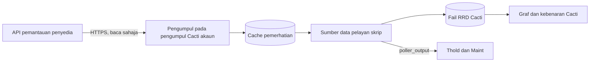

<!-- Source: README.md; SHA256: 7c621642e5f1a46bac66e4bc744f70aebb014c610d22de034088845fdc170405 -->

<!-- translations:start -->
[English](../../../README.md) | [简体中文](../zh-CN/README.md) | [हिन्दी](../hi-IN/README.md) | [Español (España)](../es-ES/README.md) | [Español (Latinoamérica)](../es-419/README.md) | [العربية (السعودية)](../ar-SA/README.md) | [Afrikaans](../af-ZA/README.md) | [አማርኛ](../am-ET/README.md) | [العربية (مصر)](../ar-EG/README.md) | [العربية (المغرب)](../ar-MA/README.md) | [বাংলা](../bn-BD/README.md) | [Bosanski](../bs-BA/README.md) | [Deutsch](../de-DE/README.md) | [فارسی](../fa-IR/README.md) | [Filipino](../fil-PH/README.md) | [Français](../fr-FR/README.md) | [Français (Maroc)](../fr-MA/README.md) | [Français (Sénégal)](../fr-SN/README.md) | [Hausa](../ha-NG/README.md) | [עברית](../he-IL/README.md) | [Hrvatski](../hr-HR/README.md) | [Bahasa Indonesia](../id-ID/README.md) | [Igbo](../ig-NG/README.md) | [Italiano](../it-IT/README.md) | [日本語](../ja-JP/README.md) | [한국어](../ko-KR/README.md) | [Malagasy](../mg-MG/README.md) | [मराठी](../mr-IN/README.md) | [Bahasa Melayu](README.md) | [Nederlands](../nl-NL/README.md) | [Polski](../pl-PL/README.md) | [Português (Brasil)](../pt-BR/README.md) | [Русский](../ru-RU/README.md) | [Kinyarwanda](../rw-RW/README.md) | [Soomaali](../so-SO/README.md) | [Српски](../sr-RS/README.md) | [Svenska](../sv-SE/README.md) | [Kiswahili](../sw-KE/README.md) | [தமிழ்](../ta-IN/README.md) | [తెలుగు](../te-IN/README.md) | [ไทย](../th-TH/README.md) | [Türkçe](../tr-TR/README.md) | [Українська](../uk-UA/README.md) | [اردو](../ur-PK/README.md) | [Tiếng Việt](../vi-VN/README.md) | [isiXhosa](../xh-ZA/README.md) | [Yorùbá](../yo-NG/README.md) | [繁體中文](../zh-TW/README.md) | [isiZulu](../zu-ZA/README.md)
<!-- translations:end -->

# plugin_cloud

Pemalam Cacti 1.2 yang membawa sumber dan metrik daripada penyedia awan awam ke dalam Cacti sebagai peranti, sumber data, dan graf biasa. Beban kerja awan kemudiannya berada bersebelahan rangkaian yang membawanya, di bawah kebenaran Cacti, dan Thold serta Maint boleh memberi amaran dan menyekatnya. Satu pemalam merangkumi setiap penyedia, dengan pemacu bagi setiap penyedia: DigitalOcean, AWS, Google Cloud, dan Azure terlebih dahulu.

> **Status: pencapaian 3 (DigitalOcean dan objek Cacti), dalam semakan.** Pencapaian ini menambah pemacu DigitalOcean, templat Cacti, peranti skop bagi setiap akaun dengan pertanyaan data bagi setiap jenis sumber, input pelayan skrip, dan anggaran permintaan pada New Graphs serta halaman kesihatan. Semakan awal terhadap akaun DigitalOcean langsung direkodkan dalam [fakta penyedia](../../research/provider-facts.md). Jangan jalankannya dalam persekitaran pengeluaran.

## Peranan akses

| Alam | Akses |
| --- | --- |
| Cloud View | Halaman pemantauan sedia ada. |
| Cloud Operator | Pemantauan serta halaman Operasi dan perakuan triaj peribadi. |
| Cloud Admin | Akses Operator serta konfigurasi dan tindakan pentadbiran sedia ada. |

Selepas menyalin fail naik taraf, buka halaman Plugins sebagai pentadbir untuk mendaftarkan
alam baharu. Berikan alam Operator secara eksplisit di bawah **Configuration > Users** atau kumpulan pengguna.
Naik taraf mengekalkan ID alam dan pemberian sedia ada bagi View dan Admin. Akses Admin
mewarisi akses Operator, dan akses Operator mewarisi akses View pada setiap permintaan;
ini tidak menambah pemberian tersimpan kepada pengguna atau kumpulan. Tetapan pemalam juga memerlukan
akses Cloud Admin selain kebenaran Settings Cacti.

Kebenaran peranti Cacti masih mengehadkan baris dan tindakan yang tersedia bagi setiap pengguna; objek yang belum dipetakan memerlukan pentadbir. Operator boleh mengesahkan kelayakan tersimpan bagi akaun yang peranti Cactinya boleh diakses oleh mereka.
Kelayakan, konfigurasi, pemetaan, pemadaman dan perubahan pentadbiran lain
kekal dalam halaman pentadbiran. Perakuan hanya bertahan dalam sesi pengguna semasa,
paling lama selama satu jam dan hanya selagi pemerhatian yang sama kekal segar.
Pemerhatian baharu atau yang berubah akan membatalkannya. Perakuan tidak pernah menandakan
pengukuran yang gagal sebagai sihat atau menyekat amaran.

## Mengapa

Setiap penyedia awan mempunyai konsol pemantauannya sendiri. Apabila dijalankan bersama Cacti, ia meninggalkan tiga jurang:

- **Kawalan akses berasingan.** Menunjukkan metrik awan kepada pengguna Cacti bermakna memberi mereka log masuk awan.
- **Tiada konteks rangkaian.** Pautan di premis digrafkan dalam Cacti; beban kerja di belakangnya digrafkan dalam konsol setiap penyedia.
- **Pemakluman berasingan.** Thold dan Maint berfungsi pada sumber data dan peranti Cacti, jadi penggera penyedia dikonfigurasikan dan disekat secara berasingan, sekali bagi setiap penyedia.

Pemalam ini membaca API pemantauan setiap penyedia pada pengumpul Cacti, menyimpan sementara titik data terkini, dan menyampaikannya kepada pelayan skrip Cacti. Pengumpul Cacti menulis fail RRD, jadi penggrafan, kebenaran, Thold, Maint, dan boost berfungsi sebagaimana untuk mana-mana data Cacti.

## Komitmen reka bentuk

- **Baca sahaja.** Setiap pemacu hanya boleh membina operasi penyedia yang ada dalam senarai benarnya; pemalam tidak pernah mengubah sumber awan. ([ADR 0002](../../decisions/0002-read-only-with-operation-allowlist.md))
- **PHP sahaja, tiada SDK.** Penandatanganan dan pertukaran token dilaksanakan dalam PHP menggunakan sambungan yang sudah diperlukan oleh Cacti. Tiada kebergantungan masa jalan Composer. ([ADR 0003](../../decisions/0003-php-only-without-sdks.md))
- **Kos sebelum pengumpulan.** Pemalam hanya membaca metrik yang mempunyai sumber data Cacti, memaparkan jangkaan bilangan permintaan dan kos harga senarai sebelum graf dicipta, serta menguatkuasakan had siling bulanan. ([ADR 0005](../../decisions/0005-collect-only-what-is-graphed.md))
- **Tiada kelayakan teks biasa dalam pangkalan data.** Kelayakan diperoleh daripada peti simpanan tersulit yang dikunci oleh fail di luar pangkalan data, daripada fail kelayakan, atau daripada identiti tika penyedia. ([ADR 0007](../../decisions/0007-credentials-outside-the-database-in-the-clear.md))

## Skop dan status

| Fasa | Skop | Pencapaian | Status |
|---|---|---|---|
| 0, penyelidikan | Pengesahan fakta penyedia, katalog metrik, model kos dan kadar, vektor ujian tandatangan, prototaip pengangkutan | [M1](https://github.com/somethingwithproof/plugin_cloud/milestone/1) | Selesai, kecuali semakan yang memerlukan akaun penyedia langsung |
| 1, teras dan DigitalOcean | Akaun, peti kelayakan, pengangkutan, pengumpul, cache pemerhatian, objek Cacti, halaman kesihatan, DigitalOcean Droplets dan pengimbang beban | [M2](https://github.com/somethingwithproof/plugin_cloud/milestone/2), [M3](https://github.com/somethingwithproof/plugin_cloud/milestone/3), [M4](https://github.com/somethingwithproof/plugin_cloud/milestone/4) | M2 selesai ([#81](https://github.com/somethingwithproof/plugin_cloud/pull/81)); pemacu, templat, dan peranti skop M3 telah digabungkan; anggaran permintaan, kebenaran, dan semakan prestasi dalam semakan; M4 belum dimulakan |
| 2, AWS | Signature Version 4, `AssumeRole`, peranan tika, CloudWatch `GetMetricData`, inventori serantau | [M5](https://github.com/somethingwithproof/plugin_cloud/milestone/5) | Belum dimulakan |
| 3, Google Cloud | JWT akaun perkhidmatan, pelayan metadata, Cloud Monitoring `timeSeries.list` | [M6](https://github.com/somethingwithproof/plugin_cloud/milestone/6) | Belum dimulakan |
| 4, Azure | Kelayakan klien Entra, identiti terurus, Resource Graph, `metrics:getBatch` | [M7](https://github.com/somethingwithproof/plugin_cloud/milestone/7) | Belum dimulakan |
| 5, pengumpul jauh | Akaun pada pengumpul data jauh Cacti | [M8](https://github.com/somethingwithproof/plugin_cloud/milestone/8) | Belum dimulakan |

Di luar skop: mengubah sumber awan, mencipta atau mencerminkan penggera penyedia, laporan pengebilan, log dan jejak, serta enjin pemakluman milik pemalam. Penyedia lain (Hetzner Cloud, Akamai Cloud, Oracle Cloud, dan lain-lain) merupakan isu penyelidikan.

## Apa yang disampaikan oleh pencapaian 2

- **Pemasangan berkawal.** Pada PHP di bawah 8.2, atau tanpa ext-openssl, pemasangan dan pengaktifan ditolak dengan mesej, dan bahagian lain Cacti terus berfungsi.
- **Kitaran hayat.** Pasang, naik taraf, dan nyahpasang melalui halaman Plugins Cacti. Naik taraf disusun secara berurutan dan tahan gangguan. Nyahpasang mengekalkan jadual pemalam melainkan anda menyahtanda *Keep Plugin Tables on Uninstall*.
- **Alam berasingan.** *Cloud Admin* membuka **Cloud Accounts**; *Cloud Operator* membuka **Cloud Operations**; *Cloud View* membuka **Cloud Health**. Admin mewarisi Operator, dan Operator mewarisi View. Ketiga-tiga halaman berada di bawah Management.
- **Akaun dan kelayakan.** Tambah, sunting, sahkan, dan padam akaun. Kelayakan sama ada disulitkan dalam pangkalan data menggunakan fail kunci yang disimpan di luarnya (AES-256-GCM), atau dibaca daripada fail pada pengumpul. Kelayakan hanya boleh ditulis dalam UI dan diredaksi daripada log.
- **Pengumpul.** Ia bermula daripada setiap larian pengumpul, satu tika bagi setiap pengumpul, dalam bajet masa. Ia mengambil pajakan bagi setiap akaun, menjalankan penemuan mengikut selangnya sendiri, dan membaca metrik hanya untuk sumber data aktif pemalam sendiri.
- **Kesihatan.** Keadaan pengumpulan, penemuan, sumber, dan kesegaran bagi setiap akaun, serta amaran untuk kunci peti simpanan yang tidak boleh digunakan, fail kelayakan yang tidak selamat, dan selang yang tidak dapat dipenuhi oleh pengumpul.

## Pasang dan konfigurasi

Langkah-langkah ini memasang kod pencapaian 2 untuk penilaian. Ia memerlukan Cacti 1.2.31 atau lebih baharu pada PHP 8.2 atau lebih baharu.

1. Salin repositori ke `plugins/cloud` di bawah direktori Cacti anda. Direktori tersebut mesti dinamakan `cloud`.
2. Cipta kunci peti simpanan di luar direktori akar web. Letakkannya dalam direktori yang hanya boleh ditulis oleh root dan pengguna Cacti, dan jadikan fail tersebut hanya boleh dibaca oleh pengguna yang menjalankan pelayan web dan pengumpul. Pemalam ini tidak pernah mencipta atau menulis fail ini:

   ```sh
   sudo install -d -m 0750 -o root -g cacti /etc/cacti
   head -c 32 /dev/urandom | sudo tee /etc/cacti/cloud-vault.key > /dev/null
   sudo chown cacti:cacti /etc/cacti/cloud-vault.key
   sudo chmod 0600 /etc/cacti/cloud-vault.key
   ```

   Gantikan `cacti` dengan pengguna yang menjalankan pelayan web dan pengumpul anda. Fail ini mengandungi 32 bait mentah atau 64 aksara perenambelasan. Sandarkannya bersama pangkalan data; tanpanya, kelayakan yang disimpan mesti dimasukkan semula.
3. Dalam Cacti, buka **Configuration > Plugins**, kemudian pasang dan aktifkan *Cloud*.
4. Di bawah **Configuration > Settings > Cloud**, tetapkan *Vault Key File* jika anda menggunakan laluan lain. *Collector Time Budget* (lalai 240 saat) mesti kekal di bawah selang pengumpul.
5. Berikan *Cloud Admin*, *Cloud Operator* atau *Cloud View* kepada pengguna dan kumpulan di bawah **Configuration > Users**. Pemasangan memberikan Cloud Admin dan Cloud View kepada pentadbir; Cloud Admin merangkumi akses Operator, jadi pentadbir tidak memerlukan pemberian Operator yang berasingan.
6. Tambah akaun di bawah **Management > Cloud Accounts**, kemudian semak **Management > Cloud Health** untuk sebarang amaran.

## Sasaran keserasian

| Komponen | Sasaran |
|---|---|
| Cacti | 1.2.31 atau lebih baharu, tiada tampalan teras |
| PHP | 8.2 atau lebih baharu; `setup.php` kekal boleh dihuraikan pada 8.0 supaya masa jalan yang tidak disokong menerima penolakan dan bukannya UI Cacti yang rosak |
| Sambungan PHP | Tiada selain yang diperlukan oleh Cacti 1.2.31 |
| Thold, Maint | Tiada perubahan diperlukan |

## Reka bentuk

- [docs/performance.md](../../performance.md) mengandungi pengukuran pengumpul dan halaman kesihatan, bersama perkakasan dan tetapan yang digunakan.
- [docs/PLAN.md](../../PLAN.md) ialah pelan penuh: seni bina, fakta penyedia dan Cacti yang menjadi sandarannya (bersama sumber), kontrak pemacu, pengiraan kos, sempadan keselamatan, pengujian, dan risiko.
- [docs/decisions/](../../decisions) menyimpan rekod keputusan seni bina bagi pilihan yang telah dibuat.
- [docs/REQUIREMENTS.md](../../REQUIREMENTS.md) memetakan setiap ID keperluan kepada isunya.



## Cara kerja dijejaki

- **Pencapaian** mengikut pencapaian pelan. Setiap satu mempunyai isu epik yang menyenaraikan sub-isu dan bukti keluarannya.
- **Isu** dikelaskan mengikut label: `type: requirement`, `type: research`, `type: decision`, `type: epic`. Isu keperluan menyatakan keperluan bernombor yang boleh diuji (`REQ-AREA-NNN`) dan kriteria penerimaan.
- **Label** juga membawa `area:`, `provider:`, `phase:`, `priority:`, dan `status:`. Lihat [CONTRIBUTING.md](../../../CONTRIBUTING.md#labels).
- [Papan projek](https://github.com/users/somethingwithproof/projects/7) memaparkan semua isu merentas pencapaian.

## Pembangunan

CI melakukan lint pada titik masuk pada PHP 8.0, menjalankan ujian unit dan integrasi serta PHPStan tahap 9, dan memasang pemalam pada PHP 8.2 hingga 8.5 terhadap Cacti 1.2.31 dan cabang 1.2.x. Ia juga menyemak bahawa PHP 8.1 ditolak tanpa merosakkan Cacti. Ujian menggunakan Pest daripada abah-abah pemalam teras Cacti. Pilihan tersebut adalah sementara sehingga [#12](https://github.com/somethingwithproof/plugin_cloud/issues/12) diputuskan. [.github/workflows/plugin-ci-workflow.yml](../../../.github/workflows/plugin-ci-workflow.yml) menyenaraikan setiap langkah. Jalankan `sh tests/lint-workflows.sh` dan `sh locales/build_gettext.sh --check` secara setempat sebelum menolak.

## Sumbangan

Baca [CONTRIBUTING.md](../../../CONTRIBUTING.md). Komit memerlukan pengesahan tandatangan DCO. Perbincangan reka bentuk berlangsung pada isu; keputusan terbuka membawa label `type: decision`.

## Keselamatan

Laporkan kerentanan secara peribadi; lihat [SECURITY.md](../../../SECURITY.md).

## Lesen

GNU General Public License v2.0, lesen yang sama seperti Cacti dan pemalamnya. Lihat [LICENSE](../../../LICENSE).
