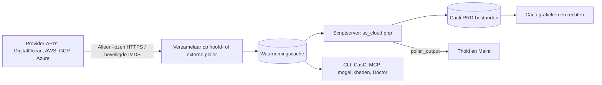

<!-- Source: README.md; SHA256: ac2074a40238686915802803c5efe773f33677f934281e0605e6e87a71a9d27d -->

<!-- translations:start -->
[English](../../../README.md) | [简体中文](../zh-CN/README.md) | [हिन्दी](../hi-IN/README.md) | [Español (España)](../es-ES/README.md) | [Español (Latinoamérica)](../es-419/README.md) | [العربية (السعودية)](../ar-SA/README.md) | [Afrikaans](../af-ZA/README.md) | [አማርኛ](../am-ET/README.md) | [العربية (مصر)](../ar-EG/README.md) | [العربية (المغرب)](../ar-MA/README.md) | [বাংলা](../bn-BD/README.md) | [Bosanski](../bs-BA/README.md) | [Deutsch](../de-DE/README.md) | [فارسی](../fa-IR/README.md) | [Filipino](../fil-PH/README.md) | [Français](../fr-FR/README.md) | [Français (Maroc)](../fr-MA/README.md) | [Français (Sénégal)](../fr-SN/README.md) | [Hausa](../ha-NG/README.md) | [עברית](../he-IL/README.md) | [Hrvatski](../hr-HR/README.md) | [Bahasa Indonesia](../id-ID/README.md) | [Igbo](../ig-NG/README.md) | [Italiano](../it-IT/README.md) | [日本語](../ja-JP/README.md) | [한국어](../ko-KR/README.md) | [Malagasy](../mg-MG/README.md) | [मराठी](../mr-IN/README.md) | [Bahasa Melayu](../ms-MY/README.md) | [Nederlands](README.md) | [Polski](../pl-PL/README.md) | [Português (Brasil)](../pt-BR/README.md) | [Русский](../ru-RU/README.md) | [Kinyarwanda](../rw-RW/README.md) | [Soomaali](../so-SO/README.md) | [Српски](../sr-RS/README.md) | [Svenska](../sv-SE/README.md) | [Kiswahili](../sw-KE/README.md) | [தமிழ்](../ta-IN/README.md) | [తెలుగు](../te-IN/README.md) | [ไทย](../th-TH/README.md) | [Türkçe](../tr-TR/README.md) | [Українська](../uk-UA/README.md) | [اردو](../ur-PK/README.md) | [Tiếng Việt](../vi-VN/README.md) | [isiXhosa](../xh-ZA/README.md) | [Yorùbá](../yo-NG/README.md) | [繁體中文](../zh-TW/README.md) | [isiZulu](../zu-ZA/README.md)
<!-- translations:end -->

# plugin_cloud

Een Cacti 1.2-plug-in die resources en metrische gegevens van publieke cloudproviders als reguliere apparaten, gegevensbronnen en grafieken naar Cacti brengt. Cloudworkloads staan daarmee direct naast het netwerk dat ze transporteert, onder de rechten van Cacti, en Thold en Maint waarschuwen erover en onderdrukken meldingen. Eén plug-in dekt DigitalOcean, Amazon Web Services, Google Cloud en Microsoft Azure via puur-PHP, alleen-lezen providerstuurprogramma's.

> **Status: in ontwikkeling, nog geen release (`0.1.0-dev`).** Deze branch implementeert puur-PHP-stuurprogramma's voor DigitalOcean, AWS, Google Cloud en Azure, replicatie van externe dataverzamelaars en alleen-lezen agentstatus, een CasC-provider en operator-CLI, MCP-mogelijkheden en Doctor-controles. Meegeleverde Cacti-sjablonen dekken momenteel DigitalOcean Droplets en load balancers (`templates/cloud_digitalocean.xml`); Cacti-sjabloonpakketten voor AWS, Google Cloud en Azure en kwalificatie op live-accounts buiten DigitalOcean ([providergegevens](../../research/provider-facts.md)) zijn nog niet voltooid. Gebruik deze versie niet in productie.

## Ondersteunde providers

Elk providerstuurprogramma is geregistreerd in `Drivers::production()`, wordt aangeboden door `Provider::released()` en draait in puur PHP met `ext-openssl` en streamsockets zonder SDK- of Composer-runtime-afhankelijkheden.

| Provider | Bereikvelden | Referentiebronnen | Authenticatie | Ontdekte resources | Metrische verzameling |
|---|---|---|---|---|---|
| DigitalOcean (`digitalocean`) | Geen (token-bereik) | `vault`, `file` | Bearer-token | `droplet`, `load_balancer` | `/v2/monitoring/metrics` met bewustzijn van het ratelimiet-aandeel; levert Cacti-sjablonen en gegevensquery's mee |
| Amazon Web Services (`aws`) | `account_id` (12 cijfers), `regions` | `vault`, `file`, `instance` | Puur-PHP AWS SigV4 (`AWS4-HMAC-SHA256`), STS `GetCallerIdentity`-verificatie, optionele STS `AssumeRole`, EC2 IMDSv2 (`169.254.169.254`) voor `instance`-accounts | `ec2_instance`, `rds_instance`, `aws_elb` (ALB/NLB) | Gebatchte CloudWatch `GetMetricData` (maximaal 500 query's per aanroep) |
| Google Cloud (`gcp`) | `project` | `vault`, `file`, `instance` | Puur-PHP RS256 service-account-JWT via `ext-openssl` ingewisseld bij `oauth2.googleapis.com/token`, of GCE-metadataserver (`metadata.google.internal`) voor `instance`-accounts | `gce_instance` via `instances.aggregatedList` | Cloud Monitoring `timeSeries.list` |
| Microsoft Azure (`azure`) | `tenant`, `subscription`, `regions` | `vault`, `file`, `instance` | Puur-PHP Entra ID OAuth2 client-credentials-stroom (alleen `client_secret`; certificaatasserties uitgesloten), of Azure IMDS (`169.254.169.254`) beheerde identiteit voor ARM- en Monitor-tokens | `azure_vm` via ARM Resource Graph (gepagineerd met `$skipToken` en ontdubbeld) | Azure Monitor `metrics:getBatch` (maximaal 50 resources per aanroep, met afhandeling van HTTP 429- en 529-beperking) |

## Geïmplementeerde mogelijkheden

### Kernplatform, kluis en verzamelaar

- **Beveiligde installatie en levenscyclus.** Startpunten (`setup.php`, `cli/cloud.php`, `poller_cloud.php`, `ss_cloud.php` en paginascripts) worden geparseerd op PHP 8.0 en weigeren PHP lager dan 8.2 of een ontbrekende `ext-openssl` zonder Cacti te breken. Upgrades verlopen geordend, idempotent (`Schema::VERSION = 3`, 9 tabellen) en doorstaan onderbrekingen. Verwijderen behoudt de plug-intabellen, tenzij *Keep Plugin Tables on Uninstall* is uitgevinkt.
- **Accounts en referenties.** Voeg accounts toe, bewerk, verifieer en verwijder ze onder **Management > Cloud Accounts**. Referenties komen uit de met AES-256-GCM versleutelde kluis (`plugin_cloud_secret`, standaard versleuteld met `/etc/cacti/cloud-vault.key`), uit een bestand dat beperkt is tot de geconfigureerde *Credential File Directory* (`cloud_credential_dir`, standaard leeg om bestanden te weigeren), of uit de instantie-identiteit van de provider. Referenties zijn alleen-schrijven in de UI en worden uit logboeken weggelaten.
- **Strikte uitgaande en alleen-lezen controles.** Elk stuurprogramma werkt achter `GuardedTransport` en `OutboundPolicy`: HTTPS-poort 443 naar exacte hostnamen per provider, waarbij link-local HTTP-poort 80-metadata-eindpunten (`169.254.169.254`, `metadata.google.internal`) alleen worden ingeschakeld voor `instance`-accounts. Alleen toegestane alleen-lezen bewerkingen zijn toegestaan.
- **Verzamelaar en kostenbeheersing.** `poller_cloud.php` draait vanuit `poller_bottom` (één proces per poller via het procesregister van Cacti) binnen `cloud_collector_budget`, verkrijgt leases per account, voert ontdekking uit volgens `discover_interval`, leest alleen metrische gegevens voor actieve Cacti-gegevensbronnen (`plugin_cloud_series`), respecteert `request_share` en `monthly_ceiling` en slaat de nieuwste datapunten op in de cache `plugin_cloud_observation` voor `ss_cloud.php`.
- **Cacti-objecten en schattingen van aanvragen.** Beheert een scope-apparaat per account (`plugin_cloud_device`), behoudt de herindexeringsmethoden van scope-apparaten bij het opslaan van apparaten, importeert DigitalOcean-sjablonen en scriptserver-gegevensquery's (`templates/cloud_digitalocean.xml`, `cloud_do_droplet.xml`, `cloud_do_load_balancer.xml`) en toont schattingen van aanvragen en catalogusprijzen op **New Graphs** (`graphs_new_top_links`) en **Cloud Health**.

### Externe dataverzamelaars

- `INFO` declareert `remote_collect:1`. Accounts kunnen worden toegewezen aan elke ingeschakelde Cacti-poller (`poller_id >= 1`) en `poller_cloud.php --poller=N` verzamelt alleen accounts die eigendom zijn van die poller.
- **`replicate_out`-hook.** Repliceert poller-gebonden rijen uit `plugin_cloud_account`, `plugin_cloud_device`, `plugin_cloud_series` en versleutelde cijfertekstrijen uit `plugin_cloud_secret` (alleen voor kluisgebaseerde accounts die eigendom zijn van de doelpoller) via `replicate_out_table()`. Onbewerkte kluissleutelbestanden worden nooit in de database opgeslagen of gerepliceerd en blijven lokaal op elke poller.
- **`remote_agent`-hook.** Biedt een alleen-lezen JSON-statussamenvatting (`action=cloud_health`) die alleen gehele getallen voor de parameters `poller_id` en `account_id` accepteert en nul referenties, bestandspaden of geheimen retourneert.

### Ecosysteemhooks (CasC, MCP-mogelijkheden en Doctor)

- **CasC-provider (`casc_register_providers`).** Registreert de provider `cloud` (schemaversie `1`) met deterministische puur-PHP YAML- en XML-export, manifestvalidatie, diff-planning en bevestigde toepassing. Kluisreferenties worden geëxporteerd als `vault:account:<name>`-verwijzingen; onbewerkte geheime velden (`secret`, `secrets`, `token`, `access_token`, `refresh_token`, `password`, `private_key`, `access_key_id`, `secret_access_key`, `session_token`, `client_secret`, `credential`, `credentials`, `vault_key`) worden geweigerd. Voor toepassing is een exacte SHA-256 `--confirm=<PLAN_HASH>` vereist.
- **MCP / Abilities API (`abilities_register`).** Registreert drie strikt alleen-lezen mogelijkheden die zijn begrensd door het Cloud View-realm (`cloud_health.php`) en het Cacti-apparaatbereik voor niet-beheerders, zonder ooit referenties, kluissleutels of paden naar referentiebestanden uit te voeren:
  - `cloud-list-accounts` (optioneel `provider`, `poller_id`)
  - `cloud-list-resources` (optioneel `account_id`, `type`, `lifecycle`)
  - `cloud-get-health` (optioneel `account_id`)
- **Doctor-controles (`doctor_register_checks`).** Registreert vijf diagnostische controles die geen geheime waarden of sleutelmateriaal blootleggen:
  - `cloud_schema`: actualiteit van schemaversie
  - `cloud_vault_key`: leesbaarheid, rechten en grootte van kluissleutelbestand
  - `cloud_drivers`: registratie van productiestuurprogramma's voor alle uitgebrachte providers
  - `cloud_accounts_health`: mislukte, beperkte of verouderde ingeschakelde accounts
  - `cloud_poller_intervals`: afstemming van verzamelintervallen van ingeschakelde accounts op het poller-interval van Cacti

## CLI

Uitvoeren vanuit de hoofdmap van Cacti met PHP 8.2 of hoger:

```sh
# Operator and CasC CLI (options use --key=value form)
php plugins/cloud/cli/cloud.php export [--format=yaml|xml]
php plugins/cloud/cli/cloud.php validate --file=<path> [--format=yaml|xml]
php plugins/cloud/cli/cloud.php plan --file=<path> [--format=yaml|xml]
php plugins/cloud/cli/cloud.php apply --file=<path> --confirm=<PLAN_HASH> [--format=yaml|xml]
php plugins/cloud/cli/cloud.php health [--format=text|json] [--poller=<id>]

# Collector entry point (normally started by poller_bottom)
php plugins/cloud/poller_cloud.php [--poller=N] [--force] [--debug]
```

## Toegangsrollen

| Realm | Toegang |
| --- | --- |
| Cloud View | Bestaande monitoringpagina's. |
| Cloud Operator | Monitoring plus de pagina Operations en persoonlijke triagebevestigingen. |
| Cloud Admin | Operator-toegang plus de bestaande configuratie en beheertaken. |

Open na het kopiëren van de upgradebestanden de pagina Plugins als beheerder om de realms te registreren. Wijs het Operator-realm expliciet toe onder **Configuration > Users** of gebruikersgroepen. Upgrades behouden de bestaande View- en Admin-realm-ID's en toekenningen. Admin-toegang erft Operator-toegang en Operator-toegang erft View-toegang bij elke aanvraag; dit voegt geen opgeslagen toekenningen toe aan gebruikers of groepen. Plug-ininstellingen vereisen ook Cloud Admin-toegang naast de Cacti-machtiging Settings.

Cacti-apparaatrechten beperken de rijen en acties die voor elke gebruiker beschikbaar zijn; niet-gekoppelde objecten vereisen een beheerder. Operators kunnen de opgeslagen referentie verifiëren voor een account waarvan ze toegang hebben tot het Cacti-apparaat. Referenties, configuratie, koppeling, verwijdering en andere beheerwijzigingen blijven op de beheerpagina's. Bevestigingen blijven alleen behouden in de huidige gebruikerssessie, voor maximaal één uur en alleen zolang dezelfde waarneming actueel blijft. Nieuwe of gewijzigde waarnemingen maken ze ongeldig. Ze markeren een mislukte meting nooit als gezond en onderdrukken geen meldingen.

## Waarom

Elke cloudprovider heeft een eigen monitoringconsole. Naast Cacti laten ze drie gaten:

- **Gescheiden toegangscontrole.** Het tonen van cloudmetrieken aan een Cacti-gebruiker betekent dat u die gebruiker een cloudlogin moet geven.
- **Geen netwerkcontext.** On-premises verbindingen worden in Cacti in grafieken weergegeven; de workloads daarachter staan in de console van elke provider.
- **Gescheiden alarmering.** Thold en Maint werken op Cacti-gegevensbronnen en -apparaten, dus provideralarmen worden afzonderlijk per provider geconfigureerd en onderdrukt.

De plug-in leest de monitoring-API van elke provider op een Cacti-poller, slaat de nieuwste datapunten op in de cache en levert ze aan de scriptserver van Cacti. De poller van Cacti schrijft de RRD-bestanden, zodat grafieken, rechten, Thold, Maint en boost werken zoals voor elke andere Cacti-gegevensbron.

## Ontwerpkeuzes

- **Alleen-lezen.** Elk stuurprogramma kan alleen de providerbewerkingen op zijn acceptatielijst opbouwen; de plug-in wijzigt nooit een cloudresource. ([ADR 0002](../../decisions/0002-read-only-with-operation-allowlist.md))
- **Alleen PHP, geen SDK's.** Ondertekening en tokenuitwisseling worden geïmplementeerd in PHP met de extensies die Cacti al vereist. Geen Composer-runtime-afhankelijkheden. ([ADR 0003](../../decisions/0003-php-only-without-sdks.md))
- **Kosten vóór verzameling.** De plug-in leest alleen metrische gegevens die een Cacti-gegevensbron hebben, toont het verwachte aantal aanvragen en de catalogusprijs voordat grafieken worden gemaakt, en handhaaft een maandelijkse limiet. ([ADR 0005](../../decisions/0005-collect-only-what-is-graphed.md))
- **Geen referenties in platte tekst in de database.** Referenties komen uit een versleutelde kluis met een sleutelbestand buiten de database, uit een referentiebestand of uit de instantie-identiteit van de provider. ([ADR 0007](../../decisions/0007-credentials-outside-the-database-in-the-clear.md))

## Scope en status

| Fase | Scope | Mijlpalen | Status |
|---|---|---|---|
| 0, onderzoek | Bevestiging van providerfeiten, metriekcatalogi, kosten- en tariefmodel, testvectoren voor ondertekening, transportprototype | [M1](https://github.com/somethingwithproof/plugin_cloud/milestone/1) | Voltooid, behalve controles die live provideraccounts vereisen |
| 1, kern en DigitalOcean | Accounts, referentiekluis, transport, verzamelaar, waarnemingscache, Cacti-objecten, sjablonen, schattingen van aanvragen, statuspagina, DigitalOcean Droplets en load balancers | [M2](https://github.com/somethingwithproof/plugin_cloud/milestone/2), [M3](https://github.com/somethingwithproof/plugin_cloud/milestone/3), [M4](https://github.com/somethingwithproof/plugin_cloud/milestone/4) | Geïmplementeerd; M4-pilotkwalificatie in behandeling |
| 2, AWS | Puur-PHP SigV4, STS `AssumeRole`, IMDSv2-instantierollen, EC2/RDS/ELB-inventaris, CloudWatch `GetMetricData` | [M5](https://github.com/somethingwithproof/plugin_cloud/milestone/5) | Stuurprogramma geïmplementeerd; Cacti-sjablonen en kwalificatie op live-account in behandeling |
| 3, Google Cloud | Puur-PHP RS256 service-account-JWT, GCE-metadataserver, Compute Engine-inventaris, Cloud Monitoring `timeSeries.list` | [M6](https://github.com/somethingwithproof/plugin_cloud/milestone/6) | Stuurprogramma geïmplementeerd; Cacti-sjablonen en kwalificatie op live-account in behandeling |
| 4, Azure | Entra ID-clientreferenties, IMDS beheerde identiteit, ARM Resource Graph VM-inventaris, Azure Monitor `metrics:getBatch` | [M7](https://github.com/somethingwithproof/plugin_cloud/milestone/7) | Stuurprogramma geïmplementeerd; Cacti-sjablonen en kwalificatie op live-account in behandeling |
| 5, externe verzamelaars en ecosysteem | Externe dataverzamelaars (`replicate_out`, `remote_agent`), CasC-provider en CLI, MCP-mogelijkheden, Doctor-controles | [M8](https://github.com/somethingwithproof/plugin_cloud/milestone/8) | Geïmplementeerd |

Buiten scope: cloudresources wijzigen, provideralarmen aanmaken of spiegelen, factureringsrapporten, logs en traces, en een plug-in-eigen alarmeringsengine. Verdere providers (Hetzner Cloud, Akamai Cloud, Oracle Cloud en andere) zijn onderzoeksissues.

## Installeren en configureren

Deze stappen installeren de ontwikkelingscode voor evaluatie. Ze vereisen Cacti 1.2.31 of hoger op PHP 8.2 of hoger.

1. Kopieer de repository naar `plugins/cloud` onder uw Cacti-map. De map moet `cloud` heten.
2. Maak de kluissleutel buiten de webroot aan op elke poller die kluisgebaseerde referenties gebruikt. Plaats deze in een map waar alleen root en de Cacti-gebruiker in mogen schrijven, en maak het bestand alleen leesbaar voor de gebruiker die de webserver en de poller uitvoert. De plug-in maakt of schrijft dit bestand nooit:

   ```sh
   sudo install -d -m 0750 -o root -g cacti /etc/cacti
   head -c 32 /dev/urandom | sudo tee /etc/cacti/cloud-vault.key > /dev/null
   sudo chown cacti:cacti /etc/cacti/cloud-vault.key
   sudo chmod 0600 /etc/cacti/cloud-vault.key
   ```

   Vervang `cacti` door de gebruiker die uw webserver en poller uitvoert. Het bestand bevat 32 onbewerkte bytes of 64 hexadecimale tekens. Maak er een back-up van samen met de database; zonder dit bestand moeten opgeslagen referenties opnieuw worden ingevoerd.
3. Open in Cacti **Configuration > Plugins** en installeer en schakel vervolgens *Cloud* in.
4. Stel onder **Configuration > Settings > Cloud** *Vault Key File* in als u een ander pad hebt gebruikt, configureer *Credential File Directory* als u bestandsgebaseerde referenties wilt gebruiken, en houd *Collector Time Budget* (standaard 240 seconden) onder het poller-interval.
5. Ken *Cloud Admin*, *Cloud Operator* of *Cloud View* toe aan gebruikers en groepen onder **Configuration > Users**. Installatie kent Cloud Admin en Cloud View toe aan de beheerder; Cloud Admin omvat Operator-toegang, dus de beheerder heeft geen aparte Operator-toekenning nodig.
6. Voeg accounts toe onder **Management > Cloud Accounts** en controleer vervolgens **Management > Cloud Health** op waarschuwingen.

## Compatibiliteitsdoelen

| Component | Doel |
|---|---|
| Cacti | 1.2.31 of hoger, geen core-patches |
| PHP | 8.2 of hoger; startpunten blijven parseerbaar op 8.0 zodat een niet-ondersteunde runtime een weigering krijgt in plaats van een defecte Cacti UI |
| PHP-extensies | `ext-openssl` (vereist door Cacti 1.2.31); geen `ext-curl` en geen Composer-runtime-afhankelijkheden |
| Thold, Maint | Geen wijzigingen vereist |

## Ontwerp

- [docs/performance.md](../../performance.md) bevat de metingen van de verzamelaar en de statuspagina, met de gebruikte hardware en instellingen.
- [docs/PLAN.md](../../PLAN.md) is het volledige plan: architectuur, de provider- en Cacti-feiten waarop het steunt (met bronnen), het stuurprogrammacontract, kostenberekening, beveiligingsgrenzen, testen en risico's.
- [docs/decisions/](../../decisions/) bevat architectuurbeslissingen (ADR's) voor reeds gemaakte keuzes.
- [docs/REQUIREMENTS.md](../../REQUIREMENTS.md) koppelt elk vereiste-ID aan het bijbehorende issue.



## Hoe werk wordt bijgehouden

- **Mijlpalen** volgen de mijlpalen van het plan. Elke mijlpaal heeft een epic-issue met de sub-issues en het opleverbewijs.
- **Issues** worden getypeerd met labels: `type: requirement`, `type: research`, `type: decision`, `type: epic`. Vereiste-issues vermelden genummerde, testbare vereisten (`REQ-AREA-NNN`) en acceptatiecriteria.
- **Labels** bevatten ook `area:`, `provider:`, `phase:`, `priority:` en `status:`. Zie [CONTRIBUTING.md](../../../CONTRIBUTING.md#labels).
- Het [projectbord](https://github.com/users/somethingwithproof/projects/7) toont alle issues over alle mijlpalen heen.

## Ontwikkeling

CI ([.github/workflows/plugin-ci-workflow.yml](../../../.github/workflows/plugin-ci-workflow.yml)) controleert het release-archief en de semantische versie (`bash tests/bin/archive-check.sh`), lint startpunten op PHP 8.0, voert Pest unit- (`phpunit.xml`) en levenscyclusintegratietests (`phpunit-integration.xml`) en PHPStan niveau 9 uit op PHP 8.2 tot en met 8.5 tegen Cacti `release/1.2.31` en `1.2.x` met `CLOUD_OFFLINE=1`, controleert de weigering op PHP 8.1, verifieert gettext-catalogi, meet de prestaties van 1.000-reeksenverzameling en de statuspagina, en voert workflow-linting en REUSE-naleving uit.

Lokale controles vóór het pushen:

```sh
bash tests/bin/archive-check.sh
sh tests/lint-workflows.sh
sh locales/build_gettext.sh --check
CACTI_PATH=/path/to/cacti phpstan analyse -c phpstan.neon --no-progress
```

Voer Pest uit met `--configuration=phpunit.xml` voor unit- en bronregeltests, of met `--configuration=phpunit-integration.xml` met `CACTI_PATH` en `CLOUD_TEST_DATABASE=disposable` tegen een wegwerp-Cacti-database voor levenscyclusintegratietests.

## Bijdragen

Lees [CONTRIBUTING.md](../../../CONTRIBUTING.md). Commits hebben een DCO sign-off nodig. Ontwerpdiscussies vinden plaats in issues; open beslissingen dragen het label `type: decision`.

## Beveiliging

Meld kwetsbaarheden privé; zie [SECURITY.md](../../../SECURITY.md).

## Licentie

GNU General Public License v2.0, dezelfde licentie als Cacti en zijn plug-ins. Zie [LICENSE](../../../LICENSE).
