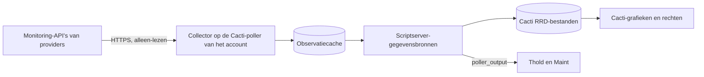

<!-- Source: README.md; SHA256: 7c621642e5f1a46bac66e4bc744f70aebb014c610d22de034088845fdc170405 -->

<!-- translations:start -->
[English](../../../README.md) | [简体中文](../zh-CN/README.md) | [हिन्दी](../hi-IN/README.md) | [Español (España)](../es-ES/README.md) | [Español (Latinoamérica)](../es-419/README.md) | [العربية (السعودية)](../ar-SA/README.md) | [Afrikaans](../af-ZA/README.md) | [አማርኛ](../am-ET/README.md) | [العربية (مصر)](../ar-EG/README.md) | [العربية (المغرب)](../ar-MA/README.md) | [বাংলা](../bn-BD/README.md) | [Deutsch](../de-DE/README.md) | [فارسی](../fa-IR/README.md) | [Filipino](../fil-PH/README.md) | [Français](../fr-FR/README.md) | [Français (Maroc)](../fr-MA/README.md) | [Français (Sénégal)](../fr-SN/README.md) | [Hausa](../ha-NG/README.md) | [עברית](../he-IL/README.md) | [Bahasa Indonesia](../id-ID/README.md) | [Igbo](../ig-NG/README.md) | [Italiano](../it-IT/README.md) | [日本語](../ja-JP/README.md) | [한국어](../ko-KR/README.md) | [Malagasy](../mg-MG/README.md) | [मराठी](../mr-IN/README.md) | [Bahasa Melayu](../ms-MY/README.md) | [Nederlands](README.md) | [Polski](../pl-PL/README.md) | [Português (Brasil)](../pt-BR/README.md) | [Русский](../ru-RU/README.md) | [Kinyarwanda](../rw-RW/README.md) | [Soomaali](../so-SO/README.md) | [Svenska](../sv-SE/README.md) | [Kiswahili](../sw-KE/README.md) | [தமிழ்](../ta-IN/README.md) | [తెలుగు](../te-IN/README.md) | [ไทย](../th-TH/README.md) | [Türkçe](../tr-TR/README.md) | [Українська](../uk-UA/README.md) | [اردو](../ur-PK/README.md) | [Tiếng Việt](../vi-VN/README.md) | [isiXhosa](../xh-ZA/README.md) | [Yorùbá](../yo-NG/README.md) | [繁體中文](../zh-TW/README.md) | [isiZulu](../zu-ZA/README.md)
<!-- translations:end -->

# plugin_cloud

Een Cacti 1.2-plug-in die resources en metrische gegevens van publieke cloudproviders als reguliere apparaten, gegevensbronnen en grafieken naar Cacti brengt. Cloudworkloads staan daarmee direct naast het netwerk dat ze transporteert, onder het rechtenmodel van Cacti, en Thold en Maint kunnen er meldingen op instellen en onderdrukken. Eén plug-in dekt elke provider, met een stuurprogramma per provider: als eerste DigitalOcean, AWS, Google Cloud en Azure.

> **Status: mijlpaal 3 (DigitalOcean en Cacti-objecten), in beoordeling.** Deze mijlpaal voegt het DigitalOcean-stuurprogramma, Cacti-sjablonen, een scope-apparaat per account met een gegevensquery per resourcetype, de scriptserver-invoer en een schatting van het aantal verzoeken op New Graphs en de statuspagina toe. De eerste controles op een live DigitalOcean-account zijn vastgelegd in [providergegevens](../../research/provider-facts.md). Gebruik deze versie niet in productie.

## Toegangsrollen

| Realm | Toegang |
| --- | --- |
| Cloud View | Bestaande monitoringpagina's. |
| Cloud Operator | Monitoring plus de pagina Operations en persoonlijke triagebevestigingen. |
| Cloud Admin | Operator-toegang plus de bestaande configuratie- en beheeracties. |

Open na het kopiëren van de upgradebestanden de pagina Plugins als beheerder om de nieuwe
realm te registreren. Wijs de Operator-realm expliciet toe onder **Configuration > Users** of bij gebruikersgroepen.
Upgrades behouden de bestaande realm-ID's en machtigingen voor View en Admin. Admin-toegang
erft bij elk verzoek Operator-toegang en Operator-toegang erft View-toegang; dit voegt geen
opgeslagen machtigingen toe aan gebruikers of groepen. Voor plug-ininstellingen is naast het
Settings-recht van Cacti ook Cloud Admin-toegang vereist.

Apparaatrechten in Cacti blijven bepalen welke rijen en acties beschikbaar zijn voor elke gebruiker; niet-gekoppelde objecten vereisen een beheerder. Operators kunnen de opgeslagen inloggegevens verifiëren voor een account waarvan zij toegang hebben tot het Cacti-apparaat.
Inloggegevens, configuratie, koppeling, verwijdering en andere beheerwijzigingen
blijven voorbehouden aan de beheerpagina's. Bevestigingen gelden alleen binnen de
huidige gebruikerssessie, voor maximaal één uur en zolang dezelfde observatie actueel
blijft. Nieuwe of gewijzigde observaties maken ze ongeldig. Ze markeren een mislukte
meting nooit als gezond en onderdrukken geen meldingen.

## Waarom

Elke cloudprovider heeft een eigen monitoringconsole. Naast Cacti gebruikt laten ze drie hiaten over:

- **Gescheiden toegangsbeheer.** Om een Cacti-gebruiker cloudmetrieken te tonen, moet u diegene een cloudaccount geven.
- **Geen netwerkcontext.** Lokale verbindingen worden in grafieken weergegeven in Cacti; de workloads erachter staan in de console van elke provider.
- **Gescheiden alarmering.** Thold en Maint werken op gegevensbronnen en apparaten in Cacti, waardoor provideralarmen apart per provider moeten worden ingesteld en onderdrukt.

De plug-in leest de monitoring-API van elke provider uit via een Cacti-poller, slaat de nieuwste datapunten op in de cache en levert ze aan de scriptserver van Cacti. De Cacti-poller schrijft de RRD-bestanden weg, zodat grafieken, rechten, Thold, Maint en boost net zo werken als voor alle andere Cacti-gegevens.

## Ontwerpprincipes

- **Alleen-lezen.** Elk stuurprogramma kan uitsluitend de providerbewerkingen op zijn acceptatielijst opbouwen; de plug-in wijzigt nooit een cloudresource. ([ADR 0002](../../decisions/0002-read-only-with-operation-allowlist.md))
- **Alleen PHP, geen SDK's.** Ondertekening en tokenuitwisseling zijn geïmplementeerd in PHP met de extensies die Cacti al vereist. Geen runtime-afhankelijkheden van Composer. ([ADR 0003](../../decisions/0003-php-only-without-sdks.md))
- **Kosten vóór verzameling.** De plug-in leest alleen metrieken waarvoor een Cacti-gegevensbron bestaat, toont het verwachte aantal verzoeken en de catalogusprijs voordat grafieken worden aangemaakt, en handhaaft een maandelijks plafond. ([ADR 0005](../../decisions/0005-collect-only-what-is-graphed.md))
- **Geen onversleutelde inloggegevens in de database.** Inloggegevens komen uit een versleutelde kluis met een sleutelbestand buiten de database, uit een bestand met inloggegevens of uit de instantie-identiteit van de provider. ([ADR 0007](../../decisions/0007-credentials-outside-the-database-in-the-clear.md))

## Reikwijdte en status

| Fase | Reikwijdte | Mijlpalen | Status |
|---|---|---|---|
| 0, onderzoek | Bevestiging van providergegevens, metriekcatalogi, kosten- en tariefmodel, testvectoren voor ondertekening, transport-spike | [M1](https://github.com/somethingwithproof/plugin_cloud/milestone/1) | Gereed, met uitzondering van controles waarvoor een live provideraccount nodig is |
| 1, kern en DigitalOcean | Accounts, kluis voor inloggegevens, transport, collector, observatiecache, Cacti-objecten, statuspagina, DigitalOcean Droplets en loadbalancers | [M2](https://github.com/somethingwithproof/plugin_cloud/milestone/2), [M3](https://github.com/somethingwithproof/plugin_cloud/milestone/3), [M4](https://github.com/somethingwithproof/plugin_cloud/milestone/4) | M2 gereed ([#81](https://github.com/somethingwithproof/plugin_cloud/pull/81)); M3-stuurprogramma, sjablonen en scope-apparaten samengevoegd; schattingen van verzoeken, rechten en prestatiecontroles in beoordeling; M4 nog niet gestart |
| 2, AWS | Signature Version 4, `AssumeRole`, instantierollen, CloudWatch `GetMetricData`, regionale inventaris | [M5](https://github.com/somethingwithproof/plugin_cloud/milestone/5) | Nog niet gestart |
| 3, Google Cloud | Serviceaccount-JWT, metadataserver, Cloud Monitoring `timeSeries.list` | [M6](https://github.com/somethingwithproof/plugin_cloud/milestone/6) | Nog niet gestart |
| 4, Azure | Entra-clientinloggegevens, beheerde identiteit, Resource Graph, `metrics:getBatch` | [M7](https://github.com/somethingwithproof/plugin_cloud/milestone/7) | Nog niet gestart |
| 5, externe collectors | Accounts op externe gegevenscollectors van Cacti | [M8](https://github.com/somethingwithproof/plugin_cloud/milestone/8) | Nog niet gestart |

Buiten reikwijdte: het wijzigen van cloudresources, het aanmaken of spiegelen van provideralarmen, factureringsrapporten, logboeken en traces, en een eigen alarmeringsengine in de plug-in. Aanvullende providers (Hetzner Cloud, Akamai Cloud, Oracle Cloud en andere) staan open als onderzoeksissues.

## Wat mijlpaal 2 levert

- **Beveiligde installatie.** Op PHP lager dan 8.2, of zonder ext-openssl, worden installatie en inschakeling geweigerd met een melding, terwijl de rest van Cacti blijft werken.
- **Levenscyclus.** Installeren, upgraden en verwijderen via de pagina Plugins in Cacti. Upgrades verlopen in volgorde en zijn bestand tegen onderbrekingen. Bij verwijderen blijven de tabellen van de plug-in behouden, tenzij u *Keep Plugin Tables on Uninstall* uitschakelt.
- **Gescheiden realms.** *Cloud Admin* opent **Cloud Accounts**; *Cloud Operator* opent **Cloud Operations**; *Cloud View* opent **Cloud Health**. Admin erft Operator, en Operator erft View. Alle drie de pagina's staan onder Management.
- **Accounts en inloggegevens.** Accounts toevoegen, bewerken, verifiëren en verwijderen. Inloggegevens worden óf versleuteld opgeslagen in de database met een sleutelbestand daarbuiten (AES-256-GCM), óf gelezen uit een bestand op de poller. Inloggegevens zijn alleen-schrijven in de gebruikersinterface en worden uit logboeken weggelaten.
- **De collector.** Deze start bij elke poller-run, één instantie per poller, binnen een tijdsbudget. Hij neemt een lease per account, voert detectie uit op zijn eigen interval en leest alleen metrieken uit voor de actieve gegevensbronnen van de plug-in zelf.
- **Status (Health).** Status per account voor verzameling, detectie, resources en actualiteit, plus waarschuwingen voor een onbruikbare kluissleutel, onveilige bestanden met inloggegevens en intervallen die de poller niet kan halen.

## Installeren en configureren

Deze stappen installeren de code van mijlpaal 2 ter evaluatie. Ze vereisen Cacti 1.2.31 of nieuwer op PHP 8.2 of nieuwer.

1. Kopieer de repository naar `plugins/cloud` onder uw Cacti-map. De map moet `cloud` heten.
2. Maak de kluissleutel aan buiten de webroot. Plaats deze in een map waarin alleen root en de Cacti-gebruiker kunnen schrijven, en maak het bestand alleen leesbaar voor de gebruiker die de webserver en de poller uitvoert. De plug-in maakt of schrijft dit bestand nooit:

   ```sh
   sudo install -d -m 0750 -o root -g cacti /etc/cacti
   head -c 32 /dev/urandom | sudo tee /etc/cacti/cloud-vault.key > /dev/null
   sudo chown cacti:cacti /etc/cacti/cloud-vault.key
   sudo chmod 0600 /etc/cacti/cloud-vault.key
   ```

   Vervang `cacti` door de gebruiker die uw webserver en poller uitvoert. Het bestand bevat 32 ruwe bytes of 64 hexadecimale tekens. Maak er samen met de database een back-up van; zonder dit bestand moeten opgeslagen inloggegevens opnieuw worden ingevoerd.
3. Open in Cacti **Configuration > Plugins**, en installeer en schakel *Cloud* in.
4. Stel onder **Configuration > Settings > Cloud** de optie *Vault Key File* in als u een ander pad hebt gebruikt. *Collector Time Budget* (standaard 240 seconden) moet onder het poller-interval blijven.
5. Ken *Cloud Admin*, *Cloud Operator* of *Cloud View* toe aan gebruikers en groepen onder **Configuration > Users**. Bij de installatie worden Cloud Admin en Cloud View aan de beheerder toegekend; Cloud Admin omvat Operator-toegang, dus de beheerder heeft geen afzonderlijke Operator-machtiging nodig.
6. Voeg accounts toe onder **Management > Cloud Accounts** en controleer vervolgens **Management > Cloud Health** op waarschuwingen.

## Compatibiliteitsdoelen

| Component | Doel |
|---|---|
| Cacti | 1.2.31 of nieuwer, geen aanpassingen aan de kern |
| PHP | 8.2 of nieuwer; `setup.php` blijft parseerbaar op 8.0 zodat een niet-ondersteunde runtime een weigering krijgt in plaats van een defecte Cacti-UI |
| PHP-extensies | Geen andere dan wat Cacti 1.2.31 vereist |
| Thold, Maint | Geen wijzigingen vereist |

## Ontwerp

- [docs/performance.md](../../performance.md) bevat de metingen van de collector en de statuspagina, inclusief de gebruikte hardware en instellingen.
- [docs/PLAN.md](../../PLAN.md) is het volledige plan: architectuur, de provider- en Cacti-gegevens waarop het steunt (met bronnen), het stuurprogrammacontract, kostenberekeningen, beveiligingsgrenzen, testen en risico's.
- [docs/decisions/](../../decisions) bevat architectuurbeslissingen (ADR's) voor reeds gemaakte keuzes.
- [docs/REQUIREMENTS.md](../../REQUIREMENTS.md) koppelt elke vereiste-ID aan het bijbehorende issue.



## Hoe het werk wordt bijgehouden

- **Mijlpalen** volgen de mijlpalen van het plan. Elke mijlpaal heeft een epic-issue met daarin de sub-issues en het opleverbewijs.
- **Issues** worden getypeerd via labels: `type: requirement`, `type: research`, `type: decision`, `type: epic`. Vereisten-issues bevatten genummerde, testbare vereisten (`REQ-AREA-NNN`) en acceptatiecriteria.
- **Labels** geven daarnaast `area:`, `provider:`, `phase:`, `priority:` en `status:` aan. Zie [CONTRIBUTING.md](../../../CONTRIBUTING.md#labels).
- Het [projectbord](https://github.com/users/somethingwithproof/projects/7) toont alle issues over de verschillende mijlpalen heen.

## Ontwikkeling

CI voert linting uit op de startpunten onder PHP 8.0, draait unit- en integratietests en PHPStan-niveau 9, en installeert de plug-in op PHP 8.2 tot en met 8.5 tegen Cacti 1.2.31 en de 1.2.x-branch. Ook wordt gecontroleerd of PHP 8.1 wordt geweigerd zonder Cacti te breken. De tests gebruiken Pest uit het plug-intestraamwerk van Cacti core. Die keuze is voorlopig totdat over [#12](https://github.com/somethingwithproof/plugin_cloud/issues/12) is beslist. [.github/workflows/plugin-ci-workflow.yml](../../../.github/workflows/plugin-ci-workflow.yml) vermeldt elke stap. Voer lokaal `sh tests/lint-workflows.sh` en `sh locales/build_gettext.sh --check` uit voordat u pusht.

## Bijdragen

Lees [CONTRIBUTING.md](../../../CONTRIBUTING.md). Commits vereisen een DCO-ondertekening (sign-off). Ontwerpdiscussies vinden plaats in issues; openstaande beslissingen hebben het label `type: decision`.

## Beveiliging

Meld kwetsbaarheden privé; zie [SECURITY.md](../../../SECURITY.md).

## Licentie

GNU General Public License v2.0, dezelfde licentie als Cacti en zijn plug-ins. Zie [LICENSE](../../../LICENSE).
