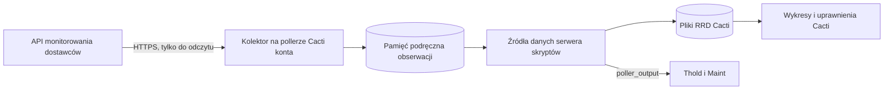

<!-- Source: README.md; SHA256: 7c621642e5f1a46bac66e4bc744f70aebb014c610d22de034088845fdc170405 -->

<!-- translations:start -->
[English](../../../README.md) | [简体中文](../zh-CN/README.md) | [हिन्दी](../hi-IN/README.md) | [Español (España)](../es-ES/README.md) | [Español (Latinoamérica)](../es-419/README.md) | [العربية (السعودية)](../ar-SA/README.md) | [Afrikaans](../af-ZA/README.md) | [አማርኛ](../am-ET/README.md) | [العربية (مصر)](../ar-EG/README.md) | [العربية (المغرب)](../ar-MA/README.md) | [বাংলা](../bn-BD/README.md) | [Bosanski](../bs-BA/README.md) | [Deutsch](../de-DE/README.md) | [فارسی](../fa-IR/README.md) | [Filipino](../fil-PH/README.md) | [Français](../fr-FR/README.md) | [Français (Maroc)](../fr-MA/README.md) | [Français (Sénégal)](../fr-SN/README.md) | [Hausa](../ha-NG/README.md) | [עברית](../he-IL/README.md) | [Hrvatski](../hr-HR/README.md) | [Bahasa Indonesia](../id-ID/README.md) | [Igbo](../ig-NG/README.md) | [Italiano](../it-IT/README.md) | [日本語](../ja-JP/README.md) | [한국어](../ko-KR/README.md) | [Malagasy](../mg-MG/README.md) | [मराठी](../mr-IN/README.md) | [Bahasa Melayu](../ms-MY/README.md) | [Nederlands](../nl-NL/README.md) | [Polski](README.md) | [Português (Brasil)](../pt-BR/README.md) | [Русский](../ru-RU/README.md) | [Kinyarwanda](../rw-RW/README.md) | [Soomaali](../so-SO/README.md) | [Српски](../sr-RS/README.md) | [Svenska](../sv-SE/README.md) | [Kiswahili](../sw-KE/README.md) | [தமிழ்](../ta-IN/README.md) | [తెలుగు](../te-IN/README.md) | [ไทย](../th-TH/README.md) | [Türkçe](../tr-TR/README.md) | [Українська](../uk-UA/README.md) | [اردو](../ur-PK/README.md) | [Tiếng Việt](../vi-VN/README.md) | [isiXhosa](../xh-ZA/README.md) | [Yorùbá](../yo-NG/README.md) | [繁體中文](../zh-TW/README.md) | [isiZulu](../zu-ZA/README.md)
<!-- translations:end -->

# plugin_cloud

Wtyczka dla systemu Cacti 1.2, która przenosi zasoby i metryki od dostawców chmury publicznej do Cacti jako zwykłe urządzenia, źródła danych i wykresy. Obciążenia chmurowe znajdują się wówczas obok sieci, która je obsługuje, podlegają uprawnieniom Cacti, a moduły Thold i Maint mogą generować dla nich alerty oraz je wyciszać. Jedna wtyczka obsługuje wszystkich dostawców dzięki oddzielnym sterownikom dla każdego z nich: w pierwszej kolejności dla DigitalOcean, AWS, Google Cloud i Azure.

> **Status: kamień milowy 3 (DigitalOcean i obiekty Cacti), w trakcie przeglądu.** Ten kamień milowy dodaje sterownik DigitalOcean, szablony Cacti, urządzenie zakresu (scope device) dla każdego konta wraz z zapytaniem o dane (data query) dla każdego typu zasobu, wejście serwera skryptów oraz szacowanie liczby żądań na stronie New Graphs i stronie kondycji. Wstępne testy na rzeczywistym koncie DigitalOcean zostały opisane w dokumencie [informacje o dostawcach](../../research/provider-facts.md). Nie należy uruchamiać tej wersji w środowisku produkcyjnym.

## Role dostępu

| Obszar uprawnień | Dostęp |
| --- | --- |
| Cloud View | Istniejące strony monitorowania. |
| Cloud Operator | Monitorowanie oraz strona Operations i osobiste potwierdzenia w ramach wstępnej analizy (triage). |
| Cloud Admin | Dostęp operatora oraz istniejąca konfiguracja i działania administracyjne. |

Po skopiowaniu plików aktualizacji należy otworzyć stronę Plugins jako administrator, aby zarejestrować nowy obszar uprawnień. Przypisz uprawnienie Operator jawnie w sekcji **Configuration > Users** lub dla grup użytkowników. Aktualizacje zachowują istniejące identyfikatory i uprawnienia obszarów View oraz Admin. Dostęp Admin dziedziczy dostęp Operator, a dostęp Operator dziedziczy dostęp View przy każdym żądaniu; nie powoduje to dodania trwałych uprawnień do użytkowników ani grup. Ustawienia wtyczki wymagają również dostępu Cloud Admin oprócz uprawnienia Settings w Cacti.

Uprawnienia do urządzeń w Cacti nadal ograniczają wiersze i działania dostępne dla każdego użytkownika; niezmapowane obiekty wymagają administratora. Operatorzy mogą weryfikować zapisane poświadczenia dla konta, do którego urządzenia Cacti mają dostęp. Poświadczenia, konfiguracja, mapowanie, usuwanie i inne zmiany administracyjne pozostają na stronach administracyjnych. Potwierdzenia obowiązują wyłącznie w bieżącej sesji użytkownika, maksymalnie przez jedną godzinę i tylko tak długo, jak ta sama obserwacja pozostaje aktualna. Nowe lub zmienione obserwacje unieważniają je. Nigdy nie oznaczają one nieudanego pomiaru jako prawidłowego ani nie wyciszają alertów.

## Dlaczego

Każdy dostawca chmury ma własną konsolę monitorowania. Używane równolegle z Cacti pozostawiają trzy luki:

- **Oddzielna kontrola dostępu.** Udostępnienie użytkownikowi Cacti metryk chmurowych wymaga nadania mu loginu do chmury.
- **Brak kontekstu sieciowego.** Łącza lokalne są rysowane na wykresach w Cacti; obsługiwane przez nie obciążenia są prezentowane na wykresach w konsoli każdego dostawcy.
- **Oddzielne alertowanie.** Moduły Thold i Maint działają na źródłach danych i urządzeniach Cacti, dlatego alarmy u dostawców muszą być konfigurowane i wyciszane osobno, dla każdego dostawcy z osobna.

Wtyczka odczytuje API monitorowania każdego dostawcy w ramach pollera Cacti, buforuje najnowsze punkty danych i udostępnia je serwerowi skryptów Cacti. Poller Cacti zapisuje pliki RRD, dzięki czemu tworzenie wykresów, uprawnienia, Thold, Maint oraz boost działają tak samo jak dla każdych innych danych w Cacti.

## Założenia projektowe

- **Tylko do odczytu.** Każdy sterownik może tworzyć wyłącznie operacje dostawcy znajdujące się na jego liście dozwolonych operacji; wtyczka nigdy nie modyfikuje zasobów chmurowych. ([ADR 0002](../../decisions/0002-read-only-with-operation-allowlist.md))
- **Wyłącznie PHP, bez zestawów SDK.** Podpisywanie żądań i wymiana tokenów są zaimplementowane w PHP przy użyciu rozszerzeń już wymaganych przez Cacti. Brak zależności uruchomieniowych Composer. ([ADR 0003](../../decisions/0003-php-only-without-sdks.md))
- **Koszt przed pobieraniem danych.** Wtyczka odczytuje wyłącznie metryki powiązane ze źródłem danych Cacti, wyświetla przewidywaną liczbę żądań i koszt według cennika przed utworzeniem wykresów oraz egzekwuje miesięczny limit. ([ADR 0005](../../decisions/0005-collect-only-what-is-graphed.md))
- **Brak poświadczeń w postaci jawnego tekstu w bazie danych.** Poświadczenia pochodzą z zaszyfrowanego magazynu chronionego kluczem w pliku poza bazą danych, z pliku poświadczeń lub z tożsamości instancji u dostawcy. ([ADR 0007](../../decisions/0007-credentials-outside-the-database-in-the-clear.md))

## Zakres i status

| Faza | Zakres | Kamienie milowe | Status |
|---|---|---|---|
| 0, badania | Weryfikacja informacji o dostawcach, katalogi metryk, model kosztów i limitów żądań, wektory testowe podpisywania, prototyp transportu | [M1](https://github.com/somethingwithproof/plugin_cloud/milestone/1) | Zakończono, z wyjątkiem testów wymagających rzeczywistego konta dostawcy |
| 1, rdzeń i DigitalOcean | Konta, magazyn poświadczeń, transport, kolektor, pamięć podręczna obserwacji, obiekty Cacti, strona kondycji, DigitalOcean Droplets i load balancery | [M2](https://github.com/somethingwithproof/plugin_cloud/milestone/2), [M3](https://github.com/somethingwithproof/plugin_cloud/milestone/3), [M4](https://github.com/somethingwithproof/plugin_cloud/milestone/4) | M2 ukończony ([#81](https://github.com/somethingwithproof/plugin_cloud/pull/81)); sterownik, szablony i urządzenia zakresu M3 scalone; szacowanie żądań, uprawnienia i testy wydajności w trakcie przeglądu; M4 nierozpoczęty |
| 2, AWS | Signature Version 4, `AssumeRole`, role instancji, CloudWatch `GetMetricData`, inwentaryzacja regionalna | [M5](https://github.com/somethingwithproof/plugin_cloud/milestone/5) | Nierozpoczęty |
| 3, Google Cloud | JWT konta usługi, serwer metadanych, Cloud Monitoring `timeSeries.list` | [M6](https://github.com/somethingwithproof/plugin_cloud/milestone/6) | Nierozpoczęty |
| 4, Azure | Poświadczenia klienta Entra, tożsamość zarządzana, Resource Graph, `metrics:getBatch` | [M7](https://github.com/somethingwithproof/plugin_cloud/milestone/7) | Nierozpoczęty |
| 5, zdalne kolektory | Konta na zdalnych kolektorach danych Cacti | [M8](https://github.com/somethingwithproof/plugin_cloud/milestone/8) | Nierozpoczęty |

Poza zakresem: modyfikowanie zasobów chmurowych, tworzenie lub odzwierciedlanie alarmów dostawców, raporty rozliczeniowe, logi i ślady (traces) oraz własny silnik alertowania wtyczki. Kolejni dostawcy (Hetzner Cloud, Akamai Cloud, Oracle Cloud i inni) są obecnie zagadnieniami badawczymi.

## Co zawiera kamień milowy 2

- **Bezpieczna instalacja z weryfikacją wymagań.** W przypadku PHP poniżej wersji 8.2 lub braku rozszerzenia ext-openssl instalacja i włączenie są odrzucane z komunikatem, a pozostałe funkcje Cacti działają bez zakłóceń.
- **Cykl życia.** Instalacja, aktualizacja i odinstalowanie przez stronę Plugins w Cacti. Aktualizacje są uporządkowane sekwencyjnie i odporne na przerwanie. Odinstalowanie zachowuje tabele wtyczki, chyba że odznaczysz opcję *Keep Plugin Tables on Uninstall*.
- **Oddzielne obszary uprawnień.** *Cloud Admin* otwiera **Cloud Accounts**; *Cloud Operator* otwiera **Cloud Operations**; *Cloud View* otwiera **Cloud Health**. Admin dziedziczy Operator, a Operator dziedziczy View. Wszystkie trzy strony znajdują się w sekcji Management.
- **Konta i poświadczenia.** Dodawanie, edycja, weryfikacja i usuwanie kont. Poświadczenie jest albo szyfrowane w bazie danych przy użyciu pliku klucza przechowywanego poza nią (AES-256-GCM), albo odczytywane z pliku na pollerze. Poświadczenia w interfejsie użytkownika są wyłącznie do zapisu i są redagowane w logach.
- **Kolektor.** Uruchamia się przy każdym wywołaniu pollera, po jednej instancji na poller, w ramach określonego budżetu czasowego. Pobiera dzierżawę (lease) dla każdego konta, uruchamia wykrywanie zasobów we własnym interwale i odczytuje metryki wyłącznie dla aktywnych źródeł danych należących do wtyczki.
- **Kondycja.** Stan zbierania danych, wykrywania, zasobów i aktualności dla każdego konta oraz ostrzeżenia o bezużytecznym kluczu magazynu, niebezpiecznych plikach poświadczeń i interwałach, których poller nie może dotrzymać.

## Instalacja i konfiguracja

Poniższe kroki instalują kod kamienia milowego 2 do celów ewaluacyjnych. Wymagają one Cacti 1.2.31 lub nowszego z PHP 8.2 lub nowszym.

1. Skopiuj repozytorium do katalogu `plugins/cloud` w katalogu głównym Cacti. Katalog musi mieć nazwę `cloud`.
2. Utwórz klucz magazynu poza katalogiem głównym serwera WWW. Umieść go w katalogu, do którego prawo zapisu mają wyłącznie użytkownik root i użytkownik Cacti, a sam plik uczyń czytelnym wyłącznie dla użytkownika uruchamiającego serwer WWW i poller. Wtyczka nigdy nie tworzy ani nie zapisuje tego pliku:

   ```sh
   sudo install -d -m 0750 -o root -g cacti /etc/cacti
   head -c 32 /dev/urandom | sudo tee /etc/cacti/cloud-vault.key > /dev/null
   sudo chown cacti:cacti /etc/cacti/cloud-vault.key
   sudo chmod 0600 /etc/cacti/cloud-vault.key
   ```

   Zamień `cacti` na nazwę użytkownika uruchamiającego serwer WWW i poller. Plik zawiera 32 surowe bajty lub 64 znaki szesnastkowe. Wykonuj jego kopię zapasową razem z bazą danych; bez niego zapisane poświadczenia trzeba będzie wprowadzić ponownie.
3. W Cacti otwórz **Configuration > Plugins**, a następnie zainstaluj i włącz wtyczkę *Cloud*.
4. W sekcji **Configuration > Settings > Cloud** ustaw *Vault Key File*, jeśli użyto innej ścieżki. Parametr *Collector Time Budget* (domyślnie 240 sekund) musi pozostać poniżej wartości interwału pollera.
5. Nadaj uprawnienia *Cloud Admin*, *Cloud Operator* lub *Cloud View* użytkownikom i grupom w sekcji **Configuration > Users**. Instalacja nadaje administratorowi uprawnienia Cloud Admin oraz Cloud View; Cloud Admin obejmuje dostęp Operator, więc administrator nie potrzebuje osobnego uprawnienia Operator.
6. Dodaj konta w sekcji **Management > Cloud Accounts**, a następnie sprawdź sekcję **Management > Cloud Health** pod kątem ewentualnych ostrzeżeń.

## Docelowa kompatybilność

| Komponent | Wymagania docelowe |
|---|---|
| Cacti | 1.2.31 lub nowszy, bez łatek rdzenia |
| PHP | 8.2 lub nowszy; plik `setup.php` pozostaje poprawny składniowo w PHP 8.0, dzięki czemu nieobsługiwane środowisko otrzyma komunikat odmowy zamiast uszkodzenia interfejsu Cacti |
| Rozszerzenia PHP | Brak dodatkowych poza wymaganymi przez Cacti 1.2.31 |
| Thold, Maint | Nie wymagają żadnych zmian |

## Projekt architektury

- [docs/performance.md](../../performance.md) zawiera pomiary wydajności kolektora i strony kondycji wraz z opisem użytego sprzętu i ustawień.
- [docs/PLAN.md](../../PLAN.md) to pełny plan: architektura, informacje o dostawcach i Cacti, na których się opiera (wraz ze źródłami), kontrakt sterowników, kalkulacja kosztów, granice bezpieczeństwa, testowanie oraz ryzyka.
- [docs/decisions/](../../decisions) zawiera rejestry decyzji architektonicznych dla już podjętych wyborów.
- [docs/REQUIREMENTS.md](../../REQUIREMENTS.md) mapuje każdy identyfikator wymagania na odpowiadające mu zgłoszenie.



## Śledzenie postępów prac

- **Kamienie milowe** odpowiadają kamieniom milowym z planu. Każdy z nich ma główne zgłoszenie zbiorcze (epic) zawierające listę podzadań oraz dowody zakończenia.
- **Zgłoszenia** są kategoryzowane etykietami: `type: requirement`, `type: research`, `type: decision`, `type: epic`. Zgłoszenia wymagań określają numerowane, testowalne wymagania (`REQ-AREA-NNN`) oraz kryteria akceptacji.
- **Etykiety** zawierają również prefiksy `area:`, `provider:`, `phase:`, `priority:` oraz `status:`. Zobacz [CONTRIBUTING.md](../../../CONTRIBUTING.md#labels).
- [Tablica projektu](https://github.com/users/somethingwithproof/projects/7) prezentuje wszystkie zgłoszenia w podziale na kamienie milowe.

## Prace rozwojowe

CI sprawdza poprawność składniową punktów wejścia w PHP 8.0, uruchamia testy jednostkowe i integracyjne oraz PHPStan na poziomie 9, a także instaluje wtyczkę w wersjach PHP od 8.2 do 8.5 z Cacti 1.2.31 oraz gałęzią 1.2.x. Weryfikuje również, czy PHP 8.1 jest odrzucany bez powodowania awarii Cacti. Testy wykorzystują framework Pest z zestawu narzędzi wtyczek rdzenia Cacti. Ten wybór jest tymczasowy do czasu rozstrzygnięcia zgłoszenia [#12](https://github.com/somethingwithproof/plugin_cloud/issues/12). Plik [.github/workflows/plugin-ci-workflow.yml](../../../.github/workflows/plugin-ci-workflow.yml) zawiera listę wszystkich kroków. Przed wypchnięciem zmian uruchom lokalnie polecenia `sh tests/lint-workflows.sh` oraz `sh locales/build_gettext.sh --check`.

## Współpraca

Zapoznaj się z plikiem [CONTRIBUTING.md](../../../CONTRIBUTING.md). Commity wymagają podpisu DCO (sign-off). Dyskusje projektowe toczą się w zgłoszeniach; otwarte decyzje oznaczone są etykietą `type: decision`.

## Bezpieczeństwo

Podatności należy zgłaszać prywatnie; zobacz [SECURITY.md](../../../SECURITY.md).

## Licencja

GNU General Public License v2.0, ta sama licencja co w przypadku Cacti i jego wtyczek. Zobacz [LICENSE](../../../LICENSE).
