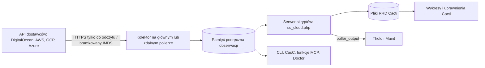

<!-- Source: README.md; SHA256: ac2074a40238686915802803c5efe773f33677f934281e0605e6e87a71a9d27d -->

<!-- translations:start -->
[English](../../../README.md) | [简体中文](../zh-CN/README.md) | [हिन्दी](../hi-IN/README.md) | [Español (España)](../es-ES/README.md) | [Español (Latinoamérica)](../es-419/README.md) | [العربية (السعودية)](../ar-SA/README.md) | [Afrikaans](../af-ZA/README.md) | [አማርኛ](../am-ET/README.md) | [العربية (مصر)](../ar-EG/README.md) | [العربية (المغرب)](../ar-MA/README.md) | [বাংলা](../bn-BD/README.md) | [Bosanski](../bs-BA/README.md) | [Deutsch](../de-DE/README.md) | [فارسی](../fa-IR/README.md) | [Filipino](../fil-PH/README.md) | [Français](../fr-FR/README.md) | [Français (Maroc)](../fr-MA/README.md) | [Français (Sénégal)](../fr-SN/README.md) | [Hausa](../ha-NG/README.md) | [עברית](../he-IL/README.md) | [Hrvatski](../hr-HR/README.md) | [Bahasa Indonesia](../id-ID/README.md) | [Igbo](../ig-NG/README.md) | [Italiano](../it-IT/README.md) | [日本語](../ja-JP/README.md) | [한국어](../ko-KR/README.md) | [Malagasy](../mg-MG/README.md) | [मराठी](../mr-IN/README.md) | [Bahasa Melayu](../ms-MY/README.md) | [Nederlands](../nl-NL/README.md) | [Polski](README.md) | [Português (Brasil)](../pt-BR/README.md) | [Русский](../ru-RU/README.md) | [Kinyarwanda](../rw-RW/README.md) | [Soomaali](../so-SO/README.md) | [Српски](../sr-RS/README.md) | [Svenska](../sv-SE/README.md) | [Kiswahili](../sw-KE/README.md) | [தமிழ்](../ta-IN/README.md) | [తెలుగు](../te-IN/README.md) | [ไทย](../th-TH/README.md) | [Türkçe](../tr-TR/README.md) | [Українська](../uk-UA/README.md) | [اردو](../ur-PK/README.md) | [Tiếng Việt](../vi-VN/README.md) | [isiXhosa](../xh-ZA/README.md) | [Yorùbá](../yo-NG/README.md) | [繁體中文](../zh-TW/README.md) | [isiZulu](../zu-ZA/README.md)
<!-- translations:end -->

# plugin_cloud

Wtyczka dla systemu Cacti 1.2, która przenosi zasoby i metryki od dostawców chmury publicznej do Cacti jako zwykłe urządzenia, źródła danych i wykresy. Obciążenia chmurowe znajdują się obok sieci, która je obsługuje, podlegają uprawnieniom Cacti, a moduły Thold i Maint generują dla nich alerty oraz je wyciszają. Jedna wtyczka obsługuje DigitalOcean, Amazon Web Services, Google Cloud i Microsoft Azure za pomocą napisanych w czystym PHP sterowników działających wyłącznie w trybie odczytu.

> **Status: w trakcie prac, brak wydania (`0.1.0-dev`).** Ta gałąź implementuje sterowniki w czystym PHP dla DigitalOcean, AWS, Google Cloud i Azure, replikację zdalnych kolektorów danych i kondycję agenta tylko do odczytu, dostawcę CasC i CLI operatora, funkcje MCP oraz testy Doctor. Dołączone szablony Cacti obejmują obecnie DigitalOcean Droplet i load balancery (`templates/cloud_digitalocean.xml`); pakiety szablonów Cacti dla AWS, Google Cloud i Azure oraz weryfikacja na rzeczywistych kontach poza DigitalOcean ([informacje o dostawcach](../../research/provider-facts.md)) nie są jeszcze ukończone. Nie uruchamiaj w środowisku produkcyjnym.

## Obsługiwani dostawcy

Każdy sterownik dostawcy jest zarejestrowany w `Drivers::production()`, udostępniany przez `Provider::released()` i działa w czystym PHP z użyciem `ext-openssl` oraz gniazd strumieniowych bez żadnych pakietów SDK ani zależności uruchomieniowych Composer.

| Dostawca | Pola zakresu | Źródła poświadczeń | Uwierzytelnianie | Wykrywane zasoby | Zbieranie metryk |
|---|---|---|---|---|---|
| DigitalOcean (`digitalocean`) | Brak (zakres tokenu) | `vault`, `file` | Token Bearer | `droplet`, `load_balancer` | `/v2/monitoring/metrics` z uwzględnieniem udziału limitu żądań; zawiera szablony Cacti i zapytania o dane |
| Amazon Web Services (`aws`) | `account_id` (12 cyfr), `regions` | `vault`, `file`, `instance` | Czyste PHP AWS SigV4 (`AWS4-HMAC-SHA256`), weryfikacja STS `GetCallerIdentity`, opcjonalnie STS `AssumeRole`, EC2 IMDSv2 (`169.254.169.254`) dla kont `instance` | `ec2_instance`, `rds_instance`, `aws_elb` (ALB/NLB) | Wsadowe CloudWatch `GetMetricData` (do 500 zapytań na wywołanie) |
| Google Cloud (`gcp`) | `project` | `vault`, `file`, `instance` | Czyste PHP RS256 JWT konta usługi przez `ext-openssl` wymieniane w `oauth2.googleapis.com/token` lub serwer metadanych GCE (`metadata.google.internal`) dla kont `instance` | `gce_instance` przez `instances.aggregatedList` | Cloud Monitoring `timeSeries.list` |
| Microsoft Azure (`azure`) | `tenant`, `subscription`, `regions` | `vault`, `file`, `instance` | Czyste PHP Entra ID OAuth2 przepływ poświadczeń klienta (tylko `client_secret`; poświadczenia certyfikatowe wykluczone) lub tożsamość zarządzana Azure IMDS (`169.254.169.254`) dla tokenów ARM i Monitor | `azure_vm` przez ARM Resource Graph (stronicowane przez `$skipToken` i deduplikowane) | Azure Monitor `metrics:getBatch` (do 50 zasobów na wywołanie, z obsługą dławienia HTTP 429 i 529) |

## Zaimplementowane funkcje

### Platforma główna, skarbiec i kolektor

- **Chroniona instalacja i cykl życia.** Punkty wejścia (`setup.php`, `cli/cloud.php`, `poller_cloud.php`, `ss_cloud.php` oraz skrypty stron) parsują się na PHP 8.0 i odrzucają PHP poniżej 8.2 lub brak `ext-openssl` bez psucia Cacti. Aktualizacje są uporządkowane, idempotentne (`Schema::VERSION = 3`, 9 tabel) i odporne na przerwania. Odinstalowanie zachowuje tabele wtyczki, chyba że opcja *Keep Plugin Tables on Uninstall* zostanie odznaczona.
- **Konta i poświadczenia.** Dodawaj, edytuj, weryfikuj i usuwaj konta w **Management > Cloud Accounts**. Poświadczenia pochodzą z zaszyfrowanego skarbca AES-256-GCM (`plugin_cloud_secret`, domyślnie z kluczem w `/etc/cacti/cloud-vault.key`), z pliku ograniczonego do skonfigurowanego katalogu *Credential File Directory* (`cloud_credential_dir`, domyślnie pustego w celu odrzucania plików) lub z tożsamości instancji dostawcy. Poświadczenia w interfejsie są tylko do zapisu i są redagowane z logów.
- **Ścisła kontrola ruchu wychodzącego i trybu tylko do odczytu.** Każdy sterownik działa za `GuardedTransport` i `OutboundPolicy`: HTTPS port 443 do dokładnych nazw hostów poszczególnych dostawców, z punktami końcowymi metadanych link-local HTTP port 80 (`169.254.169.254`, `metadata.google.internal`) włączonymi wyłącznie dla kont `instance`. Dozwolone są jedynie operacje tylko do odczytu z listy dozwolonych.
- **Kolektor i kontrola kosztów.** `poller_cloud.php` uruchamia się z `poller_bottom` (jeden proces na poller przez rejestr procesów Cacti) w ramach `cloud_collector_budget`, uzyskuje dzierżawy na konto, uruchamia wykrywanie zgodnie z `discover_interval`, odczytuje metryki wyłącznie dla aktywnych źródeł danych Cacti (`plugin_cloud_series`), przestrzega `request_share` oraz `monthly_ceiling` i buforuje najnowsze punkty danych w `plugin_cloud_observation` dla `ss_cloud.php`.
- **Obiekty Cacti i szacowanie żądań.** Utrzymuje urządzenie zakresu na konto (`plugin_cloud_device`), zachowuje metody ponownego indeksowania urządzenia zakresu podczas zapisywania urządzeń, importuje szablony DigitalOcean i zapytania o dane serwera skryptów (`templates/cloud_digitalocean.xml`, `cloud_do_droplet.xml`, `cloud_do_load_balancer.xml`) oraz wyświetla szacunki żądań i cen katalogowych na stronach **New Graphs** (`graphs_new_top_links`) i **Cloud Health**.

### Zdalne kolektory danych

- `INFO` deklaruje `remote_collect:1`. Konta można przypisać do dowolnego włączonego pollera Cacti (`poller_id >= 1`), a `poller_cloud.php --poller=N` zbiera dane wyłącznie dla kont należących do tego pollera.
- **Hook `replicate_out`.** Replikuje wiersze w zakresie pollera z tabel `plugin_cloud_account`, `plugin_cloud_device`, `plugin_cloud_series` oraz zaszyfrowane wiersze szyfrogramu z `plugin_cloud_secret` (tylko dla kont opartych na skarbcu należących do docelowego pollera) przez `replicate_out_table()`. Surowe pliki klucza skarbca nigdy nie są zapisywane w bazie danych ani replikowane i pozostają lokalne na każdym pollerze.
- **Hook `remote_agent`.** Udostępnia podsumowanie kondycji JSON tylko do odczytu (`action=cloud_health`), akceptujące wyłącznie parametry całkowitoliczbowe `poller_id` i `account_id` oraz niezwracające żadnych poświadczeń, ścieżek plików ani sekretów.

### Hooki ekosystemu (CasC, funkcje MCP i Doctor)

- **Dostawca CasC (`casc_register_providers`).** Rejestruje dostawcę `cloud` (wersja schematu `1`) z deterministycznym eksportem YAML i XML w czystym PHP, walidacją manifestu, planowaniem różnic oraz potwierdzonym zastosowaniem. Poświadczenia skarbca są eksportowane jako odniesienia `vault:account:<name>`; surowe pola sekretów (`secret`, `secrets`, `token`, `access_token`, `refresh_token`, `password`, `private_key`, `access_key_id`, `secret_access_key`, `session_token`, `client_secret`, `credential`, `credentials`, `vault_key`) są odrzucane. Zastosowanie wymaga dokładnego skrótu SHA-256 `--confirm=<PLAN_HASH>`.
- **MCP / Abilities API (`abilities_register`).** Rejestruje trzy funkcje ściśle tylko do odczytu, ograniczone przez obszar Cloud View (`cloud_health.php`) oraz zakres urządzeń Cacti dla wywołujących bez uprawnień administratora, nieujawniające żadnych poświadczeń, kluczy skarbca ani ścieżek plików poświadczeń:
  - `cloud-list-accounts` (opcjonalnie `provider`, `poller_id`)
  - `cloud-list-resources` (opcjonalnie `account_id`, `type`, `lifecycle`)
  - `cloud-get-health` (opcjonalnie `account_id`)
- **Testy Doctor (`doctor_register_checks`).** Rejestruje pięć testów diagnostycznych, które nie ujawniają żadnych wartości sekretów ani materiału klucza:
  - `cloud_schema`: aktualność wersji schematu
  - `cloud_vault_key`: czytelność, uprawnienia i rozmiar pliku klucza skarbca
  - `cloud_drivers`: rejestracja sterowników produkcyjnych dla wszystkich wydanych dostawców
  - `cloud_accounts_health`: włączone konta z błędami, dławieniem lub nieaktualnymi danymi
  - `cloud_poller_intervals`: zgodność interwałów zbierania włączonych kont z interwałem pollera Cacti

## CLI

Uruchamiaj z katalogu głównego Cacti w PHP 8.2 lub nowszym:

```sh
# Operator and CasC CLI (options use --key=value form)
php plugins/cloud/cli/cloud.php export [--format=yaml|xml]
php plugins/cloud/cli/cloud.php validate --file=<path> [--format=yaml|xml]
php plugins/cloud/cli/cloud.php plan --file=<path> [--format=yaml|xml]
php plugins/cloud/cli/cloud.php apply --file=<path> --confirm=<PLAN_HASH> [--format=yaml|xml]
php plugins/cloud/cli/cloud.php health [--format=text|json] [--poller=<id>]

# Collector entry point (normally started by poller_bottom)
php plugins/cloud/poller_cloud.php [--poller=N] [--force] [--debug]
```

## Role dostępu

| Obszar uprawnień | Dostęp |
| --- | --- |
| Cloud View | Istniejące strony monitorowania. |
| Cloud Operator | Monitorowanie oraz strona Operations i osobiste potwierdzenia klasyfikacji (triage). |
| Cloud Admin | Dostęp Operator oraz istniejąca konfiguracja i działania administracyjne. |

Po skopiowaniu plików aktualizacji otwórz stronę Plugins jako administrator, aby zarejestrować obszary uprawnień. Przypisz obszar Operator jawnie w **Configuration > Users** lub w grupach użytkowników. Aktualizacje zachowują istniejące identyfikatory i nadania obszarów View i Admin. Dostęp Admin dziedziczy dostęp Operator, a dostęp Operator dziedziczy dostęp View przy każdym żądaniu; nie dodaje to zapisanych nadań użytkownikom ani grupom. Ustawienia wtyczki wymagają również dostępu Cloud Admin oprócz uprawnienia Settings w Cacti.

Uprawnienia do urządzeń Cacti ograniczają wiersze i działania dostępne dla każdego użytkownika; niezmapowane obiekty wymagają administratora. Operatorzy mogą weryfikować zapisane poświadczenie dla konta, do którego urządzenia Cacti mają dostęp. Poświadczenia, konfiguracja, mapowanie, usuwanie i inne zmiany administracyjne pozostają na stronach administracyjnych. Potwierdzenia trwają tylko w bieżącej sesji użytkownika, maksymalnie przez jedną godzinę i tylko tak długo, jak ta sama obserwacja pozostaje aktualna. Nowe lub zmienione obserwacje unieważniają je. Nigdy nie oznaczają nieudanego pomiaru jako prawidłowego ani nie wyciszają alertów.

## Dlaczego

Każdy dostawca chmury ma własną konsolę monitorowania. Używane obok Cacti pozostawiają trzy luki:

- **Oddzielna kontrola dostępu.** Pokazanie użytkownikowi Cacti metryk chmurowych oznacza konieczność nadania mu konta logowania w chmurze.
- **Brak kontekstu sieciowego.** Łącza lokalne są rysowane na wykresach w Cacti; obciążenia za nimi są rysowane w konsoli każdego dostawcy.
- **Oddzielne alertowanie.** Moduły Thold i Maint działają na źródłach danych i urządzeniach Cacti, więc alarmy dostawców są konfigurowane i wyciszane oddzielnie, raz dla każdego dostawcy.

Wtyczka odczytuje API monitorowania każdego dostawcy na pollerze Cacti, buforuje najnowsze punkty danych i udostępnia je serwerowi skryptów Cacti. Poller Cacti zapisuje pliki RRD, więc tworzenie wykresów, uprawnienia, Thold, Maint i boost działają tak samo jak dla każdych innych danych Cacti.

## Założenia projektowe

- **Tylko do odczytu.** Każdy sterownik może budować jedynie operacje dostawcy ze swojej listy dozwolonych; wtyczka nigdy nie modyfikuje zasobu chmurowego. ([ADR 0002](../../decisions/0002-read-only-with-operation-allowlist.md))
- **Tylko PHP, bez SDK.** Podpisywanie i wymiana tokenów są zaimplementowane w PHP przy użyciu rozszerzeń już wymaganych przez Cacti. Brak zależności uruchomieniowych Composer. ([ADR 0003](../../decisions/0003-php-only-without-sdks.md))
- **Koszt przed zbieraniem.** Wtyczka odczytuje wyłącznie metryki mające źródło danych Cacti, pokazuje oczekiwaną liczbę żądań i koszt według ceny katalogowej przed utworzeniem wykresów oraz egzekwuje miesięczny limit. ([ADR 0005](../../decisions/0005-collect-only-what-is-graphed.md))
- **Brak jawnych poświadczeń w bazie danych.** Poświadczenia pochodzą z zaszyfrowanego skarbca z kluczem w pliku poza bazą danych, z pliku poświadczeń lub z tożsamości instancji dostawcy. ([ADR 0007](../../decisions/0007-credentials-outside-the-database-in-the-clear.md))

## Zakres i status

| Faza | Zakres | Kamienie milowe | Status |
|---|---|---|---|
| 0, badania | Potwierdzenie faktów o dostawcach, katalogi metryk, model kosztów i stawek, wektory testowe podpisywania, prototyp transportu | [M1](https://github.com/somethingwithproof/plugin_cloud/milestone/1) | Ukończono, poza testami wymagającymi rzeczywistych kont dostawców |
| 1, rdzeń i DigitalOcean | Konta, skarbiec poświadczeń, transport, kolektor, pamięć podręczna obserwacji, obiekty Cacti, szablony, szacowanie żądań, strona kondycji, DigitalOcean Droplet i load balancery | [M2](https://github.com/somethingwithproof/plugin_cloud/milestone/2), [M3](https://github.com/somethingwithproof/plugin_cloud/milestone/3), [M4](https://github.com/somethingwithproof/plugin_cloud/milestone/4) | Zaimplementowano; kwalifikacja pilotażowa M4 w toku |
| 2, AWS | Czyste PHP SigV4, STS `AssumeRole`, role instancji IMDSv2, inwentarz EC2/RDS/ELB, CloudWatch `GetMetricData` | [M5](https://github.com/somethingwithproof/plugin_cloud/milestone/5) | Sterownik zaimplementowany; szablony Cacti i kwalifikacja na rzeczywistym koncie w toku |
| 3, Google Cloud | Czyste PHP RS256 JWT konta usługi, serwer metadanych GCE, inwentarz Compute Engine, Cloud Monitoring `timeSeries.list` | [M6](https://github.com/somethingwithproof/plugin_cloud/milestone/6) | Sterownik zaimplementowany; szablony Cacti i kwalifikacja na rzeczywistym koncie w toku |
| 4, Azure | Poświadczenia klienta Entra ID, tożsamość zarządzana IMDS, inwentarz VM ARM Resource Graph, Azure Monitor `metrics:getBatch` | [M7](https://github.com/somethingwithproof/plugin_cloud/milestone/7) | Sterownik zaimplementowany; szablony Cacti i kwalifikacja na rzeczywistym koncie w toku |
| 5, zdalne kolektory i ekosystem | Zdalne kolektory danych (`replicate_out`, `remote_agent`), dostawca CasC i CLI, funkcje MCP, testy Doctor | [M8](https://github.com/somethingwithproof/plugin_cloud/milestone/8) | Zaimplementowano |

Poza zakresem: modyfikowanie zasobów chmurowych, tworzenie lub odzwierciedlanie alarmów dostawców, raporty rozliczeniowe, logi i ślady oraz własny silnik alertowania wtyczki. Kolejni dostawcy (Hetzner Cloud, Akamai Cloud, Oracle Cloud i inni) to zagadnienia badawcze.

## Instalacja i konfiguracja

Poniższe kroki instalują kod rozwojowy do oceny. Wymagają one Cacti 1.2.31 lub nowszego na PHP 8.2 lub nowszym.

1. Skopiuj repozytorium do `plugins/cloud` w katalogu Cacti. Katalog musi nazywać się `cloud`.
2. Utwórz klucz skarbca poza katalogiem głównym sieci WWW na każdym pollerze korzystającym z poświadczeń w skarbcu. Umieść go w katalogu, do którego zapisywać mogą wyłącznie root i użytkownik Cacti, oraz nadaj uprawnienia odczytu wyłącznie użytkownikowi uruchamiającemu serwer WWW i poller. Wtyczka nigdy nie tworzy ani nie zapisuje tego pliku:

   ```sh
   sudo install -d -m 0750 -o root -g cacti /etc/cacti
   head -c 32 /dev/urandom | sudo tee /etc/cacti/cloud-vault.key > /dev/null
   sudo chown cacti:cacti /etc/cacti/cloud-vault.key
   sudo chmod 0600 /etc/cacti/cloud-vault.key
   ```

   Zastąp `cacti` użytkownikiem uruchamiającym serwer WWW i poller. Plik przechowuje 32 surowe bajty lub 64 znaki szesnastkowe. Wykonuj jego kopię zapasową razem z bazą danych; bez niego zapisane poświadczenia trzeba będzie wprowadzić ponownie.
3. W Cacti otwórz **Configuration > Plugins**, następnie zainstaluj i włącz *Cloud*.
4. W **Configuration > Settings > Cloud** ustaw *Vault Key File*, jeśli użyto innej ścieżki, skonfiguruj *Credential File Directory*, jeśli planujesz używać poświadczeń w plikach, oraz utrzymuj *Collector Time Budget* (domyślnie 240 sekund) poniżej interwału pollera.
5. Nadaj uprawnienia *Cloud Admin*, *Cloud Operator* lub *Cloud View* użytkownikom i grupom w **Configuration > Users**. Instalacja nadaje Cloud Admin i Cloud View administratorowi; Cloud Admin zawiera dostęp Operator, więc administrator nie potrzebuje osobnego nadania Operator.
6. Dodaj konta w **Management > Cloud Accounts**, a następnie sprawdź ostrzeżenia w **Management > Cloud Health**.

## Cele zgodności

| Komponent | Cel |
|---|---|
| Cacti | 1.2.31 lub nowszy, bez łatek rdzenia |
| PHP | 8.2 lub nowszy; punkty wejścia pozostają parsowalne w 8.0, aby nieobsługiwane środowisko otrzymało odmowę zamiast zepsutego interfejsu Cacti |
| Rozszerzenia PHP | `ext-openssl` (wymagane przez Cacti 1.2.31); brak `ext-curl` i brak zależności uruchomieniowych Composer |
| Thold, Maint | Nie wymagają zmian |

## Projekt

- [docs/performance.md](../../performance.md) zawiera pomiary kolektora i strony kondycji wraz z użytym sprzętem i ustawieniami.
- [docs/PLAN.md](../../PLAN.md) to pełny plan: architektura, fakty dotyczące dostawców i Cacti, na których się opiera (ze źródłami), kontrakt sterowników, arytmetyka kosztów, granice bezpieczeństwa, testowanie i ryzyka.
- [docs/decisions/](../../decisions/) zawiera rejestry decyzji architektonicznych dla podjętych już wyborów.
- [docs/REQUIREMENTS.md](../../REQUIREMENTS.md) mapuje każdy identyfikator wymagania na jego zgłoszenie.



## Sposób śledzenia prac

- **Kamienie milowe** odzwierciedlają kamienie milowe planu. Każdy ma zgłoszenie typu epic z listą podzgłoszeń i dowodów ukończenia.
- **Zgłoszenia** są oznaczane etykietami typu: `type: requirement`, `type: research`, `type: decision`, `type: epic`. Zgłoszenia wymagań określają numerowane, testowalne wymagania (`REQ-AREA-NNN`) oraz kryteria akceptacji.
- **Etykiety** zawierają także `area:`, `provider:`, `phase:`, `priority:` i `status:`. Zobacz [CONTRIBUTING.md](../../../CONTRIBUTING.md#labels).
- [Tablica projektu](https://github.com/users/somethingwithproof/projects/7) pokazuje wszystkie zgłoszenia w poszczególnych kamieniach milowych.

## Rozwój

CI ([.github/workflows/plugin-ci-workflow.yml](../../../.github/workflows/plugin-ci-workflow.yml)) sprawdza archiwum wydania i wersjonowanie semantyczne (`bash tests/bin/archive-check.sh`), uruchamia lint punktów wejścia w PHP 8.0, wykonuje testy jednostkowe Pest (`phpunit.xml`) i integracyjne cyklu życia (`phpunit-integration.xml`) oraz PHPStan na poziomie 9 w wersjach PHP od 8.2 do 8.5 przeciwko Cacti `release/1.2.31` i `1.2.x` z `CLOUD_OFFLINE=1`, sprawdza odmowę na PHP 8.1, weryfikuje katalogi gettext, mierzy wydajność zbierania 1000 serii i strony kondycji oraz uruchamia linting przepływów pracy i sprawdzanie zgodności REUSE.

Lokalne testy przed wypchnięciem zmian:

```sh
bash tests/bin/archive-check.sh
sh tests/lint-workflows.sh
sh locales/build_gettext.sh --check
CACTI_PATH=/path/to/cacti phpstan analyse -c phpstan.neon --no-progress
```

Uruchom Pest z `--configuration=phpunit.xml` dla testów jednostkowych i reguł kodu źródłowego, lub `--configuration=phpunit-integration.xml` z `CACTI_PATH` i `CLOUD_TEST_DATABASE=disposable` na jednorazowej bazie danych Cacti dla testów integracyjnych cyklu życia.

## Wkład w projekt

Przeczytaj [CONTRIBUTING.md](../../../CONTRIBUTING.md). Commity wymagają podpisu DCO sign-off. Dyskusje projektowe toczą się w zgłoszeniach; otwarte decyzje noszą etykietę `type: decision`.

## Bezpieczeństwo

Zgłaszaj podatności prywatnie; zobacz [SECURITY.md](../../../SECURITY.md).

## Licencja

GNU General Public License v2.0, ta sama licencja co Cacti i jego wtyczki. Zobacz [LICENSE](../../../LICENSE).
