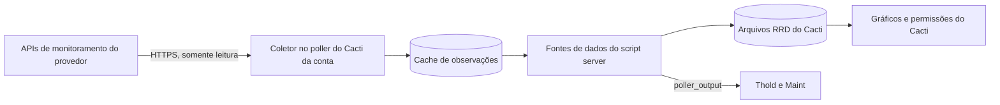

<!-- Source: README.md; SHA256: 7c621642e5f1a46bac66e4bc744f70aebb014c610d22de034088845fdc170405 -->

<!-- translations:start -->
[English](../../../README.md) | [简体中文](../zh-CN/README.md) | [हिन्दी](../hi-IN/README.md) | [Español (España)](../es-ES/README.md) | [Español (Latinoamérica)](../es-419/README.md) | [العربية (السعودية)](../ar-SA/README.md) | [Afrikaans](../af-ZA/README.md) | [አማርኛ](../am-ET/README.md) | [العربية (مصر)](../ar-EG/README.md) | [العربية (المغرب)](../ar-MA/README.md) | [বাংলা](../bn-BD/README.md) | [Bosanski](../bs-BA/README.md) | [Deutsch](../de-DE/README.md) | [فارسی](../fa-IR/README.md) | [Filipino](../fil-PH/README.md) | [Français](../fr-FR/README.md) | [Français (Maroc)](../fr-MA/README.md) | [Français (Sénégal)](../fr-SN/README.md) | [Hausa](../ha-NG/README.md) | [עברית](../he-IL/README.md) | [Hrvatski](../hr-HR/README.md) | [Bahasa Indonesia](../id-ID/README.md) | [Igbo](../ig-NG/README.md) | [Italiano](../it-IT/README.md) | [日本語](../ja-JP/README.md) | [한국어](../ko-KR/README.md) | [Malagasy](../mg-MG/README.md) | [मराठी](../mr-IN/README.md) | [Bahasa Melayu](../ms-MY/README.md) | [Nederlands](../nl-NL/README.md) | [Polski](../pl-PL/README.md) | [Português (Brasil)](README.md) | [Русский](../ru-RU/README.md) | [Kinyarwanda](../rw-RW/README.md) | [Soomaali](../so-SO/README.md) | [Српски](../sr-RS/README.md) | [Svenska](../sv-SE/README.md) | [Kiswahili](../sw-KE/README.md) | [தமிழ்](../ta-IN/README.md) | [తెలుగు](../te-IN/README.md) | [ไทย](../th-TH/README.md) | [Türkçe](../tr-TR/README.md) | [Українська](../uk-UA/README.md) | [اردو](../ur-PK/README.md) | [Tiếng Việt](../vi-VN/README.md) | [isiXhosa](../xh-ZA/README.md) | [Yorùbá](../yo-NG/README.md) | [繁體中文](../zh-TW/README.md) | [isiZulu](../zu-ZA/README.md)
<!-- translations:end -->

# plugin_cloud

Um plugin do Cacti 1.2 que traz recursos e métricas de provedores de nuvem pública para o Cacti como dispositivos, fontes de dados e gráficos comuns. As cargas de trabalho na nuvem passam a ficar ao lado da rede que as transporta, sob as permissões do Cacti, e o Thold e o Maint podem gerar alertas e suprimi-los. Um único plugin cobre todos os provedores, com um driver por provedor: DigitalOcean, AWS, Google Cloud e Azure primeiro.

> **Status: marco 3 (DigitalOcean e objetos do Cacti), em revisão.** O marco adiciona o driver da DigitalOcean, templates do Cacti, um dispositivo de escopo por conta com uma data query por tipo de recurso, a entrada do script server e uma estimativa de requisições em New Graphs e na página de integridade. As verificações iniciais em uma conta real da DigitalOcean estão registradas em [fatos dos provedores](../../research/provider-facts.md). Não execute em produção.

## Papéis de acesso

| Realm | Acesso |
| --- | --- |
| Cloud View | Páginas de monitoramento existentes. |
| Cloud Operator | Monitoramento, além da página Operations e reconhecimentos pessoais de triagem. |
| Cloud Admin | Acesso de Operator, além das páginas de configuração e ações administrativas existentes. |

Após copiar os arquivos de atualização, abra a página Plugins como administrador para
registrar o novo realm. Atribua o realm Operator explicitamente em **Configuration > Users** ou nos grupos de usuários.
As atualizações mantêm os IDs e concessões existentes dos realms View e Admin. O acesso Admin
herda o acesso Operator, e o acesso Operator herda o acesso View a cada requisição;
isso não adiciona concessões armazenadas a usuários ou grupos. As configurações do plugin também exigem
acesso Cloud Admin, além da permissão Settings do Cacti.

As permissões de dispositivo do Cacti continuam limitando as linhas e ações disponíveis para cada usuário; objetos não mapeados exigem um administrador. Operadores podem verificar a credencial armazenada para uma conta cujo dispositivo no Cacti eles possam acessar.
Credenciais, configuração, mapeamento, exclusão e outras alterações administrativas
permanecem nas páginas administrativas. Os reconhecimentos duram apenas na sessão atual
do usuário, por no máximo uma hora e somente enquanto a mesma observação permanecer
recente. Observações novas ou alteradas os invalidam. Eles nunca marcam uma medição
com falha como íntegra nem suprimem alertas.

## Por quê

Cada provedor de nuvem tem seu próprio console de monitoramento. Executados em paralelo ao Cacti, eles deixam três lacunas:

- **Controle de acesso separado.** Mostrar métricas de nuvem a um usuário do Cacti significa dar a ele um login na nuvem.
- **Sem contexto de rede.** Os enlaces locais têm gráficos no Cacti; as cargas de trabalho por trás deles têm gráficos no console de cada provedor.
- **Alertas separados.** O Thold e o Maint operam sobre fontes de dados e dispositivos do Cacti, portanto os alarmes do provedor são configurados e suprimidos separadamente, uma vez por provedor.

O plugin lê a API de monitoramento de cada provedor em um poller do Cacti, armazena em cache os pontos de dados mais recentes e os fornece ao script server do Cacti. O poller do Cacti grava os arquivos RRD, de modo que gráficos, permissões, Thold, Maint e boost funcionam como para quaisquer dados do Cacti.

## Compromissos de design

- **Somente leitura.** Cada driver pode construir apenas as operações do provedor presentes em sua lista de permissões; o plugin nunca altera um recurso na nuvem. ([ADR 0002](../../decisions/0002-read-only-with-operation-allowlist.md))
- **Apenas PHP, sem SDKs.** A assinatura e a troca de tokens são implementadas em PHP com as extensões que o Cacti já exige. Sem dependências de runtime do Composer. ([ADR 0003](../../decisions/0003-php-only-without-sdks.md))
- **Custo antes da coleta.** O plugin lê apenas métricas que tenham uma fonte de dados no Cacti, mostra a contagem esperada de requisições e o custo pelo preço de tabela antes da criação dos gráficos e impõe um teto mensal. ([ADR 0005](../../decisions/0005-collect-only-what-is-graphed.md))
- **Sem credenciais em texto simples no banco de dados.** As credenciais vêm de um cofre criptografado protegido por um arquivo de chave fora do banco de dados, de um arquivo de credenciais ou da identidade de instância do provedor. ([ADR 0007](../../decisions/0007-credentials-outside-the-database-in-the-clear.md))

## Escopo e status

| Fase | Escopo | Marcos | Status |
|---|---|---|---|
| 0, pesquisa | Confirmação de fatos dos provedores, catálogos de métricas, modelo de custo e taxa, vetores de teste de assinatura, spike de transporte | [M1](https://github.com/somethingwithproof/plugin_cloud/milestone/1) | Concluído, exceto as verificações que exigem uma conta real de provedor |
| 1, núcleo e DigitalOcean | Contas, cofre de credenciais, transporte, coletor, cache de observações, objetos do Cacti, página de integridade, Droplets e balanceadores de carga da DigitalOcean | [M2](https://github.com/somethingwithproof/plugin_cloud/milestone/2), [M3](https://github.com/somethingwithproof/plugin_cloud/milestone/3), [M4](https://github.com/somethingwithproof/plugin_cloud/milestone/4) | M2 concluído ([#81](https://github.com/somethingwithproof/plugin_cloud/pull/81)); driver, templates e dispositivos de escopo do M3 mesclados; estimativas de requisições, permissões e verificações de desempenho em revisão; M4 não iniciado |
| 2, AWS | Signature Version 4, `AssumeRole`, funções de instância, CloudWatch `GetMetricData`, inventário regional | [M5](https://github.com/somethingwithproof/plugin_cloud/milestone/5) | Não iniciado |
| 3, Google Cloud | JWT de conta de serviço, servidor de metadados, Cloud Monitoring `timeSeries.list` | [M6](https://github.com/somethingwithproof/plugin_cloud/milestone/6) | Não iniciado |
| 4, Azure | Credenciais de cliente do Entra, identidade gerenciada, Resource Graph, `metrics:getBatch` | [M7](https://github.com/somethingwithproof/plugin_cloud/milestone/7) | Não iniciado |
| 5, coletores remotos | Contas em coletores remotos de dados do Cacti | [M8](https://github.com/somethingwithproof/plugin_cloud/milestone/8) | Não iniciado |

Fora de escopo: alterar recursos na nuvem, criar ou espelhar alarmes de provedores, relatórios de faturamento, logs e traces e um motor de alertas próprio do plugin. Outros provedores (Hetzner Cloud, Akamai Cloud, Oracle Cloud e outros) são issues de pesquisa.

## O que o marco 2 entrega

- **Instalação protegida.** Em PHP abaixo da versão 8.2, ou sem ext-openssl, a instalação e a habilitação são recusadas com uma mensagem, e o restante do Cacti continua funcionando.
- **Ciclo de vida.** Instale, atualize e desinstale pela página Plugins do Cacti. As atualizações são ordenadas e sobrevivem a interrupções. A desinstalação mantém as tabelas do plugin, a menos que você desmarque *Keep Plugin Tables on Uninstall*.
- **Realms separados.** *Cloud Admin* abre **Cloud Accounts**; *Cloud Operator* abre **Cloud Operations**; *Cloud View* abre **Cloud Health**. Admin herda Operator, e Operator herda View. Todas as três páginas ficam em Management.
- **Contas e credenciais.** Adicione, edite, verifique e exclua contas. Uma credencial é criptografada no banco de dados com um arquivo de chave mantido fora dele (AES-256-GCM) ou lida de um arquivo no poller. As credenciais são somente escrita na interface e são ocultadas dos logs.
- **O coletor.** Ele inicia a partir de cada execução do poller, uma instância por poller, dentro de um orçamento de tempo. Ele obtém uma concessão por conta, executa a descoberta em seu próprio intervalo e lê métricas apenas para as fontes de dados ativas do próprio plugin.
- **Integridade.** Estado de coleta, descoberta, recursos e atualização por conta, além de avisos para chave do cofre inutilizável, arquivos de credenciais inseguros e intervalos que o poller não consegue cumprir.

## Instalação e configuração

Estas etapas instalam o código do marco 2 para avaliação. Elas exigem Cacti 1.2.31 ou posterior no PHP 8.2 ou posterior.

1. Copie o repositório para `plugins/cloud` dentro do diretório do Cacti. O diretório deve se chamar `cloud`.
2. Crie a chave do cofre fora da raiz web. Coloque-a em um diretório em que apenas o root e o usuário do Cacti possam gravar, e torne o arquivo legível apenas pelo usuário que executa o servidor web e o poller. O plugin nunca cria nem grava esse arquivo:

   ```sh
   sudo install -d -m 0750 -o root -g cacti /etc/cacti
   head -c 32 /dev/urandom | sudo tee /etc/cacti/cloud-vault.key > /dev/null
   sudo chown cacti:cacti /etc/cacti/cloud-vault.key
   sudo chmod 0600 /etc/cacti/cloud-vault.key
   ```

   Substitua `cacti` pelo usuário que executa o servidor web e o poller. O arquivo contém 32 bytes brutos ou 64 caracteres hexadecimais. Faça backup dele junto com o banco de dados; sem ele, as credenciais armazenadas precisarão ser inseridas novamente.
3. No Cacti, abra **Configuration > Plugins** e depois instale e habilite *Cloud*.
4. Em **Configuration > Settings > Cloud**, defina *Vault Key File* se você usou outro caminho. *Collector Time Budget* (padrão de 240 segundos) deve permanecer abaixo do intervalo do poller.
5. Conceda *Cloud Admin*, *Cloud Operator* ou *Cloud View* a usuários e grupos em **Configuration > Users**. A instalação concede Cloud Admin e Cloud View ao administrador; Cloud Admin inclui acesso Operator, portanto o administrador não precisa de uma concessão Operator separada.
6. Adicione contas em **Management > Cloud Accounts** e verifique se há avisos em **Management > Cloud Health**.

## Alvos de compatibilidade

| Componente | Alvo |
|---|---|
| Cacti | 1.2.31 ou posterior, sem patches no núcleo |
| PHP | 8.2 ou posterior; `setup.php` permanece analisável no 8.0 para que um runtime sem suporte receba uma recusa em vez de uma interface do Cacti quebrada |
| Extensões PHP | Nenhuma além das exigidas pelo Cacti 1.2.31 |
| Thold, Maint | Nenhuma alteração necessária |

## Design

- [docs/performance.md](../../performance.md) contém as medições do coletor e da página de integridade, com o hardware e as configurações usados.
- [docs/PLAN.md](../../PLAN.md) é o plano completo: arquitetura, os fatos dos provedores e do Cacti dos quais ele depende (com fontes), o contrato de driver, a aritmética de custos, limites de segurança, testes e riscos.
- [docs/decisions/](../../decisions) guarda os registros de decisão de arquitetura para as escolhas já feitas.
- [docs/REQUIREMENTS.md](../../REQUIREMENTS.md) mapeia cada ID de requisito para sua issue.



## Como o trabalho é acompanhado

- **Marcos** seguem os marcos do plano. Cada um possui uma issue épica listando suas sub-issues e evidências de saída.
- **Issues** são tipadas por rótulo: `type: requirement`, `type: research`, `type: decision`, `type: epic`. Issues de requisito declaram requisitos numerados e testáveis (`REQ-AREA-NNN`) e critérios de aceitação.
- **Rótulos** também trazem `area:`, `provider:`, `phase:`, `priority:` e `status:`. Veja [CONTRIBUTING.md](../../../CONTRIBUTING.md#labels).
- O [quadro do projeto](https://github.com/users/somethingwithproof/projects/7) mostra todas as issues entre os marcos.

## Desenvolvimento

O CI faz o lint dos pontos de entrada no PHP 8.0, executa testes unitários e de integração e PHPStan nível 9, e instala o plugin no PHP 8.2 a 8.5 com o Cacti 1.2.31 e o branch 1.2.x. Ele também verifica se o PHP 8.1 é recusado sem quebrar o Cacti. Os testes usam o Pest do harness de plugins do núcleo do Cacti. Essa escolha é provisória até que a [#12](https://github.com/somethingwithproof/plugin_cloud/issues/12) seja decidida. [.github/workflows/plugin-ci-workflow.yml](../../../.github/workflows/plugin-ci-workflow.yml) lista cada etapa. Execute `sh tests/lint-workflows.sh` e `sh locales/build_gettext.sh --check` localmente antes de fazer push.

## Contribuição

Leia [CONTRIBUTING.md](../../../CONTRIBUTING.md). Os commits precisam de uma assinatura DCO. A discussão de design acontece nas issues; decisões em aberto carregam o rótulo `type: decision`.

## Segurança

Relate vulnerabilidades de forma privada; veja [SECURITY.md](../../../SECURITY.md).

## Licença

GNU General Public License v2.0, a mesma licença do Cacti e de seus plugins. Veja [LICENSE](../../../LICENSE).
