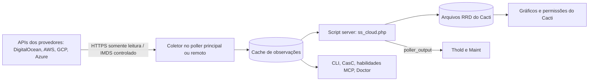

<!-- Source: README.md; SHA256: ac2074a40238686915802803c5efe773f33677f934281e0605e6e87a71a9d27d -->

<!-- translations:start -->
[English](../../../README.md) | [简体中文](../zh-CN/README.md) | [हिन्दी](../hi-IN/README.md) | [Español (España)](../es-ES/README.md) | [Español (Latinoamérica)](../es-419/README.md) | [العربية (السعودية)](../ar-SA/README.md) | [Afrikaans](../af-ZA/README.md) | [አማርኛ](../am-ET/README.md) | [العربية (مصر)](../ar-EG/README.md) | [العربية (المغرب)](../ar-MA/README.md) | [বাংলা](../bn-BD/README.md) | [Bosanski](../bs-BA/README.md) | [Deutsch](../de-DE/README.md) | [فارسی](../fa-IR/README.md) | [Filipino](../fil-PH/README.md) | [Français](../fr-FR/README.md) | [Français (Maroc)](../fr-MA/README.md) | [Français (Sénégal)](../fr-SN/README.md) | [Hausa](../ha-NG/README.md) | [עברית](../he-IL/README.md) | [Hrvatski](../hr-HR/README.md) | [Bahasa Indonesia](../id-ID/README.md) | [Igbo](../ig-NG/README.md) | [Italiano](../it-IT/README.md) | [日本語](../ja-JP/README.md) | [한국어](../ko-KR/README.md) | [Malagasy](../mg-MG/README.md) | [मराठी](../mr-IN/README.md) | [Bahasa Melayu](../ms-MY/README.md) | [Nederlands](../nl-NL/README.md) | [Polski](../pl-PL/README.md) | [Português (Brasil)](README.md) | [Русский](../ru-RU/README.md) | [Kinyarwanda](../rw-RW/README.md) | [Soomaali](../so-SO/README.md) | [Српски](../sr-RS/README.md) | [Svenska](../sv-SE/README.md) | [Kiswahili](../sw-KE/README.md) | [தமிழ்](../ta-IN/README.md) | [తెలుగు](../te-IN/README.md) | [ไทย](../th-TH/README.md) | [Türkçe](../tr-TR/README.md) | [Українська](../uk-UA/README.md) | [اردو](../ur-PK/README.md) | [Tiếng Việt](../vi-VN/README.md) | [isiXhosa](../xh-ZA/README.md) | [Yorùbá](../yo-NG/README.md) | [繁體中文](../zh-TW/README.md) | [isiZulu](../zu-ZA/README.md)
<!-- translations:end -->

# plugin_cloud

Um plugin do Cacti 1.2 que traz recursos e métricas de provedores de nuvem pública para o Cacti como dispositivos, fontes de dados e gráficos comuns. As cargas de trabalho na nuvem ficam ao lado da rede que as transporta, sob as permissões do Cacti, e o Thold e o Maint geram alertas e os suprimem. Um único plugin cobre DigitalOcean, Amazon Web Services, Google Cloud e Microsoft Azure por meio de drivers de provedor somente leitura em PHP puro.

> **Status: em desenvolvimento, ainda sem lançamento (`0.1.0-dev`).** Esta branch implementa drivers em PHP puro para DigitalOcean, AWS, Google Cloud e Azure, replicação de coletores de dados remotos e integridade somente leitura do agente, um provedor CasC e CLI de operador, habilidades MCP e verificações Doctor. Os templates do Cacti distribuídos atualmente cobrem Droplets e balanceadores de carga da DigitalOcean (`templates/cloud_digitalocean.xml`); os pacotes de templates do Cacti para AWS, Google Cloud e Azure e a qualificação em conta ativa além da DigitalOcean ([fatos dos provedores](../../research/provider-facts.md)) ainda não estão concluídos. Não execute em produção.

## Provedores suportados

Cada driver de provedor é registrado em `Drivers::production()`, oferecido por `Provider::released()` e executado em PHP puro usando `ext-openssl` e stream sockets, sem dependências de SDK ou de runtime do Composer.

| Provedor | Campos de escopo | Fontes de credenciais | Autenticação | Recursos descobertos | Coleta de métricas |
|---|---|---|---|---|---|
| DigitalOcean (`digitalocean`) | Nenhum (escopo por token) | `vault`, `file` | Token Bearer | `droplet`, `load_balancer` | `/v2/monitoring/metrics` com reconhecimento de cota de limite de taxa; inclui templates do Cacti e data queries |
| Amazon Web Services (`aws`) | `account_id` (12 dígitos), `regions` | `vault`, `file`, `instance` | AWS SigV4 em PHP puro (`AWS4-HMAC-SHA256`), verificação STS `GetCallerIdentity`, STS `AssumeRole` opcional, EC2 IMDSv2 (`169.254.169.254`) para contas `instance` | `ec2_instance`, `rds_instance`, `aws_elb` (ALB/NLB) | CloudWatch `GetMetricData` em lote (até 500 consultas por chamada) |
| Google Cloud (`gcp`) | `project` | `vault`, `file`, `instance` | JWT de conta de serviço RS256 em PHP puro via `ext-openssl` trocado em `oauth2.googleapis.com/token`, ou servidor de metadados do GCE (`metadata.google.internal`) para contas `instance` | `gce_instance` via `instances.aggregatedList` | Cloud Monitoring `timeSeries.list` |
| Microsoft Azure (`azure`) | `tenant`, `subscription`, `regions` | `vault`, `file`, `instance` | Fluxo OAuth2 client-credentials do Entra ID em PHP puro (somente `client_secret`; asserções de certificado excluídas), ou identidade gerenciada do Azure IMDS (`169.254.169.254`) para tokens de ARM e Monitor | `azure_vm` via ARM Resource Graph (paginado com `$skipToken` e deduplicado) | Azure Monitor `metrics:getBatch` (até 50 recursos por chamada, tratando limitação HTTP 429 e 529) |

## Capacidades implementadas

### Plataforma principal, cofre e coletor

- **Instalação e ciclo de vida protegidos.** Os pontos de entrada (`setup.php`, `cli/cloud.php`, `poller_cloud.php`, `ss_cloud.php` e scripts de página) são analisados no PHP 8.0 e recusam PHP abaixo de 8.2 ou ausência de `ext-openssl` sem quebrar o Cacti. As atualizações são ordenadas, idempotentes (`Schema::VERSION = 3`, 9 tabelas) e sobrevivem a interrupções. A desinstalação mantém as tabelas do plugin, a menos que *Keep Plugin Tables on Uninstall* seja desmarcada.
- **Contas e credenciais.** Adicione, edite, verifique e exclua contas em **Management > Cloud Accounts**. As credenciais vêm do cofre criptografado com AES-256-GCM (`plugin_cloud_secret`, com chave em `/etc/cacti/cloud-vault.key` por padrão), de um arquivo restrito ao diretório configurado *Credential File Directory* (`cloud_credential_dir`, vazio por padrão para recusar arquivos) ou da identidade de instância do provedor. As credenciais são somente gravação na interface e ocultadas nos logs.
- **Controles rigorosos de saída e somente leitura.** Cada driver opera atrás de `GuardedTransport` e `OutboundPolicy`: porta HTTPS 443 para os nomes de host exatos de cada provedor, com endpoints de metadados HTTP porta 80 link-local (`169.254.169.254`, `metadata.google.internal`) habilitados apenas para contas `instance`. Apenas operações somente leitura na lista permitida são autorizadas.
- **Coletor e controles de custo.** O `poller_cloud.php` é executado a partir de `poller_bottom` (um processo por poller via registro de processos do Cacti) dentro de `cloud_collector_budget`, adquire concessões por conta, executa a descoberta em `discover_interval`, lê métricas apenas para fontes de dados ativas do Cacti (`plugin_cloud_series`), respeita `request_share` e `monthly_ceiling` e armazena os pontos de dados mais recentes em cache em `plugin_cloud_observation` para `ss_cloud.php`.
- **Objetos do Cacti e estimativas de requisições.** Mantém um dispositivo de escopo por conta (`plugin_cloud_device`), preserva os métodos de reindexação do dispositivo de escopo ao salvar dispositivos, importa templates da DigitalOcean e data queries do script server (`templates/cloud_digitalocean.xml`, `cloud_do_droplet.xml`, `cloud_do_load_balancer.xml`) e exibe estimativas de requisições e preço de tabela em **New Graphs** (`graphs_new_top_links`) e **Cloud Health**.

### Coletores de dados remotos

- `INFO` declara `remote_collect:1`. As contas podem ser atribuídas a qualquer poller habilitado do Cacti (`poller_id >= 1`), e `poller_cloud.php --poller=N` coleta apenas as contas pertencentes a esse poller.
- **Hook `replicate_out`.** Replica linhas com escopo por poller de `plugin_cloud_account`, `plugin_cloud_device`, `plugin_cloud_series` e linhas de texto cifrado de `plugin_cloud_secret` (apenas para contas com cofre pertencentes ao poller de destino) via `replicate_out_table()`. Os arquivos brutos da chave do cofre nunca são armazenados no banco de dados nem replicados e permanecem locais em cada poller.
- **Hook `remote_agent`.** Expõe um resumo de integridade JSON somente leitura (`action=cloud_health`) que aceita apenas parâmetros inteiros `poller_id` e `account_id` e retorna zero credenciais, caminhos de arquivo ou segredos.

### Hooks de ecossistema (CasC, habilidades MCP e Doctor)

- **Provedor CasC (`casc_register_providers`).** Registra o provedor `cloud` (versão de esquema `1`) com exportação determinística em YAML e XML em PHP puro, validação de manifesto, planejamento de diff e aplicação confirmada. Credenciais do cofre são exportadas como referências `vault:account:<name>`; campos brutos de segredo (`secret`, `secrets`, `token`, `access_token`, `refresh_token`, `password`, `private_key`, `access_key_id`, `secret_access_key`, `session_token`, `client_secret`, `credential`, `credentials`, `vault_key`) são rejeitados. A aplicação exige um `--confirm=<PLAN_HASH>` SHA-256 exato.
- **MCP / Abilities API (`abilities_register`).** Registra três habilidades estritamente somente leitura controladas pelo realm Cloud View (`cloud_health.php`) e pelo escopo de dispositivos do Cacti para chamadores não administradores, sem emitir credenciais, chaves de cofre ou caminhos de arquivo de credencial:
  - `cloud-list-accounts` (`provider`, `poller_id` opcionais)
  - `cloud-list-resources` (`account_id`, `type`, `lifecycle` opcionais)
  - `cloud-get-health` (`account_id` opcional)
- **Verificações Doctor (`doctor_register_checks`).** Registra cinco verificações de diagnóstico que não expõem valores secretos nem material de chave:
  - `cloud_schema`: atualidade da versão do esquema
  - `cloud_vault_key`: legibilidade, permissões e tamanho do arquivo da chave do cofre
  - `cloud_drivers`: registro de drivers de produção para todos os provedores lançados
  - `cloud_accounts_health`: contas habilitadas com falha, limitação ou dados obsoletos
  - `cloud_poller_intervals`: alinhamento dos intervalos de coleta das contas habilitadas com o intervalo do poller do Cacti

## CLI

Execute a partir do diretório raiz do Cacti com PHP 8.2 ou superior:

```sh
# Operator and CasC CLI (options use --key=value form)
php plugins/cloud/cli/cloud.php export [--format=yaml|xml]
php plugins/cloud/cli/cloud.php validate --file=<path> [--format=yaml|xml]
php plugins/cloud/cli/cloud.php plan --file=<path> [--format=yaml|xml]
php plugins/cloud/cli/cloud.php apply --file=<path> --confirm=<PLAN_HASH> [--format=yaml|xml]
php plugins/cloud/cli/cloud.php health [--format=text|json] [--poller=<id>]

# Collector entry point (normally started by poller_bottom)
php plugins/cloud/poller_cloud.php [--poller=N] [--force] [--debug]
```

## Papéis de acesso

| Realm | Acesso |
| --- | --- |
| Cloud View | Páginas de monitoramento existentes. |
| Cloud Operator | Monitoramento mais a página Operations e reconhecimentos pessoais de triagem. |
| Cloud Admin | Acesso Operator mais a configuração existente e ações administrativas. |

Após copiar os arquivos de atualização, abra a página Plugins como administrador para registrar os realms. Atribua o realm Operator explicitamente em **Configuration > Users** ou em grupos de usuários. As atualizações mantêm os IDs e concessões existentes dos realms View e Admin. O acesso Admin herda o acesso Operator, e o acesso Operator herda o acesso View em cada requisição; isso não adiciona concessões armazenadas a usuários ou grupos. As configurações do plugin também exigem acesso Cloud Admin além da permissão Settings do Cacti.

As permissões de dispositivo do Cacti limitam as linhas e ações disponíveis para cada usuário; objetos não mapeados exigem um administrador. Operators podem verificar a credencial armazenada de uma conta cujo dispositivo do Cacti possam acessar. Credenciais, configuração, mapeamento, exclusão e outras alterações administrativas permanecem nas páginas administrativas. Os reconhecimentos duram apenas na sessão atual do usuário, por no máximo uma hora e somente enquanto a mesma observação permanecer recente. Observações novas ou alteradas os invalidam. Eles nunca marcam uma medição com falha como íntegra nem suprimem alertas.

## Por quê

Cada provedor de nuvem tem seu próprio console de monitoramento. Executados ao lado do Cacti, eles deixam três lacunas:

- **Controle de acesso separado.** Mostrar métricas da nuvem a um usuário do Cacti significa dar a ele um login na nuvem.
- **Sem contexto de rede.** Os links locais são exibidos em gráficos no Cacti; as cargas de trabalho por trás deles são exibidas no console de cada provedor.
- **Alertas separados.** O Thold e o Maint atuam sobre fontes de dados e dispositivos do Cacti, de modo que os alarmes dos provedores são configurados e suprimidos separadamente, uma vez por provedor.

O plugin lê a API de monitoramento de cada provedor em um poller do Cacti, armazena os pontos de dados mais recentes em cache e os entrega ao script server do Cacti. O poller do Cacti grava os arquivos RRD, fazendo com que gráficos, permissões, Thold, Maint e boost funcionem como para quaisquer outros dados do Cacti.

## Compromissos de design

- **Somente leitura.** Cada driver só pode construir as operações do provedor em sua lista permitida; o plugin nunca altera um recurso na nuvem. ([ADR 0002](../../decisions/0002-read-only-with-operation-allowlist.md))
- **Somente PHP, sem SDKs.** A assinatura e a troca de tokens são implementadas em PHP com as extensões que o Cacti já exige. Nenhuma dependência de runtime do Composer. ([ADR 0003](../../decisions/0003-php-only-without-sdks.md))
- **Custo antes da coleta.** O plugin lê apenas métricas que possuem uma fonte de dados do Cacti, exibe a contagem esperada de requisições e o custo de preço de tabela antes da criação dos gráficos e impõe um teto mensal. ([ADR 0005](../../decisions/0005-collect-only-what-is-graphed.md))
- **Sem credenciais em texto simples no banco de dados.** As credenciais vêm de um cofre criptografado com chave em arquivo fora do banco de dados, de um arquivo de credenciais ou da identidade de instância do provedor. ([ADR 0007](../../decisions/0007-credentials-outside-the-database-in-the-clear.md))

## Escopo e status

| Fase | Escopo | Marcos | Status |
|---|---|---|---|
| 0, pesquisa | Confirmação de fatos dos provedores, catálogos de métricas, modelo de custo e taxa, vetores de teste de assinatura, prova de conceito de transporte | [M1](https://github.com/somethingwithproof/plugin_cloud/milestone/1) | Concluído, exceto verificações que exigem contas ativas de provedores |
| 1, núcleo e DigitalOcean | Contas, cofre de credenciais, transporte, coletor, cache de observações, objetos do Cacti, templates, estimativas de requisições, página de integridade, DigitalOcean Droplets e balanceadores de carga | [M2](https://github.com/somethingwithproof/plugin_cloud/milestone/2), [M3](https://github.com/somethingwithproof/plugin_cloud/milestone/3), [M4](https://github.com/somethingwithproof/plugin_cloud/milestone/4) | Implementado; qualificação piloto M4 pendente |
| 2, AWS | SigV4 em PHP puro, STS `AssumeRole`, funções de instância IMDSv2, inventário EC2/RDS/ELB, CloudWatch `GetMetricData` | [M5](https://github.com/somethingwithproof/plugin_cloud/milestone/5) | Driver implementado; templates do Cacti e qualificação em conta ativa pendentes |
| 3, Google Cloud | JWT de conta de serviço RS256 em PHP puro, servidor de metadados do GCE, inventário Compute Engine, Cloud Monitoring `timeSeries.list` | [M6](https://github.com/somethingwithproof/plugin_cloud/milestone/6) | Driver implementado; templates do Cacti e qualificação em conta ativa pendentes |
| 4, Azure | Client credentials do Entra ID, identidade gerenciada IMDS, inventário de VMs ARM Resource Graph, Azure Monitor `metrics:getBatch` | [M7](https://github.com/somethingwithproof/plugin_cloud/milestone/7) | Driver implementado; templates do Cacti e qualificação em conta ativa pendentes |
| 5, coletores remotos e ecossistema | Coletores de dados remotos (`replicate_out`, `remote_agent`), provedor CasC e CLI, habilidades MCP, verificações Doctor | [M8](https://github.com/somethingwithproof/plugin_cloud/milestone/8) | Implementado |

Fora de escopo: alterar recursos na nuvem, criar ou espelhar alarmes de provedores, relatórios de faturamento, logs e traces e um mecanismo de alertas próprio do plugin. Outros provedores (Hetzner Cloud, Akamai Cloud, Oracle Cloud e outros) são issues de pesquisa.

## Instalação e configuração

Estas etapas instalam o código de desenvolvimento para avaliação. Elas exigem Cacti 1.2.31 ou superior no PHP 8.2 ou superior.

1. Copie o repositório para `plugins/cloud` dentro do diretório do Cacti. O diretório deve se chamar `cloud`.
2. Crie a chave do cofre fora da raiz web em cada poller que usa credenciais armazenadas no cofre. Coloque-a em um diretório em que apenas o root e o usuário do Cacti possam gravar e torne o arquivo legível apenas pelo usuário que executa o servidor web e o poller. O plugin nunca cria nem grava este arquivo:

   ```sh
   sudo install -d -m 0750 -o root -g cacti /etc/cacti
   head -c 32 /dev/urandom | sudo tee /etc/cacti/cloud-vault.key > /dev/null
   sudo chown cacti:cacti /etc/cacti/cloud-vault.key
   sudo chmod 0600 /etc/cacti/cloud-vault.key
   ```

   Substitua `cacti` pelo usuário que executa seu servidor web e poller. O arquivo armazena 32 bytes brutos ou 64 caracteres hexadecimais. Faça backup dele junto com o banco de dados; sem ele, as credenciais armazenadas precisarão ser inseridas novamente.
3. No Cacti, abra **Configuration > Plugins**, depois instale e habilite *Cloud*.
4. Em **Configuration > Settings > Cloud**, defina *Vault Key File* se você usou outro caminho, configure *Credential File Directory* se planeja usar credenciais baseadas em arquivo e mantenha *Collector Time Budget* (padrão 240 segundos) abaixo do intervalo do poller.
5. Conceda *Cloud Admin*, *Cloud Operator* ou *Cloud View* a usuários e grupos em **Configuration > Users**. A instalação concede Cloud Admin e Cloud View ao administrador; Cloud Admin inclui acesso Operator, portanto o administrador não precisa de uma concessão Operator separada.
6. Adicione contas em **Management > Cloud Accounts** e verifique se há avisos em **Management > Cloud Health**.

## Metas de compatibilidade

| Componente | Meta |
|---|---|
| Cacti | 1.2.31 ou superior, sem patches no núcleo |
| PHP | 8.2 ou superior; os pontos de entrada permanecem analisáveis no 8.0 para que um runtime não suportado receba uma recusa em vez de uma interface do Cacti quebrada |
| Extensões PHP | `ext-openssl` (exigida pelo Cacti 1.2.31); sem `ext-curl` e sem dependências de runtime do Composer |
| Thold, Maint | Nenhuma alteração necessária |

## Design

- [docs/performance.md](../../performance.md) contém as medições do coletor e da página de integridade, com o hardware e as configurações usados.
- [docs/PLAN.md](../../PLAN.md) é o plano completo: arquitetura, os fatos de provedores e do Cacti dos quais ele depende (com fontes), contrato de driver, aritmética de custos, limites de segurança, testes e riscos.
- [docs/decisions/](../../decisions/) guarda os registros de decisões de arquitetura das escolhas já tomadas.
- [docs/REQUIREMENTS.md](../../REQUIREMENTS.md) mapeia cada ID de requisito para sua issue.



## Como o trabalho é acompanhado

- **Marcos** seguem os marcos do plano. Cada um tem uma issue épica listando suas sub-issues e evidências de saída.
- **Issues** são tipadas por rótulo: `type: requirement`, `type: research`, `type: decision`, `type: epic`. Issues de requisito declaram requisitos numerados e testáveis (`REQ-AREA-NNN`) e critérios de aceitação.
- **Rótulos** também trazem `area:`, `provider:`, `phase:`, `priority:` e `status:`. Veja [CONTRIBUTING.md](../../../CONTRIBUTING.md#labels).
- O [quadro do projeto](https://github.com/users/somethingwithproof/projects/7) mostra todas as issues entre os marcos.

## Desenvolvimento

A CI ([.github/workflows/plugin-ci-workflow.yml](../../../.github/workflows/plugin-ci-workflow.yml)) verifica o arquivo de lançamento e a versão semântica (`bash tests/bin/archive-check.sh`), faz lint dos pontos de entrada no PHP 8.0, executa testes unitários Pest (`phpunit.xml`) e de integração de ciclo de vida (`phpunit-integration.xml`) e PHPStan nível 9 no PHP 8.2 ao 8.5 contra o Cacti `release/1.2.31` e `1.2.x` com `CLOUD_OFFLINE=1`, verifica a recusa no PHP 8.1, valida catálogos gettext, mede o desempenho da coleta de 1.000 séries e da página de integridade e executa linting de workflows e conformidade REUSE.

Verificações locais antes de enviar:

```sh
bash tests/bin/archive-check.sh
sh tests/lint-workflows.sh
sh locales/build_gettext.sh --check
CACTI_PATH=/path/to/cacti phpstan analyse -c phpstan.neon --no-progress
```

Execute o Pest com `--configuration=phpunit.xml` para testes unitários e de regras de código-fonte, ou `--configuration=phpunit-integration.xml` com `CACTI_PATH` e `CLOUD_TEST_DATABASE=disposable` contra um banco de dados Cacti descartável para testes de integração de ciclo de vida.

## Contribuição

Leia [CONTRIBUTING.md](../../../CONTRIBUTING.md). Os commits exigem um DCO sign-off. As discussões de design acontecem nas issues; decisões em aberto recebem o rótulo `type: decision`.

## Segurança

Relate vulnerabilidades de forma privada; veja [SECURITY.md](../../../SECURITY.md).

## Licença

GNU General Public License v2.0, a mesma licença do Cacti e de seus plugins. Veja [LICENSE](../../../LICENSE).
