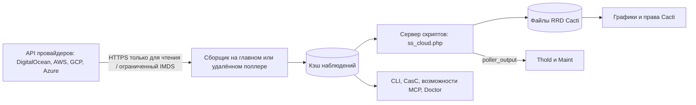

<!-- Source: README.md; SHA256: ac2074a40238686915802803c5efe773f33677f934281e0605e6e87a71a9d27d -->

<!-- translations:start -->
[English](../../../README.md) | [简体中文](../zh-CN/README.md) | [हिन्दी](../hi-IN/README.md) | [Español (España)](../es-ES/README.md) | [Español (Latinoamérica)](../es-419/README.md) | [العربية (السعودية)](../ar-SA/README.md) | [Afrikaans](../af-ZA/README.md) | [አማርኛ](../am-ET/README.md) | [العربية (مصر)](../ar-EG/README.md) | [العربية (المغرب)](../ar-MA/README.md) | [বাংলা](../bn-BD/README.md) | [Bosanski](../bs-BA/README.md) | [Deutsch](../de-DE/README.md) | [فارسی](../fa-IR/README.md) | [Filipino](../fil-PH/README.md) | [Français](../fr-FR/README.md) | [Français (Maroc)](../fr-MA/README.md) | [Français (Sénégal)](../fr-SN/README.md) | [Hausa](../ha-NG/README.md) | [עברית](../he-IL/README.md) | [Hrvatski](../hr-HR/README.md) | [Bahasa Indonesia](../id-ID/README.md) | [Igbo](../ig-NG/README.md) | [Italiano](../it-IT/README.md) | [日本語](../ja-JP/README.md) | [한국어](../ko-KR/README.md) | [Malagasy](../mg-MG/README.md) | [मराठी](../mr-IN/README.md) | [Bahasa Melayu](../ms-MY/README.md) | [Nederlands](../nl-NL/README.md) | [Polski](../pl-PL/README.md) | [Português (Brasil)](../pt-BR/README.md) | [Русский](README.md) | [Kinyarwanda](../rw-RW/README.md) | [Soomaali](../so-SO/README.md) | [Српски](../sr-RS/README.md) | [Svenska](../sv-SE/README.md) | [Kiswahili](../sw-KE/README.md) | [தமிழ்](../ta-IN/README.md) | [తెలుగు](../te-IN/README.md) | [ไทย](../th-TH/README.md) | [Türkçe](../tr-TR/README.md) | [Українська](../uk-UA/README.md) | [اردو](../ur-PK/README.md) | [Tiếng Việt](../vi-VN/README.md) | [isiXhosa](../xh-ZA/README.md) | [Yorùbá](../yo-NG/README.md) | [繁體中文](../zh-TW/README.md) | [isiZulu](../zu-ZA/README.md)
<!-- translations:end -->

# plugin_cloud

Плагин для Cacti 1.2, который переносит ресурсы и метрики публичных облачных провайдеров в Cacti в виде обычных устройств, источников данных и графиков. Облачные рабочие нагрузки размещаются рядом с сетью, которая их обслуживает, под управлением прав доступа Cacti, а Thold и Maint отправляют по ним оповещения и подавляют их. Один плагин охватывает DigitalOcean, Amazon Web Services, Google Cloud и Microsoft Azure с помощью драйверов только для чтения на чистом PHP.

> **Статус: в разработке, релизов пока нет (`0.1.0-dev`).** Эта ветка реализует драйверы на чистом PHP для DigitalOcean, AWS, Google Cloud и Azure, репликацию удалённых сборщиков данных и проверку состояния агента только для чтения, провайдер CasC и CLI оператора, возможности MCP и проверки Doctor. Входящие в комплект шаблоны Cacti сейчас охватывают Droplet и балансировщики нагрузки DigitalOcean (`templates/cloud_digitalocean.xml`); пакеты шаблонов Cacti для AWS, Google Cloud и Azure и квалификация на живых учётных записях за пределами DigitalOcean ([сведения о провайдерах](../../research/provider-facts.md)) ещё не завершены. Не используйте в промышленной эксплуатации.

## Поддерживаемые провайдеры

Каждый драйвер провайдера зарегистрирован в `Drivers::production()`, предоставляется через `Provider::released()` и работает на чистом PHP с использованием `ext-openssl` и потоковых сокетов без SDK или зависимостей времени выполнения Composer.

| Провайдер | Поля области видимости | Источники учётных данных | Аутентификация | Обнаруживаемые ресурсы | Сбор метрик |
|---|---|---|---|---|---|
| DigitalOcean (`digitalocean`) | Нет (область определяется токеном) | `vault`, `file` | Bearer-токен | `droplet`, `load_balancer` | `/v2/monitoring/metrics` с учётом доли ограничения частоты запросов; включает шаблоны Cacti и запросы данных |
| Amazon Web Services (`aws`) | `account_id` (12 цифр), `regions` | `vault`, `file`, `instance` | AWS SigV4 на чистом PHP (`AWS4-HMAC-SHA256`), проверка STS `GetCallerIdentity`, опциональный STS `AssumeRole`, EC2 IMDSv2 (`169.254.169.254`) для учётных записей `instance` | `ec2_instance`, `rds_instance`, `aws_elb` (ALB/NLB) | Пакетный CloudWatch `GetMetricData` (до 500 запросов за вызов) |
| Google Cloud (`gcp`) | `project` | `vault`, `file`, `instance` | JWT сервисного аккаунта RS256 на чистом PHP через `ext-openssl` с обменом на `oauth2.googleapis.com/token`, либо сервер метаданных GCE (`metadata.google.internal`) для учётных записей `instance` | `gce_instance` через `instances.aggregatedList` | Cloud Monitoring `timeSeries.list` |
| Microsoft Azure (`azure`) | `tenant`, `subscription`, `regions` | `vault`, `file`, `instance` | Поток client-credentials Entra ID OAuth2 на чистом PHP (только `client_secret`; утверждения сертификатов исключены), либо управляемое удостоверение Azure IMDS (`169.254.169.254`) для токенов ARM и Monitor | `azure_vm` через ARM Resource Graph (с постраничным выводом через `$skipToken` и дедупликацией) | Azure Monitor `metrics:getBatch` (до 50 ресурсов за вызов, с обработкой троттлинга HTTP 429 и 529) |

## Реализованные возможности

### Базовая платформа, хранилище и сборщик

- **Защищённая установка и жизненный цикл.** Точки входа (`setup.php`, `cli/cloud.php`, `poller_cloud.php`, `ss_cloud.php` и скрипты страниц) разбираются на PHP 8.0 и отклоняют PHP ниже 8.2 или отсутствие `ext-openssl`, не нарушая работу Cacti. Обновления упорядочены, идемпотентны (`Schema::VERSION = 3`, 9 таблиц) и устойчивы к прерываниям. Удаление сохраняет таблицы плагина, если не снят флажок *Keep Plugin Tables on Uninstall*.
- **Учётные записи и учётные данные.** Добавляйте, редактируйте, проверяйте и удаляйте учётные записи в разделе **Management > Cloud Accounts**. Учётные данные поступают из зашифрованного с помощью AES-256-GCM хранилища (`plugin_cloud_secret`, по умолчанию с ключом в `/etc/cacti/cloud-vault.key`), из файла, ограниченного настроенным каталогом *Credential File Directory* (`cloud_credential_dir`, по умолчанию пустым для запрета файлов), или из удостоверения экземпляра провайдера. Учётные данные доступны только для записи в UI и скрываются в журналах.
- **Строгий контроль исходящего трафика и режима только для чтения.** Каждый драйвер работает за `GuardedTransport` и `OutboundPolicy`: порт HTTPS 443 к точным именам хостов каждого провайдера, при этом локальные конечные точки метаданных HTTP порт 80 (`169.254.169.254`, `metadata.google.internal`) включены только для учётных записей `instance`. Разрешены исключительно операции только для чтения из белого списка.
- **Сборщик и контроль затрат.** `poller_cloud.php` запускается из `poller_bottom` (один процесс на поллер через реестр процессов Cacti) в рамках `cloud_collector_budget`, получает аренды на учётную запись, выполняет обнаружение с интервалом `discover_interval`, считывает метрики только для активных источников данных Cacti (`plugin_cloud_series`), соблюдает `request_share` и `monthly_ceiling` и кэширует последние точки данных в `plugin_cloud_observation` для `ss_cloud.php`.
- **Объекты Cacti и оценки запросов.** Поддерживает устройство области видимости для каждой учётной записи (`plugin_cloud_device`), сохраняет методы переиндексации устройства области видимости при сохранении устройств, импортирует шаблоны DigitalOcean и запросы данных сервера скриптов (`templates/cloud_digitalocean.xml`, `cloud_do_droplet.xml`, `cloud_do_load_balancer.xml`) и отображает оценки количества запросов и стоимости по прайс-листу на страницах **New Graphs** (`graphs_new_top_links`) и **Cloud Health**.

### Удалённые сборщики данных

- `INFO` объявляет `remote_collect:1`. Учётные записи могут быть назначены любому включённому поллеру Cacti (`poller_id >= 1`), а `poller_cloud.php --poller=N` собирает только учётные записи, принадлежащие этому поллеру.
- **Хук `replicate_out`.** Реплицирует строки области видимости поллера из `plugin_cloud_account`, `plugin_cloud_device`, `plugin_cloud_series` и зашифрованные строки шифротекста из `plugin_cloud_secret` (только для учётных записей с хранилищем, принадлежащих целевому поллеру) через `replicate_out_table()`. Исходные файлы ключей хранилища никогда не сохраняются в базе данных и не реплицируются, оставаясь локальными на каждом поллере.
- **Хук `remote_agent`.** Предоставляет JSON-сводку состояния только для чтения (`action=cloud_health`), принимающую только целочисленные параметры `poller_id` и `account_id` и не возвращающую никаких учётных данных, путей к файлам или секретов.

### Хуки экосистемы (CasC, возможности MCP и Doctor)

- **Провайдер CasC (`casc_register_providers`).** Регистрирует провайдер `cloud` (версия схемы `1`) с детерминированным экспортом в YAML и XML на чистом PHP, валидацией манифеста, планированием различий и подтверждённым применением. Учётные данные хранилища экспортируются как ссылки `vault:account:<name>`; открытые секретные поля (`secret`, `secrets`, `token`, `access_token`, `refresh_token`, `password`, `private_key`, `access_key_id`, `secret_access_key`, `session_token`, `client_secret`, `credential`, `credentials`, `vault_key`) отклоняются. Для применения требуется точный SHA-256 `--confirm=<PLAN_HASH>`.
- **MCP / Abilities API (`abilities_register`).** Регистрирует три строго доступные только для чтения возможности, ограниченные областью Cloud View (`cloud_health.php`) и областью устройств Cacti для вызывающих без прав администратора, не выдавая никаких учётных данных, ключей хранилища или путей к файлам учётных данных:
  - `cloud-list-accounts` (опционально `provider`, `poller_id`)
  - `cloud-list-resources` (опционально `account_id`, `type`, `lifecycle`)
  - `cloud-get-health` (опционально `account_id`)
- **Проверки Doctor (`doctor_register_checks`).** Регистрирует пять диагностических проверок, не раскрывающих секретных значений или ключевого материала:
  - `cloud_schema`: актуальность версии схемы
  - `cloud_vault_key`: читаемость, права доступа и размер файла ключа хранилища
  - `cloud_drivers`: регистрация рабочих драйверов для всех выпущенных провайдеров
  - `cloud_accounts_health`: включённые учётные записи со сбоями, троттлингом или устаревшими данными
  - `cloud_poller_intervals`: согласование интервалов сбора включённых учётных записей с интервалом поллера Cacti

## CLI

Запускайте из корневого каталога Cacti с PHP 8.2 или выше:

```sh
# Operator and CasC CLI (options use --key=value form)
php plugins/cloud/cli/cloud.php export [--format=yaml|xml]
php plugins/cloud/cli/cloud.php validate --file=<path> [--format=yaml|xml]
php plugins/cloud/cli/cloud.php plan --file=<path> [--format=yaml|xml]
php plugins/cloud/cli/cloud.php apply --file=<path> --confirm=<PLAN_HASH> [--format=yaml|xml]
php plugins/cloud/cli/cloud.php health [--format=text|json] [--poller=<id>]

# Collector entry point (normally started by poller_bottom)
php plugins/cloud/poller_cloud.php [--poller=N] [--force] [--debug]
```

## Роли доступа

| Область (Realm) | Доступ |
| --- | --- |
| Cloud View | Существующие страницы мониторинга. |
| Cloud Operator | Мониторинг, а также страница Operations и личные подтверждения сортировки (triage). |
| Cloud Admin | Доступ Operator, а также существующая конфигурация и административные действия. |

После копирования файлов обновления откройте страницу Plugins от имени администратора для регистрации областей. Явно назначьте область Operator в разделе **Configuration > Users** или группам пользователей. Обновления сохраняют существующие идентификаторы и права для областей View и Admin. Доступ Admin наследует доступ Operator, а доступ Operator наследует доступ View при каждом запросе; это не добавляет сохранённых прав пользователям или группам. Настройки плагина также требуют доступа Cloud Admin в дополнение к разрешению Settings в Cacti.

Права на устройства Cacti ограничивают строки и действия, доступные каждому пользователю; несопоставленные объекты требуют администратора. Операторы могут проверять сохранённые учётные данные для учётной записи, к устройству Cacti которой у них есть доступ. Учётные данные, конфигурация, сопоставление, удаление и другие административные изменения остаются на административных страницах. Подтверждения действуют только в текущей сессии пользователя, не более одного часа и только пока то же наблюдение остаётся актуальным. Новые или изменившиеся наблюдения аннулируют их. Они никогда не помечают неудачное измерение как исправное и не подавляют оповещения.

## Зачем

У каждого облачного провайдера есть собственная консоль мониторинга. При работе рядом с Cacti они оставляют три пробела:

- **Раздельный контроль доступа.** Показать пользователю Cacti облачные метрики означает выдать ему учётную запись в облаке.
- **Нет сетевого контекста.** Локальные каналы строятся на графиках в Cacti, а нагрузки за ними строятся в консоли каждого провайдера.
- **Раздельные оповещения.** Thold и Maint работают с источниками данных и устройствами Cacti, поэтому оповещения провайдеров настраиваются и подавляются отдельно для каждого провайдера.

Плагин считывает API мониторинга каждого провайдера на поллере Cacti, кэширует последние точки данных и передаёт их серверу скриптов Cacti. Поллер Cacti записывает RRD-файлы, поэтому построение графиков, права доступа, Thold, Maint и boost работают так же, как для любых других данных Cacti.

## Архитектурные обязательства

- **Только для чтения.** Каждый драйвер может формировать только операции провайдера из своего белого списка; плагин никогда не изменяет облачный ресурс. ([ADR 0002](../../decisions/0002-read-only-with-operation-allowlist.md))
- **Только PHP, без SDK.** Подпись и обмен токенами реализованы на PHP с использованием расширений, которые уже требуются для Cacti. Без зависимостей времени выполнения Composer. ([ADR 0003](../../decisions/0003-php-only-without-sdks.md))
- **Оценка стоимости до сбора.** Плагин считывает только метрики, у которых есть источник данных Cacti, показывает ожидаемое число запросов и стоимость по прайс-листу до создания графиков и соблюдает месячный лимит. ([ADR 0005](../../decisions/0005-collect-only-what-is-graphed.md))
- **Никаких открытых учётных данных в базе данных.** Учётные данные берутся из зашифрованного хранилища с ключом в файле вне базы данных, из файла учётных данных или из удостоверения экземпляра провайдера. ([ADR 0007](../../decisions/0007-credentials-outside-the-database-in-the-clear.md))

## Область работ и статус

| Этап | Состав | Вехи | Статус |
|---|---|---|---|
| 0, исследование | Подтверждение сведений о провайдерах, каталоги метрик, модель стоимости и квот, тестовые векторы подписи, прототип транспорта | [M1](https://github.com/somethingwithproof/plugin_cloud/milestone/1) | Завершён, за исключением проверок, требующих живых учётных записей провайдеров |
| 1, ядро и DigitalOcean | Учётные записи, хранилище учётных данных, транспорт, сборщик, кэш наблюдений, объекты Cacti, шаблоны, оценка запросов, страница состояния, Droplet и балансировщики нагрузки DigitalOcean | [M2](https://github.com/somethingwithproof/plugin_cloud/milestone/2), [M3](https://github.com/somethingwithproof/plugin_cloud/milestone/3), [M4](https://github.com/somethingwithproof/plugin_cloud/milestone/4) | Реализовано; ожидается пилотная квалификация M4 |
| 2, AWS | SigV4 на чистом PHP, STS `AssumeRole`, роли экземпляров IMDSv2, инвентаризация EC2/RDS/ELB, CloudWatch `GetMetricData` | [M5](https://github.com/somethingwithproof/plugin_cloud/milestone/5) | Драйвер реализован; ожидаются шаблоны Cacti и квалификация на живой учётной записи |
| 3, Google Cloud | JWT сервисного аккаунта RS256 на чистом PHP, сервер метаданных GCE, инвентаризация Compute Engine, Cloud Monitoring `timeSeries.list` | [M6](https://github.com/somethingwithproof/plugin_cloud/milestone/6) | Драйвер реализован; ожидаются шаблоны Cacti и квалификация на живой учётной записи |
| 4, Azure | Client credentials Entra ID, управляемое удостоверение IMDS, инвентаризация ВМ ARM Resource Graph, Azure Monitor `metrics:getBatch` | [M7](https://github.com/somethingwithproof/plugin_cloud/milestone/7) | Драйвер реализован; ожидаются шаблоны Cacti и квалификация на живой учётной записи |
| 5, удалённые сборщики и экосистема | Удалённые сборщики данных (`replicate_out`, `remote_agent`), провайдер CasC и CLI, возможности MCP, проверки Doctor | [M8](https://github.com/somethingwithproof/plugin_cloud/milestone/8) | Реализовано |

Вне области работ: изменение облачных ресурсов, создание или зеркалирование оповещений провайдеров, отчёты по биллингу, журналы и трассировки, а также собственный движок оповещений плагина. Дополнительные провайдеры (Hetzner Cloud, Akamai Cloud, Oracle Cloud и другие) оформлены как исследовательские задачи.

## Установка и настройка

Эти шаги устанавливают код разработки для ознакомления. Требуется Cacti 1.2.31 или выше на PHP 8.2 или выше.

1. Скопируйте репозиторий в `plugins/cloud` в вашем каталоге Cacti. Каталог должен называться `cloud`.
2. Создайте ключ хранилища за пределами корневого каталога веб-сервера на каждом поллере, использующем учётные данные из хранилища. Поместите его в каталог, куда могут записывать только root и пользователь Cacti, и сделайте файл доступным для чтения только пользователю, от имени которого работают веб-сервер и поллер. Плагин никогда не создаёт и не записывает этот файл:

   ```sh
   sudo install -d -m 0750 -o root -g cacti /etc/cacti
   head -c 32 /dev/urandom | sudo tee /etc/cacti/cloud-vault.key > /dev/null
   sudo chown cacti:cacti /etc/cacti/cloud-vault.key
   sudo chmod 0600 /etc/cacti/cloud-vault.key
   ```

   Замените `cacti` на пользователя, от имени которого работают ваш веб-сервер и поллер. Файл содержит 32 необработанных байта или 64 шестнадцатеричных символа. Создавайте его резервную копию вместе с базой данных; без него сохранённые учётные данные придётся ввести заново.
3. В Cacti откройте **Configuration > Plugins**, затем установите и включите *Cloud*.
4. В разделе **Configuration > Settings > Cloud** задайте *Vault Key File*, если использовали другой путь, настройте *Credential File Directory*, если планируете использовать файловые учётные данные, и поддерживайте *Collector Time Budget* (по умолчанию 240 секунд) меньше интервала поллера.
5. Назначьте *Cloud Admin*, *Cloud Operator* или *Cloud View* пользователям и группам в **Configuration > Users**. Установка выдаёт Cloud Admin и Cloud View администратору; Cloud Admin включает доступ Operator, поэтому администратору не требуется отдельное назначение Operator.
6. Добавьте учётные записи в разделе **Management > Cloud Accounts**, затем проверьте наличие предупреждений в **Management > Cloud Health**.

## Целевые требования совместимости

| Компонент | Цель |
|---|---|
| Cacti | 1.2.31 или выше, без патчей ядра |
| PHP | 8.2 или выше; точки входа остаются совместимыми с разбором на 8.0, чтобы неподдерживаемая среда выполнения получила отказ вместо поломки интерфейса Cacti |
| Расширения PHP | `ext-openssl` (требуется для Cacti 1.2.31); без `ext-curl` и без зависимостей времени выполнения Composer |
| Thold, Maint | Изменения не требуются |

## Проектирование

- [docs/performance.md](../../performance.md) содержит замеры работы сборщика и страницы состояния с указанием оборудования и настроек.
- [docs/PLAN.md](../../PLAN.md) представляет полный план: архитектуру, факты о провайдерах и Cacti, на которые он опирается (с источниками), контракт драйвера, расчёт стоимости, границы безопасности, тестирование и риски.
- [docs/decisions/](../../decisions/) содержит записи архитектурных решений (ADR) для уже принятых вариантов.
- [docs/REQUIREMENTS.md](../../REQUIREMENTS.md) связывает каждый идентификатор требования с его задачей.



## Как отслеживается работа

- **Вехи** соответствуют вехам плана. У каждой есть эпик-задача со списком подзадач и подтверждениями завершения.
- **Задачи** классифицируются метками: `type: requirement`, `type: research`, `type: decision`, `type: epic`. Задачи требований содержат нумерованные проверяемые требования (`REQ-AREA-NNN`) и критерии приёмки.
- **Метки** также включают `area:`, `provider:`, `phase:`, `priority:` и `status:`. См. [CONTRIBUTING.md](../../../CONTRIBUTING.md#labels).
- [Доска проекта](https://github.com/users/somethingwithproof/projects/7) показывает все задачи по всем вехам.

## Разработка

CI ([.github/workflows/plugin-ci-workflow.yml](../../../.github/workflows/plugin-ci-workflow.yml)) проверяет архив релиза и семантическую версию (`bash tests/bin/archive-check.sh`), выполняет линтинг точек входа на PHP 8.0, запускает модульные тесты Pest (`phpunit.xml`), интеграционные тесты жизненного цикла (`phpunit-integration.xml`) и PHPStan уровня 9 на PHP 8.2 до 8.5 против Cacti `release/1.2.31` и `1.2.x` с `CLOUD_OFFLINE=1`, проверяет отказ на PHP 8.1, валидирует каталоги gettext, измеряет производительность сбора 1 000 серий и страницы состояния, а также выполняет линтинг workflow и проверку соответствия REUSE.

Локальные проверки перед отправкой изменений:

```sh
bash tests/bin/archive-check.sh
sh tests/lint-workflows.sh
sh locales/build_gettext.sh --check
CACTI_PATH=/path/to/cacti phpstan analyse -c phpstan.neon --no-progress
```

Запускайте Pest с `--configuration=phpunit.xml` для модульных тестов и проверок правил исходного кода или с `--configuration=phpunit-integration.xml` с `CACTI_PATH` и `CLOUD_TEST_DATABASE=disposable` на одноразовой базе данных Cacti для интеграционных тестов жизненного цикла.

## Участие в разработке

Прочтите [CONTRIBUTING.md](../../../CONTRIBUTING.md). Коммиты должны иметь DCO sign-off. Обсуждение проектирования ведётся в задачах; открытые решения помечаются меткой `type: decision`.

## Безопасность

Сообщайте об уязвимостях конфиденциально; см. [SECURITY.md](../../../SECURITY.md).

## Лицензия

GNU General Public License v2.0, та же лицензия, что и у Cacti и его плагинов. См. [LICENSE](../../../LICENSE).
