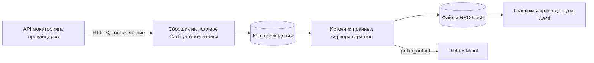

<!-- Source: README.md; SHA256: 7c621642e5f1a46bac66e4bc744f70aebb014c610d22de034088845fdc170405 -->

<!-- translations:start -->
[English](../../../README.md) | [简体中文](../zh-CN/README.md) | [हिन्दी](../hi-IN/README.md) | [Español (España)](../es-ES/README.md) | [Español (Latinoamérica)](../es-419/README.md) | [العربية (السعودية)](../ar-SA/README.md) | [Afrikaans](../af-ZA/README.md) | [አማርኛ](../am-ET/README.md) | [العربية (مصر)](../ar-EG/README.md) | [العربية (المغرب)](../ar-MA/README.md) | [বাংলা](../bn-BD/README.md) | [Deutsch](../de-DE/README.md) | [فارسی](../fa-IR/README.md) | [Filipino](../fil-PH/README.md) | [Français](../fr-FR/README.md) | [Français (Maroc)](../fr-MA/README.md) | [Français (Sénégal)](../fr-SN/README.md) | [Hausa](../ha-NG/README.md) | [עברית](../he-IL/README.md) | [Bahasa Indonesia](../id-ID/README.md) | [Igbo](../ig-NG/README.md) | [Italiano](../it-IT/README.md) | [日本語](../ja-JP/README.md) | [한국어](../ko-KR/README.md) | [Malagasy](../mg-MG/README.md) | [मराठी](../mr-IN/README.md) | [Bahasa Melayu](../ms-MY/README.md) | [Nederlands](../nl-NL/README.md) | [Polski](../pl-PL/README.md) | [Português (Brasil)](../pt-BR/README.md) | [Русский](README.md) | [Kinyarwanda](../rw-RW/README.md) | [Soomaali](../so-SO/README.md) | [Svenska](../sv-SE/README.md) | [Kiswahili](../sw-KE/README.md) | [தமிழ்](../ta-IN/README.md) | [తెలుగు](../te-IN/README.md) | [ไทย](../th-TH/README.md) | [Türkçe](../tr-TR/README.md) | [Українська](../uk-UA/README.md) | [اردو](../ur-PK/README.md) | [Tiếng Việt](../vi-VN/README.md) | [isiXhosa](../xh-ZA/README.md) | [Yorùbá](../yo-NG/README.md) | [繁體中文](../zh-TW/README.md) | [isiZulu](../zu-ZA/README.md)
<!-- translations:end -->

# plugin_cloud

Плагин для Cacti 1.2, который переносит ресурсы и метрики публичных облачных провайдеров в Cacti в виде обычных устройств, источников данных и графиков. Облачные рабочие нагрузки располагаются рядом с сетью, которая их обслуживает, под управлением прав доступа Cacti, а Thold и Maint могут отправлять по ним оповещения и подавлять их. Один плагин охватывает всех провайдеров за счёт отдельного драйвера для каждого провайдера: в первую очередь DigitalOcean, AWS, Google Cloud и Azure.

> **Статус: этап 3 (DigitalOcean и объекты Cacti), на проверке.** В рамках этого этапа добавляются драйвер DigitalOcean, шаблоны Cacti, устройство области видимости для каждой учётной записи с запросом данных (Data Query) для каждого типа ресурсов, ввод сервера скриптов и оценка количества запросов на странице New Graphs и на странице состояния. Первичные проверки на действующей учётной записи DigitalOcean зафиксированы в [сведениях о провайдерах](../../research/provider-facts.md). Не используйте в промышленной эксплуатации.

## Роли доступа

| Область (Realm) | Доступ |
| --- | --- |
| Cloud View | Существующие страницы мониторинга. |
| Cloud Operator | Мониторинг, а также страница Operations и персональные подтверждения при первичном разборе. |
| Cloud Admin | Доступ Operator, а также существующие действия по настройке и администрированию. |

После копирования файлов обновления откройте страницу Plugins с правами администратора, чтобы зарегистрировать
новую область прав (realm). Назначьте область Operator явным образом в разделе **Configuration > Users** или для групп пользователей.
При обновлении сохраняются существующие идентификаторы областей View и Admin и выданные разрешения. Доступ Admin
наследует доступ Operator, а доступ Operator наследует доступ View при каждом запросе;
это не добавляет сохранённых разрешений пользователям или группам. Для доступа к настройкам плагина также требуется
доступ Cloud Admin в дополнение к разрешению Settings в Cacti.

Разрешения на устройства в Cacti по-прежнему ограничивают строки и действия, доступные каждому пользователю; для несопоставленных объектов требуется администратор. Операторы могут проверять сохранённые учётные данные для учётной записи, к устройству Cacti которой у них есть доступ.
Учётные данные, конфигурация, сопоставление, удаление и другие административные изменения
остаются на административных страницах. Подтверждения действуют только в текущей
сессии пользователя, не более одного часа и только пока то же самое наблюдение остаётся
актуальным. Новые или изменившиеся наблюдения аннулируют их. Они никогда не помечают неудачное
измерение как исправное и не подавляют оповещения.

## Зачем это нужно

У каждого облачного провайдера есть собственная консоль мониторинга. При использовании параллельно с Cacti остаются три пробела:

- **Раздельное управление доступом.** Чтобы показать пользователю Cacti облачные метрики, ему приходится выдавать учётную запись в облаке.
- **Отсутствие сетевого контекста.** Локальные каналы строятся на графиках в Cacti; рабочие нагрузки за ними — в консоли каждого провайдера.
- **Раздельное оповещение.** Thold и Maint работают с источниками данных и устройствами Cacti, поэтому оповещения провайдеров приходится настраивать и подавлять отдельно для каждого провайдера.

Плагин опрашивает API мониторинга каждого провайдера через поллер Cacti, кэширует последние точки данных и передаёт их серверу скриптов Cacti. Поллер Cacti записывает файлы RRD, поэтому построение графиков, права доступа, Thold, Maint и boost работают так же, как для любых других данных Cacti.

## Архитектурные принципы

- **Только чтение.** Каждый драйвер может формировать только те операции провайдера, которые входят в его список разрешённых; плагин никогда не изменяет облачные ресурсы. ([ADR 0002](../../decisions/0002-read-only-with-operation-allowlist.md))
- **Только PHP, без SDK.** Подписание запросов и обмен токенов реализованы на PHP с использованием расширений, которые уже требуются для Cacti. Без зависимостей времени выполнения Composer. ([ADR 0003](../../decisions/0003-php-only-without-sdks.md))
- **Оценка стоимости перед сбором.** Плагин считывает только те метрики, для которых есть источник данных Cacti, показывает ожидаемое количество запросов и стоимость по прайс-листу до создания графиков, а также соблюдает месячный лимит. ([ADR 0005](../../decisions/0005-collect-only-what-is-graphed.md))
- **Никаких открытых учётных данных в базе данных.** Учётные данные поступают из зашифрованного хранилища, ключ к которому хранится в файле вне базы данных, из файла учётных данных или из удостоверения инстанса провайдера. ([ADR 0007](../../decisions/0007-credentials-outside-the-database-in-the-clear.md))

## Область применения и статус

| Фаза | Область | Этапы | Статус |
|---|---|---|---|
| 0, исследование | Подтверждение фактов о провайдерах, каталоги метрик, модель стоимости и квот, тестовые векторы подписи, прототип транспорта | [M1](https://github.com/somethingwithproof/plugin_cloud/milestone/1) | Выполнено, за исключением проверок, требующих действующую учётную запись провайдера |
| 1, ядро и DigitalOcean | Учётные записи, хранилище учётных данных, транспорт, сборщик, кэш наблюдений, объекты Cacti, страница состояния, Droplets и балансировщики нагрузки DigitalOcean | [M2](https://github.com/somethingwithproof/plugin_cloud/milestone/2), [M3](https://github.com/somethingwithproof/plugin_cloud/milestone/3), [M4](https://github.com/somethingwithproof/plugin_cloud/milestone/4) | M2 выполнен ([#81](https://github.com/somethingwithproof/plugin_cloud/pull/81)); драйвер M3, шаблоны и устройства области видимости объединены в основную ветку; оценки запросов, права доступа и проверки производительности на проверке; M4 не начат |
| 2, AWS | Signature Version 4, `AssumeRole`, роли инстансов, CloudWatch `GetMetricData`, региональная инвентаризация | [M5](https://github.com/somethingwithproof/plugin_cloud/milestone/5) | Не начат |
| 3, Google Cloud | JWT сервисной учётной записи, сервер метаданных, Cloud Monitoring `timeSeries.list` | [M6](https://github.com/somethingwithproof/plugin_cloud/milestone/6) | Не начат |
| 4, Azure | Учётные данные клиента Entra, управляемое удостоверение, Resource Graph, `metrics:getBatch` | [M7](https://github.com/somethingwithproof/plugin_cloud/milestone/7) | Не начат |
| 5, удалённые сборщики | Учётные записи на удалённых сборщиках данных Cacti | [M8](https://github.com/somethingwithproof/plugin_cloud/milestone/8) | Не начат |

Вне области проекта: изменение облачных ресурсов, создание или зеркалирование оповещений провайдеров, биллинговые отчёты, журналы и трассировки, а также собственный движок оповещений плагина. Дополнительные провайдеры (Hetzner Cloud, Akamai Cloud, Oracle Cloud и другие) вынесены в исследовательские задачи.

## Что входит в этап 2

- **Защищённая установка.** В PHP ниже 8.2 или при отсутствии ext-openssl установка и включение отклоняются с сообщением, а остальная часть Cacti продолжает работать.
- **Жизненный цикл.** Установка, обновление и удаление через страницу Plugins в Cacti. Обновления выполняются последовательно и устойчивы к прерыванию. Удаление сохраняет таблицы плагина, если вы не снимете отметку *Keep Plugin Tables on Uninstall*.
- **Раздельные области прав.** *Cloud Admin* открывает **Cloud Accounts**; *Cloud Operator* открывает **Cloud Operations**; *Cloud View* открывает **Cloud Health**. Admin наследует Operator, а Operator наследует View. Все три страницы находятся в разделе Management.
- **Учётные записи и учётные данные.** Добавление, редактирование, проверка и удаление учётных записей. Учётные данные либо шифруются в базе данных с помощью файла ключа, хранящегося вне её (AES-256-GCM), либо считываются из файла на поллере. В интерфейсе учётные данные доступны только для записи и скрываются в журналах.
- **Сборщик.** Запускается при каждом прогоне поллера, по одному экземпляру на поллер, в пределах бюджета времени. Получает аренду (lease) для каждой учётной записи, выполняет обнаружение с собственным интервалом и считывает метрики только для собственных активных источников данных плагина.
- **Состояние.** Состояние сбора, обнаружения, ресурсов и актуальности для каждой учётной записи, а также предупреждения о непригодном ключе хранилища, небезопасных файлах учётных данных и интервалах, которые поллер не может соблюсти.

## Установка и настройка

Эти шаги устанавливают код этапа 2 для ознакомления. Для них требуется Cacti 1.2.31 или новее на PHP 8.2 или новее.

1. Скопируйте репозиторий в `plugins/cloud` в вашем каталоге Cacti. Каталог должен называться `cloud`.
2. Создайте ключ хранилища вне корневого каталога веб-сервера. Поместите его в каталог, в который могут записывать только root и пользователь Cacti, и сделайте файл доступным для чтения только пользователю, от имени которого работают веб-сервер и поллер. Плагин никогда не создаёт и не перезаписывает этот файл:

   ```sh
   sudo install -d -m 0750 -o root -g cacti /etc/cacti
   head -c 32 /dev/urandom | sudo tee /etc/cacti/cloud-vault.key > /dev/null
   sudo chown cacti:cacti /etc/cacti/cloud-vault.key
   sudo chmod 0600 /etc/cacti/cloud-vault.key
   ```

   Замените `cacti` на пользователя, от имени которого работают ваш веб-сервер и поллер. Файл содержит 32 необработанных байта или 64 шестнадцатеричных символа. Создавайте его резервную копию вместе с базой данных; без него сохранённые учётные данные придётся ввести заново.
3. В Cacti откройте **Configuration > Plugins**, затем установите и включите *Cloud*.
4. В разделе **Configuration > Settings > Cloud** укажите *Vault Key File*, если вы использовали другой путь. Значение *Collector Time Budget* (по умолчанию 240 секунд) должно оставаться меньше интервала поллера.
5. Назначьте права *Cloud Admin*, *Cloud Operator* или *Cloud View* пользователям и группам в разделе **Configuration > Users**. При установке администратору назначаются Cloud Admin и Cloud View; Cloud Admin включает доступ Operator, поэтому администратору не требуется отдельное назначение Operator.
6. Добавьте учётные записи в разделе **Management > Cloud Accounts**, затем проверьте наличие предупреждений в **Management > Cloud Health**.

## Целевая совместимость

| Компонент | Целевое требование |
|---|---|
| Cacti | 1.2.31 или новее, без патчей ядра |
| PHP | 8.2 или новее; `setup.php` остаётся синтаксически совместимым с 8.0, чтобы неподдерживаемая среда выполнения получала отказ вместо поломки интерфейса Cacti |
| Расширения PHP | Никаких дополнительных сверх тех, что требуются для Cacti 1.2.31 |
| Thold, Maint | Изменения не требуются |

## Проектирование

- [docs/performance.md](../../performance.md) содержит замеры сборщика и страницы состояния с указанием использованного оборудования и настроек.
- [docs/PLAN.md](../../PLAN.md) — полный план: архитектура, факты о провайдерах и Cacti, на которых она основана (с источниками), контракт драйвера, расчёт стоимости, границы безопасности, тестирование и риски.
- [docs/decisions/](../../decisions) содержит записи об архитектурных решениях (ADR) для уже принятых решений.
- [docs/REQUIREMENTS.md](../../REQUIREMENTS.md) сопоставляет каждый идентификатор требования с соответствующей задачей.



## Отслеживание задач

- **Этапы (Milestones)** соответствуют этапам плана. У каждого есть эпик-задача со списком подзадач и подтверждающими результатами завершения.
- **Задачи (Issues)** типизируются метками: `type: requirement`, `type: research`, `type: decision`, `type: epic`. Задачи-требования формулируют нумерованные проверяемые требования (`REQ-AREA-NNN`) и критерии приёмки.
- **Метки** также содержат `area:`, `provider:`, `phase:`, `priority:` и `status:`. См. [CONTRIBUTING.md](../../../CONTRIBUTING.md#labels).
- На [доске проекта](https://github.com/users/somethingwithproof/projects/7) показаны все задачи по всем этапам.

## Разработка

CI проверяет синтаксис точек входа на PHP 8.0, запускает модульные и интеграционные тесты и PHPStan уровня 9, а также устанавливает плагин на PHP 8.2–8.5 с Cacti 1.2.31 и веткой 1.2.x. Кроме того, проверяется, что PHP 8.1 отклоняется без нарушения работы Cacti. В тестах используется Pest из тестовой обвязки плагинов ядра Cacti. Этот выбор является предварительным до принятия решения по [#12](https://github.com/somethingwithproof/plugin_cloud/issues/12). Файл [.github/workflows/plugin-ci-workflow.yml](../../../.github/workflows/plugin-ci-workflow.yml) перечисляет каждый шаг. Перед отправкой изменений локально запускайте `sh tests/lint-workflows.sh` и `sh locales/build_gettext.sh --check`.

## Участие в разработке

Ознакомьтесь с [CONTRIBUTING.md](../../../CONTRIBUTING.md). Коммиты должны содержать подпись DCO (sign-off). Обсуждение архитектуры ведётся в задачах; открытые решения помечаются меткой `type: decision`.

## Безопасность

Сообщайте об уязвимостях конфиденциально; см. [SECURITY.md](../../../SECURITY.md).

## Лицензия

GNU General Public License v2.0 — та же лицензия, что и у Cacti и его плагинов. См. [LICENSE](../../../LICENSE).
