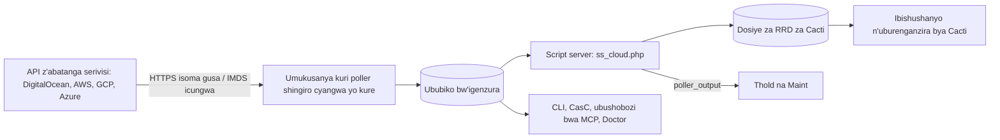

<!-- Source: README.md; SHA256: ac2074a40238686915802803c5efe773f33677f934281e0605e6e87a71a9d27d -->

<!-- translations:start -->
[English](../../../README.md) | [简体中文](../zh-CN/README.md) | [हिन्दी](../hi-IN/README.md) | [Español (España)](../es-ES/README.md) | [Español (Latinoamérica)](../es-419/README.md) | [العربية (السعودية)](../ar-SA/README.md) | [Afrikaans](../af-ZA/README.md) | [አማርኛ](../am-ET/README.md) | [العربية (مصر)](../ar-EG/README.md) | [العربية (المغرب)](../ar-MA/README.md) | [বাংলা](../bn-BD/README.md) | [Bosanski](../bs-BA/README.md) | [Deutsch](../de-DE/README.md) | [فارسی](../fa-IR/README.md) | [Filipino](../fil-PH/README.md) | [Français](../fr-FR/README.md) | [Français (Maroc)](../fr-MA/README.md) | [Français (Sénégal)](../fr-SN/README.md) | [Hausa](../ha-NG/README.md) | [עברית](../he-IL/README.md) | [Hrvatski](../hr-HR/README.md) | [Bahasa Indonesia](../id-ID/README.md) | [Igbo](../ig-NG/README.md) | [Italiano](../it-IT/README.md) | [日本語](../ja-JP/README.md) | [한국어](../ko-KR/README.md) | [Malagasy](../mg-MG/README.md) | [मराठी](../mr-IN/README.md) | [Bahasa Melayu](../ms-MY/README.md) | [Nederlands](../nl-NL/README.md) | [Polski](../pl-PL/README.md) | [Português (Brasil)](../pt-BR/README.md) | [Русский](../ru-RU/README.md) | [Kinyarwanda](README.md) | [Soomaali](../so-SO/README.md) | [Српски](../sr-RS/README.md) | [Svenska](../sv-SE/README.md) | [Kiswahili](../sw-KE/README.md) | [தமிழ்](../ta-IN/README.md) | [తెలుగు](../te-IN/README.md) | [ไทย](../th-TH/README.md) | [Türkçe](../tr-TR/README.md) | [Українська](../uk-UA/README.md) | [اردو](../ur-PK/README.md) | [Tiếng Việt](../vi-VN/README.md) | [isiXhosa](../xh-ZA/README.md) | [Yorùbá](../yo-NG/README.md) | [繁體中文](../zh-TW/README.md) | [isiZulu](../zu-ZA/README.md)
<!-- translations:end -->

# plugin_cloud

Umugereka wa Cacti 1.2 uzana ibikoresho n'ibipimo bivuye ku batanga serivisi za cloud rusange muri Cacti nk'ibikoresho bisanzwe, amasoko y'amakuru, n'ibishushanyo mbonera. Imirimo yo kuri cloud iherera iruhande rw'umuyoboro uyitwara, mu burenganzira bwa Cacti, kandi Thold na Maint bitanga impuruza bikazihagarika. Umugereka umwe ukorana na DigitalOcean, Amazon Web Services, Google Cloud, na Microsoft Azure binyuze mu bayobozi (drivers) ba PHP gusa bakora isoma gusa.

> **Imiterere: irimo gutunganywa, nta gisohorwa kiraboneka (`0.1.0-dev`).** Iri shami rishyira mu bikorwa abayobozi ba PHP gusa ba DigitalOcean, AWS, Google Cloud, na Azure, ikwirakwizwa ry'abakusanya amakuru bo kure n'ubuzima bw'umukozi usoma gusa, umutanga serivisi wa CasC na CLI y'umukoresha, ubushobozi bwa MCP, n'isuzuma rya Doctor. Inyandikorugero za Cacti zitangwa ubu zireba DigitalOcean Droplets n'ibiringaniza umutwaro (`templates/cloud_digitalocean.xml`); ibikubiyemo by'inyandikorugero za Cacti za AWS, Google Cloud, na Azure hamwe n'igenzura kuri konti zikora zitari iza DigitalOcean ([ibimenyetso by'abatanga serivisi](../../research/provider-facts.md)) ntibirarangira. Ntugikoreshe mu mikorere isanzwe (production).

## Abatanga serivisi bashyigikiwe

Buri muyobozi w'umutanga serivisi yanditswe muri `Drivers::production()`, atangwa na `Provider::released()`, kandi akora muri PHP gusa akoresheje `ext-openssl` na stream sockets nta SDK cyangwa ibikenerwa bya Composer igihe cy'ikoresha.

| Umutanga serivisi | Ibisabwa by'urugero | Inkomoko y'ibyangombwa | Kwemeza umwirondoro | Ibikoresho byabonetse | Ikusanya ry'ibipimo |
|---|---|---|---|---|---|
| DigitalOcean (`digitalocean`) | Ntacyo (bishingiye kuri token) | `vault`, `file` | Bearer token | `droplet`, `load_balancer` | `/v2/monitoring/metrics` hamwe no kubahiriza igabana ry'umuvuduko; itanga inyandikorugero za Cacti n'ibibazo by'amakuru |
| Amazon Web Services (`aws`) | `account_id` (imibare 12), `regions` | `vault`, `file`, `instance` | AWS SigV4 ya PHP gusa (`AWS4-HMAC-SHA256`), igenzura rya STS `GetCallerIdentity`, STS `AssumeRole` ku bushake, EC2 IMDSv2 (`169.254.169.254`) ku makonti ya `instance` | `ec2_instance`, `rds_instance`, `aws_elb` (ALB/NLB) | CloudWatch `GetMetricData` mu byiciro (kugeza ku bibazo 500 ku ihamagara rimwe) |
| Google Cloud (`gcp`) | `project` | `vault`, `file`, `instance` | RS256 service-account JWT ya PHP gusa binyuze kuri `ext-openssl` iguranwa kuri `oauth2.googleapis.com/token`, cyangwa seriveri ya metadata ya GCE (`metadata.google.internal`) ku makonti ya `instance` | `gce_instance` binyuze kuri `instances.aggregatedList` | Cloud Monitoring `timeSeries.list` |
| Microsoft Azure (`azure`) | `tenant`, `subscription`, `regions` | `vault`, `file`, `instance` | Uburyo bwa Entra ID OAuth2 client-credentials bwa PHP gusa (`client_secret` gusa; ibyemezo by'impamyabumenyi ntibirimo), cyangwa umwirondoro ucungwa wa Azure IMDS (`169.254.169.254`) ku matoken ya ARM na Monitor | `azure_vm` binyuze kuri ARM Resource Graph (icibwamo amapaji na `$skipToken` kandi ikavanamo ibisa) | Azure Monitor `metrics:getBatch` (kugeza ku bikoresho 50 ku ihamagara rimwe, ikemura ifungwa rya HTTP 429 na 529) |

## Ubushobozi bwashyizwe mu bikorwa

### Urubuga shingiro, ububiko bw'ibanga n'umukusanya

- **Iyinjiza n'imikorere irinzwe.** Aho twinjirira (`setup.php`, `cli/cloud.php`, `poller_cloud.php`, `ss_cloud.php`, n'inyandiko z'amapaji) bisomwa kuri PHP 8.0 kandi bikanga PHP iri munsi ya 8.2 cyangwa kubura `ext-openssl` bitangije Cacti. Ivugurura rikorwa ku murongo, ntirihindura iyo risubiwemo (`Schema::VERSION = 3`, imbonerahamwe 9), kandi rirokoka ihagarikwa. Gukuramo umugereka bigumana imbonerahamwe zawo keretse *Keep Plugin Tables on Uninstall* ikuweho.
- **Amakonti n'ibyangombwa.** Ongera, hindura, genzura, kandi usibe amakonti muri **Management > Cloud Accounts**. Ibyangombwa biva mu bubiko bw'ibanga bushyinguwe mu ibanga na AES-256-GCM (`plugin_cloud_secret`, bufite urufunguzo muri `/etc/cacti/cloud-vault.key` ku buryo busanzwe), muri dosiye yemewe muri *Credential File Directory* yagenwe (`cloud_credential_dir`, isanzwe irimo ubusa kugira ngo yange dosiye), cyangwa mu mwirondoro w'igikoresho cy'umutanga serivisi. Ibyangombwa byandikwa gusa muri UI kandi bigahishwa mu nyandiko z'ibikorwa.
- **Igenzura rikaze ryo gusohoka no gusoma gusa.** Buri muyobozi akorera inyuma ya `GuardedTransport` na `OutboundPolicy`: HTTPS umuyoboro 443 ku mazina y'amaseriveri nyayo ya buri mutanga serivisi, hamwe n'aho bahera ha metadata ya HTTP umuyoboro 80 yo hafi (`169.254.169.254`, `metadata.google.internal`) hafunguwe ku makonti ya `instance` gusa. Ibikorwa byo gusoma gusa biri ku rutonde rwemewe nibyo byonyine byemerewe.
- **Umukusanya n'igenzura ry'ikiguzi.** `poller_cloud.php` ikora ivuye kuri `poller_bottom` (igikorwa kimwe kuri buri poller binyuze mu bubiko bw'ibikorwa bya Cacti) mu gihe cya `cloud_collector_budget`, igafata ibyemezo by'igihe kuri buri konti, igakora ishakisha kuri `discover_interval`, igasoma ibipimo ku masoko y'amakuru ya Cacti akora gusa (`plugin_cloud_series`), ikubahiriza `request_share` na `monthly_ceiling`, kandi ikabika amakuru aheruka muri `plugin_cloud_observation` ku bwa `ss_cloud.php`.
- **Ibintu bya Cacti n'ibigereranyo by'ibisabwa.** Igumana igikoresho cy'urugero kuri buri konti (`plugin_cloud_device`), ikabika uburyo bwo gusubiramo imbonerahamwe z'ibikoresho by'urugero igihe cyo kubika igikoresho, ikinjiza inyandikorugero za DigitalOcean n'ibibazo by'amakuru bya script server (`templates/cloud_digitalocean.xml`, `cloud_do_droplet.xml`, `cloud_do_load_balancer.xml`), kandi ikerekana ibigereranyo by'ibisabwa n'ibiciro kuri **New Graphs** (`graphs_new_top_links`) na **Cloud Health**.

### Abakusanya amakuru bo kure

- `INFO` itangaza `remote_collect:1`. Amakonti ashobora guhabwa poller iyo ari yo yose ya Cacti ikora (`poller_id >= 1`), kandi `poller_cloud.php --poller=N` ikusanya gusa amakonti afitwe n'iyo poller.
- **Umukorwa wa `replicate_out`.** Ikwirakwiza imirongo ijyanye na poller ivuye muri `plugin_cloud_account`, `plugin_cloud_device`, `plugin_cloud_series`, n'imirongo y'inyandiko zishyinguwe mu ibanga ivuye muri `plugin_cloud_secret` (ku makonti akoresha ububiko bw'ibanga afitwe na poller igamijwe gusa) binyuze kuri `replicate_out_table()`. Dosiye z'imfunguzo z'ububiko bw'ibanga ntizigera zibikwa muri database cyangwa ngo zikwirakwizwe kandi ziguma kuri buri poller.
- **Umukorwa wa `remote_agent`.** Itanga incamake y'ubuzima ya JSON isoma gusa (`action=cloud_health`) yakira gusa ibipimo by'imibare yuzuye `poller_id` na `account_id` kandi ntigarure ibyangombwa, inzira za dosiye, cyangwa amabanga.

### Imikorwa y'urusobe (CasC, ubushobozi bwa MCP na Doctor)

- **Umutanga serivisi wa CasC (`casc_register_providers`).** Yandikisha umutanga serivisi wa `cloud` (verisiyo y'imbonerahamwe `1`) ufite iyohereza rya YAML na XML rya PHP gusa ritarimo ibihinduka, igenzura rya manifest, igenamigambi ry'itandukaniro, n'ishyira mu bikorwa ryemejwe. Ibyangombwa byo mu bubiko bw'ibanga byoherezwa nk'ibyifashishwa `vault:account:<name>`; ibisabwa by'amabanga yeruye (`secret`, `secrets`, `token`, `access_token`, `refresh_token`, `password`, `private_key`, `access_key_id`, `secret_access_key`, `session_token`, `client_secret`, `credential`, `credentials`, `vault_key`) birangwa. Gushyira mu bikorwa bisaba SHA-256 nyawo `--confirm=<PLAN_HASH>`.
- **MCP / Abilities API (`abilities_register`).** Yandikisha ubushobozi butatu bwo gusoma gusa bufungiranywe mu rwego rwa Cloud View (`cloud_health.php`) n'urugero rw'igikoresho cya Cacti ku bahamagara batari abayobozi, ntibitange ibyangombwa, imfunguzo z'ububiko bw'ibanga, cyangwa inzira za dosiye z'ibyangombwa:
  - `cloud-list-accounts` (`provider`, `poller_id` ku bushake)
  - `cloud-list-resources` (`account_id`, `type`, `lifecycle` ku bushake)
  - `cloud-get-health` (`account_id` ku bushake)
- **Isuzuma rya Doctor (`doctor_register_checks`).** Yandikisha isuzuma ritanu ry'isesengura riterekana ibanga cyangwa ibikoresho by'imfunguzo:
  - `cloud_schema`: kuba verisiyo y'imbonerahamwe igezweho
  - `cloud_vault_key`: gusomeka, uburenganzira, n'ubunini bwa dosiye y'urufunguzo rw'ububiko bw'ibanga
  - `cloud_drivers`: iyandikisha ry'abayobozi bo mu mikorere isanzwe ku batanga serivisi bose basohowe
  - `cloud_accounts_health`: amakonti akora yatsinzwe, yafunzwe ku muvuduko, cyangwa ashaje
  - `cloud_poller_intervals`: guhuza intera z'ikusanya ry'amakonti akora n'intera ya poller ya Cacti

## CLI

Koresha uvuye mu bubiko shingiro bwa Cacti hamwe na PHP 8.2 cyangwa hejuru:

```sh
# Operator and CasC CLI (options use --key=value form)
php plugins/cloud/cli/cloud.php export [--format=yaml|xml]
php plugins/cloud/cli/cloud.php validate --file=<path> [--format=yaml|xml]
php plugins/cloud/cli/cloud.php plan --file=<path> [--format=yaml|xml]
php plugins/cloud/cli/cloud.php apply --file=<path> --confirm=<PLAN_HASH> [--format=yaml|xml]
php plugins/cloud/cli/cloud.php health [--format=text|json] [--poller=<id>]

# Collector entry point (normally started by poller_bottom)
php plugins/cloud/poller_cloud.php [--poller=N] [--force] [--debug]
```

## Inshingano z'uburenganzira

| Urwego | Uburenganzira |
| --- | --- |
| Cloud View | Amapaji y'ubugenzuzi asanzweho. |
| Cloud Operator | Ubugenzuzi wongeyeho urupapuro rwa Operations n'ibyemezo bwite byo gusesengura ibibazo. |
| Cloud Admin | Uburenganzira bwa Operator wongeyeho imiterere isanzweho n'ibikorwa by'ubuyobozi. |

Nyuma yo gukopera dosiye z'ivugurura, fungura urupapuro rwa Plugins nk'umuyobozi kugira ngo wandikishe inzego. Tanga urwego rwa Operator mu buryo bweruye muri **Configuration > Users** cyangwa amatsinda y'abakoresha. Amavugurura agumana ID n'uburenganzira bwa View na Admin bisanzweho. Uburenganzira bwa Admin buvana uburenganzira bwa Operator, kandi ubwa Operator bukavana ubwa View kuri buri busabe; ibi ntibyongera uburenganzira bubitswe ku bakoresha cyangwa amatsinda. Igenamiterere ry'umugereka naryo risaba uburenganzira bwa Cloud Admin hiyongereyeho uruhushya rwa Settings muri Cacti.

Uburenganzira bw'igikoresho cya Cacti bugabanya imirongo n'ibikorwa buri mukoresha ashobora gukora; ibintu bitabonetse ku ikarita bisaba umuyobozi. Abakoresha ba Operator bashobora kugenzura icyangombwa kibitswe ku konti bafitiye uburenganzira bw'igikoresho cya Cacti. Ibyangombwa, igenamiterere, gushyira ku ikarita, gusiba, n'izindi mpinduka z'ubuyobozi biguma ku mapaji y'ubuyobozi. Ibyemezo bimara gusa mu gihe cy'umukoresha uriho, isaha imwe byibuze kandi igihe cyose isuzuma rimwe rikiri rishya. Isuzuma rishya cyangwa ryahindutse rirabitesha agaciro. Ntibigera byemeza igipimo cyatsinzwe nk'ikizima cyangwa ngo bihagarike impuruza.

## Impamvu

Buri mutanga serivisi wa cloud afite konsole ye y'ubugenzuzi. Iyo ikoreshejwe iruhande rwa Cacti, isiga ibyuho bitatu:

- **Igenzura ry'uburenganzira ritandukanye.** Kwerekana ibipimo bya cloud ku mukoresha wa Cacti bisobanuye kumuha umwirondoro wo kwinjira muri cloud.
- **Nta miterere y'umuyoboro igaragara.** Imiyoboro yo mu nzu ishyirwa mu bishushanyo muri Cacti; imirimo iri inyuma yayo igashyirwa mu bishushanyo muri konsole ya buri mutanga serivisi.
- **Impuruza zitandukanye.** Thold na Maint bikora ku masoko y'amakuru n'ibikoresho bya Cacti, bityo impuruza z'umutanga serivisi zigategurwa kandi zigahagarikwa ukubiri, rimwe kuri buri mutanga serivisi.

Umugereka usoma API y'ubugenzuzi ya buri mutanga serivisi kuri poller ya Cacti, ukabika amakuru aheruka, kandi ukayageza kuri script server ya Cacti. Poller ya Cacti yandika dosiye za RRD, bityo gukora ibishushanyo, uburenganzira, Thold, Maint, na boost bigakora nk'uko bikora ku yandi makuru yose ya Cacti.

## Amasezerano y'imikorere

- **Gusoma gusa.** Buri muyobozi ashobora gukora gusa ibikorwa by'umutanga serivisi biri ku rutonde rwemewe; umugereka ntuzigera uhindura igikoresho cya cloud. ([ADR 0002](../../decisions/0002-read-only-with-operation-allowlist.md))
- **PHP gusa, nta SDK.** Gushyira umukono no guhanahana token bikorwa muri PHP hakoreshejwe inyongera Cacti isanzwe ikenera. Nta bikenerwa bya Composer igihe cy'ikoresha. ([ADR 0003](../../decisions/0003-php-only-without-sdks.md))
- **Ikiguzi mbere yo gukusanya.** Umugereka usoma gusa ibipimo bifite isoko ry'amakuru ya Cacti, ukerekana umubare w'ibisabwa witezwe n'ikiguzi mbere y'uko ibishushanyo bikorwa, kandi ukubahiriza umupaka w'ukwezi. ([ADR 0005](../../decisions/0005-collect-only-what-is-graphed.md))
- **Nta byangombwa bigaragara mu bubiko bw'amakuru.** Ibyangombwa biva mu bubiko bw'ibanga bushyinguwe hakoreshejwe dosiye y'urufunguzo iri hanze y'ububiko bw'amakuru, muri dosiye y'ibyangombwa, cyangwa mu mwirondoro w'igikoresho cy'umutanga serivisi. ([ADR 0007](../../decisions/0007-credentials-outside-the-database-in-the-clear.md))

## Urugero n'imiterere

| Icyiciro | Ibikubiyemo | Intambwe | Imiterere |
|---|---|---|---|
| 0, ubushakashatsi | Kwemeza ibimenyetso by'abatanga serivisi, urutonde rw'ibipimo, imiterere y'ikiguzi n'umuvuduko, ibipimo by'umukono, igerageza ry'itwara | [M1](https://github.com/somethingwithproof/plugin_cloud/milestone/1) | Byarangiye, uretse igenzura rikenera amakonti akora y'abatanga serivisi |
| 1, shingiro na DigitalOcean | Amakonti, ububiko bw'ibyangombwa, itwara, umukusanya, ububiko bw'igenzura, ibintu bya Cacti, inyandikorugero, ibigereranyo by'ibisabwa, urupapuro rw'ubuzima, DigitalOcean Droplets n'ibiringaniza umutwaro | [M2](https://github.com/somethingwithproof/plugin_cloud/milestone/2), [M3](https://github.com/somethingwithproof/plugin_cloud/milestone/3), [M4](https://github.com/somethingwithproof/plugin_cloud/milestone/4) | Byashyizwe mu bikorwa; isuzuma ry'ibanze rya M4 rirategerejwe |
| 2, AWS | SigV4 ya PHP gusa, STS `AssumeRole`, inshingano z'igikoresho IMDSv2, urutonde rwa EC2/RDS/ELB, CloudWatch `GetMetricData` | [M5](https://github.com/somethingwithproof/plugin_cloud/milestone/5) | Umuyobozi yashyizwe mu bikorwa; inyandikorugero za Cacti n'igenzura kuri konti ikora birategerejwe |
| 3, Google Cloud | RS256 service-account JWT ya PHP gusa, seriveri ya metadata ya GCE, urutonde rwa Compute Engine, Cloud Monitoring `timeSeries.list` | [M6](https://github.com/somethingwithproof/plugin_cloud/milestone/6) | Umuyobozi yashyizwe mu bikorwa; inyandikorugero za Cacti n'igenzura kuri konti ikora birategerejwe |
| 4, Azure | Client credentials ya Entra ID, umwirondoro ucungwa wa IMDS, urutonde rwa VM rwa ARM Resource Graph, Azure Monitor `metrics:getBatch` | [M7](https://github.com/somethingwithproof/plugin_cloud/milestone/7) | Umuyobozi yashyizwe mu bikorwa; inyandikorugero za Cacti n'igenzura kuri konti ikora birategerejwe |
| 5, abakusanya bo kure n'urusobe | Abakusanya amakuru bo kure (`replicate_out`, `remote_agent`), umutanga serivisi wa CasC na CLI, ubushobozi bwa MCP, isuzuma rya Doctor | [M8](https://github.com/somethingwithproof/plugin_cloud/milestone/8) | Byashyizwe mu bikorwa |

Ibiri hanze y'uru rwego: guhindura ibikoresho bya cloud, gukora cyangwa kwigana impuruza z'abatanga serivisi, raporo z'ubwishyu, inyandiko z'ibikorwa n'imikurikiranire, hamwe na moteri y'impuruza y'umugereka ubwayo. Abandi batanga serivisi (Hetzner Cloud, Akamai Cloud, Oracle Cloud, n'abandi) ni ibibazo by'ubushakashatsi.

## Iyinjiza n'igenamiterere

Izi ntambwe zishyira mu bikorwa kode y'iterambere kugira ngo isuzumwe. Zisaba Cacti 1.2.31 cyangwa hejuru kuri PHP 8.2 cyangwa hejuru.

1. Koperera ububiko muri `plugins/cloud` munsi y'ububiko bwawe bwa Cacti. Ububiko bugomba kwitwa `cloud`.
2. Kora urufunguzo rw'ububiko bw'ibanga hanze ya web root kuri buri poller ikoresha ibyangombwa byo mu bubiko bw'ibanga. Rushyire mu bubiko aho root n'umukoresha wa Cacti bonyine bashobora kwandika, kandi utume dosiye isomwa gusa n'umukoresha ukoresha seriveri ya web na poller. Umugereka ntuzigera ukora cyangwa ngo wandike iyi dosiye:

   ```sh
   sudo install -d -m 0750 -o root -g cacti /etc/cacti
   head -c 32 /dev/urandom | sudo tee /etc/cacti/cloud-vault.key > /dev/null
   sudo chown cacti:cacti /etc/cacti/cloud-vault.key
   sudo chmod 0600 /etc/cacti/cloud-vault.key
   ```

   Simbuza `cacti` umukoresha ukoresha seriveri yawe ya web na poller. Dosiye ibika bytes 32 zitaratunganywa cyangwa inyuguti 64 za hexadecimal. Bika kopi yayo hamwe na database; udafite yo, ibyangombwa bibitswe bigomba kongera kwinjizwa.
3. Muri Cacti, fungura **Configuration > Plugins**, hanyuma winjize kandi ufungure *Cloud*.
4. Muri **Configuration > Settings > Cloud**, shiraho *Vault Key File* niba wakoresheje indi nzira, tegura *Credential File Directory* niba uteganya gukoresha ibyangombwa bishingiye kuri dosiye, kandi ugumane *Collector Time Budget* (240 amasegonda ku buryo busanzwe) munsi y'intera ya poller.
5. Tanga *Cloud Admin*, *Cloud Operator*, cyangwa *Cloud View* ku bakoresha n'amatsinda muri **Configuration > Users**. Iyinjiza riha Cloud Admin na Cloud View umuyobozi; Cloud Admin ikubiyemo uburenganzira bwa Operator, bityo umuyobozi ntakenera uruhushya rwa Operator rwihariye.
6. Ongera amakonti muri **Management > Cloud Accounts**, hanyuma ugenzure **Management > Cloud Health** urebe niba hari impuruza.

## Intego z'imikoranire

| Igice | Intego |
|---|---|
| Cacti | 1.2.31 cyangwa hejuru, nta mpinduka ku shingiro |
| PHP | 8.2 cyangwa hejuru; aho twinjirira haguma hasomwa kuri 8.0 kugira ngo igikoresho kidashyigikiwe gihakanirwe aho gutuma UI ya Cacti yangirika |
| Inyongera za PHP | `ext-openssl` (isabwa na Cacti 1.2.31); nta `ext-curl` kandi nta bikenerwa bya Composer igihe cy'ikoresha |
| Thold, Maint | Nta mpinduka zisabwa |

## Imiterere y'igishushanyo

- [docs/performance.md](../../performance.md) irimo ibipimo by'umukusanya n'urupapuro rw'ubuzima, hamwe n'ibikoresho n'igenamiterere byakoreshejwe.
- [docs/PLAN.md](../../PLAN.md) ni igishushanyo cyuzuye: imiterere, ibimenyetso by'abatanga serivisi na Cacti ishingiyeho (hamwe n'amasoko), amasezerano y'umuyobozi, imibare y'ikiguzi, imipaka y'umutekano, isuzuma, n'ingorane.
- [docs/decisions/](../../decisions/) ibika inyandiko z'ibyemezo by'imiterere ku mahitamo yamaze gukorwa.
- [docs/REQUIREMENTS.md](../../REQUIREMENTS.md) ihuza buri ID y'ibisabwa n'ikibazo cyayo.



## Uko imirimo ikurikiranwa

- **Intambwe** zikurikiza intambwe z'igishushanyo. Buri yose ifite ikibazo cya epic kigaragaza ibibazo bito n'ibimenyetso byo kurangiza.
- **Ibibazo** bitondekwa n'ibirango: `type: requirement`, `type: research`, `type: decision`, `type: epic`. Ibibazo by'ibisabwa bivuga ibisabwa bifite imibare bishobora kugeragezwa (`REQ-AREA-NNN`) n'ibipimo byo kwemerwa.
- **Ibirango** binajyana na `area:`, `provider:`, `phase:`, `priority:`, na `status:`. Reba [CONTRIBUTING.md](../../../CONTRIBUTING.md#labels).
- [Imbonerahamwe y'umushinga](https://github.com/users/somethingwithproof/projects/7) yerekana ibibazo byose mu ntambwe zose.

## Iterambere

CI ([.github/workflows/plugin-ci-workflow.yml](../../../.github/workflows/plugin-ci-workflow.yml)) igenzura ububiko bw'isohoka na verisiyo ya semantike (`bash tests/bin/archive-check.sh`), igasuzuma aho twinjirira kuri PHP 8.0, igakora isuzuma rya Pest unit (`phpunit.xml`) n'irya lifecycle integration (`phpunit-integration.xml`) na PHPStan urwego rwa 9 kuri PHP 8.2 kugeza kuri 8.5 ku ya Cacti `release/1.2.31` na `1.2.x` hamwe na `CLOUD_OFFLINE=1`, ikagenzura ihakana kuri PHP 8.1, ikemeza ibitabo bya gettext, igapima ikusanya ry'ibikurikirana 1,000 n'imikorere y'urupapuro rw'ubuzima, kandi igakora isuzuma rya workflow n'iyubahiriza rya REUSE.

Igenzura ryo hafi mbere yo kohereza:

```sh
bash tests/bin/archive-check.sh
sh tests/lint-workflows.sh
sh locales/build_gettext.sh --check
CACTI_PATH=/path/to/cacti phpstan analyse -c phpstan.neon --no-progress
```

Koresha Pest hamwe na `--configuration=phpunit.xml` ku isuzuma rya unit n'amategeko y'inkomoko, cyangwa `--configuration=phpunit-integration.xml` hamwe na `CACTI_PATH` na `CLOUD_TEST_DATABASE=disposable` kuri database ya Cacti ikoreshwa rimwe ku isuzuma rya lifecycle integration.

## Umusanzu

Soma [CONTRIBUTING.md](../../../CONTRIBUTING.md). Kohereza impinduka bisaba umukono wa DCO. Ibiganiro ku gishushanyo bibera mu bibazo; ibyemezo bigifunguye bitwara ikirango cya `type: decision`.

## Umutekano

Menyesha intege nke mu ibanga; reba [SECURITY.md](../../../SECURITY.md).

## Uruhushya

GNU General Public License v2.0, uruhushya rumwe n'urwa Cacti n'imigereka yayo. Reba [LICENSE](../../../LICENSE).
