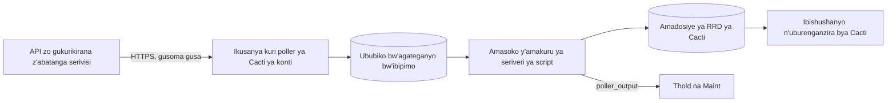

<!-- Source: README.md; SHA256: 7c621642e5f1a46bac66e4bc744f70aebb014c610d22de034088845fdc170405 -->

<!-- translations:start -->
[English](../../../README.md) | [简体中文](../zh-CN/README.md) | [हिन्दी](../hi-IN/README.md) | [Español (España)](../es-ES/README.md) | [Español (Latinoamérica)](../es-419/README.md) | [العربية (السعودية)](../ar-SA/README.md) | [Afrikaans](../af-ZA/README.md) | [አማርኛ](../am-ET/README.md) | [العربية (مصر)](../ar-EG/README.md) | [العربية (المغرب)](../ar-MA/README.md) | [বাংলা](../bn-BD/README.md) | [Deutsch](../de-DE/README.md) | [فارسی](../fa-IR/README.md) | [Filipino](../fil-PH/README.md) | [Français](../fr-FR/README.md) | [Français (Maroc)](../fr-MA/README.md) | [Français (Sénégal)](../fr-SN/README.md) | [Hausa](../ha-NG/README.md) | [עברית](../he-IL/README.md) | [Bahasa Indonesia](../id-ID/README.md) | [Igbo](../ig-NG/README.md) | [Italiano](../it-IT/README.md) | [日本語](../ja-JP/README.md) | [한국어](../ko-KR/README.md) | [Malagasy](../mg-MG/README.md) | [मराठी](../mr-IN/README.md) | [Bahasa Melayu](../ms-MY/README.md) | [Nederlands](../nl-NL/README.md) | [Polski](../pl-PL/README.md) | [Português (Brasil)](../pt-BR/README.md) | [Русский](../ru-RU/README.md) | [Kinyarwanda](README.md) | [Soomaali](../so-SO/README.md) | [Svenska](../sv-SE/README.md) | [Kiswahili](../sw-KE/README.md) | [தமிழ்](../ta-IN/README.md) | [తెలుగు](../te-IN/README.md) | [ไทย](../th-TH/README.md) | [Türkçe](../tr-TR/README.md) | [Українська](../uk-UA/README.md) | [اردو](../ur-PK/README.md) | [Tiếng Việt](../vi-VN/README.md) | [isiXhosa](../xh-ZA/README.md) | [Yorùbá](../yo-NG/README.md) | [繁體中文](../zh-TW/README.md) | [isiZulu](../zu-ZA/README.md)
<!-- translations:end -->

# plugin_cloud

Umugereka wa Cacti 1.2 uzana ibikoresho n'ibipimo bivuye ku batanga serivisi za cloud rusange muri Cacti nk'ibikoresho bisanzwe, amasoko y'amakuru, n'ibishushanyo mbonera (graphs). Imirimo yo kuri cloud ihita ijya iruhande rw'umuyoboro uyitwara, mu burenganzira bwa Cacti, kandi Thold na Maint bishobora gutanga impuruza no kuzihagarika by'agateganyo. Umugereka umwe ukorana n'abatanga serivisi bose, ukagira umuyobozi (driver) kuri buri mutanga serivisi: DigitalOcean, AWS, Google Cloud, na Azure ku ikubitiro.

> **Imiterere: icyiciro cya 3 (DigitalOcean n'ibintu bya Cacti), mu isuzuma.** Iki cyiciro cyongeramo umuyobozi wa DigitalOcean, inyandikorugero za Cacti, igikoresho cy'urugero kuri buri konti gifite ikibazo cy'amakuru kuri buri bwoko bw'igikoresho, iyinjiza rya seriveri ya script, n'ikigereranyo cy'ibisabwa kuri New Graphs no ku rupapuro rw'ubuzima. Isuzuma ry'ibanze kuri konti ikora ya DigitalOcean ryanditswe mu nyandiko y'[ibimenyetso by'abatanga serivisi](../../research/provider-facts.md). Ntugikoreshe mu mikorere isanzwe (production).

## Inshingano z'uburenganzira

| Urwego | Uburenganzira |
| --- | --- |
| Cloud View | Amapaji yo gukurikirana asanzweho. |
| Cloud Operator | Gukurikirana hiyongereyeho urupapuro rwa Operations n'ibyemezo byihariye byo kumenyesha isuzuma. |
| Cloud Admin | Uburenganzira bwa Operator hiyongereyeho amagenamiterere n'ibikorwa by'ubuyobozi bisanzweho. |

Nyuma yo gukopera amadosiye y'ivugurura, fungura urupapuro rwa Plugins nk'umuyobozi kugira ngo wandikishe urwego rushya. Tanga urwego rwa Operator ku buryo bweruye munsi ya **Configuration > Users** cyangwa mu matsinda y'abakoresha. Amavugurura agumana nimero (ID) z'inzego za View na Admin n'uburenganzira bisanzweho. Uburenganzira bwa Admin bukurikirana ubwa Operator, kandi ubwa Operator bukurikirana ubwa View kuri buri gikorwa; ibi ntibyongera uburenganzira bubitswe ku bakoresha cyangwa amatsinda. Amagenamiterere y'umugereka na yo asaba uburenganzira bwa Cloud Admin hiyongereyeho uruhushya rwa Settings rwa Cacti.

Uburenganzira bw'ibikoresho bya Cacti bukomeza kugabanya imirongo n'ibikorwa buri mukoresha ashobora kubona; ibintu bitarahuzwa bisaba umuyobozi. Abafite urwego rwa Operator bashobora kugenzura icyemezo cy'ibanga kibitswe ku konti bafitiye uburenganzira ku gikoresho cya Cacti. Ibyemezo by'ibanga, amagenamiterere, guhuza, gusiba n'izindi mpinduka z'ubuyobozi biguma mu mapaji y'ubuyobozi. Ibyemezo byo kumenyesha bimara gusa igihe cy'isaha imwe mu gihe nyirabyo akiri mu murongo, kandi mu gihe igipimo kimwe kigifite agaciro. Ibipimo bishya cyangwa byahindutse birabitesha agaciro. Ntibishobora na rimwe kwerekana igipimo cyananiranye nk'aho kimeze neza cyangwa guhagarika impuruza.

## Impamvu

Buri mutanga serivisi wa cloud agira urubuga rwe rwo gukurikirana. Iyo zikoreshejwe hamwe na Cacti, zisiga ibyuho bitatu:

- **Igenzura ry'uburenganzira ritandukanye.** Kwerekana ibipimo bya cloud ku mukoresha wa Cacti bisaba kumuha konti yo kwinjira muri cloud.
- **Nta makuru y'umuyoboro uhari.** Imiyoboro y'imbere mu kigo ishushanywa muri Cacti; imirimo ikorera inyuma yayo igashushanywa mu rubuga rwa buri mutanga serivisi.
- **Impuruza zitandukanye.** Thold na Maint bikora ku masoko y'amakuru n'ibikoresho bya Cacti, bityo impuruza z'abatanga serivisi zishyirwaho kandi zigahagarikwa ukwazo, rimwe kuri buri mutanga serivisi.

Umugereka usoma API yo gukurikirana ya buri mutanga serivisi ukoresheje poller ya Cacti, ukabika by'agateganyo ibipimo biheruka, kandi ukabiha seriveri ya script ya Cacti. Poller ya Cacti yandika amadosiye ya RRD, bityo gushushanya, uburenganzira, Thold, Maint, na boost bikora nk'uko bikora ku yandi makuru ayo ari yo yose ya Cacti.

## Imigambi y'imiterere

- **Gusoma gusa.** Buri muyobozi (driver) ashobora kubaka gusa ibikorwa by'umutanga serivisi biri ku rutonde rwemewe; umugereka ntushobora na rimwe guhindura igikoresho cya cloud. ([ADR 0002](../../decisions/0002-read-only-with-operation-allowlist.md))
- **PHP gusa, nta SDKs.** Gusinya no guhanahana utumeyo (tokens) bikorwa muri PHP hakoreshejwe imigereka Cacti isanzwe ikenera. Nta bikoresho bya Composer bikenerwa mu mikorere. ([ADR 0003](../../decisions/0003-php-only-without-sdks.md))
- **Ikiguzi mbere yo gukusanya.** Umugereka usoma gusa ibipimo bifite isoko y'amakuru ya Cacti, ukerekana umubare w'ibisabwa uteganyijwe n'igiciro cyo ku rutonde mbere y'uko ibishushanyo bikorwa, kandi ukubahiriza urugero ntarengwa rw'ukwezi. ([ADR 0005](../../decisions/0005-collect-only-what-is-graphed.md))
- **Nta byemezo by'ibanga bisomeka neza muri bazadane.** Ibyemezo by'ibanga bituruka mu bubiko bufungishijwe urufunguzo rw'idosiye iri hanze ya bazadane, mu dosiye y'ibyemezo by'ibanga, cyangwa mu ndangamuntu y'urugero rw'umutanga serivisi. ([ADR 0007](../../decisions/0007-credentials-outside-the-database-in-the-clear.md))

## Imbibi n'imiterere

| Icyiciro | Imbibi | Ibyiciro bikuru | Imiterere |
|---|---|---|---|
| 0, ubushakashatsi | Kwemeza ibimenyetso by'umutanga serivisi, urutonde rw'ibipimo, imiterere y'igiciro n'igipimo, ibipimo byo gusinya, igerageza ry'ubwikorezi | [M1](https://github.com/somethingwithproof/plugin_cloud/milestone/1) | Byararangiye, uretse isuzuma rikenera konti ikora y'umutanga serivisi |
| 1, umutima n'ibya DigitalOcean | Amakonti, ububiko bw'ibyemezo by'ibanga, ubwikorezi, ikusanya, ububiko bw'agateganyo bw'ibipimo, ibintu bya Cacti, urupapuro rw'ubuzima, Droplets n'ibiringaniza umutwaro bya DigitalOcean | [M2](https://github.com/somethingwithproof/plugin_cloud/milestone/2), [M3](https://github.com/somethingwithproof/plugin_cloud/milestone/3), [M4](https://github.com/somethingwithproof/plugin_cloud/milestone/4) | M2 yarangiye ([#81](https://github.com/somethingwithproof/plugin_cloud/pull/81)); umuyobozi wa M3, inyandikorugero, n'ibikoresho by'urugero byahujwe; ibigereranyo by'ibisabwa, uburenganzira, n'isuzuma ry'imikorere biri mu isuzuma; M4 ntabwo iratangira |
| 2, AWS | Signature Version 4, `AssumeRole`, inshingano z'ingero, CloudWatch `GetMetricData`, urutonde rw'uturere | [M5](https://github.com/somethingwithproof/plugin_cloud/milestone/5) | Ntabwo biratangira |
| 3, Google Cloud | JWT ya konti ya serivisi, seriveri ya metadata, Cloud Monitoring `timeSeries.list` | [M6](https://github.com/somethingwithproof/plugin_cloud/milestone/6) | Ntabwo biratangira |
| 4, Azure | Ibyemezo by'umukiriya wa Entra, indangamuntu icungwa, Resource Graph, `metrics:getBatch` | [M7](https://github.com/somethingwithproof/plugin_cloud/milestone/7) | Ntabwo biratangira |
| 5, ibikusanya bya kure | Amakonti ku bikusanya amakuru bya kure bya Cacti | [M8](https://github.com/somethingwithproof/plugin_cloud/milestone/8) | Ntabwo biratangira |

Ibiri hanze y'imbibi: guhindura ibikoresho bya cloud, gukora cyangwa kwigana impuruza z'umutanga serivisi, raporo z'inyemezabuguzi, amadosiye y'ibyabaye n'imikurikiranire (logs and traces), na moteri y'impuruza yihariye y'umugereka. Abandi batanga serivisi (Hetzner Cloud, Akamai Cloud, Oracle Cloud, n'abandi) ni ibibazo by'ubushakashatsi.

## Ibyo icyiciro cya 2 gitanga

- **Iyinjiza ririnzwe.** Kuri PHP iri munsi ya 8.2, cyangwa idafite ext-openssl, kwiyandikisha no gushyiramo birangwa n'ubutumwa, kandi ibindi bya Cacti bigakomeza gukora.
- **Imikorere y'ubuzima bw'umugereka.** Gushyiramo, kuvugurura, no gukuramo binyuze ku rupapuro rwa Plugins rwa Cacti. Amavugurura akorwa ku murongo kandi akomeza n'iyo habaye guhagarara. Gukuramo kugumana imbonerahamwe z'umugereka uretse igihe ukuyemo *Keep Plugin Tables on Uninstall*.
- **Inzego zitandukanye.** *Cloud Admin* ifungura **Cloud Accounts**; *Cloud Operator* ifungura **Cloud Operations**; *Cloud View* ifungura **Cloud Health**. Admin ikurikirana Operator, kandi Operator igakurikirana View. Amapaji yose atatu ari munsi ya Management.
- **Amakonti n'ibyemezo by'ibanga.** Ongeramo, hindura, genzura, kandi usibe amakonti. Icyemezo cy'ibanga gishobora kubikwa gifunzwe muri bazadane hakoreshejwe urufunguzo rw'idosiye rubitswe hanze yayo (AES-256-GCM), cyangwa kigasomwa mu dosiye iri kuri poller. Ibyemezo by'ibanga byandikwa gusa mu rubuga kandi bigahishwa mu madosiye y'ibikorwa (logs).
- **Ikusanya.** Ritangira kuri buri mikorere ya poller, urugero rumwe kuri buri poller, mu gihe cyagenwe. Rifata uruhushya ruto kuri buri konti, rigakora ishakisha ku ntera yaryo, kandi rigasoma ibipimo gusa ku masoko y'amakuru akora y'umugereka bwite.
- **Ubuzima.** Imiterere y'ikusanya, ishakisha, ibikoresho, n'ubushya kuri buri konti, hiyongereyeho imburira ku rufunguzo rw'ububiko rudakoresheka, amadosiye y'ibyemezo by'ibanga atizewe, n'intera poller idashobora kubahiriza.

## Gushyiramo no kugena imiterere

Izi ntambwe zishyiramo kode y'icyiciro cya 2 yo gusuzuma. Zisaba Cacti 1.2.31 cyangwa irenga kuri PHP 8.2 cyangwa irenga.

1. Kopera ububiko mu `plugins/cloud` munsi y'ububiko bwawe bwa Cacti. Ububiko bugomba kwitwa `cloud`.
2. Kora urufunguzo rw'ububiko hanze y'umuzi w'urubuga. Rushyire mu bubiko root n'umukoresha wa Cacti bonyine bashobora kwandikamo, kandi ugire idosiye isomeka gusa n'umukoresha ukoresha seriveri y'urubuga na poller. Umugereka ntushobora na rimwe gukora cyangwa kwandika iyi dosiye:

   ```sh
   sudo install -d -m 0750 -o root -g cacti /etc/cacti
   head -c 32 /dev/urandom | sudo tee /etc/cacti/cloud-vault.key > /dev/null
   sudo chown cacti:cacti /etc/cacti/cloud-vault.key
   sudo chmod 0600 /etc/cacti/cloud-vault.key
   ```

   Simbuza `cacti` umukoresha ukoresha seriveri yawe y'urubuga na poller. Iyi dosiye ibika bayiti 32 mbisi cyangwa inyuguti n'imibare 64 bya hexadecimal. Yibike hamwe na bazadane; utayifite, ibyemezo by'ibanga bibitswe bigomba kongera kwinjizwa.
3. Muri Cacti, fungura **Configuration > Plugins**, hanyuma ushyiremo kandi wemeze *Cloud*.
4. Munsi ya **Configuration > Settings > Cloud**, shyiraho *Vault Key File* niba wakoresheje indi nzira. *Collector Time Budget* (isanzwe ari amasegonda 240) igomba kuguma munsi y'intera ya poller.
5. Tanga *Cloud Admin*, *Cloud Operator* cyangwa *Cloud View* ku bakoresha n'amatsinda munsi ya **Configuration > Users**. Gushyiramo biha Cloud Admin na Cloud View umuyobozi; Cloud Admin harimo uburenganzira bwa Operator, bityo umuyobozi ntakenera urundi ruhushya rwihariye rwa Operator.
6. Ongeramo amakonti munsi ya **Management > Cloud Accounts**, hanyuma ugenzure **Management > Cloud Health** ko nta mburira zirimo.

## Intego z'imikoranire

| Igice | Intego |
|---|---|
| Cacti | 1.2.31 cyangwa irenga, nta mpinduka z'umutima |
| PHP | 8.2 cyangwa irenga; `setup.php` iguma isomeka kuri 8.0 kugira ngo sisitemu itemewe ihakanirwe aho kwangiza urubuga rwa Cacti |
| Imigereka ya PHP | Nta yindi uretse iyo Cacti 1.2.31 isaba |
| Thold, Maint | Nta mpinduka zisabwa |

## Imiterere

- [docs/performance.md](../../performance.md) irimo ibipimo by'ikusanya n'urupapuro rw'ubuzima, hamwe n'ibikoresho n'amagenamiterere byakoreshejwe.
- [docs/PLAN.md](../../PLAN.md) ni igenamigambi ryuzuye: imyubakire, ibimenyetso by'umutanga serivisi na Cacti ishingiyeho (hamwe n'amasoko), amasezerano y'umuyobozi (driver), imibare y'ikiguzi, imbibi z'umutekano, igerageza, n'ibyago.
- [docs/decisions/](../../decisions) ibitse inyandiko z'ibyemezo by'imyubakire ku mahitamo yamaze gukorwa.
- [docs/REQUIREMENTS.md](../../REQUIREMENTS.md) ihuza buri nimero y'ibisabwa n'ikibazo cyayo.



## Uko akazi gakurikiranwa

- **Ibyiciro bikuru (Milestones)** bikurikira ibyiciro bikuru by'igenamigambi. Buri kimwe gifite ikibazo gikuru kirimo ibibazo bito byacyo n'ibimenyetso byo gusohoka.
- **Ibibazo** bitondekwa hakoreshejwe uturango: `type: requirement`, `type: research`, `type: decision`, `type: epic`. Ibibazo by'ibisabwa bitangaza ibisabwa bifite nimero kandi bisuzumwa (`REQ-AREA-NNN`) n'ibipimo byo kwemerwa.
- **Uturango** tunagira `area:`, `provider:`, `phase:`, `priority:`, na `status:`. Reba [CONTRIBUTING.md](../../../CONTRIBUTING.md#labels).
- [Ikibaho cy'umushinga](https://github.com/users/somethingwithproof/projects/7) cyerekana ibibazo byose mu byiciro bikuru byose.

## Iterambere

CI isuzuma aho kwinjirira ku nyandiko kuri PHP 8.0, ikora isuzuma ry'ibice n'iryo guhuza na PHPStan ku rwego rwa 9, kandi igashyiramo umugereka kuri PHP 8.2 kugera kuri 8.5 kuri Cacti 1.2.31 n'ishami rya 1.2.x. Inagenzura ko PHP 8.1 yangwa itangije Cacti. Isuzuma rikoresha Pest yo mu bikoresho by'umugereka by'umutima wa Cacti. Iryo hitamo ni iry'agateganyo kugeza igihe [#12](https://github.com/somethingwithproof/plugin_cloud/issues/12) ifatiweho umwanzuro. [.github/workflows/plugin-ci-workflow.yml](../../../.github/workflows/plugin-ci-workflow.yml) itondeka buri ntambwe. Koresha `sh tests/lint-workflows.sh` na `sh locales/build_gettext.sh --check` kuri mudasobwa yawe mbere yo kohereza.

## Gutanga umusanzu

Soma [CONTRIBUTING.md](../../../CONTRIBUTING.md). Kohereza impinduka (commits) bisaba isinywa rya DCO. Ibiganiro ku miterere bibera ku bibazo; ibyemezo bitarafatwa bigira ikirango cya `type: decision`.

## Umutekano

Menyesha ibyuho by'umutekano mu ibanga; reba [SECURITY.md](../../../SECURITY.md).

## Uruhushya

GNU General Public License v2.0, uruhushya rumwe nka Cacti n'imigereka yayo. Reba [LICENSE](../../../LICENSE).
