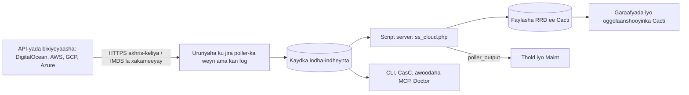

<!-- Source: README.md; SHA256: ac2074a40238686915802803c5efe773f33677f934281e0605e6e87a71a9d27d -->

<!-- translations:start -->
[English](../../../README.md) | [简体中文](../zh-CN/README.md) | [हिन्दी](../hi-IN/README.md) | [Español (España)](../es-ES/README.md) | [Español (Latinoamérica)](../es-419/README.md) | [العربية (السعودية)](../ar-SA/README.md) | [Afrikaans](../af-ZA/README.md) | [አማርኛ](../am-ET/README.md) | [العربية (مصر)](../ar-EG/README.md) | [العربية (المغرب)](../ar-MA/README.md) | [বাংলা](../bn-BD/README.md) | [Bosanski](../bs-BA/README.md) | [Deutsch](../de-DE/README.md) | [فارسی](../fa-IR/README.md) | [Filipino](../fil-PH/README.md) | [Français](../fr-FR/README.md) | [Français (Maroc)](../fr-MA/README.md) | [Français (Sénégal)](../fr-SN/README.md) | [Hausa](../ha-NG/README.md) | [עברית](../he-IL/README.md) | [Hrvatski](../hr-HR/README.md) | [Bahasa Indonesia](../id-ID/README.md) | [Igbo](../ig-NG/README.md) | [Italiano](../it-IT/README.md) | [日本語](../ja-JP/README.md) | [한국어](../ko-KR/README.md) | [Malagasy](../mg-MG/README.md) | [मराठी](../mr-IN/README.md) | [Bahasa Melayu](../ms-MY/README.md) | [Nederlands](../nl-NL/README.md) | [Polski](../pl-PL/README.md) | [Português (Brasil)](../pt-BR/README.md) | [Русский](../ru-RU/README.md) | [Kinyarwanda](../rw-RW/README.md) | [Soomaali](README.md) | [Српски](../sr-RS/README.md) | [Svenska](../sv-SE/README.md) | [Kiswahili](../sw-KE/README.md) | [தமிழ்](../ta-IN/README.md) | [తెలుగు](../te-IN/README.md) | [ไทย](../th-TH/README.md) | [Türkçe](../tr-TR/README.md) | [Українська](../uk-UA/README.md) | [اردو](../ur-PK/README.md) | [Tiếng Việt](../vi-VN/README.md) | [isiXhosa](../xh-ZA/README.md) | [Yorùbá](../yo-NG/README.md) | [繁體中文](../zh-TW/README.md) | [isiZulu](../zu-ZA/README.md)
<!-- translations:end -->

# plugin_cloud

Waa plugin-ka Cacti 1.2 oo keenaya agabyada iyo cabbirrada bixiyeyaasha daruurta guud (public cloud) gudaha Cacti iyagoo ah aalado caadi ah, ilo xogeed, iyo garaafyo. Culaysyada shaqada daruurta waxay fariisanayaan dhinaca shabakadda qaadda, iyadoo ay xukumayaan oggolaanshooyinka Cacti, halka Thold iyo Maint ay ka digaan oo ay xakameeyaan digniinahooda. Hal plugin ayaa daboolaya DigitalOcean, Amazon Web Services, Google Cloud, iyo Microsoft Azure iyadoo la adeegsanayo darawallo PHP saafi ah oo akhris-keliya.

> **Xaaladda: horumarin ayaa ku socota, weli lama sii deyn (`0.1.0-dev`).** Laantani waxay hirgelisaa darawallo PHP saafi ah oo loogu talagalay DigitalOcean, AWS, Google Cloud, iyo Azure, koobiyeynta ururiyaha xogta fog iyo caafimaadka wakiilka akhris-keliya, bixiye CasC iyo CLI-ga hawlwadeenka, awoodaha MCP, iyo hubinta Doctor. Qaababka Cacti ee hadda la socda waxay daboolayaan DigitalOcean Droplets iyo load balancers (`templates/cloud_digitalocean.xml`); xirmooyinka qaababka Cacti ee AWS, Google Cloud, iyo Azure iyo xaqiijinta akoonnada tooska ah ee ka baxsan DigitalOcean ([xaqiiqooyinka bixiyeyaasha](../../research/provider-facts.md)) weli ma dhammaan. Ha ku shaqeyn nidaamka wax-soo-saarka.

## Bixiyeyaasha la taageero

Darawal kasta oo bixiye ah waxaa lagu diiwaangeliyaa `Drivers::production()`, waxaa bixiya `Provider::released()`, wuxuuna ku shaqeeyaa PHP saafi ah isagoo adeegsanaya `ext-openssl` iyo stream sockets iyadoo aan lahayn SDK ama ku-tiirsanaanta Composer xilliga orodka.

| Bixiye | Meelaha baaxadda | Ilaha aqoonsiga | Xaqiijinta | Agabyada la helay | Ururinta cabbirrada |
|---|---|---|---|---|---|
| DigitalOcean (`digitalocean`) | Ma jiro (token-ku xaddidan) | `vault`, `file` | Bearer token | `droplet`, `load_balancer` | `/v2/monitoring/metrics` oo leh wacyigelinta saamiga xadka codsiyada; waxaa la socda qaababka Cacti iyo weydiimaha xogta |
| Amazon Web Services (`aws`) | `account_id` (12 lambar), `regions` | `vault`, `file`, `instance` | AWS SigV4 PHP saafi ah (`AWS4-HMAC-SHA256`), xaqiijinta STS `GetCallerIdentity`, ikhtiyaari STS `AssumeRole`, EC2 IMDSv2 (`169.254.169.254`) ee akoonnada `instance` | `ec2_instance`, `rds_instance`, `aws_elb` (ALB/NLB) | CloudWatch `GetMetricData` oo kooxeysan (ilaa 500 weydiin halkii wicitaan) |
| Google Cloud (`gcp`) | `project` | `vault`, `file`, `instance` | RS256 service-account JWT PHP saafi ah iyadoo loo marayo `ext-openssl` oo lagu beddelo `oauth2.googleapis.com/token`, ama serfarka metadata ee GCE (`metadata.google.internal`) ee akoonnada `instance` | `gce_instance` iyadoo loo marayo `instances.aggregatedList` | Cloud Monitoring `timeSeries.list` |
| Microsoft Azure (`azure`) | `tenant`, `subscription`, `regions` | `vault`, `file`, `instance` | Socodka client-credentials ee Entra ID OAuth2 PHP saafi ah (`client_secret` keliya; caddaymaha shahaadada waa laga reebay), ama aqoonsiga la maareeyo ee Azure IMDS (`169.254.169.254`) ee token-yada ARM iyo Monitor | `azure_vm` iyadoo loo marayo ARM Resource Graph (lagu qaybiyay `$skipToken` lagana saaray nuqullada) | Azure Monitor `metrics:getBatch` (ilaa 50 agab halkii wicitaan, oo maareeya xaddidaadda HTTP 429 iyo 529) |

## Awoodaha la hirgeliyay

### Madal aasaasi ah, qasnad, iyo ururiye

- **Rakibaad iyo wareeg nololeed la ilaaliyay.** Meelaha laga soo galo (`setup.php`, `cli/cloud.php`, `poller_cloud.php`, `ss_cloud.php`, iyo qoraallada bogga) waxay ku kala saaran yihiin PHP 8.0 waxayna diidaan PHP ka hooseeya 8.2 ama maqnaanshaha `ext-openssl` iyagoon jabin Cacti. Cusboonaysiintu waa kuwo nidaamsan, aan isbeddelin marka lagu celiyo (`Schema::VERSION = 3`, 9 miis), waxayna ka badbaadaan kala go'. Ka-saaristu waxay haysataa miisaska plugin-ka ilaa laga saaro calaamadda *Keep Plugin Tables on Uninstall*.
- **Akoonnada iyo aqoonsiyada.** Ku dar, wax ka beddel, xaqiiji, kana tirtir akoonnada hoosta **Management > Cloud Accounts**. Aqoonsiyadu waxay ka yimaadaan qasnadda qarsoon ee AES-256-GCM (`plugin_cloud_secret`, oo furaha caadiga ah ku leh `/etc/cacti/cloud-vault.key`), fayl ku xaddidan galka la habeeyay ee *Credential File Directory* (`cloud_credential_dir`, maran si caadi ah si uu u diido faylasha), ama aqoonsiga instance-ka bixiyaha. Aqoonsiyadu waa qoris-keliya gudaha UI waxaana laga qariyaa diiwaannada.
- **Xakamayn adag oo bixitaan iyo akhris-keliya ah.** Darawal kastaa wuxuu ka shaqeeyaa gadaasha `GuardedTransport` iyo `OutboundPolicy`: HTTPS dekedda 443 oo ku aaddan magacyada martigeliyeyaasha saxda ah ee bixiye kasta, iyadoo meelaha dhammaadka metadata ee HTTP dekedda 80 ee link-local (`169.254.169.254`, `metadata.google.internal`) loo shido keliya akoonnada `instance`. Keliya hawlgallada akhris-keliya ee liiska la oggol yahay ku jira ayaa la oggol yahay.
- **Ururiyaha iyo xakamaynta kharashka.** `poller_cloud.php` wuxuu ka ordaa `poller_bottom` (hal habsocod halkii poller iyadoo loo marayo diiwaanka habsocodka ee Cacti) gudaha `cloud_collector_budget`, wuxuu helaa kirada akoonkiiba, wuxuu ku socdaa baadigoobka `discover_interval`, wuxuu akhriyaa cabbirrada ilaha xogta Cacti ee firfircoon keliya (`plugin_cloud_series`), wuxuu ixtiraamaa `request_share` iyo `monthly_ceiling`, wuxuuna ku kaydiyaa dhibcaha xogta ugu dambeeyay `plugin_cloud_observation` si loogu adeegsado `ss_cloud.php`.
- **Shayyada Cacti iyo qiyaasta codsiyada.** Wuxuu hayaa aalad xaddidan (scope device) akoonkiiba (`plugin_cloud_device`), wuxuu ilaaliyaa hababka dib-u-tixraaca aaladda xaddidan marka la kaydinayo aaladaha, wuxuu soo dejiyaa qaababka DigitalOcean iyo weydiimaha xogta script server-ka (`templates/cloud_digitalocean.xml`, `cloud_do_droplet.xml`, `cloud_do_load_balancer.xml`), wuxuuna ku muujiyaa qiyaasta codsiyada iyo qiimaha liiska **New Graphs** (`graphs_new_top_links`) iyo **Cloud Health**.

### Ururiyeyaasha xogta fog

- `INFO` wuxuu caddeeyaa `remote_collect:1`. Akoonnada waxaa loo qoondeyn karaa poller kasta oo Cacti ah oo shaqeynaya (`poller_id >= 1`), iyo `poller_cloud.php --poller=N` wuxuu ururiyaa keliya akoonnada uu leeyahay poller-kaas.
- **Hook-ga `replicate_out`.** Wuxuu koobiyeyaa safafka ku xaddidan poller-ka ee ka yimaada `plugin_cloud_account`, `plugin_cloud_device`, `plugin_cloud_series`, iyo safafka qoraalka qarsoon ee ka yimaada `plugin_cloud_secret` (keliya akoonnada qasnadda ku xiran ee uu leeyahay poller-ka bartilmaameedka ah) iyadoo loo marayo `replicate_out_table()`. Faylasha furaha qasnadda ee cayriin lama geliyo keydka xogta lamana koobiyeyo, waxayna ku sugnaadaan gudaha poller kasta.
- **Hook-ga `remote_agent`.** Wuxuu soo bandhigaa soo koobid caafimaad oo JSON ah oo akhris-keliya ah (`action=cloud_health`) oo aqbalaya keliya halbeegyada tiro-buuxda ah ee `poller_id` iyo `account_id`, soona celinaya eber aqoonsiyo, waddooyin fayl, ama sir ah.

### Hook-yada nidaamka deegaanka (CasC, awoodaha MCP, iyo Doctor)

- **Bixiyaha CasC (`casc_register_providers`).** Wuxuu diiwaangeliyaa bixiyaha `cloud` (nooca qaab-dhismeedka `1`) oo leh dhoofinta YAML iyo XML PHP saafi ah oo go'an, xaqiijinta manifest, qorshaynta farqiga, iyo dhaqangelin la xaqiijiyay. Aqoonsiyada qasnadda waxaa loo dhoofiyaa sida tixraacyada `vault:account:<name>`; meelaha sirta cayriin (`secret`, `secrets`, `token`, `access_token`, `refresh_token`, `password`, `private_key`, `access_key_id`, `secret_access_key`, `session_token`, `client_secret`, `credential`, `credentials`, `vault_key`) waa la diidaa. Dhaqangelintu waxay u baahan tahay SHA-256 sax ah `--confirm=<PLAN_HASH>`.
- **MCP / Abilities API (`abilities_register`).** Wuxuu diiwaangeliyaa saddex awoodood oo si adag akhris-keliya u ah oo lagu xiro aagga Cloud View (`cloud_health.php`) iyo baaxadda aaladda Cacti ee wacayaasha aan maamulka ahayn, iyagoon soo saarin wax aqoonsi ah, furayaal qasnad ah, ama waddooyin faylka aqoonsiga:
  - `cloud-list-accounts` (`provider`, `poller_id` ikhtiyaari ah)
  - `cloud-list-resources` (`account_id`, `type`, `lifecycle` ikhtiyaari ah)
  - `cloud-get-health` (`account_id` ikhtiyaari ah)
- **Hubinta Doctor (`doctor_register_checks`).** Waxay diiwaangelisaa shan hubin baadhitaan oo aan soo bandhigin qiimo sir ah ama agab furaha:
  - `cloud_schema`: casriyeynta nooca qaab-dhismeedka
  - `cloud_vault_key`: akhrinta, oggolaanshooyinka, iyo cabbirka faylka furaha qasnadda
  - `cloud_drivers`: diiwaangelinta darawallada wax-soo-saarka ee dhammaan bixiyeyaasha la sii daayay
  - `cloud_accounts_health`: akoonnada shaqeynaya ee fashilmay, la xaddiday, ama duugoobay
  - `cloud_poller_intervals`: iswaafajinta muddooyinka ururinta akoonnada shaqeynaya iyo muddada poller-ka Cacti

## CLI

Ka ordi galka xididka Cacti adigoo adeegsanaya PHP 8.2 ama ka dambeeya:

```sh
# Operator and CasC CLI (options use --key=value form)
php plugins/cloud/cli/cloud.php export [--format=yaml|xml]
php plugins/cloud/cli/cloud.php validate --file=<path> [--format=yaml|xml]
php plugins/cloud/cli/cloud.php plan --file=<path> [--format=yaml|xml]
php plugins/cloud/cli/cloud.php apply --file=<path> --confirm=<PLAN_HASH> [--format=yaml|xml]
php plugins/cloud/cli/cloud.php health [--format=text|json] [--poller=<id>]

# Collector entry point (normally started by poller_bottom)
php plugins/cloud/poller_cloud.php [--poller=N] [--force] [--debug]
```

## Doorarka gelitaanka

| Aagga (Realm) | Gelitaanka |
| --- | --- |
| Cloud View | Boggaga kormeerka ee jira. |
| Cloud Operator | Kormeerka oo lagu daray bogga Operations iyo oggolaanshooyinka kala soocidda shakhsi ahaaneed. |
| Cloud Admin | Gelitaanka Operator oo lagu daray qaabeynta jirta iyo tallaabooyinka maamulka. |

Marka aad nuqul ka samayso faylasha cusboonaysiinta, fur bogga Plugins adigoo ah maamule si aad u diiwaangeliso aagagga. Si cad ugu qoondee aagga Operator hoosta **Configuration > Users** ama kooxaha isticmaaleyaasha. Cusboonaysiintu waxay haysataa aqoonsiyada iyo deeqaha View iyo Admin ee jira. Gelitaanka Admin wuxuu dhaxlaa gelitaanka Operator, gelitaanka Operator-na wuxuu dhaxlaa gelitaanka View codsi kasta; tani kuma kordhiso deeqo kaydsan isticmaaleyaasha ama kooxaha. Dejinta plugin-ka waxay sidoo kale u baahan tahay gelitaanka Cloud Admin marka lagu daro oggolaanshaha Settings ee Cacti.

Oggolaanshooyinka aaladda Cacti waxay xaddidaan safafka iyo tallaabooyinka u furan isticmaale kasta; shayyada aan la khariidayn waxay u baahan yihiin maamule. Hawlwadeenadu waxay xaqiijin karaan aqoonsiga kaydsan ee akoonka ay heli karaan aaladdiisa Cacti. Aqoonsiyada, qaabeynta, khariidaynta, tirtiridda, iyo isbeddellada kale ee maamulka waxay ku sii jiraan boggaga maamulka. Oggolaanshooyinku waxay ku jiraan oo keliya fadhiga isticmaalaha hadda jira, ugu badnaan hal saac iyo keliya inta isla indha-indheyntaasi ay weli cusub tahay. Indha-indheyn cusub ama isbeddeshay ayaa burisa. Waligood cabbir fashilmay uma calaamadiyaan mid caafimaad qaba mana joojiyaan digniinaha.

## Sababta

Bixiye kasta oo daruur ah wuxuu leeyahay qalabkiisa kormeerka u gaarka ah. Marka lala shaqaysiiyo Cacti, waxay ka tagaan saddex farqi:

- **Xakamayn gelitaan oo kala go'an.** In isticmaalaha Cacti la tuso cabbirrada daruurta waxay ka dhigan tahay in la siiyo galitaanka daruurta.
- **Ma jiro xaalad shabakadeed.** Xiriirrada gudaha waxaa garaaf looga sameeyaa Cacti; culaysyada shaqada ee ka dambeeyana waxaa garaaf looga sameeyaa qalabka bixiye kasta.
- **Digniino kala go'an.** Thold iyo Maint waxay ka shaqeeyaan ilaha xogta iyo aaladaha Cacti, sidaas darteed digniinaha bixiyeyaasha waxaa loo habeeyaa loona xakameeyaa si gooni ah, hal mar bixiye kasta.

Plugin-ku wuxuu ka akhriyaa API-ga kormeerka ee bixiye kasta poller-ka Cacti, wuxuu kaydiyaa dhibcaha xogta ugu dambeeyay, wuxuuna u adeegaa script server-ka Cacti. Poller-ka Cacti ayaa qora faylasha RRD, sidaas darteed garaaf samaynta, oggolaanshooyinka, Thold, Maint, iyo boost waxay u shaqeeyaan sidii xog kasta oo Cacti ah.

## Ballanqaadyada naqshadda

- **Akhris-keliya.** Darawal kastaa wuxuu dhisi karaa oo keliya hawlgallada bixiyaha ee ku jira liiska la oggol yahay; plugin-ku waligiis wax kama beddelo agabka daruurta. ([ADR 0002](../../decisions/0002-read-only-with-operation-allowlist.md))
- **PHP keliya, ma jiro SDK.** Saxeexidda iyo isweydaarsiga token-ka waxaa lagu hirgeliyay PHP iyadoo la adeegsanayo kordhinta Cacti horay uga baahnayd. Ma jiro ku-tiirsanaanta Composer xilliga orodka. ([ADR 0003](../../decisions/0003-php-only-without-sdks.md))
- **Kharashka ka hor ururinta.** Plugin-ku wuxuu akhriyaa keliya cabbirrada leh il xogeed oo Cacti ah, wuxuu muujiyaa tirada codsiyada la filayo iyo kharashka qiimaha liiska ka hor inta aan la abuurin garaafyada, wuxuuna dhaqangeliyaa xad bille ah. ([ADR 0005](../../decisions/0005-collect-only-what-is-graphed.md))
- **Ma jiraan aqoonsiyo qoraal cad ah oo ku jira keydka xogta.** Aqoonsiyadu waxay ka yimaadaan qasnad qarsoon oo furaha ku leh fayl ka baxsan keydka xogta, fayl aqoonsi, ama aqoonsiga instance-ka bixiyaha. ([ADR 0007](../../decisions/0007-credentials-outside-the-database-in-the-clear.md))

## Baaxadda iyo xaaladda

| Marxalad | Baaxadda | Meelo muhiim ah | Xaaladda |
|---|---|---|---|
| 0, cilmi-baaris | Xaqiijinta xaqiiqooyinka bixiyeyaasha, buugga cabbirrada, qaabka kharashka iyo xawaaraha, tijaabooyinka saxeexidda, tijaabada gaadiidka | [M1](https://github.com/somethingwithproof/plugin_cloud/milestone/1) | Dhammaatay, marka laga reebo hubinta u baahan akoonnada bixiyeyaasha ee tooska ah |
| 1, xudunta iyo DigitalOcean | Akoonnada, qasnadda aqoonsiga, gaadiidka, ururiyaha, kaydka indha-indheynta, shayyada Cacti, qaababka, qiyaasta codsiyada, bogga caafimaadka, DigitalOcean Droplets iyo load balancers | [M2](https://github.com/somethingwithproof/plugin_cloud/milestone/2), [M3](https://github.com/somethingwithproof/plugin_cloud/milestone/3), [M4](https://github.com/somethingwithproof/plugin_cloud/milestone/4) | La hirgeliyay; xaqiijinta tijaabada M4 ayaa la sugayaa |
| 2, AWS | SigV4 PHP saafi ah, STS `AssumeRole`, doorarka instance ee IMDSv2, diiwaanka EC2/RDS/ELB, CloudWatch `GetMetricData` | [M5](https://github.com/somethingwithproof/plugin_cloud/milestone/5) | Darawalka waa la hirgeliyay; qaababka Cacti iyo xaqiijinta akoonka tooska ah ayaa la sugayaa |
| 3, Google Cloud | RS256 service-account JWT PHP saafi ah, serfarka metadata ee GCE, diiwaanka Compute Engine, Cloud Monitoring `timeSeries.list` | [M6](https://github.com/somethingwithproof/plugin_cloud/milestone/6) | Darawalka waa la hirgeliyay; qaababka Cacti iyo xaqiijinta akoonka tooska ah ayaa la sugayaa |
| 4, Azure | Client credentials ee Entra ID, aqoonsiga la maareeyo ee IMDS, diiwaanka VM ee ARM Resource Graph, Azure Monitor `metrics:getBatch` | [M7](https://github.com/somethingwithproof/plugin_cloud/milestone/7) | Darawalka waa la hirgeliyay; qaababka Cacti iyo xaqiijinta akoonka tooska ah ayaa la sugayaa |
| 5, ururiyeyaasha fog iyo nidaamka deegaanka | Ururiyeyaasha xogta fog (`replicate_out`, `remote_agent`), bixiyaha CasC iyo CLI, awoodaha MCP, hubinta Doctor | [M8](https://github.com/somethingwithproof/plugin_cloud/milestone/8) | La hirgeliyay |

Ka baxsan baaxadda: wax ka beddelidda agabka daruurta, abuurista ama koobiyeynta digniinaha bixiyeyaasha, warbixinnada biilasha, diiwaannada iyo raadinta, iyo matoor digniin ah oo plugin-ku leeyahay. Bixiyeyaasha kale (Hetzner Cloud, Akamai Cloud, Oracle Cloud, iyo kuwo kale) waa arrimo cilmi-baaris ah.

## Rakibaadda iyo qaabeynta

Tallaabooyinkani waxay rakibayaan koodhka horumarinta si loo qiimeeyo. Waxay u baahan yihiin Cacti 1.2.31 ama ka dambeeya oo ku shaqeeya PHP 8.2 ama ka dambeeya.

1. Nuqul ka samee kaydka ilaa `plugins/cloud` hoosta galkaaga Cacti. Magaca galku waa inuu ahaadaa `cloud`.
2. Ka abuur furaha qasnadda meel ka baxsan web root-ka poller kasta oo isticmaala aqoonsiyo ku xiran qasnadda. Ku rid gal ay root iyo isticmaalaha Cacti oo keliya wax ku qori karaan, kana dhig faylka mid ay akhrin karaan oo keliya isticmaalaha maamula web server-ka iyo poller-ka. Plugin-ku waligiis ma abuuro mana qoro faylkan:

   ```sh
   sudo install -d -m 0750 -o root -g cacti /etc/cacti
   head -c 32 /dev/urandom | sudo tee /etc/cacti/cloud-vault.key > /dev/null
   sudo chown cacti:cacti /etc/cacti/cloud-vault.key
   sudo chmod 0600 /etc/cacti/cloud-vault.key
   ```

   Ku beddel `cacti` isticmaalaha maamula web server-kaaga iyo poller-ka. Faylku wuxuu hayaa 32 bytes cayriin ah ama 64 xaraf oo hexadecimal ah. La kaydso keydka xogta; la'aantiis, aqoonsiyada kaydsan waa in dib loo geliyaa.
3. Gudaha Cacti, fur **Configuration > Plugins**, ka dibna rakib oo shid *Cloud*.
4. Hoosta **Configuration > Settings > Cloud**, deji *Vault Key File* haddii aad isticmaashay waddo kale, habeey *Credential File Directory* haddii aad qorshaynayso inaad isticmaasho aqoonsiyo ku salaysan fayl, oo ku hay *Collector Time Budget* (caadi ahaan 240 ilbiriqsi) ka hooseeya muddada poller-ka.
5. Sii *Cloud Admin*, *Cloud Operator*, ama *Cloud View* isticmaaleyaasha iyo kooxaha hoosta **Configuration > Users**. Rakibaaddu waxay siisaa Cloud Admin iyo Cloud View maamulaha; Cloud Admin waxaa ku jira gelitaanka Operator, sidaas darteed maamuluhu uma baahna deeq Operator oo gaar ah.
6. Ku dar akoonnada hoosta **Management > Cloud Accounts**, ka dibna ka hubi **Management > Cloud Health** wixii digniino ah.

## Yoolalka iswaafajinta

| Qayb | Yoolka |
|---|---|
| Cacti | 1.2.31 ama ka dambeeya, iyada oo aan lahayn wax beddelaad ah oo xudunta ah |
| PHP | 8.2 ama ka dambeeya; meelaha laga soo galo waxay ku sii jiraan kuwo lagu kala saari karo 8.0 si nidaam aan la taageerin uu u helo diidmo halkii UI-ga Cacti uu jabi lahaa |
| Kordhinta PHP | `ext-openssl` (waxaa u baahan Cacti 1.2.31); ma jiro `ext-curl` mana jiro ku-tiirsanaanta Composer xilliga orodka |
| Thold, Maint | Looma baahna wax isbeddel ah |

## Naqshadda

- [docs/performance.md](../../performance.md) waxaa ku jira cabbirrada ururiyaha iyo bogga caafimaadka, oo ay la socdaan qalabka iyo dejimaha la isticmaalay.
- [docs/PLAN.md](../../PLAN.md) waa qorshaha buuxa: qaab-dhismeedka, xaqiiqooyinka bixiyaha iyo Cacti ee uu ku tiirsan yahay (oo leh ilo), heshiiska darawalka, xisaabinta kharashka, xuduudaha amniga, tijaabinta, iyo khataraha.
- [docs/decisions/](../../decisions/) wuxuu hayaa diiwaannada go'aannada qaab-dhismeedka ee doorashooyinka hore loo sameeyay.
- [docs/REQUIREMENTS.md](../../REQUIREMENTS.md) wuxuu ku xiraa aqoonsi kasta oo shuruud ah arrintiisa.



## Sida shaqada loola socdo

- **Meelaha muhiimka ah** waxay raacaan meelaha muhiimka ah ee qorshaha. Mid kastaa wuxuu leeyahay arrin epic ah oo taxaysa arrimaha hoose iyo caddaynta bixitaanka.
- **Arrimaha** waxaa lagu kala saaraa calaamad: `type: requirement`, `type: research`, `type: decision`, `type: epic`. Arrimaha shuruuduhu waxay sheegaan shuruudo lambar leh oo la tijaabin karo (`REQ-AREA-NNN`) iyo shuruudaha oggolaanshaha.
- **Calaamadaha** waxay sidoo kale sitaan `area:`, `provider:`, `phase:`, `priority:`, iyo `status:`. Eeg [CONTRIBUTING.md](../../../CONTRIBUTING.md#labels).
- [Guddiga mashruuca](https://github.com/users/somethingwithproof/projects/7) wuxuu muujiyaa dhammaan arrimaha guud ahaan meelaha muhiimka ah.

## Horumarinta

CI ([.github/workflows/plugin-ci-workflow.yml](../../../.github/workflows/plugin-ci-workflow.yml)) waxay hubisaa kaydka sii deynta iyo nooca macnaha (`bash tests/bin/archive-check.sh`), waxay ku hubisaa meelaha laga soo galo PHP 8.0, waxay ku oroddaa tijaabooyinka cutubka Pest (`phpunit.xml`) iyo isdhexgalka wareegga nololeed (`phpunit-integration.xml`) iyo PHPStan heerka 9 ee PHP 8.2 ilaa 8.5 iyadoo lala barbardhigayo Cacti `release/1.2.31` iyo `1.2.x` oo leh `CLOUD_OFFLINE=1`, waxay hubisaa diidmada PHP 8.1, waxay xaqiijisaa buugaagta gettext, waxay cabbirtaa ururinta 1,000-taxane iyo waxqabadka bogga caafimaadka, waxayna socodsiisaa hubinta workflow iyo u hoggaansanaanta REUSE.

Hubinta gudaha ka hor inta aan la riixin:

```sh
bash tests/bin/archive-check.sh
sh tests/lint-workflows.sh
sh locales/build_gettext.sh --check
CACTI_PATH=/path/to/cacti phpstan analyse -c phpstan.neon --no-progress
```

Ku ordi Pest adigoo adeegsanaya `--configuration=phpunit.xml` tijaabooyinka cutubka iyo xeerarka koodhka isha, ama `--configuration=phpunit-integration.xml` oo leh `CACTI_PATH` iyo `CLOUD_TEST_DATABASE=disposable` oo ku wajahan keyd xogeed Cacti ah oo la tuuri karo si loo sameeyo tijaabooyinka isdhexgalka wareegga nololeed.

## Ku biirista

Akhri [CONTRIBUTING.md](../../../CONTRIBUTING.md). Commit-yadu waxay u baahan yihiin saxiixa DCO. Doodaha naqshaddu waxay ka dhacaan arrimaha; go'aannada furan waxay sitaan calaamadda `type: decision`.

## Amniga

U soo sheeg nuglaanshaha si qarsoodi ah; eeg [SECURITY.md](../../../SECURITY.md).

## Shatiga

GNU General Public License v2.0, isla shatiga Cacti iyo plugin-yadeeda. Eeg [LICENSE](../../../LICENSE).
