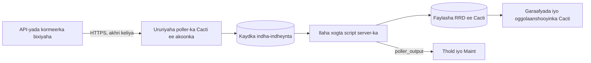

<!-- Source: README.md; SHA256: 7c621642e5f1a46bac66e4bc744f70aebb014c610d22de034088845fdc170405 -->

<!-- translations:start -->
[English](../../../README.md) | [简体中文](../zh-CN/README.md) | [हिन्दी](../hi-IN/README.md) | [Español (España)](../es-ES/README.md) | [Español (Latinoamérica)](../es-419/README.md) | [العربية (السعودية)](../ar-SA/README.md) | [Afrikaans](../af-ZA/README.md) | [አማርኛ](../am-ET/README.md) | [العربية (مصر)](../ar-EG/README.md) | [العربية (المغرب)](../ar-MA/README.md) | [বাংলা](../bn-BD/README.md) | [Bosanski](../bs-BA/README.md) | [Deutsch](../de-DE/README.md) | [فارسی](../fa-IR/README.md) | [Filipino](../fil-PH/README.md) | [Français](../fr-FR/README.md) | [Français (Maroc)](../fr-MA/README.md) | [Français (Sénégal)](../fr-SN/README.md) | [Hausa](../ha-NG/README.md) | [עברית](../he-IL/README.md) | [Hrvatski](../hr-HR/README.md) | [Bahasa Indonesia](../id-ID/README.md) | [Igbo](../ig-NG/README.md) | [Italiano](../it-IT/README.md) | [日本語](../ja-JP/README.md) | [한국어](../ko-KR/README.md) | [Malagasy](../mg-MG/README.md) | [मराठी](../mr-IN/README.md) | [Bahasa Melayu](../ms-MY/README.md) | [Nederlands](../nl-NL/README.md) | [Polski](../pl-PL/README.md) | [Português (Brasil)](../pt-BR/README.md) | [Русский](../ru-RU/README.md) | [Kinyarwanda](../rw-RW/README.md) | [Soomaali](README.md) | [Српски](../sr-RS/README.md) | [Svenska](../sv-SE/README.md) | [Kiswahili](../sw-KE/README.md) | [தமிழ்](../ta-IN/README.md) | [తెలుగు](../te-IN/README.md) | [ไทย](../th-TH/README.md) | [Türkçe](../tr-TR/README.md) | [Українська](../uk-UA/README.md) | [اردو](../ur-PK/README.md) | [Tiếng Việt](../vi-VN/README.md) | [isiXhosa](../xh-ZA/README.md) | [Yorùbá](../yo-NG/README.md) | [繁體中文](../zh-TW/README.md) | [isiZulu](../zu-ZA/README.md)
<!-- translations:end -->

# plugin_cloud

Waa plugin-ka Cacti 1.2 oo keenaya agabyada iyo cabbirrada bixiyeyaasha daruurta guud (public cloud) gudaha Cacti iyagoo ah aalado caadi ah, ilo xogeed, iyo garaafyo. Culaysyada shaqada daruurta waxay markaas dhinac fariisanayaan shabakadda qaadda, iyadoo ay xukumayaan oggolaanshooyinka Cacti, halka Thold iyo Maint ay ka digi karaan ama joojin karaan digniinahooda. Hal plugin ayaa daboolaya bixiye kasta, isagoo leh darawal (driver) bixiye kasta u gaar ah: DigitalOcean, AWS, Google Cloud, iyo Azure marka hore.

> **Xaaladda: marxaladda 3 (DigitalOcean iyo shayyada Cacti), dib-u-eegis ayaa ku socota.** Marxaladdani waxay ku daraysaa darawalka DigitalOcean, qaababka (templates) Cacti, aalad xaddidan (scope device) akoonkiiba oo leh weydiinta xogta nooca agab kasta, gelinta script server-ka, iyo qiyaasta codsiyada ee New Graphs iyo bogga caafimaadka. Hubintii ugu horreysay ee laga sameeyay akoon DigitalOcean oo toos ah waxaa lagu diiwaangeliyay [xaqiiqooyinka bixiyaha](../../research/provider-facts.md). Ha ku shaqeyn nidaamka wax-soo-saarka (production).

## Doorarka gelitaanka

| Aagga (Realm) | Gelitaanka |
| --- | --- |
| Cloud View | Boggaga kormeerka ee jira. |
| Cloud Operator | Kormeerka oo lagu daray bogga Hawlgallada (Operations) iyo qirashada kala-soocidda shakhsi ahaaneed. |
| Cloud Admin | Gelitaanka Operator oo lagu daray qaabeynta jirta iyo tallaabooyinka maamulka. |

Markaad koobiyayso faylasha cusboonaysiinta, u fur bogga Plugins adigoo ah maamule si aad u diiwaangeliso
aagga cusub. Si cad ugu qoondee aagga Operator hoos yimaada **Configuration > Users** ama kooxaha isticmaalayaasha.
Cusboonaysiinta waxay ilaalinaysaa aqoonsiyada (IDs) iyo deeqaha aagga View iyo Admin ee jira. Gelitaanka Admin
wuxuu dhaxlayaa gelitaanka Operator, gelitaanka Operator-kuna wuxuu dhaxlayaa gelitaanka View codsi kasta;
tani kuma darayso deeqo kaydsan isticmaalayaasha ama kooxaha. Dejinta plugin-ka waxay sidoo kale u baahan tahay
gelitaanka Cloud Admin marka lagu daro oggolaanshaha Settings ee Cacti.

Oggolaanshooyinka aaladaha Cacti waxay weli xaddidayaan safafka iyo ficillada u furan isticmaale kasta; shayyada aan la khariidadayn waxay u baahan yihiin maamule. Operators-ku waxay xaqiijin karaan aqoonsiga kaydsan ee akoonka ay geli karaan aaladdiisa Cacti.
Aqoonsiyada sirta ah, qaabeynta, khariidadaynta, tirtiridda iyo isbeddellada kale ee maamulka
waxay ku sii jiraan boggaga maamulka. Qirashooyinka waxay shaqeeyaan oo keliya fadhiga hadda jira ee isticmaalaha,
ugu badnaan hal saac iyo keliya inta isla indha-indheyntaasi ay cusub tahay.
Indha-indheyn cusub ama isbeddeshay way burisaa iyaga. Waligood cabbir fashilmay kuma calaamadeeyaan caafimaad qab mana joojiyaan digniinaha.

## Sababta

Bixiye kasta oo daruur ah wuxuu leeyahay qalabkiisa kormeerka u gaarka ah. Marka lala socodsiiyo Cacti, waxay ka tagaan saddex farqi:

- **Xakamayn gelitaan oo kala go'an.** In isticmaalaha Cacti la tuso cabbirrada daruurta waxay ka dhigan tahay in la siiyo galitaan daruurta ah.
- **Ma jiro xiriirka shabakadda.** Xiriirrada gudaha (on-premises) waxaa lagu garaafeeyaa Cacti; culaysyada shaqada ee ka dambeeyana waxaa lagu garaafeeyaa qalabka bixiye kasta.
- **Digniino kala go'an.** Thold iyo Maint waxay ka shaqeeyaan ilaha xogta iyo aaladaha Cacti, sidaas darteed digniinaha bixiyeyaasha waxaa loo qaabeeyaa loona joojiyaa si gooni ah, hal mar bixiye kasta.

Plugin-ku wuxuu ka akhriyaa API-ga kormeerka ee bixiye kasta poller-ka Cacti, wuxuu keydiyaa (cache) dhibcaha xogta ugu dambeeyay, wuxuuna u gudbiyaa script server-ka Cacti. Poller-ka Cacti wuxuu qoraa faylasha RRD, sidaas darteed garaafaynta, oggolaanshooyinka, Thold, Maint, iyo boost waxay u shaqeeyaan sidii xog kasta oo Cacti ah.

## Ballanqaadyada naqshadaynta

- **Akhri-keliya (Read-only).** Darawal kasta wuxuu dhisi karaa oo keliya hawlgallada bixiyaha ee ku jira liiska oggolaanshaha (allowlist); plugin-ku waligii ma beddelo agab daruur ah. ([ADR 0002](../../decisions/0002-read-only-with-operation-allowlist.md))
- **PHP keliya, ma jiraan SDKs.** Saxiixa iyo isweydaarsiga calaamadaha (tokens) waxaa lagu hirgeliyay PHP iyadoo la adeegsanayo kordhinnada (extensions) uu Cacti horeba uga baahan yahay. Ma jiraan ku-tiirsanaan waqtiga-shaqada ee Composer. ([ADR 0003](../../decisions/0003-php-only-without-sdks.md))
- **Qiimaha ka hor ururinta.** Plugin-ku wuxuu akhriyaa oo keliya cabbirrada leh il xogeed oo Cacti ah, wuxuu muujiyaa tirada codsiyada la filayo iyo kharashka qiimaha liiska ka hor intaan garaafyada la abuurin, wuxuuna dhaqan-geliyaa xad bille ah. ([ADR 0005](../../decisions/0005-collect-only-what-is-graphed.md))
- **Ma jiraan aqoonsiyo qoraal-cad ah oo ku jira kaydka xogta.** Aqoonsiyada waxay ka yimaadaan khasnadda qarsoon (encrypted vault) oo fure u yahay fayl ka baxsan kaydka xogta, ama faylka aqoonsiga, ama aqoonsiga tusaalaha (instance identity) ee bixiyaha. ([ADR 0007](../../decisions/0007-credentials-outside-the-database-in-the-clear.md))

## Baaxadda iyo xaaladda

| Wajiga | Baaxadda | Marxaladaha | Xaaladda |
|---|---|---|---|
| 0, cilmi-baaris | Xaqiijinta xaqiiqooyinka bixiyaha, liisaska cabbirrada, qaabka kharashka iyo heerka, tusaalooyinka tijaabada saxiixa, tijaabada gaadiidka | [M1](https://github.com/somethingwithproof/plugin_cloud/milestone/1) | Dhammaatay, marka laga reebo hubinta u baahan akoon bixiye oo toos ah |
| 1, xudunta iyo DigitalOcean | Akoonnada, khasnadda aqoonsiga, gaadiidka, ururiyaha, kaydka indha-indheynta, shayyada Cacti, bogga caafimaadka, DigitalOcean Droplets iyo load balancers | [M2](https://github.com/somethingwithproof/plugin_cloud/milestone/2), [M3](https://github.com/somethingwithproof/plugin_cloud/milestone/3), [M4](https://github.com/somethingwithproof/plugin_cloud/milestone/4) | M2 way dhammaatay ([#81](https://github.com/somethingwithproof/plugin_cloud/pull/81)); darawalka M3, qaababka, iyo aaladaha xaddidan waa la mideeyay; qiyaasaha codsiyada, oggolaanshooyinka, iyo hubinta waxqabadka dib-u-eegis baa ku socota; M4 lama bilaabin |
| 2, AWS | Signature Version 4, `AssumeRole`, doorarka tusaalaha, CloudWatch `GetMetricData`, diiwaanka gobolka | [M5](https://github.com/somethingwithproof/plugin_cloud/milestone/5) | Lama bilaabin |
| 3, Google Cloud | Akoonka adeegga JWT, server-ka metadata, Cloud Monitoring `timeSeries.list` | [M6](https://github.com/somethingwithproof/plugin_cloud/milestone/6) | Lama bilaabin |
| 4, Azure | Aqoonsiyada macmiilka Entra, aqoonsiga la maareeyo, Resource Graph, `metrics:getBatch` | [M7](https://github.com/somethingwithproof/plugin_cloud/milestone/7) | Lama bilaabin |
| 5, ururiyeyaasha fog | Akoonnada ku jira ururiyeyaasha xogta fog ee Cacti | [M8](https://github.com/somethingwithproof/plugin_cloud/milestone/8) | Lama bilaabin |

Ka baxsan baaxadda: beddelidda agabyada daruurta, abuurista ama muraayadaynta digniinaha bixiyaha, warbixinnada biilasha, diiwaannada (logs) iyo raadadka (traces), iyo matoorka digniinta ee uu plugin-ku leeyahay. Bixiyeyaasha dheeraadka ah (Hetzner Cloud, Akamai Cloud, Oracle Cloud, iyo kuwo kale) waa arrimo cilmi-baaris.

## Waxa marxaladda 2 ay keento

- **Rakibaad la ilaaliyay.** PHP ka hooseeya 8.2, ama la'aanta ext-openssl, rakibidda iyo hawlgelinta waa la diidaa iyadoo farriin la soo saarayo, inta kale ee Cacti-na way sii shaqeynaysaa.
- **Wareegga nolosha.** Rakib, cusboonaysii, oo ka saar iyadoo loo marayo bogga Plugins ee Cacti. Cusboonaysiintu waa habaysan tahay wayna ka badbaaddaa hakadka. Ka-saaridda waxay ilaalisaa miisaska plugin-ka ilaa aad ka tirto *Keep Plugin Tables on Uninstall*.
- **Aagag kala go'an.** *Cloud Admin* wuxuu furaa **Cloud Accounts**; *Cloud Operator* wuxuu furaa **Cloud Operations**; *Cloud View* wuxuu furaa **Cloud Health**. Admin wuxuu dhaxlaa Operator, Operator-kuna wuxuu dhaxlaa View. Saddexda bogba waxay hoos yimaadaan Management.
- **Akoonnada iyo aqoonsiyada.** Ku dar, wax ka beddel, xaqiiji, oo tirtir akoonnada. Aqoonsigu wuxuu ku qarsoon yahay kaydka xogta isagoo leh fayl fure ah oo ka baxsan (AES-256-GCM), ama waxaa laga akhriyaa fayl ku yaal poller-ka. Aqoonsiyadu waa qorid-keliya gudaha UI-ga waxaana laga masaxaa diiwaannada (logs).
- **Ururiyaha.** Wuxuu ka bilaabmaa socodsiin kasta oo poller ah, hal tusaale poller-kiiba, iyadoo la raacayo miisaaniyad waqti. Wuxuu qaataa kiro (lease) akoonkiiba, wuxuu socodsiiyaa daahfurka muddadiisa u gaarka ah, wuxuuna akhriyaa cabbirrada keliya ee ilaha xogta firfircoon ee plugin-ka.
- **Caafimaadka.** Xaaladda ururinta, daahfurka, agabka, iyo cusboonaanta akoonkiiba, oo lagu daray digniinaha furaha khasnadda aan la isticmaali karin, faylasha aqoonsiga ee aan ammaanka ahayn, iyo waqtiyada uusan poller-ku ixtiraami karin.

## Rakib oo qaabee

Tallaabooyinkani waxay rakibayaan koodhka marxaladda 2 si loo qiimeeyo. Waxay u baahan yihiin Cacti 1.2.31 ama ka dambeeya iyo PHP 8.2 ama ka dambeeya.

1. U koobiyey kaydka (repository) galka `plugins/cloud` ee hoos yimaada galkaaga Cacti. Galka waa in loo bixiyaa `cloud`.
2. Ka abuur furaha khasnadda meel ka baxsan web root-ka. Ku rid gal ay qori karaan oo keliya root iyo isticmaalaha Cacti, kana dhig faylka mid uu akhrin karo oo keliya isticmaalaha socodsiiya web server-ka iyo poller-ka. Plugin-ku waligii ma abuuro mana qoro faylkan:

   ```sh
   sudo install -d -m 0750 -o root -g cacti /etc/cacti
   head -c 32 /dev/urandom | sudo tee /etc/cacti/cloud-vault.key > /dev/null
   sudo chown cacti:cacti /etc/cacti/cloud-vault.key
   sudo chmod 0600 /etc/cacti/cloud-vault.key
   ```

   Ku beddel `cacti` isticmaalaha socodsiiya web server-kaaga iyo poller-ka. Faylku wuxuu hayaa 32 bytes oo cayriin ah ama 64 xaraf oo hexadecimal ah. La kaydi (back up) kaydka xogta; la'aantiis, aqoonsiyada kaydsan waa in mar kale la geliyaa.
3. Gudaha Cacti, fur **Configuration > Plugins**, kadibna rakib oo hawlgeli *Cloud*.
4. Hoos yimaada **Configuration > Settings > Cloud**, deji *Vault Key File* haddii aad isticmaashay waddo kale. *Collector Time Budget* (caadiga ah 240 ilbiriqsi) waa inuu ka hooseeyaa muddada poller-ka.
5. Sii *Cloud Admin*, *Cloud Operator* ama *Cloud View* isticmaalayaasha iyo kooxaha hoos yimaada **Configuration > Users**. Rakibidda waxay siisaa Cloud Admin iyo Cloud View maamulaha; Cloud Admin waxaa ku jira gelitaanka Operator, sidaas darteed maamuluhu uma baahna deeq Operator oo gaar ah.
6. Ku dar akoonnada hoos yimaada **Management > Cloud Accounts**, kadibna ka hubi **Management > Cloud Health** wixii digniino ah.

## Bartilmaameedyada iswaafajinta

| Qaybta | Bartilmaameedka |
|---|---|
| Cacti | 1.2.31 ama ka dambeeya, ma jiraan wax ka beddel xudunta ah |
| PHP | 8.2 ama ka dambeeya; `setup.php` wuxuu sii ahaadaa mid la akhrin karo (parseable) gudaha 8.0 si runtime aan la taageerin uu u helo diidmo halkii uu ka heli lahaa Cacti UI oo jabay |
| Kordhinnada PHP | Ma jiraan kuwo ka baxsan kuwa uu Cacti 1.2.31 u baahan yahay |
| Thold, Maint | Looma baahna wax isbeddel ah |

## Naqshadaynta

- [docs/performance.md](../../performance.md) wuxuu hayaa cabbirrada ururiyaha iyo bogga caafimaadka, iyadoo la socdaan qalabka iyo dejinta la isticmaalay.
- [docs/PLAN.md](../../PLAN.md) waa qorshaha buuxa: qaab-dhismeedka, xaqiiqooyinka bixiyaha iyo Cacti ee uu ku tiirsan yahay (oo leh ilo), heshiiska darawalka, xisaabinta kharashka, xuduudaha amniga, tijaabinta, iyo khataraha.
- [docs/decisions/](../../decisions) wuxuu hayaa diiwaannada go'aannada qaab-dhismeedka ee doorashooyinka hore loo sameeyay.
- [docs/REQUIREMENTS.md](../../REQUIREMENTS.md) wuxuu ku xiraa aqoonsi kasta oo shuruud ah arrintiisa (issue).



## Sida shaqada loola socdo

- **Marxaladaha** waxay raacaan marxaladaha qorshaha. Mid kastaa wuxuu leeyahay arrin weyn (epic issue) oo taxaysa arrimaha hoose iyo caddaynta bixitaanka.
- **Arrimaha (Issues)** waxaa lagu kala soocaa calaamado: `type: requirement`, `type: research`, `type: decision`, `type: epic`. Arrimaha shuruudaha waxay sheegaan shuruudo tiro leh oo la tijaabin karo (`REQ-AREA-NNN`) iyo shuruudaha aqbalidda.
- **Calaamadaha (Labels)** waxay sidoo kale sitaan `area:`, `provider:`, `phase:`, `priority:`, iyo `status:`. Eeg [CONTRIBUTING.md](../../../CONTRIBUTING.md#labels).
- [Guddiga mashruuca](https://github.com/users/somethingwithproof/projects/7) wuxuu muujiyaa dhammaan arrimaha marxaladaha oo dhan.

## Horumarinta

CI waxay hubisaa (lint) barta laga soo galo ee PHP 8.0, waxay socodsiisaa tijaabooyinka unugga (unit) iyo isdhexgalka (integration) iyo PHPStan heerka 9, waxayna ku rakibtaa plugin-ka PHP 8.2 ilaa 8.5 iyadoo lala barbardhigayo Cacti 1.2.31 iyo laanta 1.2.x. Waxay sidoo kale hubisaa in PHP 8.1 la diido iyadoon la jebin Cacti. Tijaabooyinku waxay isticmaalaan Pest oo ka yimid qalabka plugin-ka ee xudunta Cacti. Doorashadaasi waa ku-meel-gaar ilaa laga go'aamiyo [#12](https://github.com/somethingwithproof/plugin_cloud/issues/12). [.github/workflows/plugin-ci-workflow.yml](../../../.github/workflows/plugin-ci-workflow.yml) wuxuu taxaa tallaabo kasta. Ku socodsii `sh tests/lint-workflows.sh` iyo `sh locales/build_gettext.sh --check` gudaha ka hor intaadan dirin (push).

## Ka qayb qaadashada

Akhri [CONTRIBUTING.md](../../../CONTRIBUTING.md). Isbeddellada la gudbinayo (commits) waxay u baahan yihiin saxiixa DCO. Doodaha naqshadaynta waxay ka dhacaan arrimaha (issues); go'aannada furan waxay sitaan calaamadda `type: decision`.

## Amniga

U soo sheeg nuglaanshooyinka amniga si qarsoodi ah; eeg [SECURITY.md](../../../SECURITY.md).

## Shatiga

GNU General Public License v2.0, waa isla shatiga Cacti iyo plugin-nadeeda. Eeg [LICENSE](../../../LICENSE).
