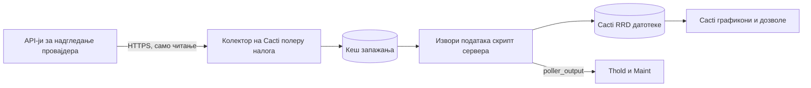

<!-- Source: README.md; SHA256: 7c621642e5f1a46bac66e4bc744f70aebb014c610d22de034088845fdc170405 -->

<!-- translations:start -->
[English](../../../README.md) | [简体中文](../zh-CN/README.md) | [हिन्दी](../hi-IN/README.md) | [Español (España)](../es-ES/README.md) | [Español (Latinoamérica)](../es-419/README.md) | [العربية (السعودية)](../ar-SA/README.md) | [Afrikaans](../af-ZA/README.md) | [አማርኛ](../am-ET/README.md) | [العربية (مصر)](../ar-EG/README.md) | [العربية (المغرب)](../ar-MA/README.md) | [বাংলা](../bn-BD/README.md) | [Bosanski](../bs-BA/README.md) | [Deutsch](../de-DE/README.md) | [فارسی](../fa-IR/README.md) | [Filipino](../fil-PH/README.md) | [Français](../fr-FR/README.md) | [Français (Maroc)](../fr-MA/README.md) | [Français (Sénégal)](../fr-SN/README.md) | [Hausa](../ha-NG/README.md) | [עברית](../he-IL/README.md) | [Hrvatski](../hr-HR/README.md) | [Bahasa Indonesia](../id-ID/README.md) | [Igbo](../ig-NG/README.md) | [Italiano](../it-IT/README.md) | [日本語](../ja-JP/README.md) | [한국어](../ko-KR/README.md) | [Malagasy](../mg-MG/README.md) | [मराठी](../mr-IN/README.md) | [Bahasa Melayu](../ms-MY/README.md) | [Nederlands](../nl-NL/README.md) | [Polski](../pl-PL/README.md) | [Português (Brasil)](../pt-BR/README.md) | [Русский](../ru-RU/README.md) | [Kinyarwanda](../rw-RW/README.md) | [Soomaali](../so-SO/README.md) | [Српски](README.md) | [Svenska](../sv-SE/README.md) | [Kiswahili](../sw-KE/README.md) | [தமிழ்](../ta-IN/README.md) | [తెలుగు](../te-IN/README.md) | [ไทย](../th-TH/README.md) | [Türkçe](../tr-TR/README.md) | [Українська](../uk-UA/README.md) | [اردو](../ur-PK/README.md) | [Tiếng Việt](../vi-VN/README.md) | [isiXhosa](../xh-ZA/README.md) | [Yorùbá](../yo-NG/README.md) | [繁體中文](../zh-TW/README.md) | [isiZulu](../zu-ZA/README.md)
<!-- translations:end -->

# plugin_cloud

Додатак за Cacti 1.2 који доноси ресурсе и метрике јавних провајдера облака у Cacti као обичне уређаје, изворе података и графиконе. Радна оптерећења у облаку тада стоје одмах поред мреже која их преноси, под Cacti дозволама, а Thold и Maint могу слати упозорења и потискивати их. Један додатак покрива сваког провајдера, са једним драјвером по провајдеру: прво DigitalOcean, AWS, Google Cloud и Azure.

> **Статус: прекретница 3 (DigitalOcean и Cacti објекти), у прегледу.** Ова прекретница додаје драјвер за DigitalOcean, Cacti шаблоне, уређај опсега по налогу са упитом података по типу ресурса, унос за скрипт сервер и процену захтева на страници *New Graphs* и страници стања. Почетне провере на живом DigitalOcean налогу забележене су у [чињеницама о провајдерима](../../research/provider-facts.md). Немојте га покретати у продукцији.

## Улоге приступа

| Подручје дозвола | Приступ |
| --- | --- |
| Cloud View | Постојеће странице за надгледање. |
| Cloud Operator | Надгледање уз страницу *Operations* и личне потврде тријаже. |
| Cloud Admin | Приступ оператера уз постојеће конфигурационе и административне радње. |

Након копирања датотека за надоградњу, отворите страницу *Plugins* као администратор да бисте регистровали ново подручје дозвола. Доделите подручје *Operator* изричито под **Configuration > Users** или корисничким групама. Надоградње задржавају постојеће ИД-ове и доделе за *View* и *Admin*. Приступ *Admin* наслеђује приступ *Operator*, а приступ *Operator* наслеђује приступ *View* при сваком захтеву; тиме се корисницима или групама не додају сачуване доделе. Подешавања додатка такође захтевају приступ *Cloud Admin* поред Cacti дозволе *Settings*.

Cacti дозволе за уређаје и даље ограничавају редове и радње доступне сваком кориснику; немапирани објекти захтевају администратора. Оператери могу проверити сачувани акредитив за налог чијем Cacti уређају смеју приступити. Акредитиви, конфигурација, мапирање, брисање и друге административне измене остају на административним страницама. Потврде трају само у тренутној корисничкој сесији, највише један сат и само док исто запажање остаје свеже. Нова или промењена запажања их поништавају. Оне никад не означавају неуспешно мерење као исправно нити потискују упозорења.

## Зашто

Сваки провајдер облака има сопствену конзолу за надгледање. Када се користе упоредо са системом Cacti, остављају три празнине:

- **Одвојена контрола приступа.** Приказивање метрика облака Cacti кориснику значи давање пријаве за облак.
- **Без мрежног контекста.** Локалне везе цртају се на графиконима у Cacti-ју; радна оптерећења иза њих цртају се у конзоли сваког провајдера.
- **Одвојено упозоравање.** Thold и Maint раде на Cacti изворима података и уређајима, па се аларми провајдера конфигуришу и потискују одвојено, посебно за сваког провајдера.

Додатак чита API за надгледање сваког провајдера на Cacti полеру, кешира најновије тачке података и послужује их Cacti скрипт серверу. Cacti полер уписује RRD датотеке, па графикони, дозволе, Thold, Maint и boost раде исто као за било које друге Cacti податке.

## Дизајнерске обавезе

- **Само за читање.** Сваки драјвер може саставити само операције провајдера са свог списка дозвољених операција; додатак никад не мења ресурс у облаку. ([ADR 0002](../../decisions/0002-read-only-with-operation-allowlist.md))
- **Само PHP, без SDK-ова.** Потписивање и размена токена имплементирани су у PHP-у помоћу екстензија које Cacti већ захтева. Нема Composer зависности у времену извршавања. ([ADR 0003](../../decisions/0003-php-only-without-sdks.md))
- **Трошак пре прикупљања.** Додатак чита само метрике које имају Cacti извор података, приказује очекивани број захтева и трошак по каталошким ценама пре креирања графикона и спроводи месечни лимит. ([ADR 0005](../../decisions/0005-collect-only-what-is-graphed.md))
- **Без акредитива у чистом тексту у бази података.** Акредитиви долазе из шифрованог трезора заштићеног кључем у датотеци изван базе података, из датотеке акредитива или из идентитета инстанце провајдера. ([ADR 0007](../../decisions/0007-credentials-outside-the-database-in-the-clear.md))

## Опсег и статус

| Фаза | Опсег | Прекретнице | Статус |
|---|---|---|---|
| 0, истраживање | Потврда чињеница о провајдерима, каталози метрика, модел трошкова и ограничења стопе, тестни вектори потписивања, проба транспорта | [M1](https://github.com/somethingwithproof/plugin_cloud/milestone/1) | Завршено, осим провера које захтевају живи налог код провајдера |
| 1, језгро и DigitalOcean | Налози, трезор акредитива, транспорт, колектор, кеш запажања, Cacti објекти, страница стања, DigitalOcean Droplets и балансери оптерећења | [M2](https://github.com/somethingwithproof/plugin_cloud/milestone/2), [M3](https://github.com/somethingwithproof/plugin_cloud/milestone/3), [M4](https://github.com/somethingwithproof/plugin_cloud/milestone/4) | M2 завршен ([#81](https://github.com/somethingwithproof/plugin_cloud/pull/81)); M3 драјвер, шаблони и уређаји опсега спојени; процене захтева, дозволе и провере перформанси у прегледу; M4 није започет |
| 2, AWS | Signature Version 4, `AssumeRole`, улоге инстанце, CloudWatch `GetMetricData`, регионални инвентар | [M5](https://github.com/somethingwithproof/plugin_cloud/milestone/5) | Није започето |
| 3, Google Cloud | JWT сервисног налога, сервер метаподатака, Cloud Monitoring `timeSeries.list` | [M6](https://github.com/somethingwithproof/plugin_cloud/milestone/6) | Није започето |
| 4, Azure | Entra акредитиви клијента, управљани идентитет, Resource Graph, `metrics:getBatch` | [M7](https://github.com/somethingwithproof/plugin_cloud/milestone/7) | Није започето |
| 5, удаљени колектори | Налози на удаљеним Cacti колекторима података | [M8](https://github.com/somethingwithproof/plugin_cloud/milestone/8) | Није започето |

Изван опсега: мењање ресурса у облаку, креирање или пресликавање аларма провајдера, извештаји наплате, дневници и трагови, као и сопствени систем упозоравања у додатку. Даљи провајдери (Hetzner Cloud, Akamai Cloud, Oracle Cloud и други) воде се као истраживачки задаци.

## Шта доноси прекретница 2

- **Заштићена инсталација.** На PHP-у старијем од 8.2 или без ext-openssl, инсталација и омогућавање одбијају се уз поруку, док остатак Cacti-ја наставља да ради.
- **Животни циклус.** Инсталација, надоградња и деинсталација кроз Cacti страницу *Plugins*. Надоградње су уређене по редоследу и подносе прекиде. Деинсталација задржава табеле додатка осим ако поништите *Keep Plugin Tables on Uninstall*.
- **Одвојена подручја дозвола.** *Cloud Admin* отвара **Cloud Accounts**; *Cloud Operator* отвара **Cloud Operations**; *Cloud View* отвара **Cloud Health**. Admin наслеђује Operator, а Operator наслеђује View. Све три странице налазе се под *Management*.
- **Налози и акредитиви.** Додавање, уређивање, провера и брисање налога. Акредитив се или шифрује у бази података помоћу датотеке кључа која се чува изван ње (AES-256-GCM), или се чита из датотеке на полеру. Акредитиви су у корисничком интерфејсу само за упис и скривају се у дневницима.
- **Колектор.** Покреће се при сваком покретању полера, по једна инстанца по полеру, унутар временског буџета. Преузима закуп по налогу, покреће откривање у сопственом интервалу и чита метрике само за активне изворе података самог додатка.
- **Стање.** Стање прикупљања, откривања, ресурса и свежине по налогу, уз упозорења за неупотребљив кључ трезора, несигурне датотеке акредитива и интервале које полер не може да испоштује.

## Инсталација и конфигурација

Ови кораци инсталирају код прекретнице 2 ради евалуације. Захтевају Cacti 1.2.31 или новији на PHP-у 8.2 или новијем.

1. Копирајте репозиторијум у `plugins/cloud` унутар вашег Cacti директоријума. Директоријум мора имати назив `cloud`.
2. Креирајте кључ трезора изван корена веба. Сместите га у директоријум у који могу да пишу само root и корисник Cacti-ја, и учините датотеку читљивом само кориснику који покреће веб сервер и полер. Додатак никад не креира нити уписује ову датотеку:

   ```sh
   sudo install -d -m 0750 -o root -g cacti /etc/cacti
   head -c 32 /dev/urandom | sudo tee /etc/cacti/cloud-vault.key > /dev/null
   sudo chown cacti:cacti /etc/cacti/cloud-vault.key
   sudo chmod 0600 /etc/cacti/cloud-vault.key
   ```

   Замените `cacti` корисником који покреће ваш веб сервер и полер. Датотека садржи 32 сирова бајта или 64 хексадецимална знака. Направите резервну копију заједно са базом података; без ње сачувани акредитиви морају бити поново унети.
3. У Cacti-ју отворите **Configuration > Plugins**, затим инсталирајте и омогућите *Cloud*.
4. Под **Configuration > Settings > Cloud** подесите *Vault Key File* ако сте користили другу путању. *Collector Time Budget* (подразумевано 240 секунди) мора остати испод интервала полера.
5. Доделите *Cloud Admin*, *Cloud Operator* или *Cloud View* корисницима и групама под **Configuration > Users**. Инсталација додељује *Cloud Admin* и *Cloud View* администратору; *Cloud Admin* укључује приступ *Operator*, па администратору није потребна посебна додела за *Operator*.
6. Додајте налоге под **Management > Cloud Accounts**, затим проверите **Management > Cloud Health** ради евентуалних упозорења.

## Циљеви компатибилности

| Компонента | Циљ |
|---|---|
| Cacti | 1.2.31 или новији, без закрпа језгра |
| PHP | 8.2 или новији; `setup.php` остаје читљив за парсер на 8.0 како би неподржано извршно окружење добило одбијање уместо поквареног Cacti интерфејса |
| PHP екстензије | Нема додатних поред оних које Cacti 1.2.31 захтева |
| Thold, Maint | Нису потребне измене |

## Дизајн

- [docs/performance.md](../../performance.md) садржи мерења колектора и странице стања, са коришћеним хардвером и подешавањима.
- [docs/PLAN.md](../../PLAN.md) представља потпуни план: архитектуру, чињенице о провајдерима и Cacti-ју на које се ослања (са изворима), уговор драјвера, рачуницу трошкова, сигурносне границе, тестирање и ризике.
- [docs/decisions/](../../decisions) садржи записе о архитектонским одлукама (ADR) за већ донете изборе.
- [docs/REQUIREMENTS.md](../../REQUIREMENTS.md) повезује сваки ИД захтева са његовим задатком.



## Како се прати рад

- **Прекретнице** прате прекретнице плана. Свака има кровни задатак (epic) који наводи подзадатке и доказе завршетка.
- **Задаци** су означени по типу: `type: requirement`, `type: research`, `type: decision`, `type: epic`. Задаци захтева наводе нумерисане, тестабилне захтеве (`REQ-AREA-NNN`) и критеријуме прихватања.
- **Ознаке** такође носе префиксе `area:`, `provider:`, `phase:`, `priority:` и `status:`. Погледајте [CONTRIBUTING.md](../../../CONTRIBUTING.md#labels).
- [Табла пројекта](https://github.com/users/somethingwithproof/projects/7) приказује све задатке кроз прекретнице.

## Развој

CI проверава синтаксу улазних тачака на PHP-у 8.0, покреће јединичне и интеграционе тестове и PHPStan ниво 9 и инсталира додатак на PHP-у 8.2 до 8.5 према Cacti-ју 1.2.31 и грани 1.2.x. Такође проверава да је PHP 8.1 одбијен без кварења Cacti-ја. Тестови користе Pest из тестног оквира језгра Cacti-ја. Тај избор је привремен док се не одлучи о [#12](https://github.com/somethingwithproof/plugin_cloud/issues/12). [.github/workflows/plugin-ci-workflow.yml](../../../.github/workflows/plugin-ci-workflow.yml) наводи сваки корак. Покрените `sh tests/lint-workflows.sh` и `sh locales/build_gettext.sh --check` локално пре слања промена.

## Допринос

Прочитајте [CONTRIBUTING.md](../../../CONTRIBUTING.md). Комитови захтевају DCO потпис (sign-off). Расправа о дизајну одвија се на задацима; отворене одлуке носе ознаку `type: decision`.

## Безбедност

Рањивости пријавите приватно; погледајте [SECURITY.md](../../../SECURITY.md).

## Лиценца

GNU General Public License v2.0, иста лиценца као Cacti и његови додаци. Погледајте [LICENSE](../../../LICENSE).
