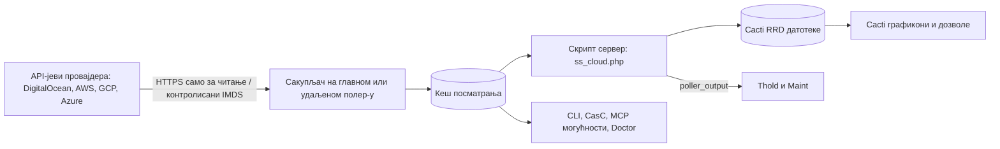

<!-- Source: README.md; SHA256: ac2074a40238686915802803c5efe773f33677f934281e0605e6e87a71a9d27d -->

<!-- translations:start -->
[English](../../../README.md) | [简体中文](../zh-CN/README.md) | [हिन्दी](../hi-IN/README.md) | [Español (España)](../es-ES/README.md) | [Español (Latinoamérica)](../es-419/README.md) | [العربية (السعودية)](../ar-SA/README.md) | [Afrikaans](../af-ZA/README.md) | [አማርኛ](../am-ET/README.md) | [العربية (مصر)](../ar-EG/README.md) | [العربية (المغرب)](../ar-MA/README.md) | [বাংলা](../bn-BD/README.md) | [Bosanski](../bs-BA/README.md) | [Deutsch](../de-DE/README.md) | [فارسی](../fa-IR/README.md) | [Filipino](../fil-PH/README.md) | [Français](../fr-FR/README.md) | [Français (Maroc)](../fr-MA/README.md) | [Français (Sénégal)](../fr-SN/README.md) | [Hausa](../ha-NG/README.md) | [עברית](../he-IL/README.md) | [Hrvatski](../hr-HR/README.md) | [Bahasa Indonesia](../id-ID/README.md) | [Igbo](../ig-NG/README.md) | [Italiano](../it-IT/README.md) | [日本語](../ja-JP/README.md) | [한국어](../ko-KR/README.md) | [Malagasy](../mg-MG/README.md) | [मराठी](../mr-IN/README.md) | [Bahasa Melayu](../ms-MY/README.md) | [Nederlands](../nl-NL/README.md) | [Polski](../pl-PL/README.md) | [Português (Brasil)](../pt-BR/README.md) | [Русский](../ru-RU/README.md) | [Kinyarwanda](../rw-RW/README.md) | [Soomaali](../so-SO/README.md) | [Српски](README.md) | [Svenska](../sv-SE/README.md) | [Kiswahili](../sw-KE/README.md) | [தமிழ்](../ta-IN/README.md) | [తెలుగు](../te-IN/README.md) | [ไทย](../th-TH/README.md) | [Türkçe](../tr-TR/README.md) | [Українська](../uk-UA/README.md) | [اردو](../ur-PK/README.md) | [Tiếng Việt](../vi-VN/README.md) | [isiXhosa](../xh-ZA/README.md) | [Yorùbá](../yo-NG/README.md) | [繁體中文](../zh-TW/README.md) | [isiZulu](../zu-ZA/README.md)
<!-- translations:end -->

# plugin_cloud

Додатак за Cacti 1.2 који доноси ресурсе и метрике јавних провајдера облака у Cacti као обичне уређаје, изворе података и графиконе. Радна оптерећења у облаку налазе се поред мреже која их преноси, под Cacti дозволама, а Thold и Maint шаљу упозорења и потискују их. Један додатак покрива DigitalOcean, Amazon Web Services, Google Cloud и Microsoft Azure помоћу драјвера у чистом PHP-у који раде само у режиму читања.

> **Статус: у развоју, још нема издања (`0.1.0-dev`).** Ова грана имплементира драјвере у чистом PHP-у за DigitalOcean, AWS, Google Cloud и Azure, репликацију удаљених сакупљача података и стање агента само за читање, CasC провајдера и CLI за оператере, MCP могућности и Doctor провере. Испоручени Cacti шаблони тренутно покривају DigitalOcean Droplets и балансере оптерећења (`templates/cloud_digitalocean.xml`); пакети Cacti шаблона за AWS, Google Cloud и Azure и квалификација на живим налозима изван DigitalOcean-а ([чињенице о провајдерима](../../research/provider-facts.md)) још нису завршени. Немојте покретати у продукцији.

## Подржани провајдери

Сваки драјвер провајдера је регистрован у `Drivers::production()`, нуди га `Provider::released()`, и ради у чистом PHP-у користећи `ext-openssl` и стрим сокете без SDK-ова или Composer зависности у времену извршавања.

| Провајдер | Поља опсега | Извори акредитива | Аутентификација | Откривени ресурси | Прикупљање метрика |
|---|---|---|---|---|---|
| DigitalOcean (`digitalocean`) | Нема (опсег токена) | `vault`, `file` | Bearer токен | `droplet`, `load_balancer` | `/v2/monitoring/metrics` уз свест о уделу ограничења брзине; испоручује Cacti шаблоне и упите података |
| Amazon Web Services (`aws`) | `account_id` (12 цифара), `regions` | `vault`, `file`, `instance` | AWS SigV4 у чистом PHP-у (`AWS4-HMAC-SHA256`), STS `GetCallerIdentity` верификација, опциони STS `AssumeRole`, EC2 IMDSv2 (`169.254.169.254`) за `instance` налоге | `ec2_instance`, `rds_instance`, `aws_elb` (ALB/NLB) | Групни CloudWatch `GetMetricData` (до 500 упита по позиву) |
| Google Cloud (`gcp`) | `project` | `vault`, `file`, `instance` | RS256 сервисног налога JWT у чистом PHP-у преко `ext-openssl` размењен на `oauth2.googleapis.com/token`, или GCE сервер метаподатака (`metadata.google.internal`) за `instance` налоге | `gce_instance` преко `instances.aggregatedList` | Cloud Monitoring `timeSeries.list` |
| Microsoft Azure (`azure`) | `tenant`, `subscription`, `regions` | `vault`, `file`, `instance` | Entra ID OAuth2 ток акредитива клијента у чистом PHP-у (само `client_secret`; тврдње сертификата су искључене), или Azure IMDS (`169.254.169.254`) управљани идентитет за ARM и Monitor токене | `azure_vm` преко ARM Resource Graph-а (пагинирано са `$skipToken` и дедупликовано) | Azure Monitor `metrics:getBatch` (до 50 ресурса по позиву, уз руковање HTTP 429 и 529 ограничењем) |

## Имплементиране могућности

### Основна платформа, трезор и сакупљач

- **Заштићена инсталација и животни циклус.** Улазне тачке (`setup.php`, `cli/cloud.php`, `poller_cloud.php`, `ss_cloud.php` и скрипте страница) парсирају се на PHP 8.0 и одбијају PHP испод 8.2 или недостатак `ext-openssl` без нарушавања Cacti-ја. Надоградње су уређене, идемпотентне (`Schema::VERSION = 3`, 9 табела) и отпорне на прекиде. Деинсталација задржава табеле додатка осим ако се не опозове избор *Keep Plugin Tables on Uninstall*.
- **Налози и акредитиви.** Додајте, измените, верификујте и обришите налоге под **Management > Cloud Accounts**. Акредитиви долазе из AES-256-GCM шифрованог трезора (`plugin_cloud_secret`, подразумевано шифровано кључем `/etc/cacti/cloud-vault.key`), из датотеке ограничене на подешени *Credential File Directory* (`cloud_credential_dir`, подразумевано празан да би одбијао датотеке), или из идентитета инстанце провајдера. Акредитиви су само за упис у корисничком интерфејсу и уклањају се из дневника.
- **Строга контрола одлазног саобраћаја и режима само за читање.** Сваки драјвер ради иза `GuardedTransport` и `OutboundPolicy`: HTTPS порт 443 ка тачним именима хостова по провајдеру, при чему су локалне крајње тачке метаподатака на HTTP порту 80 (`169.254.169.254`, `metadata.google.internal`) омогућене само за `instance` налоге. Дозвољене су само операције читања са листе дозвољених.
- **Сакупљач и контрола трошкова.** `poller_cloud.php` се покреће из `poller_bottom` (један процес по полер-у преко Cacti регистра процеса) у оквиру `cloud_collector_budget`, преузима закупе по налогу, покреће откривање на `discover_interval`, чита метрике само за активне Cacti изворе података (`plugin_cloud_series`), поштује `request_share` и `monthly_ceiling`, и кешира најновије тачке података у `plugin_cloud_observation` за `ss_cloud.php`.
- **Cacti објекти и процене захтева.** Одржава уређај опсега по налогу (`plugin_cloud_device`), чува методе поновног индексирања уређаја опсега приликом чувања уређаја, увози DigitalOcean шаблоне и упите података скрипт сервера (`templates/cloud_digitalocean.xml`, `cloud_do_droplet.xml`, `cloud_do_load_balancer.xml`), и приказује процене захтева и ценовника на **New Graphs** (`graphs_new_top_links`) и **Cloud Health**.

### Удаљени сакупљачи података

- `INFO` објављује `remote_collect:1`. Налози могу бити додељени било ком омогућеном Cacti полер-у (`poller_id >= 1`), а `poller_cloud.php --poller=N` прикупља само налоге који припадају том полер-у.
- **`replicate_out` кука.** Реплицира редове у опсегу полер-а из `plugin_cloud_account`, `plugin_cloud_device`, `plugin_cloud_series`, и шифроване редове текста из `plugin_cloud_secret` (само за налоге засноване на трезору који припадају циљном полер-у) преко `replicate_out_table()`. Сирове датотеке кључа трезора се никада не чувају у бази података нити се реплицирају и остају локалне на сваком полер-у.
- **`remote_agent` кука.** Излаже JSON резиме стања само за читање (`action=cloud_health`) који прихвата само целобројне параметре `poller_id` и `account_id` и не враћа никакве акредитиве, путање датотека или тајне.

### Куке екосистема (CasC, MCP могућности и Doctor)

- **CasC провајдер (`casc_register_providers`).** Региструје `cloud` провајдера (верзија шеме `1`) са детерминистичким YAML и XML извозом у чистом PHP-у, валидацијом манифеста, планирањем разлика и потврђеном применом. Акредитиви трезора се извозе као референце `vault:account:<name>`; сирова поља тајни (`secret`, `secrets`, `token`, `access_token`, `refresh_token`, `password`, `private_key`, `access_key_id`, `secret_access_key`, `session_token`, `client_secret`, `credential`, `credentials`, `vault_key`) се одбијају. Примена захтева тачан SHA-256 `--confirm=<PLAN_HASH>`.
- **MCP / Abilities API (`abilities_register`).** Региструје три могућности строго само за читање ограничене подручјем Cloud View (`cloud_health.php`) и опсегом Cacti уређаја за позиваоце који нису администратори, не емитујући никакве акредитиве, кључеве трезора или путање датотека акредитива:
  - `cloud-list-accounts` (опционо `provider`, `poller_id`)
  - `cloud-list-resources` (опционо `account_id`, `type`, `lifecycle`)
  - `cloud-get-health` (опционо `account_id`)
- **Doctor провере (`doctor_register_checks`).** Региструје пет дијагностичких провера које не излажу тајне вредности или материјал кључева:
  - `cloud_schema`: ажурност верзије шеме
  - `cloud_vault_key`: читљивост, дозволе и величина датотеке кључа трезора
  - `cloud_drivers`: регистрација продукцијских драјвера за све објављене провајдере
  - `cloud_accounts_health`: неуспели, ограничени или застарели омогућени налози
  - `cloud_poller_intervals`: усклађеност интервала прикупљања омогућених налога са интервалом Cacti полер-а

## CLI

Покрените из основног директоријума Cacti-ја са PHP 8.2 или новијим:

```sh
# Operator and CasC CLI (options use --key=value form)
php plugins/cloud/cli/cloud.php export [--format=yaml|xml]
php plugins/cloud/cli/cloud.php validate --file=<path> [--format=yaml|xml]
php plugins/cloud/cli/cloud.php plan --file=<path> [--format=yaml|xml]
php plugins/cloud/cli/cloud.php apply --file=<path> --confirm=<PLAN_HASH> [--format=yaml|xml]
php plugins/cloud/cli/cloud.php health [--format=text|json] [--poller=<id>]

# Collector entry point (normally started by poller_bottom)
php plugins/cloud/poller_cloud.php [--poller=N] [--force] [--debug]
```

## Улоге приступа

| Подручје дозвола | Приступ |
| --- | --- |
| Cloud View | Постојеће странице за праћење. |
| Cloud Operator | Праћење уз страницу Operations и личне потврде тријаже. |
| Cloud Admin | Приступ Operator уз постојећу конфигурацију и административне радње. |

Након копирања датотека за надоградњу, отворите страницу Plugins као администратор да бисте регистровали подручја дозвола. Експлицитно доделите подручје Operator под **Configuration > Users** или корисничким групама. Надоградње задржавају постојеће ID-јеве и доделе подручја View и Admin. Приступ Admin наслеђује приступ Operator, а приступ Operator наслеђује приступ View при сваком захтеву; ово не додаје сачуване доделе корисницима или групама. Подешавања додатка такође захтевају приступ Cloud Admin поред Cacti дозволе Settings.

Cacti дозволе за уређаје ограничавају редове и радње доступне сваком кориснику; немапирани објекти захтевају администратора. Оператери могу да верификују сачувани акредитив за налог чијем Cacti уређају имају приступ. Акредитиви, конфигурација, мапирање, брисање и друге административне измене остају на административним страницама. Потврде трају само у тренутној корисничкој сесији, највише један сат и само док исто посматрање остаје свеже. Нова или измењена посматрања их поништавају. Оне никада не означавају неуспешно мерење као исправно нити потискују упозорења.

## Зашто

Сваки провајдер облака има сопствену конзолу за праћење. Покренуте поред Cacti-ја, оне остављају три празнине:

- **Одвојена контрола приступа.** Приказивање метрика облака Cacti кориснику значи давање пријаве за облак.
- **Нема мрежног контекста.** Локалне везе се приказују на графиконима у Cacti-ју; радна оптерећења иза њих приказују се у конзоли сваког провајдера.
- **Одвојено упозоравање.** Thold и Maint раде над Cacti изворима података и уређајима, па се аларми провајдера подешавају и потискују одвојено, једном по провајдеру.

Додатак чита API за праћење сваког провајдера на Cacti полер-у, кешира најновије тачке података и доставља их Cacti скрипт серверу. Cacti полер уписује RRD датотеке, па цртање графикона, дозволе, Thold, Maint и boost раде као и за сваке друге Cacti податке.

## Пројектне обавезе

- **Само за читање.** Сваки драјвер може да састави само операције провајдера са своје листе дозвољених; додатак никада не мења ресурс у облаку. ([ADR 0002](../../decisions/0002-read-only-with-operation-allowlist.md))
- **Само PHP, без SDK-ова.** Потписивање и размена токена имплементирани су у PHP-у помоћу проширења која Cacti већ захтева. Нема Composer зависности у времену извршавања. ([ADR 0003](../../decisions/0003-php-only-without-sdks.md))
- **Трошак пре прикупљања.** Додатак чита само метрике које имају Cacti извор података, приказује очекивани број захтева и цену по ценовнику пре креирања графикона и примењује месечно ограничење. ([ADR 0005](../../decisions/0005-collect-only-what-is-graphed.md))
- **Без акредитива у обичном тексту у бази података.** Акредитиви долазе из шифрованог трезора чији је кључ у датотеци изван базе података, из датотеке акредитива или из идентитета инстанце провајдера. ([ADR 0007](../../decisions/0007-credentials-outside-the-database-in-the-clear.md))

## Опсег и статус

| Фаза | Опсег | Прекретнице | Статус |
|---|---|---|---|
| 0, истраживање | Потврда чињеница о провајдерима, каталози метрика, модел трошкова и брзине, тестни вектори потписивања, прототип транспорта | [M1](https://github.com/somethingwithproof/plugin_cloud/milestone/1) | Завршено, осим провера које захтевају живе налоге провајдера |
| 1, језгро и DigitalOcean | Налози, трезор акредитива, транспорт, сакупљач, кеш посматрања, Cacti објекти, шаблони, процене захтева, страница стања, DigitalOcean Droplets и балансери оптерећења | [M2](https://github.com/somethingwithproof/plugin_cloud/milestone/2), [M3](https://github.com/somethingwithproof/plugin_cloud/milestone/3), [M4](https://github.com/somethingwithproof/plugin_cloud/milestone/4) | Имплементирано; пилот квалификација M4 на чекању |
| 2, AWS | SigV4 у чистом PHP-у, STS `AssumeRole`, улоге инстанци IMDSv2, EC2/RDS/ELB инвентар, CloudWatch `GetMetricData` | [M5](https://github.com/somethingwithproof/plugin_cloud/milestone/5) | Драјвер имплементиран; Cacti шаблони и квалификација на живом налогу на чекању |
| 3, Google Cloud | RS256 сервисног налога JWT у чистом PHP-у, GCE сервер метаподатака, Compute Engine инвентар, Cloud Monitoring `timeSeries.list` | [M6](https://github.com/somethingwithproof/plugin_cloud/milestone/6) | Драјвер имплементиран; Cacti шаблони и квалификација на живом налогу на чекању |
| 4, Azure | Entra ID акредитиви клијента, IMDS управљани идентитет, ARM Resource Graph VM инвентар, Azure Monitor `metrics:getBatch` | [M7](https://github.com/somethingwithproof/plugin_cloud/milestone/7) | Драјвер имплементиран; Cacti шаблони и квалификација на живом налогу на чекању |
| 5, удаљени сакупљачи и екосистем | Удаљени сакупљачи података (`replicate_out`, `remote_agent`), CasC провајдер и CLI, MCP могућности, Doctor провере | [M8](https://github.com/somethingwithproof/plugin_cloud/milestone/8) | Имплементирано |

Ван опсега: мењање ресурса у облаку, креирање или пресликавање аларма провајдера, извештаји о наплати, логови и трагови и сопствени механизам за упозоравање додатка. Даљи провајдери (Hetzner Cloud, Akamai Cloud, Oracle Cloud и други) су истраживачки задаци.

## Инсталација и конфигурација

Ови кораци инсталирају развојни кôд за процену. Захтевају Cacti 1.2.31 или новији на PHP 8.2 или новијем.

1. Копирајте репозиторијум у `plugins/cloud` у вашем Cacti директоријуму. Директоријум мора да се зове `cloud`.
2. Креирајте кључ трезора изван web root-а на сваком полер-у који користи акредитиве из трезора. Ставите га у директоријум у који могу да уписују само root и Cacti корисник и учините датотеку читљивом само кориснику који покреће веб сервер и полер. Додатак никада не креира нити уписује ову датотеку:

   ```sh
   sudo install -d -m 0750 -o root -g cacti /etc/cacti
   head -c 32 /dev/urandom | sudo tee /etc/cacti/cloud-vault.key > /dev/null
   sudo chown cacti:cacti /etc/cacti/cloud-vault.key
   sudo chmod 0600 /etc/cacti/cloud-vault.key
   ```

   Замените `cacti` корисником који покреће ваш веб сервер и полер. Датотека садржи 32 сирова бајта или 64 хексадецимална знака. Направите њену резервну копију заједно са базом података; без ње, сачувани акредитиви морају поново да се унесу.
3. У Cacti-ју отворите **Configuration > Plugins**, затим инсталирајте и омогућите *Cloud*.
4. Под **Configuration > Settings > Cloud**, поставите *Vault Key File* ако сте користили другу путању, конфигуришите *Credential File Directory* ако планирате да користите акредитиве засноване на датотекама, и држите *Collector Time Budget* (подразумевано 240 секунди) испод интервала полер-а.
5. Доделите *Cloud Admin*, *Cloud Operator* или *Cloud View* корисницима и групама под **Configuration > Users**. Инсталација додељује Cloud Admin и Cloud View администратору; Cloud Admin укључује приступ Operator, па администратору није потребна посебна додела Operator.
6. Додајте налоге под **Management > Cloud Accounts**, а затим проверите **Management > Cloud Health** ради упозорења.

## Циљеви компатибилности

| Компонента | Циљ |
|---|---|
| Cacti | 1.2.31 или новији, без закрпа језгра |
| PHP | 8.2 или новији; улазне тачке остају парсибилне на 8.0 тако да неподржано окружење добије одбијање уместо поквареног Cacti интерфејса |
| PHP екстензије | `ext-openssl` (захтева Cacti 1.2.31); без `ext-curl` и без Composer зависности у времену извршавања |
| Thold, Maint | Нису потребне измене |

## Дизајн

- [docs/performance.md](../../performance.md) садржи мерења сакупљача и странице стања, са коришћеним хардвером и подешавањима.
- [docs/PLAN.md](../../PLAN.md) је комплетан план: архитектура, чињенице о провајдерима и Cacti-ју на које се ослања (са изворима), уговор драјвера, рачуница трошкова, безбедносне границе, тестирање и ризици.
- [docs/decisions/](../../decisions/) чува записе о архитектонским одлукама за већ донете изборе.
- [docs/REQUIREMENTS.md](../../REQUIREMENTS.md) повезује сваки ID захтева са његовим проблемом.



## Како се прати рад

- **Прекретнице** прате прекретнице плана. Свака има епски проблем који наводи своје подпроблеме и доказе о завршетку.
- **Проблеми** су означени ознаком типа: `type: requirement`, `type: research`, `type: decision`, `type: epic`. Проблеми захтева наводе нумерисане, проверљиве захтеве (`REQ-AREA-NNN`) и критеријуме прихватања.
- **Ознаке** такође носе `area:`, `provider:`, `phase:`, `priority:` и `status:`. Погледајте [CONTRIBUTING.md](../../../CONTRIBUTING.md#labels).
- [Табла пројекта](https://github.com/users/somethingwithproof/projects/7) приказује све проблеме кроз прекретнице.

## Развој

CI ([.github/workflows/plugin-ci-workflow.yml](../../../.github/workflows/plugin-ci-workflow.yml)) проверава архиву издања и семантичко верзионисање (`bash tests/bin/archive-check.sh`), линта улазне тачке на PHP 8.0, покреће Pest јединичне (`phpunit.xml`) и интеграционе тестове животног циклуса (`phpunit-integration.xml`) и PHPStan ниво 9 на PHP 8.2 до 8.5 против Cacti `release/1.2.31` и `1.2.x` са `CLOUD_OFFLINE=1`, проверава одбијање на PHP 8.1, верификује gettext каталоге, мери перформансе прикупљања 1.000 серија и странице стања и покреће линтање радних токова и усклађеност са REUSE.

Локалне провере пре слања измена:

```sh
bash tests/bin/archive-check.sh
sh tests/lint-workflows.sh
sh locales/build_gettext.sh --check
CACTI_PATH=/path/to/cacti phpstan analyse -c phpstan.neon --no-progress
```

Покрените Pest са `--configuration=phpunit.xml` за јединичне тестове и тестове правила изворног кода, или `--configuration=phpunit-integration.xml` са `CACTI_PATH` и `CLOUD_TEST_DATABASE=disposable` на једнократној Cacti бази података за интеграционе тестове животног циклуса.

## Допринос

Прочитајте [CONTRIBUTING.md](../../../CONTRIBUTING.md). Комитови захтевају DCO sign-off. Дискусије о дизајну воде се на проблемима; отворене одлуке носе ознаку `type: decision`.

## Безбедност

Пријавите рањивости приватно; погледајте [SECURITY.md](../../../SECURITY.md).

## Лиценца

GNU General Public License v2.0, иста лиценца као за Cacti и његове додатке. Погледајте [LICENSE](../../../LICENSE).
