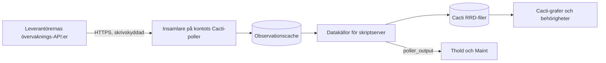

<!-- Source: README.md; SHA256: 7c621642e5f1a46bac66e4bc744f70aebb014c610d22de034088845fdc170405 -->

<!-- translations:start -->
[English](../../../README.md) | [简体中文](../zh-CN/README.md) | [हिन्दी](../hi-IN/README.md) | [Español (España)](../es-ES/README.md) | [Español (Latinoamérica)](../es-419/README.md) | [العربية (السعودية)](../ar-SA/README.md) | [Afrikaans](../af-ZA/README.md) | [አማርኛ](../am-ET/README.md) | [العربية (مصر)](../ar-EG/README.md) | [العربية (المغرب)](../ar-MA/README.md) | [বাংলা](../bn-BD/README.md) | [Bosanski](../bs-BA/README.md) | [Deutsch](../de-DE/README.md) | [فارسی](../fa-IR/README.md) | [Filipino](../fil-PH/README.md) | [Français](../fr-FR/README.md) | [Français (Maroc)](../fr-MA/README.md) | [Français (Sénégal)](../fr-SN/README.md) | [Hausa](../ha-NG/README.md) | [עברית](../he-IL/README.md) | [Hrvatski](../hr-HR/README.md) | [Bahasa Indonesia](../id-ID/README.md) | [Igbo](../ig-NG/README.md) | [Italiano](../it-IT/README.md) | [日本語](../ja-JP/README.md) | [한국어](../ko-KR/README.md) | [Malagasy](../mg-MG/README.md) | [मराठी](../mr-IN/README.md) | [Bahasa Melayu](../ms-MY/README.md) | [Nederlands](../nl-NL/README.md) | [Polski](../pl-PL/README.md) | [Português (Brasil)](../pt-BR/README.md) | [Русский](../ru-RU/README.md) | [Kinyarwanda](../rw-RW/README.md) | [Soomaali](../so-SO/README.md) | [Српски](../sr-RS/README.md) | [Svenska](README.md) | [Kiswahili](../sw-KE/README.md) | [தமிழ்](../ta-IN/README.md) | [తెలుగు](../te-IN/README.md) | [ไทย](../th-TH/README.md) | [Türkçe](../tr-TR/README.md) | [Українська](../uk-UA/README.md) | [اردو](../ur-PK/README.md) | [Tiếng Việt](../vi-VN/README.md) | [isiXhosa](../xh-ZA/README.md) | [Yorùbá](../yo-NG/README.md) | [繁體中文](../zh-TW/README.md) | [isiZulu](../zu-ZA/README.md)
<!-- translations:end -->

# plugin_cloud

En Cacti 1.2-plugin som för in resurser och mätvärden från publika molnleverantörer i Cacti som vanliga enheter, datakällor och grafer. Molnarbetslaster hamnar då bredvid nätverket som bär dem, under Cactis behörigheter, och Thold och Maint kan larma om och undertrycka dem. En enda plugin täcker varje leverantör, med en drivrutin per leverantör: DigitalOcean, AWS, Google Cloud och Azure först.

> **Status: milstolpe 3 (DigitalOcean och Cacti-objekt), under granskning.** Milstolpen lägger till drivrutinen för DigitalOcean, Cacti-mallar, en omfångsenhet per konto med en datafråga per resurstyp, indata för skriptservern samt en förfrågningsuppskattning på New Graphs och hälsosidan. Inledande kontroller mot ett aktivt DigitalOcean-konto finns dokumenterade i [leverantörsfakta](../../research/provider-facts.md). Kör den inte i produktion.

## Åtkomstroller

| Behörighetsområde | Åtkomst |
| --- | --- |
| Cloud View | Befintliga övervakningssidor. |
| Cloud Operator | Övervakning samt sidan Operations och personliga triage-kvitteringar. |
| Cloud Admin | Operatörsåtkomst samt befintliga konfigurations- och administrationsåtgärder. |

Efter att du har kopierat uppgraderingsfiler öppnar du sidan Plugins som administratör för att registrera
det nya behörighetsområdet. Tilldela behörighetsområdet Operator uttryckligen under **Configuration > Users** eller användargrupper.
Uppgraderingar behåller de befintliga behörighetsområdes-ID:na och tilldelningarna för View och Admin. Admin-åtkomst
ärver Operator-åtkomst, och Operator-åtkomst ärver View-åtkomst vid varje förfrågan;
detta lägger inte till lagrade tilldelningar för användare eller grupper. Plugin-inställningar kräver också
Cloud Admin-åtkomst utöver Cactis Settings-behörighet.

Cactis enhetsbehörigheter begränsar fortfarande vilka rader och åtgärder som är tillgängliga för varje användare; omappade objekt kräver en administratör. Operatörer kan verifiera den lagrade autentiseringsuppgiften för ett konto vars Cacti-enhet de har åtkomst till.
Autentiseringsuppgifter, konfiguration, mappning, borttagning och andra administrativa ändringar
finns kvar på administrationssidorna. Kvitteringar gäller endast under den aktuella
användarens session, i högst en timme och endast så länge samma observation förblir
aktuell. Nya eller ändrade observationer ogiltigförklarar dem. De markerar aldrig en misslyckad
mätning som frisk och undertrycker aldrig larm.

## Varför

Varje molnleverantör har sin egen övervakningskonsol. När de körs vid sidan av Cacti lämnar de tre luckor:

- **Separat åtkomstkontroll.** Att visa molnmätvärden för en Cacti-användare innebär att man måste ge användaren en inloggning till molnet.
- **Ingen nätverkskontext.** Lokala länkar ritas i grafer i Cacti; arbetslasterna bakom dem ritas i respektive leverantörs konsol.
- **Separat larmhantering.** Thold och Maint arbetar mot Cactis datakällor och enheter, så leverantörslarm konfigureras och undertrycks separat, en gång per leverantör.

Pluginen läser varje leverantörs övervaknings-API via en Cacti-poller, cachar de senaste datapunkterna och levererar dem till Cactis skriptserver. Cactis poller skriver RRD-filerna, så grafer, behörigheter, Thold, Maint och boost fungerar precis som för all annan Cacti-data.

## Designåtaganden

- **Skrivskyddad.** Varje drivrutin kan endast bygga de leverantörsoperationer som finns på dess tillåtna lista; pluginen ändrar aldrig en molnresurs. ([ADR 0002](../../decisions/0002-read-only-with-operation-allowlist.md))
- **Endast PHP, inga SDK:er.** Signering och tokenutbyte är implementerade i PHP med de tillägg som Cacti redan kräver. Inga körtidsberoenden via Composer. ([ADR 0003](../../decisions/0003-php-only-without-sdks.md))
- **Kostnad före insamling.** Pluginen läser endast mätvärden som har en Cacti-datakälla, visar förväntat antal förfrågningar och listpriskostnad innan grafer skapas och upprätthåller ett månatligt tak. ([ADR 0005](../../decisions/0005-collect-only-what-is-graphed.md))
- **Inga autentiseringsuppgifter i klartext i databasen.** Autentiseringsuppgifter kommer från ett krypterat valv med en nyckelfil utanför databasen, från en fil med autentiseringsuppgifter eller från leverantörens instansidentitet. ([ADR 0007](../../decisions/0007-credentials-outside-the-database-in-the-clear.md))

## Omfattning och status

| Fas | Omfattning | Milstolpar | Status |
|---|---|---|---|
| 0, research | Bekräftelse av leverantörsfakta, mätvärdeskataloger, kostnads- och frekvensmodell, testvektorer för signering, transportspike | [M1](https://github.com/somethingwithproof/plugin_cloud/milestone/1) | Klar, förutom de kontroller som kräver ett aktivt leverantörskonto |
| 1, kärna och DigitalOcean | Konton, valv för autentiseringsuppgifter, transport, insamlare, observationscache, Cacti-objekt, hälsosida, DigitalOcean Droplets och lastbalanserare | [M2](https://github.com/somethingwithproof/plugin_cloud/milestone/2), [M3](https://github.com/somethingwithproof/plugin_cloud/milestone/3), [M4](https://github.com/somethingwithproof/plugin_cloud/milestone/4) | M2 klar ([#81](https://github.com/somethingwithproof/plugin_cloud/pull/81)); M3-drivrutin, mallar och omfångsenheter sammanslagna; förfrågningsuppskattningar, behörigheter och prestandakontroller under granskning; M4 ej påbörjad |
| 2, AWS | Signature Version 4, `AssumeRole`, instansroller, CloudWatch `GetMetricData`, regional inventering | [M5](https://github.com/somethingwithproof/plugin_cloud/milestone/5) | Ej påbörjad |
| 3, Google Cloud | JWT för tjänstekonto, metadataserver, Cloud Monitoring `timeSeries.list` | [M6](https://github.com/somethingwithproof/plugin_cloud/milestone/6) | Ej påbörjad |
| 4, Azure | Entra-klientautentiseringsuppgifter, hanterad identitet, Resource Graph, `metrics:getBatch` | [M7](https://github.com/somethingwithproof/plugin_cloud/milestone/7) | Ej påbörjad |
| 5, fjärrinsamlare | Konton på Cactis fjärrdatainsamlare (remote data collectors) | [M8](https://github.com/somethingwithproof/plugin_cloud/milestone/8) | Ej påbörjad |

Utanför omfattningen: ändra molnresurser, skapa eller spegla leverantörslarm, faktureringsrapporter, loggar och spårningar samt en plugin-ägd larmmotor. Ytterligare leverantörer (Hetzner Cloud, Akamai Cloud, Oracle Cloud med flera) hanteras som research-ärenden.

## Vad milstolpe 2 levererar

- **En skyddad installation.** På PHP under 8.2, eller utan ext-openssl, nekas installation och aktivering med ett meddelande, och resten av Cacti fortsätter att fungera.
- **Livscykel.** Installation, uppgradering och avinstallation via Cactis Plugins-sida. Uppgraderingar sker i ordning och klarar avbrott. Avinstallation behåller pluginens tabeller om du inte avmarkerar *Keep Plugin Tables on Uninstall*.
- **Separata behörighetsområden.** *Cloud Admin* öppnar **Cloud Accounts**; *Cloud Operator* öppnar **Cloud Operations**; *Cloud View* öppnar **Cloud Health**. Admin ärver Operator, och Operator ärver View. Alla tre sidorna ligger under Management.
- **Konton och autentiseringsuppgifter.** Lägg till, redigera, verifiera och ta bort konton. En autentiseringsuppgift är antingen krypterad i databasen med en nyckelfil som hålls utanför den (AES-256-GCM), eller läses från en fil på pollern. Autentiseringsuppgifter är endast skrivbara i användargränssnittet och maskeras i loggar.
- **Insamlaren.** Den startas från varje pollerkörning, en instans per poller, inom en tidsbudget. Den tar ett lån (lease) per konto, kör upptäckt enligt sitt eget intervall och läser endast mätvärden för pluginens egna aktiva datakällor.
- **Hälsa.** Status per konto för insamling, upptäckt, resurser och aktualitet, samt varningar för en oanvändbar valvnyckel, osäkra filer med autentiseringsuppgifter och intervall som pollern inte kan upprätthålla.

## Installera och konfigurera

Dessa steg installerar koden för milstolpe 2 för utvärdering. De kräver Cacti 1.2.31 eller senare på PHP 8.2 eller senare.

1. Kopiera arkivet till `plugins/cloud` under din Cacti-katalog. Katalogen måste heta `cloud`.
2. Skapa valvnyckeln utanför webbroten. Placera den i en katalog som endast root och Cacti-användaren kan skriva till, och gör filen läsbar endast för användaren som kör webbservern och pollern. Pluginen skapar eller skriver aldrig till denna fil:

   ```sh
   sudo install -d -m 0750 -o root -g cacti /etc/cacti
   head -c 32 /dev/urandom | sudo tee /etc/cacti/cloud-vault.key > /dev/null
   sudo chown cacti:cacti /etc/cacti/cloud-vault.key
   sudo chmod 0600 /etc/cacti/cloud-vault.key
   ```

   Ersätt `cacti` med den användare som kör din webbserver och poller. Filen innehåller 32 råa byte eller 64 hexadecimala tecken. Säkerhetskopiera den tillsammans med databasen; utan den måste lagrade autentiseringsuppgifter anges på nytt.
3. I Cacti öppnar du **Configuration > Plugins** och installerar samt aktiverar *Cloud*.
4. Under **Configuration > Settings > Cloud** anger du *Vault Key File* om du använde en annan sökväg. *Collector Time Budget* (standard 240 sekunder) måste hållas lägre än pollerintervallet.
5. Tilldela *Cloud Admin*, *Cloud Operator* eller *Cloud View* till användare och grupper under **Configuration > Users**. Installationen ger administratören Cloud Admin och Cloud View; Cloud Admin inkluderar Operator-åtkomst, så administratören behöver ingen separat Operator-tilldelning.
6. Lägg till konton under **Management > Cloud Accounts** och kontrollera sedan **Management > Cloud Health** för eventuella varningar.

## Kompatibilitetsmål

| Komponent | Mål |
|---|---|
| Cacti | 1.2.31 eller senare, inga ändringar i kärnan |
| PHP | 8.2 eller senare; `setup.php` förblir tolkbar på 8.0 så att en körtidsmiljö som inte stöds får ett avslag i stället för ett trasigt Cacti-gränssnitt |
| PHP-tillägg | Inga utöver de som Cacti 1.2.31 kräver |
| Thold, Maint | Inga ändringar krävs |

## Design

- [docs/performance.md](../../performance.md) innehåller mätningar för insamlaren och hälsosidan, tillsammans med använd hårdvara och inställningar.
- [docs/PLAN.md](../../PLAN.md) är den fullständiga planen: arkitektur, de leverantörs- och Cacti-fakta den bygger på (med källor), drivrutinskontrakt, kostnadsberäkning, säkerhetsgränser, testning och risker.
- [docs/decisions/](../../decisions) innehåller arkitekturbeslut (ADR) för val som redan gjorts.
- [docs/REQUIREMENTS.md](../../REQUIREMENTS.md) mappar varje krav-ID till sitt ärende.



## Hur arbetet spåras

- **Milstolpar** följer planens milstolpar. Varje milstolpe har ett epic-ärende som listar dess underärenden och bevis för färdigställande.
- **Ärenden** kategoriseras med etiketter: `type: requirement`, `type: research`, `type: decision`, `type: epic`. Krävärenden anger numrerade, testbara krav (`REQ-AREA-NNN`) och acceptanskriterier.
- **Etiketter** bär också `area:`, `provider:`, `phase:`, `priority:` och `status:`. Se [CONTRIBUTING.md](../../../CONTRIBUTING.md#labels).
- [Projekttavlan](https://github.com/users/somethingwithproof/projects/7) visar alla ärenden över milstolparna.

## Utveckling

CI kör syntaxkontroll på startpunkterna på PHP 8.0, kör enhets- och integrationstester samt PHPStan nivå 9, och installerar pluginen på PHP 8.2 till 8.5 mot Cacti 1.2.31 och grenen 1.2.x. Den kontrollerar även att PHP 8.1 avvisas utan att Cacti går sönder. Testerna använder Pest från Cacti-kärnans plugin-testramverk. Det valet är preliminärt tills [#12](https://github.com/somethingwithproof/plugin_cloud/issues/12) har avgjorts. [.github/workflows/plugin-ci-workflow.yml](../../../.github/workflows/plugin-ci-workflow.yml) listar varje steg. Kör `sh tests/lint-workflows.sh` och `sh locales/build_gettext.sh --check` lokalt innan du pushar.

## Bidra

Läs [CONTRIBUTING.md](../../../CONTRIBUTING.md). Commits kräver en DCO sign-off. Designdiskussioner sker i ärenden; öppna beslut har etiketten `type: decision`.

## Säkerhet

Rapportera sårbarheter privat; se [SECURITY.md](../../../SECURITY.md).

## Licens

GNU General Public License v2.0, samma licens som Cacti och dess plugins. Se [LICENSE](../../../LICENSE).
