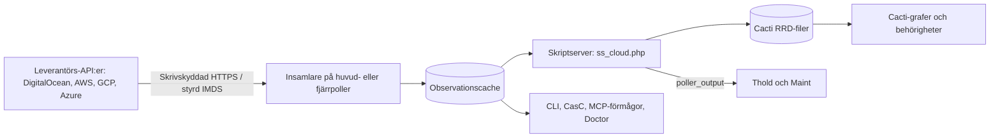

<!-- Source: README.md; SHA256: ac2074a40238686915802803c5efe773f33677f934281e0605e6e87a71a9d27d -->

<!-- translations:start -->
[English](../../../README.md) | [简体中文](../zh-CN/README.md) | [हिन्दी](../hi-IN/README.md) | [Español (España)](../es-ES/README.md) | [Español (Latinoamérica)](../es-419/README.md) | [العربية (السعودية)](../ar-SA/README.md) | [Afrikaans](../af-ZA/README.md) | [አማርኛ](../am-ET/README.md) | [العربية (مصر)](../ar-EG/README.md) | [العربية (المغرب)](../ar-MA/README.md) | [বাংলা](../bn-BD/README.md) | [Bosanski](../bs-BA/README.md) | [Deutsch](../de-DE/README.md) | [فارسی](../fa-IR/README.md) | [Filipino](../fil-PH/README.md) | [Français](../fr-FR/README.md) | [Français (Maroc)](../fr-MA/README.md) | [Français (Sénégal)](../fr-SN/README.md) | [Hausa](../ha-NG/README.md) | [עברית](../he-IL/README.md) | [Hrvatski](../hr-HR/README.md) | [Bahasa Indonesia](../id-ID/README.md) | [Igbo](../ig-NG/README.md) | [Italiano](../it-IT/README.md) | [日本語](../ja-JP/README.md) | [한국어](../ko-KR/README.md) | [Malagasy](../mg-MG/README.md) | [मराठी](../mr-IN/README.md) | [Bahasa Melayu](../ms-MY/README.md) | [Nederlands](../nl-NL/README.md) | [Polski](../pl-PL/README.md) | [Português (Brasil)](../pt-BR/README.md) | [Русский](../ru-RU/README.md) | [Kinyarwanda](../rw-RW/README.md) | [Soomaali](../so-SO/README.md) | [Српски](../sr-RS/README.md) | [Svenska](README.md) | [Kiswahili](../sw-KE/README.md) | [தமிழ்](../ta-IN/README.md) | [తెలుగు](../te-IN/README.md) | [ไทย](../th-TH/README.md) | [Türkçe](../tr-TR/README.md) | [Українська](../uk-UA/README.md) | [اردو](../ur-PK/README.md) | [Tiếng Việt](../vi-VN/README.md) | [isiXhosa](../xh-ZA/README.md) | [Yorùbá](../yo-NG/README.md) | [繁體中文](../zh-TW/README.md) | [isiZulu](../zu-ZA/README.md)
<!-- translations:end -->

# plugin_cloud

En Cacti 1.2-plugin som för in resurser och mätvärden från publika molnleverantörer i Cacti som vanliga enheter, datakällor och grafer. Molnarbetslaster hamnar bredvid nätverket som bär dem, under Cactis behörigheter, och Thold och Maint larmar om och undertrycker dem. En enda plugin täcker DigitalOcean, Amazon Web Services, Google Cloud och Microsoft Azure via skrivskyddade leverantörsdrivrutiner i ren PHP.

> **Status: under utveckling, ingen release ännu (`0.1.0-dev`).** Den här grenen implementerar drivrutiner i ren PHP för DigitalOcean, AWS, Google Cloud och Azure, replikering av fjärrdatainsamlare och skrivskyddad agenthälsa, en CasC-leverantör och operatörs-CLI, MCP-förmågor samt Doctor-kontroller. Medföljande Cacti-mallar täcker för närvarande DigitalOcean Droplets och lastbalanserare (`templates/cloud_digitalocean.xml`); Cacti-mallpaket för AWS, Google Cloud och Azure samt kvalificering på aktiva konton utöver DigitalOcean ([leverantörsfakta](../../research/provider-facts.md)) är ännu inte klara. Kör inte i produktion.

## Leverantörer som stöds

Varje leverantörsdrivrutin är registrerad i `Drivers::production()`, tillhandahålls av `Provider::released()` och körs i ren PHP med `ext-openssl` och strömsockets utan några SDK- eller Composer-körtidsberoenden.

| Leverantör | Omfångsfält | Autentiseringskällor | Autentisering | Upptäckta resurser | Mätvärdesinsamling |
|---|---|---|---|---|---|
| DigitalOcean (`digitalocean`) | Inga (token-begränsad) | `vault`, `file` | Bearer-token | `droplet`, `load_balancer` | `/v2/monitoring/metrics` med medvetenhet om andel av hastighetsgränsen; levereras med Cacti-mallar och datafrågor |
| Amazon Web Services (`aws`) | `account_id` (12 siffror), `regions` | `vault`, `file`, `instance` | AWS SigV4 i ren PHP (`AWS4-HMAC-SHA256`), STS `GetCallerIdentity`-verifiering, valfri STS `AssumeRole`, EC2 IMDSv2 (`169.254.169.254`) för `instance`-konton | `ec2_instance`, `rds_instance`, `aws_elb` (ALB/NLB) | Batchad CloudWatch `GetMetricData` (upp till 500 frågor per anrop) |
| Google Cloud (`gcp`) | `project` | `vault`, `file`, `instance` | RS256-tjänstekonto-JWT i ren PHP via `ext-openssl` växlad hos `oauth2.googleapis.com/token`, eller GCE-metadataserver (`metadata.google.internal`) för `instance`-konton | `gce_instance` via `instances.aggregatedList` | Cloud Monitoring `timeSeries.list` |
| Microsoft Azure (`azure`) | `tenant`, `subscription`, `regions` | `vault`, `file`, `instance` | Entra ID OAuth2 client-credentials-flöde i ren PHP (endast `client_secret`; certifikatintyg undantagna), eller hanterad identitet via Azure IMDS (`169.254.169.254`) för ARM- och Monitor-tokens | `azure_vm` via ARM Resource Graph (paginerad med `$skipToken` och deduplicerad) | Azure Monitor `metrics:getBatch` (upp till 50 resurser per anrop, med hantering av HTTP 429- och 529-strypning) |

## Implementerade funktioner

### Kärnplattform, valv och insamlare

- **Skyddad installation och livscykel.** Ingångspunkter (`setup.php`, `cli/cloud.php`, `poller_cloud.php`, `ss_cloud.php` och sidskript) kan parsas på PHP 8.0 och nekar PHP under 8.2 eller avsaknad av `ext-openssl` utan att förstöra Cacti. Uppgraderingar är ordnade, idempotenta (`Schema::VERSION = 3`, 9 tabeller) och överlever avbrott. Avinstallation behåller plugintabellerna såvida inte *Keep Plugin Tables on Uninstall* är avmarkerat.
- **Konton och autentiseringsuppgifter.** Lägg till, redigera, verifiera och ta bort konton under **Management > Cloud Accounts**. Autentiseringsuppgifter hämtas från det AES-256-GCM-krypterade valvet (`plugin_cloud_secret`, med nyckeln `/etc/cacti/cloud-vault.key` som standard), från en fil begränsad till den konfigurerade katalogen *Credential File Directory* (`cloud_credential_dir`, tom som standard för att neka filer), eller från leverantörens instansidentitet. Autentiseringsuppgifter kan endast skrivas i gränssnittet och maskeras i loggar.
- **Strikta utgående och skrivskyddade kontroller.** Varje drivrutin körs bakom `GuardedTransport` och `OutboundPolicy`: HTTPS-port 443 till exakta värdnamn per leverantör, med länk-lokala HTTP-port 80-metadataslutpunkter (`169.254.169.254`, `metadata.google.internal`) aktiverade endast för `instance`-konton. Endast skrivskyddade åtgärder på tillåtlistan tillåts.
- **Insamlare och kostnadskontroller.** `poller_cloud.php` körs från `poller_bottom` (en process per poller via Cactis processregister) inom `cloud_collector_budget`, skaffar lån per konto, kör upptäckt vid `discover_interval`, läser mätvärden endast för aktiva Cacti-datakällor (`plugin_cloud_series`), respekterar `request_share` och `monthly_ceiling` samt cachar de senaste datapunkterna i `plugin_cloud_observation` för `ss_cloud.php`.
- **Cacti-objekt och förfrågningsuppskattningar.** Upprätthåller en omfångsenhet per konto (`plugin_cloud_device`), bevarar omfångsenhetens omindexeringsmetoder när enheter sparas, importerar DigitalOcean-mallar och datafrågor för skriptservern (`templates/cloud_digitalocean.xml`, `cloud_do_droplet.xml`, `cloud_do_load_balancer.xml`) samt visar förfrågnings- och listprisuppskattningar på **New Graphs** (`graphs_new_top_links`) och **Cloud Health**.

### Fjärrdatainsamlare

- `INFO` deklarerar `remote_collect:1`. Konton kan tilldelas valfri aktiverad Cacti-poller (`poller_id >= 1`), och `poller_cloud.php --poller=N` samlar endast in konton som ägs av den pollern.
- **`replicate_out`-hook.** Replikerar poller-avgränsade rader från `plugin_cloud_account`, `plugin_cloud_device`, `plugin_cloud_series` och krypterade chiffertextrader från `plugin_cloud_secret` (endast för valvbaserade konton som ägs av mål-pollern) via `replicate_out_table()`. Råa valvnyckelfiler lagras aldrig i databasen eller replikeras utan förblir lokala på varje poller.
- **`remote_agent`-hook.** Exponerar en skrivskyddad JSON-hälsosammanfattning (`action=cloud_health`) som endast accepterar heltalsparametrarna `poller_id` och `account_id` och returnerar noll autentiseringsuppgifter, filsökvägar eller hemligheter.

### Ekosystemhooks (CasC, MCP-förmågor och Doctor)

- **CasC-leverantör (`casc_register_providers`).** Registrerar leverantören `cloud` (schemaversion `1`) med deterministisk YAML- och XML-export i ren PHP, manifestvalidering, diff-planering och bekräftad tillämpning. Valvuppgifter exporteras som `vault:account:<name>`-referenser; råa hemlighetsfält (`secret`, `secrets`, `token`, `access_token`, `refresh_token`, `password`, `private_key`, `access_key_id`, `secret_access_key`, `session_token`, `client_secret`, `credential`, `credentials`, `vault_key`) avvisas. Tillämpning kräver en exakt SHA-256 `--confirm=<PLAN_HASH>`.
- **MCP / Abilities API (`abilities_register`).** Registrerar tre strikt skrivskyddade förmågor som styrs av behörighetsområdet Cloud View (`cloud_health.php`) och Cacti-enhetsomfånget för anropare utan administratörsbehörighet, och lämnar aldrig ut autentiseringsuppgifter, valvnycklar eller sökvägar till autentiseringsfiler:
  - `cloud-list-accounts` (valfri `provider`, `poller_id`)
  - `cloud-list-resources` (valfri `account_id`, `type`, `lifecycle`)
  - `cloud-get-health` (valfri `account_id`)
- **Doctor-kontroller (`doctor_register_checks`).** Registrerar fem diagnostiska kontroller som inte avslöjar hemliga värden eller nyckelmaterial:
  - `cloud_schema`: om schemaversionen är aktuell
  - `cloud_vault_key`: läsbarhet, behörigheter och storlek för valvnyckelfilen
  - `cloud_drivers`: registrering av produktionsdrivrutiner för alla lanserade leverantörer
  - `cloud_accounts_health`: aktiverade konton som misslyckats, strypts eller har föråldrad data
  - `cloud_poller_intervals`: anpassning av insamlingsintervallen för aktiverade konton till Cactis pollerintervall

## CLI

Kör från Cactis rotkatalog med PHP 8.2 eller senare:

```sh
# Operator and CasC CLI (options use --key=value form)
php plugins/cloud/cli/cloud.php export [--format=yaml|xml]
php plugins/cloud/cli/cloud.php validate --file=<path> [--format=yaml|xml]
php plugins/cloud/cli/cloud.php plan --file=<path> [--format=yaml|xml]
php plugins/cloud/cli/cloud.php apply --file=<path> --confirm=<PLAN_HASH> [--format=yaml|xml]
php plugins/cloud/cli/cloud.php health [--format=text|json] [--poller=<id>]

# Collector entry point (normally started by poller_bottom)
php plugins/cloud/poller_cloud.php [--poller=N] [--force] [--debug]
```

## Åtkomstroller

| Behörighetsområde | Åtkomst |
| --- | --- |
| Cloud View | Befintliga övervakningssidor. |
| Cloud Operator | Övervakning samt sidan Operations och personliga triage-bekräftelser. |
| Cloud Admin | Operator-åtkomst samt befintlig konfiguration och administrativa åtgärder. |

När uppgraderingsfilerna har kopierats öppnar du sidan Plugins som administratör för att registrera behörighetsområdena. Tilldela behörighetsområdet Operator uttryckligen under **Configuration > Users** eller användargrupper. Uppgraderingar behåller befintliga ID:n och tilldelningar för View och Admin. Admin-åtkomst ärver Operator-åtkomst och Operator-åtkomst ärver View-åtkomst vid varje begäran; detta lägger inte till lagrade tilldelningar för användare eller grupper. Plugininställningar kräver även Cloud Admin-åtkomst utöver Cactis behörighet Settings.

Cactis enhetsbehörigheter begränsar vilka rader och åtgärder som är tillgängliga för varje användare; omappade objekt kräver en administratör. Operatörer kan verifiera den lagrade autentiseringsuppgiften för ett konto vars Cacti-enhet de har åtkomst till. Autentiseringsuppgifter, konfiguration, mappning, borttagning och andra administrativa ändringar stannar kvar på de administrativa sidorna. Bekräftelser gäller endast i den aktuella användarsessionen, i högst en timme och endast så länge samma observation förblir aktuell. Nya eller ändrade observationer gör dem ogiltiga. De markerar aldrig en misslyckad mätning som frisk och undertrycker aldrig larm.

## Varför

Varje molnleverantör har sin egen övervakningskonsol. När de körs vid sidan av Cacti lämnar de tre luckor:

- **Separat åtkomstkontroll.** Att visa molnmätvärden för en Cacti-användare innebär att man måste ge dem en molninloggning.
- **Ingen nätverkskontext.** Lokala länkar ritas i grafer i Cacti; arbetslasterna bakom dem ritas i respektive leverantörs konsol.
- **Separata larm.** Thold och Maint arbetar på Cactis datakällor och enheter, så leverantörslarm konfigureras och undertrycks separat, en gång per leverantör.

Pluginen läser varje leverantörs övervaknings-API på en Cacti-poller, cachar de senaste datapunkterna och levererar dem till Cactis skriptserver. Cactis poller skriver RRD-filerna, så grafritning, behörigheter, Thold, Maint och boost fungerar som för all annan Cacti-data.

## Designåtaganden

- **Skrivskyddad.** Varje drivrutin kan endast bygga leverantörsåtgärderna på sin tillåtlista; pluginen ändrar aldrig en molnresurs. ([ADR 0002](../../decisions/0002-read-only-with-operation-allowlist.md))
- **Endast PHP, inga SDK:er.** Signering och tokenutbyte implementeras i PHP med de tillägg Cacti redan kräver. Inga Composer-körtidsberoenden. ([ADR 0003](../../decisions/0003-php-only-without-sdks.md))
- **Kostnad före insamling.** Pluginen läser bara mätvärden som har en Cacti-datakälla, visar förväntat antal förfrågningar och listpriskostnad innan grafer skapas och upprätthåller ett månadstak. ([ADR 0005](../../decisions/0005-collect-only-what-is-graphed.md))
- **Inga klartextuppgifter i databasen.** Autentiseringsuppgifter kommer från ett krypterat valv med en nyckelfil utanför databasen, från en fil med autentiseringsuppgifter eller från leverantörens instansidentitet. ([ADR 0007](../../decisions/0007-credentials-outside-the-database-in-the-clear.md))

## Omfång och status

| Fas | Omfång | Milstolpar | Status |
|---|---|---|---|
| 0, forskning | Bekräftelse av leverantörsfakta, mätvärdeskataloger, kostnads- och hastighetsmodell, testvektorer för signering, transportprototyp | [M1](https://github.com/somethingwithproof/plugin_cloud/milestone/1) | Klar, utom kontroller som kräver aktiva leverantörskonton |
| 1, kärna och DigitalOcean | Konton, autentiseringsvalv, transport, insamlare, observationscache, Cacti-objekt, mallar, förfrågningsuppskattningar, hälsosida, DigitalOcean Droplets och lastbalanserare | [M2](https://github.com/somethingwithproof/plugin_cloud/milestone/2), [M3](https://github.com/somethingwithproof/plugin_cloud/milestone/3), [M4](https://github.com/somethingwithproof/plugin_cloud/milestone/4) | Implementerad; M4-pilotkvalificering pågår |
| 2, AWS | SigV4 i ren PHP, STS `AssumeRole`, IMDSv2-instansroller, EC2/RDS/ELB-inventering, CloudWatch `GetMetricData` | [M5](https://github.com/somethingwithproof/plugin_cloud/milestone/5) | Drivrutin implementerad; Cacti-mallar och kvalificering på aktivt konto pågår |
| 3, Google Cloud | RS256-tjänstekonto-JWT i ren PHP, GCE-metadataserver, Compute Engine-inventering, Cloud Monitoring `timeSeries.list` | [M6](https://github.com/somethingwithproof/plugin_cloud/milestone/6) | Drivrutin implementerad; Cacti-mallar och kvalificering på aktivt konto pågår |
| 4, Azure | Entra ID client credentials, hanterad identitet via IMDS, ARM Resource Graph VM-inventering, Azure Monitor `metrics:getBatch` | [M7](https://github.com/somethingwithproof/plugin_cloud/milestone/7) | Drivrutin implementerad; Cacti-mallar och kvalificering på aktivt konto pågår |
| 5, fjärrinsamlare och ekosystem | Fjärrdatainsamlare (`replicate_out`, `remote_agent`), CasC-leverantör och CLI, MCP-förmågor, Doctor-kontroller | [M8](https://github.com/somethingwithproof/plugin_cloud/milestone/8) | Implementerad |

Utanför omfånget: att ändra molnresurser, skapa eller spegla leverantörslarm, faktureringsrapporter, loggar och spårningar samt en pluginegen larmmotor. Ytterligare leverantörer (Hetzner Cloud, Akamai Cloud, Oracle Cloud och andra) är forskningsärenden.

## Installera och konfigurera

Dessa steg installerar utvecklingskoden för utvärdering. De kräver Cacti 1.2.31 eller senare på PHP 8.2 eller senare.

1. Kopiera arkivet till `plugins/cloud` under din Cacti-katalog. Katalogen måste heta `cloud`.
2. Skapa valvnyckeln utanför webbroten på varje poller som använder valvbaserade autentiseringsuppgifter. Lägg den i en katalog som bara root och Cacti-användaren kan skriva till och gör filen läsbar endast för användaren som kör webbservern och pollern. Pluginen skapar eller skriver aldrig den här filen:

   ```sh
   sudo install -d -m 0750 -o root -g cacti /etc/cacti
   head -c 32 /dev/urandom | sudo tee /etc/cacti/cloud-vault.key > /dev/null
   sudo chown cacti:cacti /etc/cacti/cloud-vault.key
   sudo chmod 0600 /etc/cacti/cloud-vault.key
   ```

   Ersätt `cacti` med användaren som kör din webbserver och poller. Filen rymmer 32 råa byte eller 64 hexadecimala tecken. Säkerhetskopiera den tillsammans med databasen; utan den måste lagrade autentiseringsuppgifter anges på nytt.
3. I Cacti öppnar du **Configuration > Plugins** och installerar och aktiverar *Cloud*.
4. Under **Configuration > Settings > Cloud** anger du *Vault Key File* om du använt en annan sökväg, konfigurerar *Credential File Directory* om du planerar att använda filbaserade autentiseringsuppgifter och håller *Collector Time Budget* (standard 240 sekunder) under pollerintervallet.
5. Ge *Cloud Admin*, *Cloud Operator* eller *Cloud View* till användare och grupper under **Configuration > Users**. Installationen ger Cloud Admin och Cloud View till administratören; Cloud Admin inkluderar Operator-åtkomst, så administratören behöver ingen separat Operator-tilldelning.
6. Lägg till konton under **Management > Cloud Accounts** och kontrollera sedan **Management > Cloud Health** för varningar.

## Kompatibilitetsmål

| Komponent | Mål |
|---|---|
| Cacti | 1.2.31 eller senare, inga kärnpatchar |
| PHP | 8.2 eller senare; ingångspunkter förblir parsbara på 8.0 så att en körtid som inte stöds får ett avslag i stället för ett trasigt Cacti-gränssnitt |
| PHP-tillägg | `ext-openssl` (krävs av Cacti 1.2.31); inget `ext-curl` och inga Composer-körtidsberoenden |
| Thold, Maint | Inga ändringar krävs |

## Design

- [docs/performance.md](../../performance.md) innehåller mätningarna för insamlaren och hälsosidan, med den hårdvara och de inställningar som använts.
- [docs/PLAN.md](../../PLAN.md) är hela planen: arkitektur, de leverantörs- och Cacti-fakta den bygger på (med källor), drivrutinskontrakt, kostnadsberäkning, säkerhetsgränser, testning och risker.
- [docs/decisions/](../../decisions/) innehåller arkitekturbeslut för redan gjorda val.
- [docs/REQUIREMENTS.md](../../REQUIREMENTS.md) kopplar varje krav-ID till dess ärende.



## Hur arbetet spåras

- **Milstolpar** följer planens milstolpar. Varje milstolpe har ett episkt ärende som listar dess underärenden och slutbevis.
- **Ärenden** är typade med etiketter: `type: requirement`, `type: research`, `type: decision`, `type: epic`. Kravärenden anger numrerade, testbara krav (`REQ-AREA-NNN`) och acceptanskriterier.
- **Etiketter** har också `area:`, `provider:`, `phase:`, `priority:` och `status:`. Se [CONTRIBUTING.md](../../../CONTRIBUTING.md#labels).
- [Projekttavlan](https://github.com/users/somethingwithproof/projects/7) visar alla ärenden över alla milstolpar.

## Utveckling

CI ([.github/workflows/plugin-ci-workflow.yml](../../../.github/workflows/plugin-ci-workflow.yml)) kontrollerar releasearkivet och semantisk versionshantering (`bash tests/bin/archive-check.sh`), lintar ingångspunkter på PHP 8.0, kör Pest-enhetstester (`phpunit.xml`) och livscykelintegrationstester (`phpunit-integration.xml`) samt PHPStan nivå 9 över PHP 8.2 till 8.5 mot Cacti `release/1.2.31` och `1.2.x` med `CLOUD_OFFLINE=1`, kontrollerar avslag på PHP 8.1, verifierar gettext-kataloger, mäter prestandan för insamling av 1 000 serier och hälsosidan samt kör workflow-linting och REUSE-efterlevnad.

Lokala kontroller före push:

```sh
bash tests/bin/archive-check.sh
sh tests/lint-workflows.sh
sh locales/build_gettext.sh --check
CACTI_PATH=/path/to/cacti phpstan analyse -c phpstan.neon --no-progress
```

Kör Pest med `--configuration=phpunit.xml` för enhets- och källregeltstester, eller `--configuration=phpunit-integration.xml` med `CACTI_PATH` och `CLOUD_TEST_DATABASE=disposable` mot en engångsdatabas för Cacti för livscykelintegrationstester.

## Bidra

Läs [CONTRIBUTING.md](../../../CONTRIBUTING.md). Commits kräver en DCO sign-off. Designdiskussioner förs i ärenden; öppna beslut bär etiketten `type: decision`.

## Säkerhet

Rapportera sårbarheter privat; se [SECURITY.md](../../../SECURITY.md).

## Licens

GNU General Public License v2.0, samma licens som Cacti och dess plugins. Se [LICENSE](../../../LICENSE).
