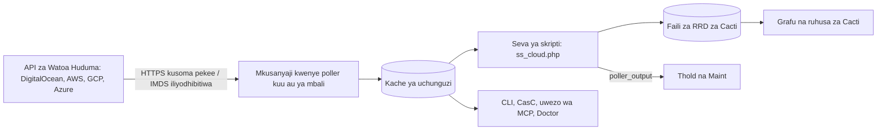

<!-- Source: README.md; SHA256: ac2074a40238686915802803c5efe773f33677f934281e0605e6e87a71a9d27d -->

<!-- translations:start -->
[English](../../../README.md) | [简体中文](../zh-CN/README.md) | [हिन्दी](../hi-IN/README.md) | [Español (España)](../es-ES/README.md) | [Español (Latinoamérica)](../es-419/README.md) | [العربية (السعودية)](../ar-SA/README.md) | [Afrikaans](../af-ZA/README.md) | [አማርኛ](../am-ET/README.md) | [العربية (مصر)](../ar-EG/README.md) | [العربية (المغرب)](../ar-MA/README.md) | [বাংলা](../bn-BD/README.md) | [Bosanski](../bs-BA/README.md) | [Deutsch](../de-DE/README.md) | [فارسی](../fa-IR/README.md) | [Filipino](../fil-PH/README.md) | [Français](../fr-FR/README.md) | [Français (Maroc)](../fr-MA/README.md) | [Français (Sénégal)](../fr-SN/README.md) | [Hausa](../ha-NG/README.md) | [עברית](../he-IL/README.md) | [Hrvatski](../hr-HR/README.md) | [Bahasa Indonesia](../id-ID/README.md) | [Igbo](../ig-NG/README.md) | [Italiano](../it-IT/README.md) | [日本語](../ja-JP/README.md) | [한국어](../ko-KR/README.md) | [Malagasy](../mg-MG/README.md) | [मराठी](../mr-IN/README.md) | [Bahasa Melayu](../ms-MY/README.md) | [Nederlands](../nl-NL/README.md) | [Polski](../pl-PL/README.md) | [Português (Brasil)](../pt-BR/README.md) | [Русский](../ru-RU/README.md) | [Kinyarwanda](../rw-RW/README.md) | [Soomaali](../so-SO/README.md) | [Српски](../sr-RS/README.md) | [Svenska](../sv-SE/README.md) | [Kiswahili](README.md) | [தமிழ்](../ta-IN/README.md) | [తెలుగు](../te-IN/README.md) | [ไทย](../th-TH/README.md) | [Türkçe](../tr-TR/README.md) | [Українська](../uk-UA/README.md) | [اردو](../ur-PK/README.md) | [Tiếng Việt](../vi-VN/README.md) | [isiXhosa](../xh-ZA/README.md) | [Yorùbá](../yo-NG/README.md) | [繁體中文](../zh-TW/README.md) | [isiZulu](../zu-ZA/README.md)
<!-- translations:end -->

# plugin_cloud

Programu-jalizi ya Cacti 1.2 inayoleta rasilimali na vipimo kutoka kwa watoa huduma wa wingu wa umma hadi ndani ya Cacti kama vifaa vya kawaida, vyanzo vya data, na grafu. Kazi za wingu hukaa kando ya mtandao unaozibeba, chini ya ruhusa za Cacti, na Thold na Maint hutoa tahadhari na kuzizuia. Programu-jalizi moja inashughulikia DigitalOcean, Amazon Web Services, Google Cloud, na Microsoft Azure kupitia viendeshi vya PHP safi vya kusoma pekee.

> **Hali: bado inatengenezwa, hakuna toleo rasmi bado (`0.1.0-dev`).** Tawi hili linatekeleza viendeshi vya PHP safi kwa DigitalOcean, AWS, Google Cloud, na Azure, urudufishaji wa mkusanyaji data wa mbali na afya ya ajenti ya kusoma pekee, mtoa huduma wa CasC na CLI ya mwendeshaji, uwezo wa MCP, na ukaguzi wa Doctor. Violezo vya Cacti vilivyojumuishwa kwa sasa vinashughulikia DigitalOcean Droplets na load balancers (`templates/cloud_digitalocean.xml`); vifurushi vya violezo vya Cacti kwa AWS, Google Cloud, na Azure pamoja na uthibitishaji wa akaunti hai zaidi ya DigitalOcean ([ukweli wa watoa huduma](../../research/provider-facts.md)) bado havijakamilika. Usiiendeshe katika mazingira ya uzalishaji.

## Watoa huduma wanaotumika

Kila kiendeshi cha mtoa huduma kimesajiliwa katika `Drivers::production()`, kinatolewa na `Provider::released()`, na kinafanya kazi kwa PHP safi kwa kutumia `ext-openssl` na soketi za mtiririko bila SDK wala vitegemezi vya wakati wa uendeshaji vya Composer.

| Mtoa huduma | Sehemu za wigo | Vyanzo vya vitambulisho | Uthibitishaji | Rasilimali zinazogunduliwa | Ukusanyaji wa vipimo |
|---|---|---|---|---|---|
| DigitalOcean (`digitalocean`) | Hakuna (wigo wa tokeni) | `vault`, `file` | Bearer token | `droplet`, `load_balancer` | `/v2/monitoring/metrics` yenye ufahamu wa mgao wa kikomo cha maombi; inakuja na violezo vya Cacti na hoja za data |
| Amazon Web Services (`aws`) | `account_id` (tarakimu 12), `regions` | `vault`, `file`, `instance` | AWS SigV4 ya PHP safi (`AWS4-HMAC-SHA256`), uthibitishaji wa STS `GetCallerIdentity`, STS `AssumeRole` ya hiari, EC2 IMDSv2 (`169.254.169.254`) kwa akaunti za `instance` | `ec2_instance`, `rds_instance`, `aws_elb` (ALB/NLB) | CloudWatch `GetMetricData` kwa mafungu (hadi hoja 500 kwa kila wito) |
| Google Cloud (`gcp`) | `project` | `vault`, `file`, `instance` | JWT ya akaunti ya huduma ya RS256 ya PHP safi kupitia `ext-openssl` ikibadilishwa katika `oauth2.googleapis.com/token`, au seva ya metadata ya GCE (`metadata.google.internal`) kwa akaunti za `instance` | `gce_instance` kupitia `instances.aggregatedList` | Cloud Monitoring `timeSeries.list` |
| Microsoft Azure (`azure`) | `tenant`, `subscription`, `regions` | `vault`, `file`, `instance` | Mtiririko wa vitambulisho vya mteja vya Entra ID OAuth2 kwa PHP safi (`client_secret` pekee; uthibitisho wa cheti haujajumuishwa), au utambulisho unaosimamiwa wa Azure IMDS (`169.254.169.254`) kwa tokeni za ARM na Monitor | `azure_vm` kupitia ARM Resource Graph (iliyo na kurasa kwa `$skipToken` na kuondoa nakala) | Azure Monitor `metrics:getBatch` (hadi rasilimali 50 kwa kila wito, ikishughulikia upunguzaji wa kasi wa HTTP 429 na 529) |

## Uwezo uliotekelezwa

### Jukwaa kuu, hifadhi ya siri, na mkusanyaji

- **Usakinishaji na mzunguko wa maisha uliolindwa.** Pointi za kuingia (`setup.php`, `cli/cloud.php`, `poller_cloud.php`, `ss_cloud.php`, na hati za kurasa) zinachanganuliwa kwenye PHP 8.0 na kukataa PHP chini ya 8.2 au kukosekana kwa `ext-openssl` bila kuvunja Cacti. Masasisho yamepangwa, ni idempotent (`Schema::VERSION = 3`, majedwali 9), na yanastahimili kukatizwa. Uondoaji huhifadhi majedwali ya programu-jalizi isipokuwa *Keep Plugin Tables on Uninstall* imeondolewa alama.
- **Akaunti na vitambulisho.** Ongeza, hariri, thibitisha, na futa akaunti chini ya **Management > Cloud Accounts**. Vitambulisho vinatoka kwenye hifadhi iliyosimbwa kwa AES-256-GCM (`plugin_cloud_secret`, inayotumia ufunguo wa `/etc/cacti/cloud-vault.key` kwa chaguo-msingi), kutoka kwenye faili iliyozuiwa ndani ya *Credential File Directory* iliyosanidiwa (`cloud_credential_dir`, tupu kwa chaguo-msingi ili kukataa faili), au kutoka kwa utambulisho wa mfano wa mtoa huduma. Vitambulisho ni vya kuandika tu katika kiolesura na hufichwa kwenye kumbukumbu.
- **Udhibiti mkali wa kutoka nje na kusoma pekee.** Kila kiendeshi hufanya kazi nyuma ya `GuardedTransport` na `OutboundPolicy`: lango la HTTPS 443 kwenda kwa majina kamili ya wapangishi wa kila mtoa huduma, na pointi za mwisho za metadata za HTTP za ndani ya kiungo lango la 80 (`169.254.169.254`, `metadata.google.internal`) zikiwashwa kwa akaunti za `instance` pekee. Shughuli za kusoma pekee zilizoruhusiwa ndizo zinazoruhusiwa.
- **Mkusanyaji na udhibiti wa gharama.** `poller_cloud.php` huendeshwa kutoka `poller_bottom` (mchakato mmoja kwa kila poller kupitia usajili wa michakato wa Cacti) ndani ya `cloud_collector_budget`, hupata ukodishaji wa muda kwa kila akaunti, huendesha ugunduzi kwenye `discover_interval`, husoma vipimo kwa vyanzo hai vya data vya Cacti pekee (`plugin_cloud_series`), huheshimu `request_share` na `monthly_ceiling`, na huhifadhi pointi za hivi karibuni za data katika `plugin_cloud_observation` kwa ajili ya `ss_cloud.php`.
- **Vipengee vya Cacti na makadirio ya maombi.** Hudumisha kifaa cha wigo kwa kila akaunti (`plugin_cloud_device`), huhifadhi mbinu za kuweka faharasa upya za kifaa cha wigo wakati wa kuhifadhi kifaa, huingiza violezo vya DigitalOcean na hoja za data za script server (`templates/cloud_digitalocean.xml`, `cloud_do_droplet.xml`, `cloud_do_load_balancer.xml`), na huonyesha makadirio ya maombi na bei ya orodha kwenye **New Graphs** (`graphs_new_top_links`) na **Cloud Health**.

### Wakusanyaji data wa mbali

- `INFO` inatangaza `remote_collect:1`. Akaunti zinaweza kugawiwa kwa poller yoyote ya Cacti iliyowashwa (`poller_id >= 1`), na `poller_cloud.php --poller=N` hukusanya akaunti zinazomilikiwa na poller hiyo pekee.
- **Hook ya `replicate_out`.** Hurudufisha safu mlalo za wigo wa poller kutoka `plugin_cloud_account`, `plugin_cloud_device`, `plugin_cloud_series`, na safu mlalo za maandishi yaliyosimbwa kutoka `plugin_cloud_secret` (kwa akaunti zinazotumia vault zinazomilikiwa na poller lengwa pekee) kupitia `replicate_out_table()`. Faili ghafi za ufunguo wa vault hazihifadhiwi kamwe kwenye hifadhidata wala kurudufishwa na hubaki ndani ya kila poller.
- **Hook ya `remote_agent`.** Hutoa muhtasari wa afya wa JSON wa kusoma pekee (`action=cloud_health`) unaokubali vigezo vya nambari kamili `poller_id` na `account_id` pekee na kurudisha sifuri za vitambulisho, njia za faili, au siri.

### Hook za mfumo ikolojia (CasC, uwezo wa MCP, na Doctor)

- **Mtoa huduma wa CasC (`casc_register_providers`).** Husajili mtoa huduma wa `cloud` (toleo la schema `1`) akiwa na uhamishaji thabiti wa YAML na XML kwa PHP safi, uthibitishaji wa manifest, upangaji wa tofauti, na utekelezaji uliothibitishwa. Vitambulisho vya vault huhamishwa kama marejeleo ya `vault:account:<name>`; sehemu ghafi za siri (`secret`, `secrets`, `token`, `access_token`, `refresh_token`, `password`, `private_key`, `access_key_id`, `secret_access_key`, `session_token`, `client_secret`, `credential`, `credentials`, `vault_key`) hukataliwa. Kutekeleza kunahitaji `--confirm=<PLAN_HASH>` kamili ya SHA-256.
- **MCP / Abilities API (`abilities_register`).** Husajili uwezo tatu za kusoma pekee zilizodhibitiwa kwenye realm ya Cloud View (`cloud_health.php`) na wigo wa kifaa cha Cacti kwa wapigaji wasio wasimamizi, bila kutoa vitambulisho, funguo za vault, au njia za faili za vitambulisho:
  - `cloud-list-accounts` (`provider`, `poller_id` za hiari)
  - `cloud-list-resources` (`account_id`, `type`, `lifecycle` za hiari)
  - `cloud-get-health` (`account_id` ya hiari)
- **Ukaguzi wa Doctor (`doctor_register_checks`).** Husajili ukaguzi tano za uchunguzi ambazo hazionyeshi thamani za siri au nyenzo za ufunguo:
  - `cloud_schema`: usasishaji wa toleo la schema
  - `cloud_vault_key`: usomaji wa faili ya ufunguo wa vault, ruhusa, na ukubwa
  - `cloud_drivers`: usajili wa kiendeshi cha uzalishaji kwa watoa huduma wote waliotolewa
  - `cloud_accounts_health`: akaunti zilizowashwa ambazo zimeshindwa, zimepunguzwa kasi, au zimepitwa na wakati
  - `cloud_poller_intervals`: upatanishi wa vipindi vya ukusanyaji wa akaunti zilizowashwa na kipindi cha poller ya Cacti

## CLI

Endesha kutoka saraka kuu ya Cacti ukitumia PHP 8.2 au mpya zaidi:

```sh
# Operator and CasC CLI (options use --key=value form)
php plugins/cloud/cli/cloud.php export [--format=yaml|xml]
php plugins/cloud/cli/cloud.php validate --file=<path> [--format=yaml|xml]
php plugins/cloud/cli/cloud.php plan --file=<path> [--format=yaml|xml]
php plugins/cloud/cli/cloud.php apply --file=<path> --confirm=<PLAN_HASH> [--format=yaml|xml]
php plugins/cloud/cli/cloud.php health [--format=text|json] [--poller=<id>]

# Collector entry point (normally started by poller_bottom)
php plugins/cloud/poller_cloud.php [--poller=N] [--force] [--debug]
```

## Majukumu ya ufikiaji

| Realm | Ufikiaji |
| --- | --- |
| Cloud View | Kurasa zilizopo za ufuatiliaji. |
| Cloud Operator | Ufuatiliaji pamoja na ukurasa wa Shughuli na uthibitisho wa kibinafsi wa uchunguzi wa awali. |
| Cloud Admin | Ufikiaji wa Operator pamoja na usanidi uliopo na vitendo vya usimamizi. |

Baada ya kunakili faili za sasisho, fungua ukurasa wa Plugins kama msimamizi ili kusajili realms. Weka realm ya Operator waziwazi chini ya **Configuration > Users** au vikundi vya watumiaji. Masasisho huhifadhi vitambulisho na ruhusa zilizopo za realm za View na Admin. Ufikiaji wa Admin hurithi ufikiaji wa Operator, na ufikiaji wa Operator hurithi ufikiaji wa View kwa kila ombi; hii haiongezi ruhusa zilizohifadhiwa kwa watumiaji au vikundi. Mipangilio ya programu-jalizi pia inahitaji ufikiaji wa Cloud Admin pamoja na ruhusa ya Settings ya Cacti.

Ruhusa za kifaa cha Cacti hupunguza safu mlalo na vitendo vinavyopatikana kwa kila mtumiaji; vipengee visivyo na ramani vinahitaji msimamizi. Waendeshaji wanaweza kuthibitisha kitambulisho kilichohifadhiwa kwa akaunti ambayo kifaa chake cha Cacti wanaweza kukifikia. Vitambulisho, usanidi, upangaji ramani, ufutaji, na mabadiliko mengine ya usimamizi hubaki kwenye kurasa za usimamizi. Uthibitisho wa awali hudumu katika kipindi cha sasa cha mtumiaji pekee, kwa muda usiozidi saa moja na mradi tu uchunguzi ule ule ubaki mpya. Uchunguzi mpya au uliobadilika huubatilisha. Haubadilishi kamwe kipimo kilichoshindwa kuwa chenye afya wala kuzuia tahadhari.

## Kwa nini

Kila mtoa huduma wa wingu ana dashibodi yake ya ufuatiliaji. Zinapoendeshwa kando ya Cacti, zinaacha mapengo matatu:

- **Udhibiti tofauti wa ufikiaji.** Kumwonyesha mtumiaji wa Cacti vipimo vya wingu kunamaanisha kumpa akaunti ya kuingia ya wingu.
- **Hakuna muktadha wa mtandao.** Viungo vya ndani huchorwa grafu katika Cacti; kazi zilizo nyuma yake huchorwa grafu katika dashibodi ya kila mtoa huduma.
- **Tahadhari tofauti.** Thold na Maint hufanya kazi kwenye vyanzo vya data na vifaa vya Cacti, hivyo kengele za mtoa huduma husanidiwa na kuzuiwa kando, mara moja kwa kila mtoa huduma.

Programu-jalizi husoma API ya ufuatiliaji ya kila mtoa huduma kwenye poller ya Cacti, huhifadhi pointi za hivi karibuni za data kwenye kache, na kuzihudumia kwa script server ya Cacti. Poller ya Cacti huandika faili za RRD, hivyo uchoraji wa grafu, ruhusa, Thold, Maint, na boost hufanya kazi kama kwa data yoyote ya Cacti.

## Ahadi za muundo

- **Kusoma pekee.** Kila kiendeshi kinaweza kuunda shughuli za mtoa huduma zilizo kwenye orodha yake ya ruhusa pekee; programu-jalizi haibadilishi kamwe rasilimali ya wingu. ([ADR 0002](../../decisions/0002-read-only-with-operation-allowlist.md))
- **PHP pekee, hakuna SDK.** Usainishaji na ubadilishanaji wa tokeni hutekelezwa katika PHP kwa kutumia viendelezi ambavyo Cacti tayari inahitaji. Hakuna vitegemezi vya wakati wa uendeshaji vya Composer. ([ADR 0003](../../decisions/0003-php-only-without-sdks.md))
- **Gharama kabla ya ukusanyaji.** Programu-jalizi husoma vipimo vyenye chanzo cha data cha Cacti pekee, huonyesha idadi inayotarajiwa ya maombi na gharama ya bei ya orodha kabla ya grafu kuundwa, na hulazimisha kikomo cha kila mwezi. ([ADR 0005](../../decisions/0005-collect-only-what-is-graphed.md))
- **Hakuna vitambulisho wazi kwenye hifadhidata.** Vitambulisho vinatoka kwenye hifadhi iliyosimbwa inayotumia ufunguo wa faili nje ya hifadhidata, kutoka kwenye faili ya vitambulisho, au kutoka kwa utambulisho wa mfano wa mtoa huduma. ([ADR 0007](../../decisions/0007-credentials-outside-the-database-in-the-clear.md))

## Wigo na hali

| Awamu | Wigo | Hatua muhimu | Hali |
|---|---|---|---|
| 0, utafiti | Uthibitishaji wa ukweli wa watoa huduma, katalogi za vipimo, muundo wa gharama na viwango, vekta za majaribio ya usainishaji, jaribio la usafirishaji | [M1](https://github.com/somethingwithproof/plugin_cloud/milestone/1) | Imekamilika, isipokuwa ukaguzi unaohitaji akaunti hai za watoa huduma |
| 1, msingi na DigitalOcean | Akaunti, hifadhi ya vitambulisho, usafirishaji, mkusanyaji, kache ya uchunguzi, vipengee vya Cacti, violezo, makadirio ya maombi, ukurasa wa afya, DigitalOcean Droplets na load balancers | [M2](https://github.com/somethingwithproof/plugin_cloud/milestone/2), [M3](https://github.com/somethingwithproof/plugin_cloud/milestone/3), [M4](https://github.com/somethingwithproof/plugin_cloud/milestone/4) | Imetekelezwa; uthibitishaji wa majaribio wa M4 unasubiri |
| 2, AWS | SigV4 ya PHP safi, STS `AssumeRole`, majukumu ya mfano ya IMDSv2, orodha ya EC2/RDS/ELB, CloudWatch `GetMetricData` | [M5](https://github.com/somethingwithproof/plugin_cloud/milestone/5) | Kiendeshi kimetekelezwa; violezo vya Cacti na uthibitishaji wa akaunti hai vinasubiri |
| 3, Google Cloud | JWT ya akaunti ya huduma ya RS256 ya PHP safi, seva ya metadata ya GCE, orodha ya Compute Engine, Cloud Monitoring `timeSeries.list` | [M6](https://github.com/somethingwithproof/plugin_cloud/milestone/6) | Kiendeshi kimetekelezwa; violezo vya Cacti na uthibitishaji wa akaunti hai vinasubiri |
| 4, Azure | Vitambulisho vya mteja vya Entra ID, utambulisho unaosimamiwa wa IMDS, orodha ya VM ya ARM Resource Graph, Azure Monitor `metrics:getBatch` | [M7](https://github.com/somethingwithproof/plugin_cloud/milestone/7) | Kiendeshi kimetekelezwa; violezo vya Cacti na uthibitishaji wa akaunti hai vinasubiri |
| 5, wakusanyaji wa mbali na mfumo ikolojia | Wakusanyaji data wa mbali (`replicate_out`, `remote_agent`), mtoa huduma wa CasC na CLI, uwezo wa MCP, ukaguzi wa Doctor | [M8](https://github.com/somethingwithproof/plugin_cloud/milestone/8) | Imetekelezwa |

Nje ya wigo: kubadilisha rasilimali za wingu, kuunda au kuakisi kengele za mtoa huduma, ripoti za malipo, kumbukumbu na ufuatiliaji wa nyayo, na injini ya tahadhari inayomilikiwa na programu-jalizi. Watoa huduma wengine (Hetzner Cloud, Akamai Cloud, Oracle Cloud, na wengine) ni masuala ya utafiti.

## Sakinisha na usanidi

Hatua hizi husakinisha msimbo wa uendelezaji kwa ajili ya tathmini. Zinahitaji Cacti 1.2.31 au mpya zaidi kwenye PHP 8.2 au mpya zaidi.

1. Nakili hazina hii hadi `plugins/cloud` chini ya saraka yako ya Cacti. Saraka lazima iitwe `cloud`.
2. Unda ufunguo wa hifadhi nje ya mzizi wa wavuti kwenye kila poller inayotumia vitambulisho vinavyotegemea hifadhi. Uuweke katika saraka ambayo root na mtumiaji wa Cacti pekee wanaweza kuiandikia, na ufanye faili isomeke na mtumiaji anayeendesha seva ya wavuti na poller pekee. Programu-jalizi haiundi wala kuandika faili hii kamwe:

   ```sh
   sudo install -d -m 0750 -o root -g cacti /etc/cacti
   head -c 32 /dev/urandom | sudo tee /etc/cacti/cloud-vault.key > /dev/null
   sudo chown cacti:cacti /etc/cacti/cloud-vault.key
   sudo chmod 0600 /etc/cacti/cloud-vault.key
   ```

   Badilisha `cacti` na mtumiaji anayeendesha seva yako ya wavuti na poller. Faili ina baiti 32 ghafi au herufi 64 za heksadesimali. Ihifadhi nakala pamoja na hifadhidata; bila hiyo, vitambulisho vilivyohifadhiwa lazima viingizwe tena.
3. Katika Cacti, fungua **Configuration > Plugins**, kisha sakinisha na uwashe *Cloud*.
4. Chini ya **Configuration > Settings > Cloud**, weka *Vault Key File* ikiwa ulitumia njia nyingine, sanidi *Credential File Directory* ikiwa unapanga kutumia vitambulisho vinavyotegemea faili, na weka *Collector Time Budget* (chaguo-msingi sekunde 240) chini ya kipindi cha poller.
5. Wape watumiaji na vikundi *Cloud Admin*, *Cloud Operator*, au *Cloud View* chini ya **Configuration > Users**. Kusakinisha humpa msimamizi Cloud Admin na Cloud View; Cloud Admin inajumuisha ufikiaji wa Operator, hivyo msimamizi hahitaji ruhusa tofauti ya Operator.
6. Ongeza akaunti chini ya **Management > Cloud Accounts**, kisha angalia **Management > Cloud Health** kwa maonyo.

## Malengo ya uoanifu

| Kipengee | Lengo |
|---|---|
| Cacti | 1.2.31 au mpya zaidi, hakuna viraka vya msingi |
| PHP | 8.2 au mpya zaidi; pointi za kuingia zinabaki kuchanganuliwa kwenye 8.0 ili mazingira yasiyotumika yapate kukataliwa badala ya kiolesura cha Cacti kilichovunjika |
| Viendelezi vya PHP | `ext-openssl` (inahitajika na Cacti 1.2.31); hakuna `ext-curl` na hakuna vitegemezi vya wakati wa uendeshaji vya Composer |
| Thold, Maint | Hakuna mabadiliko yanayohitajika |

## Muundo

- [docs/performance.md](../../performance.md) ina vipimo vya mkusanyaji na ukurasa wa afya, pamoja na vifaa na mipangilio iliyotumika.
- [docs/PLAN.md](../../PLAN.md) ni mpango kamili: usanifu, ukweli wa watoa huduma na Cacti unaotegemewa (pamoja na vyanzo), mkataba wa kiendeshi, hesabu ya gharama, mipaka ya usalama, majaribio, na hatari.
- [docs/decisions/](../../decisions/) ina kumbukumbu za maamuzi ya usanifu kwa chaguo zilizokwisha fanywa.
- [docs/REQUIREMENTS.md](../../REQUIREMENTS.md) inaunganisha kila kitambulisho cha hitaji na suala lake.



## Jinsi kazi inavyofuatiliwa

- **Hatua muhimu** hufuata hatua za mpango. Kila moja ina suala kuu linaloorodhesha masuala madogo na ushahidi wa kukamilisha.
- **Masuala** yanaainishwa kwa lebo: `type: requirement`, `type: research`, `type: decision`, `type: epic`. Masuala ya mahitaji hubainisha mahitaji yenye nambari yanayoweza kupimwa (`REQ-AREA-NNN`) na vigezo vya kukubalika.
- **Lebo** pia hubeba `area:`, `provider:`, `phase:`, `priority:`, na `status:`. Tazama [CONTRIBUTING.md](../../../CONTRIBUTING.md#labels).
- [Bodi ya mradi](https://github.com/users/somethingwithproof/projects/7) inaonyesha masuala yote katika hatua zote muhimu.

## Uendelezaji

CI ([.github/workflows/plugin-ci-workflow.yml](../../../.github/workflows/plugin-ci-workflow.yml)) hukagua kumbukumbu ya toleo na toleo la kisemantiki (`bash tests/bin/archive-check.sh`), hukagua kisintaksia pointi za kuingia kwenye PHP 8.0, huendesha majaribio ya kitengo ya Pest (`phpunit.xml`) na muunganisho wa mzunguko wa maisha (`phpunit-integration.xml`) na PHPStan kiwango cha 9 katika PHP 8.2 hadi 8.5 dhidi ya Cacti `release/1.2.31` na `1.2.x` na `CLOUD_OFFLINE=1`, hukagua kukataliwa kwenye PHP 8.1, huthibitisha katalogi za gettext, hupima ukusanyaji wa mfululizo 1,000 na utendaji wa ukurasa wa afya, na huendesha ukaguzi wa mtiririko wa kazi na uzingatiaji wa REUSE.

Ukaguzi wa ndani kabla ya kusukuma mabadiliko:

```sh
bash tests/bin/archive-check.sh
sh tests/lint-workflows.sh
sh locales/build_gettext.sh --check
CACTI_PATH=/path/to/cacti phpstan analyse -c phpstan.neon --no-progress
```

Endesha Pest ukitumia `--configuration=phpunit.xml` kwa majaribio ya kitengo na kanuni za msimbo chanzo, au `--configuration=phpunit-integration.xml` na `CACTI_PATH` na `CLOUD_TEST_DATABASE=disposable` dhidi ya hifadhidata ya Cacti ya kutupwa kwa majaribio ya muunganisho wa mzunguko wa maisha.

## Kuchangia

Soma [CONTRIBUTING.md](../../../CONTRIBUTING.md). Ahadi (commits) zinahitaji sahihi ya DCO. Majadiliano ya muundo hufanyika kwenye masuala; maamuzi yaliyo wazi hubeba lebo ya `type: decision`.

## Usalama

Ripoti udhaifu wa kiusalama kwa faragha; tazama [SECURITY.md](../../../SECURITY.md).

## Leseni

GNU General Public License v2.0, leseni sawa na Cacti na programu-jalizi zake. Tazama [LICENSE](../../../LICENSE).
