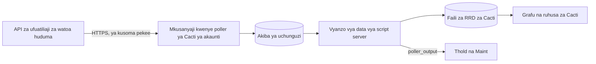

<!-- Source: README.md; SHA256: 7c621642e5f1a46bac66e4bc744f70aebb014c610d22de034088845fdc170405 -->

<!-- translations:start -->
[English](../../../README.md) | [简体中文](../zh-CN/README.md) | [हिन्दी](../hi-IN/README.md) | [Español (España)](../es-ES/README.md) | [Español (Latinoamérica)](../es-419/README.md) | [العربية (السعودية)](../ar-SA/README.md) | [Afrikaans](../af-ZA/README.md) | [አማርኛ](../am-ET/README.md) | [العربية (مصر)](../ar-EG/README.md) | [العربية (المغرب)](../ar-MA/README.md) | [বাংলা](../bn-BD/README.md) | [Deutsch](../de-DE/README.md) | [فارسی](../fa-IR/README.md) | [Filipino](../fil-PH/README.md) | [Français](../fr-FR/README.md) | [Français (Maroc)](../fr-MA/README.md) | [Français (Sénégal)](../fr-SN/README.md) | [Hausa](../ha-NG/README.md) | [עברית](../he-IL/README.md) | [Bahasa Indonesia](../id-ID/README.md) | [Igbo](../ig-NG/README.md) | [Italiano](../it-IT/README.md) | [日本語](../ja-JP/README.md) | [한국어](../ko-KR/README.md) | [Malagasy](../mg-MG/README.md) | [मराठी](../mr-IN/README.md) | [Bahasa Melayu](../ms-MY/README.md) | [Nederlands](../nl-NL/README.md) | [Polski](../pl-PL/README.md) | [Português (Brasil)](../pt-BR/README.md) | [Русский](../ru-RU/README.md) | [Kinyarwanda](../rw-RW/README.md) | [Soomaali](../so-SO/README.md) | [Svenska](../sv-SE/README.md) | [Kiswahili](README.md) | [தமிழ்](../ta-IN/README.md) | [తెలుగు](../te-IN/README.md) | [ไทย](../th-TH/README.md) | [Türkçe](../tr-TR/README.md) | [Українська](../uk-UA/README.md) | [اردو](../ur-PK/README.md) | [Tiếng Việt](../vi-VN/README.md) | [isiXhosa](../xh-ZA/README.md) | [Yorùbá](../yo-NG/README.md) | [繁體中文](../zh-TW/README.md) | [isiZulu](../zu-ZA/README.md)
<!-- translations:end -->

# plugin_cloud

Programu-jalizi ya Cacti 1.2 inayoleta rasilimali na vipimo kutoka kwa watoa huduma wa wingu wa umma hadi ndani ya Cacti kama vifaa vya kawaida, vyanzo vya data, na grafu. Kazi za wingu kisha hukaa kando ya mtandao unaozibeba, chini ya ruhusa za Cacti, na Thold na Maint zinaweza kutoa tahadhari na kuzizuia. Programu-jalizi moja inashughulikia kila mtoa huduma, ikiwa na kiendeshi kwa kila mtoa huduma: DigitalOcean, AWS, Google Cloud, na Azure kwanza.

> **Hali: hatua ya 3 (DigitalOcean na vipengee vya Cacti), katika ukaguzi.** Hatua hii inaongeza kiendeshi cha DigitalOcean, violezo vya Cacti, kifaa cha wigo kwa kila akaunti chenye hoja ya data kwa kila aina ya rasilimali, ingizo la script server, na makadirio ya maombi kwenye New Graphs na ukurasa wa afya. Ukaguzi wa awali dhidi ya akaunti hai ya DigitalOcean umerekodiwa katika [ukweli wa watoa huduma](../../research/provider-facts.md). Usiiendeshe katika mazingira ya uzalishaji.

## Majukumu ya ufikiaji

| Realm | Ufikiaji |
| --- | --- |
| Cloud View | Kurasa zilizopo za ufuatiliaji. |
| Cloud Operator | Ufuatiliaji pamoja na ukurasa wa Operations na uthibitisho wa kibinafsi wa uchunguzi wa awali. |
| Cloud Admin | Ufikiaji wa Operator pamoja na usanidi uliopo na vitendo vya kiutawala. |

Baada ya kunakili faili za uboreshaji, fungua ukurasa wa Plugins kama msimamizi ili kusajili
eneo jipya la ruhusa. Gawa eneo la Operator waziwazi chini ya **Configuration > Users** au vikundi vya watumiaji.
Uboreshaji huhifadhi vitambulisho na ruhusa zilizopo za maeneo ya View na Admin. Ufikiaji wa Admin
hurithi ufikiaji wa Operator, na ufikiaji wa Operator hurithi ufikiaji wa View kwa kila ombi;
hii haiongezi ruhusa zilizohifadhiwa kwa watumiaji au vikundi. Mipangilio ya programu-jalizi pia inahitaji
ufikiaji wa Cloud Admin pamoja na ruhusa ya Settings ya Cacti.

Ruhusa za vifaa vya Cacti bado zinadhibiti safu na vitendo vinavyopatikana kwa kila mtumiaji; vipengee visivyooanishwa vinahitaji msimamizi. Waendeshaji wanaweza kuthibitisha kitambulisho kilichohifadhiwa kwa akaunti ambayo wanaweza kufikia kifaa chake cha Cacti.
Vitambulisho, usanidi, uoanishaji, ufutaji na mabadiliko mengine ya kiutawala
hubaki katika kurasa za kiutawala. Uthibitisho wa uchunguzi hudumu tu katika kipindi cha sasa
cha mtumiaji, kwa muda usiozidi saa moja na tu wakati uchunguzi huo huo unabaki
mpya. Uchunguzi mpya au uliobadilika huubatilisha. Haubadilishi kamwe kipimo kilichoshindwa
kuonekana kuwa na afya au kuzuia tahadhari.

## Kwa nini

Kila mtoa huduma wa wingu ana dashibodi yake ya ufuatiliaji. Zikitumiwa sambamba na Cacti, zinaacha mapengo matatu:

- **Udhibiti tofauti wa ufikiaji.** Kumwonyesha mtumiaji wa Cacti vipimo vya wingu kunamaanisha kumpa akaunti ya kuingia kwenye wingu.
- **Hakuna muktadha wa mtandao.** Viungo vya ndani vinachorwa grafu katika Cacti; kazi zilizo nyuma yake zinachorwa grafu katika dashibodi ya kila mtoa huduma.
- **Tahadhari tofauti.** Thold na Maint hufanya kazi kwenye vyanzo vya data na vifaa vya Cacti, kwa hivyo kengele za watoa huduma husanidiwa na kuzuiwa kando, mara moja kwa kila mtoa huduma.

Programu-jalizi husoma API ya ufuatiliaji ya kila mtoa huduma kwenye poller ya Cacti, huhifadhi kwa muda nukta za data za hivi karibuni, na kuzihudumia kwa script server ya Cacti. Poller ya Cacti huandika faili za RRD, kwa hivyo uchoraji grafu, ruhusa, Thold, Maint, na boost hufanya kazi kama zinavyofanya kwa data yoyote ya Cacti.

## Ahadi za muundo

- **Ya kusoma pekee.** Kila kiendeshi kinaweza kujenga tu shughuli za mtoa huduma zilizo kwenye orodha yake ya ruhusa; programu-jalizi haibadilishi kamwe rasilimali ya wingu. ([ADR 0002](../../decisions/0002-read-only-with-operation-allowlist.md))
- **PHP pekee, bila SDKs.** Utiaji saini na ubadilishanaji wa tokeni unatekelezwa katika PHP kwa kutumia viendelezi ambavyo Cacti tayari inahitaji. Hakuna vitegemezi vya wakati wa utekelezaji vya Composer. ([ADR 0003](../../decisions/0003-php-only-without-sdks.md))
- **Gharama kabla ya ukusanyaji.** Programu-jalizi husoma tu vipimo vilivyo na chanzo cha data cha Cacti, huonyesha idadi inayotarajiwa ya maombi na gharama ya bei ya orodha kabla ya grafu kuundwa, na hutekeleza kiwango cha juu cha kila mwezi. ([ADR 0005](../../decisions/0005-collect-only-what-is-graphed.md))
- **Hakuna vitambulisho vya maandishi wazi katika hifadhidata.** Vitambulisho hutoka kwenye hifadhi iliyosimbwa kwa ufunguo ulio katika faili nje ya hifadhidata, kutoka kwa faili ya vitambulisho, au kutoka kwa utambulisho wa mfano wa mtoa huduma. ([ADR 0007](../../decisions/0007-credentials-outside-the-database-in-the-clear.md))

## Wigo na hali

| Awamu | Wigo | Hatua | Hali |
|---|---|---|---|
| 0, utafiti | Uthibitisho wa ukweli wa watoa huduma, katalogi za vipimo, modeli ya gharama na viwango, vekta za majaribio ya utiaji saini, jaribio la usafirishaji | [M1](https://github.com/somethingwithproof/plugin_cloud/milestone/1) | Imekamilika, isipokuwa ukaguzi unaohitaji akaunti hai ya mtoa huduma |
| 1, msingi na DigitalOcean | Akaunti, hifadhi ya vitambulisho, usafirishaji, mkusanyaji, akiba ya uchunguzi, vipengee vya Cacti, ukurasa wa afya, DigitalOcean Droplets na load balancers | [M2](https://github.com/somethingwithproof/plugin_cloud/milestone/2), [M3](https://github.com/somethingwithproof/plugin_cloud/milestone/3), [M4](https://github.com/somethingwithproof/plugin_cloud/milestone/4) | M2 imekamilika ([#81](https://github.com/somethingwithproof/plugin_cloud/pull/81)); kiendeshi cha M3, violezo, na vifaa vya wigo vimeunganishwa; makadirio ya maombi, ruhusa, na ukaguzi wa utendaji katika ukaguzi; M4 haijaanza |
| 2, AWS | Signature Version 4, `AssumeRole`, majukumu ya mfano, CloudWatch `GetMetricData`, orodha ya kikanda | [M5](https://github.com/somethingwithproof/plugin_cloud/milestone/5) | Haijaanza |
| 3, Google Cloud | JWT ya akaunti ya huduma, seva ya metadata, Cloud Monitoring `timeSeries.list` | [M6](https://github.com/somethingwithproof/plugin_cloud/milestone/6) | Haijaanza |
| 4, Azure | Vitambulisho vya mteja vya Entra, utambulisho unaosimamiwa, Resource Graph, `metrics:getBatch` | [M7](https://github.com/somethingwithproof/plugin_cloud/milestone/7) | Haijaanza |
| 5, wakusanyaji wa mbali | Akaunti kwenye wakusanyaji wa data wa mbali wa Cacti | [M8](https://github.com/somethingwithproof/plugin_cloud/milestone/8) | Haijaanza |

Nje ya wigo: kubadilisha rasilimali za wingu, kuunda au kuakisi kengele za watoa huduma, ripoti za bili, kumbukumbu na ufuatiliaji wa nyayo, na injini ya tahadhari inayomilikiwa na programu-jalizi. Watoa huduma wengine (Hetzner Cloud, Akamai Cloud, Oracle Cloud, na wengine) ni masuala ya utafiti.

## Kinachotolewa na hatua ya 2

- **Usakinishaji uliolindwa.** Kwenye PHP chini ya 8.2, au bila ext-openssl, usakinishaji na uwezeshaji hukataliwa kwa ujumbe, na sehemu iliyobaki ya Cacti huendelea kufanya kazi.
- **Mzunguko wa maisha.** Sakinisha, boresha, na uondoe kupitia ukurasa wa Plugins wa Cacti. Uboreshaji hupangwa kwa mpangilio na hustahimili kukatizwa. Uondoaji huhifadhi majedwali ya programu-jalizi isipokuwa uondoe tiki kwenye *Keep Plugin Tables on Uninstall*.
- **Maeneo tofauti ya ruhusa.** *Cloud Admin* hufungua **Cloud Accounts**; *Cloud Operator* hufungua **Cloud Operations**; *Cloud View* hufungua **Cloud Health**. Admin hurithi Operator, na Operator hurithi View. Kurasa zote tatu ziko chini ya Management.
- **Akaunti na vitambulisho.** Ongeza, hariri, thibitisha, na ufute akaunti. Kitambulisho husimbwa katika hifadhidata kwa faili ya ufunguo iliyohifadhiwa nje yake (AES-256-GCM), au husomwa kutoka kwa faili kwenye poller. Vitambulisho ni vya kuandikwa tu katika kiolesura na hufichwa kutoka kwenye kumbukumbu.
- **Mkusanyaji.** Huanza kutoka kwa kila uendeshaji wa poller, mfano mmoja kwa kila poller, ndani ya bajeti ya muda. Huchukua ukodishaji kwa kila akaunti, huendesha ugunduzi kwa muda wake yenyewe, na husoma vipimo tu kwa vyanzo vya data hai vya programu-jalizi yenyewe.
- **Afya.** Hali ya ukusanyaji, ugunduzi, rasilimali, na upya kwa kila akaunti, pamoja na maonyo kwa ufunguo wa hifadhi usiotumika, faili za vitambulisho zisizo salama, na vipindi ambavyo poller haiwezi kuvitimiza.

## Kusakinisha na kusanidi

Hatua hizi husakinisha msimbo wa hatua ya 2 kwa tathmini. Zinahitaji Cacti 1.2.31 au mpya zaidi kwenye PHP 8.2 au mpya zaidi.

1. Nakili hazina hadi `plugins/cloud` chini ya saraka yako ya Cacti. Saraka lazima iitwe `cloud`.
2. Unda ufunguo wa hifadhi nje ya mzizi wa wavuti. Uuweke katika saraka ambayo root na mtumiaji wa Cacti pekee wanaweza kuandika, na uifanye faili isomwe tu na mtumiaji anayeendesha seva ya wavuti na poller. Programu-jalizi haiundi wala haiandiki faili hii kamwe:

   ```sh
   sudo install -d -m 0750 -o root -g cacti /etc/cacti
   head -c 32 /dev/urandom | sudo tee /etc/cacti/cloud-vault.key > /dev/null
   sudo chown cacti:cacti /etc/cacti/cloud-vault.key
   sudo chmod 0600 /etc/cacti/cloud-vault.key
   ```

   Badilisha `cacti` na mtumiaji anayeendesha seva yako ya wavuti na poller. Faili hubeba baiti 32 ghafi au herufi 64 za heksadesimali. Ihifadhi nakala rudufu pamoja na hifadhidata; bila hiyo, vitambulisho vilivyohifadhiwa lazima viingizwe tena.
3. Katika Cacti, fungua **Configuration > Plugins**, kisha usakinishe na uwezeshe *Cloud*.
4. Chini ya **Configuration > Settings > Cloud**, weka *Vault Key File* ikiwa ulitumia njia nyingine. *Collector Time Budget* (chaguo-msingi sekunde 240) lazima ibaki chini ya kipindi cha poller.
5. Wape watumiaji na vikundi *Cloud Admin*, *Cloud Operator* au *Cloud View* chini ya **Configuration > Users**. Kusakinisha humpa msimamizi Cloud Admin na Cloud View; Cloud Admin inajumuisha ufikiaji wa Operator, kwa hivyo msimamizi hahitaji ruhusa tofauti ya Operator.
6. Ongeza akaunti chini ya **Management > Cloud Accounts**, kisha angalia **Management > Cloud Health** kwa maonyo.

## Malengo ya uoanifu

| Kipengele | Lengo |
|---|---|
| Cacti | 1.2.31 au mpya zaidi, hakuna viraka vya msingi |
| PHP | 8.2 au mpya zaidi; `setup.php` hubaki ikichanganulika kwenye 8.0 ili mazingira yasiyoungwa mkono yapate kukataliwa badala ya kiolesura cha Cacti kilichovunjika |
| Viendelezi vya PHP | Hakuna zaidi ya vile ambavyo Cacti 1.2.31 inahitaji |
| Thold, Maint | Hakuna mabadiliko yanayohitajika |

## Muundo

- [docs/performance.md](../../performance.md) ina vipimo vya mkusanyaji na ukurasa wa afya, pamoja na maunzi na mipangilio iliyotumika.
- [docs/PLAN.md](../../PLAN.md) ni mpango kamili: usanifu, ukweli wa mtoa huduma na Cacti unaotegemewa (pamoja na vyanzo), mkataba wa kiendeshi, hesabu ya gharama, mipaka ya usalama, majaribio, na hatari.
- [docs/decisions/](../../decisions) huhifadhi rekodi za maamuzi ya usanifu kwa chaguo ambazo tayari zimefanywa.
- [docs/REQUIREMENTS.md](../../REQUIREMENTS.md) huoanisha kila kitambulisho cha hitaji na suala lake.



## Jinsi kazi inavyofuatiliwa

- **Hatua (Milestones)** hufuata hatua za mpango. Kila moja ina suala kuu linaloorodhesha masuala yake madogo na ushahidi wa kukamilisha.
- **Masuala (Issues)** yanaainishwa kwa lebo: `type: requirement`, `type: research`, `type: decision`, `type: epic`. Masuala ya mahitaji hueleza mahitaji yenye namba yanayoweza kujaribiwa (`REQ-AREA-NNN`) na vigezo vya kukubalika.
- **Lebo** pia hubeba `area:`, `provider:`, `phase:`, `priority:`, na `status:`. Tazama [CONTRIBUTING.md](../../../CONTRIBUTING.md#labels).
- [Ubao wa mradi](https://github.com/users/somethingwithproof/projects/7) huonyesha masuala yote katika hatua zote.

## Uendelezaji

CI hukagua sehemu za kuingilia kwenye PHP 8.0, huendesha majaribio ya kitengo na muunganisho na PHPStan kiwango cha 9, na husakinisha programu-jalizi kwenye PHP 8.2 hadi 8.5 dhidi ya Cacti 1.2.31 na tawi la 1.2.x. Pia hukagua kuwa PHP 8.1 inakataliwa bila kuvunja Cacti. Majaribio hutumia Pest kutoka kwenye mfumo wa programu-jalizi wa msingi wa Cacti. Chaguo hilo ni la muda hadi [#12](https://github.com/somethingwithproof/plugin_cloud/issues/12) itakapoamuliwa. [.github/workflows/plugin-ci-workflow.yml](../../../.github/workflows/plugin-ci-workflow.yml) huorodhesha kila hatua. Endesha `sh tests/lint-workflows.sh` na `sh locales/build_gettext.sh --check` ndani kabla ya kusukuma mabadiliko.

## Kuchangia

Soma [CONTRIBUTING.md](../../../CONTRIBUTING.md). Ahadi za msimbo zinahitaji saini ya DCO. Majadiliano ya muundo hufanyika kwenye masuala; maamuzi yaliyo wazi hubeba lebo ya `type: decision`.

## Usalama

Ripoti udhaifu kwa faragha; tazama [SECURITY.md](../../../SECURITY.md).

## Leseni

GNU General Public License v2.0, leseni sawa na ya Cacti na programu-jalizi zake. Tazama [LICENSE](../../../LICENSE).
