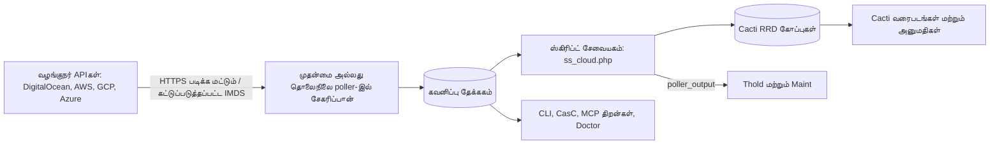

<!-- Source: README.md; SHA256: ac2074a40238686915802803c5efe773f33677f934281e0605e6e87a71a9d27d -->

<!-- translations:start -->
[English](../../../README.md) | [简体中文](../zh-CN/README.md) | [हिन्दी](../hi-IN/README.md) | [Español (España)](../es-ES/README.md) | [Español (Latinoamérica)](../es-419/README.md) | [العربية (السعودية)](../ar-SA/README.md) | [Afrikaans](../af-ZA/README.md) | [አማርኛ](../am-ET/README.md) | [العربية (مصر)](../ar-EG/README.md) | [العربية (المغرب)](../ar-MA/README.md) | [বাংলা](../bn-BD/README.md) | [Bosanski](../bs-BA/README.md) | [Deutsch](../de-DE/README.md) | [فارسی](../fa-IR/README.md) | [Filipino](../fil-PH/README.md) | [Français](../fr-FR/README.md) | [Français (Maroc)](../fr-MA/README.md) | [Français (Sénégal)](../fr-SN/README.md) | [Hausa](../ha-NG/README.md) | [עברית](../he-IL/README.md) | [Hrvatski](../hr-HR/README.md) | [Bahasa Indonesia](../id-ID/README.md) | [Igbo](../ig-NG/README.md) | [Italiano](../it-IT/README.md) | [日本語](../ja-JP/README.md) | [한국어](../ko-KR/README.md) | [Malagasy](../mg-MG/README.md) | [मराठी](../mr-IN/README.md) | [Bahasa Melayu](../ms-MY/README.md) | [Nederlands](../nl-NL/README.md) | [Polski](../pl-PL/README.md) | [Português (Brasil)](../pt-BR/README.md) | [Русский](../ru-RU/README.md) | [Kinyarwanda](../rw-RW/README.md) | [Soomaali](../so-SO/README.md) | [Српски](../sr-RS/README.md) | [Svenska](../sv-SE/README.md) | [Kiswahili](../sw-KE/README.md) | [தமிழ்](README.md) | [తెలుగు](../te-IN/README.md) | [ไทย](../th-TH/README.md) | [Türkçe](../tr-TR/README.md) | [Українська](../uk-UA/README.md) | [اردو](../ur-PK/README.md) | [Tiếng Việt](../vi-VN/README.md) | [isiXhosa](../xh-ZA/README.md) | [Yorùbá](../yo-NG/README.md) | [繁體中文](../zh-TW/README.md) | [isiZulu](../zu-ZA/README.md)
<!-- translations:end -->

# plugin_cloud

பொது கிளவுட் வழங்குநர்களிடமிருந்து வளங்கள் மற்றும் அளவீடுகளை Cacti-க்குள் சாதாரண சாதனங்கள், தரவு மூலங்கள் மற்றும் வரைபடங்களாகக் கொண்டு வரும் ஒரு Cacti 1.2 செருகுநிரல். கிளவுட் பணிச்சுமைகள் அவற்றைச் சுமக்கும் பிணையத்திற்கு அருகில், Cacti-இன் அனுமதிகளின் கீழ் அமையும்; மேலும் Thold மற்றும் Maint அவற்றின் மீது எச்சரிக்கைகளை அனுப்பும் மற்றும் தற்காலிகமாக நிறுத்தி வைக்கும். DigitalOcean, Amazon Web Services, Google Cloud மற்றும் Microsoft Azure ஆகியவற்றை தூய-PHP, படிக்க-மட்டுமான வழங்குநர் இயக்கிகள் மூலம் ஒரே செருகுநிரல் உள்ளடக்குகிறது.

> **நிலை: உருவாக்கத்தில் உள்ளது, இன்னும் வெளியீடு இல்லை (`0.1.0-dev`).** இந்தக் கிளை DigitalOcean, AWS, Google Cloud மற்றும் Azure ஆகியவற்றிற்கான தூய-PHP இயக்கிகள், தொலைநிலைத் தரவு சேகரிப்பான் நகலாக்கம் மற்றும் படிக்க-மட்டுமான முகவர் நலநிலை, ஒரு CasC வழங்குநர் மற்றும் இயக்குநர் CLI, MCP திறன்கள் மற்றும் Doctor சோதனைகளைச் செயல்படுத்துகிறது. சேர்க்கப்பட்டுள்ள Cacti வார்ப்புருக்கள் தற்போது DigitalOcean Droplets மற்றும் சுமை சமநிலைப்படுத்திகளை (`templates/cloud_digitalocean.xml`) உள்ளடக்குகின்றன; AWS, Google Cloud மற்றும் Azure ஆகியவற்றிற்கான Cacti வார்ப்புரு தொகுப்புகள் மற்றும் DigitalOcean-க்கு அப்பாற்பட்ட நேரடி கணக்குத் தகுதிநிலை ([வழங்குநர் உண்மைகள்](../../research/provider-facts.md)) இன்னும் நிறைவடையவில்லை. உற்பத்திச் சூழலில் இயக்க வேண்டாம்.

## ஆதரிக்கப்படும் வழங்குநர்கள்

ஒவ்வொரு வழங்குநர் இயக்கியும் `Drivers::production()`-இல் பதிவு செய்யப்பட்டு, `Provider::released()` மூலம் வழங்கப்படுகிறது; மேலும் எவ்வித SDK அல்லது Composer இயக்க நேரச் சார்புகளும் இன்றி `ext-openssl` மற்றும் ஸ்ட்ரீம் சாக்கெட்டுகளைப் பயன்படுத்தி தூய PHP-இல் இயங்குகிறது.

| வழங்குநர் | வரம்புப் புலங்கள் | சான்று மூலங்கள் | அங்கீகாரம் | கண்டறியப்படும் வளங்கள் | அளவீடு சேகரிப்பு |
|---|---|---|---|---|---|
| DigitalOcean (`digitalocean`) | இல்லை (டோக்கன் வரம்பிற்கு உட்பட்டது) | `vault`, `file` | Bearer token | `droplet`, `load_balancer` | வீத வரம்புப் பகிர்வு விழிப்புணர்வுடன் `/v2/monitoring/metrics`; Cacti வார்ப்புருக்கள் மற்றும் தரவு வினவல்களைக் கொண்டுள்ளது |
| Amazon Web Services (`aws`) | `account_id` (12 இலக்கங்கள்), `regions` | `vault`, `file`, `instance` | தூய-PHP AWS SigV4 (`AWS4-HMAC-SHA256`), STS `GetCallerIdentity` சரிபார்ப்பு, விருப்பத்தேர்வு STS `AssumeRole`, `instance` கணக்குகளுக்கு EC2 IMDSv2 (`169.254.169.254`) | `ec2_instance`, `rds_instance`, `aws_elb` (ALB/NLB) | தொகுக்கப்பட்ட CloudWatch `GetMetricData` (ஒரு அழைப்பிற்கு 500 வினவல்கள் வரை) |
| Google Cloud (`gcp`) | `project` | `vault`, `file`, `instance` | `ext-openssl` வழியாக `oauth2.googleapis.com/token`-இல் பரிமாறப்படும் தூய-PHP RS256 சேவை-கணக்கு JWT, அல்லது `instance` கணக்குகளுக்கு GCE மெட்டாடேட்டா சேவையகம் (`metadata.google.internal`) | `instances.aggregatedList` வழியாக `gce_instance` | Cloud Monitoring `timeSeries.list` |
| Microsoft Azure (`azure`) | `tenant`, `subscription`, `regions` | `vault`, `file`, `instance` | தூய-PHP Entra ID OAuth2 கிளையண்ட்-சான்று ஓட்டம் (`client_secret` மட்டும்; சான்றிதழ் உறுதிப்படுத்தல்கள் விலக்கப்பட்டுள்ளன), அல்லது ARM மற்றும் Monitor டோக்கன்களுக்கு Azure IMDS (`169.254.169.254`) நிர்வகிக்கப்பட்ட அடையாளம் | ARM Resource Graph வழியாக `azure_vm` (`$skipToken` உடன் பக்கமாக்கப்பட்டு நகல்கள் நீக்கப்பட்டது) | Azure Monitor `metrics:getBatch` (ஒரு அழைப்பிற்கு 50 வளங்கள் வரை, HTTP 429 மற்றும் 529 கட்டுப்பாடுகளைக் கையாளுகிறது) |

## செயல்படுத்தப்பட்ட திறன்கள்

### மையத் தளம், பெட்டகம் மற்றும் சேகரிப்பான்

- **பாதுகாக்கப்பட்ட நிறுவல் மற்றும் வாழ்க்கைச் சுழற்சி.** நுழைவுப் புள்ளிகள் (`setup.php`, `cli/cloud.php`, `poller_cloud.php`, `ss_cloud.php` மற்றும் பக்க ஸ்கிரிப்டுகள்) PHP 8.0-இல் பாகுபடுத்தப்படுகின்றன மற்றும் Cacti-ஐ முறிக்காமல் PHP 8.2-க்குக் கீழே அல்லது `ext-openssl` இல்லாதபோது மறுக்கின்றன. மேம்படுத்தல்கள் வரிசைப்படுத்தப்பட்டவை, மீள்தன்மை கொண்டவை (`Schema::VERSION = 3`, 9 அட்டவணைகள்) மற்றும் இடையூறுகளைத் தாங்கக்கூடியவை. *Keep Plugin Tables on Uninstall* நீக்கப்படாவிட்டால், நிறுவல் நீக்கம் செருகுநிரல் அட்டவணைகளை வைத்திருக்கும்.
- **கணக்குகள் மற்றும் சான்றுகள்.** **Management > Cloud Accounts** கீழ் கணக்குகளைச் சேர்க்கவும், திருத்தவும், சரிபார்க்கவும் மற்றும் நீக்கவும். சான்றுகள் AES-256-GCM மறையாக்கப்பட்ட பெட்டகத்திலிருந்து (`plugin_cloud_secret`, இயல்புநிலையாக `/etc/cacti/cloud-vault.key` விசையிடப்பட்டது), உள்ளமைக்கப்பட்ட *Credential File Directory*-க்குள் (`cloud_credential_dir`, கோப்புகளை மறுக்க இயல்புநிலையாகக் காலியாக உள்ளது) கட்டுப்படுத்தப்பட்ட கோப்பிலிருந்து அல்லது வழங்குநர் நிகழ்வு அடையாளத்திலிருந்து வருகின்றன. சான்றுகள் பயனர் இடைமுகத்தில் எழுத-மட்டுமானவை மற்றும் பதிவுகளிலிருந்து மறைக்கப்படுகின்றன.
- **கடுமையான வெளிச்செல்லும் மற்றும் படிக்க-மட்டுமான கட்டுப்பாடுகள்.** ஒவ்வொரு இயக்கியும் `GuardedTransport` மற்றும் `OutboundPolicy`-க்குப் பின்னால் இயங்குகிறது: துல்லியமான வழங்குநர் வாரியான புரவலன் பெயர்களுக்கு HTTPS போர்ட் 443, மற்றும் `instance` கணக்குகளுக்கு மட்டும் இணைப்பு-உள்ளூர் HTTP போர்ட் 80 மெட்டாடேட்டா முனைப்புகள் (`169.254.169.254`, `metadata.google.internal`) இயக்கப்படுகின்றன. அனுமதிப்பட்டியலில் உள்ள படிக்க-மட்டுமான செயல்பாடுகள் மட்டுமே அனுமதிக்கப்படுகின்றன.
- **சேகரிப்பான் மற்றும் செலவுக் கட்டுப்பாடுகள்.** `poller_cloud.php` என்பது `poller_bottom`-இலிருந்து (Cacti-இன் செயல்முறைப் பதிவேடு வழியாக ஒரு poller-க்கு ஒரு செயல்முறை) `cloud_collector_budget`-க்குள் இயங்குகிறது, கணக்கு வாரியான குத்தகைகளைப் பெறுகிறது, `discover_interval`-இல் கண்டறிதலை இயக்குகிறது, செயலில் உள்ள Cacti தரவு மூலங்களுக்கு (`plugin_cloud_series`) மட்டுமே அளவீடுகளைப் படிக்கிறது, `request_share` மற்றும் `monthly_ceiling`-ஐ மதிக்கிறது, மேலும் `ss_cloud.php`-க்காக `plugin_cloud_observation`-இல் சமீபத்திய தரவுப் புள்ளிகளைத் தேக்கி வைக்கிறது.
- **Cacti பொருள்கள் மற்றும் கோரிக்கை மதிப்பீடுகள்.** கணக்குக்கு ஒரு வரம்புச் சாதனத்தைப் (`plugin_cloud_device`) பராமரிக்கிறது, சாதனச் சேமிப்புகளில் வரம்புச் சாதன மறு-அட்டவணைப்படுத்தல் முறைகளைப் பாதுகாக்கிறது, DigitalOcean வார்ப்புருக்கள் மற்றும் ஸ்கிரிப்ட் சேவையகத் தரவு வினவல்களை (`templates/cloud_digitalocean.xml`, `cloud_do_droplet.xml`, `cloud_do_load_balancer.xml`) இறக்குமதி செய்கிறது, மேலும் **New Graphs** (`graphs_new_top_links`) மற்றும் **Cloud Health**-இல் கோரிக்கை மற்றும் பட்டியல்-விலை மதிப்பீடுகளைக் காட்டுகிறது.

### தொலைநிலைத் தரவு சேகரிப்பான்கள்

- `INFO` என்பது `remote_collect:1`-ஐ அறிவிக்கிறது. கணக்குகளை இயக்கப்பட்ட எந்த Cacti poller-க்கும் (`poller_id >= 1`) ஒதுக்கலாம், மேலும் `poller_cloud.php --poller=N` அந்த poller-க்குச் சொந்தமான கணக்குகளை மட்டுமே சேகரிக்கும்.
- **`replicate_out` கொக்கி.** `replicate_out_table()` வழியாக `plugin_cloud_account`, `plugin_cloud_device`, `plugin_cloud_series` ஆகியவற்றிலிருந்து poller-வரம்பு வரிசைகளையும், `plugin_cloud_secret`-இலிருந்து மறையாக்கப்பட்ட ciphertext வரிசைகளையும் (இலக்கு poller-க்குச் சொந்தமான பெட்டக-ஆதரவு கணக்குகளுக்கு மட்டும்) நகலாக்குகிறது. மூலப் பெட்டக விசைக் கோப்புகள் தரவுத்தளத்தில் ஒருபோதும் சேமிக்கப்படுவதில்லை அல்லது நகலாக்கப்படுவதில்லை, மேலும் அவை ஒவ்வொரு poller-இலும் உள்ளூரிலேயே இருக்கும்.
- **`remote_agent` கொக்கி.** முழு எண் `poller_id` மற்றும் `account_id` அளவுருக்களை மட்டுமே ஏற்றுக்கொண்டு, சான்றுகள், கோப்புப் பாதைகள் அல்லது ரகசியங்கள் எதையும் திருப்பித் தராத படிக்க-மட்டுமான JSON நலநிலைச் சுருக்கத்தை (`action=cloud_health`) வெளிப்படுத்துகிறது.

### சூழல் அமைப்பு கொக்கிகள் (CasC, MCP திறன்கள் மற்றும் Doctor)

- **CasC வழங்குநர் (`casc_register_providers`).** உறுதியான தூய-PHP YAML மற்றும் XML ஏற்றுமதி, manifest சரிபார்ப்பு, வேறுபாடு திட்டமிடல் மற்றும் உறுதிப்படுத்தப்பட்ட பயன்பாடு ஆகியவற்றுடன் `cloud` வழங்குநரை (திட்டப் பதிப்பு `1`) பதிவு செய்கிறது. பெட்டகச் சான்றுகள் `vault:account:<name>` குறிப்புகளாக ஏற்றுமதி செய்யப்படுகின்றன; மூல ரகசியப் புலங்கள் (`secret`, `secrets`, `token`, `access_token`, `refresh_token`, `password`, `private_key`, `access_key_id`, `secret_access_key`, `session_token`, `client_secret`, `credential`, `credentials`, `vault_key`) நிராகரிக்கப்படுகின்றன. பயன்படுத்துவதற்குத் துல்லியமான SHA-256 `--confirm=<PLAN_HASH>` தேவைப்படுகிறது.
- **MCP / Abilities API (`abilities_register`).** நிர்வாகி அல்லாத அழைப்பாளர்களுக்கு Cloud View வரம்பு (`cloud_health.php`) மற்றும் Cacti சாதன வரம்பில் கட்டுப்படுத்தப்பட்ட மூன்று கண்டிப்பான படிக்க-மட்டுமான திறன்களைப் பதிவு செய்கிறது; இவை சான்றுகள், பெட்டக விசைகள் அல்லது சான்று கோப்புப் பாதைகள் எதையும் வெளியிடுவதில்லை:
  - `cloud-list-accounts` (விருப்பத்தேர்வு `provider`, `poller_id`)
  - `cloud-list-resources` (விருப்பத்தேர்வு `account_id`, `type`, `lifecycle`)
  - `cloud-get-health` (விருப்பத்தேர்வு `account_id`)
- **Doctor சோதனைகள் (`doctor_register_checks`).** ரகசிய மதிப்புகள் அல்லது விசைத் தகவல்களை வெளிப்படுத்தாத ஐந்து கண்டறியும் சோதனைகளைப் பதிவு செய்கிறது:
  - `cloud_schema`: திட்டப் பதிப்பு நடப்புநிலை
  - `cloud_vault_key`: பெட்டக விசைக் கோப்பு படிக்கக்கூடிய தன்மை, அனுமதிகள் மற்றும் அளவு
  - `cloud_drivers`: வெளியிடப்பட்ட அனைத்து வழங்குநர்களுக்கும் உற்பத்தி இயக்கிப் பதிவு
  - `cloud_accounts_health`: தோல்வியடைந்த, கட்டுப்படுத்தப்பட்ட அல்லது காலாவதியான இயக்கப்பட்ட கணக்குகள்
  - `cloud_poller_intervals`: இயக்கப்பட்ட கணக்குச் சேகரிப்பு இடைவெளிகளை Cacti-இன் poller இடைவெளியுடன் சீரமைத்தல்

## CLI

PHP 8.2 அல்லது அதற்குப் பிந்தைய பதிப்புடன் Cacti மூல கோப்பகத்திலிருந்து இயக்கவும்:

```sh
# Operator and CasC CLI (options use --key=value form)
php plugins/cloud/cli/cloud.php export [--format=yaml|xml]
php plugins/cloud/cli/cloud.php validate --file=<path> [--format=yaml|xml]
php plugins/cloud/cli/cloud.php plan --file=<path> [--format=yaml|xml]
php plugins/cloud/cli/cloud.php apply --file=<path> --confirm=<PLAN_HASH> [--format=yaml|xml]
php plugins/cloud/cli/cloud.php health [--format=text|json] [--poller=<id>]

# Collector entry point (normally started by poller_bottom)
php plugins/cloud/poller_cloud.php [--poller=N] [--force] [--debug]
```

## அணுகல் பாத்திரங்கள்

| வரம்பு | அணுகல் |
| --- | --- |
| Cloud View | ஏற்கனவே உள்ள கண்காணிப்புப் பக்கங்கள். |
| Cloud Operator | கண்காணிப்பு மற்றும் செயல்பாடுகள் பக்கமும் தனிப்பட்ட முன்னுரிமை ஒப்புதல்களும். |
| Cloud Admin | Operator அணுகல் மற்றும் ஏற்கனவே உள்ள உள்ளமைவு மற்றும் நிர்வாக நடவடிக்கைகள். |

மேம்படுத்தல் கோப்புகளை நகலெடுத்த பிறகு, வரம்புகளைப் பதிவு செய்ய நிர்வாகியாக Plugins பக்கத்தைத் திறக்கவும். **Configuration > Users** அல்லது பயனர் குழுக்களின் கீழ் Operator வரம்பை வெளிப்படையாக ஒதுக்கவும். மேம்படுத்தல்கள் ஏற்கனவே உள்ள View மற்றும் Admin வரம்பு ஐடிகள் மற்றும் மானியங்களைத் தக்கவைத்துக்கொள்கின்றன. Admin அணுகல் Operator அணுகலைப் பெறுகிறது, மேலும் Operator அணுகல் ஒவ்வொரு கோரிக்கையிலும் View அணுகலைப் பெறுகிறது; இது பயனர்கள் அல்லது குழுக்களுக்குச் சேமிக்கப்பட்ட மானியங்களைச் சேர்க்காது. செருகுநிரல் அமைப்புகளுக்கும் Cacti-இன் Settings அனுமதியுடன் கூடுதலாக Cloud Admin அணுகல் தேவைப்படுகிறது.

Cacti சாதன அனுமதிகள் ஒவ்வொரு பயனருக்கும் கிடைக்கும் வரிசைகள் மற்றும் செயல்களைக் கட்டுப்படுத்துகின்றன; வரைபடமாக்கப்படாத பொருள்களுக்கு நிர்வாகி தேவை. இயக்குநர்கள் தாங்கள் அணுகக்கூடிய Cacti சாதனத்தைக் கொண்ட கணக்கின் சேமிக்கப்பட்ட சான்றைச் சரிபார்க்க முடியும். சான்றுகள், உள்ளமைவு, வரைபடமாக்கல், நீக்குதல் மற்றும் பிற நிர்வாக மாற்றங்கள் நிர்வாகப் பக்கங்களிலேயே இருக்கும். ஒப்புதல்கள் தற்போதைய பயனரின் அமர்வில் மட்டுமே, அதிகபட்சமாக ஒரு மணி நேரத்திற்கும், அதே கவனிப்பு புதிதாக இருக்கும் வரை மட்டுமே நீடிக்கும். புதிய அல்லது மாற்றப்பட்ட கவனிப்புகள் அவற்றைச் செல்லாததாக்கும். அவை தோல்வியுற்ற அளவீட்டை ஒருபோதும் நலமானதாகக் குறிக்காது அல்லது எச்சரிக்கைகளைத் தடுக்காது.

## ஏன்

ஒவ்வொரு கிளவுட் வழங்குநருக்கும் அதன் சொந்தக் கண்காணிப்புத் தளம் உள்ளது. Cacti உடன் இணைந்து இயங்கும்போது, அவை மூன்று இடைவெளிகளை விட்டுச் செல்கின்றன:

- **தனித்தனி அணுகல் கட்டுப்பாடு.** ஒரு Cacti பயனருக்குக் கிளவுட் அளவீடுகளைக் காட்டுவது என்பது அவர்களுக்குக் கிளவுட் உள்நுழைவை வழங்குவதைக் குறிக்கிறது.
- **பிணையச் சூழல் இல்லை.** உள்ளூர் இணைப்புகள் Cacti-இல் வரைபடமாக்கப்படுகின்றன; அவற்றின் பின்னால் உள்ள பணிச்சுமைகள் ஒவ்வொரு வழங்குநரின் தளத்திலும் வரைபடமாக்கப்படுகின்றன.
- **தனித்தனி எச்சரிக்கை.** Thold மற்றும் Maint ஆகியவை Cacti தரவு மூலங்கள் மற்றும் சாதனங்களில் செயல்படுகின்றன, எனவே வழங்குநர் எச்சரிக்கைகள் வழங்குநருக்கு ஒரு முறை தனித்தனியாக உள்ளமைக்கப்பட்டுத் தடுக்கப்படுகின்றன.

செருகுநிரல் ஒவ்வொரு வழங்குநரின் கண்காணிப்பு API-ஐயும் Cacti poller-இல் படித்து, சமீபத்திய தரவுப் புள்ளிகளைத் தேக்கி வைத்து, அவற்றை Cacti-இன் ஸ்கிரிப்ட் சேவையகத்திற்கு வழங்குகிறது. Cacti-இன் poller RRD கோப்புகளை எழுதுகிறது, எனவே வரைபடம் வரைதல், அனுமதிகள், Thold, Maint மற்றும் boost ஆகியவை எந்தவொரு Cacti தரவிற்கும் செயல்படுவது போலவே செயல்படுகின்றன.

## வடிவமைப்பு உறுதிப்பாடுகள்

- **படிக்க மட்டும்.** ஒவ்வொரு இயக்கியும் அதன் அனுமதிப்பட்டியலில் உள்ள வழங்குநர் செயல்பாடுகளை மட்டுமே உருவாக்க முடியும்; செருகுநிரல் ஒருபோதும் கிளவுட் வளத்தை மாற்றாது. ([ADR 0002](../../decisions/0002-read-only-with-operation-allowlist.md))
- **PHP மட்டும், SDK-கள் இல்லை.** கையொப்பமிடுதல் மற்றும் டோக்கன் பரிமாற்றம் ஆகியவை Cacti ஏற்கனவே தேவைப்படும் நீட்டிப்புகளுடன் PHP-இல் செயல்படுத்தப்படுகின்றன. Composer இயக்க நேரச் சார்புகள் இல்லை. ([ADR 0003](../../decisions/0003-php-only-without-sdks.md))
- **சேகரிப்பதற்கு முன் செலவு.** Cacti தரவு மூலத்தைக் கொண்ட அளவீடுகளை மட்டுமே செருகுநிரல் படிக்கிறது, வரைபடங்கள் உருவாக்கப்படுவதற்கு முன்பு எதிர்பார்க்கப்படும் கோரிக்கை எண்ணிக்கை மற்றும் பட்டியல்-விலை செலவைக் காட்டுகிறது, மேலும் மாதாந்திர உச்சவரம்பைச் செயல்படுத்துகிறது. ([ADR 0005](../../decisions/0005-collect-only-what-is-graphed.md))
- **தரவுத்தளத்தில் வெற்று உரைச் சான்றுகள் இல்லை.** சான்றுகள் தரவுத்தளத்திற்கு வெளியே உள்ள கோப்பால் விசையிடப்பட்ட மறையாக்கப்பட்ட பெட்டகத்திலிருந்து, சான்று கோப்பிலிருந்து அல்லது வழங்குநரின் நிகழ்வு அடையாளத்திலிருந்து வருகின்றன. ([ADR 0007](../../decisions/0007-credentials-outside-the-database-in-the-clear.md))

## வரம்பு மற்றும் நிலை

| கட்டம் | வரம்பு | மைல்கற்கள் | நிலை |
|---|---|---|---|
| 0, ஆராய்ச்சி | வழங்குநர் உண்மை உறுதிப்படுத்தல், அளவீடு பட்டியல்கள், செலவு மற்றும் வீத மாதிரி, கையொப்பமிடும் சோதனை வெக்டர்கள், போக்குவரத்து சோதனை | [M1](https://github.com/somethingwithproof/plugin_cloud/milestone/1) | நேரடி வழங்குநர் கணக்குகள் தேவைப்படும் சோதனைகள் தவிர முடிந்தது |
| 1, மையம் மற்றும் DigitalOcean | கணக்குகள், சான்று பெட்டகம், போக்குவரத்து, சேகரிப்பான், கவனிப்பு தேக்ககம், Cacti பொருள்கள், வார்ப்புருக்கள், கோரிக்கை மதிப்பீடுகள், நலநிலைப் பக்கம், DigitalOcean Droplets மற்றும் சுமை சமநிலைப்படுத்திகள் | [M2](https://github.com/somethingwithproof/plugin_cloud/milestone/2), [M3](https://github.com/somethingwithproof/plugin_cloud/milestone/3), [M4](https://github.com/somethingwithproof/plugin_cloud/milestone/4) | செயல்படுத்தப்பட்டது; M4 முன்னோட்டத் தகுதிநிலை நிலுவையில் உள்ளது |
| 2, AWS | தூய-PHP SigV4, STS `AssumeRole`, IMDSv2 நிகழ்வுப் பாத்திரங்கள், EC2/RDS/ELB சரக்கு, CloudWatch `GetMetricData` | [M5](https://github.com/somethingwithproof/plugin_cloud/milestone/5) | இயக்கி செயல்படுத்தப்பட்டது; Cacti வார்ப்புருக்கள் மற்றும் நேரடி கணக்குத் தகுதிநிலை நிலுவையில் உள்ளன |
| 3, Google Cloud | தூய-PHP RS256 சேவை-கணக்கு JWT, GCE மெட்டாடேட்டா சேவையகம், Compute Engine சரக்கு, Cloud Monitoring `timeSeries.list` | [M6](https://github.com/somethingwithproof/plugin_cloud/milestone/6) | இயக்கி செயல்படுத்தப்பட்டது; Cacti வார்ப்புருக்கள் மற்றும் நேரடி கணக்குத் தகுதிநிலை நிலுவையில் உள்ளன |
| 4, Azure | Entra ID கிளையண்ட் சான்றுகள், IMDS நிர்வகிக்கப்பட்ட அடையாளம், ARM Resource Graph VM சரக்கு, Azure Monitor `metrics:getBatch` | [M7](https://github.com/somethingwithproof/plugin_cloud/milestone/7) | இயக்கி செயல்படுத்தப்பட்டது; Cacti வார்ப்புருக்கள் மற்றும் நேரடி கணக்குத் தகுதிநிலை நிலுவையில் உள்ளன |
| 5, தொலைநிலை சேகரிப்பான்கள் மற்றும் சூழல் அமைப்பு | தொலைநிலைத் தரவு சேகரிப்பான்கள் (`replicate_out`, `remote_agent`), CasC வழங்குநர் மற்றும் CLI, MCP திறன்கள், Doctor சோதனைகள் | [M8](https://github.com/somethingwithproof/plugin_cloud/milestone/8) | செயல்படுத்தப்பட்டது |

வரம்பிற்கு அப்பாற்பட்டவை: கிளவுட் வளங்களை மாற்றுதல், வழங்குநர் எச்சரிக்கைகளை உருவாக்குதல் அல்லது பிரதிபலித்தல், கட்டண அறிக்கைகள், பதிவுகள் மற்றும் தடயங்கள், மற்றும் செருகுநிரலுக்குச் சொந்தமான எச்சரிக்கை இயந்திரம். மேலும் வழங்குநர்கள் (Hetzner Cloud, Akamai Cloud, Oracle Cloud மற்றும் பிற) ஆராய்ச்சிச் சிக்கல்களாக உள்ளன.

## நிறுவுதல் மற்றும் உள்ளமைத்தல்

இந்தப் படிகள் மதிப்பீட்டிற்காக உருவாக்கக் குறியீட்டை நிறுவுகின்றன. இவற்றிற்கு PHP 8.2 அல்லது அதற்குப் பிந்தைய பதிப்பில் Cacti 1.2.31 அல்லது அதற்குப் பிந்தைய பதிப்பு தேவைப்படுகிறது.

1. உங்கள் Cacti கோப்பகத்தின் கீழ் `plugins/cloud`-க்கு இந்தக் களஞ்சியத்தை நகலெடுக்கவும். கோப்பகத்தின் பெயர் `cloud` என இருக்க வேண்டும்.
2. பெட்டக-ஆதரவு சான்றுகளைப் பயன்படுத்தும் ஒவ்வொரு poller-இலும் வலை மூலத்திற்கு வெளியே பெட்டக விசையை உருவாக்கவும். root மற்றும் Cacti பயனர் மட்டுமே எழுதக்கூடிய கோப்பகத்தில் அதை வைக்கவும், மேலும் வலைச் சேவையகத்தையும் poller-ஐயும் இயக்கும் பயனரால் மட்டுமே படிக்கக்கூடியதாகக் கோப்பை மாற்றவும். செருகுநிரல் ஒருபோதும் இந்தக் கோப்பை உருவாக்காது அல்லது எழுதாது:

   ```sh
   sudo install -d -m 0750 -o root -g cacti /etc/cacti
   head -c 32 /dev/urandom | sudo tee /etc/cacti/cloud-vault.key > /dev/null
   sudo chown cacti:cacti /etc/cacti/cloud-vault.key
   sudo chmod 0600 /etc/cacti/cloud-vault.key
   ```

   உங்கள் வலைச் சேவையகம் மற்றும் poller-ஐ இயக்கும் பயனருடன் `cacti`-ஐ மாற்றவும். இக்கோப்பு 32 மூல பைட்டுகள் அல்லது 64 ஹெக்ஸாடெசிமல் எழுத்துகளைக் கொண்டுள்ளது. தரவுத்தளத்துடன் சேர்த்து இதையும் காப்புப் பிரதி எடுக்கவும்; இது இல்லாமல், சேமிக்கப்பட்ட சான்றுகளை மீண்டும் உள்ளிட வேண்டும்.
3. Cacti-இல், **Configuration > Plugins**-ஐத் திறந்து, *Cloud*-ஐ நிறுவி இயக்கவும்.
4. **Configuration > Settings > Cloud**-இன் கீழ், நீங்கள் வேறு பாதையைப் பயன்படுத்தியிருந்தால் *Vault Key File*-ஐ அமைக்கவும், கோப்பு அடிப்படையிலான சான்றுகளைப் பயன்படுத்தத் திட்டமிட்டால் *Credential File Directory*-ஐ உள்ளமைக்கவும், மேலும் *Collector Time Budget*-ஐ (இயல்புநிலை 240 வினாடிகள்) poller இடைவெளியை விடக் குறைவாக வைத்திருக்கவும்.
5. **Configuration > Users**-இன் கீழ் பயனர்கள் மற்றும் குழுக்களுக்கு *Cloud Admin*, *Cloud Operator* அல்லது *Cloud View* வழங்கவும். நிறுவுவது நிர்வாகிக்கு Cloud Admin மற்றும் Cloud View-ஐ வழங்குகிறது; Cloud Admin-இல் Operator அணுகலும் உள்ளடங்கும், எனவே நிர்வாகிக்குத் தனி Operator மானியம் தேவையில்லை.
6. **Management > Cloud Accounts**-இன் கீழ் கணக்குகளைச் சேர்க்கவும், பின்னர் எச்சரிக்கைகளுக்கு **Management > Cloud Health**-ஐச் சரிபார்க்கவும்.

## இணக்கத்தன்மை இலக்குகள்

| கூறு | இலக்கு |
|---|---|
| Cacti | 1.2.31 அல்லது அதற்குப் பிந்தையது, மையத் திருத்தங்கள் இல்லை |
| PHP | 8.2 அல்லது அதற்குப் பிந்தையது; ஆதரிக்கப்படாத இயக்க நேரத்திற்கு உடைந்த Cacti பயனர் இடைமுகத்திற்குப் பதிலாக மறுப்பு கிடைக்கும் வகையில் நுழைவுப் புள்ளிகள் 8.0-இல் பாகுபடுத்தக்கூடியதாக இருக்கும் |
| PHP நீட்டிப்புகள் | `ext-openssl` (Cacti 1.2.31-க்குத் தேவை); `ext-curl` இல்லை மற்றும் Composer இயக்க நேரச் சார்புகள் இல்லை |
| Thold, Maint | மாற்றங்கள் எதுவும் தேவையில்லை |

## வடிவமைப்பு

- [docs/performance.md](../../performance.md) என்பது பயன்படுத்தப்பட்ட வன்பொருள் மற்றும் அமைப்புகளுடன் சேகரிப்பான் மற்றும் நலநிலைப் பக்க அளவீடுகளைக் கொண்டுள்ளது.
- [docs/PLAN.md](../../PLAN.md) என்பது முழுத் திட்டமாகும்: கட்டமைப்பு, அது சார்ந்துள்ள வழங்குநர் மற்றும் Cacti உண்மைகள் (ஆதாரங்களுடன்), இயக்கி ஒப்பந்தம், செலவுக் கணிதம், பாதுகாப்பு எல்லைகள், சோதனை மற்றும் இடர்கள்.
- [docs/decisions/](../../decisions/) என்பது ஏற்கனவே எடுக்கப்பட்ட தேர்வுகளுக்கான கட்டமைப்பு முடிவுப் பதிவுகளைக் கொண்டுள்ளது.
- [docs/REQUIREMENTS.md](../../REQUIREMENTS.md) என்பது ஒவ்வொரு தேவை ஐடியையும் அதன் சிக்கலுடன் இணைக்கிறது.



## பணிகள் எவ்வாறு கண்காணிக்கப்படுகின்றன

- **மைல்கற்கள்** திட்டத்தின் மைல்கற்களைப் பின்பற்றுகின்றன. ஒவ்வொன்றும் அதன் துணைச் சிக்கல்கள் மற்றும் வெளியேறும் சான்றுகளைப் பட்டியலிடும் ஒரு காவியச் சிக்கலைக் (epic issue) கொண்டுள்ளது.
- **சிக்கல்கள்** லேபிள் மூலம் வகைப்படுத்தப்படுகின்றன: `type: requirement`, `type: research`, `type: decision`, `type: epic`. தேவைச் சிக்கல்கள் எண்ணிடப்பட்ட, சோதிக்கக்கூடிய தேவைகள் (`REQ-AREA-NNN`) மற்றும் ஏற்பு அளவுகோல்களைக் குறிப்பிடுகின்றன.
- **லேபிள்கள்** `area:`, `provider:`, `phase:`, `priority:` மற்றும் `status:` ஆகியவற்றையும் கொண்டுள்ளன. [CONTRIBUTING.md](../../../CONTRIBUTING.md#labels)-ஐப் பார்க்கவும்.
- [திட்டப் பலகை](https://github.com/users/somethingwithproof/projects/7) அனைத்து மைல்கற்களிலும் உள்ள எல்லாச் சிக்கல்களையும் காட்டுகிறது.

## மேம்பாடு

CI ([.github/workflows/plugin-ci-workflow.yml](../../../.github/workflows/plugin-ci-workflow.yml)) வெளியீட்டு ஆவணக் காப்பகம் மற்றும் சொற்பொருள் பதிப்பைச் (`bash tests/bin/archive-check.sh`) சரிபார்க்கிறது, PHP 8.0-இல் நுழைவுப் புள்ளிகளை லிண்ட் செய்கிறது, `CLOUD_OFFLINE=1` உடன் Cacti `release/1.2.31` மற்றும் `1.2.x`-க்கு எதிராக PHP 8.2 முதல் 8.5 வரை Pest அலகு (`phpunit.xml`) மற்றும் வாழ்க்கைச் சுழற்சி ஒருங்கிணைப்பு (`phpunit-integration.xml`) சோதனைகளையும் PHPStan நிலை 9-ஐயும் இயக்குகிறது, PHP 8.1-இல் மறுப்பைச் சரிபார்க்கிறது, gettext பட்டியல்களைச் சரிபார்க்கிறது, 1,000-தொடர் சேகரிப்பு மற்றும் நலநிலைப் பக்கச் செயல்திறனை அளவிடுகிறது, மேலும் பணிப்பாய்வு லிண்டிங் மற்றும் REUSE இணக்கத்தை இயக்குகிறது.

தள்ளுவதற்கு முன் உள்ளூர் சோதனைகள்:

```sh
bash tests/bin/archive-check.sh
sh tests/lint-workflows.sh
sh locales/build_gettext.sh --check
CACTI_PATH=/path/to/cacti phpstan analyse -c phpstan.neon --no-progress
```

அலகு மற்றும் மூல-விதி சோதனைகளுக்கு `--configuration=phpunit.xml` உடன், அல்லது வாழ்க்கைச் சுழற்சி ஒருங்கிணைப்பு சோதனைகளுக்குத் தள்ளுபடி செய்யக்கூடிய Cacti தரவுத்தளத்திற்கு எதிராக `CACTI_PATH` மற்றும் `CLOUD_TEST_DATABASE=disposable` உடன் `--configuration=phpunit-integration.xml` கொண்டு Pest-ஐ இயக்கவும்.

## பங்களித்தல்

[CONTRIBUTING.md](../../../CONTRIBUTING.md)-ஐப் படிக்கவும். கமிட்களுக்கு DCO கையொப்பம் தேவை. வடிவமைப்பு விவாதம் சிக்கல்களில் நடைபெறுகிறது; திறந்த முடிவுகள் `type: decision` லேபிளைக் கொண்டுள்ளன.

## பாதுகாப்பு

பாதுகாப்புப் பாதிப்புகளைத் தனிப்பட்ட முறையில் தெரிவிக்கவும்; [SECURITY.md](../../../SECURITY.md)-ஐப் பார்க்கவும்.

## உரிமம்

GNU General Public License v2.0, Cacti மற்றும் அதன் செருகுநிரல்களுக்கான அதே உரிமம். [LICENSE](../../../LICENSE)-ஐப் பார்க்கவும்.
