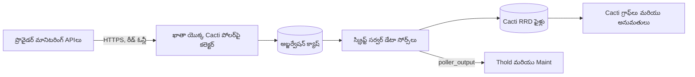

<!-- Source: README.md; SHA256: 7c621642e5f1a46bac66e4bc744f70aebb014c610d22de034088845fdc170405 -->

<!-- translations:start -->
[English](../../../README.md) | [简体中文](../zh-CN/README.md) | [हिन्दी](../hi-IN/README.md) | [Español (España)](../es-ES/README.md) | [Español (Latinoamérica)](../es-419/README.md) | [العربية (السعودية)](../ar-SA/README.md) | [Afrikaans](../af-ZA/README.md) | [አማርኛ](../am-ET/README.md) | [العربية (مصر)](../ar-EG/README.md) | [العربية (المغرب)](../ar-MA/README.md) | [বাংলা](../bn-BD/README.md) | [Bosanski](../bs-BA/README.md) | [Deutsch](../de-DE/README.md) | [فارسی](../fa-IR/README.md) | [Filipino](../fil-PH/README.md) | [Français](../fr-FR/README.md) | [Français (Maroc)](../fr-MA/README.md) | [Français (Sénégal)](../fr-SN/README.md) | [Hausa](../ha-NG/README.md) | [עברית](../he-IL/README.md) | [Hrvatski](../hr-HR/README.md) | [Bahasa Indonesia](../id-ID/README.md) | [Igbo](../ig-NG/README.md) | [Italiano](../it-IT/README.md) | [日本語](../ja-JP/README.md) | [한국어](../ko-KR/README.md) | [Malagasy](../mg-MG/README.md) | [मराठी](../mr-IN/README.md) | [Bahasa Melayu](../ms-MY/README.md) | [Nederlands](../nl-NL/README.md) | [Polski](../pl-PL/README.md) | [Português (Brasil)](../pt-BR/README.md) | [Русский](../ru-RU/README.md) | [Kinyarwanda](../rw-RW/README.md) | [Soomaali](../so-SO/README.md) | [Српски](../sr-RS/README.md) | [Svenska](../sv-SE/README.md) | [Kiswahili](../sw-KE/README.md) | [தமிழ்](../ta-IN/README.md) | [తెలుగు](README.md) | [ไทย](../th-TH/README.md) | [Türkçe](../tr-TR/README.md) | [Українська](../uk-UA/README.md) | [اردو](../ur-PK/README.md) | [Tiếng Việt](../vi-VN/README.md) | [isiXhosa](../xh-ZA/README.md) | [Yorùbá](../yo-NG/README.md) | [繁體中文](../zh-TW/README.md) | [isiZulu](../zu-ZA/README.md)
<!-- translations:end -->

# plugin_cloud

పబ్లిక్ క్లౌడ్ ప్రొవైడర్ల నుండి వనరులు మరియు మెట్రిక్‌లను సాధారణ డివైజ్‌లు, డేటా సోర్స్‌లు మరియు గ్రాఫ్‌లుగా Cacti లోకి తీసుకువచ్చే Cacti 1.2 ప్లగిన్. అప్పుడు క్లౌడ్ వర్క్‌లోడ్‌లు వాటిని తీసుకెళ్లే నెట్‌వర్క్ పక్కనే, Cacti అనుమతుల కింద ఉంటాయి, మరియు Thold మరియు Maint వాటిపై అలర్ట్‌లను పంపగలవు మరియు వాటిని సప్రెస్ చేయగలవు. ఒకే ప్లగిన్ ప్రతి ప్రొవైడర్‌ను కవర్ చేస్తుంది, ప్రతి ప్రొవైడర్‌కు ఒక డ్రైవర్ ఉంటుంది: ముందుగా DigitalOcean, AWS, Google Cloud, మరియు Azure.

> **స్థితి: మైల్‌స్టోన్ 3 (DigitalOcean మరియు Cacti ఆబ్జెక్ట్‌లు), సమీక్షలో ఉంది.** ఈ మైల్‌స్టోన్ DigitalOcean డ్రైవర్, Cacti టెంప్లేట్‌లు, ప్రతి వనరు రకానికి ఒక డేటా క్వెరీతో ప్రతి ఖాతాకు ఒక స్కోప్ డివైజ్, స్క్రిప్ట్ సర్వర్ ఇన్‌పుట్, మరియు New Graphs మరియు హెల్త్ పేజీలో రిక్వెస్ట్ అంచనాను జోడిస్తుంది. లైవ్ DigitalOcean ఖాతాపై నిర్వహించిన ప్రాథమిక తనిఖీలు [ప్రొవైడర్ వాస్తవాలు](../../research/provider-facts.md)లో నమోదు చేయబడ్డాయి. దీనిని ప్రొడక్షన్‌లో అమలు చేయవద్దు.

## యాక్సెస్ పాత్రలు

| రెల్మ్ | యాక్సెస్ |
| --- | --- |
| Cloud View | ప్రస్తుత పర్యవేక్షణ పేజీలు. |
| Cloud Operator | పర్యవేక్షణతో పాటు Operations పేజీ మరియు వ్యక్తిగత ట్రయాజ్ అక్నాలెడ్జ్‌మెంట్లు. |
| Cloud Admin | Operator యాక్సెస్‌తో పాటు ప్రస్తుత కాన్ఫిగరేషన్ మరియు అడ్మినిస్ట్రేటివ్ చర్యలు. |

అప్‌గ్రేడ్ ఫైళ్లను కాపీ చేసిన తర్వాత, కొత్త రెల్మ్‌ను నమోదు చేయడానికి అడ్మినిస్ట్రేటర్‌గా Plugins పేజీని తెరవండి. **Configuration > Users** లేదా యూజర్ గ్రూప్‌ల కింద Operator రెల్మ్‌ను స్పష్టంగా కేటాయించండి. అప్‌గ్రేడ్‌లు ఇప్పటికే ఉన్న View మరియు Admin రెల్మ్ IDలు మరియు గ్రాంట్‌లను నిలుపుకుంటాయి. ప్రతి రిక్వెస్ట్‌లో Admin యాక్సెస్ Operator యాక్సెస్‌ను వారసత్వంగా పొందుతుంది, మరియు Operator యాక్సెస్ View యాక్సెస్‌ను వారసత్వంగా పొందుతుంది; ఇది యూజర్‌లు లేదా గ్రూప్‌లకు నిల్వ చేసిన గ్రాంట్‌లను జోడించదు. Cacti యొక్క Settings అనుమతితో పాటు ప్లగిన్ సెట్టింగ్‌లకు కూడా Cloud Admin యాక్సెస్ అవసరం.

Cacti డివైజ్ అనుమతులు ఇప్పటికీ ప్రతి యూజర్‌కు అందుబాటులో ఉన్న వరుసలు మరియు చర్యలను పరిమితం చేస్తాయి; మ్యాప్ చేయని ఆబ్జెక్ట్‌లకు అడ్మినిస్ట్రేటర్ అవసరం. ఆపరేటర్లు తాము యాక్సెస్ చేయగల Cacti డివైజ్ ఉన్న ఖాతా కోసం నిల్వ చేసిన క్రెడెన్షియల్‌ను ధృవీకరించగలరు. క్రెడెన్షియల్స్, కాన్ఫిగరేషన్, మ్యాపింగ్, తొలగింపు మరియు ఇతర అడ్మినిస్ట్రేటివ్ మార్పులు అడ్మినిస్ట్రేటివ్ పేజీలలోనే ఉంటాయి. అక్నాలెడ్జ్‌మెంట్లు ప్రస్తుత యూజర్ సెషన్‌లో మాత్రమే, గరిష్టంగా ఒక గంట పాటు మరియు అదే అబ్జర్వేషన్ తాజాగా ఉన్నంత వరకు మాత్రమే ఉంటాయి. కొత్త లేదా మారిన అబ్జర్వేషన్లు వాటిని చెల్లనివిగా చేస్తాయి. అవి విఫలమైన కొలతను ఎప్పుడూ ఆరోగ్యకరమైనదిగా గుర్తించవు లేదా అలర్ట్‌లను సప్రెస్ చేయవు.

## ఎందుకు

ప్రతి క్లౌడ్ ప్రొవైడర్‌కు దాని స్వంత మానిటరింగ్ కన్సోల్ ఉంటుంది. Cacti తో పాటు వాటిని నడిపినప్పుడు, మూడు అంతరాలు ఏర్పడతాయి:

- **వేర్వేరు యాక్సెస్ నియంత్రణ.** Cacti యూజర్‌కు క్లౌడ్ మెట్రిక్‌లను చూపించడం అంటే వారికి క్లౌడ్ లాగిన్ ఇవ్వడమే.
- **నెట్‌వర్క్ సందర్భం లేకపోవడం.** ఆన్-ప్రిమైజెస్ లింక్‌లు Cacti లో గ్రాఫ్ చేయబడతాయి; వాటి వెనుక ఉన్న వర్క్‌లోడ్‌లు ప్రతి ప్రొవైడర్ కన్సోల్‌లో గ్రాఫ్ చేయబడతాయి.
- **వేర్వేరు అలర్టింగ్.** Thold మరియు Maint Cacti డేటా సోర్స్‌లు మరియు డివైజ్‌లపై పనిచేస్తాయి, కాబట్టి ప్రొవైడర్ అలారంలు ప్రతి ప్రొవైడర్‌కు ఒకసారి విడిగా కాన్ఫిగర్ చేయబడి, సప్రెస్ చేయబడతాయి.

ఈ ప్లగిన్ Cacti పోలర్‌లో ప్రతి ప్రొవైడర్ మానిటరింగ్ APIని చదువుతుంది, తాజా డేటాపాయింట్‌లను క్యాష్ చేస్తుంది మరియు వాటిని Cacti స్క్రిప్ట్ సర్వర్‌కు అందిస్తుంది. Cacti పోలర్ RRD ఫైళ్లను రాస్తుంది, కాబట్టి గ్రాఫింగ్, అనుమతులు, Thold, Maint, మరియు boost ఇతర ఏ Cacti డేటాకైనా పనిచేసినట్లే పనిచేస్తాయి.

## డిజైన్ నిబద్ధతలు

- **రీడ్-ఓన్లీ.** ప్రతి డ్రైవర్ దాని అనుమతి జాబితాలోని ప్రొవైడర్ ఆపరేషన్‌లను మాత్రమే నిర్మించగలదు; ఈ ప్లగిన్ ఎప్పుడూ క్లౌడ్ వనరును మార్చదు. ([ADR 0002](../../decisions/0002-read-only-with-operation-allowlist.md))
- **PHP మాత్రమే, SDKలు లేవు.** Cacti ఇప్పటికే కోరే ఎక్స్‌టెన్షన్‌లతో PHP లోనే సైనింగ్ మరియు టోకెన్ మార్పిడి అమలు చేయబడ్డాయి. Composer రన్‌టైమ్ డిపెండెన్సీలు లేవు. ([ADR 0003](../../decisions/0003-php-only-without-sdks.md))
- **సేకరణకు ముందు ఖర్చు అంచనా.** ఈ ప్లగిన్ Cacti డేటా సోర్స్ ఉన్న మెట్రిక్‌లను మాత్రమే చదువుతుంది, గ్రాఫ్‌లను సృష్టించే ముందు ఆశించిన రిక్వెస్ట్ సంఖ్య మరియు లిస్ట్-ధర ఖర్చును చూపుతుంది మరియు నెలవారీ గరిష్ట పరిమితిని అమలు చేస్తుంది. ([ADR 0005](../../decisions/0005-collect-only-what-is-graphed.md))
- **డేటాబేస్‌లో ప్లెయిన్‌టెక్స్ట్ క్రెడెన్షియల్స్ ఉండవు.** డేటాబేస్ వెలుపల ఉన్న ఫైల్ ద్వారా కీ చేయబడిన ఎన్క్రిప్టెడ్ వాల్ట్ నుండి, క్రెడెన్షియల్ ఫైల్ నుండి లేదా ప్రొవైడర్ యొక్క ఇన్‌స్టాన్స్ ఐడెంటిటీ నుండి క్రెడెన్షియల్స్ వస్తాయి. ([ADR 0007](../../decisions/0007-credentials-outside-the-database-in-the-clear.md))

## పరిధి మరియు స్థితి

| దశ | పరిధి | మైల్‌స్టోన్‌లు | స్థితి |
|---|---|---|---|
| 0, పరిశోధన | ప్రొవైడర్ వాస్తవాల నిర్ధారణ, మెట్రిక్ కేటలాగ్‌లు, ఖర్చు మరియు రేటు నమూనా, సైనింగ్ టెస్ట్ వెక్టర్‌లు, ట్రాన్స్‌పోర్ట్ స్పైక్ | [M1](https://github.com/somethingwithproof/plugin_cloud/milestone/1) | లైవ్ ప్రొవైడర్ ఖాతా అవసరమైన తనిఖీలు మినహా పూర్తయింది |
| 1, కోర్ మరియు DigitalOcean | ఖాతాలు, క్రెడెన్షియల్ వాల్ట్, ట్రాన్స్‌పోర్ట్, కలెక్టర్, అబ్జర్వేషన్ క్యాష్, Cacti ఆబ్జెక్ట్‌లు, హెల్త్ పేజీ, DigitalOcean Dropletలు మరియు లోడ్ బ్యాలెన్సర్‌లు | [M2](https://github.com/somethingwithproof/plugin_cloud/milestone/2), [M3](https://github.com/somethingwithproof/plugin_cloud/milestone/3), [M4](https://github.com/somethingwithproof/plugin_cloud/milestone/4) | M2 పూర్తయింది ([#81](https://github.com/somethingwithproof/plugin_cloud/pull/81)); M3 డ్రైవర్, టెంప్లేట్‌లు మరియు స్కోప్ డివైజ్‌లు విలీనం చేయబడ్డాయి; రిక్వెస్ట్ అంచనాలు, అనుమతులు మరియు పనితీరు తనిఖీలు సమీక్షలో ఉన్నాయి; M4 ప్రారంభం కాలేదు |
| 2, AWS | Signature Version 4, `AssumeRole`, ఇన్‌స్టాన్స్ రోల్స్, CloudWatch `GetMetricData`, ప్రాంతీయ ఇన్వెంటరీ | [M5](https://github.com/somethingwithproof/plugin_cloud/milestone/5) | ప్రారంభం కాలేదు |
| 3, Google Cloud | సర్వీస్ ఖాతా JWT, మెటాడేటా సర్వర్, Cloud Monitoring `timeSeries.list` | [M6](https://github.com/somethingwithproof/plugin_cloud/milestone/6) | ప్రారంభం కాలేదు |
| 4, Azure | Entra క్లయింట్ క్రెడెన్షియల్స్, మేనేజ్డ్ ఐడెంటిటీ, Resource Graph, `metrics:getBatch` | [M7](https://github.com/somethingwithproof/plugin_cloud/milestone/7) | ప్రారంభం కాలేదు |
| 5, రిమోట్ కలెక్టర్లు | Cacti రిమోట్ డేటా కలెక్టర్లలో ఖాతాలు | [M8](https://github.com/somethingwithproof/plugin_cloud/milestone/8) | ప్రారంభం కాలేదు |

పరిధి వెలుపల ఉన్నవి: క్లౌడ్ వనరులను మార్చడం, ప్రొవైడర్ అలారంలను సృష్టించడం లేదా ప్రతిబింబించడం, బిల్లింగ్ నివేదికలు, లాగ్‌లు మరియు ట్రేస్‌లు, మరియు ప్లగిన్ స్వంత అలర్టింగ్ ఇంజిన్. తదుపరి ప్రొవైడర్లు (Hetzner Cloud, Akamai Cloud, Oracle Cloud, మరియు ఇతరాలు) పరిశోధన సమస్యలుగా ఉన్నాయి.

## మైల్‌స్టోన్ 2 లో వచ్చేవి

- **రక్షిత ఇన్‌స్టాల్.** 8.2 కంటే తక్కువ PHP పై, లేదా ext-openssl లేకుండా, ఇన్‌స్టాల్ మరియు ఎనేబుల్ ఒక సందేశంతో తిరస్కరించబడతాయి, మరియు మిగిలిన Cacti పనిచేస్తూనే ఉంటుంది.
- **జీవితచక్రం.** Cacti యొక్క Plugins పేజీ ద్వారా ఇన్‌స్టాల్, అప్‌గ్రేడ్ మరియు అన్‌ఇన్‌స్టాల్ చేయండి. అప్‌గ్రేడ్‌లు క్రమంలో ఉంటాయి మరియు అంతరాయాన్ని తట్టుకుంటాయి. మీరు *Keep Plugin Tables on Uninstall* ను క్లియర్ చేయకపోతే అన్‌ఇన్‌స్టాల్ ప్లగిన్ టేబుళ్లను ఉంచుతుంది.
- **వేర్వేరు రెల్మ్‌లు.** *Cloud Admin* **Cloud Accounts** ను తెరుస్తుంది; *Cloud Operator* **Cloud Operations** ను తెరుస్తుంది; *Cloud View* **Cloud Health** ను తెరుస్తుంది. Admin Operator ను వారసత్వంగా పొందుతుంది, మరియు Operator View ను వారసత్వంగా పొందుతుంది. ఈ మూడు పేజీలూ Management కింద ఉంటాయి.
- **ఖాతాలు మరియు క్రెడెన్షియల్స్.** ఖాతాలను జోడించండి, సవరించండి, ధృవీకరించండి మరియు తొలగించండి. క్రెడెన్షియల్ డేటాబేస్ వెలుపల ఉంచబడిన కీ ఫైల్‌తో డేటాబేస్‌లో ఎన్క్రిప్ట్ చేయబడుతుంది (AES-256-GCM), లేదా పోలర్‌లోని ఫైల్ నుండి చదవబడుతుంది. UI లో క్రెడెన్షియల్స్ రైట్-ఓన్లీగా ఉంటాయి మరియు లాగ్‌ల నుండి తొలగించబడతాయి.
- **కలెక్టర్.** ఇది ప్రతి పోలర్ రన్ నుండి, ప్రతి పోలర్‌కు ఒక ఇన్‌స్టాన్స్ చొప్పున, సమయ పరిమితిలో ప్రారంభమవుతుంది. ఇది ప్రతి ఖాతాకు లీజు తీసుకుంటుంది, దాని స్వంత విరామంలో డిస్కవరీని నడుపుతుంది మరియు ప్లగిన్ యొక్క స్వంత యాక్టివ్ డేటా సోర్స్‌ల కోసం మాత్రమే మెట్రిక్‌లను చదువుతుంది.
- **హెల్త్.** ప్రతి ఖాతాకు సేకరణ, డిస్కవరీ, వనరు మరియు తాజాదనం స్థితి, అలాగే ఉపయోగించలేని వాల్ట్ కీ, అసురక్షిత క్రెడెన్షియల్ ఫైళ్లు మరియు పోలర్ పాటించలేని విరామాల కోసం హెచ్చరికలు.

## ఇన్‌స్టాల్ మరియు కాన్ఫిగర్ చేయండి

ఈ దశలు మూల్యాంకనం కోసం మైల్‌స్టోన్ 2 కోడ్‌ను ఇన్‌స్టాల్ చేస్తాయి. వీటికి PHP 8.2 లేదా ఆ తర్వాతి వెర్షన్‌లో Cacti 1.2.31 లేదా ఆ తర్వాతి వెర్షన్ అవసరం.

1. మీ Cacti డైరెక్టరీ కింద ఉన్న `plugins/cloud` లోకి రిపోజిటరీని కాపీ చేయండి. డైరెక్టరీ పేరు తప్పనిసరిగా `cloud` అయి ఉండాలి.
2. వెబ్ రూట్ వెలుపల వాల్ట్ కీని సృష్టించండి. దానిని root మరియు Cacti యూజర్ మాత్రమే రాయగలిగే డైరెక్టరీలో ఉంచండి మరియు వెబ్ సర్వర్ మరియు పోలర్‌ను నడిపే యూజర్ మాత్రమే ఫైల్‌ను చదవగలిగేలా చేయండి. ఈ ప్లగిన్ ఈ ఫైల్‌ను ఎప్పుడూ సృష్టించదు లేదా రాయదు:

   ```sh
   sudo install -d -m 0750 -o root -g cacti /etc/cacti
   head -c 32 /dev/urandom | sudo tee /etc/cacti/cloud-vault.key > /dev/null
   sudo chown cacti:cacti /etc/cacti/cloud-vault.key
   sudo chmod 0600 /etc/cacti/cloud-vault.key
   ```

   `cacti` ని మీ వెబ్ సర్వర్ మరియు పోలర్‌ను నడిపే యూజర్‌తో భర్తీ చేయండి. ఫైల్ 32 రా బైట్లు లేదా 64 హెక్సాడెసిమల్ అక్షరాలను కలిగి ఉంటుంది. డేటాబేస్‌తో పాటు దీనిని బ్యాకప్ చేయండి; అది లేకుండా, నిల్వ చేసిన క్రెడెన్షియల్స్‌ను మళ్లీ నమోదు చేయాల్సి ఉంటుంది.
3. Cacti లో, **Configuration > Plugins** తెరిచి, ఆపై *Cloud* ను ఇన్‌స్టాల్ చేసి ఎనేబుల్ చేయండి.
4. **Configuration > Settings > Cloud** కింద, మీరు వేరే పాత్ ఉపయోగించినట్లయితే *Vault Key File* ను సెట్ చేయండి. *Collector Time Budget* (డిఫాల్ట్ 240 సెకన్లు) పోలర్ విరామం కంటే తక్కువగా ఉండాలి.
5. **Configuration > Users** కింద యూజర్‌లకు మరియు గ్రూప్‌లకు *Cloud Admin*, *Cloud Operator* లేదా *Cloud View* ను మంజూరు చేయండి. ఇన్‌స్టాల్ చేయడం వలన అడ్మినిస్ట్రేటర్‌కు Cloud Admin మరియు Cloud View మంజూరు అవుతాయి; Cloud Admin లో Operator యాక్సెస్ ఉంటుంది, కాబట్టి అడ్మినిస్ట్రేటర్‌కు ప్రత్యేక Operator గ్రాంట్ అవసరం లేదు.
6. **Management > Cloud Accounts** కింద ఖాతాలను జోడించి, ఆపై హెచ్చరికల కోసం **Management > Cloud Health** ను తనిఖీ చేయండి.

## అనుకూలత లక్ష్యాలు

| భాగం | లక్ష్యం |
|---|---|
| Cacti | 1.2.31 లేదా ఆ తర్వాతిది, కోర్ ప్యాచ్‌లు లేవు |
| PHP | 8.2 లేదా ఆ తర్వాతిది; మద్దతు లేని రన్‌టైమ్‌కు Cacti UI పాడవకుండా తిరస్కరణ అందేలా `setup.php` 8.0 లో పార్స్ చేయగలిగేలా ఉంటుంది |
| PHP ఎక్స్‌టెన్షన్‌లు | Cacti 1.2.31 కోరేవి కాకుండా మరేవీ లేవు |
| Thold, Maint | మార్పులు అవసరం లేదు |

## డిజైన్

- [docs/performance.md](../../performance.md) లో ఉపయోగించిన హార్డ్‌వేర్ మరియు సెట్టింగ్‌లతో కలెక్టర్ మరియు హెల్త్ పేజీ కొలతలు ఉన్నాయి.
- [docs/PLAN.md](../../PLAN.md) పూర్తి ప్రణాళిక: ఆర్కిటెక్చర్, అది ఆధారపడే ప్రొవైడర్ మరియు Cacti వాస్తవాలు (మూలాలతో సహా), డ్రైవర్ కాంట్రాక్ట్, ఖర్చు అంకగణితం, భద్రతా సరిహద్దులు, పరీక్షలు మరియు ప్రమాదాలు.
- [docs/decisions/](../../decisions) ఇప్పటికే తీసుకున్న ఎంపికల కోసం ఆర్కిటెక్చర్ నిర్ణయ రికార్డులను కలిగి ఉంది.
- [docs/REQUIREMENTS.md](../../REQUIREMENTS.md) ప్రతి రిక్వైర్‌మెంట్ ID ని దాని ఇష్యూకు మ్యాప్ చేస్తుంది.



## పని ఎలా ట్రాక్ చేయబడుతుంది

- **మైల్‌స్టోన్‌లు** ప్రణాళికలోని మైల్‌స్టోన్‌లను అనుసరిస్తాయి. ప్రతిదానికీ దాని సబ్-ఇష్యూలు మరియు నిష్క్రమణ ఆధారాలను జాబితా చేసే ఒక ఎపిక్ ఇష్యూ ఉంటుంది.
- **ఇష్యూలు** లేబుల్ ద్వారా వర్గీకరించబడతాయి: `type: requirement`, `type: research`, `type: decision`, `type: epic`. రిక్వైర్‌మెంట్ ఇష్యూలు సంఖ్యలతో కూడిన, పరీక్షించదగిన అవసరాలను (`REQ-AREA-NNN`) మరియు ఆమోద ప్రమాణాలను పేర్కొంటాయి.
- **లేబుల్స్** `area:`, `provider:`, `phase:`, `priority:`, మరియు `status:` లను కూడా కలిగి ఉంటాయి. [CONTRIBUTING.md](../../../CONTRIBUTING.md#labels) చూడండి.
- [ప్రాజెక్ట్ బోర్డు](https://github.com/users/somethingwithproof/projects/7) మైల్‌స్టోన్‌లలో ఉన్న అన్ని ఇష్యూలను చూపుతుంది.

## డెవలప్‌మెంట్

CI PHP 8.0 పై ఎంట్రీ పాయింట్‌లను లింట్ చేస్తుంది, యూనిట్ మరియు ఇంటిగ్రేషన్ పరీక్షలు మరియు PHPStan స్థాయి 9 ను నడుపుతుంది, మరియు Cacti 1.2.31 మరియు 1.2.x బ్రాంచ్‌కు వ్యతిరేకంగా PHP 8.2 నుండి 8.5 వరకు ప్లగిన్‌ను ఇన్‌స్టాల్ చేస్తుంది. Cacti పాడవకుండా PHP 8.1 తిరస్కరించబడుతుందో లేదో కూడా ఇది తనిఖీ చేస్తుంది. పరీక్షలు Cacti కోర్ యొక్క ప్లగిన్ హార్నెస్ నుండి Pest ను ఉపయోగిస్తాయి. [#12](https://github.com/somethingwithproof/plugin_cloud/issues/12) పై నిర్ణయం తీసుకునే వరకు ఆ ఎంపిక తాత్కాలికమైనది. [.github/workflows/plugin-ci-workflow.yml](../../../.github/workflows/plugin-ci-workflow.yml) ప్రతి దశను జాబితా చేస్తుంది. పుష్ చేయడానికి ముందు స్థానికంగా `sh tests/lint-workflows.sh` మరియు `sh locales/build_gettext.sh --check` లను అమలు చేయండి.

## సహకారం

[CONTRIBUTING.md](../../../CONTRIBUTING.md) చదవండి. కమిట్‌లకు DCO సైన్-ఆఫ్ అవసరం. డిజైన్ చర్చలు ఇష్యూలపై జరుగుతాయి; తెరిచి ఉన్న నిర్ణయాలకు `type: decision` లేబుల్ ఉంటుంది.

## భద్రత

భద్రతా లోపాలను ప్రైవేట్‌గా నివేదించండి; [SECURITY.md](../../../SECURITY.md) చూడండి.

## లైసెన్స్

GNU General Public License v2.0, Cacti మరియు దాని ప్లగిన్‌లకు ఉన్న అదే లైసెన్స్. [LICENSE](../../../LICENSE) చూడండి.
