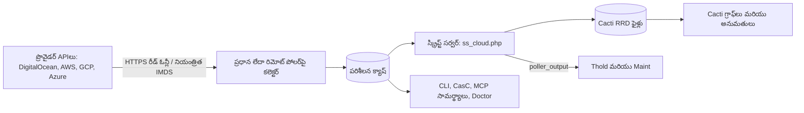

<!-- Source: README.md; SHA256: ac2074a40238686915802803c5efe773f33677f934281e0605e6e87a71a9d27d -->

<!-- translations:start -->
[English](../../../README.md) | [简体中文](../zh-CN/README.md) | [हिन्दी](../hi-IN/README.md) | [Español (España)](../es-ES/README.md) | [Español (Latinoamérica)](../es-419/README.md) | [العربية (السعودية)](../ar-SA/README.md) | [Afrikaans](../af-ZA/README.md) | [አማርኛ](../am-ET/README.md) | [العربية (مصر)](../ar-EG/README.md) | [العربية (المغرب)](../ar-MA/README.md) | [বাংলা](../bn-BD/README.md) | [Bosanski](../bs-BA/README.md) | [Deutsch](../de-DE/README.md) | [فارسی](../fa-IR/README.md) | [Filipino](../fil-PH/README.md) | [Français](../fr-FR/README.md) | [Français (Maroc)](../fr-MA/README.md) | [Français (Sénégal)](../fr-SN/README.md) | [Hausa](../ha-NG/README.md) | [עברית](../he-IL/README.md) | [Hrvatski](../hr-HR/README.md) | [Bahasa Indonesia](../id-ID/README.md) | [Igbo](../ig-NG/README.md) | [Italiano](../it-IT/README.md) | [日本語](../ja-JP/README.md) | [한국어](../ko-KR/README.md) | [Malagasy](../mg-MG/README.md) | [मराठी](../mr-IN/README.md) | [Bahasa Melayu](../ms-MY/README.md) | [Nederlands](../nl-NL/README.md) | [Polski](../pl-PL/README.md) | [Português (Brasil)](../pt-BR/README.md) | [Русский](../ru-RU/README.md) | [Kinyarwanda](../rw-RW/README.md) | [Soomaali](../so-SO/README.md) | [Српски](../sr-RS/README.md) | [Svenska](../sv-SE/README.md) | [Kiswahili](../sw-KE/README.md) | [தமிழ்](../ta-IN/README.md) | [తెలుగు](README.md) | [ไทย](../th-TH/README.md) | [Türkçe](../tr-TR/README.md) | [Українська](../uk-UA/README.md) | [اردو](../ur-PK/README.md) | [Tiếng Việt](../vi-VN/README.md) | [isiXhosa](../xh-ZA/README.md) | [Yorùbá](../yo-NG/README.md) | [繁體中文](../zh-TW/README.md) | [isiZulu](../zu-ZA/README.md)
<!-- translations:end -->

# plugin_cloud

పబ్లిక్ క్లౌడ్ ప్రొవైడర్ల నుండి వనరులు మరియు మెట్రిక్‌లను సాధారణ డివైజ్‌లు, డేటా సోర్స్‌లు మరియు గ్రాఫ్‌లుగా Cacti లోకి తీసుకువచ్చే Cacti 1.2 ప్లగిన్. క్లౌడ్ వర్క్‌లోడ్‌లు వాటిని తీసుకెళ్లే నెట్‌వర్క్ పక్కనే, Cacti అనుమతుల కింద ఉంటాయి, మరియు Thold మరియు Maint వాటిపై అలర్ట్‌లను పంపుతాయి మరియు వాటిని సప్రెస్ చేస్తాయి. పూర్తి-PHP, రీడ్-ఓన్లీ ప్రొవైడర్ డ్రైవర్ల ద్వారా ఒకే ప్లగిన్ DigitalOcean, Amazon Web Services, Google Cloud మరియు Microsoft Azure లను కవర్ చేస్తుంది.

> **స్థితి: అభివృద్ధిలో ఉంది, ఇంకా విడుదల కాలేదు (`0.1.0-dev`).** ఈ బ్రాంచ్ DigitalOcean, AWS, Google Cloud మరియు Azure కోసం పూర్తి-PHP డ్రైవర్లు, రిమోట్ డేటా కలెక్టర్ రిప్లికేషన్ మరియు రీడ్-ఓన్లీ ఏజెంట్ హెల్త్, ఒక CasC ప్రొవైడర్ మరియు ఆపరేటర్ CLI, MCP సామర్థ్యాలు మరియు Doctor తనిఖీలను అమలు చేస్తుంది. ప్రస్తుతం అందించబడిన Cacti టెంప్లేట్‌లు DigitalOcean Droplets మరియు లోడ్ బ్యాలెన్సర్‌లను (`templates/cloud_digitalocean.xml`) కవర్ చేస్తాయి; AWS, Google Cloud మరియు Azure కోసం Cacti టెంప్లేట్ ప్యాకేజీలు మరియు DigitalOcean కు అతీతంగా లైవ్-ఖాతా అర్హత నిర్ధారణ ([ప్రొవైడర్ వాస్తవాలు](../../research/provider-facts.md)) ఇంకా పూర్తి కాలేదు. ప్రొడక్షన్‌లో అమలు చేయవద్దు.

## మద్దతు ఉన్న ప్రొవైడర్లు

ప్రతి ప్రొవైడర్ డ్రైవర్ `Drivers::production()` లో నమోదు చేయబడుతుంది, `Provider::released()` ద్వారా అందించబడుతుంది మరియు ఎటువంటి SDK లేదా Composer రన్‌టైమ్ డిపెండెన్సీలు లేకుండా `ext-openssl` మరియు స్ట్రీమ్ సాకెట్‌లను ఉపయోగించి పూర్తి PHP లో నడుస్తుంది.

| ప్రొవైడర్ | స్కోప్ ఫీల్డ్‌లు | క్రెడెన్షియల్ మూలాలు | ప్రమాణీకరణ | కనుగొనబడిన వనరులు | మెట్రిక్ సేకరణ |
|---|---|---|---|---|---|
| DigitalOcean (`digitalocean`) | ఏవీ లేవు (టోకెన్-స్కోప్డ్) | `vault`, `file` | Bearer token | `droplet`, `load_balancer` | రేట్-లిమిట్ షేర్ అవగాహనతో `/v2/monitoring/metrics`; Cacti టెంప్లేట్‌లు మరియు డేటా క్వెరీలను అందిస్తుంది |
| Amazon Web Services (`aws`) | `account_id` (12 అంకెలు), `regions` | `vault`, `file`, `instance` | పూర్తి-PHP AWS SigV4 (`AWS4-HMAC-SHA256`), STS `GetCallerIdentity` ధృవీకరణ, ఐచ్ఛిక STS `AssumeRole`, `instance` ఖాతాల కోసం EC2 IMDSv2 (`169.254.169.254`) | `ec2_instance`, `rds_instance`, `aws_elb` (ALB/NLB) | బ్యాచ్డ్ CloudWatch `GetMetricData` (కాల్‌కు గరిష్టంగా 500 క్వెరీలు) |
| Google Cloud (`gcp`) | `project` | `vault`, `file`, `instance` | `ext-openssl` ద్వారా `oauth2.googleapis.com/token` వద్ద మార్పిడి చేయబడిన పూర్తి-PHP RS256 సర్వీస్-ఖాతా JWT, లేదా `instance` ఖాతాల కోసం GCE మెటాడేటా సర్వర్ (`metadata.google.internal`) | `instances.aggregatedList` ద్వారా `gce_instance` | Cloud Monitoring `timeSeries.list` |
| Microsoft Azure (`azure`) | `tenant`, `subscription`, `regions` | `vault`, `file`, `instance` | పూర్తి-PHP Entra ID OAuth2 క్లయింట్-క్రెడెన్షియల్స్ ఫ్లో (`client_secret` మాత్రమే; సర్టిఫికేట్ అసెర్షన్లు మినహాయించబడ్డాయి), లేదా ARM మరియు Monitor టోకెన్ల కోసం Azure IMDS (`169.254.169.254`) మేనేజ్డ్ ఐడెంటిటీ | ARM Resource Graph ద్వారా `azure_vm` (`$skipToken` తో పేజినేట్ చేయబడింది మరియు డూప్లికేట్లు తొలగించబడింది) | Azure Monitor `metrics:getBatch` (కాల్‌కు గరిష్టంగా 50 వనరులు, HTTP 429 మరియు 529 త్రోట్లింగ్‌ను నిర్వహిస్తుంది) |

## అమలు చేయబడిన సామర్థ్యాలు

### కోర్ ప్లాట్‌ఫారమ్, వాల్ట్ మరియు కలెక్టర్

- **రక్షిత ఇన్‌స్టాల్ మరియు జీవితచక్రం.** ఎంట్రీ పాయింట్లు (`setup.php`, `cli/cloud.php`, `poller_cloud.php`, `ss_cloud.php`, మరియు పేజీ స్క్రిప్ట్‌లు) PHP 8.0 లో పార్స్ అవుతాయి మరియు Cacti ని విచ్ఛిన్నం చేయకుండా PHP 8.2 కంటే తక్కువ లేదా `ext-openssl` లేకపోవడాన్ని తిరస్కరిస్తాయి. అప్‌గ్రేడ్‌లు క్రమబద్ధమైనవి, ఐడెంపోటెంట్ (`Schema::VERSION = 3`, 9 టేబుళ్లు) మరియు అంతరాయాన్ని తట్టుకుంటాయి. *Keep Plugin Tables on Uninstall* క్లియర్ చేయకపోతే అన్‌ఇన్‌స్టాల్ ప్లగిన్ టేబుళ్లను ఉంచుతుంది.
- **ఖాతాలు మరియు క్రెడెన్షియల్స్.** **Management > Cloud Accounts** కింద ఖాతాలను జోడించండి, సవరించండి, ధృవీకరించండి మరియు తొలగించండి. క్రెడెన్షియల్స్ AES-256-GCM ఎన్‌క్రిప్ట్ చేసిన వాల్ట్ (`plugin_cloud_secret`, డిఫాల్ట్‌గా `/etc/cacti/cloud-vault.key` తో కీ చేయబడింది) నుండి, కాన్ఫిగర్ చేయబడిన *Credential File Directory* (`cloud_credential_dir`, ఫైళ్లను తిరస్కరించడానికి డిఫాల్ట్‌గా ఖాళీగా ఉంటుంది) లోపల పరిమితం చేయబడిన ఫైల్ నుండి లేదా ప్రొవైడర్ ఇన్‌స్టాన్స్ గుర్తింపు నుండి వస్తాయి. క్రెడెన్షియల్స్ UI లో రైట్-ఓన్లీగా ఉంటాయి మరియు లాగ్‌ల నుండి తొలగించబడతాయి.
- **కఠినమైన అవుట్‌బౌండ్ మరియు రీడ్-ఓన్లీ నియంత్రణలు.** ప్రతి డ్రైవర్ `GuardedTransport` మరియు `OutboundPolicy` వెనుక పనిచేస్తుంది: ప్రతి ప్రొవైడర్ యొక్క ఖచ్చితమైన హోస్ట్‌నేమ్‌లకు HTTPS పోర్ట్ 443, మరియు `instance` ఖాతాలకు మాత్రమే లింక్-లోకల్ HTTP పోర్ట్ 80 మెటాడేటా ఎండ్‌పాయింట్లు (`169.254.169.254`, `metadata.google.internal`) ప్రారంభించబడతాయి. అనుమతించబడిన రీడ్-ఓన్లీ ఆపరేషన్లు మాత్రమే అనుమతించబడతాయి.
- **కలెక్టర్ మరియు ఖర్చు నియంత్రణలు.** `poller_cloud.php` అనేది `poller_bottom` నుండి (Cacti యొక్క ప్రాసెస్ రిజిస్ట్రీ ద్వారా పోలర్‌కు ఒక ప్రాసెస్) `cloud_collector_budget` లోపల నడుస్తుంది, ఖాతా-వారీ లీజులను పొందుతుంది, `discover_interval` పై డిస్కవరీని నడుపుతుంది, యాక్టివ్ Cacti డేటా సోర్స్‌ల (`plugin_cloud_series`) కోసం మాత్రమే మెట్రిక్‌లను చదువుతుంది, `request_share` మరియు `monthly_ceiling` లను గౌరవిస్తుంది మరియు `ss_cloud.php` కోసం `plugin_cloud_observation` లో తాజా డేటాపాయింట్లను క్యాష్ చేస్తుంది.
- **Cacti ఆబ్జెక్ట్‌లు మరియు రిక్వెస్ట్ అంచనాలు.** ప్రతి ఖాతాకు ఒక స్కోప్ డివైజ్‌ను (`plugin_cloud_device`) నిర్వహిస్తుంది, డివైజ్ సేవ్‌లలో స్కోప్ డివైజ్ రీఇండెక్స్ పద్ధతులను సంరక్షిస్తుంది, DigitalOcean టెంప్లేట్‌లు మరియు స్క్రిప్ట్ సర్వర్ డేటా క్వెరీలను (`templates/cloud_digitalocean.xml`, `cloud_do_droplet.xml`, `cloud_do_load_balancer.xml`) దిగుమతి చేస్తుంది, మరియు **New Graphs** (`graphs_new_top_links`) మరియు **Cloud Health** పై రిక్వెస్ట్ మరియు లిస్ట్-ధర అంచనాలను చూపుతుంది.

### రిమోట్ డేటా కలెక్టర్లు

- `INFO` అనేది `remote_collect:1` ను ప్రకటిస్తుంది. ఖాతాలను ఏదైనా ప్రారంభించబడిన Cacti పోలర్‌కు (`poller_id >= 1`) కేటాయించవచ్చు, మరియు `poller_cloud.php --poller=N` ఆ పోలర్ స్వంతమైన ఖాతాలను మాత్రమే సేకరిస్తుంది.
- **`replicate_out` హుక్.** `replicate_out_table()` ద్వారా `plugin_cloud_account`, `plugin_cloud_device`, `plugin_cloud_series` నుండి పోలర్-స్కోప్డ్ వరుసలను మరియు `plugin_cloud_secret` నుండి ఎన్‌క్రిప్ట్ చేసిన సైఫర్‌టెక్స్ట్ వరుసలను (టార్గెట్ పోలర్ స్వంతమైన వాల్ట్-బ్యాక్డ్ ఖాతాలకు మాత్రమే) రిప్లికేట్ చేస్తుంది. ముడి వాల్ట్ కీ ఫైళ్లు డేటాబేస్‌లో ఎప్పుడూ నిల్వ చేయబడవు లేదా రిప్లికేట్ చేయబడవు మరియు ప్రతి పోలర్‌లో లోకల్‌గా ఉంటాయి.
- **`remote_agent` హుక్.** పూర్ణాంకం `poller_id` మరియు `account_id` పారామీటర్లను మాత్రమే అంగీకరిస్తూ, ఎటువంటి క్రెడెన్షియల్స్, ఫైల్ మార్గాలు లేదా రహస్యాలను తిరిగి ఇవ్వని రీడ్-ఓన్లీ JSON హెల్త్ సారాంశాన్ని (`action=cloud_health`) బహిర్గతం చేస్తుంది.

### పర్యావరణ వ్యవస్థ హుక్‌లు (CasC, MCP సామర్థ్యాలు మరియు Doctor)

- **CasC ప్రొవైడర్ (`casc_register_providers`).** నిర్దిష్ట పూర్తి-PHP YAML మరియు XML ఎగుమతి, మానిఫెస్ట్ ధృవీకరణ, డిఫ్ ప్రణాళిక మరియు నిర్ధారిత అప్లైతో `cloud` ప్రొవైడర్ (స్కీమా వెర్షన్ `1`) ను నమోదు చేస్తుంది. వాల్ట్ క్రెడెన్షియల్స్ `vault:account:<name>` రిఫరెన్సులుగా ఎగుమతి చేయబడతాయి; ముడి రహస్య ఫీల్డ్‌లు (`secret`, `secrets`, `token`, `access_token`, `refresh_token`, `password`, `private_key`, `access_key_id`, `secret_access_key`, `session_token`, `client_secret`, `credential`, `credentials`, `vault_key`) తిరస్కరించబడతాయి. అప్లై చేయడానికి ఖచ్చితమైన SHA-256 `--confirm=<PLAN_HASH>` అవసరం.
- **MCP / Abilities API (`abilities_register`).** అడ్మిన్ కాని కాలర్ల కోసం Cloud View రెల్మ్ (`cloud_health.php`) మరియు Cacti డివైజ్ స్కోప్‌పై నియంత్రించబడిన మూడు కఠినమైన రీడ్-ఓన్లీ సామర్థ్యాలను నమోదు చేస్తుంది, ఇవి ఎటువంటి క్రెడెన్షియల్స్, వాల్ట్ కీలు లేదా క్రెడెన్షియల్ ఫైల్ మార్గాలను విడుదల చేయవు:
  - `cloud-list-accounts` (ఐచ్ఛికం `provider`, `poller_id`)
  - `cloud-list-resources` (ఐచ్ఛికం `account_id`, `type`, `lifecycle`)
  - `cloud-get-health` (ఐచ్ఛికం `account_id`)
- **Doctor తనిఖీలు (`doctor_register_checks`).** రహస్య విలువలు లేదా కీ సమాచారాన్ని బహిర్గతం చేయని ఐదు డయాగ్నోస్టిక్ తనిఖీలను నమోదు చేస్తుంది:
  - `cloud_schema`: స్కీమా వెర్షన్ తాజాదనం
  - `cloud_vault_key`: వాల్ట్ కీ ఫైల్ చదవగలగడం, అనుమతులు మరియు పరిమాణం
  - `cloud_drivers`: విడుదలైన అన్ని ప్రొవైడర్ల కోసం ప్రొడక్షన్ డ్రైవర్ నమోదు
  - `cloud_accounts_health`: విఫలమైన, త్రోటిల్ చేయబడిన లేదా పాతదైన ప్రారంభించబడిన ఖాతాలు
  - `cloud_poller_intervals`: ప్రారంభించబడిన ఖాతా సేకరణ విరామాలను Cacti పోలర్ విరామంతో సమలేఖనం చేయడం

## CLI

PHP 8.2 లేదా ఆ తర్వాత వెర్షన్‌తో Cacti రూట్ డైరెక్టరీ నుండి అమలు చేయండి:

```sh
# Operator and CasC CLI (options use --key=value form)
php plugins/cloud/cli/cloud.php export [--format=yaml|xml]
php plugins/cloud/cli/cloud.php validate --file=<path> [--format=yaml|xml]
php plugins/cloud/cli/cloud.php plan --file=<path> [--format=yaml|xml]
php plugins/cloud/cli/cloud.php apply --file=<path> --confirm=<PLAN_HASH> [--format=yaml|xml]
php plugins/cloud/cli/cloud.php health [--format=text|json] [--poller=<id>]

# Collector entry point (normally started by poller_bottom)
php plugins/cloud/poller_cloud.php [--poller=N] [--force] [--debug]
```

## యాక్సెస్ పాత్రలు

| రెల్మ్ | యాక్సెస్ |
| --- | --- |
| Cloud View | ఇప్పటికే ఉన్న పర్యవేక్షణ పేజీలు. |
| Cloud Operator | పర్యవేక్షణతో పాటు Operations పేజీ మరియు వ్యక్తిగత ట్రయాజ్ అంగీకారాలు. |
| Cloud Admin | Operator యాక్సెస్‌తో పాటు ఇప్పటికే ఉన్న కాన్ఫిగరేషన్ మరియు పరిపాలనా చర్యలు. |

అప్‌గ్రేడ్ ఫైళ్లను కాపీ చేసిన తర్వాత, రెల్మ్‌లను నమోదు చేయడానికి అడ్మినిస్ట్రేటర్‌గా Plugins పేజీని తెరవండి. **Configuration > Users** లేదా వినియోగదారు సమూహాల కింద Operator రెల్మ్‌ను స్పష్టంగా కేటాయించండి. అప్‌గ్రేడ్‌లు ఇప్పటికే ఉన్న View మరియు Admin రెల్మ్ IDలు మరియు గ్రాంట్లను నిలుపుకుంటాయి. Admin యాక్సెస్ Operator యాక్సెస్‌ను వారసత్వంగా పొందుతుంది, మరియు Operator యాక్సెస్ ప్రతి అభ్యర్థనపై View యాక్సెస్‌ను వారసత్వంగా పొందుతుంది; ఇది వినియోగదారులు లేదా సమూహాలకు నిల్వ చేయబడిన గ్రాంట్లను జోడించదు. ప్లగిన్ సెట్టింగ్‌లకు Cacti యొక్క Settings అనుమతితో పాటు Cloud Admin యాక్సెస్ కూడా అవసరం.

Cacti డివైజ్ అనుమతులు ప్రతి వినియోగదారుకు అందుబాటులో ఉన్న వరుసలు మరియు చర్యలను పరిమితం చేస్తాయి; మ్యాప్ చేయని ఆబ్జెక్ట్‌లకు అడ్మినిస్ట్రేటర్ అవసరం. ఆపరేటర్లు తాము యాక్సెస్ చేయగల Cacti డివైజ్ ఉన్న ఖాతా కోసం నిల్వ చేసిన క్రెడెన్షియల్‌ను ధృవీకరించగలరు. క్రెడెన్షియల్స్, కాన్ఫిగరేషన్, మ్యాపింగ్, తొలగింపు మరియు ఇతర పరిపాలనా మార్పులు పరిపాలనా పేజీలలోనే ఉంటాయి. అంగీకారాలు ప్రస్తుత వినియోగదారు సెషన్‌లో మాత్రమే, గరిష్టంగా ఒక గంట పాటు మరియు అదే పరిశీలన తాజాగా ఉన్నంత వరకు మాత్రమే ఉంటాయి. కొత్త లేదా మారిన పరిశీలనలు వాటిని చెల్లనివిగా చేస్తాయి. అవి విఫలమైన కొలతను ఎప్పుడూ ఆరోగ్యకరమైనదిగా గుర్తించవు లేదా అలర్ట్‌లను అణచివేయవు.

## ఎందుకు

ప్రతి క్లౌడ్ ప్రొవైడర్‌కు దాని స్వంత పర్యవేక్షణ కన్సోల్ ఉంటుంది. Cacti తో పాటు నడిపినప్పుడు, అవి మూడు అంతరాలను వదిలివేస్తాయి:

- **వేర్వేరు యాక్సెస్ నియంత్రణ.** ఒక Cacti వినియోగదారుకు క్లౌడ్ మెట్రిక్‌లను చూపించడం అంటే వారికి క్లౌడ్ లాగిన్ ఇవ్వడం అని అర్థం.
- **నెట్‌వర్క్ సందర్భం లేదు.** ఆన్-ప్రెమిసెస్ లింక్‌లు Cacti లో గ్రాఫ్ చేయబడతాయి; వాటి వెనుక ఉన్న వర్క్‌లోడ్‌లు ప్రతి ప్రొవైడర్ కన్సోల్‌లో గ్రాఫ్ చేయబడతాయి.
- **వేర్వేరు అలర్టింగ్.** Thold మరియు Maint అనేవి Cacti డేటా సోర్స్‌లు మరియు డివైజ్‌లపై పనిచేస్తాయి, కాబట్టి ప్రొవైడర్ అలారమ్‌లు ప్రతి ప్రొవైడర్‌కు ఒకసారి విడిగా కాన్ఫిగర్ చేయబడి అణచివేయబడతాయి.

ఈ ప్లగిన్ ప్రతి ప్రొవైడర్ పర్యవేక్షణ API ని Cacti పోలర్‌పై చదువుతుంది, తాజా డేటాపాయింట్లను క్యాష్ చేస్తుంది మరియు వాటిని Cacti స్క్రిప్ట్ సర్వర్‌కు అందిస్తుంది. Cacti పోలర్ RRD ఫైళ్లను వ్రాస్తుంది, కాబట్టి గ్రాఫింగ్, అనుమతులు, Thold, Maint మరియు boost ఏ ఇతర Cacti డేటాకైనా పనిచేసినట్లే పనిచేస్తాయి.

## డిజైన్ నిబద్ధతలు

- **రీడ్-ఓన్లీ.** ప్రతి డ్రైవర్ దాని అనుమతి జాబితాలో ఉన్న ప్రొవైడర్ ఆపరేషన్లను మాత్రమే నిర్మించగలదు; ప్లగిన్ ఎప్పుడూ క్లౌడ్ వనరును మార్చదు. ([ADR 0002](../../decisions/0002-read-only-with-operation-allowlist.md))
- **PHP మాత్రమే, SDKలు లేవు.** సంతకం చేయడం మరియు టోకెన్ మార్పిడి Cacti కి ఇప్పటికే అవసరమైన ఎక్స్‌టెన్షన్లతో PHP లో అమలు చేయబడతాయి. Composer రన్‌టైమ్ డిపెండెన్సీలు లేవు. ([ADR 0003](../../decisions/0003-php-only-without-sdks.md))
- **సేకరణకు ముందు ఖర్చు.** Cacti డేటా సోర్స్ ఉన్న మెట్రిక్‌లను మాత్రమే ప్లగిన్ చదువుతుంది, గ్రాఫ్‌లను సృష్టించే ముందు ఆశించిన రిక్వెస్ట్ సంఖ్య మరియు లిస్ట్-ధర ఖర్చును చూపుతుంది మరియు నెలవారీ పరిమితిని అమలు చేస్తుంది. ([ADR 0005](../../decisions/0005-collect-only-what-is-graphed.md))
- **డేటాబేస్‌లో ప్లెయిన్‌టెక్స్ట్ క్రెడెన్షియల్స్ లేవు.** క్రెడెన్షియల్స్ డేటాబేస్ వెలుపల ఉన్న ఫైల్ ద్వారా కీ చేయబడిన ఎన్‌క్రిప్ట్ చేసిన వాల్ట్ నుండి, క్రెడెన్షియల్ ఫైల్ నుండి లేదా ప్రొవైడర్ ఇన్‌స్టాన్స్ గుర్తింపు నుండి వస్తాయి. ([ADR 0007](../../decisions/0007-credentials-outside-the-database-in-the-clear.md))

## పరిధి మరియు స్థితి

| దశ | పరిధి | మైల్‌స్టోన్లు | స్థితి |
|---|---|---|---|
| 0, పరిశోధన | ప్రొవైడర్ వాస్తవ నిర్ధారణ, మెట్రిక్ కేటలాగ్‌లు, ఖర్చు మరియు రేటు నమూనా, సైనింగ్ టెస్ట్ వెక్టర్లు, ట్రాన్స్‌పోర్ట్ స్పైక్ | [M1](https://github.com/somethingwithproof/plugin_cloud/milestone/1) | లైవ్ ప్రొవైడర్ ఖాతాలు అవసరమయ్యే తనిఖీలు మినహా పూర్తయింది |
| 1, కోర్ మరియు DigitalOcean | ఖాతాలు, క్రెడెన్షియల్ వాల్ట్, ట్రాన్స్‌పోర్ట్, కలెక్టర్, అబ్జర్వేషన్ క్యాష్, Cacti ఆబ్జెక్ట్‌లు, టెంప్లేట్‌లు, రిక్వెస్ట్ అంచనాలు, హెల్త్ పేజీ, DigitalOcean Droplets మరియు లోడ్ బ్యాలెన్సర్లు | [M2](https://github.com/somethingwithproof/plugin_cloud/milestone/2), [M3](https://github.com/somethingwithproof/plugin_cloud/milestone/3), [M4](https://github.com/somethingwithproof/plugin_cloud/milestone/4) | అమలు చేయబడింది; M4 పైలట్ అర్హత పెండింగ్‌లో ఉంది |
| 2, AWS | పూర్తి-PHP SigV4, STS `AssumeRole`, IMDSv2 ఇన్‌స్టాన్స్ పాత్రలు, EC2/RDS/ELB ఇన్వెంటరీ, CloudWatch `GetMetricData` | [M5](https://github.com/somethingwithproof/plugin_cloud/milestone/5) | డ్రైవర్ అమలు చేయబడింది; Cacti టెంప్లేట్‌లు మరియు లైవ్-ఖాతా అర్హత పెండింగ్‌లో ఉన్నాయి |
| 3, Google Cloud | పూర్తి-PHP RS256 సర్వీస్-ఖాతా JWT, GCE మెటాడేటా సర్వర్, Compute Engine ఇన్వెంటరీ, Cloud Monitoring `timeSeries.list` | [M6](https://github.com/somethingwithproof/plugin_cloud/milestone/6) | డ్రైవర్ అమలు చేయబడింది; Cacti టెంప్లేట్‌లు మరియు లైవ్-ఖాతా అర్హత పెండింగ్‌లో ఉన్నాయి |
| 4, Azure | Entra ID క్లయింట్ క్రెడెన్షియల్స్, IMDS మేనేజ్డ్ ఐడెంటిటీ, ARM Resource Graph VM ఇన్వెంటరీ, Azure Monitor `metrics:getBatch` | [M7](https://github.com/somethingwithproof/plugin_cloud/milestone/7) | డ్రైవర్ అమలు చేయబడింది; Cacti టెంప్లేట్‌లు మరియు లైవ్-ఖాతా అర్హత పెండింగ్‌లో ఉన్నాయి |
| 5, రిమోట్ కలెక్టర్లు మరియు పర్యావరణ వ్యవస్థ | రిమోట్ డేటా కలెక్టర్లు (`replicate_out`, `remote_agent`), CasC ప్రొవైడర్ మరియు CLI, MCP సామర్థ్యాలు, Doctor తనిఖీలు | [M8](https://github.com/somethingwithproof/plugin_cloud/milestone/8) | అమలు చేయబడింది |

పరిధికి వెలుపల ఉన్నవి: క్లౌడ్ వనరులను మార్చడం, ప్రొవైడర్ అలారమ్‌లను సృష్టించడం లేదా ప్రతిబింబించడం, బిల్లింగ్ నివేదికలు, లాగ్‌లు మరియు ట్రేస్‌లు, మరియు ప్లగిన్-యాజమాన్య అలర్టింగ్ ఇంజిన్. తదుపరి ప్రొవైడర్లు (Hetzner Cloud, Akamai Cloud, Oracle Cloud మరియు ఇతరులు) పరిశోధన సమస్యలుగా ఉన్నాయి.

## ఇన్‌స్టాల్ మరియు కాన్ఫిగర్ చేయండి

ఈ దశలు మూల్యాంకనం కోసం అభివృద్ధి కోడ్‌ను ఇన్‌స్టాల్ చేస్తాయి. వీటికి PHP 8.2 లేదా ఆ తర్వాత వెర్షన్‌పై Cacti 1.2.31 లేదా ఆ తర్వాత వెర్షన్ అవసరం.

1. మీ Cacti డైరెక్టరీ కింద `plugins/cloud` కు రిపోజిటరీని కాపీ చేయండి. డైరెక్టరీ పేరు తప్పనిసరిగా `cloud` అని ఉండాలి.
2. వాల్ట్-బ్యాక్డ్ క్రెడెన్షియల్స్ ఉపయోగించే ప్రతి పోలర్‌పై వెబ్ రూట్ వెలుపల వాల్ట్ కీని సృష్టించండి. root మరియు Cacti వినియోగదారు మాత్రమే వ్రాయగలిగే డైరెక్టరీలో దానిని ఉంచండి మరియు వెబ్ సర్వర్ మరియు పోలర్‌ను నడిపే వినియోగదారు మాత్రమే ఫైల్‌ను చదవగలిగేలా చేయండి. ప్లగిన్ ఎప్పుడూ ఈ ఫైల్‌ను సృష్టించదు లేదా వ్రాయదు:

   ```sh
   sudo install -d -m 0750 -o root -g cacti /etc/cacti
   head -c 32 /dev/urandom | sudo tee /etc/cacti/cloud-vault.key > /dev/null
   sudo chown cacti:cacti /etc/cacti/cloud-vault.key
   sudo chmod 0600 /etc/cacti/cloud-vault.key
   ```

   మీ వెబ్ సర్వర్ మరియు పోలర్‌ను నడిపే వినియోగదారుతో `cacti` ని భర్తీ చేయండి. ఫైల్ 32 ముడి బైట్‌లు లేదా 64 హెక్సాడెసిమల్ అక్షరాలను కలిగి ఉంటుంది. డేటాబేస్‌తో పాటు దీనిని బ్యాకప్ చేయండి; ఇది లేకుండా, నిల్వ చేయబడిన క్రెడెన్షియల్స్‌ను మళ్లీ నమోదు చేయాలి.
3. Cacti లో, **Configuration > Plugins** తెరిచి, ఆపై *Cloud* ను ఇన్‌స్టాల్ చేసి ప్రారంభించండి.
4. **Configuration > Settings > Cloud** కింద, మీరు వేరే మార్గాన్ని ఉపయోగించినట్లయితే *Vault Key File* ను సెట్ చేయండి, మీరు ఫైల్-ఆధారిత క్రెడెన్షియల్స్ ఉపయోగించాలని ప్లాన్ చేస్తే *Credential File Directory* ను కాన్ఫిగర్ చేయండి మరియు *Collector Time Budget* (డిఫాల్ట్ 240 సెకన్లు) ను పోలర్ విరామం కంటే తక్కువగా ఉంచండి.
5. **Configuration > Users** కింద వినియోగదారులు మరియు సమూహాలకు *Cloud Admin*, *Cloud Operator* లేదా *Cloud View* ను మంజూరు చేయండి. ఇన్‌స్టాల్ చేయడం వలన అడ్మినిస్ట్రేటర్‌కు Cloud Admin మరియు Cloud View మంజూరు చేయబడతాయి; Cloud Admin లో Operator యాక్సెస్ ఉంటుంది, కాబట్టి అడ్మినిస్ట్రేటర్‌కు ప్రత్యేక Operator గ్రాంట్ అవసరం లేదు.
6. **Management > Cloud Accounts** కింద ఖాతాలను జోడించండి, ఆపై హెచ్చరికల కోసం **Management > Cloud Health** ను తనిఖీ చేయండి.

## అనుకూలత లక్ష్యాలు

| భాగం | లక్ష్యం |
|---|---|
| Cacti | 1.2.31 లేదా ఆ తర్వాత, కోర్ ప్యాచ్‌లు లేవు |
| PHP | 8.2 లేదా ఆ తర్వాత; మద్దతు లేని రన్‌టైమ్ విరిగిన Cacti UI కి బదులుగా తిరస్కరణను పొందేలా ఎంట్రీ పాయింట్లు 8.0 పై పార్స్ చేయగలిగేవిగా ఉంటాయి |
| PHP ఎక్స్‌టెన్షన్లు | `ext-openssl` (Cacti 1.2.31 ద్వారా అవసరం); `ext-curl` లేదు మరియు Composer రన్‌టైమ్ డిపెండెన్సీలు లేవు |
| Thold, Maint | ఎటువంటి మార్పులు అవసరం లేదు |

## డిజైన్

- [docs/performance.md](../../performance.md) లో ఉపయోగించిన హార్డ్‌వేర్ మరియు సెట్టింగ్‌లతో కూడిన కలెక్టర్ మరియు హెల్త్ పేజీ కొలతలు ఉన్నాయి.
- [docs/PLAN.md](../../PLAN.md) పూర్తి ప్రణాళిక: ఆర్కిటెక్చర్, అది ఆధారపడే ప్రొవైడర్ మరియు Cacti వాస్తవాలు (మూలాలతో సహా), డ్రైవర్ కాంట్రాక్ట్, ఖర్చు గణితం, భద్రతా సరిహద్దులు, పరీక్షలు మరియు ప్రమాదాలు.
- [docs/decisions/](../../decisions/) ఇప్పటికే తీసుకున్న ఎంపికల కోసం ఆర్కిటెక్చర్ నిర్ణయ రికార్డులను కలిగి ఉంది.
- [docs/REQUIREMENTS.md](../../REQUIREMENTS.md) ప్రతి అవసర ID ని దాని సమస్యకు మ్యాప్ చేస్తుంది.



## పని ఎలా ట్రాక్ చేయబడుతుంది

- **మైల్‌స్టోన్లు** ప్రణాళిక మైల్‌స్టోన్లను అనుసరిస్తాయి. ప్రతి ఒక్కటి దాని ఉప-సమస్యలు మరియు నిష్క్రమణ ఆధారాలను జాబితా చేసే ఒక ఎపిక్ సమస్యను కలిగి ఉంటుంది.
- **సమస్యలు** లేబుల్ ద్వారా వర్గీకరించబడతాయి: `type: requirement`, `type: research`, `type: decision`, `type: epic`. అవసర సమస్యలు సంఖ్యలతో కూడిన, పరీక్షించదగిన అవసరాలు (`REQ-AREA-NNN`) మరియు ఆమోద ప్రమాణాలను పేర్కొంటాయి.
- **లేబుళ్లు** `area:`, `provider:`, `phase:`, `priority:` మరియు `status:` లను కూడా కలిగి ఉంటాయి. [CONTRIBUTING.md](../../../CONTRIBUTING.md#labels) చూడండి.
- [ప్రాజెక్ట్ బోర్డ్](https://github.com/users/somethingwithproof/projects/7) అన్ని మైల్‌స్టోన్లలోని అన్ని సమస్యలను చూపుతుంది.

## అభివృద్ధి

CI ([.github/workflows/plugin-ci-workflow.yml](../../../.github/workflows/plugin-ci-workflow.yml)) విడుదల ఆర్కైవ్ మరియు సెమాంటిక్ వెర్షన్ (`bash tests/bin/archive-check.sh`) ను తనిఖీ చేస్తుంది, PHP 8.0 పై ఎంట్రీ పాయింట్లను లింట్ చేస్తుంది, `CLOUD_OFFLINE=1` తో Cacti `release/1.2.31` మరియు `1.2.x` లకు వ్యతిరేకంగా PHP 8.2 నుండి 8.5 వరకు Pest యూనిట్ (`phpunit.xml`) మరియు జీవితచక్ర ఏకీకరణ (`phpunit-integration.xml`) పరీక్షలు మరియు PHPStan స్థాయి 9 ను అమలు చేస్తుంది, PHP 8.1 పై తిరస్కరణను తనిఖీ చేస్తుంది, gettext కేటలాగ్‌లను ధృవీకరిస్తుంది, 1,000-సిరీస్ సేకరణ మరియు హెల్త్ పేజీ పనితీరును కొలుస్తుంది మరియు వర్క్‌ఫ్లో లింటింగ్ మరియు REUSE సమ్మతిని అమలు చేస్తుంది.

పుష్ చేసే ముందు స్థానిక తనిఖీలు:

```sh
bash tests/bin/archive-check.sh
sh tests/lint-workflows.sh
sh locales/build_gettext.sh --check
CACTI_PATH=/path/to/cacti phpstan analyse -c phpstan.neon --no-progress
```

యూనిట్ మరియు సోర్స్-రూల్ పరీక్షల కోసం `--configuration=phpunit.xml` తో, లేదా జీవితచక్ర ఏకీకరణ పరీక్షల కోసం డిస్పోజబుల్ Cacti డేటాబేస్‌కు వ్యతిరేకంగా `CACTI_PATH` మరియు `CLOUD_TEST_DATABASE=disposable` తో `--configuration=phpunit-integration.xml` ఉపయోగించి Pest ను అమలు చేయండి.

## సహకారం అందించడం

[CONTRIBUTING.md](../../../CONTRIBUTING.md) చదవండి. కమిట్‌లకు DCO సైన్-ఆఫ్ అవసరం. డిజైన్ చర్చ సమస్యలపై జరుగుతుంది; తెరిచిన నిర్ణయాలు `type: decision` లేబుల్‌ను కలిగి ఉంటాయి.

## భద్రత

దుర్బలత్వాలను ప్రైవేట్‌గా నివేదించండి; [SECURITY.md](../../../SECURITY.md) చూడండి.

## లైసెన్స్

GNU General Public License v2.0, Cacti మరియు దాని ప్లగిన్‌ల వలె అదే లైసెన్స్. [LICENSE](../../../LICENSE) చూడండి.
