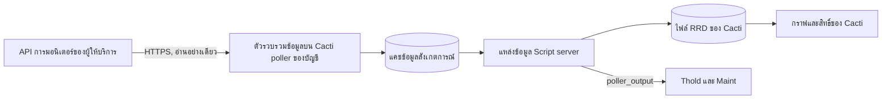

<!-- Source: README.md; SHA256: 7c621642e5f1a46bac66e4bc744f70aebb014c610d22de034088845fdc170405 -->

<!-- translations:start -->
[English](../../../README.md) | [简体中文](../zh-CN/README.md) | [हिन्दी](../hi-IN/README.md) | [Español (España)](../es-ES/README.md) | [Español (Latinoamérica)](../es-419/README.md) | [العربية (السعودية)](../ar-SA/README.md) | [Afrikaans](../af-ZA/README.md) | [አማርኛ](../am-ET/README.md) | [العربية (مصر)](../ar-EG/README.md) | [العربية (المغرب)](../ar-MA/README.md) | [বাংলা](../bn-BD/README.md) | [Deutsch](../de-DE/README.md) | [فارسی](../fa-IR/README.md) | [Filipino](../fil-PH/README.md) | [Français](../fr-FR/README.md) | [Français (Maroc)](../fr-MA/README.md) | [Français (Sénégal)](../fr-SN/README.md) | [Hausa](../ha-NG/README.md) | [עברית](../he-IL/README.md) | [Bahasa Indonesia](../id-ID/README.md) | [Igbo](../ig-NG/README.md) | [Italiano](../it-IT/README.md) | [日本語](../ja-JP/README.md) | [한국어](../ko-KR/README.md) | [Malagasy](../mg-MG/README.md) | [मराठी](../mr-IN/README.md) | [Bahasa Melayu](../ms-MY/README.md) | [Nederlands](../nl-NL/README.md) | [Polski](../pl-PL/README.md) | [Português (Brasil)](../pt-BR/README.md) | [Русский](../ru-RU/README.md) | [Kinyarwanda](../rw-RW/README.md) | [Soomaali](../so-SO/README.md) | [Svenska](../sv-SE/README.md) | [Kiswahili](../sw-KE/README.md) | [தமிழ்](../ta-IN/README.md) | [తెలుగు](../te-IN/README.md) | [ไทย](README.md) | [Türkçe](../tr-TR/README.md) | [Українська](../uk-UA/README.md) | [اردو](../ur-PK/README.md) | [Tiếng Việt](../vi-VN/README.md) | [isiXhosa](../xh-ZA/README.md) | [Yorùbá](../yo-NG/README.md) | [繁體中文](../zh-TW/README.md) | [isiZulu](../zu-ZA/README.md)
<!-- translations:end -->

# plugin_cloud

ปลั๊กอินสำหรับ Cacti 1.2 ที่นำทรัพยากรและเมตริกจากผู้ให้บริการคลาวด์สาธารณะเข้ามาใน Cacti ในรูปแบบอุปกรณ์ แหล่งข้อมูล และกราฟทั่วไป ทำให้เวิร์กโหลดบนคลาวด์อยู่เคียงข้างเครือข่ายที่เชื่อมต่อเข้าถึง ภายใต้ระบบสิทธิ์ของ Cacti รวมถึงให้ Thold และ Maint สามารถแจ้งเตือนและระงับการแจ้งเตือนได้ ปลั๊กอินเดียวรองรับผู้ให้บริการทุกราย โดยมีไดรเวอร์แยกตามผู้ให้บริการ ได้แก่ DigitalOcean, AWS, Google Cloud และ Azure เป็นกลุ่มแรก

> **สถานะ: ไมล์สโตน 3 (DigitalOcean และอ็อบเจกต์ของ Cacti) อยู่ระหว่างการตรวจสอบ** ไมล์สโตนนี้เพิ่มไดรเวอร์ DigitalOcean, เทมเพลตของ Cacti, อุปกรณ์กำหนดขอบเขต (scope device) ต่อหนึ่งบัญชีพร้อมการคิวรีข้อมูล (data query) ต่อหนึ่งประเภททรัพยากร, อินพุตของ script server และการประมาณจำนวนคำขอในหน้า New Graphs และหน้าตรวจสอบสถานะสุขภาพ ผลการตรวจสอบเบื้องต้นกับบัญชี DigitalOcean จริงถูกบันทึกไว้ใน [ข้อมูลข้อเท็จจริงของผู้ให้บริการ](../../research/provider-facts.md) ห้ามนำไปใช้งานในสภาพแวดล้อมการใช้งานจริง (production)

## บทบาทการเข้าถึง

| ขอบเขตสิทธิ์ (Realm) | การเข้าถึง |
| --- | --- |
| Cloud View | หน้าการมอนิเตอร์ที่มีอยู่ |
| Cloud Operator | การมอนิเตอร์ รวมถึงหน้า Operations และการรับทราบปัญหาเฉพาะบุคคล (personal triage acknowledgments) |
| Cloud Admin | สิทธิ์ระดับ Operator รวมถึงการตั้งค่าและการดำเนินการด้านการดูแลระบบที่มีอยู่ |

หลังจากคัดลอกไฟล์อัปเกรดแล้ว ให้เปิดหน้า Plugins ด้วยสิทธิ์ผู้ดูแลระบบเพื่อลงทะเบียน
ขอบเขตสิทธิ์ใหม่ กำหนดสิทธิ์ขอบเขต Operator อย่างชัดเจนภายใต้ **Configuration > Users** หรือกลุ่มผู้ใช้
การอัปเกรดจะคง ID และสิทธิ์ที่กำหนดไว้เดิมของขอบเขต View และ Admin ไว้ สิทธิ์ระดับ Admin
จะสืบทอดสิทธิ์ระดับ Operator และสิทธิ์ระดับ Operator จะสืบทอดสิทธิ์ระดับ View ในแต่ละคำขอ
โดยไม่ได้เพิ่มรายการสิทธิ์ที่จัดเก็บถาวรให้กับผู้ใช้หรือกลุ่ม การตั้งค่าปลั๊กอินยังต้องมี
สิทธิ์ Cloud Admin เพิ่มเติมจากสิทธิ์ Settings ของ Cacti ด้วย

สิทธิ์การเข้าถึงอุปกรณ์ของ Cacti ยังคงจำกัดแถวและรายการดำเนินการที่ผู้ใช้แต่ละคนเข้าถึงได้ อ็อบเจกต์ที่ยังไม่ได้จับคู่ต้องดำเนินการโดยผู้ดูแลระบบ ผู้ปฏิบัติการ (Operators) สามารถตรวจสอบข้อมูลรับรองที่จัดเก็บไว้สำหรับบัญชีที่ตนเองมีสิทธิ์เข้าถึงอุปกรณ์ Cacti นั้นได้
ข้อมูลรับรอง การกำหนดค่า การจับคู่ การลบ และการเปลี่ยนแปลงด้านการดูแลระบบอื่นๆ
จะยังคงอยู่ในหน้าสำหรับผู้ดูแลระบบ การรับทราบปัญหาจะคงอยู่เฉพาะในเซสชันปัจจุบันของ
ผู้ใช้เท่านั้น เป็นเวลาสูงสุดหนึ่งชั่วโมงและเฉพาะขณะที่ข้อมูลสังเกตการณ์เดิมยังคง
สดใหม่ ข้อมูลสังเกตการณ์ใหม่หรือที่เปลี่ยนแปลงจะทำให้การรับทราบเป็นโมฆะ และจะไม่ทำเครื่องหมายว่าการวัดที่ล้มเหลวเป็นสถานะปกติหรือระงับการแจ้งเตือน

## เหตุผล

ผู้ให้บริการคลาวด์แต่ละรายมีคอนโซลการมอนิเตอร์ของตนเอง เมื่อใช้งานควบคู่กับ Cacti จะเกิดช่องว่างสามประการ:

- **การควบคุมการเข้าถึงแยกจากกัน** การแสดงเมตริกคลาวด์ให้ผู้ใช้ Cacti ดูหมายความว่าต้องให้บัญชีเข้าสู่ระบบคลาวด์แก่ผู้ใช้ด้วย
- **ไม่มีบริบทด้านเครือข่าย** ลิงก์ภายในองค์กรถูกสร้างกราฟใน Cacti แต่เวิร์กโหลดที่อยู่เบื้องหลังกลับถูกสร้างกราฟในคอนโซลของผู้ให้บริการแต่ละราย
- **การแจ้งเตือนแยกจากกัน** Thold และ Maint ทำงานกับแหล่งข้อมูลและอุปกรณ์ของ Cacti ดังนั้นการแจ้งเตือนของผู้ให้บริการจึงต้องตั้งค่าและระงับแยกต่างหากตามผู้ให้บริการแต่ละราย

ปลั๊กอินจะอ่าน API การมอนิเตอร์ของผู้ให้บริการแต่ละรายบน Cacti poller แคชจุดข้อมูลล่าสุด และส่งมอบให้แก่ script server ของ Cacti จากนั้น poller ของ Cacti จะเขียนไฟล์ RRD ทำให้การสร้างกราฟ สิทธิ์การใช้งาน Thold, Maint และ boost ทำงานได้เช่นเดียวกับข้อมูลอื่นๆ ของ Cacti

## หลักการออกแบบ

- **อ่านอย่างเดียว (Read-only)** ไดรเวอร์แต่ละตัวสามารถสร้างได้เฉพาะการดำเนินการของผู้ให้บริการที่อยู่ในรายการอนุญาต (allowlist) เท่านั้น ปลั๊กอินจะไม่เปลี่ยนแปลงทรัพยากรคลาวด์ใดๆ ([ADR 0002](../../decisions/0002-read-only-with-operation-allowlist.md))
- **ใช้ PHP ล้วน ไม่มี SDK** การลงนามและการแลกเปลี่ยนโทเค็นถูกพัฒนาด้วย PHP โดยใช้ส่วนขยายที่ Cacti ต้องการอยู่แล้ว ไม่มีไลบรารีรันไทม์ของ Composer ([ADR 0003](../../decisions/0003-php-only-without-sdks.md))
- **ประเมินค่าใช้จ่ายก่อนจัดเก็บข้อมูล** ปลั๊กอินจะอ่านเฉพาะเมตริกที่มีแหล่งข้อมูลใน Cacti แสดงจำนวนคำขอที่คาดการณ์และค่าใช้จ่ายตามราคาปกติก่อนสร้างกราฟ และบังคับใช้เพดานค่าใช้จ่ายรายเดือน ([ADR 0005](../../decisions/0005-collect-only-what-is-graphed.md))
- **ไม่มีข้อมูลรับรองแบบข้อความธรรมดาในฐานข้อมูล** ข้อมูลรับรองมาจากห้องนิรภัยที่เข้ารหัส (encrypted vault) ซึ่งใช้คีย์จากไฟล์ภายนอกฐานข้อมูล จากไฟล์ข้อมูลรับรอง หรือจากข้อมูลประจำตัวอินสแตนซ์ (instance identity) ของผู้ให้บริการ ([ADR 0007](../../decisions/0007-credentials-outside-the-database-in-the-clear.md))

## ขอบเขตและสถานะ

| ระยะ | ขอบเขต | ไมล์สโตน | สถานะ |
|---|---|---|---|
| 0, การวิจัย | การยืนยันข้อเท็จจริงของผู้ให้บริการ, แค็ตตาล็อกเมตริก, แบบจำลองค่าใช้จ่ายและอัตราคำขอ, เวกเตอร์ทดสอบการลงนาม, การทดสอบต้นแบบการรับส่งข้อมูล | [M1](https://github.com/somethingwithproof/plugin_cloud/milestone/1) | เสร็จสมบูรณ์ ยกเว้นการตรวจสอบที่ต้องใช้บัญชีผู้ให้บริการจริง |
| 1, ระบบแกนหลักและ DigitalOcean | บัญชี, ห้องนิรภัยข้อมูลรับรอง, การรับส่งข้อมูล, ตัวรวบรวมข้อมูล, แคชข้อมูลสังเกตการณ์, อ็อบเจกต์ของ Cacti, หน้าตรวจสอบสถานะสุขภาพ, DigitalOcean Droplets และโหลดบาลานเซอร์ | [M2](https://github.com/somethingwithproof/plugin_cloud/milestone/2), [M3](https://github.com/somethingwithproof/plugin_cloud/milestone/3), [M4](https://github.com/somethingwithproof/plugin_cloud/milestone/4) | M2 เสร็จแล้ว ([#81](https://github.com/somethingwithproof/plugin_cloud/pull/81)); ไดรเวอร์, เทมเพลต และอุปกรณ์กำหนดขอบเขตของ M3 ถูกผสานโค้ดแล้ว; การประมาณคำขอ, สิทธิ์ และการตรวจสอบประสิทธิภาพอยู่ระหว่างการตรวจสอบ; M4 ยังไม่เริ่ม |
| 2, AWS | Signature Version 4, `AssumeRole`, บทบาทของอินสแตนซ์ (instance roles), CloudWatch `GetMetricData`, รายการทรัพยากรตามภูมิภาค | [M5](https://github.com/somethingwithproof/plugin_cloud/milestone/5) | ยังไม่เริ่ม |
| 3, Google Cloud | Service account JWT, เซิร์ฟเวอร์ข้อมูลเมตา (metadata server), Cloud Monitoring `timeSeries.list` | [M6](https://github.com/somethingwithproof/plugin_cloud/milestone/6) | ยังไม่เริ่ม |
| 4, Azure | ข้อมูลรับรองไคลเอนต์ของ Entra, ข้อมูลประจำตัวที่มีการจัดการ (managed identity), Resource Graph, `metrics:getBatch` | [M7](https://github.com/somethingwithproof/plugin_cloud/milestone/7) | ยังไม่เริ่ม |
| 5, ตัวรวบรวมข้อมูลระยะไกล | บัญชีบนตัวรวบรวมข้อมูลระยะไกล (remote data collectors) ของ Cacti | [M8](https://github.com/somethingwithproof/plugin_cloud/milestone/8) | ยังไม่เริ่ม |

นอกเหนือขอบเขต: การเปลี่ยนแปลงทรัพยากรคลาวด์, การสร้างหรือจำลองการแจ้งเตือนของผู้ให้บริการ, รายงานการเรียกเก็บเงิน, บันทึก (logs) และการติดตาม (traces) รวมถึงระบบแจ้งเตือนของปลั๊กอินเอง ผู้ให้บริการรายอื่นเพิ่มเติม (Hetzner Cloud, Akamai Cloud, Oracle Cloud และรายอื่นๆ) อยู่ในสถานะประเด็นงานวิจัย

## สิ่งที่ส่งมอบในไมล์สโตน 2

- **การติดตั้งที่มีการตรวจสอบป้องกัน** บน PHP รุ่นต่ำกว่า 8.2 หรือไม่มีส่วนขยาย ext-openssl ระบบจะปฏิเสธการติดตั้งและการเปิดใช้งานพร้อมข้อความแจ้งเตือน โดยส่วนที่เหลือของ Cacti ยังคงทำงานได้ตามปกติ
- **วงจรชีวิตของปลั๊กอิน** ติดตั้ง อัปเกรด และถอนการติดตั้งผ่านหน้า Plugins ของ Cacti การอัปเกรดทำงานตามลำดับและรองรับการทำงานต่อเมื่อถูกขัดจังหวะ การถอนการติดตั้งจะคงตารางของปลั๊กอินไว้ เว้นแต่คุณจะยกเลิกการเลือก *Keep Plugin Tables on Uninstall*
- **ขอบเขตสิทธิ์แยกส่วน** *Cloud Admin* เปิดหน้า **Cloud Accounts**; *Cloud Operator* เปิดหน้า **Cloud Operations**; *Cloud View* เปิดหน้า **Cloud Health** โดยสิทธิ์ Admin สืบทอด Operator และ Operator สืบทอด View ทั้งสามหน้าอยู่ภายใต้เมนู Management
- **บัญชีและข้อมูลรับรอง** เพิ่ม แก้ไข ตรวจสอบ และลบบัญชี ข้อมูลรับรองจะถูกเข้ารหัสในฐานข้อมูลด้วยไฟล์คีย์ที่เก็บไว้ภายนอก (AES-256-GCM) หรืออ่านจากไฟล์บน poller ข้อมูลรับรองเป็นแบบเขียนได้อย่างเดียวใน UI และจะถูกปกปิด (redacted) ในไฟล์บันทึก
- **ตัวรวบรวมข้อมูล (Collector)** เริ่มทำงานจากการรัน poller แต่ละครั้ง โดยทำงานหนึ่งอินสแตนซ์ต่อหนึ่ง poller ภายใต้กรอบเวลาที่กำหนด มีการขอสิทธิ์เช่า (lease) ต่อบัญชี ดำเนินการค้นหาทรัพยากรตามรอบเวลาของตนเอง และอ่านเมตริกเฉพาะสำหรับแหล่งข้อมูลที่ใช้งานอยู่ของปลั๊กอินเท่านั้น
- **สถานะสุขภาพ (Health)** แสดงสถานะการจัดเก็บข้อมูล การค้นหาทรัพยากร ทรัพยากร และความสดใหม่ของข้อมูลรายบัญชี พร้อมคำเตือนสำหรับคีย์ห้องนิรภัยที่ใช้งานไม่ได้ ไฟล์ข้อมูลรับรองที่ไม่ปลอดภัย และรอบเวลาที่ poller ไม่สามารถทำตามได้ทัน

## การติดตั้งและการกำหนดค่า

ขั้นตอนต่อไปนี้เป็นการติดตั้งโค้ดไมล์สโตน 2 เพื่อการประเมินผล โดยต้องใช้ Cacti 1.2.31 หรือใหม่กว่า บน PHP 8.2 หรือใหม่กว่า

1. คัดลอกที่เก็บโค้ด (repository) ไปยัง `plugins/cloud` ภายใต้ไดเรกทอรี Cacti ของคุณ โดยไดเรกทอรีต้องมีชื่อว่า `cloud`
2. สร้างคีย์ห้องนิรภัยไว้นอก web root โดยวางไว้ในไดเรกทอรีที่เฉพาะ root และผู้ใช้ Cacti เท่านั้นที่เขียนได้ และกำหนดให้ไฟล์อ่านได้เฉพาะผู้ใช้ที่รันเว็บเซิร์ฟเวอร์และ poller เท่านั้น ปลั๊กอินจะไม่สร้างหรือเขียนไฟล์นี้โดยอัตโนมัติ:

   ```sh
   sudo install -d -m 0750 -o root -g cacti /etc/cacti
   head -c 32 /dev/urandom | sudo tee /etc/cacti/cloud-vault.key > /dev/null
   sudo chown cacti:cacti /etc/cacti/cloud-vault.key
   sudo chmod 0600 /etc/cacti/cloud-vault.key
   ```

   แทนที่ `cacti` ด้วยชื่อผู้ใช้ที่รันเว็บเซิร์ฟเวอร์และ poller ของคุณ ไฟล์นี้บรรจุข้อมูลดิบ 32 ไบต์หรืออักขระเลขฐานสิบหก 64 ตัว ให้สำรองไฟล์นี้ควบคู่กับฐานข้อมูล หากไม่มีไฟล์นี้ จะต้องกรอกข้อมูลรับรองที่จัดเก็บไว้ใหม่อีกครั้ง
3. ใน Cacti ให้เปิด **Configuration > Plugins** จากนั้นติดตั้งและเปิดใช้งาน *Cloud*
4. ภายใต้ **Configuration > Settings > Cloud** ให้ตั้งค่า *Vault Key File* หากคุณใช้พาธอื่น โดย *Collector Time Budget* (ค่าเริ่มต้น 240 วินาที) ต้องมีค่าน้อยกว่ารอบเวลาของ poller
5. กำหนดสิทธิ์ *Cloud Admin*, *Cloud Operator* หรือ *Cloud View* ให้แก่ผู้ใช้และกลุ่มภายใต้ **Configuration > Users** การติดตั้งจะให้สิทธิ์ Cloud Admin และ Cloud View แก่ผู้ดูแลระบบโดยอัตโนมัติ ซึ่ง Cloud Admin รวมสิทธิ์ Operator ไว้แล้ว ผู้ดูแลระบบจึงไม่จำเป็นต้องกำหนดสิทธิ์ Operator แยกต่างหาก
6. เพิ่มบัญชีภายใต้ **Management > Cloud Accounts** จากนั้นตรวจสอบคำเตือนใน **Management > Cloud Health**

## เป้าหมายความเข้ากันได้

| องค์ประกอบ | เป้าหมาย |
|---|---|
| Cacti | 1.2.31 หรือใหม่กว่า โดยไม่ต้องแพตช์โค้ดแกนหลัก |
| PHP | 8.2 หรือใหม่กว่า; `setup.php` ยังคงถูกแยกวิเคราะห์ได้บน 8.0 เพื่อให้อินเทอร์เฟซของ Cacti ไม่เสียหายและสามารถแสดงข้อความปฏิเสธบนรันไทม์ที่ไม่รองรับได้ |
| ส่วนขยาย PHP | ไม่มีเพิ่มเติมจากที่ Cacti 1.2.31 ต้องการ |
| Thold, Maint | ไม่จำเป็นต้องแก้ไขใดๆ |

## การออกแบบ

- [docs/performance.md](../../performance.md) มีผลการวัดประสิทธิภาพของตัวรวบรวมข้อมูลและหน้าตรวจสอบสถานะสุขภาพ พร้อมรายละเอียดฮาร์ดแวร์และการตั้งค่าที่ใช้
- [docs/PLAN.md](../../PLAN.md) คือแผนงานฉบับเต็ม: สถาปัตยกรรม, ข้อเท็จจริงของผู้ให้บริการและ Cacti ที่ต้องพึ่งพา (พร้อมแหล่งอ้างอิง), สัญญาการเชื่อมต่อของไดรเวอร์, การคำนวณค่าใช้จ่าย, ขอบเขตความปลอดภัย, การทดสอบ และความเสี่ยง
- [docs/decisions/](../../decisions) เก็บบันทึกการตัดสินใจด้านสถาปัตยกรรม (ADR) สำหรับตัวเลือกที่ได้ตัดสินใจไปแล้ว
- [docs/REQUIREMENTS.md](../../REQUIREMENTS.md) จับคู่รหัสข้อกำหนดทุกข้อเข้ากับประเด็นงาน (issue) ที่เกี่ยวข้อง



## การติดตามงาน

- **ไมล์สโตน (Milestones)** เป็นไปตามไมล์สโตนในแผนงาน แต่ละไมล์สโตนจะมี epic issue ที่ระบุประเด็นงานย่อยและหลักฐานการปิดงาน
- **ประเด็นงาน (Issues)** แยกประเภทด้วยป้ายกำกับ: `type: requirement`, `type: research`, `type: decision`, `type: epic` โดยประเด็นงานประเภทข้อกำหนดจะระบุข้อกำหนดที่มีหมายเลขและทดสอบได้ (`REQ-AREA-NNN`) พร้อมเกณฑ์การยอมรับ
- **ป้ายกำกับ (Labels)** ยังระบุ `area:`, `provider:`, `phase:`, `priority:` และ `status:` ดูรายละเอียดใน [CONTRIBUTING.md](../../../CONTRIBUTING.md#labels)
- [บอร์ดโครงการ](https://github.com/users/somethingwithproof/projects/7) แสดงประเด็นงานทั้งหมดในทุกไมล์สโตน

## การพัฒนา

CI จะตรวจสอบไวยากรณ์ (lint) ของจุดเริ่มต้นโค้ดบน PHP 8.0, รันการทดสอบระดับยูนิตและระดับบูรณาการ รวมถึง PHPStan ระดับ 9 และติดตั้งปลั๊กอินบน PHP 8.2 ถึง 8.5 กับ Cacti 1.2.31 และสาขา 1.2.x นอกจากนี้ยังตรวจสอบว่า PHP 8.1 ถูกปฏิเสธโดยไม่ทำให้ Cacti เสียหาย การทดสอบใช้ Pest จากชุดทดสอบปลั๊กอินของแกนหลัก Cacti ซึ่งเป็นตัวเลือกชั่วคราวจนกว่าจะได้ข้อสรุปใน [#12](https://github.com/somethingwithproof/plugin_cloud/issues/12) ดูขั้นตอนทั้งหมดได้ใน [.github/workflows/plugin-ci-workflow.yml](../../../.github/workflows/plugin-ci-workflow.yml) โปรดรัน `sh tests/lint-workflows.sh` และ `sh locales/build_gettext.sh --check` ในเครื่องก่อนพุชโค้ด

## การมีส่วนร่วม

อ่าน [CONTRIBUTING.md](../../../CONTRIBUTING.md) การคอมมิตต้องมีการลงนาม DCO sign-off การอภิปรายด้านการออกแบบเกิดขึ้นใน issues โดยการตัดสินใจที่ยังเปิดอยู่จะมีป้ายกำกับ `type: decision`

## ความปลอดภัย

รายงานช่องโหว่แบบส่วนตัว ดูรายละเอียดใน [SECURITY.md](../../../SECURITY.md)

## สัญญาอนุญาต

GNU General Public License v2.0 ซึ่งเป็นสัญญาอนุญาตเดียวกับ Cacti และปลั๊กอินของ Cacti ดูรายละเอียดใน [LICENSE](../../../LICENSE)
