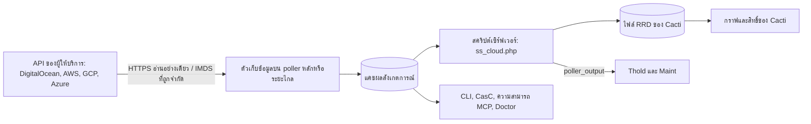

<!-- Source: README.md; SHA256: ac2074a40238686915802803c5efe773f33677f934281e0605e6e87a71a9d27d -->

<!-- translations:start -->
[English](../../../README.md) | [简体中文](../zh-CN/README.md) | [हिन्दी](../hi-IN/README.md) | [Español (España)](../es-ES/README.md) | [Español (Latinoamérica)](../es-419/README.md) | [العربية (السعودية)](../ar-SA/README.md) | [Afrikaans](../af-ZA/README.md) | [አማርኛ](../am-ET/README.md) | [العربية (مصر)](../ar-EG/README.md) | [العربية (المغرب)](../ar-MA/README.md) | [বাংলা](../bn-BD/README.md) | [Bosanski](../bs-BA/README.md) | [Deutsch](../de-DE/README.md) | [فارسی](../fa-IR/README.md) | [Filipino](../fil-PH/README.md) | [Français](../fr-FR/README.md) | [Français (Maroc)](../fr-MA/README.md) | [Français (Sénégal)](../fr-SN/README.md) | [Hausa](../ha-NG/README.md) | [עברית](../he-IL/README.md) | [Hrvatski](../hr-HR/README.md) | [Bahasa Indonesia](../id-ID/README.md) | [Igbo](../ig-NG/README.md) | [Italiano](../it-IT/README.md) | [日本語](../ja-JP/README.md) | [한국어](../ko-KR/README.md) | [Malagasy](../mg-MG/README.md) | [मराठी](../mr-IN/README.md) | [Bahasa Melayu](../ms-MY/README.md) | [Nederlands](../nl-NL/README.md) | [Polski](../pl-PL/README.md) | [Português (Brasil)](../pt-BR/README.md) | [Русский](../ru-RU/README.md) | [Kinyarwanda](../rw-RW/README.md) | [Soomaali](../so-SO/README.md) | [Српски](../sr-RS/README.md) | [Svenska](../sv-SE/README.md) | [Kiswahili](../sw-KE/README.md) | [தமிழ்](../ta-IN/README.md) | [తెలుగు](../te-IN/README.md) | [ไทย](README.md) | [Türkçe](../tr-TR/README.md) | [Українська](../uk-UA/README.md) | [اردو](../ur-PK/README.md) | [Tiếng Việt](../vi-VN/README.md) | [isiXhosa](../xh-ZA/README.md) | [Yorùbá](../yo-NG/README.md) | [繁體中文](../zh-TW/README.md) | [isiZulu](../zu-ZA/README.md)
<!-- translations:end -->

# plugin_cloud

ปลั๊กอินสำหรับ Cacti 1.2 ที่นำทรัพยากรและเมตริกจากผู้ให้บริการคลาวด์สาธารณะเข้ามาใน Cacti ในรูปแบบอุปกรณ์ แหล่งข้อมูล และกราฟทั่วไป เวิร์กโหลดบนคลาวด์จะอยู่เคียงข้างเครือข่ายที่เชื่อมต่อไปยังมัน ภายใต้ระบบสิทธิ์ของ Cacti รวมถึงให้ Thold และ Maint แจ้งเตือนและระงับการแจ้งเตือนได้ ปลั๊กอินเดียวรองรับ DigitalOcean, Amazon Web Services, Google Cloud และ Microsoft Azure ผ่านไดรเวอร์ผู้ให้บริการแบบ PHP ล้วนที่อ่านได้อย่างเดียว

> **สถานะ: กำลังพัฒนา ยังไม่มีรุ่นเผยแพร่ (`0.1.0-dev`)** แบรนช์นี้พัฒนาไดรเวอร์ PHP ล้วนสำหรับ DigitalOcean, AWS, Google Cloud และ Azure, การจำลองตัวเก็บข้อมูลระยะไกลและสถานะสุขภาพของเอเจนต์แบบอ่านอย่างเดียว, ผู้ให้บริการ CasC และ CLI สำหรับผู้ดูแล, ความสามารถของ MCP และการตรวจสอบของ Doctor เทมเพลต Cacti ที่รวมมาในปัจจุบันครอบคลุม DigitalOcean Droplets และโหลดบาลานเซอร์ (`templates/cloud_digitalocean.xml`) ส่วนแพ็กเกจเทมเพลต Cacti สำหรับ AWS, Google Cloud และ Azure รวมถึงการตรวจสอบคุณสมบัติกับบัญชีจริงนอกเหนือจาก DigitalOcean ([ข้อมูลข้อเท็จจริงของผู้ให้บริการ](../../research/provider-facts.md)) ยังไม่แล้วเสร็จ ห้ามนำไปใช้งานในสภาพแวดล้อมจริง

## ผู้ให้บริการที่รองรับ

ไดรเวอร์ผู้ให้บริการทุกตัวถูกลงทะเบียนใน `Drivers::production()` ให้บริการโดย `Provider::released()` และทำงานด้วย PHP ล้วนโดยใช้ `ext-openssl` และ stream sockets โดยไม่มี SDK หรือไลบรารีรันไทม์ของ Composer

| ผู้ให้บริการ | ฟิลด์ขอบเขต | แหล่งข้อมูลรับรอง | การยืนยันตัวตน | ทรัพยากรที่ค้นพบ | การเก็บเมตริก |
|---|---|---|---|---|---|
| DigitalOcean (`digitalocean`) | ไม่มี (ตามขอบเขตของโทเค็น) | `vault`, `file` | Bearer token | `droplet`, `load_balancer` | `/v2/monitoring/metrics` พร้อมการรับรู้สัดส่วนขีดจำกัดอัตราคำขอ มีเทมเพลต Cacti และ data queries ให้พร้อม |
| Amazon Web Services (`aws`) | `account_id` (12 หลัก), `regions` | `vault`, `file`, `instance` | AWS SigV4 แบบ PHP ล้วน (`AWS4-HMAC-SHA256`), ตรวจสอบผ่าน STS `GetCallerIdentity`, STS `AssumeRole` แบบเลือกได้, EC2 IMDSv2 (`169.254.169.254`) สำหรับบัญชี `instance` | `ec2_instance`, `rds_instance`, `aws_elb` (ALB/NLB) | CloudWatch `GetMetricData` แบบรวมชุด (สูงสุด 500 คิวรีต่อครั้ง) |
| Google Cloud (`gcp`) | `project` | `vault`, `file`, `instance` | JWT ของบัญชีบริการแบบ RS256 ด้วย PHP ล้วนผ่าน `ext-openssl` เพื่อแลกเปลี่ยนที่ `oauth2.googleapis.com/token` หรือเซิร์ฟเวอร์เมทาดาทา GCE (`metadata.google.internal`) สำหรับบัญชี `instance` | `gce_instance` ผ่าน `instances.aggregatedList` | Cloud Monitoring `timeSeries.list` |
| Microsoft Azure (`azure`) | `tenant`, `subscription`, `regions` | `vault`, `file`, `instance` | ขั้นตอน Entra ID OAuth2 client-credentials ด้วย PHP ล้วน (เฉพาะ `client_secret` ไม่รวมการยืนยันด้วยใบรับรอง) หรือข้อมูลประจำตัวที่มีการจัดการของ Azure IMDS (`169.254.169.254`) สำหรับโทเค็น ARM และ Monitor | `azure_vm` ผ่าน ARM Resource Graph (แบ่งหน้าด้วย `$skipToken` และขจัดข้อมูลซ้ำ) | Azure Monitor `metrics:getBatch` (สูงสุด 50 ทรัพยากรต่อครั้ง พร้อมจัดการการจำกัดอัตรา HTTP 429 และ 529) |

## ความสามารถที่พัฒนาแล้ว

### แพลตฟอร์มหลัก คลังความลับ และตัวเก็บข้อมูล

- **การติดตั้งและวงจรชีวิตที่มีการป้องกัน** จุดเริ่มต้นการทำงาน (`setup.php`, `cli/cloud.php`, `poller_cloud.php`, `ss_cloud.php` และสคริปต์หน้าเว็บ) สามารถแยกวิเคราะห์ได้บน PHP 8.0 และปฏิเสธ PHP ที่ต่ำกว่า 8.2 หรือไม่มี `ext-openssl` โดยไม่ทำให้ Cacti เสียหาย การอัปเกรดเป็นไปตามลำดับ ทำซ้ำได้โดยให้ผลลัพธ์เดิม (`Schema::VERSION = 3`, 9 ตาราง) และทนทานต่อการหยุดชะงัก การถอนการติดตั้งจะเก็บตารางของปลั๊กอินไว้ เว้นแต่จะยกเลิกการเลือก *Keep Plugin Tables on Uninstall*
- **บัญชีและข้อมูลรับรอง** เพิ่ม แก้ไข ตรวจสอบ และลบบัญชีได้ภายใต้ **Management > Cloud Accounts** ข้อมูลรับรองมาจากคลังที่เข้ารหัสด้วย AES-256-GCM (`plugin_cloud_secret` ใช้คีย์ `/etc/cacti/cloud-vault.key` เป็นค่าเริ่มต้น), จากไฟล์ที่จำกัดให้อยู่ภายใน *Credential File Directory* ที่ตั้งค่าไว้ (`cloud_credential_dir` ค่าเริ่มต้นว่างเพื่อปฏิเสธการใช้ไฟล์) หรือจากข้อมูลประจำตัวของอินสแตนซ์ผู้ให้บริการ ข้อมูลรับรองเป็นแบบเขียนได้อย่างเดียวใน UI และถูกปิดบังในบันทึก
- **การควบคุมการเชื่อมต่อขาออกและสิทธิ์อ่านอย่างเดียวที่เข้มงวด** ไดรเวอร์ทุกตัวทำงานภายใต้ `GuardedTransport` และ `OutboundPolicy` ได้แก่ พอร์ต HTTPS 443 ไปยังชื่อโฮสต์ที่แน่นอนของแต่ละผู้ให้บริการ โดยเปิดใช้งานจุดสิ้นสุดเมทาดาทาแบบ link-local HTTP พอร์ต 80 (`169.254.169.254`, `metadata.google.internal`) เฉพาะสำหรับบัญชี `instance` เท่านั้น อนุญาตเฉพาะการดำเนินการแบบอ่านอย่างเดียวที่อยู่ในรายการอนุญาต
- **ตัวเก็บข้อมูลและการควบคุมต้นทุน** `poller_cloud.php` ทำงานจาก `poller_bottom` (หนึ่งโพรเซสต่อหนึ่ง poller ผ่านระบบทะเบียนโพรเซสของ Cacti) ภายในขอบเขต `cloud_collector_budget`, ขอสิทธิ์เช่าระดับบัญชี, รันการค้นพบตามรอบ `discover_interval`, อ่านเมตริกเฉพาะสำหรับแหล่งข้อมูล Cacti ที่ใช้งานอยู่ (`plugin_cloud_series`), ปฏิบัติตาม `request_share` และ `monthly_ceiling` และแคชจุดข้อมูลล่าสุดไว้ใน `plugin_cloud_observation` สำหรับ `ss_cloud.php`
- **อ็อบเจกต์ของ Cacti และการประมาณจำนวนคำขอ** ดูแลอุปกรณ์กำหนดขอบเขตต่อบัญชี (`plugin_cloud_device`), รักษาวิธีการจัดทำดัชนีใหม่ของอุปกรณ์ขอบเขตเมื่อมีการบันทึกอุปกรณ์, นำเข้าเทมเพลต DigitalOcean และ data queries ของ script server (`templates/cloud_digitalocean.xml`, `cloud_do_droplet.xml`, `cloud_do_load_balancer.xml`) และแสดงการประมาณจำนวนคำขอและราคาตามรายการบนหน้า **New Graphs** (`graphs_new_top_links`) และ **Cloud Health**

### ตัวเก็บข้อมูลระยะไกล

- `INFO` ประกาศ `remote_collect:1` สามารถกำหนดบัญชีให้กับ Cacti poller ใดก็ได้ที่เปิดใช้งาน (`poller_id >= 1`) และ `poller_cloud.php --poller=N` จะเก็บข้อมูลเฉพาะบัญชีที่เป็นของ poller นั้น
- **ฮุก `replicate_out`** จำลองแถวข้อมูลตามขอบเขต poller จาก `plugin_cloud_account`, `plugin_cloud_device`, `plugin_cloud_series` และแถวข้อมูลที่เข้ารหัสแล้วจาก `plugin_cloud_secret` (เฉพาะบัญชีที่ใช้คลังความลับซึ่งเป็นของ poller เป้าหมาย) ผ่าน `replicate_out_table()` ไฟล์คีย์ดิบของคลังความลับจะไม่ถูกจัดเก็บในฐานข้อมูลหรือถูกจำลอง และยังคงอยู่เฉพาะในเครื่องของแต่ละ poller
- **ฮุก `remote_agent`** เปิดเผยสรุปสถานะสุขภาพแบบ JSON ที่อ่านได้อย่างเดียว (`action=cloud_health`) โดยรับเฉพาะพารามิเตอร์จำนวนเต็ม `poller_id` และ `account_id` และไม่ส่งคืนข้อมูลรับรอง พาธไฟล์ หรือความลับใดๆ

### ฮุกของระบบนิเวศ (CasC, ความสามารถของ MCP และ Doctor)

- **ผู้ให้บริการ CasC (`casc_register_providers`)** ลงทะเบียนผู้ให้บริการ `cloud` (เวอร์ชันสคีมา `1`) พร้อมการส่งออกเป็น YAML และ XML แบบ PHP ล้วนที่ให้ผลลัพธ์คงที่ การตรวจสอบไฟล์ manifest การวางแผนส่วนต่าง และการนำไปใช้เมื่อยืนยันแล้ว ข้อมูลรับรองในคลังความลับจะถูกส่งออกเป็นการอ้างอิง `vault:account:<name>` ส่วนฟิลด์ความลับดิบ (`secret`, `secrets`, `token`, `access_token`, `refresh_token`, `password`, `private_key`, `access_key_id`, `secret_access_key`, `session_token`, `client_secret`, `credential`, `credentials`, `vault_key`) จะถูกปฏิเสธ การนำไปใช้ต้องระบุ `--confirm=<PLAN_HASH>` แบบ SHA-256 ที่ตรงกันทุกประการ
- **MCP / Abilities API (`abilities_register`)** ลงทะเบียนความสามารถแบบอ่านอย่างเดียวอย่างเคร่งครัดสามรายการที่ควบคุมด้วยขอบเขตสิทธิ์ Cloud View (`cloud_health.php`) และขอบเขตอุปกรณ์ Cacti สำหรับผู้เรียกที่ไม่ใช่ผู้ดูแลระบบ โดยไม่เปิดเผยข้อมูลรับรอง คีย์ของคลังความลับ หรือพาธไฟล์ข้อมูลรับรองใดๆ:
  - `cloud-list-accounts` (ระบุ `provider`, `poller_id` ได้)
  - `cloud-list-resources` (ระบุ `account_id`, `type`, `lifecycle` ได้)
  - `cloud-get-health` (ระบุ `account_id` ได้)
- **การตรวจสอบของ Doctor (`doctor_register_checks`)** ลงทะเบียนการตรวจสอบวินิจฉัยห้ารายการที่ไม่เปิดเผยค่าความลับหรือข้อมูลคีย์:
  - `cloud_schema`: ความเป็นปัจจุบันของเวอร์ชันสคีมา
  - `cloud_vault_key`: ความสามารถในการอ่าน สิทธิ์ และขนาดของไฟล์คีย์คลังความลับ
  - `cloud_drivers`: การลงทะเบียนไดรเวอร์ระดับโปรดักชันสำหรับผู้ให้บริการที่เปิดตัวทั้งหมด
  - `cloud_accounts_health`: บัญชีที่เปิดใช้งานซึ่งล้มเหลว ถูกจำกัดอัตรา หรือข้อมูลล้าสมัย
  - `cloud_poller_intervals`: ความสอดคล้องของช่วงเวลาการเก็บข้อมูลของบัญชีที่เปิดใช้งานกับช่วงเวลาของ poller ใน Cacti

## CLI

รันจากไดเรกทอรีรากของ Cacti ด้วย PHP 8.2 ขึ้นไป:

```sh
# Operator and CasC CLI (options use --key=value form)
php plugins/cloud/cli/cloud.php export [--format=yaml|xml]
php plugins/cloud/cli/cloud.php validate --file=<path> [--format=yaml|xml]
php plugins/cloud/cli/cloud.php plan --file=<path> [--format=yaml|xml]
php plugins/cloud/cli/cloud.php apply --file=<path> --confirm=<PLAN_HASH> [--format=yaml|xml]
php plugins/cloud/cli/cloud.php health [--format=text|json] [--poller=<id>]

# Collector entry point (normally started by poller_bottom)
php plugins/cloud/poller_cloud.php [--poller=N] [--force] [--debug]
```

## บทบาทการเข้าถึง

| ขอบเขตสิทธิ์ | การเข้าถึง |
| --- | --- |
| Cloud View | หน้าการเฝ้าติดตามที่มีอยู่ |
| Cloud Operator | การเฝ้าติดตาม รวมถึงหน้า Operations และการรับทราบการคัดแยกปัญหาส่วนบุคคล |
| Cloud Admin | สิทธิ์ของ Operator รวมถึงการตั้งค่าและการดำเนินการด้านการดูแลระบบที่มีอยู่ |

หลังจากคัดลอกไฟล์อัปเกรดแล้ว ให้เปิดหน้า Plugins ในฐานะผู้ดูแลระบบเพื่อลงทะเบียนขอบเขตสิทธิ์ กำหนดขอบเขตสิทธิ์ Operator อย่างชัดเจนภายใต้ **Configuration > Users** หรือกลุ่มผู้ใช้ การอัปเกรดจะยังคง ID และสิทธิ์ที่มอบให้ของขอบเขตสิทธิ์ View และ Admin เดิมไว้ สิทธิ์ Admin จะสืบทอดสิทธิ์ Operator และสิทธิ์ Operator จะสืบทอดสิทธิ์ View ในแต่ละคำขอ โดยไม่เพิ่มสิทธิ์ที่จัดเก็บไว้ให้กับผู้ใช้หรือกลุ่ม การตั้งค่าปลั๊กอินต้องใช้สิทธิ์ Cloud Admin เพิ่มเติมจากสิทธิ์ Settings ของ Cacti ด้วย

สิทธิ์อุปกรณ์ของ Cacti จะจำกัดแถวและการดำเนินการที่ผู้ใช้แต่ละรายเข้าถึงได้ อ็อบเจกต์ที่ไม่ได้จับคู่ต้องใช้ผู้ดูแลระบบ ผู้ดูแลระดับ Operator สามารถตรวจสอบข้อมูลรับรองที่จัดเก็บไว้สำหรับบัญชีที่ตนมีสิทธิ์เข้าถึงอุปกรณ์ Cacti ได้ ส่วนข้อมูลรับรอง การตั้งค่า การจับคู่ การลบ และการเปลี่ยนแปลงด้านการดูแลระบบอื่นๆ จะยังคงอยู่ในหน้าการดูแลระบบ การรับทราบปัญหาจะมีผลเฉพาะในเซสชันปัจจุบันของผู้ใช้ นานที่สุดไม่เกินหนึ่งชั่วโมง และเฉพาะตราบใดที่ผลสังเกตการณ์เดิมยังคงใหม่อยู่ ผลสังเกตการณ์ใหม่หรือที่เปลี่ยนแปลงจะทำให้การรับทราบเป็นโมฆะ และจะไม่ทำเครื่องหมายค่าที่วัดล้มเหลวว่าปกติหรือระงับการแจ้งเตือน

## ทำไมต้องมีปลั๊กอินนี้

ผู้ให้บริการคลาวด์แต่ละรายมีคอนโซลเฝ้าติดตามของตนเอง เมื่อใช้งานคู่กับ Cacti จะเกิดช่องว่างสามประการ:

- **การควบคุมการเข้าถึงแยกส่วน** การให้ผู้ใช้ Cacti ดูเมตริกคลาวด์หมายความว่าต้องให้บัญชีเข้าสู่ระบบคลาวด์แก่ผู้ใช้ด้วย
- **ไม่มีบริบทของเครือข่าย** ลิงก์ภายในองค์กรถูกสร้างกราฟใน Cacti ส่วนเวิร์กโหลดที่อยู่เบื้องหลังถูกสร้างกราฟในคอนโซลของแต่ละผู้ให้บริการ
- **การแจ้งเตือนแยกส่วน** Thold และ Maint ทำงานบนแหล่งข้อมูลและอุปกรณ์ของ Cacti ดังนั้นการแจ้งเตือนของผู้ให้บริการจึงต้องตั้งค่าและระงับแยกกันทีละผู้ให้บริการ

ปลั๊กอินจะอ่าน API การเฝ้าติดตามของผู้ให้บริการแต่ละรายบน Cacti poller แคชจุดข้อมูลล่าสุด และให้บริการแก่ script server ของ Cacti จากนั้น Cacti poller จะเขียนไฟล์ RRD ทำให้การสร้างกราฟ สิทธิ์การใช้งาน Thold, Maint และ boost ทำงานได้เหมือนกับข้อมูล Cacti ทั่วไป

## หลักการออกแบบ

- **อ่านอย่างเดียว** ไดรเวอร์แต่ละตัวสามารถสร้างได้เฉพาะการดำเนินการของผู้ให้บริการที่อยู่ในรายการอนุญาตเท่านั้น ปลั๊กอินจะไม่เปลี่ยนแปลงทรัพยากรคลาวด์ใดๆ ([ADR 0002](../../decisions/0002-read-only-with-operation-allowlist.md))
- **PHP ล้วน ไม่มี SDK** การลงนามและการแลกเปลี่ยนโทเค็นถูกพัฒนาด้วย PHP โดยใช้ส่วนขยายที่ Cacti ต้องการอยู่แล้ว ไม่มีไลบรารีรันไทม์ของ Composer ([ADR 0003](../../decisions/0003-php-only-without-sdks.md))
- **รู้ต้นทุนก่อนเก็บข้อมูล** ปลั๊กอินจะอ่านเฉพาะเมตริกที่มีแหล่งข้อมูล Cacti เท่านั้น แสดงจำนวนคำขอที่คาดไว้และราคาตามรายการก่อนสร้างกราฟ และบังคับใช้เพดานรายเดือน ([ADR 0005](../../decisions/0005-collect-only-what-is-graphed.md))
- **ไม่มีข้อมูลรับรองแบบข้อความธรรมดาในฐานข้อมูล** ข้อมูลรับรองมาจากคลังที่เข้ารหัสด้วยคีย์ไฟล์นอกฐานข้อมูล จากไฟล์ข้อมูลรับรอง หรือจากข้อมูลประจำตัวอินสแตนซ์ของผู้ให้บริการ ([ADR 0007](../../decisions/0007-credentials-outside-the-database-in-the-clear.md))

## ขอบเขตและสถานะ

| ระยะ | ขอบเขต | ไมล์สโตน | สถานะ |
|---|---|---|---|
| 0, การวิจัย | การยืนยันข้อเท็จจริงของผู้ให้บริการ แคตตาล็อกเมตริก แบบจำลองต้นทุนและอัตรา เวกเตอร์ทดสอบการลงนาม การทดสอบการรับส่งข้อมูล | [M1](https://github.com/somethingwithproof/plugin_cloud/milestone/1) | เสร็จสมบูรณ์ ยกเว้นการตรวจสอบที่ต้องใช้บัญชีผู้ให้บริการจริง |
| 1, แกนหลักและ DigitalOcean | บัญชี คลังข้อมูลรับรอง การรับส่งข้อมูล ตัวเก็บข้อมูล แคชผลสังเกตการณ์ อ็อบเจกต์ Cacti เทมเพลต การประมาณคำขอ หน้าสุขภาพ DigitalOcean Droplets และโหลดบาลานเซอร์ | [M2](https://github.com/somethingwithproof/plugin_cloud/milestone/2), [M3](https://github.com/somethingwithproof/plugin_cloud/milestone/3), [M4](https://github.com/somethingwithproof/plugin_cloud/milestone/4) | พัฒนาแล้ว อยู่ระหว่างรอการทดสอบคุณสมบัติขั้นนำร่อง M4 |
| 2, AWS | SigV4 แบบ PHP ล้วน, STS `AssumeRole`, บทบาทอินสแตนซ์ IMDSv2, รายการทรัพยากร EC2/RDS/ELB, CloudWatch `GetMetricData` | [M5](https://github.com/somethingwithproof/plugin_cloud/milestone/5) | พัฒนาไดรเวอร์แล้ว อยู่ระหว่างรอเทมเพลต Cacti และการตรวจสอบคุณสมบัติกับบัญชีจริง |
| 3, Google Cloud | JWT บัญชีบริการ RS256 แบบ PHP ล้วน, เซิร์ฟเวอร์เมทาดาทา GCE, รายการทรัพยากร Compute Engine, Cloud Monitoring `timeSeries.list` | [M6](https://github.com/somethingwithproof/plugin_cloud/milestone/6) | พัฒนาไดรเวอร์แล้ว อยู่ระหว่างรอเทมเพลต Cacti และการตรวจสอบคุณสมบัติกับบัญชีจริง |
| 4, Azure | Entra ID client credentials, ข้อมูลประจำตัวที่มีการจัดการของ IMDS, รายการ VM จาก ARM Resource Graph, Azure Monitor `metrics:getBatch` | [M7](https://github.com/somethingwithproof/plugin_cloud/milestone/7) | พัฒนาไดรเวอร์แล้ว อยู่ระหว่างรอเทมเพลต Cacti และการตรวจสอบคุณสมบัติกับบัญชีจริง |
| 5, ตัวเก็บข้อมูลระยะไกลและระบบนิเวศ | ตัวเก็บข้อมูลระยะไกล (`replicate_out`, `remote_agent`), ผู้ให้บริการ CasC และ CLI, ความสามารถของ MCP, การตรวจสอบของ Doctor | [M8](https://github.com/somethingwithproof/plugin_cloud/milestone/8) | พัฒนาแล้ว |

นอกขอบเขต: การแก้ไขทรัพยากรคลาวด์ การสร้างหรือจำลองการแจ้งเตือนของผู้ให้บริการ รายงานการเรียกเก็บเงิน บันทึกและร่องรอยการทำงาน และกลไกการแจ้งเตือนที่ปลั๊กอินเป็นเจ้าของเอง ผู้ให้บริการเพิ่มเติม (Hetzner Cloud, Akamai Cloud, Oracle Cloud และอื่นๆ) อยู่ในประเด็นการวิจัย

## การติดตั้งและการตั้งค่า

ขั้นตอนเหล่านี้ติดตั้งโค้ดรุ่นพัฒนาเพื่อการประเมินผล ต้องใช้ Cacti 1.2.31 ขึ้นไปบน PHP 8.2 ขึ้นไป

1. คัดลอกที่เก็บโค้ดไปยัง `plugins/cloud` ภายใต้ไดเรกทอรี Cacti ของคุณ โดยไดเรกทอรีต้องชื่อ `cloud`
2. สร้างคีย์คลังความลับนอกไดเรกทอรีรากของเว็บในทุก poller ที่ใช้ข้อมูลรับรองจากคลังความลับ วางไว้ในไดเรกทอรีที่เฉพาะ root และผู้ใช้ Cacti เท่านั้นที่เขียนได้ และตั้งสิทธิ์ให้ไฟล์อ่านได้เฉพาะผู้ใช้ที่รันเว็บเซิร์ฟเวอร์และ poller เท่านั้น ปลั๊กอินจะไม่สร้างหรือเขียนไฟล์นี้โดยเด็ดขาด:

   ```sh
   sudo install -d -m 0750 -o root -g cacti /etc/cacti
   head -c 32 /dev/urandom | sudo tee /etc/cacti/cloud-vault.key > /dev/null
   sudo chown cacti:cacti /etc/cacti/cloud-vault.key
   sudo chmod 0600 /etc/cacti/cloud-vault.key
   ```

   แทนที่ `cacti` ด้วยผู้ใช้ที่รันเว็บเซิร์ฟเวอร์และ poller ของคุณ ไฟล์นี้เก็บข้อมูลดิบ 32 ไบต์หรืออักขระเลขฐานสิบหก 64 ตัว ให้สำรองไฟล์นี้ไว้พร้อมกับฐานข้อมูล มิฉะนั้นจะต้องป้อนข้อมูลรับรองที่จัดเก็บไว้ใหม่อีกครั้ง
3. ใน Cacti ให้เปิด **Configuration > Plugins** จากนั้นติดตั้งและเปิดใช้งาน *Cloud*
4. ภายใต้ **Configuration > Settings > Cloud** ให้กำหนด *Vault Key File* หากคุณใช้พาธอื่น กำหนด *Credential File Directory* หากคุณวางแผนจะใช้ข้อมูลรับรองแบบไฟล์ และตั้ง *Collector Time Budget* (ค่าเริ่มต้น 240 วินาที) ให้ต่ำกว่าช่วงเวลาของ poller
5. มอบสิทธิ์ *Cloud Admin*, *Cloud Operator* หรือ *Cloud View* ให้กับผู้ใช้และกลุ่มภายใต้ **Configuration > Users** การติดตั้งจะมอบ Cloud Admin และ Cloud View ให้ผู้ดูแลระบบ โดย Cloud Admin รวมสิทธิ์ Operator ไว้แล้ว ผู้ดูแลระบบจึงไม่จำเป็นต้องได้รับสิทธิ์ Operator แยกต่างหาก
6. เพิ่มบัญชีภายใต้ **Management > Cloud Accounts** จากนั้นตรวจสอบคำเตือนที่ **Management > Cloud Health**

## เป้าหมายความเข้ากันได้

| องค์ประกอบ | เป้าหมาย |
|---|---|
| Cacti | 1.2.31 ขึ้นไป ไม่ต้องแพตช์แกนหลัก |
| PHP | 8.2 ขึ้นไป จุดเริ่มต้นการทำงานยังคงแยกวิเคราะห์บน 8.0 ได้ เพื่อไม่ให้รันไทม์ที่ไม่รองรับทำให้ UI ของ Cacti เสียหาย แต่จะได้รับการปฏิเสธแทน |
| ส่วนขยาย PHP | `ext-openssl` (จำเป็นสำหรับ Cacti 1.2.31) ไม่ใช้ `ext-curl` และไม่มีไลบรารีรันไทม์ของ Composer |
| Thold, Maint | ไม่จำเป็นต้องเปลี่ยนแปลงใดๆ |

## การออกแบบ

- [docs/performance.md](../../performance.md) มีผลการวัดประสิทธิภาพของตัวเก็บข้อมูลและหน้าสถานะสุขภาพ พร้อมรายละเอียดฮาร์ดแวร์และการตั้งค่าที่ใช้
- [docs/PLAN.md](../../PLAN.md) คือแผนฉบับเต็ม ได้แก่ สถาปัตยกรรม ข้อเท็จจริงของผู้ให้บริการและ Cacti ที่ต้องอาศัย (พร้อมแหล่งอ้างอิง) สัญญาของไดรเวอร์ การคำนวณต้นทุน ขอบเขตความปลอดภัย การทดสอบ และความเสี่ยง
- [docs/decisions/](../../decisions/) เก็บบันทึกการตัดสินใจด้านสถาปัตยกรรมสำหรับทางเลือกที่ได้ตัดสินใจไปแล้ว
- [docs/REQUIREMENTS.md](../../REQUIREMENTS.md) เชื่อมโยงรหัสความต้องการแต่ละรายการเข้ากับ issue ของตนเอง



## วิธีติดตามงาน

- **ไมล์สโตน** เป็นไปตามไมล์สโตนของแผนงาน แต่ละไมล์สโตนมี epic issue ที่ระบุรายการ sub-issues และหลักฐานการผ่านเกณฑ์
- **Issues** แบ่งประเภทด้วยป้ายกำกับ ได้แก่ `type: requirement`, `type: research`, `type: decision`, `type: epic` โดย issue ความต้องการจะระบุข้อกำหนดที่มีหมายเลขและทดสอบได้ (`REQ-AREA-NNN`) พร้อมเกณฑ์การยอมรับ
- **ป้ายกำกับ** ยังประกอบด้วย `area:`, `provider:`, `phase:`, `priority:` และ `status:` ดูเพิ่มเติมที่ [CONTRIBUTING.md](../../../CONTRIBUTING.md#labels)
- [บอร์ดโครงการ](https://github.com/users/somethingwithproof/projects/7) แสดง issue ทั้งหมดในทุกไมล์สโตน

## การพัฒนา

CI ([.github/workflows/plugin-ci-workflow.yml](../../../.github/workflows/plugin-ci-workflow.yml)) ตรวจสอบไฟล์เก็บถาวรสำหรับเผยแพร่และเวอร์ชันเชิงความหมาย (`bash tests/bin/archive-check.sh`), ตรวจสอบไวยากรณ์ของจุดเริ่มต้นบน PHP 8.0, รันการทดสอบยูนิตของ Pest (`phpunit.xml`) และการทดสอบการรวมวงจรชีวิต (`phpunit-integration.xml`) รวมถึง PHPStan ระดับ 9 บน PHP 8.2 ถึง 8.5 กับ Cacti `release/1.2.31` และ `1.2.x` โดยตั้ง `CLOUD_OFFLINE=1`, ตรวจสอบการปฏิเสธบน PHP 8.1, ตรวจสอบแคตตาล็อก gettext, วัดประสิทธิภาพการเก็บข้อมูล 1,000 ซีรีส์และหน้าสถานะสุขภาพ รวมถึงตรวจสอบเวิร์กโฟลว์และความสอดคล้องกับ REUSE

การตรวจสอบในเครื่องก่อนพุช:

```sh
bash tests/bin/archive-check.sh
sh tests/lint-workflows.sh
sh locales/build_gettext.sh --check
CACTI_PATH=/path/to/cacti phpstan analyse -c phpstan.neon --no-progress
```

รัน Pest ด้วย `--configuration=phpunit.xml` สำหรับการทดสอบยูนิตและกฎของซอร์สโค้ด หรือ `--configuration=phpunit-integration.xml` พร้อม `CACTI_PATH` และ `CLOUD_TEST_DATABASE=disposable` กับฐานข้อมูล Cacti แบบใช้แล้วทิ้งสำหรับการทดสอบการรวมวงจรชีวิต

## การมีส่วนร่วม

อ่าน [CONTRIBUTING.md](../../../CONTRIBUTING.md) คอมมิตต้องมีการลงนาม DCO การอภิปรายด้านการออกแบบเกิดขึ้นใน issues และการตัดสินใจที่ยังเปิดอยู่จะติดป้ายกำกับ `type: decision`

## ความปลอดภัย

รายงานช่องโหว่แบบส่วนตัว ดูรายละเอียดที่ [SECURITY.md](../../../SECURITY.md)

## สัญญาอนุญาต

GNU General Public License v2.0 ซึ่งเป็นสัญญาอนุญาตเดียวกับ Cacti และปลั๊กอินของ Cacti ดูรายละเอียดที่ [LICENSE](../../../LICENSE)
