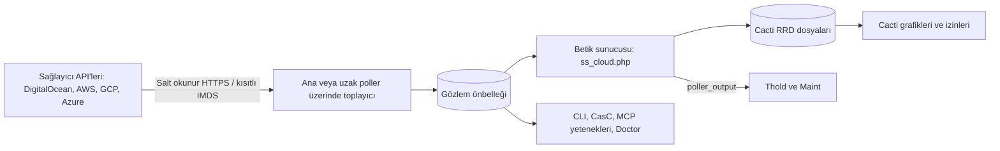

<!-- Source: README.md; SHA256: ac2074a40238686915802803c5efe773f33677f934281e0605e6e87a71a9d27d -->

<!-- translations:start -->
[English](../../../README.md) | [简体中文](../zh-CN/README.md) | [हिन्दी](../hi-IN/README.md) | [Español (España)](../es-ES/README.md) | [Español (Latinoamérica)](../es-419/README.md) | [العربية (السعودية)](../ar-SA/README.md) | [Afrikaans](../af-ZA/README.md) | [አማርኛ](../am-ET/README.md) | [العربية (مصر)](../ar-EG/README.md) | [العربية (المغرب)](../ar-MA/README.md) | [বাংলা](../bn-BD/README.md) | [Bosanski](../bs-BA/README.md) | [Deutsch](../de-DE/README.md) | [فارسی](../fa-IR/README.md) | [Filipino](../fil-PH/README.md) | [Français](../fr-FR/README.md) | [Français (Maroc)](../fr-MA/README.md) | [Français (Sénégal)](../fr-SN/README.md) | [Hausa](../ha-NG/README.md) | [עברית](../he-IL/README.md) | [Hrvatski](../hr-HR/README.md) | [Bahasa Indonesia](../id-ID/README.md) | [Igbo](../ig-NG/README.md) | [Italiano](../it-IT/README.md) | [日本語](../ja-JP/README.md) | [한국어](../ko-KR/README.md) | [Malagasy](../mg-MG/README.md) | [मराठी](../mr-IN/README.md) | [Bahasa Melayu](../ms-MY/README.md) | [Nederlands](../nl-NL/README.md) | [Polski](../pl-PL/README.md) | [Português (Brasil)](../pt-BR/README.md) | [Русский](../ru-RU/README.md) | [Kinyarwanda](../rw-RW/README.md) | [Soomaali](../so-SO/README.md) | [Српски](../sr-RS/README.md) | [Svenska](../sv-SE/README.md) | [Kiswahili](../sw-KE/README.md) | [தமிழ்](../ta-IN/README.md) | [తెలుగు](../te-IN/README.md) | [ไทย](../th-TH/README.md) | [Türkçe](README.md) | [Українська](../uk-UA/README.md) | [اردو](../ur-PK/README.md) | [Tiếng Việt](../vi-VN/README.md) | [isiXhosa](../xh-ZA/README.md) | [Yorùbá](../yo-NG/README.md) | [繁體中文](../zh-TW/README.md) | [isiZulu](../zu-ZA/README.md)
<!-- translations:end -->

# plugin_cloud

Genel bulut sağlayıcılarından kaynakları ve metrikleri sıradan cihazlar, veri kaynakları ve grafikler olarak Cacti'ye aktaran bir Cacti 1.2 eklentisidir. Bulut iş yükleri kendilerini taşıyan ağın yanında, Cacti izinleri altında yer alır; Thold ve Maint bunlar üzerinde uyarı üretir ve uyarıları bastırır. Tek bir eklenti; saf PHP ve salt okunur sağlayıcı sürücüleri aracılığıyla DigitalOcean, Amazon Web Services, Google Cloud ve Microsoft Azure'u kapsar.

> **Durum: geliştirme aşamasında, henüz sürüm yok (`0.1.0-dev`).** Bu dal; DigitalOcean, AWS, Google Cloud ve Azure için saf PHP sürücülerini, uzak veri toplayıcı çoğaltmasını ve salt okunur aracı sağlığını, bir CasC sağlayıcısı ile operatör CLI'ını, MCP yeteneklerini ve Doctor kontrollerini içerir. Dahil edilen Cacti şablonları şu anda DigitalOcean Droplet'lerini ve yük dengeleyicilerini (`templates/cloud_digitalocean.xml`) kapsar; AWS, Google Cloud ve Azure için Cacti şablon paketleri ve DigitalOcean dışındaki canlı hesap doğrulamaları ([sağlayıcı bilgileri](../../research/provider-facts.md)) henüz tamamlanmamıştır. Üretim ortamında çalıştırmayın.

## Desteklenen sağlayıcılar

Her sağlayıcı sürücüsü `Drivers::production()` içinde kayıtlıdır, `Provider::released()` tarafından sunulur ve `ext-openssl` ile akış soketlerini kullanarak hiçbir SDK veya Composer çalışma zamanı bağımlılığı olmadan saf PHP ile çalışır.

| Sağlayıcı | Kapsam alanları | Kimlik bilgisi kaynakları | Kimlik doğrulama | Keşfedilen kaynaklar | Metrik toplama |
|---|---|---|---|---|---|
| DigitalOcean (`digitalocean`) | Yok (belirteç kapsamlı) | `vault`, `file` | Bearer token | `droplet`, `load_balancer` | Hız sınırı paylaşımı farkındalığına sahip `/v2/monitoring/metrics`; Cacti şablonları ve veri sorguları içerir |
| Amazon Web Services (`aws`) | `account_id` (12 haneli), `regions` | `vault`, `file`, `instance` | Saf PHP AWS SigV4 (`AWS4-HMAC-SHA256`), STS `GetCallerIdentity` doğrulaması, isteğe bağlı STS `AssumeRole`, `instance` hesapları için EC2 IMDSv2 (`169.254.169.254`) | `ec2_instance`, `rds_instance`, `aws_elb` (ALB/NLB) | Toplu CloudWatch `GetMetricData` (çağrı başına en fazla 500 sorgu) |
| Google Cloud (`gcp`) | `project` | `vault`, `file`, `instance` | `ext-openssl` aracılığıyla `oauth2.googleapis.com/token` adresinde takas edilen saf PHP RS256 hizmet hesabı JWT'si veya `instance` hesapları için GCE meta veri sunucusu (`metadata.google.internal`) | `instances.aggregatedList` üzerinden `gce_instance` | Cloud Monitoring `timeSeries.list` |
| Microsoft Azure (`azure`) | `tenant`, `subscription`, `regions` | `vault`, `file`, `instance` | Saf PHP Entra ID OAuth2 istemci kimlik bilgileri akışı (yalnızca `client_secret`; sertifika onayları hariç) veya ARM ve Monitor belirteçleri için Azure IMDS (`169.254.169.254`) yönetilen kimliği | ARM Resource Graph üzerinden `azure_vm` (`$skipToken` ile sayfalanmış ve yinelenenlerden arındırılmış) | Azure Monitor `metrics:getBatch` (çağrı başına en fazla 50 kaynak, HTTP 429 ve 529 kısıtlamalarını işler) |

## Uygulanan yetenekler

### Çekirdek platform, kasa ve toplayıcı

- **Korumalı kurulum ve yaşam döngüsü.** Giriş noktaları (`setup.php`, `cli/cloud.php`, `poller_cloud.php`, `ss_cloud.php` ve sayfa betikleri) PHP 8.0'da ayrıştırılır ve Cacti'yi bozmadan PHP 8.2'nin altını veya `ext-openssl` eksikliğini reddeder. Yükseltmeler sıralıdır, eşgüçlüdür (`Schema::VERSION = 3`, 9 tablo) ve kesintilere dayanıklıdır. Kaldırma işlemi, *Keep Plugin Tables on Uninstall* işareti kaldırılmadıkça eklenti tablolarını korur.
- **Hesaplar ve kimlik bilgileri.** **Management > Cloud Accounts** altından hesap ekleyin, düzenleyin, doğrulayın ve silin. Kimlik bilgileri AES-256-GCM şifreli kasadan (`plugin_cloud_secret`, varsayılan olarak `/etc/cacti/cloud-vault.key` ile anahtarlanır), yapılandırılmış *Credential File Directory* içindeki kısıtlı bir dosyadan (`cloud_credential_dir`, dosyaları reddetmek için varsayılan olarak boştur) veya sağlayıcı örnek kimliğinden gelir. Kimlik bilgileri arayüzde yalnızca yazılabilir özelliktedir ve günlüklerden gizlenir.
- **Sıkı giden trafik ve salt okunur denetimleri.** Her sürücü `GuardedTransport` ve `OutboundPolicy` arkasında çalışır: her sağlayıcıya özel kesin ana bilgisayar adlarına HTTPS bağlantı noktası 443, yalnızca `instance` hesapları için etkinleştirilen bağlantı yerel HTTP bağlantı noktası 80 meta veri uç noktaları (`169.254.169.254`, `metadata.google.internal`). Yalnızca izin listesinde yer alan salt okunur işlemlere izin verilir.
- **Toplayıcı ve maliyet denetimleri.** `poller_cloud.php`, `poller_bottom` içinden (Cacti'nin süreç kaydı aracılığıyla poller başına bir süreç) `cloud_collector_budget` dahilinde çalışır, hesap başına kiralamalar alır, `discover_interval` üzerinde keşif yürütür, yalnızca etkin Cacti veri kaynakları (`plugin_cloud_series`) için metrikleri okur, `request_share` ve `monthly_ceiling` değerlerine uyar ve `ss_cloud.php` için en son veri noktalarını `plugin_cloud_observation` içinde önbelleğe alır.
- **Cacti nesneleri ve istek tahminleri.** Hesap başına bir kapsam cihazı (`plugin_cloud_device`) tutar, cihaz kaydetme işlemlerinde kapsam cihazı yeniden dizinleme yöntemlerini korur, DigitalOcean şablonlarını ve betik sunucusu veri sorgularını (`templates/cloud_digitalocean.xml`, `cloud_do_droplet.xml`, `cloud_do_load_balancer.xml`) içe aktarır ve **New Graphs** (`graphs_new_top_links`) ile **Cloud Health** üzerinde istek ve liste fiyatı tahminlerini gösterir.

### Uzak veri toplayıcılar

- `INFO`, `remote_collect:1` bildirir. Hesaplar etkinleştirilmiş herhangi bir Cacti poller'ına (`poller_id >= 1`) atanabilir ve `poller_cloud.php --poller=N` yalnızca o poller'a ait hesapları toplar.
- **`replicate_out` kancası.** `replicate_out_table()` aracılığıyla `plugin_cloud_account`, `plugin_cloud_device`, `plugin_cloud_series` tablolarından poller kapsamlı satırları ve `plugin_cloud_secret` tablosundan şifreli metin satırlarını (yalnızca hedef poller'a ait kasa destekli hesaplar için) çoğaltır. Ham kasa anahtar dosyaları asla veritabanında saklanmaz veya çoğaltılmaz ve her poller üzerinde yerel olarak kalır.
- **`remote_agent` kancası.** Yalnızca tamsayı `poller_id` ve `account_id` parametrelerini kabul eden ve sıfır kimlik bilgisi, dosya yolu veya gizli anahtar döndüren salt okunur bir JSON sağlık özeti (`action=cloud_health`) sunar.

### Ekosistem kancaları (CasC, MCP yetenekleri ve Doctor)

- **CasC sağlayıcısı (`casc_register_providers`).** Belirlenimci saf PHP YAML ve XML dışa aktarma, bildirim doğrulama, fark planlama ve onaylı uygulama özellikleriyle `cloud` sağlayıcısını (şema sürümü `1`) kaydeder. Kasa kimlik bilgileri `vault:account:<name>` başvuruları olarak dışa aktarılır; ham gizli alanlar (`secret`, `secrets`, `token`, `access_token`, `refresh_token`, `password`, `private_key`, `access_key_id`, `secret_access_key`, `session_token`, `client_secret`, `credential`, `credentials`, `vault_key`) reddedilir. Uygulama için kesin bir SHA-256 `--confirm=<PLAN_HASH>` gerekir.
- **MCP / Abilities API (`abilities_register`).** Yönetici olmayan çağrıcılar için Cloud View yetki alanı (`cloud_health.php`) ve Cacti cihaz kapsamıyla sınırlandırılmış, hiçbir kimlik bilgisi, kasa anahtarı veya kimlik bilgisi dosya yolu yaymayan üç kesinlikle salt okunur yetenek kaydeder:
  - `cloud-list-accounts` (isteğe bağlı `provider`, `poller_id`)
  - `cloud-list-resources` (isteğe bağlı `account_id`, `type`, `lifecycle`)
  - `cloud-get-health` (isteğe bağlı `account_id`)
- **Doctor kontrolleri (`doctor_register_checks`).** Hiçbir gizli değer veya anahtar materyali açığa çıkarmayan beş tanılama kontrolü kaydeder:
  - `cloud_schema`: şema sürümü güncelliği
  - `cloud_vault_key`: kasa anahtar dosyasının okunabilirliği, izinleri ve boyutu
  - `cloud_drivers`: yayımlanan tüm sağlayıcılar için üretim sürücüsü kaydı
  - `cloud_accounts_health`: başarısız olmuş, hız kısıtlamasına takılmış veya güncelliğini yitirmiş etkin hesaplar
  - `cloud_poller_intervals`: etkin hesap toplama aralıklarının Cacti'nin poller aralığıyla hizalanması

## CLI

PHP 8.2 veya üzeri ile Cacti kök dizininden çalıştırın:

```sh
# Operator and CasC CLI (options use --key=value form)
php plugins/cloud/cli/cloud.php export [--format=yaml|xml]
php plugins/cloud/cli/cloud.php validate --file=<path> [--format=yaml|xml]
php plugins/cloud/cli/cloud.php plan --file=<path> [--format=yaml|xml]
php plugins/cloud/cli/cloud.php apply --file=<path> --confirm=<PLAN_HASH> [--format=yaml|xml]
php plugins/cloud/cli/cloud.php health [--format=text|json] [--poller=<id>]

# Collector entry point (normally started by poller_bottom)
php plugins/cloud/poller_cloud.php [--poller=N] [--force] [--debug]
```

## Erişim rolleri

| Yetki Alanı | Erişim |
| --- | --- |
| Cloud View | Mevcut izleme sayfaları. |
| Cloud Operator | İzlemeye ek olarak İşlemler sayfası ve kişisel önceliklendirme onayları. |
| Cloud Admin | Operator erişimine ek olarak mevcut yapılandırma ve yönetim eylemleri. |

Yükseltme dosyalarını kopyaladıktan sonra, yetki alanlarını kaydetmek için yönetici olarak Plugins sayfasını açın. **Configuration > Users** veya kullanıcı grupları altında Operator yetki alanını açıkça atayın. Yükseltmeler mevcut View ve Admin yetki alanı kimliklerini ve izinlerini korur. Admin erişimi Operator erişimini, Operator erişimi ise her istekte View erişimini devralır; bu işlem kullanıcılara veya gruplara depolanmış izinler eklemez. Eklenti ayarları ayrıca Cacti'nin Settings iznine ek olarak Cloud Admin erişimi gerektirir.

Cacti cihaz izinleri her kullanıcının erişebileceği satırları ve eylemleri sınırlar; eşlenmemiş nesneler için yönetici gerekir. Operatörler, Cacti cihazına erişebildikleri bir hesap için depolanan kimlik bilgisini doğrulayabilir. Kimlik bilgileri, yapılandırma, eşleme, silme ve diğer yönetim değişiklikleri yönetim sayfalarında kalır. Onaylar yalnızca geçerli kullanıcının oturumunda, en fazla bir saat boyunca ve yalnızca aynı gözlem güncel kaldığı sürece geçerlidir. Yeni veya değişen gözlemler bunları geçersiz kılar. Başarısız bir ölçümü asla sağlıklı olarak işaretlemezler veya uyarıları bastırmazlar.

## Neden

Her bulut sağlayıcısının kendi izleme konsolu vardır. Cacti ile yan yana çalıştırıldıklarında üç boşluk bırakırlar:

- **Ayrı erişim denetimi.** Bir Cacti kullanıcısına bulut metriklerini göstermek, ona bir bulut oturum açma hesabı vermek anlamına gelir.
- **Ağ bağlamı yok.** Kurum içi bağlantılar Cacti'de grafikleştirilir; bunların arkasındaki iş yükleri ise her sağlayıcının kendi konsolunda grafikleştirilir.
- **Ayrı uyarı yönetimi.** Thold ve Maint, Cacti veri kaynakları ve cihazları üzerinde çalışır; bu nedenle sağlayıcı alarmları her sağlayıcı için bir kez ayrı ayrı yapılandırılır ve bastırılır.

Eklenti her sağlayıcının izleme API'sini bir Cacti poller'ı üzerinde okur, en son veri noktalarını önbelleğe alır ve bunları Cacti'nin betik sunucusuna sunar. Cacti'nin poller'ı RRD dosyalarını yazar; böylece grafik oluşturma, izinler, Thold, Maint ve boost diğer tüm Cacti verilerinde olduğu gibi çalışır.

## Tasarım taahhütleri

- **Salt okunur.** Her sürücü yalnızca izin listesinde yer alan sağlayıcı işlemlerini oluşturabilir; eklenti hiçbir zaman bir bulut kaynağını değiştirmez. ([ADR 0002](../../decisions/0002-read-only-with-operation-allowlist.md))
- **Yalnızca PHP, SDK yok.** İmzalama ve belirteç değişimi, Cacti'nin zaten gerektirdiği uzantılarla PHP'de uygulanır. Composer çalışma zamanı bağımlılığı yoktur. ([ADR 0003](../../decisions/0003-php-only-without-sdks.md))
- **Toplamadan önce maliyet.** Eklenti yalnızca Cacti veri kaynağına sahip metrikleri okur, grafikler oluşturulmadan önce beklenen istek sayısını ve liste fiyatı maliyetini gösterir ve aylık bir üst sınır uygular. ([ADR 0005](../../decisions/0005-collect-only-what-is-graphed.md))
- **Veritabanında düz metin kimlik bilgisi yok.** Kimlik bilgileri, veritabanı dışındaki bir dosyayla anahtarlanan şifreli bir kasadan, bir kimlik bilgisi dosyasından veya sağlayıcının örnek kimliğinden gelir. ([ADR 0007](../../decisions/0007-credentials-outside-the-database-in-the-clear.md))

## Kapsam ve durum

| Aşama | Kapsam | Kilometre taşları | Durum |
|---|---|---|---|
| 0, araştırma | Sağlayıcı bilgilerinin doğrulanması, metrik katalogları, maliyet ve hız modeli, imzalama test vektörleri, aktarım denemesi | [M1](https://github.com/somethingwithproof/plugin_cloud/milestone/1) | Canlı sağlayıcı hesapları gerektiren kontroller hariç tamamlandı |
| 1, çekirdek ve DigitalOcean | Hesaplar, kimlik bilgisi kasası, aktarım, toplayıcı, gözlem önbelleği, Cacti nesneleri, şablonlar, istek tahminleri, sağlık sayfası, DigitalOcean Droplet'leri ve yük dengeleyiciler | [M2](https://github.com/somethingwithproof/plugin_cloud/milestone/2), [M3](https://github.com/somethingwithproof/plugin_cloud/milestone/3), [M4](https://github.com/somethingwithproof/plugin_cloud/milestone/4) | Uygulandı; M4 pilot doğrulaması beklemede |
| 2, AWS | Saf PHP SigV4, STS `AssumeRole`, IMDSv2 örnek rolleri, EC2/RDS/ELB envanteri, CloudWatch `GetMetricData` | [M5](https://github.com/somethingwithproof/plugin_cloud/milestone/5) | Sürücü uygulandı; Cacti şablonları ve canlı hesap doğrulaması beklemede |
| 3, Google Cloud | Saf PHP RS256 hizmet hesabı JWT'si, GCE meta veri sunucusu, Compute Engine envanteri, Cloud Monitoring `timeSeries.list` | [M6](https://github.com/somethingwithproof/plugin_cloud/milestone/6) | Sürücü uygulandı; Cacti şablonları ve canlı hesap doğrulaması beklemede |
| 4, Azure | Entra ID istemci kimlik bilgileri, IMDS yönetilen kimliği, ARM Resource Graph VM envanteri, Azure Monitor `metrics:getBatch` | [M7](https://github.com/somethingwithproof/plugin_cloud/milestone/7) | Sürücü uygulandı; Cacti şablonları ve canlı hesap doğrulaması beklemede |
| 5, uzak toplayıcılar ve ekosistem | Uzak veri toplayıcılar (`replicate_out`, `remote_agent`), CasC sağlayıcısı ve CLI, MCP yetenekleri, Doctor kontrolleri | [M8](https://github.com/somethingwithproof/plugin_cloud/milestone/8) | Uygulandı |

Kapsam dışı: bulut kaynaklarını değiştirme, sağlayıcı alarmları oluşturma veya yansıtma, faturalandırma raporları, günlükler ve izler ile eklentiye ait bir uyarı motoru. Diğer sağlayıcılar (Hetzner Cloud, Akamai Cloud, Oracle Cloud ve diğerleri) araştırma konularıdır.

## Kurulum ve yapılandırma

Bu adımlar geliştirme kodunu değerlendirme amacıyla kurar. PHP 8.2 veya üzeri üzerinde Cacti 1.2.31 veya üzerini gerektirirler.

1. Depoyu Cacti dizininizin altında `plugins/cloud` konumuna kopyalayın. Dizinin adı mutlaka `cloud` olmalıdır.
2. Kasa destekli kimlik bilgileri kullanan her poller üzerinde web kök dizininin dışında kasa anahtarını oluşturun. Bunu yalnızca root ve Cacti kullanıcısının yazabileceği bir dizine koyun ve dosyayı yalnızca web sunucusu ile poller'ı çalıştıran kullanıcının okuyabileceği şekilde ayarlayın. Eklenti bu dosyayı asla oluşturmaz veya yazmaz:

   ```sh
   sudo install -d -m 0750 -o root -g cacti /etc/cacti
   head -c 32 /dev/urandom | sudo tee /etc/cacti/cloud-vault.key > /dev/null
   sudo chown cacti:cacti /etc/cacti/cloud-vault.key
   sudo chmod 0600 /etc/cacti/cloud-vault.key
   ```

   `cacti` yerine web sunucunuzu ve poller'ı çalıştıran kullanıcıyı yazın. Dosya 32 ham bayt veya 64 onaltılık karakter içerir. Veritabanıyla birlikte yedekleyin; bu dosya olmadan depolanan kimlik bilgilerinin yeniden girilmesi gerekir.
3. Cacti'de **Configuration > Plugins** sayfasını açın, ardından *Cloud* eklentisini kurun ve etkinleştirin.
4. **Configuration > Settings > Cloud** altında, başka bir yol kullandıysanız *Vault Key File* ayarını yapın, dosya tabanlı kimlik bilgileri kullanmayı planlıyorsanız *Credential File Directory* ayarını yapılandırın ve *Collector Time Budget* değerini (varsayılan 240 saniye) poller aralığının altında tutun.
5. **Configuration > Users** altında kullanıcılara ve gruplara *Cloud Admin*, *Cloud Operator* veya *Cloud View* yetkisi verin. Kurulum yöneticiye Cloud Admin ve Cloud View yetkilerini verir; Cloud Admin zaten Operator erişimini içerdiğinden yöneticinin ayrı bir Operator iznine ihtiyacı yoktur.
6. **Management > Cloud Accounts** altından hesapları ekleyin, ardından uyarılar için **Management > Cloud Health** sayfasını kontrol edin.

## Uyumluluk hedefleri

| Bileşen | Hedef |
|---|---|
| Cacti | 1.2.31 veya üzeri, çekirdek yaması gerektirmez |
| PHP | 8.2 veya üzeri; desteklenmeyen bir çalışma zamanının bozuk bir Cacti arayüzü yerine ret yanıtı alabilmesi için giriş noktaları 8.0 üzerinde ayrıştırılabilir kalır |
| PHP uzantıları | `ext-openssl` (Cacti 1.2.31 tarafından gereklidir); `ext-curl` ve Composer çalışma zamanı bağımlılığı yoktur |
| Thold, Maint | Değişiklik gerekmez |

## Tasarım

- [docs/performance.md](../../performance.md) kullanılan donanım ve ayarlarla birlikte toplayıcı ve sağlık sayfası ölçümlerini içerir.
- [docs/PLAN.md](../../PLAN.md) tam plandır: mimari, dayandığı sağlayıcı ve Cacti bilgileri (kaynaklarıyla birlikte), sürücü sözleşmesi, maliyet aritmetiği, güvenlik sınırları, testler ve riskler.
- [docs/decisions/](../../decisions/) halihazırda yapılmış seçimler için mimari karar kayıtlarını içerir.
- [docs/REQUIREMENTS.md](../../REQUIREMENTS.md) her gereksinim kimliğini ilgili sorunla eşler.



## Çalışmaların takip edilme şekli

- **Kilometre taşları** planın kilometre taşlarını izler. Her birinin alt sorunları ve çıkış kanıtlarını listeleyen bir epik sorunu vardır.
- **Sorunlar** etiketlerle türlerine ayrılır: `type: requirement`, `type: research`, `type: decision`, `type: epic`. Gereksinim sorunları numaralandırılmış, test edilebilir gereksinimleri (`REQ-AREA-NNN`) ve kabul ölçütlerini belirtir.
- **Etiketler** ayrıca `area:`, `provider:`, `phase:`, `priority:` ve `status:` bilgilerini taşır. Bkz. [CONTRIBUTING.md](../../../CONTRIBUTING.md#labels).
- [Proje panosu](https://github.com/users/somethingwithproof/projects/7) tüm kilometre taşlarındaki bütün sorunları gösterir.

## Geliştirme

CI ([.github/workflows/plugin-ci-workflow.yml](../../../.github/workflows/plugin-ci-workflow.yml)); sürüm arşivini ve anlamsal sürümü denetler (`bash tests/bin/archive-check.sh`), giriş noktalarını PHP 8.0 üzerinde sözdizimi denetiminden geçirir, `CLOUD_OFFLINE=1` ile Cacti `release/1.2.31` ve `1.2.x` sürümlerine karşı PHP 8.2'den 8.5'e kadar Pest birim (`phpunit.xml`) ve yaşam döngüsü entegrasyon (`phpunit-integration.xml`) testleri ile PHPStan seviye 9 analizini çalıştırır, PHP 8.1 üzerindeki reddetmeyi doğrular, gettext kataloglarını kontrol eder, 1.000 serilik toplama ve sağlık sayfası performansını ölçer ve iş akışı lint denetimi ile REUSE uyumluluğunu yürütür.

Göndermeden önce yerel kontroller:

```sh
bash tests/bin/archive-check.sh
sh tests/lint-workflows.sh
sh locales/build_gettext.sh --check
CACTI_PATH=/path/to/cacti phpstan analyse -c phpstan.neon --no-progress
```

Birim ve kaynak kuralı testleri için `--configuration=phpunit.xml` ile, veya yaşam döngüsü entegrasyon testleri için tek kullanımlık bir Cacti veritabanına karşı `CACTI_PATH` ve `CLOUD_TEST_DATABASE=disposable` ile `--configuration=phpunit-integration.xml` kullanarak Pest'i çalıştırın.

## Katkıda bulunma

[CONTRIBUTING.md](../../../CONTRIBUTING.md) dosyasını okuyun. Commit'ler DCO imzası gerektirir. Tasarım tartışmaları sorunlar üzerinde yapılır; açık kararlar `type: decision` etiketini taşır.

## Güvenlik

Güvenlik açıklarını gizli olarak bildirin; bkz. [SECURITY.md](../../../SECURITY.md).

## Lisans

Cacti ve eklentileriyle aynı lisans olan GNU General Public License v2.0. Bkz. [LICENSE](../../../LICENSE).
