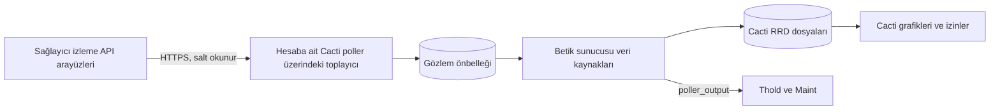

<!-- Source: README.md; SHA256: 7c621642e5f1a46bac66e4bc744f70aebb014c610d22de034088845fdc170405 -->

<!-- translations:start -->
[English](../../../README.md) | [简体中文](../zh-CN/README.md) | [हिन्दी](../hi-IN/README.md) | [Español (España)](../es-ES/README.md) | [Español (Latinoamérica)](../es-419/README.md) | [العربية (السعودية)](../ar-SA/README.md) | [Afrikaans](../af-ZA/README.md) | [አማርኛ](../am-ET/README.md) | [العربية (مصر)](../ar-EG/README.md) | [العربية (المغرب)](../ar-MA/README.md) | [বাংলা](../bn-BD/README.md) | [Bosanski](../bs-BA/README.md) | [Deutsch](../de-DE/README.md) | [فارسی](../fa-IR/README.md) | [Filipino](../fil-PH/README.md) | [Français](../fr-FR/README.md) | [Français (Maroc)](../fr-MA/README.md) | [Français (Sénégal)](../fr-SN/README.md) | [Hausa](../ha-NG/README.md) | [עברית](../he-IL/README.md) | [Hrvatski](../hr-HR/README.md) | [Bahasa Indonesia](../id-ID/README.md) | [Igbo](../ig-NG/README.md) | [Italiano](../it-IT/README.md) | [日本語](../ja-JP/README.md) | [한국어](../ko-KR/README.md) | [Malagasy](../mg-MG/README.md) | [मराठी](../mr-IN/README.md) | [Bahasa Melayu](../ms-MY/README.md) | [Nederlands](../nl-NL/README.md) | [Polski](../pl-PL/README.md) | [Português (Brasil)](../pt-BR/README.md) | [Русский](../ru-RU/README.md) | [Kinyarwanda](../rw-RW/README.md) | [Soomaali](../so-SO/README.md) | [Српски](../sr-RS/README.md) | [Svenska](../sv-SE/README.md) | [Kiswahili](../sw-KE/README.md) | [தமிழ்](../ta-IN/README.md) | [తెలుగు](../te-IN/README.md) | [ไทย](../th-TH/README.md) | [Türkçe](README.md) | [Українська](../uk-UA/README.md) | [اردو](../ur-PK/README.md) | [Tiếng Việt](../vi-VN/README.md) | [isiXhosa](../xh-ZA/README.md) | [Yorùbá](../yo-NG/README.md) | [繁體中文](../zh-TW/README.md) | [isiZulu](../zu-ZA/README.md)
<!-- translations:end -->

# plugin_cloud

Public cloud sağlayıcılarından kaynakları ve metrikleri sıradan cihazlar, veri kaynakları ve grafikler olarak Cacti'ye aktaran bir Cacti 1.2 eklentisidir. Böylece bulut iş yükleri, kendilerini taşıyan ağın yanında, Cacti izinleri altında yer alır; Thold ve Maint bunlar için uyarı üretebilir ve uyarıları bastırabilir. Tek bir eklenti her sağlayıcıyı kapsar ve her sağlayıcı için ayrı bir sürücü içerir: öncelikli olarak DigitalOcean, AWS, Google Cloud ve Azure desteklenir.

> **Durum: 3. kilometre taşı (DigitalOcean ve Cacti nesneleri), inceleme aşamasında.** Bu kilometre taşı; DigitalOcean sürücüsünü, Cacti şablonlarını, her kaynak türü için bir veri sorgusu içeren hesap başına bir kapsam cihazını, betik sunucusu girdisini ve *New Graphs* ile sağlık sayfasında bir istek tahminini ekler. Canlı bir DigitalOcean hesabına yönelik ilk kontroller [sağlayıcı bilgileri](../../research/provider-facts.md) belgesinde kayıtlıdır. Üretim ortamında çalıştırmayın.

## Erişim rolleri

| Yetki Alanı | Erişim |
| --- | --- |
| Cloud View | Mevcut izleme sayfaları. |
| Cloud Operator | İzleme sayfalarına ek olarak Operations sayfası ve kişisel önceliklendirme (triage) onayları. |
| Cloud Admin | Operator erişimine ek olarak mevcut yapılandırma ve yönetim işlemleri. |

Yükseltme dosyalarını kopyaladıktan sonra yeni yetki alanını kaydetmek için yönetici olarak Plugins sayfasını açın. Operator yetki alanını **Configuration > Users** altından veya kullanıcı grupları üzerinden açıkça atayın.
Yükseltmeler mevcut View ve Admin yetki alanı kimliklerini ve yetkilerini korur. Admin erişimi
Operator erişimini, Operator erişimi ise View erişimini her istekte devralır;
bu durum kullanıcılara veya gruplara kalıcı olarak saklanan yeni yetkiler eklemez. Eklenti ayarları ayrıca
Cacti'nin Settings iznine ek olarak Cloud Admin erişimi gerektirir.

Cacti cihaz izinleri her kullanıcının erişebileceği satırları ve işlemleri sınırlamaya devam eder; eşlenmemiş nesneler için yönetici gerekir. Operatörler, Cacti cihazına erişim yetkisine sahip oldukları bir hesabın kayıtlı kimlik bilgisini doğrulayabilir.
Kimlik bilgileri, yapılandırma, eşleme, silme ve diğer yönetim değişiklikleri
yönetim sayfalarında kalır. Onaylar yalnızca mevcut kullanıcının
oturumunda, en fazla bir saat boyunca ve yalnızca aynı gözlem güncelliğini
koruduğu sürece geçerlidir. Yeni veya değişmiş gözlemler bunları geçersiz kılar. Başarısız bir
ölçümü hiçbir zaman sağlıklı olarak işaretlemez veya uyarıları bastırmazlar.

## Neden

Her bulut sağlayıcısının kendi izleme konsolu vardır. Cacti ile birlikte çalıştırıldıklarında üç boşluk ortaya çıkar:

- **Ayrı erişim denetimi.** Bir Cacti kullanıcısına bulut metriklerini göstermek, ona bir bulut oturum açma hesabı vermeyi gerektirir.
- **Ağ bağlamının olmaması.** Şirket içi bağlantılar Cacti'de grafiklenir; arkalarındaki iş yükleri ise her sağlayıcının kendi konsolunda grafiklenir.
- **Ayrı uyarı yönetimi.** Thold ve Maint, Cacti veri kaynakları ve cihazları üzerinde çalışır; bu nedenle sağlayıcı alarmları her sağlayıcı için ayrı ayrı yapılandırılır ve bastırılır.

Eklenti, her sağlayıcının izleme API'sini bir Cacti poller üzerinde okur, en son veri noktalarını önbelleğe alır ve bunları Cacti'nin betik sunucusuna sunar. Cacti'nin poller'ı RRD dosyalarını yazdığından; grafikleme, izinler, Thold, Maint ve boost diğer tüm Cacti verilerinde olduğu gibi çalışır.

## Tasarım taahhütleri

- **Salt okunur.** Her sürücü yalnızca izin listesindeki sağlayıcı işlemlerini oluşturabilir; eklenti hiçbir zaman bir bulut kaynağını değiştirmez. ([ADR 0002](../../decisions/0002-read-only-with-operation-allowlist.md))
- **Yalnızca PHP, SDK yok.** İmzalama ve belirteç (token) değişimi, Cacti'nin halihazırda gerektirdiği eklentilerle PHP içinde uygulanır. Composer çalışma zamanı bağımlılığı yoktur. ([ADR 0003](../../decisions/0003-php-only-without-sdks.md))
- **Toplamadan önce maliyet.** Eklenti yalnızca Cacti veri kaynağına sahip metrikleri okur, grafikler oluşturulmadan önce beklenen istek sayısını ve liste fiyatı maliyetini gösterir ve aylık bir üst sınır uygular. ([ADR 0005](../../decisions/0005-collect-only-what-is-graphed.md))
- **Veritabanında düz metin kimlik bilgisi yok.** Kimlik bilgileri; veritabanı dışındaki bir dosyayla anahtarlanan şifreli bir kasadan, bir kimlik bilgisi dosyasından veya sağlayıcının örnek kimliğinden alınır. ([ADR 0007](../../decisions/0007-credentials-outside-the-database-in-the-clear.md))

## Kapsam ve durum

| Aşama | Kapsam | Kilometre Taşları | Durum |
|---|---|---|---|
| 0, araştırma | Sağlayıcı bilgilerinin doğrulanması, metrik katalogları, maliyet ve hız modeli, imzalama test vektörleri, aktarım denemesi | [M1](https://github.com/somethingwithproof/plugin_cloud/milestone/1) | Canlı sağlayıcı hesabı gerektiren kontroller dışında tamamlandı |
| 1, çekirdek ve DigitalOcean | Hesaplar, kimlik bilgisi kasası, aktarım, toplayıcı, gözlem önbelleği, Cacti nesneleri, sağlık sayfası, DigitalOcean Droplet'ları ve yük dengeleyiciler | [M2](https://github.com/somethingwithproof/plugin_cloud/milestone/2), [M3](https://github.com/somethingwithproof/plugin_cloud/milestone/3), [M4](https://github.com/somethingwithproof/plugin_cloud/milestone/4) | M2 tamamlandı ([#81](https://github.com/somethingwithproof/plugin_cloud/pull/81)); M3 sürücüsü, şablonları ve kapsam cihazları birleştirildi; istek tahminleri, izinler ve performans kontrolleri incelemede; M4 başlamadı |
| 2, AWS | Signature Version 4, `AssumeRole`, örnek rolleri, CloudWatch `GetMetricData`, bölgesel envanter | [M5](https://github.com/somethingwithproof/plugin_cloud/milestone/5) | Başlamadı |
| 3, Google Cloud | Hizmet hesabı JWT, meta veri sunucusu, Cloud Monitoring `timeSeries.list` | [M6](https://github.com/somethingwithproof/plugin_cloud/milestone/6) | Başlamadı |
| 4, Azure | Entra istemci kimlik bilgileri, yönetilen kimlik, Resource Graph, `metrics:getBatch` | [M7](https://github.com/somethingwithproof/plugin_cloud/milestone/7) | Başlamadı |
| 5, uzak toplayıcılar | Cacti uzak veri toplayıcıları üzerindeki hesaplar | [M8](https://github.com/somethingwithproof/plugin_cloud/milestone/8) | Başlamadı |

Kapsam dışı: bulut kaynaklarını değiştirme, sağlayıcı alarmları oluşturma veya yansıtma, faturalandırma raporları, günlükler ve izler ile eklentiye ait bir uyarı motoru. Diğer sağlayıcılar (Hetzner Cloud, Akamai Cloud, Oracle Cloud ve diğerleri) araştırma konularıdır.

## 2. kilometre taşı neleri içeriyor

- **Korumalı kurulum.** PHP 8.2'nin altında veya ext-openssl olmadan kurulum ve etkinleştirme bir mesajla reddedilir ve Cacti'nin geri kalanı çalışmaya devam eder.
- **Yaşam döngüsü.** Cacti'nin Plugins sayfası üzerinden kurulum, yükseltme ve kaldırma. Yükseltmeler sıralıdır ve kesintilere karşı dayanıklıdır. Kaldırma işlemi, *Keep Plugin Tables on Uninstall* seçeneğinin işaretini kaldırmadığınız sürece eklenti tablolarını korur.
- **Ayrı yetki alanları.** *Cloud Admin* **Cloud Accounts** sayfasını açar; *Cloud Operator* **Cloud Operations** sayfasını açar; *Cloud View* **Cloud Health** sayfasını açar. Admin Operator'ı, Operator ise View'ı devralır. Üç sayfa da Management altındadır.
- **Hesaplar ve kimlik bilgileri.** Hesap ekleme, düzenleme, doğrulama ve silme. Bir kimlik bilgisi ya veritabanı dışında tutulan bir anahtar dosyasıyla veritabanında şifrelenir (AES-256-GCM) ya da poller üzerindeki bir dosyadan okunur. Kimlik bilgileri kullanıcı arayüzünde yalnızca yazılabilir niteliktedir ve günlüklerden gizlenir.
- **Toplayıcı.** Her poller çalışmasından başlatılır, poller başına bir örnek çalışır ve belirli bir zaman bütçesi içinde kalır. Hesap başına bir kiralama (lease) alır, keşfi kendi aralığında çalıştırır ve yalnızca eklentinin kendi etkin veri kaynakları için metrik okur.
- **Sağlık.** Hesap bazında toplama, keşif, kaynak ve güncellik durumu ile kullanılamayan bir kasa anahtarı, güvenli olmayan kimlik bilgisi dosyaları ve poller'ın karşılayamadığı aralıklar için uyarılar.

## Kurulum ve yapılandırma

Bu adımlar, değerlendirme amacıyla 2. kilometre taşı kodunu kurar. PHP 8.2 veya üzeri üzerinde Cacti 1.2.31 veya üzeri gerektirir.

1. Depoyu Cacti dizininizin altındaki `plugins/cloud` konumuna kopyalayın. Dizinin adı `cloud` olmalıdır.
2. Kasa anahtarını web kök dizininin dışında oluşturun. Bunu yalnızca root ve Cacti kullanıcısının yazabileceği bir dizine koyun ve dosyayı yalnızca web sunucusunu ve poller'ı çalıştıran kullanıcı tarafından okunabilir yapın. Eklenti bu dosyayı hiçbir zaman oluşturmaz veya yazmaz:

   ```sh
   sudo install -d -m 0750 -o root -g cacti /etc/cacti
   head -c 32 /dev/urandom | sudo tee /etc/cacti/cloud-vault.key > /dev/null
   sudo chown cacti:cacti /etc/cacti/cloud-vault.key
   sudo chmod 0600 /etc/cacti/cloud-vault.key
   ```

   `cacti` yerine web sunucunuzu ve poller'ı çalıştıran kullanıcıyı yazın. Dosya 32 ham bayt veya 64 onaltılık karakter içerir. Veritabanıyla birlikte yedekleyin; bu dosya olmadan, kayıtlı kimlik bilgilerinin yeniden girilmesi gerekir.
3. Cacti'de **Configuration > Plugins** sayfasını açın, ardından *Cloud* eklentisini kurun ve etkinleştirin.
4. Başka bir yol kullandıysanız **Configuration > Settings > Cloud** altında *Vault Key File* ayarını yapın. *Collector Time Budget* (varsayılan 240 saniye), poller aralığının altında kalmalıdır.
5. **Configuration > Users** altında kullanıcılara ve gruplara *Cloud Admin*, *Cloud Operator* veya *Cloud View* yetkilerini verin. Kurulum, yöneticiye Cloud Admin ve Cloud View yetkilerini verir; Cloud Admin, Operator erişimini içerdiğinden yöneticinin ayrı bir Operator yetkisine ihtiyacı yoktur.
6. **Management > Cloud Accounts** altında hesapları ekleyin, ardından uyarılar için **Management > Cloud Health** sayfasını kontrol edin.

## Uyumluluk hedefleri

| Bileşen | Hedef |
|---|---|
| Cacti | 1.2.31 veya üzeri, çekirdek yaması gerekmez |
| PHP | 8.2 veya üzeri; `setup.php`, desteklenmeyen bir çalışma zamanının bozuk bir Cacti arayüzü yerine ret mesajı alması için PHP 8.0'da ayrıştırılabilir kalır |
| PHP eklentileri | Cacti 1.2.31'in gerektirdikleri dışında ek eklenti yok |
| Thold, Maint | Değişiklik gerekmez |

## Tasarım

- [docs/performance.md](../../performance.md), kullanılan donanım ve ayarlarla birlikte toplayıcı ve sağlık sayfası ölçümlerini içerir.
- [docs/PLAN.md](../../PLAN.md) tam plandır: mimari, dayandığı sağlayıcı ve Cacti bilgileri (kaynaklarıyla birlikte), sürücü sözleşmesi, maliyet aritmetiği, güvenlik sınırları, testler ve riskler.
- [docs/decisions/](../../decisions) halihazırda alınmış kararlar için mimari karar kayıtlarını içerir.
- [docs/REQUIREMENTS.md](../../REQUIREMENTS.md) her gereksinim kimliğini ilgili konu kaydıyla eşler.



## Çalışmanın izlenmesi

- **Kilometre taşları**, plandaki kilometre taşlarını takip eder. Her birinin, alt konu kayıtlarını ve çıkış kanıtlarını listeleyen bir epik konu kaydı vardır.
- **Konu kayıtları** etiketlerle türlerine ayrılır: `type: requirement`, `type: research`, `type: decision`, `type: epic`. Gereksinim kayıtları numaralandırılmış, test edilebilir gereksinimleri (`REQ-AREA-NNN`) ve kabul ölçütlerini belirtir.
- **Etiketler** ayrıca `area:`, `provider:`, `phase:`, `priority:` ve `status:` öneklerini taşır. Bkz. [CONTRIBUTING.md](../../../CONTRIBUTING.md#labels).
- [Proje panosu](https://github.com/users/somethingwithproof/projects/7), tüm kilometre taşlarındaki konu kayıtlarını gösterir.

## Geliştirme

CI; giriş noktalarını PHP 8.0 üzerinde lint eder, birim ve tümleştirme testlerini ve PHPStan level 9 analizini çalıştırır ve eklentiyi Cacti 1.2.31 ile 1.2.x dalına karşı PHP 8.2'den 8.5'e kadar sürümlerde kurar. Ayrıca PHP 8.1'in Cacti'yi bozmadan reddedildiğini doğrular. Testler, Cacti çekirdeğinin eklenti test düzeneğinden Pest'i kullanır. Bu seçim, [#12](https://github.com/somethingwithproof/plugin_cloud/issues/12) karara bağlanana kadar geçicidir. [.github/workflows/plugin-ci-workflow.yml](../../../.github/workflows/plugin-ci-workflow.yml) her adımı listeler. Göndermeden önce yerel olarak `sh tests/lint-workflows.sh` ve `sh locales/build_gettext.sh --check` komutlarını çalıştırın.

## Katkıda bulunma

[CONTRIBUTING.md](../../../CONTRIBUTING.md) dosyasını okuyun. Commit'ler DCO imzası (sign-off) gerektirir. Tasarım tartışmaları konu kayıtları üzerinde yapılır; açık kararlar `type: decision` etiketini taşır.

## Güvenlik

Güvenlik açıklarını gizli olarak bildirin; bkz. [SECURITY.md](../../../SECURITY.md).

## Lisans

Cacti ve eklentileriyle aynı lisans olan GNU General Public License v2.0. Bkz. [LICENSE](../../../LICENSE).
