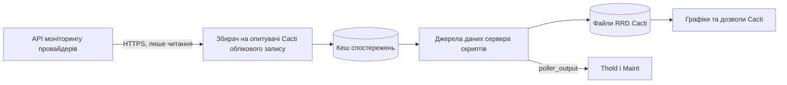

<!-- Source: README.md; SHA256: 7c621642e5f1a46bac66e4bc744f70aebb014c610d22de034088845fdc170405 -->

<!-- translations:start -->
[English](../../../README.md) | [简体中文](../zh-CN/README.md) | [हिन्दी](../hi-IN/README.md) | [Español (España)](../es-ES/README.md) | [Español (Latinoamérica)](../es-419/README.md) | [العربية (السعودية)](../ar-SA/README.md) | [Afrikaans](../af-ZA/README.md) | [አማርኛ](../am-ET/README.md) | [العربية (مصر)](../ar-EG/README.md) | [العربية (المغرب)](../ar-MA/README.md) | [বাংলা](../bn-BD/README.md) | [Bosanski](../bs-BA/README.md) | [Deutsch](../de-DE/README.md) | [فارسی](../fa-IR/README.md) | [Filipino](../fil-PH/README.md) | [Français](../fr-FR/README.md) | [Français (Maroc)](../fr-MA/README.md) | [Français (Sénégal)](../fr-SN/README.md) | [Hausa](../ha-NG/README.md) | [עברית](../he-IL/README.md) | [Hrvatski](../hr-HR/README.md) | [Bahasa Indonesia](../id-ID/README.md) | [Igbo](../ig-NG/README.md) | [Italiano](../it-IT/README.md) | [日本語](../ja-JP/README.md) | [한국어](../ko-KR/README.md) | [Malagasy](../mg-MG/README.md) | [मराठी](../mr-IN/README.md) | [Bahasa Melayu](../ms-MY/README.md) | [Nederlands](../nl-NL/README.md) | [Polski](../pl-PL/README.md) | [Português (Brasil)](../pt-BR/README.md) | [Русский](../ru-RU/README.md) | [Kinyarwanda](../rw-RW/README.md) | [Soomaali](../so-SO/README.md) | [Српски](../sr-RS/README.md) | [Svenska](../sv-SE/README.md) | [Kiswahili](../sw-KE/README.md) | [தமிழ்](../ta-IN/README.md) | [తెలుగు](../te-IN/README.md) | [ไทย](../th-TH/README.md) | [Türkçe](../tr-TR/README.md) | [Українська](README.md) | [اردو](../ur-PK/README.md) | [Tiếng Việt](../vi-VN/README.md) | [isiXhosa](../xh-ZA/README.md) | [Yorùbá](../yo-NG/README.md) | [繁體中文](../zh-TW/README.md) | [isiZulu](../zu-ZA/README.md)
<!-- translations:end -->

# plugin_cloud

Плагін для Cacti 1.2, який додає ресурси та метрики публічних хмарних провайдерів до Cacti як звичайні пристрої, джерела даних і графіки. Хмарні навантаження розташовуються поруч із мережею, що їх обслуговує, під керуванням дозволів Cacti, а Thold і Maint можуть формувати для них сповіщення та приглушувати їх. Один плагін охоплює всіх провайдерів завдяки окремому драйверу для кожного: спершу DigitalOcean, AWS, Google Cloud та Azure.

> **Статус: етап 3 (DigitalOcean та об'єкти Cacti), на перегляді.** Цей етап додає драйвер DigitalOcean, шаблони Cacti, пристрій області дії для кожного облікового запису із запитом даних для кожного типу ресурсів, вхідні дані сервера скриптів, а також оцінку кількості запитів на сторінці «Нові графіки» (New Graphs) і сторінці стану. Початкові перевірки на робочому обліковому записі DigitalOcean зафіксовано у [відомостях про провайдерів](../../research/provider-facts.md). Не використовуйте в продуктивному середовищі.

## Ролі доступу

| Область доступу | Доступ |
| --- | --- |
| Cloud View | Наявні сторінки моніторингу. |
| Cloud Operator | Моніторинг, а також сторінка «Операції» (Operations) й особисті підтвердження під час первинного розбору інцидентів. |
| Cloud Admin | Доступ рівня Operator, а також наявні конфігураційні та адміністративні дії. |

Після копіювання файлів оновлення відкрийте сторінку плагінів із правами адміністратора, щоб зареєструвати
нову область доступу. Призначте область доступу Operator явно в розділі **Конфігурація > Користувачі** або для груп користувачів.
Оновлення зберігають наявні ідентифікатори та права доступу для областей View й Admin. Доступ Admin
успадковує доступ Operator, а доступ Operator успадковує доступ View під час кожного запиту;
це не додає збережених прав користувачам або групам. Налаштування плагіна також вимагають
доступу Cloud Admin на додачу до дозволу Cacti на зміну налаштувань (Settings).

Дозволи на пристрої Cacti все одно обмежують рядки та дії, доступні кожному користувачеві; незіставлені об'єкти потребують участі адміністратора. Оператори можуть перевіряти збережені облікові дані для облікового запису, до пристрою Cacti якого вони мають доступ.
Облікові дані, конфігурація, зіставлення, видалення та інші адміністративні зміни
залишаються на адміністративних сторінках. Підтвердження діють лише в межах поточної
сесії користувача, щонайбільше одну годину й лише доти, доки те саме спостереження залишається
актуальним. Нові або змінені спостереження роблять їх недійсними. Вони ніколи не позначають невдале
вимірювання як справне й не приглушують сповіщення.

## Навіщо це потрібно

Кожен хмарний провайдер має власну консоль моніторингу. За паралельного використання з Cacti виникають три прогалини:

- **Окреме керування доступом.** Щоб показати користувачеві Cacti хмарні метрики, йому доводиться надавати обліковий запис у хмарі.
- **Відсутність мережевого контексту.** Локальні канали зв'язку відображаються на графіках у Cacti, а робочі навантаження за ними — у консолі відповідного провайдера.
- **Окремі сповіщення.** Thold і Maint працюють із джерелами даних і пристроями Cacti, тому тривоги провайдера доводиться налаштовувати та приглушувати окремо — для кожного провайдера.

Плагін опитує API моніторингу кожного провайдера через опитувач Cacti, кешує останні точки даних і передає їх на сервер скриптів Cacti. Опитувач Cacti записує файли RRD, тож побудова графіків, дозволи, Thold, Maint і boost працюють так само, як для будь-яких інших даних Cacti.

## Проєктні зобов'язання

- **Лише читання.** Кожен драйвер може формувати лише операції провайдера зі свого списку дозволених операцій; плагін ніколи не змінює хмарні ресурси. ([ADR 0002](../../decisions/0002-read-only-with-operation-allowlist.md))
- **Лише PHP, без SDK.** Підписання запитів та обмін маркерів реалізовано на PHP із використанням розширень, яких уже вимагає Cacti. Жодних залежностей часу виконання Composer. ([ADR 0003](../../decisions/0003-php-only-without-sdks.md))
- **Оцінка вартості до збору даних.** Плагін зчитує лише ті метрики, які мають джерело даних Cacti, показує очікувану кількість запитів і вартість за прайсом перед створенням графіків та дотримується місячного ліміту. ([ADR 0005](../../decisions/0005-collect-only-what-is-graphed.md))
- **Жодних облікових даних у відкритому вигляді в базі даних.** Облікові дані беруться із зашифрованого сховища, ключ якого міститься у файлі поза базою даних, із файлу облікових даних або з ідентичності екземпляра провайдера. ([ADR 0007](../../decisions/0007-credentials-outside-the-database-in-the-clear.md))

## Межі проєкту та статус

| Фаза | Обсяг робіт | Етапи | Статус |
|---|---|---|---|
| 0, дослідження | Підтвердження фактів про провайдерів, каталоги метрик, модель вартості й обмежень частоти, тестові вектори підписання, дослідницький прототип транспорту | [M1](https://github.com/somethingwithproof/plugin_cloud/milestone/1) | Виконано, крім перевірок, для яких потрібен робочий обліковий запис провайдера |
| 1, ядро та DigitalOcean | Облікові записи, сховище облікових даних, транспорт, збирач, кеш спостережень, об'єкти Cacti, сторінка стану, дроплети й балансувальники навантаження DigitalOcean | [M2](https://github.com/somethingwithproof/plugin_cloud/milestone/2), [M3](https://github.com/somethingwithproof/plugin_cloud/milestone/3), [M4](https://github.com/somethingwithproof/plugin_cloud/milestone/4) | M2 виконано ([#81](https://github.com/somethingwithproof/plugin_cloud/pull/81)); драйвер, шаблони та пристрої області дії M3 змерджено; оцінка запитів, дозволи та перевірки продуктивності на перегляді; M4 ще не розпочато |
| 2, AWS | Signature Version 4, `AssumeRole`, ролі екземплярів, CloudWatch `GetMetricData`, регіональна інвентаризація | [M5](https://github.com/somethingwithproof/plugin_cloud/milestone/5) | Не розпочато |
| 3, Google Cloud | JWT сервісного облікового запису, сервер метаданих, Cloud Monitoring `timeSeries.list` | [M6](https://github.com/somethingwithproof/plugin_cloud/milestone/6) | Не розпочато |
| 4, Azure | Облікові дані клієнта Entra, керована ідентичність, Resource Graph, `metrics:getBatch` | [M7](https://github.com/somethingwithproof/plugin_cloud/milestone/7) | Не розпочато |
| 5, віддалені збирачі | Облікові записи на віддалених опитувачах даних Cacti | [M8](https://github.com/somethingwithproof/plugin_cloud/milestone/8) | Не розпочато |

Поза межами проєкту: зміна хмарних ресурсів, створення або віддзеркалення тривог провайдера, звіти про білінг, журнали й трасування, а також власний рушій сповіщень у плагіні. Інші провайдери (Hetzner Cloud, Akamai Cloud, Oracle Cloud та інші) винесено в дослідницькі завдання.

## Що входить до етапу 2

- **Захищене встановлення.** На PHP версії нижче 8.2 або без ext-openssl встановлення та увімкнення відхиляються з відповідним повідомленням, а решта Cacti продовжує працювати.
- **Життєвий цикл.** Встановлення, оновлення та видалення через сторінку плагінів Cacti. Оновлення виконуються впорядковано та витримують переривання. Видалення зберігає таблиці плагіна, якщо ви не знімете прапорець *Keep Plugin Tables on Uninstall* (Зберігати таблиці плагіна після видалення).
- **Окремі області доступу.** *Cloud Admin* відкриває **Cloud Accounts**; *Cloud Operator* відкриває **Cloud Operations**; *Cloud View* відкриває **Cloud Health**. Admin успадковує Operator, а Operator успадковує View. Усі три сторінки розташовано в розділі «Керування» (Management).
- **Облікові записи та облікові дані.** Додавання, редагування, перевірка та видалення облікових записів. Облікові дані або шифруються в базі даних за допомогою файлу ключа, що зберігається поза нею (AES-256-GCM), або зчитуються з файлу на опитувачі. В інтерфейсі облікові дані доступні лише для запису та вилучаються з журналів.
- **Збирач.** Запускається під час кожного проходу опитувача, по одному екземпляру на опитувач, у межах заданого бюджету часу. Він бере оренду (lease) для кожного облікового запису, запускає виявлення за власним інтервалом і зчитує метрики лише для власних активних джерел даних плагіна.
- **Стан (Health).** Стан збирання даних, виявлення, ресурсів і актуальності даних для кожного облікового запису, а також попередження про непридатний ключ сховища, небезпечні файли облікових даних та інтервали, яких опитувач не може дотримуватися.

## Встановлення та налаштування

Ці кроки встановлюють код етапу 2 для ознайомлення. Вони потребують Cacti 1.2.31 або новішої версії на PHP 8.2 або новішої версії.

1. Скопіюйте репозиторій до `plugins/cloud` у вашому каталозі Cacti. Каталог обов'язково має називатися `cloud`.
2. Створіть ключ сховища поза кореневим каталогом вебсервера. Помістіть його в каталог, куди можуть записувати лише root і користувач Cacti, та зробіть файл доступним для читання лише тому користувачеві, від імені якого працюють вебсервер і опитувач. Плагін ніколи не створює і не змінює цей файл:

   ```sh
   sudo install -d -m 0750 -o root -g cacti /etc/cacti
   head -c 32 /dev/urandom | sudo tee /etc/cacti/cloud-vault.key > /dev/null
   sudo chown cacti:cacti /etc/cacti/cloud-vault.key
   sudo chmod 0600 /etc/cacti/cloud-vault.key
   ```

   Замініть `cacti` на користувача, від імені якого працюють ваш вебсервер і опитувач. Файл містить 32 сирих байти або 64 шістнадцяткові символи. Створюйте його резервну копію разом із базою даних; без нього збережені облікові дані доведеться вводити повторно.
3. У Cacti відкрийте **Конфігурація > Плагіни**, а потім встановіть та увімкніть *Cloud*.
4. У розділі **Конфігурація > Налаштування > Cloud** вкажіть *Vault Key File* (Файл ключа сховища), якщо використовували інший шлях. *Collector Time Budget* (Бюджет часу збирача, типово 240 секунд) має залишатися меншим за інтервал опитувача.
5. Надайте права *Cloud Admin*, *Cloud Operator* або *Cloud View* користувачам і групам у розділі **Конфігурація > Користувачі**. Встановлення автоматично надає Cloud Admin і Cloud View адміністратору; Cloud Admin уже включає доступ Operator, тож адміністратору не потрібне окреме надання прав Operator.
6. Додайте облікові записи в розділі **Керування > Cloud Accounts**, а потім перевірте **Керування > Cloud Health** на наявність попереджень.

## Цільова сумісність

| Компонент | Цільові вимоги |
|---|---|
| Cacti | 1.2.31 або новіша, без патчів ядра |
| PHP | 8.2 або новіша; `setup.php` залишається синтаксично сумісним із 8.0, щоб непідтримуване середовище отримувало відмову замість пошкодження інтерфейсу Cacti |
| Розширення PHP | Жодних додаткових, окрім тих, що вимагає Cacti 1.2.31 |
| Thold, Maint | Зміни не потрібні |

## Проєктування

- [docs/performance.md](../../performance.md) містить вимірювання роботи збирача та сторінки стану із зазначенням використаного обладнання та налаштувань.
- [docs/PLAN.md](../../PLAN.md) — повний план: архітектура, залежні факти про провайдерів і Cacti (із джерелами), контракт драйвера, арифметика вартості, межі безпеки, тестування та ризики.
- [docs/decisions/](../../decisions) містить записи архітектурних рішень (ADR) для вже ухвалених виборів.
- [docs/REQUIREMENTS.md](../../REQUIREMENTS.md) зіставляє кожен ідентифікатор вимоги з відповідним завданням.



## Як відстежується робота

- **Етапи (Milestones)** відповідають етапам плану. Кожен має епік-завдання зі списком підзавдань і доказами завершення.
- **Завдання (Issues)** типізуються за мітками: `type: requirement`, `type: research`, `type: decision`, `type: epic`. Завдання-вимоги визначають нумеровані тестовані вимоги (`REQ-AREA-NNN`) та критерії прийнятності.
- **Мітки** також містять `area:`, `provider:`, `phase:`, `priority:` та `status:`. Див. [CONTRIBUTING.md](../../../CONTRIBUTING.md#labels).
- На [дошці проєкту](https://github.com/users/somethingwithproof/projects/7) відображаються всі завдання за етапами.

## Розробка

CI виконує лінтинг точок входу на PHP 8.0, запускає модульні й інтеграційні тести та PHPStan рівня 9, а також встановлює плагін на PHP 8.2–8.5 із Cacti 1.2.31 та гілкою 1.2.x. Також перевіряється, що PHP 8.1 відхиляється без поломки Cacti. Тести використовують Pest із тестового каркаса плагінів ядра Cacti. Цей вибір є попереднім до ухвалення рішення щодо [#12](https://github.com/somethingwithproof/plugin_cloud/issues/12). Усі кроки перелічено у [.github/workflows/plugin-ci-workflow.yml](../../../.github/workflows/plugin-ci-workflow.yml). Перед відправленням змін локально запускайте `sh tests/lint-workflows.sh` та `sh locales/build_gettext.sh --check`.

## Внесок у проєкт

Ознайомтеся з [CONTRIBUTING.md](../../../CONTRIBUTING.md). Коміти повинні мати підпис DCO (sign-off). Обговорення проєктних рішень відбувається в завданнях; відкриті рішення позначаються міткою `type: decision`.

## Безпека

Повідомляйте про вразливості приватно; див. [SECURITY.md](../../../SECURITY.md).

## Ліцензія

GNU General Public License v2.0 — та сама ліцензія, що й у Cacti та його плагінів. Див. [LICENSE](../../../LICENSE).
