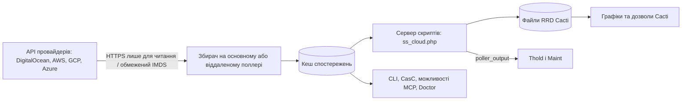

<!-- Source: README.md; SHA256: ac2074a40238686915802803c5efe773f33677f934281e0605e6e87a71a9d27d -->

<!-- translations:start -->
[English](../../../README.md) | [简体中文](../zh-CN/README.md) | [हिन्दी](../hi-IN/README.md) | [Español (España)](../es-ES/README.md) | [Español (Latinoamérica)](../es-419/README.md) | [العربية (السعودية)](../ar-SA/README.md) | [Afrikaans](../af-ZA/README.md) | [አማርኛ](../am-ET/README.md) | [العربية (مصر)](../ar-EG/README.md) | [العربية (المغرب)](../ar-MA/README.md) | [বাংলা](../bn-BD/README.md) | [Bosanski](../bs-BA/README.md) | [Deutsch](../de-DE/README.md) | [فارسی](../fa-IR/README.md) | [Filipino](../fil-PH/README.md) | [Français](../fr-FR/README.md) | [Français (Maroc)](../fr-MA/README.md) | [Français (Sénégal)](../fr-SN/README.md) | [Hausa](../ha-NG/README.md) | [עברית](../he-IL/README.md) | [Hrvatski](../hr-HR/README.md) | [Bahasa Indonesia](../id-ID/README.md) | [Igbo](../ig-NG/README.md) | [Italiano](../it-IT/README.md) | [日本語](../ja-JP/README.md) | [한국어](../ko-KR/README.md) | [Malagasy](../mg-MG/README.md) | [मराठी](../mr-IN/README.md) | [Bahasa Melayu](../ms-MY/README.md) | [Nederlands](../nl-NL/README.md) | [Polski](../pl-PL/README.md) | [Português (Brasil)](../pt-BR/README.md) | [Русский](../ru-RU/README.md) | [Kinyarwanda](../rw-RW/README.md) | [Soomaali](../so-SO/README.md) | [Српски](../sr-RS/README.md) | [Svenska](../sv-SE/README.md) | [Kiswahili](../sw-KE/README.md) | [தமிழ்](../ta-IN/README.md) | [తెలుగు](../te-IN/README.md) | [ไทย](../th-TH/README.md) | [Türkçe](../tr-TR/README.md) | [Українська](README.md) | [اردو](../ur-PK/README.md) | [Tiếng Việt](../vi-VN/README.md) | [isiXhosa](../xh-ZA/README.md) | [Yorùbá](../yo-NG/README.md) | [繁體中文](../zh-TW/README.md) | [isiZulu](../zu-ZA/README.md)
<!-- translations:end -->

# plugin_cloud

Плагін для Cacti 1.2, який додає ресурси та метрики публічних хмарних провайдерів до Cacti як звичайні пристрої, джерела даних і графіки. Хмарні навантаження розташовуються поруч із мережею, що їх обслуговує, під керуванням дозволів Cacti, а Thold і Maint формують для них сповіщення та приглушують їх. Один плагін охоплює DigitalOcean, Amazon Web Services, Google Cloud та Microsoft Azure за допомогою суто PHP-драйверів у режимі лише для читання.

> **Статус: у розробці, релізу ще немає (`0.1.0-dev`).** Ця гілка реалізує суто PHP-драйвери для DigitalOcean, AWS, Google Cloud і Azure, реплікацію віддалених збирачів даних та стан агента лише для читання, провайдера CasC і CLI оператора, можливості MCP та перевірки Doctor. Надані шаблони Cacti наразі охоплюють DigitalOcean Droplets та балансувальники навантаження (`templates/cloud_digitalocean.xml`); пакети шаблонів Cacti для AWS, Google Cloud і Azure, а також кваліфікація на реальних облікових записах поза DigitalOcean ([відомості про провайдерів](../../research/provider-facts.md)) ще не завершені. Не використовуйте в продуктивному середовищі.

## Підтримувані провайдери

Кожен драйвер провайдера зареєстровано в `Drivers::production()`, надано через `Provider::released()` і реалізовано на чистому PHP з використанням `ext-openssl` та потокових сокетів без жодних SDK чи залежностей виконання Composer.

| Провайдер | Поля області дії | Джерела облікових даних | Автентифікація | Виявлені ресурси | Збір метрик |
|---|---|---|---|---|---|
| DigitalOcean (`digitalocean`) | Немає (область дії токена) | `vault`, `file` | Bearer token | `droplet`, `load_balancer` | `/v2/monitoring/metrics` з урахуванням частки ліміту запитів; містить шаблони Cacti та запити даних |
| Amazon Web Services (`aws`) | `account_id` (12 цифр), `regions` | `vault`, `file`, `instance` | Чистий PHP AWS SigV4 (`AWS4-HMAC-SHA256`), перевірка STS `GetCallerIdentity`, необов'язковий STS `AssumeRole`, EC2 IMDSv2 (`169.254.169.254`) для облікових записів `instance` | `ec2_instance`, `rds_instance`, `aws_elb` (ALB/NLB) | Пакетний CloudWatch `GetMetricData` (до 500 запитів за виклик) |
| Google Cloud (`gcp`) | `project` | `vault`, `file`, `instance` | Чистий PHP RS256 JWT сервісного облікового запису через `ext-openssl`, що обмінюється на `oauth2.googleapis.com/token`, або сервер метаданих GCE (`metadata.google.internal`) для облікових записів `instance` | `gce_instance` через `instances.aggregatedList` | Cloud Monitoring `timeSeries.list` |
| Microsoft Azure (`azure`) | `tenant`, `subscription`, `regions` | `vault`, `file`, `instance` | Чистий PHP потік облікових даних клієнта Entra ID OAuth2 (лише `client_secret`; твердження сертифікатів виключено) або керована ідентичність Azure IMDS (`169.254.169.254`) для токенів ARM і Monitor | `azure_vm` через ARM Resource Graph (з розбиттям на сторінки через `$skipToken` і дедуплікацією) | Azure Monitor `metrics:getBatch` (до 50 ресурсів за виклик, з обробкою обмеження швидкості HTTP 429 та 529) |

## Реалізовані можливості

### Базова платформа, сховище секретів і збирач

- **Захищене встановлення та життєвий цикл.** Точки входу (`setup.php`, `cli/cloud.php`, `poller_cloud.php`, `ss_cloud.php` і скриптові сторінки) розбираються на PHP 8.0 і відмовляють у роботі на PHP нижче 8.2 або без `ext-openssl` без порушення роботи Cacti. Оновлення впорядковані, ідемпотентні (`Schema::VERSION = 3`, 9 таблиць) і стійкі до переривань. Видалення зберігає таблиці плагіна, якщо не знято прапорець *Keep Plugin Tables on Uninstall*.
- **Облікові записи та облікові дані.** Додавайте, редагуйте, перевіряйте та видаляйте облікові записи в розділі **Management > Cloud Accounts**. Облікові дані надходять із зашифрованого сховища AES-256-GCM (`plugin_cloud_secret`, за замовчуванням із ключем `/etc/cacti/cloud-vault.key`), із файлу, обмеженого в межах налаштованого каталогу *Credential File Directory* (`cloud_credential_dir`, за замовчуванням порожнього для заборони файлів), або з ідентичності екземпляра провайдера. Облікові дані в інтерфейсі доступні лише для запису та приховуються в журналах.
- **Суворий контроль вихідного трафіку та режиму лише для читання.** Кожен драйвер працює за `GuardedTransport` і `OutboundPolicy`: порт HTTPS 443 до точних імен хостів кожного провайдера, а локальні для каналу кінцеві точки метаданих HTTP порт 80 (`169.254.169.254`, `metadata.google.internal`) вмикаються лише для облікових записів `instance`. Дозволено виключно операції лише для читання зі списку дозволених.
- **Збирач і контроль витрат.** `poller_cloud.php` запускається з `poller_bottom` (один процес на поллер через реєстр процесів Cacti) у межах `cloud_collector_budget`, отримує оренди на рівні облікового запису, виконує виявлення за `discover_interval`, зчитує метрики лише для активних джерел даних Cacti (`plugin_cloud_series`), дотримується `request_share` і `monthly_ceiling` та кешує останні точки даних у `plugin_cloud_observation` для `ss_cloud.php`.
- **Об'єкти Cacti та оцінка запитів.** Підтримує пристрій області дії для кожного облікового запису (`plugin_cloud_device`), зберігає методи переіндексації пристрою області дії під час збереження пристроїв, імпортує шаблони DigitalOcean та запити даних сервера скриптів (`templates/cloud_digitalocean.xml`, `cloud_do_droplet.xml`, `cloud_do_load_balancer.xml`), а також показує оцінку запитів і прейскурантної вартості на сторінках **New Graphs** (`graphs_new_top_links`) та **Cloud Health**.

### Віддалені збирачі даних

- `INFO` оголошує `remote_collect:1`. Облікові записи можна призначити будь-якому увімкненому поллеру Cacti (`poller_id >= 1`), і `poller_cloud.php --poller=N` збирає лише облікові записи, що належать цьому поллеру.
- **Хук `replicate_out`.** Реплікує рядки, прив'язані до поллера, з `plugin_cloud_account`, `plugin_cloud_device`, `plugin_cloud_series` та зашифровані рядки з `plugin_cloud_secret` (лише для облікових записів зі сховищем секретів, що належать цільовому поллеру) через `replicate_out_table()`. Файли сирого ключа сховища ніколи не зберігаються в базі даних і не реплікуються, залишаючись локальними на кожному поллері.
- **Хук `remote_agent`.** Надає зведення стану в JSON лише для читання (`action=cloud_health`), яке приймає лише цілочисельні параметри `poller_id` та `account_id` і не повертає жодних облікових даних, шляхів до файлів чи секретів.

### Хуки екосистеми (CasC, можливості MCP та Doctor)

- **Провайдер CasC (`casc_register_providers`).** Реєструє провайдера `cloud` (версія схеми `1`) з детермінованим експортом у YAML та XML на чистому PHP, перевіркою маніфесту, плануванням різниці та підтвердженим застосуванням. Облікові дані сховища експортуються як посилання `vault:account:<name>`; сирі поля секретів (`secret`, `secrets`, `token`, `access_token`, `refresh_token`, `password`, `private_key`, `access_key_id`, `secret_access_key`, `session_token`, `client_secret`, `credential`, `credentials`, `vault_key`) відхиляються. Для застосування потрібен точний SHA-256 `--confirm=<PLAN_HASH>`.
- **MCP / Abilities API (`abilities_register`).** Реєструє три суворо доступні лише для читання можливості, обмежені областю доступу Cloud View (`cloud_health.php`) та областю пристроїв Cacti для користувачів без прав адміністратора, які не видають жодних облікових даних, ключів сховища чи шляхів до файлів облікових даних:
  - `cloud-list-accounts` (необов'язкові `provider`, `poller_id`)
  - `cloud-list-resources` (необов'язкові `account_id`, `type`, `lifecycle`)
  - `cloud-get-health` (необов'язковий `account_id`)
- **Перевірки Doctor (`doctor_register_checks`).** Реєструє п'ять діагностичних перевірок, які не розкривають значень секретів або ключового матеріалу:
  - `cloud_schema`: актуальність версії схеми
  - `cloud_vault_key`: придатність до читання, права доступу та розмір файлу ключа сховища
  - `cloud_drivers`: реєстрація продуктивних драйверів для всіх випущених провайдерів
  - `cloud_accounts_health`: увімкнені облікові записи з помилками, обмеженням швидкості або застарілими даними
  - `cloud_poller_intervals`: узгодженість інтервалів збору увімкнених облікових записів з інтервалом поллера Cacti

## CLI

Запускайте з кореневого каталогу Cacti на PHP 8.2 або новішої версії:

```sh
# Operator and CasC CLI (options use --key=value form)
php plugins/cloud/cli/cloud.php export [--format=yaml|xml]
php plugins/cloud/cli/cloud.php validate --file=<path> [--format=yaml|xml]
php plugins/cloud/cli/cloud.php plan --file=<path> [--format=yaml|xml]
php plugins/cloud/cli/cloud.php apply --file=<path> --confirm=<PLAN_HASH> [--format=yaml|xml]
php plugins/cloud/cli/cloud.php health [--format=text|json] [--poller=<id>]

# Collector entry point (normally started by poller_bottom)
php plugins/cloud/poller_cloud.php [--poller=N] [--force] [--debug]
```

## Ролі доступу

| Область доступу | Доступ |
| --- | --- |
| Cloud View | Наявні сторінки моніторингу. |
| Cloud Operator | Моніторинг, а також сторінка операцій і персональні підтвердження опрацювання інцидентів. |
| Cloud Admin | Доступ Operator, а також наявні дії з налаштування та адміністрування. |

Після копіювання файлів оновлення відкрийте сторінку Plugins як адміністратор, щоб зареєструвати області доступу. Призначте область доступу Operator явно в розділі **Configuration > Users** або для груп користувачів. Оновлення зберігають наявні ідентифікатори та призначення областей доступу View і Admin. Доступ Admin успадковує доступ Operator, а доступ Operator успадковує доступ View під час кожного запиту; це не додає збережених прав користувачам чи групам. Налаштування плагіна також вимагають доступу Cloud Admin на додачу до дозволу Settings у Cacti.

Дозволи на пристрої Cacti обмежують рядки та дії, доступні кожному користувачеві; для незіставлених об'єктів потрібен адміністратор. Оператори можуть перевіряти збережені облікові дані для облікового запису, до пристрою Cacti якого вони мають доступ. Облікові дані, конфігурація, зіставлення, видалення та інші адміністративні зміни залишаються на сторінках адміністрування. Підтвердження діють лише в поточному сеансі користувача, щонайбільше одну годину і лише доти, доки те саме спостереження залишається свіжим. Нові або змінені спостереження роблять їх недійсними. Вони ніколи не позначають невдале вимірювання як справне та не приглушують сповіщення.

## Навіщо це потрібно

Кожен хмарний провайдер має власну консоль моніторингу. Працюючи поруч із Cacti, вони залишають три прогалини:

- **Окреме керування доступом.** Щоб показати користувачеві Cacti хмарні метрики, потрібно видати йому обліковий запис у хмарі.
- **Немає мережевого контексту.** Локальні канали відображаються на графіках у Cacti, а навантаження за ними будуються на графіках у консолі кожного провайдера.
- **Окреме сповіщення.** Thold і Maint працюють із джерелами даних і пристроями Cacti, тому тривоги провайдера доводиться налаштовувати та приглушувати окремо, для кожного провайдера.

Плагін опитує API моніторингу кожного провайдера на поллері Cacti, кешує останні точки даних і передає їх серверу скриптів Cacti. Поллер Cacti записує файли RRD, тож побудова графіків, дозволи, Thold, Maint і boost працюють так само, як і для будь-яких інших даних Cacti.

## Принципи проєктування

- **Лише для читання.** Кожен драйвер може формувати лише ті операції провайдера, які є в його списку дозволених; плагін ніколи не змінює хмарний ресурс. ([ADR 0002](../../decisions/0002-read-only-with-operation-allowlist.md))
- **Лише PHP, без SDK.** Підпис і обмін токенами реалізовані на PHP з використанням розширень, яких уже потребує Cacti. Без залежностей виконання Composer. ([ADR 0003](../../decisions/0003-php-only-without-sdks.md))
- **Оцінка вартості до збору даних.** Плагін зчитує лише метрики, що мають джерело даних Cacti, показує очікувану кількість запитів і прейскурантну вартість до створення графіків і забезпечує дотримання місячного ліміту. ([ADR 0005](../../decisions/0005-collect-only-what-is-graphed.md))
- **Жодних відкритих облікових даних у базі даних.** Облікові дані надходять із зашифрованого сховища з ключем у файлі поза базою даних, із файлу облікових даних або з ідентичності екземпляра провайдера. ([ADR 0007](../../decisions/0007-credentials-outside-the-database-in-the-clear.md))

## Обсяг і статус

| Фаза | Обсяг | Етапи | Статус |
|---|---|---|---|
| 0, дослідження | Підтвердження відомостей про провайдерів, каталоги метрик, модель вартості та обмежень, тестові вектори підпису, прототип транспорту | [M1](https://github.com/somethingwithproof/plugin_cloud/milestone/1) | Виконано, крім перевірок, які потребують реальних облікових записів провайдерів |
| 1, ядро та DigitalOcean | Облікові записи, сховище облікових даних, транспорт, збирач, кеш спостережень, об'єкти Cacti, шаблони, оцінка запитів, сторінка стану, DigitalOcean Droplets та балансувальники навантаження | [M2](https://github.com/somethingwithproof/plugin_cloud/milestone/2), [M3](https://github.com/somethingwithproof/plugin_cloud/milestone/3), [M4](https://github.com/somethingwithproof/plugin_cloud/milestone/4) | Реалізовано; пілотна кваліфікація M4 очікує |
| 2, AWS | Чистий PHP SigV4, STS `AssumeRole`, ролі екземпляра IMDSv2, інвентаризація EC2/RDS/ELB, CloudWatch `GetMetricData` | [M5](https://github.com/somethingwithproof/plugin_cloud/milestone/5) | Драйвер реалізовано; шаблони Cacti та кваліфікація на реальному обліковому записі очікують |
| 3, Google Cloud | Чистий PHP RS256 JWT сервісного облікового запису, сервер метаданих GCE, інвентаризація Compute Engine, Cloud Monitoring `timeSeries.list` | [M6](https://github.com/somethingwithproof/plugin_cloud/milestone/6) | Драйвер реалізовано; шаблони Cacti та кваліфікація на реальному обліковому записі очікують |
| 4, Azure | Облікові дані клієнта Entra ID, керована ідентичність IMDS, інвентаризація VM через ARM Resource Graph, Azure Monitor `metrics:getBatch` | [M7](https://github.com/somethingwithproof/plugin_cloud/milestone/7) | Драйвер реалізовано; шаблони Cacti та кваліфікація на реальному обліковому записі очікують |
| 5, віддалені збирачі та екосистема | Віддалені збирачі даних (`replicate_out`, `remote_agent`), провайдер CasC і CLI, можливості MCP, перевірки Doctor | [M8](https://github.com/somethingwithproof/plugin_cloud/milestone/8) | Реалізовано |

Поза обсягом: зміна хмарних ресурсів, створення або дублювання тривог провайдера, звіти про оплату, журнали та трасування, а також власний рушій сповіщень плагіна. Додаткові провайдери (Hetzner Cloud, Akamai Cloud, Oracle Cloud та інші) оформлені як дослідницькі завдання.

## Встановлення та налаштування

Ці кроки встановлюють код розробки для ознайомлення. Вони вимагають Cacti 1.2.31 або новішої версії на PHP 8.2 або новішої версії.

1. Скопіюйте репозиторій до `plugins/cloud` у вашому каталозі Cacti. Каталог обов'язково має називатися `cloud`.
2. Створіть ключ сховища поза коренем вебсервера на кожному поллері, що використовує облікові дані зі сховища. Розмістіть його в каталозі, куди можуть записувати лише root і користувач Cacti, та зробіть файл доступним для читання лише тому користувачеві, під яким працюють вебсервер і поллер. Плагін ніколи не створює та не змінює цей файл:

   ```sh
   sudo install -d -m 0750 -o root -g cacti /etc/cacti
   head -c 32 /dev/urandom | sudo tee /etc/cacti/cloud-vault.key > /dev/null
   sudo chown cacti:cacti /etc/cacti/cloud-vault.key
   sudo chmod 0600 /etc/cacti/cloud-vault.key
   ```

   Замініть `cacti` на користувача, під яким працюють ваш вебсервер і поллер. Файл містить 32 сирі байти або 64 шістнадцяткові символи. Зберігайте його резервну копію разом із базою даних; без нього збережені облікові дані доведеться вводити повторно.
3. У Cacti відкрийте **Configuration > Plugins**, потім встановіть і увімкніть *Cloud*.
4. У розділі **Configuration > Settings > Cloud** вкажіть *Vault Key File*, якщо ви використали інший шлях, налаштуйте *Credential File Directory*, якщо плануєте використовувати файлові облікові дані, та тримайте *Collector Time Budget* (за замовчуванням 240 секунд) меншим за інтервал поллера.
5. Надайте користувачам і групам права *Cloud Admin*, *Cloud Operator* або *Cloud View* у розділі **Configuration > Users**. Встановлення надає адміністратору Cloud Admin і Cloud View; Cloud Admin включає доступ Operator, тому адміністратору не потрібне окреме призначення Operator.
6. Додайте облікові записи в розділі **Management > Cloud Accounts**, а потім перевірте **Management > Cloud Health** на наявність попереджень.

## Цілі сумісності

| Компонент | Ціль |
|---|---|
| Cacti | 1.2.31 або новіша, без патчів ядра |
| PHP | 8.2 або новіша; точки входу залишаються придатними для розбору на 8.0, щоб непідтримуване середовище отримувало відмову замість зламаного інтерфейсу Cacti |
| Розширення PHP | `ext-openssl` (потрібне для Cacti 1.2.31); без `ext-curl` і без залежностей виконання Composer |
| Thold, Maint | Зміни не потрібні |

## Архітектура

- [docs/performance.md](../../performance.md) містить вимірювання продуктивності збирача та сторінки стану разом з описом використаного обладнання та налаштувань.
- [docs/PLAN.md](../../PLAN.md) містить повний план: архітектуру, факти про провайдерів і Cacti, на які вона спирається (із джерелами), контракт драйвера, розрахунок вартості, межі безпеки, тестування та ризики.
- [docs/decisions/](../../decisions/) містить записи архітектурних рішень для вже зроблених виборів.
- [docs/REQUIREMENTS.md](../../REQUIREMENTS.md) пов'язує кожен ідентифікатор вимоги з відповідним завданням.



## Як відстежується робота

- **Етапи** відповідають етапам плану. Кожен має епік-завдання з переліком підзавдань і доказів завершення.
- **Завдання** класифікуються мітками: `type: requirement`, `type: research`, `type: decision`, `type: epic`. Завдання вимог визначають нумеровані вимоги, які можна перевірити (`REQ-AREA-NNN`), та критерії прийняття.
- **Мітки** також позначають `area:`, `provider:`, `phase:`, `priority:` та `status:`. Див. [CONTRIBUTING.md](../../../CONTRIBUTING.md#labels).
- [Дошка проєкту](https://github.com/users/somethingwithproof/projects/7) показує всі завдання за всіма етапами.

## Розробка

CI ([.github/workflows/plugin-ci-workflow.yml](../../../.github/workflows/plugin-ci-workflow.yml)) перевіряє архів релізу та семантичну версію (`bash tests/bin/archive-check.sh`), виконує лінтинг точок входу на PHP 8.0, запускає модульні тести Pest (`phpunit.xml`), інтеграційні тести життєвого циклу (`phpunit-integration.xml`) та PHPStan рівня 9 на PHP 8.2 до 8.5 проти Cacti `release/1.2.31` і `1.2.x` із `CLOUD_OFFLINE=1`, перевіряє відмову на PHP 8.1, верифікує каталоги gettext, вимірює продуктивність збору 1000 серій і сторінки стану та виконує лінтинг робочих процесів і перевірку відповідності REUSE.

Локальні перевірки перед надсиланням змін:

```sh
bash tests/bin/archive-check.sh
sh tests/lint-workflows.sh
sh locales/build_gettext.sh --check
CACTI_PATH=/path/to/cacti phpstan analyse -c phpstan.neon --no-progress
```

Запускайте Pest із `--configuration=phpunit.xml` для модульних тестів і тестів правил вихідного коду, або з `--configuration=phpunit-integration.xml` із `CACTI_PATH` та `CLOUD_TEST_DATABASE=disposable` проти одноразової бази даних Cacti для інтеграційних тестів життєвого циклу.

## Внесок у проєкт

Прочитайте [CONTRIBUTING.md](../../../CONTRIBUTING.md). Коміти потребують підпису DCO. Обговорення дизайну відбувається в завданнях; відкриті рішення позначаються міткою `type: decision`.

## Безпека

Повідомляйте про вразливості приватно; див. [SECURITY.md](../../../SECURITY.md).

## Ліцензія

GNU General Public License v2.0, та сама ліцензія, що й у Cacti та його плагінів. Див. [LICENSE](../../../LICENSE).
