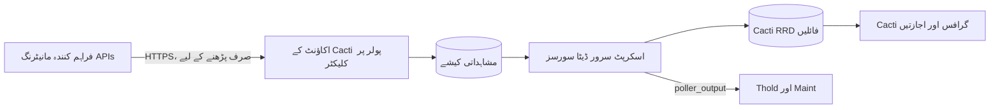

<!-- Source: README.md; SHA256: 7c621642e5f1a46bac66e4bc744f70aebb014c610d22de034088845fdc170405 -->

<!-- translations:start -->
[English](../../../README.md) | [简体中文](../zh-CN/README.md) | [हिन्दी](../hi-IN/README.md) | [Español (España)](../es-ES/README.md) | [Español (Latinoamérica)](../es-419/README.md) | [العربية (السعودية)](../ar-SA/README.md) | [Afrikaans](../af-ZA/README.md) | [አማርኛ](../am-ET/README.md) | [العربية (مصر)](../ar-EG/README.md) | [العربية (المغرب)](../ar-MA/README.md) | [বাংলা](../bn-BD/README.md) | [Bosanski](../bs-BA/README.md) | [Deutsch](../de-DE/README.md) | [فارسی](../fa-IR/README.md) | [Filipino](../fil-PH/README.md) | [Français](../fr-FR/README.md) | [Français (Maroc)](../fr-MA/README.md) | [Français (Sénégal)](../fr-SN/README.md) | [Hausa](../ha-NG/README.md) | [עברית](../he-IL/README.md) | [Hrvatski](../hr-HR/README.md) | [Bahasa Indonesia](../id-ID/README.md) | [Igbo](../ig-NG/README.md) | [Italiano](../it-IT/README.md) | [日本語](../ja-JP/README.md) | [한국어](../ko-KR/README.md) | [Malagasy](../mg-MG/README.md) | [मराठी](../mr-IN/README.md) | [Bahasa Melayu](../ms-MY/README.md) | [Nederlands](../nl-NL/README.md) | [Polski](../pl-PL/README.md) | [Português (Brasil)](../pt-BR/README.md) | [Русский](../ru-RU/README.md) | [Kinyarwanda](../rw-RW/README.md) | [Soomaali](../so-SO/README.md) | [Српски](../sr-RS/README.md) | [Svenska](../sv-SE/README.md) | [Kiswahili](../sw-KE/README.md) | [தமிழ்](../ta-IN/README.md) | [తెలుగు](../te-IN/README.md) | [ไทย](../th-TH/README.md) | [Türkçe](../tr-TR/README.md) | [Українська](../uk-UA/README.md) | [اردو](README.md) | [Tiếng Việt](../vi-VN/README.md) | [isiXhosa](../xh-ZA/README.md) | [Yorùbá](../yo-NG/README.md) | [繁體中文](../zh-TW/README.md) | [isiZulu](../zu-ZA/README.md)
<!-- translations:end -->

# plugin_cloud

Cacti 1.2 کا ایک پلگ ان جو پبلک کلاؤڈ فراہم کنندگان کے وسائل اور میٹرکس کو Cacti میں عام ڈیوائسز، ڈیٹا سورسز، اور گرافس کے طور پر لاتا ہے۔ اس سے کلاؤڈ ورک لوڈز اس نیٹ ورک کے ساتھ آ جاتے ہیں جو انہیں چلاتا ہے، Cacti کی اجازتوں کے تحت، اور Thold اور Maint ان پر الرٹ جاری کر سکتے ہیں اور انہیں دبا سکتے ہیں۔ ایک ہی پلگ ان ہر فراہم کنندہ کا احاطہ کرتا ہے، جس میں ہر فراہم کنندہ کے لیے ایک ڈرائیور ہوتا ہے: سب سے پہلے DigitalOcean، AWS، Google Cloud، اور Azure۔

> **حیثیت: مائل اسٹون 3 (DigitalOcean اور Cacti آبجیکٹس)، زیرِ جائزہ۔** یہ مائل اسٹون DigitalOcean ڈرائیور، Cacti ٹیمپلیٹس، فی اکاؤنٹ ایک اسکوپ ڈیوائس جس میں فی ریسورس قسم ایک ڈیٹا کوئیری ہو، اسکرپٹ سرور ان پٹ، اور New Graphs اور ہیلتھ پیج پر درخواستوں کا تخمینہ شامل کرتا ہے۔ ایک لائیو DigitalOcean اکاؤنٹ کے خلاف ابتدائی جانچ [فراہم کنندہ کے حقائق](../../research/provider-facts.md) میں درج ہے۔ اسے پروڈکشن میں نہ چلائیں۔

## رسائی کے کردار

| دائرہ اختیار | رسائی |
| --- | --- |
| Cloud View | موجودہ مانیٹرنگ صفحات۔ |
| Cloud Operator | مانیٹرنگ کے ساتھ Operations کا صفحہ اور ذاتی ٹرائیج توثیقات۔ |
| Cloud Admin | Operator کی رسائی کے ساتھ موجودہ کنفیگریشن اور انتظامی اقدامات۔ |

اپ گریڈ فائلیں کاپی کرنے کے بعد، نیا دائرہ اختیار رجسٹر کرنے کے لیے بطور ایڈمنسٹریٹر Plugins کا صفحہ کھولیں۔
Operator کا دائرہ اختیار واضح طور پر **Configuration > Users** یا صارف گروپس کے تحت تفویض کریں۔
اپ گریڈز موجودہ View اور Admin دائرہ اختیار کی IDs اور اجازتیں برقرار رکھتے ہیں۔ ہر درخواست پر Admin رسائی
Operator رسائی کو وراثت میں لیتی ہے، اور Operator رسائی View رسائی کو وراثت میں لیتی ہے؛
اس سے صارفین یا گروپس میں محفوظ شدہ اجازتیں شامل نہیں ہوتیں۔ پلگ ان کی ترتیبات کے لیے
Cacti کی Settings اجازت کے علاوہ Cloud Admin رسائی بھی درکار ہوتی ہے۔

Cacti ڈیوائس کی اجازتیں اب بھی ہر صارف کے لیے دستیاب قطاروں اور اقدامات کو محدود کرتی ہیں؛ غیر میپ شدہ آبجیکٹس کے لیے ایڈمنسٹریٹر درکار ہوتا ہے۔ Operators اس اکاؤنٹ کے لیے محفوظ شدہ کریڈینشل کی تصدیق کر سکتے ہیں جس کے Cacti ڈیوائس تک انہیں رسائی حاصل ہو۔
کریڈینشلز، کنفیگریشن، میپنگ، حذف کرنا اور دیگر انتظامی تبدیلیاں
انتظامی صفحات میں ہی رہتی ہیں۔ توثیقات صرف موجودہ صارف کے سیشن میں،
زیادہ سے زیادہ ایک گھنٹے کے لیے اور صرف اس وقت تک برقرار رہتی ہیں جب تک وہی مشاہدہ
تازہ رہے۔ نئے یا تبدیل شدہ مشاہدات انہیں کالعدم کر دیتے ہیں۔ وہ کبھی بھی کسی ناکام
پیمائش کو صحت مند قرار نہیں دیتیں اور نہ ہی الرٹس کو روکتی ہیں۔

## کیوں

ہر کلاؤڈ فراہم کنندہ کا اپنا مانیٹرنگ کنسول ہوتا ہے۔ Cacti کے ساتھ چلانے پر، ان میں تین خلا رہ جاتے ہیں:

- **الگ رسائی کنٹرول۔** Cacti کے کسی صارف کو کلاؤڈ میٹرکس دکھانے کا مطلب ہے کہ اسے کلاؤڈ لاگ ان دینا۔
- **نیٹ ورک سیاق و سباق کا فقدان۔** آن پریمیسس لنکس کا گراف Cacti میں بنتا ہے؛ ان کے پیچھے موجود ورک لوڈز کا گراف ہر فراہم کنندہ کے کنسول میں بنتا ہے۔
- **الگ الرٹنگ۔** Thold اور Maint، Cacti ڈیٹا سورسز اور ڈیوائسز پر کام کرتے ہیں، اس لیے فراہم کنندہ کے الارمز ہر فراہم کنندہ کے لیے الگ سے ترتیب دیے اور دبائے جاتے ہیں۔

یہ پلگ ان Cacti پولر پر ہر فراہم کنندہ کی مانیٹرنگ API کو پڑھتا ہے، تازہ ترین ڈیٹا پوائنٹس کو کیشے کرتا ہے، اور انہیں Cacti کے اسکرپٹ سرور کو فراہم کرتا ہے۔ Cacti کا پولر RRD فائلیں لکھتا ہے، چنانچہ گرافنگ، اجازتیں، Thold، Maint، اور boost بالکل ویسے ہی کام کرتے ہیں جیسے وہ کسی بھی Cacti ڈیٹا کے لیے کرتے ہیں۔

## ڈیزائن کے عہد

- **صرف پڑھنے کے لیے۔** ہر ڈرائیور صرف اپنی اجازت شدہ فہرست میں شامل فراہم کنندہ آپریشنز ہی بنا سکتا ہے؛ پلگ ان کبھی کسی کلاؤڈ ریسورس کو تبدیل نہیں کرتا۔ ([ADR 0002](../../decisions/0002-read-only-with-operation-allowlist.md))
- **صرف PHP، کوئی SDKs نہیں۔** دستخط اور ٹوکن کا تبادلہ PHP میں ان ایکسٹینشنز کے ساتھ نافذ کیا گیا ہے جن کی Cacti کو پہلے ہی ضرورت ہوتی ہے۔ کوئی Composer رن ٹائم انحصار نہیں۔ ([ADR 0003](../../decisions/0003-php-only-without-sdks.md))
- **جمع کرنے سے پہلے لاگت۔** پلگ ان صرف ان میٹرکس کو پڑھتا ہے جن کا Cacti ڈیٹا سورس موجود ہو، گرافس بننے سے پہلے متوقع درخواستوں کی تعداد اور فہرستِ قیمت کی لاگت دکھاتا ہے، اور ماہانہ حد نافذ کرتا ہے۔ ([ADR 0005](../../decisions/0005-collect-only-what-is-graphed.md))
- **ڈیٹا بیس میں کوئی سادہ متن کریڈینشلز نہیں۔** کریڈینشلز ڈیٹا بیس سے باہر کسی فائل سے کلید شدہ انکرپٹڈ والٹ سے، کریڈینشل فائل سے، یا فراہم کنندہ کی انسٹینس شناخت سے آتے ہیں۔ ([ADR 0007](../../decisions/0007-credentials-outside-the-database-in-the-clear.md))

## دائرہ کار اور حیثیت

| مرحلہ | دائرہ کار | مائل اسٹونز | حیثیت |
|---|---|---|---|
| 0، تحقیق | فراہم کنندہ کے حقائق کی تصدیق، میٹرک کیٹلاگز، لاگت اور ریٹ ماڈل، دستخطی ٹیسٹ ویکٹرز، ٹرانسپورٹ اسپائک | [M1](https://github.com/somethingwithproof/plugin_cloud/milestone/1) | مکمل، سوائے ان جانچوں کے جن کے لیے لائیو فراہم کنندہ اکاؤنٹ درکار ہے |
| 1، کور اور DigitalOcean | اکاؤنٹس، کریڈینشل والٹ، ٹرانسپورٹ، کلیکٹر، مشاہداتی کیشے، Cacti آبجیکٹس، ہیلتھ پیج، DigitalOcean Droplets اور لوڈ بیلنسرز | [M2](https://github.com/somethingwithproof/plugin_cloud/milestone/2)، [M3](https://github.com/somethingwithproof/plugin_cloud/milestone/3)، [M4](https://github.com/somethingwithproof/plugin_cloud/milestone/4) | M2 مکمل ([#81](https://github.com/somethingwithproof/plugin_cloud/pull/81))؛ M3 ڈرائیور، ٹیمپلیٹس، اور اسکوپ ڈیوائسز ضم ہو چکے ہیں؛ درخواستوں کے تخمینے، اجازتیں، اور کارکردگی کی جانچیں زیرِ جائزہ ہیں؛ M4 شروع نہیں ہوا |
| 2، AWS | Signature Version 4، `AssumeRole`، انسٹینس رولز، CloudWatch `GetMetricData`، علاقائی انوینٹری | [M5](https://github.com/somethingwithproof/plugin_cloud/milestone/5) | شروع نہیں ہوا |
| 3، Google Cloud | سروس اکاؤنٹ JWT، میٹا ڈیٹا سرور، Cloud Monitoring `timeSeries.list` | [M6](https://github.com/somethingwithproof/plugin_cloud/milestone/6) | شروع نہیں ہوا |
| 4، Azure | Entra کلائنٹ کریڈینشلز، مینیجڈ آئیڈینٹٹی، Resource Graph، `metrics:getBatch` | [M7](https://github.com/somethingwithproof/plugin_cloud/milestone/7) | شروع نہیں ہوا |
| 5، ریموٹ کلیکٹرز | Cacti ریموٹ ڈیٹا کلیکٹرز پر اکاؤنٹس | [M8](https://github.com/somethingwithproof/plugin_cloud/milestone/8) | شروع نہیں ہوا |

دائرہ کار سے باہر: کلاؤڈ وسائل کو تبدیل کرنا، فراہم کنندہ کے الارمز بنانا یا ان کی نقل تیار کرنا، بلنگ رپورٹس، لاگز اور ٹریسز، اور پلگ ان کا اپنا الرٹنگ انجن۔ مزید فراہم کنندگان (Hetzner Cloud، Akamai Cloud، Oracle Cloud، اور دیگر) تحقیقی مسائل ہیں۔

## مائل اسٹون 2 میں کیا شامل ہے

- **محفوظ تنصیب۔** 8.2 سے کم PHP پر، یا ext-openssl کے بغیر، تنصیب اور فعال کرنے کو ایک پیغام کے ساتھ مسترد کر دیا جاتا ہے، اور باقی Cacti کام کرتا رہتا ہے۔
- **لائف سائیکل۔** Cacti کے Plugins صفحے کے ذریعے تنصیب، اپ گریڈ، اور ان انسٹال کریں۔ اپ گریڈز ترتیب وار ہوتے ہیں اور رکاوٹ کے باوجود برقرار رہتے ہیں۔ ان انسٹال کرنے سے پلگ ان کی میزیں برقرار رہتی ہیں جب تک آپ *Keep Plugin Tables on Uninstall* کو صاف نہ کریں۔
- **الگ دائرہ اختیار۔** *Cloud Admin* **Cloud Accounts** کھولتا ہے؛ *Cloud Operator* **Cloud Operations** کھولتا ہے؛ *Cloud View* **Cloud Health** کھولتا ہے۔ Admin، Operator کو اور Operator، View کو وراثت میں لیتا ہے۔ یہ تینوں صفحات Management کے تحت ہیں۔
- **اکاؤنٹس اور کریڈینشلز۔** اکاؤنٹس شامل کریں، ترمیم کریں، تصدیق کریں، اور حذف کریں۔ کریڈینشل کو یا تو ڈیٹا بیس سے باہر رکھی گئی کلیدی فائل کے ساتھ ڈیٹا بیس میں انکرپٹ کیا جاتا ہے (AES-256-GCM)، یا پولر پر موجود کسی فائل سے پڑھا جاتا ہے۔ UI میں کریڈینشلز صرف لکھنے کے لیے ہوتے ہیں اور لاگز سے حذف کر دیے جاتے ہیں۔
- **کلیکٹر۔** یہ ہر پولر رن سے شروع ہوتا ہے، فی پولر ایک انسٹینس، ایک مقررہ وقت کے بجٹ کے اندر۔ یہ فی اکاؤنٹ ایک لیز لیتا ہے، اپنے وقفے پر دریافت چلاتا ہے، اور صرف پلگ ان کے اپنے فعال ڈیٹا سورسز کے لیے میٹرکس پڑھتا ہے۔
- **صحت۔** فی اکاؤنٹ جمع آوری، دریافت، ریسورس، اور تازگی کی حالت، نیز ناقابلِ استعمال والٹ کلید، غیر محفوظ کریڈینشل فائلوں، اور ان وقفوں کے لیے انتباہات جن کی پولر پابندی نہیں کر سکتا۔

## تنصیب اور ترتیب

یہ اقدامات جانچ کے لیے مائل اسٹون 2 کا کوڈ انسٹال کرتے ہیں۔ ان کے لیے PHP 8.2 یا اس کے بعد کے ورژن پر Cacti 1.2.31 یا اس کے بعد کا ورژن درکار ہے۔

1. ریپوزیٹری کو اپنی Cacti ڈائریکٹری کے تحت `plugins/cloud` میں کاپی کریں۔ ڈائریکٹری کا نام `cloud` ہونا لازمی ہے۔
2. ویب روٹ سے باہر والٹ کلید بنائیں۔ اسے ایسی ڈائریکٹری میں رکھیں جہاں صرف root اور Cacti صارف ہی لکھ سکیں، اور فائل کو صرف اس صارف کے لیے قابلِ مطالعہ بنائیں جو ویب سرور اور پولر چلاتا ہے۔ پلگ ان کبھی بھی یہ فائل بناتا یا اس میں لکھتا نہیں ہے:

   ```sh
   sudo install -d -m 0750 -o root -g cacti /etc/cacti
   head -c 32 /dev/urandom | sudo tee /etc/cacti/cloud-vault.key > /dev/null
   sudo chown cacti:cacti /etc/cacti/cloud-vault.key
   sudo chmod 0600 /etc/cacti/cloud-vault.key
   ```

   `cacti` کو اس صارف سے تبدیل کریں جو آپ کا ویب سرور اور پولر چلاتا ہے۔ فائل میں 32 خام بائٹس یا 64 ہیکساڈیسیمل حروف ہوتے ہیں۔ اسے ڈیٹا بیس کے ساتھ بیک اپ کریں؛ اس کے بغیر، محفوظ شدہ کریڈینشلز دوبارہ درج کرنے ہوں گے۔
3. Cacti میں، **Configuration > Plugins** کھولیں، پھر *Cloud* انسٹال اور فعال کریں۔
4. اگر آپ نے کوئی اور راستہ استعمال کیا ہے تو **Configuration > Settings > Cloud** کے تحت *Vault Key File* سیٹ کریں۔ *Collector Time Budget* (ڈیفالٹ 240 سیکنڈز) پولر کے وقفے سے کم رہنا چاہیے۔
5. **Configuration > Users** کے تحت صارفین اور گروپس کو *Cloud Admin*، *Cloud Operator* یا *Cloud View* تفویض کریں۔ انسٹال کرنے سے ایڈمنسٹریٹر کو Cloud Admin اور Cloud View مل جاتے ہیں؛ Cloud Admin میں Operator کی رسائی شامل ہے، اس لیے ایڈمنسٹریٹر کو الگ Operator اجازت کی ضرورت نہیں ہے۔
6. **Management > Cloud Accounts** کے تحت اکاؤنٹس شامل کریں، پھر انتباہات کے لیے **Management > Cloud Health** چیک کریں۔

## مطابقت کے اہداف

| جزو | ہدف |
|---|---|
| Cacti | 1.2.31 یا اس کے بعد کا ورژن، کوئی کور پیچ نہیں |
| PHP | 8.2 یا اس کے بعد کا ورژن؛ `setup.php` 8.0 پر بھی پارس ہونے کے قابل رہتا ہے تاکہ غیر معاون رن ٹائم کو Cacti UI ٹوٹنے کے بجائے انکار کا پیغام ملے |
| PHP ایکسٹینشنز | Cacti 1.2.31 کے لیے درکار ایکسٹینشنز کے علاوہ کوئی نہیں |
| Thold، Maint | کسی تبدیلی کی ضرورت نہیں |

## ڈیزائن

- [docs/performance.md](../../performance.md) میں کلیکٹر اور ہیلتھ پیج کی پیمائشیں، استعمال شدہ ہارڈویئر اور ترتیبات کے ساتھ موجود ہیں۔
- [docs/PLAN.md](../../PLAN.md) مکمل منصوبہ ہے: آرکیٹیکچر، وہ فراہم کنندہ اور Cacti حقائق جن پر یہ منحصر ہے (ذرائع کے ساتھ)، ڈرائیور کا معاہدہ، لاگت کا حساب کتاب، سیکیورٹی حدود، ٹیسٹنگ، اور خطرات۔
- [docs/decisions/](../../decisions) میں پہلے سے کیے گئے انتخاب کے لیے آرکیٹیکچر فیصلوں کے ریکارڈ موجود ہیں۔
- [docs/REQUIREMENTS.md](../../REQUIREMENTS.md) ہر ضرورت کی ID کو اس کے متعلقہ مسئلے سے جوڑتا ہے۔



## کام کو کیسے ٹریک کیا جاتا ہے

- **مائل اسٹونز** منصوبے کے مائل اسٹونز کی پیروی کرتے ہیں۔ ہر ایک کا ایک ایپک ایشو ہوتا ہے جس میں اس کے ذیلی مسائل اور اختتامی شواہد درج ہوتے ہیں۔
- **مسائل** لیبل کے ذریعے درجہ بند کیے جاتے ہیں: `type: requirement`، `type: research`، `type: decision`، `type: epic`۔ ضرورت کے مسائل میں نمبر شدہ، قابلِ جانچ تقاضے (`REQ-AREA-NNN`) اور قبولیت کے معیارات بیان کیے جاتے ہیں۔
- **لیبلز** میں `area:`، `provider:`، `phase:`، `priority:`، اور `status:` بھی شامل ہیں۔ [CONTRIBUTING.md](../../../CONTRIBUTING.md#labels) دیکھیں۔
- [پروجیکٹ بورڈ](https://github.com/users/somethingwithproof/projects/7) تمام مائل اسٹونز کے تمام مسائل دکھاتا ہے۔

## ڈیولپمنٹ

CI PHP 8.0 پر انٹری پوائنٹس کو لنٹ کرتا ہے، یونٹ اور انٹیگریشن ٹیسٹس اور PHPStan لیول 9 چلاتا ہے، اور Cacti 1.2.31 اور 1.2.x برانچ کے خلاف PHP 8.2 سے 8.5 پر پلگ ان انسٹال کرتا ہے۔ یہ اس بات کی بھی جانچ کرتا ہے کہ Cacti کو توڑے بغیر PHP 8.1 کو مسترد کر دیا جائے۔ ٹیسٹس Cacti کور کے پلگ ان ہارنس سے Pest استعمال کرتے ہیں۔ یہ انتخاب عارضی ہے جب تک [#12](https://github.com/somethingwithproof/plugin_cloud/issues/12) پر فیصلہ نہ ہو جائے۔ [.github/workflows/plugin-ci-workflow.yml](../../../.github/workflows/plugin-ci-workflow.yml) میں ہر قدم درج ہے۔ پش کرنے سے پہلے مقامی طور پر `sh tests/lint-workflows.sh` اور `sh locales/build_gettext.sh --check` چلائیں۔

## شراکت داری

[CONTRIBUTING.md](../../../CONTRIBUTING.md) پڑھیں۔ کمٹس کے لیے DCO سائن آف درکار ہے۔ ڈیزائن پر گفتگو مسائل پر ہوتی ہے؛ زیرِ غور فیصلوں پر `type: decision` لیبل لگا ہوتا ہے۔

## سیکیورٹی

کمزوریوں کی اطلاع نجی طور پر دیں؛ [SECURITY.md](../../../SECURITY.md) دیکھیں۔

## لائسنس

GNU General Public License v2.0، وہی لائسنس جو Cacti اور اس کے پلگ انز کا ہے۔ [LICENSE](../../../LICENSE) دیکھیں۔
