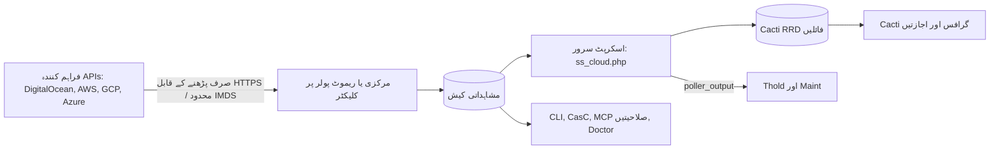

<!-- Source: README.md; SHA256: ac2074a40238686915802803c5efe773f33677f934281e0605e6e87a71a9d27d -->

<!-- translations:start -->
[English](../../../README.md) | [简体中文](../zh-CN/README.md) | [हिन्दी](../hi-IN/README.md) | [Español (España)](../es-ES/README.md) | [Español (Latinoamérica)](../es-419/README.md) | [العربية (السعودية)](../ar-SA/README.md) | [Afrikaans](../af-ZA/README.md) | [አማርኛ](../am-ET/README.md) | [العربية (مصر)](../ar-EG/README.md) | [العربية (المغرب)](../ar-MA/README.md) | [বাংলা](../bn-BD/README.md) | [Bosanski](../bs-BA/README.md) | [Deutsch](../de-DE/README.md) | [فارسی](../fa-IR/README.md) | [Filipino](../fil-PH/README.md) | [Français](../fr-FR/README.md) | [Français (Maroc)](../fr-MA/README.md) | [Français (Sénégal)](../fr-SN/README.md) | [Hausa](../ha-NG/README.md) | [עברית](../he-IL/README.md) | [Hrvatski](../hr-HR/README.md) | [Bahasa Indonesia](../id-ID/README.md) | [Igbo](../ig-NG/README.md) | [Italiano](../it-IT/README.md) | [日本語](../ja-JP/README.md) | [한국어](../ko-KR/README.md) | [Malagasy](../mg-MG/README.md) | [मराठी](../mr-IN/README.md) | [Bahasa Melayu](../ms-MY/README.md) | [Nederlands](../nl-NL/README.md) | [Polski](../pl-PL/README.md) | [Português (Brasil)](../pt-BR/README.md) | [Русский](../ru-RU/README.md) | [Kinyarwanda](../rw-RW/README.md) | [Soomaali](../so-SO/README.md) | [Српски](../sr-RS/README.md) | [Svenska](../sv-SE/README.md) | [Kiswahili](../sw-KE/README.md) | [தமிழ்](../ta-IN/README.md) | [తెలుగు](../te-IN/README.md) | [ไทย](../th-TH/README.md) | [Türkçe](../tr-TR/README.md) | [Українська](../uk-UA/README.md) | [اردو](README.md) | [Tiếng Việt](../vi-VN/README.md) | [isiXhosa](../xh-ZA/README.md) | [Yorùbá](../yo-NG/README.md) | [繁體中文](../zh-TW/README.md) | [isiZulu](../zu-ZA/README.md)
<!-- translations:end -->

# plugin_cloud

Cacti 1.2 کا ایک پلگ ان جو پبلک کلاؤڈ فراہم کنندگان کے وسائل اور میٹرکس کو Cacti میں عام ڈیوائسز، ڈیٹا سورسز، اور گرافس کے طور پر لاتا ہے۔ کلاؤڈ ورک لوڈز اس نیٹ ورک کے ساتھ آ جاتے ہیں جو انہیں چلاتا ہے، Cacti کی اجازتوں کے تحت، اور Thold اور Maint ان پر الرٹ جاری کرتے ہیں اور انہیں دباتے ہیں۔ ایک ہی پلگ ان خالص PHP، صرف پڑھنے کے قابل فراہم کنندہ ڈرائیورز کے ذریعے DigitalOcean، Amazon Web Services، Google Cloud، اور Microsoft Azure کا احاطہ کرتا ہے۔

> **حیثیت: زیرِ تکمیل، ابھی کوئی ریلیز نہیں (`0.1.0-dev`)۔** یہ برانچ DigitalOcean، AWS، Google Cloud، اور Azure کے لیے خالص PHP ڈرائیورز، ریموٹ ڈیٹا کلیکٹر ریپلیکیشن اور صرف پڑھنے کے قابل ایجنٹ ہیلتھ، ایک CasC فراہم کنندہ اور آپریٹر CLI، MCP صلاحیتیں، اور Doctor چیکس نافذ کرتی ہے۔ فی الحال شامل Cacti ٹیمپلیٹس DigitalOcean Droplets اور لوڈ بیلنسرز (`templates/cloud_digitalocean.xml`) کا احاطہ کرتے ہیں؛ AWS، Google Cloud، اور Azure کے لیے Cacti ٹیمپلیٹ پیکجز اور DigitalOcean کے علاوہ لائیو اکاؤنٹ کی اہلیت کی جانچ ([فراہم کنندہ کے حقائق](../../research/provider-facts.md)) ابھی مکمل نہیں ہوئے ہیں۔ اسے پروڈکشن میں نہ چلائیں۔

## تعاون یافتہ فراہم کنندگان

ہر فراہم کنندہ ڈرائیور `Drivers::production()` میں رجسٹرڈ ہے، `Provider::released()` کے ذریعے پیش کیا جاتا ہے، اور بغیر کسی SDK یا Composer رن ٹائم انحصار کے `ext-openssl` اور اسٹریم ساکٹس کا استعمال کرتے ہوئے خالص PHP میں چلتا ہے۔

| فراہم کنندہ | اسکوپ فیلڈز | اسناد کے ذرائع | توثیق | دریافت شدہ وسائل | میٹرک جمع آوری |
|---|---|---|---|---|---|
| DigitalOcean (`digitalocean`) | کوئی نہیں (ٹوکن کے دائرہ اختیار میں) | `vault`, `file` | Bearer token | `droplet`, `load_balancer` | ریٹ لمٹ شیئر آگاہی کے ساتھ `/v2/monitoring/metrics`؛ Cacti ٹیمپلیٹس اور ڈیٹا کوئیریز کے ساتھ آتا ہے |
| Amazon Web Services (`aws`) | `account_id` (12 ہندسے)، `regions` | `vault`, `file`, `instance` | خالص PHP AWS SigV4 (`AWS4-HMAC-SHA256`)، STS `GetCallerIdentity` توثیق، اختیاری STS `AssumeRole`، `instance` اکاؤنٹس کے لیے EC2 IMDSv2 (`169.254.169.254`) | `ec2_instance`, `rds_instance`, `aws_elb` (ALB/NLB) | بیچ شدہ CloudWatch `GetMetricData` (فی کال زیادہ سے زیادہ 500 کوئیریز) |
| Google Cloud (`gcp`) | `project` | `vault`, `file`, `instance` | `ext-openssl` کے ذریعے خالص PHP RS256 سروس اکاؤنٹ JWT جس کا تبادلہ `oauth2.googleapis.com/token` پر ہوتا ہے، یا `instance` اکاؤنٹس کے لیے GCE میٹاڈیٹا سرور (`metadata.google.internal`) | `instances.aggregatedList` کے ذریعے `gce_instance` | Cloud Monitoring `timeSeries.list` |
| Microsoft Azure (`azure`) | `tenant`, `subscription`, `regions` | `vault`, `file`, `instance` | خالص PHP Entra ID OAuth2 کلائنٹ کریڈینشلز فلو (صرف `client_secret`؛ سرٹیفکیٹ تصدیقات مستثنیٰ ہیں)، یا ARM اور Monitor ٹوکنز کے لیے Azure IMDS (`169.254.169.254`) منظم شناخت | ARM Resource Graph کے ذریعے `azure_vm` (`$skipToken` کے ساتھ صفحات میں تقسیم اور نقول سے پاک) | Azure Monitor `metrics:getBatch` (فی کال زیادہ سے زیادہ 50 وسائل، HTTP 429 اور 529 تھروٹلنگ کو سنبھالتا ہے) |

## نافذ کردہ صلاحیتیں

### بنیادی پلیٹ فارم، والٹ، اور کلیکٹر

- **محفوظ تنصیب اور لائف سائیکل۔** انٹری پوائنٹس (`setup.php`, `cli/cloud.php`, `poller_cloud.php`, `ss_cloud.php`، اور پیج اسکرپٹس) PHP 8.0 پر پارس ہوتے ہیں اور Cacti کو توڑے بغیر PHP 8.2 سے کم یا `ext-openssl` کی عدم موجودگی کو مسترد کرتے ہیں۔ اپ گریڈز ترتیب وار، آئیڈیمپوٹینٹ (`Schema::VERSION = 3`، 9 ٹیبلز) ہیں اور مداخلت کے باوجود محفوظ رہتے ہیں۔ ان انسٹالیشن پلگ ان ٹیبلز کو برقرار رکھتی ہے جب تک *Keep Plugin Tables on Uninstall* کو غیر منتخب نہ کیا جائے۔
- **اکاؤنٹس اور اسناد۔** **Management > Cloud Accounts** کے تحت اکاؤنٹس شامل کریں، ترمیم کریں، تصدیق کریں، اور حذف کریں۔ اسناد AES-256-GCM انکرپٹڈ والٹ (`plugin_cloud_secret`، طے شدہ طور پر `/etc/cacti/cloud-vault.key` سے کلید شدہ)، ترتیب دی گئی *Credential File Directory* (`cloud_credential_dir`، فائلوں کو مسترد کرنے کے لیے طے شدہ طور پر خالی) کے اندر محدود فائل، یا فراہم کنندہ انسٹینس شناخت سے آتی ہیں۔ UI میں اسناد صرف لکھنے کے قابل ہیں اور لاگز سے حذف کر دی جاتی ہیں۔
- **سخت آؤٹ باؤنڈ اور صرف پڑھنے کے کنٹرولز۔** ہر ڈرائیور `GuardedTransport` اور `OutboundPolicy` کے پیچھے کام کرتا ہے: ہر فراہم کنندہ کے عین مطابق میزبان ناموں کے لیے HTTPS پورٹ 443، اور لنک لوکل HTTP پورٹ 80 میٹاڈیٹا اینڈ پوائنٹس (`169.254.169.254`, `metadata.google.internal`) صرف `instance` اکاؤنٹس کے لیے فعال ہوتے ہیں۔ صرف اجازت یافتہ فہرست میں موجود پڑھنے کے قابل آپریشنز کی اجازت ہے۔
- **کلیکٹر اور لاگت کے کنٹرولز۔** `poller_cloud.php`، `poller_bottom` سے (Cacti کی پروسیس رجسٹری کے ذریعے فی پولر ایک پروسیس) `cloud_collector_budget` کے اندر چلتا ہے، فی اکاؤنٹ لیز حاصل کرتا ہے، `discover_interval` پر دریافت چلاتا ہے، صرف فعال Cacti ڈیٹا سورسز (`plugin_cloud_series`) کے لیے میٹرکس پڑھتا ہے، `request_share` اور `monthly_ceiling` کا احترام کرتا ہے، اور `ss_cloud.php` کے لیے تازہ ترین ڈیٹا پوائنٹس کو `plugin_cloud_observation` میں کیش کرتا ہے۔
- **Cacti آبجیکٹس اور درخواستوں کے تخمینے۔** فی اکاؤنٹ ایک اسکوپ ڈیوائس (`plugin_cloud_device`) برقرار رکھتا ہے، ڈیوائس محفوظ کرنے پر اسکوپ ڈیوائس کے ری انڈیکس طریقوں کو محفوظ رکھتا ہے، DigitalOcean ٹیمپلیٹس اور اسکرپٹ سرور ڈیٹا کوئیریز (`templates/cloud_digitalocean.xml`, `cloud_do_droplet.xml`, `cloud_do_load_balancer.xml`) درآمد کرتا ہے، اور **New Graphs** (`graphs_new_top_links`) اور **Cloud Health** پر درخواست اور فہرست قیمت کے تخمینے دکھاتا ہے۔

### ریموٹ ڈیٹا کلیکٹرز

- `INFO`، `remote_collect:1` کا اعلان کرتا ہے۔ اکاؤنٹس کسی بھی فعال Cacti پولر (`poller_id >= 1`) کو تفویض کیے جا سکتے ہیں، اور `poller_cloud.php --poller=N` صرف اسی پولر کی ملکیت والے اکاؤنٹس کو جمع کرتا ہے۔
- **`replicate_out` ہک۔** `replicate_out_table()` کے ذریعے `plugin_cloud_account`، `plugin_cloud_device`، `plugin_cloud_series` سے پولر اسکوپ والی قطاریں اور `plugin_cloud_secret` سے انکرپٹڈ سائفر ٹیکسٹ قطاریں (صرف ہدف پولر کی ملکیت والے والٹ سے منسلک اکاؤنٹس کے لیے) نقل کرتا ہے۔ خام والٹ کلیدی فائلیں کبھی ڈیٹا بیس میں محفوظ یا نقل نہیں کی جاتیں اور ہر پولر پر مقامی رہتی ہیں۔
- **`remote_agent` ہک۔** صرف پڑھنے کے قابل JSON ہیلتھ خلاصہ (`action=cloud_health`) فراہم کرتا ہے جو صرف عددی `poller_id` اور `account_id` پیرامیٹرز قبول کرتا ہے اور صفر اسناد، فائل راستے، یا راز واپس کرتا ہے۔

### ایکو سسٹم ہکس (CasC، MCP صلاحیتیں، اور Doctor)

- **CasC فراہم کنندہ (`casc_register_providers`)۔** متعین خالص PHP YAML اور XML برآمد، مینی فیسٹ کی توثیق، فرق کی منصوبہ بندی، اور تصدیق شدہ اطلاق کے ساتھ `cloud` فراہم کنندہ (اسکیما ورژن `1`) رجسٹر کرتا ہے۔ والٹ کی اسناد `vault:account:<name>` حوالہ جات کے طور پر برآمد کی جاتی ہیں؛ خام خفیہ فیلڈز (`secret`, `secrets`, `token`, `access_token`, `refresh_token`, `password`, `private_key`, `access_key_id`, `secret_access_key`, `session_token`, `client_secret`, `credential`, `credentials`, `vault_key`) مسترد کر دیے جاتے ہیں۔ اطلاق کے لیے عین مطابق SHA-256 `--confirm=<PLAN_HASH>` درکار ہے۔
- **MCP / Abilities API (`abilities_register`)۔** غیر منتظم کالرز کے لیے Cloud View دائرہ اختیار (`cloud_health.php`) اور Cacti ڈیوائس اسکوپ پر محدود تین سختی سے صرف پڑھنے کے قابل صلاحیتیں رجسٹر کرتا ہے، جو صفر اسناد، والٹ کلیدیں، یا اسناد کی فائل کے راستے جاری کرتی ہیں:
  - `cloud-list-accounts` (اختیاری `provider`, `poller_id`)
  - `cloud-list-resources` (اختیاری `account_id`, `type`, `lifecycle`)
  - `cloud-get-health` (اختیاری `account_id`)
- **Doctor چیکس (`doctor_register_checks`)۔** پانچ تشخیصی چیکس رجسٹر کرتا ہے جو کوئی خفیہ اقدار یا کلیدی مواد ظاہر نہیں کرتے:
  - `cloud_schema`: اسکیما ورژن کی تازگی
  - `cloud_vault_key`: والٹ کلیدی فائل کی پڑھنے کی اہلیت، اجازتیں، اور سائز
  - `cloud_drivers`: تمام جاری کردہ فراہم کنندگان کے لیے پروڈکشن ڈرائیور رجسٹریشن
  - `cloud_accounts_health`: ناکام، تھروٹل شدہ، یا پرانے فعال اکاؤنٹس
  - `cloud_poller_intervals`: فعال اکاؤنٹ جمع آوری کے وقفوں کی Cacti کے پولر وقفے کے ساتھ ہم آہنگی

## CLI

PHP 8.2 یا اس کے بعد کے ورژن کے ساتھ Cacti روٹ ڈائریکٹری سے چلائیں:

```sh
# Operator and CasC CLI (options use --key=value form)
php plugins/cloud/cli/cloud.php export [--format=yaml|xml]
php plugins/cloud/cli/cloud.php validate --file=<path> [--format=yaml|xml]
php plugins/cloud/cli/cloud.php plan --file=<path> [--format=yaml|xml]
php plugins/cloud/cli/cloud.php apply --file=<path> --confirm=<PLAN_HASH> [--format=yaml|xml]
php plugins/cloud/cli/cloud.php health [--format=text|json] [--poller=<id>]

# Collector entry point (normally started by poller_bottom)
php plugins/cloud/poller_cloud.php [--poller=N] [--force] [--debug]
```

## رسائی کے کردار

| دائرہ اختیار | رسائی |
| --- | --- |
| Cloud View | موجودہ نگرانی کے صفحات۔ |
| Cloud Operator | نگرانی کے علاوہ آپریشنز صفحہ اور ذاتی ترجیحی توثیقات۔ |
| Cloud Admin | Operator رسائی کے علاوہ موجودہ ترتیب اور انتظامی اقدامات۔ |

اپ گریڈ فائلیں کاپی کرنے کے بعد، دائرہ اختیارات رجسٹر کرنے کے لیے بطور منتظم Plugins صفحہ کھولیں۔ **Configuration > Users** یا صارف گروپس کے تحت Operator دائرہ اختیار واضح طور پر تفویض کریں۔ اپ گریڈز موجودہ View اور Admin دائرہ اختیار کی شناختیں اور عطیات برقرار رکھتے ہیں۔ Admin رسائی ہر درخواست پر Operator رسائی وراثت میں لیتی ہے، اور Operator رسائی View رسائی وراثت میں لیتی ہے؛ اس سے صارفین یا گروپس میں محفوظ کردہ عطیات شامل نہیں ہوتے۔ پلگ ان سیٹنگز کے لیے Cacti کی Settings اجازت کے علاوہ Cloud Admin رسائی بھی درکار ہوتی ہے۔

Cacti ڈیوائس کی اجازتیں ہر صارف کے لیے دستیاب قطاروں اور اقدامات کو محدود کرتی ہیں؛ غیر نقشہ شدہ آبجیکٹس کے لیے منتظم درکار ہوتا ہے۔ آپریٹرز اس اکاؤنٹ کے لیے محفوظ کردہ اسناد کی تصدیق کر سکتے ہیں جس کے Cacti ڈیوائس تک انہیں رسائی حاصل ہو۔ اسناد، ترتیب، نقشہ سازی، حذف کاری، اور دیگر انتظامی تبدیلیاں انتظامی صفحات میں ہی رہتی ہیں۔ توثیقات صرف موجودہ صارف کے سیشن میں، زیادہ سے زیادہ ایک گھنٹے کے لیے اور صرف اس وقت تک رہتی ہیں جب تک وہی مشاہدہ تازہ رہے۔ نئے یا تبدیل شدہ مشاہدات انہیں کالعدم کر دیتے ہیں۔ وہ کبھی بھی ناکام پیمائش کو صحت مند قرار نہیں دیتیں اور نہ ہی الرٹس کو دباتی ہیں۔

## کیوں

ہر کلاؤڈ فراہم کنندہ کا اپنا نگرانی کنسول ہوتا ہے۔ Cacti کے ساتھ چلنے پر، وہ تین خلا چھوڑ دیتے ہیں:

- **الگ رسائی کا کنٹرول۔** Cacti صارف کو کلاؤڈ میٹرکس دکھانے کا مطلب انہیں کلاؤڈ لاگ ان دینا ہے۔
- **کوئی نیٹ ورک سیاق و سباق نہیں۔** آن پریمیسز لنکس Cacti میں گراف کیے جاتے ہیں؛ ان کے پیچھے موجود ورک لوڈز ہر فراہم کنندہ کے کنسول میں گراف کیے جاتے ہیں۔
- **الگ الرٹنگ۔** Thold اور Maint، Cacti ڈیٹا سورسز اور ڈیوائسز پر کام کرتے ہیں، لہذا فراہم کنندہ کے الارمز فی فراہم کنندہ ایک بار الگ سے ترتیب دیے اور دبائے جاتے ہیں۔

پلگ ان Cacti پولر پر ہر فراہم کنندہ کا نگرانی API پڑھتا ہے، تازہ ترین ڈیٹا پوائنٹس کو کیش کرتا ہے، اور انہیں Cacti کے اسکرپٹ سرور کو فراہم کرتا ہے۔ Cacti کا پولر RRD فائلیں لکھتا ہے، لہذا گرافنگ، اجازتیں، Thold، Maint، اور boost کسی بھی دیگر Cacti ڈیٹا کی طرح کام کرتے ہیں۔

## ڈیزائن کے عہد

- **صرف پڑھنے کے قابل۔** ہر ڈرائیور صرف اپنی اجازت یافتہ فہرست میں شامل فراہم کنندہ آپریشنز بنا سکتا ہے؛ پلگ ان کبھی کلاؤڈ وسیلے کو تبدیل نہیں کرتا۔ ([ADR 0002](../../decisions/0002-read-only-with-operation-allowlist.md))
- **صرف PHP، کوئی SDKs نہیں۔** دستخط اور ٹوکن کا تبادلہ ان ایکسٹینشنز کے ساتھ PHP میں نافذ کیا جاتا ہے جن کی Cacti کو پہلے ہی ضرورت ہے۔ کوئی Composer رن ٹائم انحصار نہیں ہے۔ ([ADR 0003](../../decisions/0003-php-only-without-sdks.md))
- **جمع آوری سے پہلے لاگت۔** پلگ ان صرف ان میٹرکس کو پڑھتا ہے جن کا Cacti ڈیٹا سورس موجود ہو، گرافس بنانے سے پہلے متوقع درخواستوں کی تعداد اور فہرست قیمت کی لاگت دکھاتا ہے، اور ماہانہ حد نافذ کرتا ہے۔ ([ADR 0005](../../decisions/0005-collect-only-what-is-graphed.md))
- **ڈیٹا بیس میں کوئی سادہ متنی اسناد نہیں۔** اسناد ڈیٹا بیس سے باہر ایک فائل سے کلید شدہ انکرپٹڈ والٹ سے، کسی اسناد کی فائل سے، یا فراہم کنندہ کی انسٹینس شناخت سے آتی ہیں۔ ([ADR 0007](../../decisions/0007-credentials-outside-the-database-in-the-clear.md))

## دائرہ کار اور حیثیت

| مرحلہ | دائرہ کار | سنگ میل | حیثیت |
|---|---|---|---|
| 0، تحقیق | فراہم کنندہ کے حقائق کی تصدیق، میٹرک کیٹلاگز، لاگت اور شرح کا ماڈل، دستخط کے ٹیسٹ ویکٹرز، ٹرانسپورٹ اسپائک | [M1](https://github.com/somethingwithproof/plugin_cloud/milestone/1) | مکمل، سوائے ان جانچوں کے جن کے لیے لائیو فراہم کنندہ اکاؤنٹس درکار ہیں |
| 1، بنیادی ڈھانچہ اور DigitalOcean | اکاؤنٹس، اسناد والٹ، ٹرانسپورٹ، کلیکٹر، مشاہداتی کیش، Cacti آبجیکٹس، ٹیمپلیٹس، درخواست کے تخمینے، ہیلتھ پیج، DigitalOcean Droplets اور لوڈ بیلنسرز | [M2](https://github.com/somethingwithproof/plugin_cloud/milestone/2), [M3](https://github.com/somethingwithproof/plugin_cloud/milestone/3), [M4](https://github.com/somethingwithproof/plugin_cloud/milestone/4) | نافذ شدہ؛ M4 پائلٹ اہلیت زیر التواء ہے |
| 2، AWS | خالص PHP SigV4، STS `AssumeRole`، IMDSv2 انسٹینس کردار، EC2/RDS/ELB انوینٹری، CloudWatch `GetMetricData` | [M5](https://github.com/somethingwithproof/plugin_cloud/milestone/5) | ڈرائیور نافذ شدہ؛ Cacti ٹیمپلیٹس اور لائیو اکاؤنٹ کی اہلیت زیر التواء ہیں |
| 3، Google Cloud | خالص PHP RS256 سروس اکاؤنٹ JWT، GCE میٹاڈیٹا سرور، Compute Engine انوینٹری، Cloud Monitoring `timeSeries.list` | [M6](https://github.com/somethingwithproof/plugin_cloud/milestone/6) | ڈرائیور نافذ شدہ؛ Cacti ٹیمپلیٹس اور لائیو اکاؤنٹ کی اہلیت زیر التواء ہیں |
| 4، Azure | Entra ID کلائنٹ اسناد، IMDS منظم شناخت، ARM Resource Graph VM انوینٹری، Azure Monitor `metrics:getBatch` | [M7](https://github.com/somethingwithproof/plugin_cloud/milestone/7) | ڈرائیور نافذ شدہ؛ Cacti ٹیمپلیٹس اور لائیو اکاؤنٹ کی اہلیت زیر التواء ہیں |
| 5، ریموٹ کلیکٹرز اور ایکو سسٹم | ریموٹ ڈیٹا کلیکٹرز (`replicate_out`, `remote_agent`)، CasC فراہم کنندہ اور CLI، MCP صلاحیتیں، Doctor چیکس | [M8](https://github.com/somethingwithproof/plugin_cloud/milestone/8) | نافذ شدہ |

دائرہ کار سے باہر: کلاؤڈ وسائل میں تبدیلی، فراہم کنندہ کے الارمز بنانا یا عکس بندی کرنا، بلنگ رپورٹس، لاگز اور ٹریسز، اور پلگ ان کا اپنا الرٹنگ انجن۔ مزید فراہم کنندگان (Hetzner Cloud، Akamai Cloud، Oracle Cloud، اور دیگر) تحقیقی مسائل ہیں۔

## تنصیب اور ترتیب

یہ اقدامات تشخیص کے لیے ترقیاتی کوڈ نصب کرتے ہیں۔ ان کے لیے PHP 8.2 یا اس کے بعد کے ورژن پر Cacti 1.2.31 یا اس کے بعد کا ورژن درکار ہے۔

1. اپنی Cacti ڈائریکٹری کے تحت `plugins/cloud` میں ریپوزٹری کاپی کریں۔ ڈائریکٹری کا نام لازماً `cloud` ہونا چاہیے۔
2. والٹ سے منسلک اسناد استعمال کرنے والے ہر پولر پر ویب روٹ سے باہر والٹ کلید بنائیں۔ اسے ایسی ڈائریکٹری میں رکھیں جہاں صرف root اور Cacti صارف لکھ سکیں، اور فائل کو صرف اس صارف کے پڑھنے کے قابل بنائیں جو ویب سرور اور پولر چلاتا ہے۔ پلگ ان کبھی یہ فائل نہیں بناتا یا لکھتا:

   ```sh
   sudo install -d -m 0750 -o root -g cacti /etc/cacti
   head -c 32 /dev/urandom | sudo tee /etc/cacti/cloud-vault.key > /dev/null
   sudo chown cacti:cacti /etc/cacti/cloud-vault.key
   sudo chmod 0600 /etc/cacti/cloud-vault.key
   ```

   اپنے ویب سرور اور پولر چلانے والے صارف سے `cacti` کو تبدیل کریں۔ فائل میں 32 خام بائٹس یا 64 ہیکساڈیسیمل حروف ہوتے ہیں۔ ڈیٹا بیس کے ساتھ اس کا بیک اپ لیں؛ اس کے بغیر، محفوظ کردہ اسناد دوبارہ درج کرنی ہوں گی۔
3. Cacti میں **Configuration > Plugins** کھولیں، پھر *Cloud* نصب اور فعال کریں۔
4. **Configuration > Settings > Cloud** کے تحت، اگر آپ نے کوئی اور راستہ استعمال کیا ہے تو *Vault Key File* سیٹ کریں، اگر آپ فائل پر مبنی اسناد استعمال کرنے کا ارادہ رکھتے ہیں تو *Credential File Directory* ترتیب دیں، اور *Collector Time Budget* (طے شدہ 240 سیکنڈز) کو پولر وقفے سے کم رکھیں۔
5. **Configuration > Users** کے تحت صارفین اور گروپس کو *Cloud Admin*، *Cloud Operator*، یا *Cloud View* تفویض کریں۔ تنصیب منتظم کو Cloud Admin اور Cloud View عطا کرتی ہے؛ Cloud Admin میں Operator رسائی شامل ہوتی ہے، اس لیے منتظم کو علیحدہ Operator عطا کی ضرورت نہیں ہے۔
6. **Management > Cloud Accounts** کے تحت اکاؤنٹس شامل کریں، پھر انتباہات کے لیے **Management > Cloud Health** چیک کریں۔

## مطابقت کے اہداف

| جزو | ہدف |
|---|---|
| Cacti | 1.2.31 یا اس کے بعد کا ورژن، کوئی بنیادی پیچ نہیں |
| PHP | 8.2 یا اس کے بعد کا ورژن؛ انٹری پوائنٹس 8.0 پر پارس کے قابل رہتے ہیں تاکہ غیر معاون رن ٹائم کو ٹوٹے ہوئے Cacti UI کے بجائے انکار ملے |
| PHP ایکسٹینشنز | `ext-openssl` (Cacti 1.2.31 کے لیے درکار)؛ کوئی `ext-curl` اور کوئی Composer رن ٹائم انحصار نہیں |
| Thold, Maint | کسی تبدیلی کی ضرورت نہیں |

## ڈیزائن

- [docs/performance.md](../../performance.md) میں استعمال شدہ ہارڈویئر اور ترتیبات کے ساتھ کلیکٹر اور ہیلتھ پیج کی پیمائشیں موجود ہیں۔
- [docs/PLAN.md](../../PLAN.md) مکمل منصوبہ ہے: فن تعمیر، وہ فراہم کنندہ اور Cacti حقائق جن پر یہ انحصار کرتا ہے (حوالوں سمیت)، ڈرائیور معاہدہ، لاگت کا حساب، حفاظتی حدود، جانچ، اور خطرات۔
- [docs/decisions/](../../decisions/) میں پہلے سے کیے گئے انتخاب کے لیے فن تعمیری فیصلوں کے ریکارڈز موجود ہیں۔
- [docs/REQUIREMENTS.md](../../REQUIREMENTS.md) ہر تقاضہ ID کو اس کے مسئلے سے جوڑتا ہے۔



## کام کی نگرانی کیسے کی جاتی ہے

- **سنگ میل** منصوبے کے سنگ میلوں کی پیروی کرتے ہیں۔ ہر ایک کا ایک ایپک مسئلہ ہوتا ہے جو اس کے ذیلی مسائل اور تکمیل کے شواہد کی فہرست دیتا ہے۔
- **مسائل** لیبل کے ذریعے درجہ بند کیے جاتے ہیں: `type: requirement`, `type: research`, `type: decision`, `type: epic`۔ تقاضے کے مسائل نمبر شدہ، قابل جانچ تقاضے (`REQ-AREA-NNN`) اور قبولیت کے معیار بیان کرتے ہیں۔
- **لیبلز** میں `area:`, `provider:`, `phase:`, `priority:`، اور `status:` بھی شامل ہیں۔ [CONTRIBUTING.md](../../../CONTRIBUTING.md#labels) دیکھیں۔
- [پروجیکٹ بورڈ](https://github.com/users/somethingwithproof/projects/7) تمام سنگ میلوں کے تمام مسائل دکھاتا ہے۔

## ترقی

CI ([.github/workflows/plugin-ci-workflow.yml](../../../.github/workflows/plugin-ci-workflow.yml)) ریلیز آرکائیو اور سیمینٹک ورژن (`bash tests/bin/archive-check.sh`) چیک کرتا ہے، PHP 8.0 پر انٹری پوائنٹس کی لنٹنگ کرتا ہے، `CLOUD_OFFLINE=1` کے ساتھ Cacti `release/1.2.31` اور `1.2.x` کے خلاف PHP 8.2 سے 8.5 تک Pest یونٹ (`phpunit.xml`) اور لائف سائیکل انٹیگریشن (`phpunit-integration.xml`) ٹیسٹ اور PHPStan لیول 9 چلاتا ہے، PHP 8.1 پر انکار کی جانچ کرتا ہے، gettext کیٹلاگز کی تصدیق کرتا ہے، 1,000-سیریز جمع آوری اور ہیلتھ پیج کی کارکردگی کی پیمائش کرتا ہے، اور ورک فلو لنٹنگ اور REUSE تعمیل چلاتا ہے۔

پش کرنے سے پہلے مقامی جانچیں:

```sh
bash tests/bin/archive-check.sh
sh tests/lint-workflows.sh
sh locales/build_gettext.sh --check
CACTI_PATH=/path/to/cacti phpstan analyse -c phpstan.neon --no-progress
```

یونٹ اور سورس رول ٹیسٹ کے لیے `--configuration=phpunit.xml` کے ساتھ، یا لائف سائیکل انٹیگریشن ٹیسٹ کے لیے عارضی Cacti ڈیٹا بیس کے خلاف `CACTI_PATH` اور `CLOUD_TEST_DATABASE=disposable` کے ساتھ `--configuration=phpunit-integration.xml` استعمال کرتے ہوئے Pest چلائیں۔

## تعاون

[CONTRIBUTING.md](../../../CONTRIBUTING.md) پڑھیں۔ کمٹس کے لیے DCO سائن آف درکار ہے۔ ڈیزائن پر گفتگو مسائل پر ہوتی ہے؛ کھلے فیصلوں پر `type: decision` لیبل ہوتا ہے۔

## سلامتی

کمزوریوں کی اطلاع نجی طور پر دیں؛ [SECURITY.md](../../../SECURITY.md) دیکھیں۔

## لائسنس

GNU General Public License v2.0، وہی لائسنس جو Cacti اور اس کے پلگ انز کا ہے۔ [LICENSE](../../../LICENSE) دیکھیں۔
