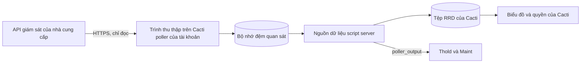

<!-- Source: README.md; SHA256: 7c621642e5f1a46bac66e4bc744f70aebb014c610d22de034088845fdc170405 -->

<!-- translations:start -->
[English](../../../README.md) | [简体中文](../zh-CN/README.md) | [हिन्दी](../hi-IN/README.md) | [Español (España)](../es-ES/README.md) | [Español (Latinoamérica)](../es-419/README.md) | [العربية (السعودية)](../ar-SA/README.md) | [Afrikaans](../af-ZA/README.md) | [አማርኛ](../am-ET/README.md) | [العربية (مصر)](../ar-EG/README.md) | [العربية (المغرب)](../ar-MA/README.md) | [বাংলা](../bn-BD/README.md) | [Bosanski](../bs-BA/README.md) | [Deutsch](../de-DE/README.md) | [فارسی](../fa-IR/README.md) | [Filipino](../fil-PH/README.md) | [Français](../fr-FR/README.md) | [Français (Maroc)](../fr-MA/README.md) | [Français (Sénégal)](../fr-SN/README.md) | [Hausa](../ha-NG/README.md) | [עברית](../he-IL/README.md) | [Hrvatski](../hr-HR/README.md) | [Bahasa Indonesia](../id-ID/README.md) | [Igbo](../ig-NG/README.md) | [Italiano](../it-IT/README.md) | [日本語](../ja-JP/README.md) | [한국어](../ko-KR/README.md) | [Malagasy](../mg-MG/README.md) | [मराठी](../mr-IN/README.md) | [Bahasa Melayu](../ms-MY/README.md) | [Nederlands](../nl-NL/README.md) | [Polski](../pl-PL/README.md) | [Português (Brasil)](../pt-BR/README.md) | [Русский](../ru-RU/README.md) | [Kinyarwanda](../rw-RW/README.md) | [Soomaali](../so-SO/README.md) | [Српски](../sr-RS/README.md) | [Svenska](../sv-SE/README.md) | [Kiswahili](../sw-KE/README.md) | [தமிழ்](../ta-IN/README.md) | [తెలుగు](../te-IN/README.md) | [ไทย](../th-TH/README.md) | [Türkçe](../tr-TR/README.md) | [Українська](../uk-UA/README.md) | [اردو](../ur-PK/README.md) | [Tiếng Việt](README.md) | [isiXhosa](../xh-ZA/README.md) | [Yorùbá](../yo-NG/README.md) | [繁體中文](../zh-TW/README.md) | [isiZulu](../zu-ZA/README.md)
<!-- translations:end -->

# plugin_cloud

Một plugin Cacti 1.2 đưa các tài nguyên và chỉ số từ các nhà cung cấp đám mây công cộng vào Cacti dưới dạng thiết bị, nguồn dữ liệu và biểu đồ thông thường. Khi đó, các khối lượng công việc đám mây nằm ngay bên cạnh hạ tầng mạng truyền tải chúng, tuân theo hệ thống phân quyền của Cacti, đồng thời Thold và Maint có thể cảnh báo và tạm ẩn cảnh báo trên chúng. Một plugin duy nhất hỗ trợ mọi nhà cung cấp, với một driver riêng cho từng nhà cung cấp: trước tiên là DigitalOcean, AWS, Google Cloud và Azure.

> **Trạng thái: cột mốc 3 (DigitalOcean và các đối tượng Cacti), đang xem xét.** Cột mốc này bổ sung driver DigitalOcean, các mẫu Cacti, một thiết bị phạm vi cho mỗi tài khoản cùng một truy vấn dữ liệu cho từng loại tài nguyên, đầu vào cho script server, và ước tính yêu cầu trên trang New Graphs cũng như trang trạng thái sức khỏe. Các kiểm tra ban đầu với một tài khoản DigitalOcean thực tế được ghi lại trong [thông tin thực tế về nhà cung cấp](../../research/provider-facts.md). Không sử dụng trong môi trường sản xuất.

## Vai trò truy cập

| Realm | Quyền truy cập |
| --- | --- |
| Cloud View | Các trang giám sát hiện có. |
| Cloud Operator | Quyền giám sát cộng thêm trang Operations và xác nhận phân loại cá nhân. |
| Cloud Admin | Quyền Operator cộng thêm các thao tác cấu hình và quản trị hiện có. |

Sau khi sao chép các tệp nâng cấp, hãy mở trang Plugins với tư cách quản trị viên để đăng ký
realm mới. Gán realm Operator một cách tường minh trong mục **Configuration > Users** hoặc nhóm người dùng.
Việc nâng cấp vẫn giữ nguyên ID và quyền đã cấp cho các realm View và Admin hiện có. Quyền Admin
kế thừa quyền Operator, và quyền Operator kế thừa quyền View trên mỗi yêu cầu;
điều này không thêm quyền được lưu trữ vào người dùng hay nhóm. Các thiết lập plugin cũng yêu cầu
quyền Cloud Admin bên cạnh quyền Settings của Cacti.

Quyền thiết bị của Cacti vẫn giới hạn các hàng và thao tác khả dụng đối với từng người dùng; các đối tượng chưa được ánh xạ yêu cầu quyền quản trị viên. Operator có thể xác minh thông tin xác thực đã lưu cho một tài khoản mà họ có quyền truy cập thiết bị Cacti tương ứng.
Thông tin xác thực, cấu hình, ánh xạ, thao tác xóa và các thay đổi quản trị khác
vẫn nằm trong các trang quản trị. Các xác nhận chỉ có hiệu lực trong phiên làm việc hiện tại
của người dùng, tối đa một giờ và chỉ khi cùng một quan sát vẫn còn
mới. Các quan sát mới hoặc đã thay đổi sẽ làm mất hiệu lực của chúng. Chúng không bao giờ đánh dấu một phép đo thất bại
là khỏe mạnh hoặc tạm ẩn cảnh báo.

## Lý do

Mỗi nhà cung cấp đám mây đều có bảng điều khiển giám sát riêng. Khi chạy song song với Cacti, chúng để lại ba khoảng trống:

- **Kiểm soát truy cập tách biệt.** Việc cho người dùng Cacti xem các chỉ số đám mây đồng nghĩa với việc phải cấp cho họ tài khoản đăng nhập đám mây.
- **Thiếu ngữ cảnh mạng.** Các liên kết tại chỗ được vẽ biểu đồ trong Cacti; các khối lượng công việc phía sau chúng lại được vẽ biểu đồ trong bảng điều khiển của từng nhà cung cấp.
- **Cảnh báo tách biệt.** Thold và Maint hoạt động trên các nguồn dữ liệu và thiết bị của Cacti, nên các cảnh báo của nhà cung cấp phải được cấu hình và tạm ẩn riêng lẻ theo từng nhà cung cấp.

Plugin đọc API giám sát của từng nhà cung cấp trên một Cacti poller, lưu vào bộ nhớ đệm các điểm dữ liệu mới nhất và cung cấp chúng cho script server của Cacti. Poller của Cacti ghi các tệp RRD, nhờ đó việc vẽ biểu đồ, phân quyền, Thold, Maint và boost hoạt động giống như với mọi dữ liệu Cacti khác.

## Cam kết thiết kế

- **Chỉ đọc.** Mỗi driver chỉ có thể xây dựng các thao tác nhà cung cấp nằm trong danh sách cho phép của nó; plugin không bao giờ thay đổi tài nguyên đám mây. ([ADR 0002](../../decisions/0002-read-only-with-operation-allowlist.md))
- **Chỉ dùng PHP, không dùng SDK.** Việc ký yêu cầu và trao đổi token được triển khai bằng PHP với các phần mở rộng mà Cacti đã yêu cầu sẵn. Không có phụ thuộc runtime của Composer. ([ADR 0003](../../decisions/0003-php-only-without-sdks.md))
- **Ước tính chi phí trước khi thu thập.** Plugin chỉ đọc các chỉ số có nguồn dữ liệu Cacti, hiển thị số lượng yêu cầu dự kiến và chi phí theo giá niêm yết trước khi biểu đồ được tạo, đồng thời áp dụng mức trần hàng tháng. ([ADR 0005](../../decisions/0005-collect-only-what-is-graphed.md))
- **Không lưu thông tin xác thực dạng văn bản thuần trong cơ sở dữ liệu.** Thông tin xác thực đến từ một kho lưu trữ được mã hóa bằng tệp khóa nằm ngoài cơ sở dữ liệu, từ một tệp thông tin xác thực, hoặc từ danh tính thực thể của nhà cung cấp. ([ADR 0007](../../decisions/0007-credentials-outside-the-database-in-the-clear.md))

## Phạm vi và trạng thái

| Giai đoạn | Phạm vi | Cột mốc | Trạng thái |
|---|---|---|---|
| 0, nghiên cứu | Xác nhận thông tin thực tế nhà cung cấp, danh mục chỉ số, mô hình chi phí và tốc độ, vector kiểm thử chữ ký, thử nghiệm tầng truyền tải | [M1](https://github.com/somethingwithproof/plugin_cloud/milestone/1) | Hoàn thành, ngoại trừ các kiểm tra cần tài khoản nhà cung cấp thực tế |
| 1, lõi và DigitalOcean | Tài khoản, kho thông tin xác thực, tầng truyền tải, trình thu thập, bộ nhớ đệm quan sát, đối tượng Cacti, trang trạng thái sức khỏe, DigitalOcean Droplets và bộ cân bằng tải | [M2](https://github.com/somethingwithproof/plugin_cloud/milestone/2), [M3](https://github.com/somethingwithproof/plugin_cloud/milestone/3), [M4](https://github.com/somethingwithproof/plugin_cloud/milestone/4) | M2 hoàn thành ([#81](https://github.com/somethingwithproof/plugin_cloud/pull/81)); driver M3, các mẫu và thiết bị phạm vi đã được hợp nhất; ước tính yêu cầu, phân quyền và kiểm tra hiệu năng đang được xem xét; M4 chưa bắt đầu |
| 2, AWS | Signature Version 4, `AssumeRole`, vai trò thực thể, CloudWatch `GetMetricData`, kiểm kê theo vùng | [M5](https://github.com/somethingwithproof/plugin_cloud/milestone/5) | Chưa bắt đầu |
| 3, Google Cloud | JWT tài khoản dịch vụ, máy chủ siêu dữ liệu, Cloud Monitoring `timeSeries.list` | [M6](https://github.com/somethingwithproof/plugin_cloud/milestone/6) | Chưa bắt đầu |
| 4, Azure | Thông tin xác thực client Entra, danh tính được quản lý, Resource Graph, `metrics:getBatch` | [M7](https://github.com/somethingwithproof/plugin_cloud/milestone/7) | Chưa bắt đầu |
| 5, trình thu thập từ xa | Tài khoản trên các trình thu thập dữ liệu từ xa của Cacti | [M8](https://github.com/somethingwithproof/plugin_cloud/milestone/8) | Chưa bắt đầu |

Ngoài phạm vi: thay đổi tài nguyên đám mây, tạo hoặc sao chép cảnh báo của nhà cung cấp, báo cáo hóa đơn, nhật ký và dấu vết (logs and traces), và một công cụ cảnh báo riêng thuộc sở hữu của plugin. Các nhà cung cấp tiếp theo (Hetzner Cloud, Akamai Cloud, Oracle Cloud và các nhà cung cấp khác) là các vấn đề nghiên cứu.

## Những gì cột mốc 2 cung cấp

- **Cài đặt được bảo vệ.** Trên PHP dưới 8.2, hoặc khi thiếu ext-openssl, quá trình cài đặt và kích hoạt bị từ chối kèm thông báo, và phần còn lại của Cacti vẫn hoạt động bình thường.
- **Vòng đời.** Cài đặt, nâng cấp và gỡ cài đặt thông qua trang Plugins của Cacti. Quá trình nâng cấp theo thứ tự và có thể phục hồi khi bị gián đoạn. Thao tác gỡ cài đặt giữ lại các bảng của plugin trừ khi bạn bỏ chọn *Keep Plugin Tables on Uninstall*.
- **Các realm tách biệt.** *Cloud Admin* mở **Cloud Accounts**; *Cloud Operator* mở **Cloud Operations**; *Cloud View* mở **Cloud Health**. Admin kế thừa Operator, và Operator kế thừa View. Cả ba trang đều nằm trong mục Management.
- **Tài khoản và thông tin xác thực.** Thêm, sửa, xác minh và xóa tài khoản. Thông tin xác thực được mã hóa trong cơ sở dữ liệu bằng tệp khóa lưu bên ngoài (AES-256-GCM), hoặc được đọc từ một tệp trên poller. Thông tin xác thực chỉ hỗ trợ ghi trên giao diện người dùng và được che khỏi nhật ký.
- **Trình thu thập.** Khởi chạy từ mỗi lần chạy poller, một thực thể cho mỗi poller, trong giới hạn thời gian cho phép. Nó giữ một lease cho từng tài khoản, chạy khám phá theo chu kỳ riêng, và chỉ đọc chỉ số cho các nguồn dữ liệu đang hoạt động của chính plugin.
- **Trạng thái sức khỏe.** Trạng thái thu thập, khám phá, tài nguyên và độ mới dữ liệu theo từng tài khoản, cùng các cảnh báo cho khóa vault không dùng được, tệp thông tin xác thực không an toàn và các chu kỳ mà poller không thể đáp ứng.

## Cài đặt và cấu hình

Các bước này cài đặt mã của cột mốc 2 để đánh giá. Chúng yêu cầu Cacti 1.2.31 trở lên trên PHP 8.2 trở lên.

1. Sao chép kho mã nguồn vào `plugins/cloud` bên dưới thư mục Cacti của bạn. Thư mục phải được đặt tên là `cloud`.
2. Tạo khóa vault bên ngoài thư mục gốc web. Đặt nó vào một thư mục mà chỉ root và người dùng Cacti có quyền ghi, và thiết lập quyền chỉ cho phép người dùng chạy máy chủ web và poller đọc tệp này. Plugin không bao giờ tạo hoặc ghi tệp này:

   ```sh
   sudo install -d -m 0750 -o root -g cacti /etc/cacti
   head -c 32 /dev/urandom | sudo tee /etc/cacti/cloud-vault.key > /dev/null
   sudo chown cacti:cacti /etc/cacti/cloud-vault.key
   sudo chmod 0600 /etc/cacti/cloud-vault.key
   ```

   Thay `cacti` bằng người dùng chạy máy chủ web và poller của bạn. Tệp chứa 32 byte thô hoặc 64 ký tự thập lục phân. Hãy sao lưu tệp này cùng với cơ sở dữ liệu; nếu thiếu nó, các thông tin xác thực đã lưu sẽ phải nhập lại.
3. Trong Cacti, mở **Configuration > Plugins**, sau đó cài đặt và kích hoạt *Cloud*.
4. Trong **Configuration > Settings > Cloud**, hãy đặt *Vault Key File* nếu bạn dùng đường dẫn khác. *Collector Time Budget* (mặc định 240 giây) phải nhỏ hơn chu kỳ của poller.
5. Cấp quyền *Cloud Admin*, *Cloud Operator* hoặc *Cloud View* cho người dùng và nhóm trong **Configuration > Users**. Quá trình cài đặt sẽ cấp Cloud Admin và Cloud View cho quản trị viên; Cloud Admin đã bao gồm quyền Operator nên quản trị viên không cần cấp riêng quyền Operator.
6. Thêm tài khoản trong **Management > Cloud Accounts**, sau đó kiểm tra **Management > Cloud Health** để xem có cảnh báo nào không.

## Mục tiêu tương thích

| Thành phần | Mục tiêu |
|---|---|
| Cacti | 1.2.31 trở lên, không cần bản vá lõi |
| PHP | 8.2 trở lên; `setup.php` vẫn phân tích cú pháp được trên 8.0 để runtime không được hỗ trợ nhận được thông báo từ chối thay vì làm hỏng giao diện Cacti |
| Phần mở rộng PHP | Không yêu cầu thêm ngoài các phần mở rộng mà Cacti 1.2.31 yêu cầu |
| Thold, Maint | Không cần thay đổi |

## Thiết kế

- [docs/performance.md](../../performance.md) chứa các số đo của trình thu thập và trang trạng thái sức khỏe, kèm theo phần cứng và thiết lập đã sử dụng.
- [docs/PLAN.md](../../PLAN.md) là bản kế hoạch đầy đủ: kiến trúc, các thông tin thực tế về nhà cung cấp và Cacti mà kế hoạch phụ thuộc (kèm nguồn), hợp đồng driver, phép tính chi phí, ranh giới bảo mật, kiểm thử và rủi ro.
- [docs/decisions/](../../decisions) lưu giữ các bản ghi quyết định kiến trúc cho những lựa chọn đã được đưa ra.
- [docs/REQUIREMENTS.md](../../REQUIREMENTS.md) ánh xạ từng mã yêu cầu tới issue tương ứng.



## Cách theo dõi công việc

- **Cột mốc** tuân theo các cột mốc trong kế hoạch. Mỗi cột mốc có một issue tổng (epic) liệt kê các issue con và bằng chứng hoàn thành.
- **Issues** được phân loại theo nhãn: `type: requirement`, `type: research`, `type: decision`, `type: epic`. Các issue yêu cầu nêu rõ các yêu cầu được đánh số và có thể kiểm thử (`REQ-AREA-NNN`) cùng tiêu chí nghiệm thu.
- **Nhãn** cũng mang các tiền tố `area:`, `provider:`, `phase:`, `priority:` và `status:`. Xem [CONTRIBUTING.md](../../../CONTRIBUTING.md#labels).
- [Bảng dự án](https://github.com/users/somethingwithproof/projects/7) hiển thị toàn bộ các issue qua từng cột mốc.

## Phát triển

CI kiểm tra cú pháp các điểm vào trên PHP 8.0, chạy kiểm thử đơn vị và tích hợp cùng PHPStan mức 9, và cài đặt plugin trên PHP 8.2 đến 8.5 với Cacti 1.2.31 và nhánh 1.2.x. CI cũng kiểm tra rằng PHP 8.1 bị từ chối mà không làm hỏng Cacti. Các bài kiểm thử sử dụng Pest từ bộ công cụ kiểm thử plugin của lõi Cacti. Lựa chọn đó chỉ là tạm thời cho đến khi [#12](https://github.com/somethingwithproof/plugin_cloud/issues/12) được quyết định. [.github/workflows/plugin-ci-workflow.yml](../../../.github/workflows/plugin-ci-workflow.yml) liệt kê mọi bước. Hãy chạy `sh tests/lint-workflows.sh` và `sh locales/build_gettext.sh --check` cục bộ trước khi đẩy mã lên.

## Đóng góp

Hãy đọc [CONTRIBUTING.md](../../../CONTRIBUTING.md). Các commit cần có DCO sign-off. Thảo luận thiết kế diễn ra trên các issue; các quyết định đang mở mang nhãn `type: decision`.

## Bảo mật

Vui lòng báo cáo lỗ hổng bảo mật một cách riêng tư; xem [SECURITY.md](../../../SECURITY.md).

## Giấy phép

Giấy phép Công cộng GNU v2.0, cùng giấy phép với Cacti và các plugin của nó. Xem [LICENSE](../../../LICENSE).
