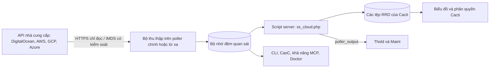

<!-- Source: README.md; SHA256: ac2074a40238686915802803c5efe773f33677f934281e0605e6e87a71a9d27d -->

<!-- translations:start -->
[English](../../../README.md) | [简体中文](../zh-CN/README.md) | [हिन्दी](../hi-IN/README.md) | [Español (España)](../es-ES/README.md) | [Español (Latinoamérica)](../es-419/README.md) | [العربية (السعودية)](../ar-SA/README.md) | [Afrikaans](../af-ZA/README.md) | [አማርኛ](../am-ET/README.md) | [العربية (مصر)](../ar-EG/README.md) | [العربية (المغرب)](../ar-MA/README.md) | [বাংলা](../bn-BD/README.md) | [Bosanski](../bs-BA/README.md) | [Deutsch](../de-DE/README.md) | [فارسی](../fa-IR/README.md) | [Filipino](../fil-PH/README.md) | [Français](../fr-FR/README.md) | [Français (Maroc)](../fr-MA/README.md) | [Français (Sénégal)](../fr-SN/README.md) | [Hausa](../ha-NG/README.md) | [עברית](../he-IL/README.md) | [Hrvatski](../hr-HR/README.md) | [Bahasa Indonesia](../id-ID/README.md) | [Igbo](../ig-NG/README.md) | [Italiano](../it-IT/README.md) | [日本語](../ja-JP/README.md) | [한국어](../ko-KR/README.md) | [Malagasy](../mg-MG/README.md) | [मराठी](../mr-IN/README.md) | [Bahasa Melayu](../ms-MY/README.md) | [Nederlands](../nl-NL/README.md) | [Polski](../pl-PL/README.md) | [Português (Brasil)](../pt-BR/README.md) | [Русский](../ru-RU/README.md) | [Kinyarwanda](../rw-RW/README.md) | [Soomaali](../so-SO/README.md) | [Српски](../sr-RS/README.md) | [Svenska](../sv-SE/README.md) | [Kiswahili](../sw-KE/README.md) | [தமிழ்](../ta-IN/README.md) | [తెలుగు](../te-IN/README.md) | [ไทย](../th-TH/README.md) | [Türkçe](../tr-TR/README.md) | [Українська](../uk-UA/README.md) | [اردو](../ur-PK/README.md) | [Tiếng Việt](README.md) | [isiXhosa](../xh-ZA/README.md) | [Yorùbá](../yo-NG/README.md) | [繁體中文](../zh-TW/README.md) | [isiZulu](../zu-ZA/README.md)
<!-- translations:end -->

# plugin_cloud

Một plugin Cacti 1.2 đưa các tài nguyên và chỉ số từ các nhà cung cấp đám mây công cộng vào Cacti dưới dạng thiết bị, nguồn dữ liệu và biểu đồ thông thường. Các khối lượng công việc đám mây nằm ngay bên cạnh hạ tầng mạng truyền tải chúng, tuân theo hệ thống phân quyền của Cacti, đồng thời Thold và Maint cảnh báo và tạm ẩn cảnh báo trên chúng. Một plugin duy nhất hỗ trợ DigitalOcean, Amazon Web Services, Google Cloud và Microsoft Azure thông qua các driver thuần PHP chỉ đọc.

> **Trạng thái: đang phát triển, chưa có bản phát hành (`0.1.0-dev`).** Nhánh này triển khai các driver thuần PHP cho DigitalOcean, AWS, Google Cloud và Azure, đồng bộ bộ thu thập dữ liệu từ xa và trạng thái tác nhân chỉ đọc, nhà cung cấp CasC và CLI cho người vận hành, các khả năng MCP và kiểm tra Doctor. Các mẫu Cacti đi kèm hiện hỗ trợ DigitalOcean Droplet và bộ cân bằng tải (`templates/cloud_digitalocean.xml`); các gói mẫu Cacti cho AWS, Google Cloud và Azure cùng việc kiểm chứng với tài khoản thực tế ngoài DigitalOcean ([thông tin thực tế về nhà cung cấp](../../research/provider-facts.md)) vẫn chưa hoàn tất. Không chạy trong môi trường sản xuất.

## Các nhà cung cấp được hỗ trợ

Mỗi driver nhà cung cấp được đăng ký trong `Drivers::production()`, cung cấp bởi `Provider::released()` và chạy bằng PHP thuần sử dụng `ext-openssl` cùng stream socket mà không cần SDK hay phụ thuộc thời gian chạy Composer nào.

| Nhà cung cấp | Trường phạm vi | Nguồn thông tin xác thực | Xác thực | Tài nguyên được phát hiện | Thu thập chỉ số |
|---|---|---|---|---|---|
| DigitalOcean (`digitalocean`) | Không có (theo phạm vi token) | `vault`, `file` | Bearer token | `droplet`, `load_balancer` | `/v2/monitoring/metrics` có nhận biết phần chia giới hạn tốc độ; đi kèm mẫu Cacti và truy vấn dữ liệu |
| Amazon Web Services (`aws`) | `account_id` (12 chữ số), `regions` | `vault`, `file`, `instance` | AWS SigV4 thuần PHP (`AWS4-HMAC-SHA256`), xác minh STS `GetCallerIdentity`, tùy chọn STS `AssumeRole`, EC2 IMDSv2 (`169.254.169.254`) cho tài khoản `instance` | `ec2_instance`, `rds_instance`, `aws_elb` (ALB/NLB) | CloudWatch `GetMetricData` theo lô (tối đa 500 truy vấn mỗi lần gọi) |
| Google Cloud (`gcp`) | `project` | `vault`, `file`, `instance` | JWT tài khoản dịch vụ RS256 thuần PHP qua `ext-openssl` trao đổi tại `oauth2.googleapis.com/token`, hoặc máy chủ siêu dữ liệu GCE (`metadata.google.internal`) cho tài khoản `instance` | `gce_instance` qua `instances.aggregatedList` | Cloud Monitoring `timeSeries.list` |
| Microsoft Azure (`azure`) | `tenant`, `subscription`, `regions` | `vault`, `file`, `instance` | Luồng client-credentials Entra ID OAuth2 thuần PHP (chỉ `client_secret`; loại trừ xác nhận chứng chỉ), hoặc danh tính được quản lý Azure IMDS (`169.254.169.254`) cho token ARM và Monitor | `azure_vm` qua ARM Resource Graph (phân trang bằng `$skipToken` và khử trùng lặp) | Azure Monitor `metrics:getBatch` (tối đa 50 tài nguyên mỗi lần gọi, xử lý điều tiết HTTP 429 và 529) |

## Các khả năng đã triển khai

### Nền tảng cốt lõi, kho lưu trữ bí mật và bộ thu thập

- **Cài đặt và vòng đời được bảo vệ.** Các điểm vào (`setup.php`, `cli/cloud.php`, `poller_cloud.php`, `ss_cloud.php` và các tệp trang) phân tích cú pháp được trên PHP 8.0 và từ chối PHP dưới 8.2 hoặc thiếu `ext-openssl` mà không làm hỏng Cacti. Quá trình nâng cấp theo thứ tự, lũy đẳng (`Schema::VERSION = 3`, 9 bảng) và chịu được gián đoạn. Gỡ cài đặt vẫn giữ lại các bảng của plugin trừ khi bỏ chọn *Keep Plugin Tables on Uninstall*.
- **Tài khoản và thông tin xác thực.** Thêm, sửa, xác minh và xóa tài khoản tại **Management > Cloud Accounts**. Thông tin xác thực đến từ kho lưu trữ mã hóa AES-256-GCM (`plugin_cloud_secret`, mặc định dùng khóa `/etc/cacti/cloud-vault.key`), từ tệp bị giới hạn trong *Credential File Directory* đã cấu hình (`cloud_credential_dir`, mặc định để trống để từ chối tệp), hoặc từ danh tính phiên bản của nhà cung cấp. Thông tin xác thực chỉ cho phép ghi trên giao diện và được ẩn khỏi nhật ký.
- **Kiểm soát kết nối đi ra và chỉ đọc nghiêm ngặt.** Mọi driver hoạt động phía sau `GuardedTransport` và `OutboundPolicy`: cổng HTTPS 443 tới đúng tên máy chủ của từng nhà cung cấp, với các điểm cuối siêu dữ liệu HTTP link-local cổng 80 (`169.254.169.254`, `metadata.google.internal`) chỉ được bật cho tài khoản `instance`. Chỉ cho phép các thao tác chỉ đọc nằm trong danh sách cho phép.
- **Bộ thu thập và kiểm soát chi phí.** `poller_cloud.php` chạy từ `poller_bottom` (một tiến trình cho mỗi poller thông qua sổ đăng ký tiến trình của Cacti) trong phạm vi `cloud_collector_budget`, nhận quyền thuê theo từng tài khoản, chạy phát hiện theo `discover_interval`, chỉ đọc chỉ số cho các nguồn dữ liệu Cacti đang hoạt động (`plugin_cloud_series`), tuân thủ `request_share` và `monthly_ceiling`, và lưu bộ nhớ đệm các điểm dữ liệu mới nhất vào `plugin_cloud_observation` cho `ss_cloud.php`.
- **Đối tượng Cacti và ước tính yêu cầu.** Duy trì một thiết bị phạm vi cho mỗi tài khoản (`plugin_cloud_device`), bảo toàn phương thức lập chỉ mục lại của thiết bị phạm vi qua các lần lưu thiết bị, nhập các mẫu DigitalOcean và truy vấn dữ liệu script server (`templates/cloud_digitalocean.xml`, `cloud_do_droplet.xml`, `cloud_do_load_balancer.xml`), đồng thời hiển thị ước tính số yêu cầu và chi phí theo bảng giá trên **New Graphs** (`graphs_new_top_links`) và **Cloud Health**.

### Bộ thu thập dữ liệu từ xa

- `INFO` khai báo `remote_collect:1`. Tài khoản có thể được gán cho bất kỳ Cacti poller nào đang bật (`poller_id >= 1`), và `poller_cloud.php --poller=N` chỉ thu thập các tài khoản thuộc về poller đó.
- **Hook `replicate_out`.** Sao chép các hàng thuộc phạm vi poller từ `plugin_cloud_account`, `plugin_cloud_device`, `plugin_cloud_series` và các hàng bản mã đã mã hóa từ `plugin_cloud_secret` (chỉ dành cho các tài khoản dùng kho lưu trữ bí mật thuộc về poller đích) qua `replicate_out_table()`. Các tệp khóa thô của kho lưu trữ không bao giờ được lưu trong cơ sở dữ liệu hay sao chép và luôn nằm cục bộ trên từng poller.
- **Hook `remote_agent`.** Cung cấp bản tóm tắt sức khỏe JSON chỉ đọc (`action=cloud_health`) chỉ chấp nhận tham số số nguyên `poller_id` và `account_id`, đồng thời không trả về bất kỳ thông tin xác thực, đường dẫn tệp hay bí mật nào.

### Các hook hệ sinh thái (CasC, khả năng MCP và Doctor)

- **Nhà cung cấp CasC (`casc_register_providers`).** Đăng ký nhà cung cấp `cloud` (phiên bản lược đồ `1`) với khả năng xuất YAML và XML thuần PHP xác định, xác thực tệp kê khai, lập kế hoạch sai khác và áp dụng có xác nhận. Thông tin xác thực trong kho lưu trữ được xuất dưới dạng tham chiếu `vault:account:<name>`; các trường bí mật thô (`secret`, `secrets`, `token`, `access_token`, `refresh_token`, `password`, `private_key`, `access_key_id`, `secret_access_key`, `session_token`, `client_secret`, `credential`, `credentials`, `vault_key`) bị từ chối. Việc áp dụng yêu cầu chính xác chuỗi băm SHA-256 `--confirm=<PLAN_HASH>`.
- **MCP / Abilities API (`abilities_register`).** Đăng ký ba khả năng chỉ đọc nghiêm ngặt được giới hạn theo phạm vi quyền Cloud View (`cloud_health.php`) và phạm vi thiết bị Cacti đối với người gọi không phải quản trị viên, không phát lộ thông tin xác thực, khóa kho lưu trữ hay đường dẫn tệp thông tin xác thực nào:
  - `cloud-list-accounts` (tùy chọn `provider`, `poller_id`)
  - `cloud-list-resources` (tùy chọn `account_id`, `type`, `lifecycle`)
  - `cloud-get-health` (tùy chọn `account_id`)
- **Kiểm tra Doctor (`doctor_register_checks`).** Đăng ký năm bước kiểm tra chẩn đoán không làm lộ giá trị bí mật hay dữ liệu khóa:
  - `cloud_schema`: tính cập nhật của phiên bản lược đồ
  - `cloud_vault_key`: khả năng đọc, quyền hạn và kích thước tệp khóa kho lưu trữ
  - `cloud_drivers`: đăng ký driver sản xuất cho tất cả nhà cung cấp đã phát hành
  - `cloud_accounts_health`: các tài khoản đang bật bị lỗi, bị điều tiết hoặc dữ liệu cũ
  - `cloud_poller_intervals`: sự đồng bộ giữa khoảng thời gian thu thập của tài khoản đang bật với khoảng thời gian poller của Cacti

## CLI

Chạy từ thư mục gốc của Cacti với PHP 8.2 trở lên:

```sh
# Operator and CasC CLI (options use --key=value form)
php plugins/cloud/cli/cloud.php export [--format=yaml|xml]
php plugins/cloud/cli/cloud.php validate --file=<path> [--format=yaml|xml]
php plugins/cloud/cli/cloud.php plan --file=<path> [--format=yaml|xml]
php plugins/cloud/cli/cloud.php apply --file=<path> --confirm=<PLAN_HASH> [--format=yaml|xml]
php plugins/cloud/cli/cloud.php health [--format=text|json] [--poller=<id>]

# Collector entry point (normally started by poller_bottom)
php plugins/cloud/poller_cloud.php [--poller=N] [--force] [--debug]
```

## Vai trò truy cập

| Realm | Quyền truy cập |
| --- | --- |
| Cloud View | Các trang giám sát hiện có. |
| Cloud Operator | Giám sát cộng thêm trang Vận hành và xác nhận phân loại cá nhân. |
| Cloud Admin | Quyền của Operator cộng thêm các thao tác cấu hình và quản trị hiện có. |

Sau khi sao chép các tệp nâng cấp, hãy mở trang Plugins với quyền quản trị viên để đăng ký các realm. Gán realm Operator một cách tường minh trong **Configuration > Users** hoặc các nhóm người dùng. Quá trình nâng cấp giữ nguyên ID và quyền đã cấp của realm View và Admin hiện có. Quyền Admin kế thừa quyền Operator, và quyền Operator kế thừa quyền View trên mỗi yêu cầu; việc này không thêm quyền được lưu trữ cho người dùng hay nhóm. Cài đặt plugin cũng yêu cầu quyền Cloud Admin bên cạnh quyền Settings của Cacti.

Quyền thiết bị của Cacti giới hạn các hàng và thao tác khả dụng cho từng người dùng; các đối tượng chưa được ánh xạ yêu cầu quản trị viên. Người vận hành có thể xác minh thông tin xác thực đã lưu cho tài khoản có thiết bị Cacti mà họ được phép truy cập. Thông tin xác thực, cấu hình, ánh xạ, xóa và các thay đổi quản trị khác vẫn nằm trong các trang quản trị. Các xác nhận chỉ tồn tại trong phiên hiện tại của người dùng, tối đa một giờ và chỉ khi cùng một quan sát đó vẫn còn mới. Các quan sát mới hoặc đã thay đổi sẽ làm mất hiệu lực của chúng. Chúng không bao giờ đánh dấu một phép đo thất bại là bình thường hoặc tạm ẩn cảnh báo.

## Tại sao

Mỗi nhà cung cấp đám mây đều có bảng điều khiển giám sát riêng. Khi chạy song song với Cacti, chúng để lại ba khoảng trống:

- **Kiểm soát truy cập tách rời.** Cho người dùng Cacti xem chỉ số đám mây đồng nghĩa với việc phải cấp cho họ tài khoản đăng nhập đám mây.
- **Không có ngữ cảnh mạng.** Các đường truyền tại chỗ được vẽ biểu đồ trong Cacti; các khối lượng công việc phía sau chúng lại được vẽ biểu đồ trong bảng điều khiển của từng nhà cung cấp.
- **Cảnh báo tách rời.** Thold và Maint hoạt động trên các nguồn dữ liệu và thiết bị của Cacti, vì vậy cảnh báo của nhà cung cấp phải được cấu hình và tạm ẩn riêng rẽ, mỗi nhà cung cấp một lần.

Plugin đọc API giám sát của từng nhà cung cấp trên một Cacti poller, lưu bộ nhớ đệm các điểm dữ liệu mới nhất và phục vụ chúng cho script server của Cacti. Poller của Cacti ghi các tệp RRD, nhờ đó việc vẽ biểu đồ, phân quyền, Thold, Maint và boost hoạt động như đối với mọi dữ liệu Cacti khác.

## Cam kết thiết kế

- **Chỉ đọc.** Mỗi driver chỉ có thể tạo các thao tác nhà cung cấp nằm trong danh sách cho phép của nó; plugin không bao giờ thay đổi tài nguyên đám mây. ([ADR 0002](../../decisions/0002-read-only-with-operation-allowlist.md))
- **Chỉ PHP, không SDK.** Việc ký và trao đổi token được triển khai bằng PHP với các phần mở rộng mà Cacti đã yêu cầu sẵn. Không có phụ thuộc thời gian chạy Composer. ([ADR 0003](../../decisions/0003-php-only-without-sdks.md))
- **Tính chi phí trước khi thu thập.** Plugin chỉ đọc các chỉ số có nguồn dữ liệu Cacti, hiển thị số lượng yêu cầu dự kiến và chi phí theo bảng giá trước khi tạo biểu đồ, đồng thời áp đặt mức trần hàng tháng. ([ADR 0005](../../decisions/0005-collect-only-what-is-graphed.md))
- **Không lưu thông tin xác thực dạng văn bản thuần trong cơ sở dữ liệu.** Thông tin xác thực đến từ kho lưu trữ mã hóa dùng khóa tệp nằm ngoài cơ sở dữ liệu, từ tệp thông tin xác thực, hoặc từ danh tính phiên bản của nhà cung cấp. ([ADR 0007](../../decisions/0007-credentials-outside-the-database-in-the-clear.md))

## Phạm vi và trạng thái

| Giai đoạn | Phạm vi | Cột mốc | Trạng thái |
|---|---|---|---|
| 0, nghiên cứu | Xác nhận thông tin thực tế về nhà cung cấp, danh mục chỉ số, mô hình chi phí và giới hạn tốc độ, vector kiểm thử ký, thử nghiệm truyền tải | [M1](https://github.com/somethingwithproof/plugin_cloud/milestone/1) | Hoàn tất, ngoại trừ các kiểm tra cần tài khoản nhà cung cấp thực tế |
| 1, lõi và DigitalOcean | Tài khoản, kho lưu trữ thông tin xác thực, truyền tải, bộ thu thập, bộ nhớ đệm quan sát, đối tượng Cacti, mẫu, ước tính yêu cầu, trang sức khỏe, DigitalOcean Droplet và bộ cân bằng tải | [M2](https://github.com/somethingwithproof/plugin_cloud/milestone/2), [M3](https://github.com/somethingwithproof/plugin_cloud/milestone/3), [M4](https://github.com/somethingwithproof/plugin_cloud/milestone/4) | Đã triển khai; đang chờ kiểm chứng thử nghiệm M4 |
| 2, AWS | SigV4 thuần PHP, STS `AssumeRole`, vai trò phiên bản IMDSv2, danh mục EC2/RDS/ELB, CloudWatch `GetMetricData` | [M5](https://github.com/somethingwithproof/plugin_cloud/milestone/5) | Đã triển khai driver; đang chờ mẫu Cacti và kiểm chứng tài khoản thực tế |
| 3, Google Cloud | JWT tài khoản dịch vụ RS256 thuần PHP, máy chủ siêu dữ liệu GCE, danh mục Compute Engine, Cloud Monitoring `timeSeries.list` | [M6](https://github.com/somethingwithproof/plugin_cloud/milestone/6) | Đã triển khai driver; đang chờ mẫu Cacti và kiểm chứng tài khoản thực tế |
| 4, Azure | Thông tin xác thực khách hàng Entra ID, danh tính được quản lý IMDS, danh mục VM từ ARM Resource Graph, Azure Monitor `metrics:getBatch` | [M7](https://github.com/somethingwithproof/plugin_cloud/milestone/7) | Đã triển khai driver; đang chờ mẫu Cacti và kiểm chứng tài khoản thực tế |
| 5, bộ thu thập từ xa và hệ sinh thái | Bộ thu thập dữ liệu từ xa (`replicate_out`, `remote_agent`), nhà cung cấp CasC và CLI, khả năng MCP, kiểm tra Doctor | [M8](https://github.com/somethingwithproof/plugin_cloud/milestone/8) | Đã triển khai |

Ngoài phạm vi: thay đổi tài nguyên đám mây, tạo hoặc nhân bản cảnh báo của nhà cung cấp, báo cáo thanh toán, nhật ký và dấu vết, và công cụ cảnh báo do plugin tự sở hữu. Các nhà cung cấp khác (Hetzner Cloud, Akamai Cloud, Oracle Cloud và các nhà cung cấp khác) là các vấn đề nghiên cứu.

## Cài đặt và cấu hình

Các bước này cài đặt mã phát triển để đánh giá. Chúng yêu cầu Cacti 1.2.31 trở lên trên PHP 8.2 trở lên.

1. Sao chép kho lưu trữ vào `plugins/cloud` trong thư mục Cacti của bạn. Thư mục bắt buộc phải có tên là `cloud`.
2. Tạo khóa kho lưu trữ bên ngoài thư mục gốc web trên mỗi poller sử dụng thông tin xác thực từ kho lưu trữ. Đặt khóa trong thư mục mà chỉ root và người dùng Cacti mới có thể ghi, và đặt quyền để tệp chỉ có thể đọc được bởi người dùng chạy máy chủ web và poller. Plugin không bao giờ tạo hay ghi tệp này:

   ```sh
   sudo install -d -m 0750 -o root -g cacti /etc/cacti
   head -c 32 /dev/urandom | sudo tee /etc/cacti/cloud-vault.key > /dev/null
   sudo chown cacti:cacti /etc/cacti/cloud-vault.key
   sudo chmod 0600 /etc/cacti/cloud-vault.key
   ```

   Thay `cacti` bằng người dùng chạy máy chủ web và poller của bạn. Tệp chứa 32 byte thô hoặc 64 ký tự thập lục phân. Hãy sao lưu tệp này cùng với cơ sở dữ liệu; nếu không có nó, các thông tin xác thực đã lưu sẽ phải nhập lại.
3. Trong Cacti, mở **Configuration > Plugins**, sau đó cài đặt và bật *Cloud*.
4. Trong **Configuration > Settings > Cloud**, đặt *Vault Key File* nếu bạn dùng đường dẫn khác, cấu hình *Credential File Directory* nếu bạn dự định dùng thông tin xác thực dạng tệp, và giữ *Collector Time Budget* (mặc định 240 giây) nhỏ hơn chu kỳ của poller.
5. Cấp quyền *Cloud Admin*, *Cloud Operator*, hoặc *Cloud View* cho người dùng và nhóm trong **Configuration > Users**. Việc cài đặt cấp Cloud Admin và Cloud View cho quản trị viên; Cloud Admin đã bao gồm quyền Operator, vì vậy quản trị viên không cần được cấp quyền Operator riêng.
6. Thêm tài khoản trong **Management > Cloud Accounts**, sau đó kiểm tra cảnh báo tại **Management > Cloud Health**.

## Mục tiêu tương thích

| Thành phần | Mục tiêu |
|---|---|
| Cacti | 1.2.31 trở lên, không cần vá mã nguồn lõi |
| PHP | 8.2 trở lên; các điểm vào vẫn phân tích cú pháp được trên 8.0 để môi trường chạy không được hỗ trợ nhận thông báo từ chối thay vì làm hỏng giao diện Cacti |
| Phần mở rộng PHP | `ext-openssl` (được Cacti 1.2.31 yêu cầu); không cần `ext-curl` và không có phụ thuộc thời gian chạy Composer |
| Thold, Maint | Không cần thay đổi |

## Thiết kế

- [docs/performance.md](../../performance.md) chứa các phép đo hiệu năng của bộ thu thập và trang sức khỏe, kèm theo phần cứng và cấu hình đã sử dụng.
- [docs/PLAN.md](../../PLAN.md) là kế hoạch đầy đủ: kiến trúc, thông tin thực tế về nhà cung cấp và Cacti mà hệ thống phụ thuộc (kèm nguồn), hợp đồng driver, phép tính chi phí, ranh giới bảo mật, kiểm thử và rủi ro.
- [docs/decisions/](../../decisions/) lưu trữ các bản ghi quyết định kiến trúc cho những lựa chọn đã được đưa ra.
- [docs/REQUIREMENTS.md](../../REQUIREMENTS.md) ánh xạ từng mã yêu cầu tới issue tương ứng.



## Cách theo dõi công việc

- **Cột mốc** tuân theo các cột mốc của kế hoạch. Mỗi cột mốc có một epic issue liệt kê các sub-issue và bằng chứng hoàn thành.
- **Issues** được phân loại bằng nhãn: `type: requirement`, `type: research`, `type: decision`, `type: epic`. Các issue yêu cầu nêu rõ các yêu cầu được đánh số, có thể kiểm thử (`REQ-AREA-NNN`) và tiêu chí chấp nhận.
- **Nhãn** cũng mang các thông tin `area:`, `provider:`, `phase:`, `priority:` và `status:`. Xem [CONTRIBUTING.md](../../../CONTRIBUTING.md#labels).
- [Bảng dự án](https://github.com/users/somethingwithproof/projects/7) hiển thị toàn bộ các issue qua mọi cột mốc.

## Phát triển

CI ([.github/workflows/plugin-ci-workflow.yml](../../../.github/workflows/plugin-ci-workflow.yml)) kiểm tra gói lưu trữ phát hành và phiên bản ngữ nghĩa (`bash tests/bin/archive-check.sh`), kiểm tra cú pháp các điểm vào trên PHP 8.0, chạy kiểm thử đơn vị Pest (`phpunit.xml`) và tích hợp vòng đời (`phpunit-integration.xml`) cùng PHPStan cấp độ 9 trên PHP 8.2 đến 8.5 với Cacti `release/1.2.31` và `1.2.x` cùng `CLOUD_OFFLINE=1`, kiểm tra việc từ chối trên PHP 8.1, xác minh các danh mục gettext, đo hiệu năng thu thập 1.000 chuỗi và trang sức khỏe, đồng thời chạy kiểm tra luồng công việc và tuân thủ REUSE.

Các kiểm tra cục bộ trước khi đẩy mã nguồn:

```sh
bash tests/bin/archive-check.sh
sh tests/lint-workflows.sh
sh locales/build_gettext.sh --check
CACTI_PATH=/path/to/cacti phpstan analyse -c phpstan.neon --no-progress
```

Chạy Pest với `--configuration=phpunit.xml` cho các kiểm thử đơn vị và quy tắc mã nguồn, hoặc `--configuration=phpunit-integration.xml` với `CACTI_PATH` và `CLOUD_TEST_DATABASE=disposable` trên một cơ sở dữ liệu Cacti dùng một lần cho các kiểm thử tích hợp vòng đời.

## Đóng góp

Đọc [CONTRIBUTING.md](../../../CONTRIBUTING.md). Các commit cần có chữ ký DCO. Thảo luận thiết kế diễn ra trên các issue; các quyết định đang mở mang nhãn `type: decision`.

## Bảo mật

Báo cáo lỗ hổng một cách riêng tư; xem [SECURITY.md](../../../SECURITY.md).

## Giấy phép

GNU General Public License v2.0, cùng giấy phép với Cacti và các plugin của nó. Xem [LICENSE](../../../LICENSE).
