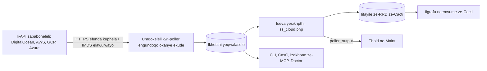

<!-- Source: README.md; SHA256: ac2074a40238686915802803c5efe773f33677f934281e0605e6e87a71a9d27d -->

<!-- translations:start -->
[English](../../../README.md) | [简体中文](../zh-CN/README.md) | [हिन्दी](../hi-IN/README.md) | [Español (España)](../es-ES/README.md) | [Español (Latinoamérica)](../es-419/README.md) | [العربية (السعودية)](../ar-SA/README.md) | [Afrikaans](../af-ZA/README.md) | [አማርኛ](../am-ET/README.md) | [العربية (مصر)](../ar-EG/README.md) | [العربية (المغرب)](../ar-MA/README.md) | [বাংলা](../bn-BD/README.md) | [Bosanski](../bs-BA/README.md) | [Deutsch](../de-DE/README.md) | [فارسی](../fa-IR/README.md) | [Filipino](../fil-PH/README.md) | [Français](../fr-FR/README.md) | [Français (Maroc)](../fr-MA/README.md) | [Français (Sénégal)](../fr-SN/README.md) | [Hausa](../ha-NG/README.md) | [עברית](../he-IL/README.md) | [Hrvatski](../hr-HR/README.md) | [Bahasa Indonesia](../id-ID/README.md) | [Igbo](../ig-NG/README.md) | [Italiano](../it-IT/README.md) | [日本語](../ja-JP/README.md) | [한국어](../ko-KR/README.md) | [Malagasy](../mg-MG/README.md) | [मराठी](../mr-IN/README.md) | [Bahasa Melayu](../ms-MY/README.md) | [Nederlands](../nl-NL/README.md) | [Polski](../pl-PL/README.md) | [Português (Brasil)](../pt-BR/README.md) | [Русский](../ru-RU/README.md) | [Kinyarwanda](../rw-RW/README.md) | [Soomaali](../so-SO/README.md) | [Српски](../sr-RS/README.md) | [Svenska](../sv-SE/README.md) | [Kiswahili](../sw-KE/README.md) | [தமிழ்](../ta-IN/README.md) | [తెలుగు](../te-IN/README.md) | [ไทย](../th-TH/README.md) | [Türkçe](../tr-TR/README.md) | [Українська](../uk-UA/README.md) | [اردو](../ur-PK/README.md) | [Tiếng Việt](../vi-VN/README.md) | [isiXhosa](README.md) | [Yorùbá](../yo-NG/README.md) | [繁體中文](../zh-TW/README.md) | [isiZulu](../zu-ZA/README.md)
<!-- translations:end -->

# plugin_cloud

Iplagin ye-Cacti 1.2 ezisa izibonelelo kunye nemilinganiselo evela kubaboneleli be-cloud kawonke-wonke kwi-Cacti njengezixhobo eziqhelekileyo, imithombo yedatha, kunye neegrafu. Imisebenzi ye-cloud ihlala ecaleni kwenethiwekhi eyithwalayo, phantsi kweemvume ze-Cacti, kwaye i-Thold ne-Maint zithumela izilumkiso kuyo kwaye ziyizithibe. Iplagin enye igubungela i-DigitalOcean, i-Amazon Web Services, i-Google Cloud, kunye ne-Microsoft Azure ngabaqhubi bababoneleli be-PHP emsulwa abafunda kuphela.

> **Imeko: isaphuhliswa, akukho kukhutshwa okwangoku (`0.1.0-dev`).** Eli sebe liphumeza abaqhubi be-PHP emsulwa be-DigitalOcean, i-AWS, i-Google Cloud, ne-Azure, ukuphindaphinda komqokeleli wedatha okude kunye nempilo yomeleli efunda kuphela, umboneleli we-CasC kunye ne-CLI yomsebenzisi, izakhono ze-MCP, kunye neetshekhi ze-Doctor. Iitempleyithi ze-Cacti ezikhutshiweyo okwangoku zigubungela ii-DigitalOcean Droplets kunye nee-load balancer (`templates/cloud_digitalocean.xml`); iipakethe zeetempleyithi ze-Cacti ze-AWS, i-Google Cloud, ne-Azure kunye nokufaneleka kwe-akhawunti ephilayo ngaphaya kwe-DigitalOcean ([iinkcukacha zomboneleli](../../research/provider-facts.md)) azikagqitywa. Musa ukuyisebenzisa kwinkqubo yemveliso.

## Ababoneleli abaxhaswayo

Umqhubi ngamnye womboneleli ubhaliswe kwi-`Drivers::production()`, unikwa yi-`Provider::released()`, kwaye usebenza nge-PHP emsulwa esebenzisa i-`ext-openssl` kunye nee-stream socket ngaphandle kwe-SDK okanye izixhomekeki zexesha lokusebenza ze-Composer.

| Umboneleli | Imihlaba yesikophu | Imithombo yee-akhawunti zokuqinisekisa | Uqinisekiso | Izibonelelo ezifunyenweyo | Uqokelelo lwemilinganiselo |
|---|---|---|---|---|---|
| DigitalOcean (`digitalocean`) | Akukho (yenzelwe ithokheni) | `vault`, `file` | Bearer token | `droplet`, `load_balancer` | `/v2/monitoring/metrics` enolwazi lwesabelo somda wezinga; iza neetempleyithi ze-Cacti kunye nemibuzo yedatha |
| Amazon Web Services (`aws`) | `account_id` (amadijithi ayi-12), `regions` | `vault`, `file`, `instance` | I-AWS SigV4 ye-PHP emsulwa (`AWS4-HMAC-SHA256`), ukuqinisekiswa kwe-STS `GetCallerIdentity`, i-STS `AssumeRole` ekhethekayo, i-EC2 IMDSv2 (`169.254.169.254`) yee-akhawunti ze-`instance` | `ec2_instance`, `rds_instance`, `aws_elb` (ALB/NLB) | I-CloudWatch `GetMetricData` edityanisiweyo (ukuya kuthi ga kwimibuzo eyi-500 ngomnxeba ngamnye) |
| Google Cloud (`gcp`) | `project` | `vault`, `file`, `instance` | I-JWT ye-akhawunti yenkonzo ye-RS256 ye-PHP emsulwa nge-`ext-openssl` etshintshiswa kwi-`oauth2.googleapis.com/token`, okanye iseva ye-metadata ye-GCE (`metadata.google.internal`) yee-akhawunti ze-`instance` | `gce_instance` nge-`instances.aggregatedList` | Cloud Monitoring `timeSeries.list` |
| Microsoft Azure (`azure`) | `tenant`, `subscription`, `regions` | `vault`, `file`, `instance` | Uqukuqelo lwe-client-credentials ze-Entra ID OAuth2 ye-PHP emsulwa (`client_secret` kuphela; iziqinisekiso zezatifikethi azibandakanywa), okanye isazisi esilawulwayo se-Azure IMDS (`169.254.169.254`) seethokheni ze-ARM ne-Monitor | `azure_vm` nge-ARM Resource Graph (enamaphepha nge-`$skipToken` kwaye isusiwe iziphinda) | Azure Monitor `metrics:getBatch` (ukuya kuthi ga kwizibonelelo eziyi-50 ngomnxeba ngamnye, iphatha ukuthintelwa kwe-HTTP 429 ne-529) |

## Izakhono eziphunyeziweyo

### Iqonga eliphambili, igumbi lokugcina iimfihlo, kunye nomqokeleli

- **Ufakelo olukhuselekileyo kunye nomjikelo wobomi.** Iindawo zokungena (`setup.php`, `cli/cloud.php`, `poller_cloud.php`, `ss_cloud.php`, kunye nezikripthi zamaphepha) ziyacazululwa kwi-PHP 8.0 kwaye ziyayala i-PHP engaphantsi kwe-8.2 okanye ukungabikho kwe-`ext-openssl` ngaphandle kokwaphula i-Cacti. Uhlaziyo lulandelelanisiwe, aluguquki xa luphindwa (`Schema::VERSION = 3`, iitheyibhile eziyi-9), kwaye luyakwazi ukunyamezela ukuphazamiseka. Ukukhupha kugcina iitheyibhile zeplagin ngaphandle kokuba i-*Keep Plugin Tables on Uninstall* icinyiwe.
- **Ii-akhawunti kunye neencwadi zokuqinisekisa.** Yongeza, hlela, qinisekisa, kwaye ucime ii-akhawunti phantsi kwe-**Management > Cloud Accounts**. Iincwadi zokuqinisekisa zivela kwigumbi eliguqulelwe ngokufihlakeleyo le-AES-256-GCM (`plugin_cloud_secret`, elinesitshixo nge-`/etc/cacti/cloud-vault.key` ngokungagqibekanga), kwifayile elinganiselwe ngaphakathi kwe-*Credential File Directory* emiselweyo (`cloud_credential_dir`, engenanto ngokungagqibekanga ukwala iifayile), okanye kwisazisi somzekelo womboneleli. Iincwadi zokuqinisekisa zezokubhala kuphela kwi-UI kwaye zisusiwe kwiilog.
- **Ulawulo olungqongqo lwangaphandle nolokufunda kuphela.** Umqhubi ngamnye usebenza ngasemva kwe-`GuardedTransport` kunye ne-`OutboundPolicy`: izibuko le-HTTPS 443 ukuya kumagama achanekileyo e-host ngomboneleli ngamnye, kunye neendawo zokugqibela ze-metadata ye-HTTP yendawo yekhonkco izibuko 80 (`169.254.169.254`, `metadata.google.internal`) ezivulwe kuphela kwii-akhawunti ze-`instance`. Kuphela yimisebenzi yokufunda kuphela ekuluhlu oluvunyelweyo evunyelweyo.
- **Umqokeleli nolawulo lweendleko.** I-`poller_cloud.php` isebenza ukusuka kwi-`poller_bottom` (inkqubo enye nge-poller nganye ngokusebenzisa irejista yenkqubo ye-Cacti) ngaphakathi kwe-`cloud_collector_budget`, ifumana iirenti ze-akhawunti nganye, iqhuba ukufumanisa kwi-`discover_interval`, ifunda imilinganiselo yemithombo yedatha ye-Cacti esebenzayo kuphela (`plugin_cloud_series`), ihlonipha i-`request_share` kunye ne-`monthly_ceiling`, kwaye igcina amanqaku edatha amva nje kwi-`plugin_cloud_observation` ye-`ss_cloud.php`.
- **Izinto ze-Cacti noqikelelo lwezicelo.** Igcina isixhobo sesikophu nge-akhawunti nganye (`plugin_cloud_device`), ikhusela iindlela zokuphinda zikhangelwe kwakhona zesixhobo sesikophu xa kugcinwa izixhobo, ingenisa iitempleyithi ze-DigitalOcean kunye nemibuzo yedatha yeseva yesikripthi (`templates/cloud_digitalocean.xml`, `cloud_do_droplet.xml`, `cloud_do_load_balancer.xml`), kwaye ibonisa uqikelelo lwezicelo nolwexabiso loluhlu kwi-**New Graphs** (`graphs_new_top_links`) nakwi-**Cloud Health**.

### Abaqokeleli bedatha abakude

- I-`INFO` ibhengeza `remote_collect:1`. Ii-akhawunti zinokwabelwa kuyo nayiphi na i-poller ye-Cacti evuliweyo (`poller_id >= 1`), kwaye i-`poller_cloud.php --poller=N` iqokelela kuphela ii-akhawunti ezizezaloo poller.
- **I-hook ye-`replicate_out`.** Iphindaphinda imigca yesikophu se-poller ukusuka kwi-`plugin_cloud_account`, `plugin_cloud_device`, `plugin_cloud_series`, kunye nemigca ye-ciphertext eguqulelwe ngokufihlakeleyo ukusuka kwi-`plugin_cloud_secret` (kuphela kwii-akhawunti ezixhaswa ligumbi lokugcina iimfihlo ezizeze-poller ekujoliswe kuyo) nge-`replicate_out_table()`. Iifayile zesitshixo esingalungiswanga zegumbi lokugcina iimfihlo azikhe zigcinwe kwi-database okanye ziphindaphindwe kwaye zihlala zikwindawo kwi-poller nganye.
- **I-hook ye-`remote_agent`.** Ibonisa isishwankathelo sempilo se-JSON esifunda kuphela (`action=cloud_health`) esamkela kuphela iiparamitha zenani elipheleleyo ze-`poller_id` kunye ne-`account_id` kwaye sibuyisela iqanda leencwadi zokuqinisekisa, iindlela zeefayile, okanye iimfihlo.

### Ii-hook zenkqubo yendalo (i-CasC, izakhono ze-MCP, kunye ne-Doctor)

- **Umboneleli we-CasC (`casc_register_providers`).** Ubhalisa umboneleli we-`cloud` (inguqulelo yesikima `1`) ngokuthumela ngaphandle kwe-YAML kunye ne-XML ye-PHP emsulwa eqinisekileyo, ukuqinisekiswa kwe-manifest, ukucwangciswa komahluko, kunye nokusetyenziswa okuqinisekisiweyo. Iincwadi zokuqinisekisa zegumbi lokugcina iimfihlo zithunyelwa ngaphandle njengeereferensi ze-`vault:account:<name>`; imihlaba yeemfihlo ezingalungiswanga (`secret`, `secrets`, `token`, `access_token`, `refresh_token`, `password`, `private_key`, `access_key_id`, `secret_access_key`, `session_token`, `client_secret`, `credential`, `credentials`, `vault_key`) iyaliwa. Ukusetyenziswa kufuna i-SHA-256 echanekileyo ye-`--confirm=<PLAN_HASH>`.
- **I-MCP / Abilities API (`abilities_register`).** Ibhalisa izakhono ezintathu ezifunda kuphela ngokungqongqo ezivalelwe kummandla we-Cloud View (`cloud_health.php`) nakwisikophu sesixhobo se-Cacti kubafowuni abangengabo abalawuli, zingakhuphi iincwadi zokuqinisekisa, izitshixo zegumbi lokugcina iimfihlo, okanye iindlela zeefayile zeencwadi zokuqinisekisa:
  - `cloud-list-accounts` (i-`provider`, `poller_id` ezikhethekayo)
  - `cloud-list-resources` (i-`account_id`, `type`, `lifecycle` ezikhethekayo)
  - `cloud-get-health` (i-`account_id` ekhethekayo)
- **Iitshekhi ze-Doctor (`doctor_register_checks`).** Ibhalisa iitshekhi ezintlanu zokuxilonga ezingabonisi maxabiso eemfihlo okanye izinto zesitshixo:
  - `cloud_schema`: ukusebenza kwangoku kwenguqulelo yesikima
  - `cloud_vault_key`: ukufundeka kwefayile yesitshixo segumbi lokugcina iimfihlo, iimvume, kunye nobungakanani
  - `cloud_drivers`: ubhaliso lomqhubi wemveliso kubo bonke ababoneleli abakhutshiweyo
  - `cloud_accounts_health`: ii-akhawunti ezivuliweyo ezisileleyo, ezithintelweyo, okanye ezindala
  - `cloud_poller_intervals`: ukulungelelaniswa kwamaxesha okuqokelela ee-akhawunti ezivuliweyo nexesha le-poller ye-Cacti

## I-CLI

Sebenzisa ukusuka kwidirekthori engcambu ye-Cacti nge-PHP 8.2 okanye kamva:

```sh
# Operator and CasC CLI (options use --key=value form)
php plugins/cloud/cli/cloud.php export [--format=yaml|xml]
php plugins/cloud/cli/cloud.php validate --file=<path> [--format=yaml|xml]
php plugins/cloud/cli/cloud.php plan --file=<path> [--format=yaml|xml]
php plugins/cloud/cli/cloud.php apply --file=<path> --confirm=<PLAN_HASH> [--format=yaml|xml]
php plugins/cloud/cli/cloud.php health [--format=text|json] [--poller=<id>]

# Collector entry point (normally started by poller_bottom)
php plugins/cloud/poller_cloud.php [--poller=N] [--force] [--debug]
```

## Iindima zofikelelo

| Ummandla | Ufikelelo |
| --- | --- |
| Cloud View | Amaphepha okubeka iliso akhoyo. |
| Cloud Operator | Ukubeka iliso kunye nephepha leMisebenzi nolwamkelo lokuqala olulolwakho. |
| Cloud Admin | Ufikelelo lwe-Operator kunye nolungelelaniso olukhoyo kunye nezenzo zolawulo. |

Emva kokukopa iifayile zohlaziyo, vula iphepha le-Plugins njengomlawuli ukubhalisa imimandla. Yabela ummandla we-Operator ngokucacileyo phantsi kwe-**Configuration > Users** okanye amaqela abasebenzisi. Uhlaziyo lugcina ii-ID zemimandla ze-View kunye ne-Admin ezikhoyo kunye nezibonelelo. Ufikelelo lwe-Admin luthatha ilifa lofikelelo lwe-Operator, kwaye ufikelelo lwe-Operator luthatha ilifa lofikelelo lwe-View kwisicelo ngasinye; oku akongezi zibonelelo zigciniweyo kubasebenzisi okanye kumaqela. Iisetingi zeplagin zikwafuna ufikelelo lwe-Cloud Admin ukongeza kwimvume ye-Settings ye-Cacti.

Iimvume zesixhobo se-Cacti zinciphisa imigca kunye nezenzo ezifumanekayo kumsebenzisi ngamnye; izinto ezingamaphwanga zifuna umlawuli. Abasebenzisi banokuqinisekisa incwadi yokuqinisekisa egciniweyo ye-akhawunti abanokufikelela kwisixhobo sayo se-Cacti. Iincwadi zokuqinisekisa, ulungelelaniso, umapho, ukucima, kunye nolunye utshintsho lolawulo zihlala kumaphepha olawulo. Ukuvunywa kuhlala kuphela kwiseshoni yomsebenzisi yangoku, ubuninzi beyure enye kwaye kuphela ngelixa uqwalaselo olufanayo luhleli lulutsha. Uqwalaselo olutsha okanye olutshintshileyo luyalutshitshisa. Alukhe luphawule umlinganiselo ohlulekileyo njengosempilweni okanye luthintele izilumkiso.

## Kutheni

Umboneleli ngamnye we-cloud unekhonsoli yakhe yokubeka iliso. Xa zisetyenziswa ecaleni kwe-Cacti, zishiya izikhewu ezithathu:

- **Ulawulo lofikelelo olwahlukileyo.** Ukubonisa umsebenzisi we-Cacti imilinganiselo ye-cloud kuthetha ukumnika ukungena kwi-cloud.
- **Akukho mxholo wenethiwekhi.** Amakhonkco asezindaweni zangaphakathi ayagrafwa kwi-Cacti; imisebenzi engasemva kwawo igrafwa kwikhonsoli yomboneleli ngamnye.
- **Izilumkiso ezahlukileyo.** I-Thold kunye ne-Maint zisebenza kwimithombo yedatha nakwizixhobo ze-Cacti, ngoko ke ii-alamu zomboneleli zicwangciswa kwaye zizithinjwe ngokwahlukeneyo, kube kanye ngomboneleli ngamnye.

Iplagin ifunda i-API yokubeka iliso yomboneleli ngamnye kwi-poller ye-Cacti, igcina amanqaku edatha amva nje kwikhetshi, kwaye iwahambise kwiseva yesikripthi ye-Cacti. I-poller ye-Cacti ibhala iifayile ze-RRD, ngoko ke ukugrafa, iimvume, i-Thold, i-Maint, kunye ne-boost zisebenza njengako nakuphi na okunye idatha ye-Cacti.

## Izibophelelo zoyilo

- **Funda kuphela.** Umqhubi ngamnye unokwakha kuphela imisebenzi yomboneleli ekuluhlu lwakhe oluvunyelweyo; iplagin ayikhe itshintshe isibonelelo se-cloud. ([ADR 0002](../../decisions/0002-read-only-with-operation-allowlist.md))
- **I-PHP kuphela, akukho SDK.** Ukusayina kunye nokutshintshisana ngethokheni kuphunyezwa kwi-PHP ngeendlela ezongeziweyo ezisele zifunwa yi-Cacti. Akukho zixhomekeki zexesha lokusebenza ze-Composer. ([ADR 0003](../../decisions/0003-php-only-without-sdks.md))
- **Iindleko phambi koqokelelo.** Iplagin ifunda kuphela imilinganiselo enomthombo wedatha we-Cacti, ibonisa inani elilindelweyo lezicelo kunye nexabiso loluhlu phambi kokuba iigrafu zenziwe, kwaye inyanzelisa umda wenyanga. ([ADR 0005](../../decisions/0005-collect-only-what-is-graphed.md))
- **Akukho ncwadi zokuqinisekisa zombhalo ocacileyo kwi-database.** Iincwadi zokuqinisekisa zivela kwigumbi lokugcina iimfihlo eliguqulelwe ngokufihlakeleyo elinesitshixo ngefayile engaphandle kwe-database, kwifayile yeencwadi zokuqinisekisa, okanye kwisazisi somzekelo womboneleli. ([ADR 0007](../../decisions/0007-credentials-outside-the-database-in-the-clear.md))

## Isikophu kunye nemeko

| Isigaba | Isikophu | Amanqanaba | Imeko |
|---|---|---|---|
| 0, uphando | Ukuqinisekiswa kweenkcukacha zomboneleli, iikhathalogi zemilinganiselo, imodeli yeendleko nezinga, ii-vector zovavanyo lokusayina, uvavanyo lothutho | [M1](https://github.com/somethingwithproof/plugin_cloud/milestone/1) | Kugqityiwe, ngaphandle kweetshekhi ezifuna ii-akhawunti zababoneleli ezphilayo |
| 1, undoqo ne-DigitalOcean | Ii-akhawunti, igumbi leencwadi zokuqinisekisa, uthutho, umqokeleli, ikhetshi yoqwalaselo, izinto ze-Cacti, iitempleyithi, uqikelelo lwezicelo, iphepha lempilo, ii-DigitalOcean Droplets kunye nee-load balancer | [M2](https://github.com/somethingwithproof/plugin_cloud/milestone/2), [M3](https://github.com/somethingwithproof/plugin_cloud/milestone/3), [M4](https://github.com/somethingwithproof/plugin_cloud/milestone/4) | Kuphunyeziwe; ukufaneleka kovavanyo lwe-M4 kulindile |
| 2, AWS | I-SigV4 ye-PHP emsulwa, i-STS `AssumeRole`, iindima zomzekelo ze-IMDSv2, uluhlu lwe-EC2/RDS/ELB, i-CloudWatch `GetMetricData` | [M5](https://github.com/somethingwithproof/plugin_cloud/milestone/5) | Umqhubi uphunyeziwe; iitempleyithi ze-Cacti kunye nokufaneleka kwe-akhawunti ephilayo kulindile |
| 3, Google Cloud | I-JWT ye-akhawunti yenkonzo ye-RS256 ye-PHP emsulwa, iseva ye-metadata ye-GCE, uluhlu lwe-Compute Engine, i-Cloud Monitoring `timeSeries.list` | [M6](https://github.com/somethingwithproof/plugin_cloud/milestone/6) | Umqhubi uphunyeziwe; iitempleyithi ze-Cacti kunye nokufaneleka kwe-akhawunti ephilayo kulindile |
| 4, Azure | Iincwadi zokuqinisekisa zomxhasi we-Entra ID, isazisi esilawulwayo se-IMDS, uluhlu lwe-VM lwe-ARM Resource Graph, i-Azure Monitor `metrics:getBatch` | [M7](https://github.com/somethingwithproof/plugin_cloud/milestone/7) | Umqhubi uphunyeziwe; iitempleyithi ze-Cacti kunye nokufaneleka kwe-akhawunti ephilayo kulindile |
| 5, abaqokeleli abakude kunye nenkqubo yendalo | Abaqokeleli bedatha abakude (`replicate_out`, `remote_agent`), umboneleli we-CasC kunye ne-CLI, izakhono ze-MCP, iitshekhi ze-Doctor | [M8](https://github.com/somethingwithproof/plugin_cloud/milestone/8) | Kuphunyeziwe |

Ngaphandle kwesikophu: ukutshintsha izibonelelo ze-cloud, ukudala okanye ukubonisa ii-alamu zomboneleli, iingxelo zentlawulo, iilog kunye nemikhondo, kunye nenjini yezilumkiso eyeyoplagin. Abanye ababoneleli (i-Hetzner Cloud, i-Akamai Cloud, i-Oracle Cloud, nabanye) yimiba yophando.

## Faka kwaye ulungelelanise

La manyathelo afaka ikhowudi yophuhliso ukuze ivavanywe. Afuna i-Cacti 1.2.31 okanye kamva kwi-PHP 8.2 okanye kamva.

1. Kopa indawo yokugcina kwi-`plugins/cloud` phantsi kwedirekthori yakho ye-Cacti. Idirekthori kufuneka ibizwe ngokuba yi-`cloud`.
2. Yenza isitshixo segumbi lokugcina iimfihlo ngaphandle kwengcambu yewebhu kwi-poller nganye esebenzisa iincwadi zokuqinisekisa ezixhaswa ligumbi. Sibeke kwidirekthori apho kuphela i-root kunye nomsebenzisi we-Cacti abanokubhala kuyo, kwaye wenze ifayile ifundeke kuphela ngumsebenzisi oqhuba iseva yewebhu kunye ne-poller. Iplagin ayikhe iyenze okanye iyibhale le fayile:

   ```sh
   sudo install -d -m 0750 -o root -g cacti /etc/cacti
   head -c 32 /dev/urandom | sudo tee /etc/cacti/cloud-vault.key > /dev/null
   sudo chown cacti:cacti /etc/cacti/cloud-vault.key
   sudo chmod 0600 /etc/cacti/cloud-vault.key
   ```

   Faka endaweni ye-`cacti` umsebenzisi oqhuba iseva yakho yewebhu ne-poller. Ifayile iqulathe ii-byte ezingalungiswanga eziyi-32 okanye oonobumba be-hexadecimal abayi-64. Yigcine ikopi kunye ne-database; ngaphandle kwayo, iincwadi zokuqinisekisa ezigciniweyo kufuneka zingeniswe kwakhona.
3. Kwi-Cacti, vula **Configuration > Plugins**, emva koko ufake kwaye uvule i-*Cloud*.
4. Phantsi kwe-**Configuration > Settings > Cloud**, seta *Vault Key File* ukuba usebenzise enye indlela, lungelelanisa *Credential File Directory* ukuba uceba ukusebenzisa iincwadi zokuqinisekisa ezisekelwe kwifayile, kwaye ugcine *Collector Time Budget* (okungagqibekanga imizuzwana eyi-240) ingaphantsi kwexesha le-poller.
5. Nika *Cloud Admin*, *Cloud Operator*, okanye *Cloud View* kubasebenzisi nakumaqela phantsi kwe-**Configuration > Users**. Ukufaka kunika i-Cloud Admin ne-Cloud View kumlawuli; i-Cloud Admin ibandakanya ufikelelo lwe-Operator, ngoko ke umlawuli akadingi sibonelelo esahlukileyo se-Operator.
6. Yongeza ii-akhawunti phantsi kwe-**Management > Cloud Accounts**, emva koko ujonge i-**Management > Cloud Health** ngezilumkiso.

## Iinjongo zokuhambelana

| Icandelo | Injongo |
|---|---|
| Cacti | 1.2.31 okanye kamva, akukho zipatshi zengqokolela |
| PHP | 8.2 okanye kamva; iindawo zokungena zihlala zicazululeka kwi-8.0 ukuze ixesha lokusebenza elingaxhaswanga lifumane ukwaliwa endaweni ye-UI ye-Cacti eyaphukileyo |
| Izandiso ze-PHP | `ext-openssl` (efunwa yi-Cacti 1.2.31); akukho `ext-curl` kwaye akukho zixhomekeki zexesha lokusebenza ze-Composer |
| Thold, Maint | Akukho tshintsho lufunekayo |

## Uyilo

- I-[docs/performance.md](../../performance.md) inemilinganiselo yomqokeleli neyephepha lempilo, kunye ne-hardware neesetingi ezisetyenzisiweyo.
- I-[docs/PLAN.md](../../PLAN.md) sisicwangciso esipheleleyo: uyilo lwakhiwo, iinkcukacha zomboneleli neze-Cacti exhomekeke kuzo (kunye nemithombo), isivumelwano somqhubi, izibalo zeendleko, imida yokhuseleko, uvavanyo, kunye nemingcipheko.
- I-[docs/decisions/](../../decisions/) igcina iirekhodi zezigqibo zoyilo lwakhiwo zezikhetho ezisele zenziwe.
- I-[docs/REQUIREMENTS.md](../../REQUIREMENTS.md) imapha i-ID yemfuneko nganye kumbandela wayo.



## Indlela umsebenzi olandelelwa ngayo

- **Amanqanaba** alandela amanqanaba esicwangciso. Linye linomba omkhulu (epic) odwelisa imiba engaphantsi kwawo kunye nobungqina bokuphuma.
- **Imiba** ihlelwe ngeeleyibhile: `type: requirement`, `type: research`, `type: decision`, `type: epic`. Imiba yeemfuno ichaza iimfuno ezinamanani nezinokuvavanywa (`REQ-AREA-NNN`) kunye nemiqathango yokwamkelwa.
- **Iileyibhile** zikwaphatha `area:`, `provider:`, `phase:`, `priority:`, kunye ne-`status:`. Jonga [CONTRIBUTING.md](../../../CONTRIBUTING.md#labels).
- I-[bhodi yeprojekthi](https://github.com/users/somethingwithproof/projects/7) ibonisa yonke imiba kuwo onke amanqanaba.

## Uphuhliso

I-CI ([.github/workflows/plugin-ci-workflow.yml](../../../.github/workflows/plugin-ci-workflow.yml)) ikhangela uvimba wokukhutshwa kunye noguqulelo lwentsingiselo (`bash tests/bin/archive-check.sh`), yenza i-lint yeendawo zokungena kwi-PHP 8.0, iqhuba iimvavanyo zeyunithi ze-Pest (`phpunit.xml`) kunye nokudibanisa komjikelo wobomi (`phpunit-integration.xml`) kunye ne-PHPStan inqanaba le-9 kwi-PHP 8.2 ukuya kwi-8.5 ngokuchasene ne-Cacti `release/1.2.31` ne-`1.2.x` nge-`CLOUD_OFFLINE=1`, ikhangela ukwaliwa kwi-PHP 8.1, iqinisekisa iikhathalogi ze-gettext, ilinganisa ukusebenza koqokelelo lwe-1,000-series kunye nephepha lempilo, kwaye iqhuba i-linting yokuhamba komsebenzi kunye nokuthobela i-REUSE.

Iitshekhi zasekhaya phambi kokutyhala:

```sh
bash tests/bin/archive-check.sh
sh tests/lint-workflows.sh
sh locales/build_gettext.sh --check
CACTI_PATH=/path/to/cacti phpstan analyse -c phpstan.neon --no-progress
```

Qhuba i-Pest nge-`--configuration=phpunit.xml` kwiimvavanyo zeyunithi nezomthetho wemvelaphi, okanye `--configuration=phpunit-integration.xml` nge-`CACTI_PATH` kunye ne-`CLOUD_TEST_DATABASE=disposable` ngokuchasene ne-database ye-Cacti elahlwayo kwiimvavanyo zokudibanisa komjikelo wobomi.

## Ukufaka isandla

Funda i-[CONTRIBUTING.md](../../../CONTRIBUTING.md). Iikomithi zifuna isayini ye-DCO. Ingxoxo yoyilo yenzeka kwimiba; izigqibo ezivulekileyo zithwala ileyibhile ye-`type: decision`.

## Ukhuseleko

Xela ubuthathaka ngasese; jonga [SECURITY.md](../../../SECURITY.md).

## Ilayisensi

GNU General Public License v2.0, ilayisensi efanayo neye-Cacti kunye neeplagin zayo. Jonga [LICENSE](../../../LICENSE).
