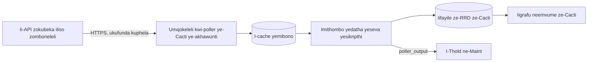

<!-- Source: README.md; SHA256: 7c621642e5f1a46bac66e4bc744f70aebb014c610d22de034088845fdc170405 -->

<!-- translations:start -->
[English](../../../README.md) | [简体中文](../zh-CN/README.md) | [हिन्दी](../hi-IN/README.md) | [Español (España)](../es-ES/README.md) | [Español (Latinoamérica)](../es-419/README.md) | [العربية (السعودية)](../ar-SA/README.md) | [Afrikaans](../af-ZA/README.md) | [አማርኛ](../am-ET/README.md) | [العربية (مصر)](../ar-EG/README.md) | [العربية (المغرب)](../ar-MA/README.md) | [বাংলা](../bn-BD/README.md) | [Bosanski](../bs-BA/README.md) | [Deutsch](../de-DE/README.md) | [فارسی](../fa-IR/README.md) | [Filipino](../fil-PH/README.md) | [Français](../fr-FR/README.md) | [Français (Maroc)](../fr-MA/README.md) | [Français (Sénégal)](../fr-SN/README.md) | [Hausa](../ha-NG/README.md) | [עברית](../he-IL/README.md) | [Hrvatski](../hr-HR/README.md) | [Bahasa Indonesia](../id-ID/README.md) | [Igbo](../ig-NG/README.md) | [Italiano](../it-IT/README.md) | [日本語](../ja-JP/README.md) | [한국어](../ko-KR/README.md) | [Malagasy](../mg-MG/README.md) | [मराठी](../mr-IN/README.md) | [Bahasa Melayu](../ms-MY/README.md) | [Nederlands](../nl-NL/README.md) | [Polski](../pl-PL/README.md) | [Português (Brasil)](../pt-BR/README.md) | [Русский](../ru-RU/README.md) | [Kinyarwanda](../rw-RW/README.md) | [Soomaali](../so-SO/README.md) | [Српски](../sr-RS/README.md) | [Svenska](../sv-SE/README.md) | [Kiswahili](../sw-KE/README.md) | [தமிழ்](../ta-IN/README.md) | [తెలుగు](../te-IN/README.md) | [ไทย](../th-TH/README.md) | [Türkçe](../tr-TR/README.md) | [Українська](../uk-UA/README.md) | [اردو](../ur-PK/README.md) | [Tiếng Việt](../vi-VN/README.md) | [isiXhosa](README.md) | [Yorùbá](../yo-NG/README.md) | [繁體中文](../zh-TW/README.md) | [isiZulu](../zu-ZA/README.md)
<!-- translations:end -->

# plugin_cloud

Iplagin ye-Cacti 1.2 ezisa izibonelelo kunye nemilinganiselo evela kubaboneleli be-cloud kawonke-wonke kwi-Cacti njengezixhobo eziqhelekileyo, imithombo yedatha, kunye neegrafu. Imisebenzi ye-cloud emva koko ihlala ecaleni kwenethiwekhi eyithwalayo, phantsi kweemvume ze-Cacti, kwaye i-Thold ne-Maint zinokulumkisa kwaye zizicinezele. Iplagin enye igubungela bonke ababoneleli, inomqhubi ngomboneleli ngamnye: i-DigitalOcean, i-AWS, i-Google Cloud, kunye ne-Azure kuqala.

> **Imeko: inqanaba lesi-3 (i-DigitalOcean kunye nezinto ze-Cacti), liyaphononongwa.** Eli nqanaba longeza umqhubi we-DigitalOcean, iitempleyithi ze-Cacti, isixhobo sesikophu nge-akhawunti nganye esinombuzo wedatha ngohlobo lwesibonelelo ngasinye, igalelo leseva yesikripthi, kunye noqikelelo lwezicelo kwiigrafu ezintsha (New Graphs) nakwiphepha lempilo. Uhlolo lokuqala kwi-akhawunti ephilayo ye-DigitalOcean lurekhodwe kwi-[iinkcukacha zomboneleli](../../research/provider-facts.md). Sukuyisebenzisa kwinkqubo yemveliso.

## Iindima zofikelelo

| Ummandla | Ufikelelo |
| --- | --- |
| Cloud View | Amaphepha okubeka iliso akhoyo. |
| Cloud Operator | Ukubeka iliso kunye nephepha leMisebenzi (Operations) kunye nezivumo zohluzo zobuqu. |
| Cloud Admin | Ufikelelo loMsebenzisi (Operator) kunye noqwalaselo olukhoyo nezenzo zolawulo. |

Emva kokukopa iifayile zohlaziyo, vula iphepha leePlagin njengomlawuli ukubhalisa
ummandla omtsha. Yabela ummandla we-Operator ngokucacileyo phantsi kwe-**Configuration > Users** okanye amaqela abasebenzisi.
Uhlaziyo lugcina ii-ID zemimandla ye-View ne-Admin ezikhoyo kunye neemvume ezabelweyo. Ufikelelo lwe-Admin
lufumana ufikelelo lwe-Operator njengelifa, kwaye ufikelelo lwe-Operator lufumana ufikelelo lwe-View njengelifa kwisicelo ngasinye;
oku akongezi iimvume ezigciniweyo kubasebenzisi okanye kumaqela. Iisethingi zeplagin zifuna kwakhona
ufikelelo lwe-Cloud Admin ukongeza kwimvume yeeSethingi (Settings) ye-Cacti.

Iimvume zezixhobo ze-Cacti zisayinciphisa imigca nezenzo ezifumanekayo kumsebenzisi ngamnye; izinto ezingamephwanga zifuna umlawuli. Abasebenzisi be-Operator banokuqinisekisa isiqinisekiso esigciniweyo se-akhawunti abanokufikelela kwisixhobo sayo se-Cacti.
Iziqinisekiso, uqwalaselo, umepho, ukucima kunye nolunye utshintsho lolawulo
zihlala kumaphepha olawulo. Izivumo zihlala kuphela kwiseshoni yangoku
yomsebenzisi, ubuninzi beyure enye kwaye kuphela xa kwakuloo mbono
usahlaziyekile. Imibono emitsha okanye etshintshileyo iyazitshitshisa. Azize ziphawule umlinganiselo owohlulekileyo
njengosempilweni okanye zicinezele izilumkiso.

## Kutheni

Umboneleli we-cloud ngamnye unekhonsoli yakhe yokubeka iliso. Xa isetyenziswa ecaleni kwe-Cacti, ishiya izikhewu ezithathu:

- **Ulawulo lofikelelo olwahlukileyo.** Ukubonisa umsebenzisi we-Cacti imilinganiselo ye-cloud kuthetha ukumnika igama lokungena kwi-cloud.
- **Akukho mxholo wenethiwekhi.** Amakhonkco akwisakhiwo agrafwa kwi-Cacti; imisebenzi engasemva kwawo igrafwa kwikhonsoli yomboneleli ngamnye.
- **Izilumkiso ezahlukileyo.** I-Thold ne-Maint zisebenza kwimithombo yedatha nezixhobo ze-Cacti, ngoko ke ii-alamu zomboneleli ziqwalaselwa kwaye zicinezelwe zodwa, kube kanye ngomboneleli.

Iplagin ifunda i-API yokubeka iliso yomboneleli ngamnye kwi-poller ye-Cacti, igcina amanqaku edatha amva nje kwi-cache, kwaye iwasebenzisele iseva yesikripthi ye-Cacti. I-poller ye-Cacti ibhala iifayile ze-RRD, ngoko ke ukugrafa, iimvume, i-Thold, i-Maint, kunye ne-boost zisebenza ngendlela ezisebenza ngayo kuyo nayiphi na idatha ye-Cacti.

## Izibophelelo zoyilo

- **Ukufunda kuphela.** Umqhubi ngamnye unokwakha kuphela imisebenzi yomboneleli ekuluhlu oluvunyelweyo; iplagin ayize itshintshe isibonelelo se-cloud. ([ADR 0002](../../decisions/0002-read-only-with-operation-allowlist.md))
- **I-PHP kuphela, akukho zi-SDK.** Ukusayina nokutshintshiselana ngeethokheni kuphunyezwa nge-PHP ngezongezo esele zifunwa yi-Cacti. Akukho zixhomekeko zexesha lokusebenza ze-Composer. ([ADR 0003](../../decisions/0003-php-only-without-sdks.md))
- **Iindleko phambi kokuqokelela.** Iplagin ifunda kuphela imilinganiselo enomthombo wedatha we-Cacti, ibonisa inani lezicelo ezilindelekileyo kunye neendleko zexabiso loluhlu phambi kokuba kwenziwe iigrafu, kwaye inyanzelisa umda wenyanga. ([ADR 0005](../../decisions/0005-collect-only-what-is-graphed.md))
- **Akukho ziqinisekiso ezibhalwe ngokungafihlwanga kwi-database.** Iziqinisekiso zivela kwi-vault efihliweyo enesitshixo esikwifayile engaphandle kwe-database, kwifayile yesiqinisekiso, okanye kwisazisi sesibonelelo (instance identity) somboneleli. ([ADR 0007](../../decisions/0007-credentials-outside-the-database-in-the-clear.md))

## Umda nemeko

| Isigaba | Umda | Amanqanaba | Imeko |
|---|---|---|---|
| 0, uphando | Ukuqinisekiswa kweenkcukacha zomboneleli, iikhathalogu zemilinganiselo, imodeli yeendleko neyexabiso, iivektha zovavanyo lokusayina, uvavanyo lothutho | [M1](https://github.com/somethingwithproof/plugin_cloud/milestone/1) | Igqityiwe, ngaphandle kohlolo olufuna i-akhawunti yomboneleli ephilayo |
| 1, isiseko ne-DigitalOcean | Ii-akhawunti, i-vault yeziqinisekiso, uthutho, umqokeleli, i-cache yemibono, izinto ze-Cacti, iphepha lempilo, ii-Droplets ze-DigitalOcean nezilinganisi zomthwalo | [M2](https://github.com/somethingwithproof/plugin_cloud/milestone/2), [M3](https://github.com/somethingwithproof/plugin_cloud/milestone/3), [M4](https://github.com/somethingwithproof/plugin_cloud/milestone/4) | I-M2 igqityiwe ([#81](https://github.com/somethingwithproof/plugin_cloud/pull/81)); umqhubi we-M3, iitempleyithi, nezixhobo zesikophu zidibanisiwe; uqikelelo lwezicelo, iimvume, nohlolo lwentsebenzo luyaphononongwa; i-M4 ayikaqalwa |
| 2, i-AWS | Uhlobo lwe-4 loTyikityo (Signature Version 4), `AssumeRole`, iindima zesibonelelo (instance roles), i-CloudWatch `GetMetricData`, uluhlu lwengingqi | [M5](https://github.com/somethingwithproof/plugin_cloud/milestone/5) | Ayikaqalwa |
| 3, i-Google Cloud | I-JWT ye-akhawunti yenkonzo, iseva ye-metadata, i-Cloud Monitoring `timeSeries.list` | [M6](https://github.com/somethingwithproof/plugin_cloud/milestone/6) | Ayikaqalwa |
| 4, i-Azure | Iziqinisekiso zomthengi ze-Entra, isazisi esilawulwayo, i-Resource Graph, `metrics:getBatch` | [M7](https://github.com/somethingwithproof/plugin_cloud/milestone/7) | Ayikaqalwa |
| 5, abaqokeleli abakude | Ii-akhawunti kubaqokeleli bedatha abakude be-Cacti | [M8](https://github.com/somethingwithproof/plugin_cloud/milestone/8) | Ayikaqalwa |

Ngaphandle komda: ukutshintsha izibonelelo ze-cloud, ukudala okanye ukulinganisa ii-alamu zomboneleli, iingxelo zetyala, iilogi nemizila, kunye nenjini yezilumkiso eyeyoplagin. Abanye ababoneleli (i-Hetzner Cloud, i-Akamai Cloud, i-Oracle Cloud, nabanye) yimiba yophando.

## Oko kuthunyelwa linqanaba lesi-2

- **Ufakelo olukhuselekileyo.** Kwi-PHP engaphantsi kwe-8.2, okanye ngaphandle kwe-ext-openssl, ufakelo nokuvula ziyaliwa ngomyalezo, kwaye enye indawo ye-Cacti iqhubeka isebenza.
- **Umjikelo wobomi.** Faka, hlaziya, kwaye ususe ngephepha leePlagin ze-Cacti. Uhlaziyo lulandelelaniswa kwaye luyaphila ekuphazamisekeni. Ukususa kugcina iitafile zeplagin ngaphandle kokuba ucima u-*Keep Plugin Tables on Uninstall*.
- **Imimandla eyahlukileyo.** I-*Cloud Admin* ivula i-**Cloud Accounts**; i-*Cloud Operator* ivula i-**Cloud Operations**; i-*Cloud View* ivula i-**Cloud Health**. I-Admin ifumana i-Operator njengelifa, kwaye i-Operator ifumana i-View njengelifa. Omathathu la maphepha aphantsi koLawulo (Management).
- **Ii-akhawunti neziqinisekiso.** Yongeza, hlela, qinisekisa, kwaye ucime ii-akhawunti. Isiqinisekiso siyatshixwa (encrypted) kwi-database ngefayile yesitshixo egcinwe ngaphandle kwayo (AES-256-GCM), okanye sifundwe kwifayile ekwi-poller. Iziqinisekiso zezokubhala kuphela kwi-UI kwaye ziyasuswa kwiilogi.
- **Umqokeleli.** Iqala kusebenza ngakunye kwe-poller, umzekelo omnye nge-poller nganye, ngaphakathi kohlahlo lwabiwo-mali lwexesha. Ithatha ilisi nge-akhawunti nganye, iqhuba ukufumanisa ngesithuba sayo, kwaye ifunda imilinganiselo kuphela yemithombo yedatha esebenzayo yeplagin ngokwayo.
- **Impilo.** Imeko yokuqokelela, yokufumanisa, yesibonelelo, neyokuhlaziya nge-akhawunti nganye, kunye nezilumkiso zesitshixo se-vault esingasebenziyo, iifayile zeziqinisekiso ezingakhuselekanga, kunye nezithuba ezingenakuhlonitshwa yi-poller.

## Faka kwaye uqwalasele

La manyathelo afaka ikhowudi yenqanaba lesi-2 ukuze ivavanywe. Afuna i-Cacti 1.2.31 okanye yamva kwi-PHP 8.2 okanye yamva.

1. Kopa irepozithori kwi-`plugins/cloud` phantsi kolawulo lwakho lwe-Cacti. Ulawulo kufuneka lubizwe ngokuba yi-`cloud`.
2. Yenza isitshixo se-vault ngaphandle kwengcambu yewebhu. Sibeke kulawulo olunokubhalwa kuphela ngu-root kunye nomsebenzisi we-Cacti, kwaye wenze ifayile ifundeke kuphela ngumsebenzisi oqhuba iseva yewebhu kunye ne-poller. Iplagin ayize iyenze okanye ibhale le fayile:

   ```sh
   sudo install -d -m 0750 -o root -g cacti /etc/cacti
   head -c 32 /dev/urandom | sudo tee /etc/cacti/cloud-vault.key > /dev/null
   sudo chown cacti:cacti /etc/cacti/cloud-vault.key
   sudo chmod 0600 /etc/cacti/cloud-vault.key
   ```

   Buyisela u-`cacti` ngomsebenzisi oqhuba iseva yakho yewebhu kunye ne-poller. Ifayile igcina iibhayithi ezingama-32 ezingaphekwanga okanye oonobumba be-hexadecimal abangama-64. Yenzele i-backup kunye ne-database; ngaphandle kwayo, iziqinisekiso ezigciniweyo kufuneka zingeniswe kwakhona.
3. Kwi-Cacti, vula i-**Configuration > Plugins**, uze ufake kwaye uvule i-*Cloud*.
4. Phantsi kwe-**Configuration > Settings > Cloud**, seta i-*Vault Key File* ukuba usebenzise enye indlela. I-*Collector Time Budget* (emiselweyo yimizuzwana engama-240) kufuneka ihlale ingaphantsi kwesithuba se-poller.
5. Nika i-*Cloud Admin*, i-*Cloud Operator* okanye i-*Cloud View* kubasebenzisi nakumaqela phantsi kwe-**Configuration > Users**. Ukufaka kunika i-Cloud Admin ne-Cloud View kumlawuli; i-Cloud Admin iquka ufikelelo lwe-Operator, ngoko ke umlawuli akafuni mvume eyahlukileyo ye-Operator.
6. Yongeza ii-akhawunti phantsi kwe-**Management > Cloud Accounts**, uze ukhangele i-**Management > Cloud Health** ngezilumkiso.

## Iinjongo zokuhambelana

| Icandelo | Injongo |
|---|---|
| I-Cacti | 1.2.31 okanye yamva, akukho ziphetshi zengcambu |
| I-PHP | 8.2 okanye yamva; i-`setup.php` ihlala ifundeka kwi-8.0 ukuze ixesha lokusebenza elingaxhaswayo lifumane ukwaliwa endaweni ye-UI ye-Cacti eyaphukileyo |
| Izongezo ze-PHP | Akukho nto ngaphaya kwezo zifunwa yi-Cacti 1.2.31 |
| I-Thold, i-Maint | Akukho lutshintsho lufunekayo |

## Uyilo

- I-[docs/performance.md](../../performance.md) inemilinganiselo yomqokeleli kunye neyephepha lempilo, kunye neehardware neesethingi ezisetyenzisiweyo.
- I-[docs/PLAN.md](../../PLAN.md) sisicwangciso esipheleleyo: uyilo, iinkcukacha zomboneleli neze-Cacti exhomekeke kuzo (kunye nemithombo), isivumelwano somqhubi, izibalo zeendleko, imida yokhuseleko, uvavanyo, kunye nemingcipheko.
- I-[docs/decisions/](../../decisions) igcina iirekhodi zezigqibo zoyilo kukhetho esele lwenziwe.
- I-[docs/REQUIREMENTS.md](../../REQUIREMENTS.md) imepha i-ID yemfuneko nganye kumba wayo.



## Indlela umsebenzi olandelelwa ngayo

- **Amanqanaba** alandela amanqanaba esicwangciso. Ngalinye linomba omkhulu (epic) odwelisa imiba yawo engaphantsi nobungqina bokuphuma.
- **Imiba** ihlelwa ngokweleyibhile: `type: requirement`, `type: research`, `type: decision`, `type: epic`. Imiba yeemfuno ichaza iimfuno ezinamanani nezinokuvavanywa (`REQ-AREA-NNN`) kunye neendlela zokwamkelwa.
- **Iileyibhile** zikwathwala u-`area:`, `provider:`, `phase:`, `priority:`, kunye no-`status:`. Jonga ku-[CONTRIBUTING.md](../../../CONTRIBUTING.md#labels).
- I-[ibhodi yeprojekthi](https://github.com/users/somethingwithproof/projects/7) ibonisa yonke imiba kumanqanaba onke.

## Uphuhliso

I-CI ihlola iindawo zokungena kwi-PHP 8.0, iqhuba iimvavanyo zeyunithi nezentsebenziswano kunye ne-PHPStan inqanaba le-9, kwaye ifaka iplagin kwi-PHP 8.2 ukuya kwi-8.5 ngokuchasene ne-Cacti 1.2.31 kunye nesebe le-1.2.x. Ikwajonga ukuba i-PHP 8.1 iyaliwa ngaphandle kokwaphula i-Cacti. Iimvavanyo zisebenzisa i-Pest esuka kwisixhobo seplagin yengcambu ye-Cacti. Olo khetho lolwexeshana kude kugqitywe i-[#12](https://github.com/somethingwithproof/plugin_cloud/issues/12). I-[.github/workflows/plugin-ci-workflow.yml](../../../.github/workflows/plugin-ci-workflow.yml) idwelisa inyathelo ngalinye. Qhuba u-`sh tests/lint-workflows.sh` kunye no-`sh locales/build_gettext.sh --check` kwikhompyutha yakho phambi kokuthumela (push).

## Ukuba negalelo

Funda i-[CONTRIBUTING.md](../../../CONTRIBUTING.md). Iikhomithi zifuna utyikityo lwe-DCO. Ingxoxo yoyilo yenzeka kwimiba; izigqibo ezivulekileyo zithwala ileyibhile ye-`type: decision`.

## Ukhuseleko

Xela ubuthathaka bokhuseleko ngasese; jonga ku-[SECURITY.md](../../../SECURITY.md).

## Ilayisensi

I-GNU General Public License v2.0, ikwayilayisensi efanayo neye-Cacti neeplagin zayo. Jonga ku-[LICENSE](../../../LICENSE).
