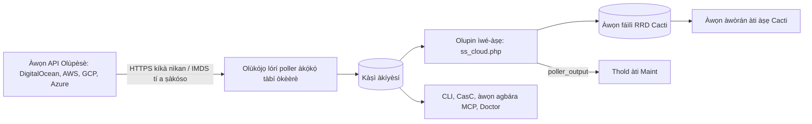

<!-- Source: README.md; SHA256: ac2074a40238686915802803c5efe773f33677f934281e0605e6e87a71a9d27d -->

<!-- translations:start -->
[English](../../../README.md) | [简体中文](../zh-CN/README.md) | [हिन्दी](../hi-IN/README.md) | [Español (España)](../es-ES/README.md) | [Español (Latinoamérica)](../es-419/README.md) | [العربية (السعودية)](../ar-SA/README.md) | [Afrikaans](../af-ZA/README.md) | [አማርኛ](../am-ET/README.md) | [العربية (مصر)](../ar-EG/README.md) | [العربية (المغرب)](../ar-MA/README.md) | [বাংলা](../bn-BD/README.md) | [Bosanski](../bs-BA/README.md) | [Deutsch](../de-DE/README.md) | [فارسی](../fa-IR/README.md) | [Filipino](../fil-PH/README.md) | [Français](../fr-FR/README.md) | [Français (Maroc)](../fr-MA/README.md) | [Français (Sénégal)](../fr-SN/README.md) | [Hausa](../ha-NG/README.md) | [עברית](../he-IL/README.md) | [Hrvatski](../hr-HR/README.md) | [Bahasa Indonesia](../id-ID/README.md) | [Igbo](../ig-NG/README.md) | [Italiano](../it-IT/README.md) | [日本語](../ja-JP/README.md) | [한국어](../ko-KR/README.md) | [Malagasy](../mg-MG/README.md) | [मराठी](../mr-IN/README.md) | [Bahasa Melayu](../ms-MY/README.md) | [Nederlands](../nl-NL/README.md) | [Polski](../pl-PL/README.md) | [Português (Brasil)](../pt-BR/README.md) | [Русский](../ru-RU/README.md) | [Kinyarwanda](../rw-RW/README.md) | [Soomaali](../so-SO/README.md) | [Српски](../sr-RS/README.md) | [Svenska](../sv-SE/README.md) | [Kiswahili](../sw-KE/README.md) | [தமிழ்](../ta-IN/README.md) | [తెలుగు](../te-IN/README.md) | [ไทย](../th-TH/README.md) | [Türkçe](../tr-TR/README.md) | [Українська](../uk-UA/README.md) | [اردو](../ur-PK/README.md) | [Tiếng Việt](../vi-VN/README.md) | [isiXhosa](../xh-ZA/README.md) | [Yorùbá](README.md) | [繁體中文](../zh-TW/README.md) | [isiZulu](../zu-ZA/README.md)
<!-- translations:end -->

# plugin_cloud

Àfikún Cacti 1.2 kan tí ó ń mú àwọn ohun-èlò àti ìwọ̀n láti ọ̀dọ̀ àwọn olùpèsè àwọsánmà gbogbo-gbòò wọ inú Cacti gẹ́gẹ́ bí àwọn ẹ̀rọ, orísun dátà, àti àwòrán oníṣirò lásán. Àwọn iṣẹ́ àwọsánmà máa ń jókòó lẹ́gbẹ̀ẹ́ nẹ́tíwọ́ọ̀kì tí ó ń gbé wọn, lábẹ́ àwọn àṣẹ Cacti, bẹ́ẹ̀ sì ni Thold àti Maint ń fi ìkìlọ̀ ránṣẹ́ lórí wọn wọ́n sì ń dá wọn dúró. Àfikún kan ṣoṣo bo DigitalOcean, Amazon Web Services, Google Cloud, àti Microsoft Azure nípasẹ̀ àwọn awakọ̀ olùpèsè PHP pọ́ọ́rọ́ tí ó jẹ́ kíkà nìkan.

> **Ipò: ó wà lọ́wọ́ ìdàgbàsókè, kò tíì sí ìtẹ̀jáde kankan (`0.1.0-dev`).** Ẹ̀ka yìí ṣe àmúṣẹ àwọn awakọ̀ PHP pọ́ọ́rọ́ fún DigitalOcean, AWS, Google Cloud, àti Azure, ìṣàfihàn-púpọ̀ olùkójọ dátà òkèèrè àti ìlera aṣojú kíkà nìkan, olùpèsè CasC àti CLI olùṣiṣẹ́, àwọn agbára MCP, àti àwọn àyẹ̀wò Doctor. Àwọn àdàkọ Cacti tí a fi ránṣẹ́ lọ́wọ́lọ́wọ́ bo DigitalOcean Droplets àti àwọn olùṣedọ́gba ẹrù (`templates/cloud_digitalocean.xml`); àwọn àpò àdàkọ Cacti fún AWS, Google Cloud, àti Azure àti ìjẹ́rìísí àkọọ́lẹ̀ gidi lẹ́yìn DigitalOcean ([àwọn òtítọ́ olùpèsè](../../research/provider-facts.md)) kò tíì parí. Má ṣe lò ó nínú àyíká iṣẹ́ gidi.

## Àwọn olùpèsè tí a ṣe àtìlẹ́yìn fún

Olùpèsè awakọ̀ kọ̀ọ̀kan wà ní ìforúkọsílẹ̀ nínú `Drivers::production()`, `Provider::released()` ní ó ń pèsè rẹ̀, ó sì ń ṣiṣẹ́ nínú PHP pọ́ọ́rọ́ nípa lílo `ext-openssl` àti àwọn ihò ìṣàn láìsí SDK tàbí ìgbẹ́kẹ̀lé àkókò-iṣẹ́ Composer kankan.

| Olùpèsè | Àwọn pápá ààyè | Àwọn orísun ẹ̀rí-ìdánimọ̀ | Ìjẹ́rìísí-ìdánimọ̀ | Àwọn ohun-èlò tí a ṣàwárí | Ìkójọ ìwọ̀n |
|---|---|---|---|---|---|
| DigitalOcean (`digitalocean`) | Kò sí (ààyè tókìnì) | `vault`, `file` | Bearer token | `droplet`, `load_balancer` | `/v2/monitoring/metrics` pẹ̀lú ìmọ̀ pínpín òpin ìwọ̀n; ó ń mú àwọn àdàkọ Cacti àti ìbéèrè dátà wá |
| Amazon Web Services (`aws`) | `account_id` (ọ̀nà 12), `regions` | `vault`, `file`, `instance` | AWS SigV4 PHP pọ́ọ́rọ́ (`AWS4-HMAC-SHA256`), ìjẹ́rìísí STS `GetCallerIdentity`, STS `AssumeRole` àṣàyàn, EC2 IMDSv2 (`169.254.169.254`) fún àwọn àkọọ́lẹ̀ `instance` | `ec2_instance`, `rds_instance`, `aws_elb` (ALB/NLB) | CloudWatch `GetMetricData` ní àkójọ (títí dé ìbéèrè 500 fún ìpè kan) |
| Google Cloud (`gcp`) | `project` | `vault`, `file`, `instance` | JWT àkọọ́lẹ̀ iṣẹ́ RS256 PHP pọ́ọ́rọ́ nípasẹ̀ `ext-openssl` tí a pàṣípààrọ̀ ní `oauth2.googleapis.com/token`, tàbí olupin metadata GCE (`metadata.google.internal`) fún àwọn àkọọ́lẹ̀ `instance` | `gce_instance` nípasẹ̀ `instances.aggregatedList` | Cloud Monitoring `timeSeries.list` |
| Microsoft Azure (`azure`) | `tenant`, `subscription`, `regions` | `vault`, `file`, `instance` | Ìṣàn ẹ̀rí-ìdánimọ̀ oníbàárà Entra ID OAuth2 PHP pọ́ọ́rọ́ (`client_secret` nìkan; ìjẹ́rìísí ìwé-ẹ̀rí kò sí nínú rẹ̀), tàbí ìdánimọ̀ tí a ṣàkóso Azure IMDS (`169.254.169.254`) fún àwọn tókìnì ARM àti Monitor | `azure_vm` nípasẹ̀ ARM Resource Graph (tí a pín sí ojú-ewé pẹ̀lú `$skipToken` tí a sì yọ àdàkọ kúrò) | Azure Monitor `metrics:getBatch` (títí dé ohun-èlò 50 fún ìpè kan, ó ń ṣàkóso ìdènà HTTP 429 àti 529) |

## Àwọn agbára tí a ti ṣe àmúṣẹ

### Pẹpẹ ìpìlẹ̀, àpótí ìpamọ́, àti olùkójọ

- **Ìfi-sípò àti ìyíká ìgbésí-ayé tí a dáàbò bò.** Àwọn ojú ìwọlé (`setup.php`, `cli/cloud.php`, `poller_cloud.php`, `ss_cloud.php`, àti àwọn ìwé-àṣẹ ojú-ewé) ṣe é túmọ̀ lórí PHP 8.0 wọ́n sì ń kọ PHP tí ó kéré sí 8.2 tàbí àìsí `ext-openssl` láì ba Cacti jẹ́. Àwọn ìgbéga wà ní ìtòlẹ́sẹẹsẹ, wọ́n jẹ́ idempotent (`Schema::VERSION = 3`, tábìlì 9), wọ́n sì lè fara da ìdádúró. Yíyọ kúrò máa ń pa àwọn tábìlì àfikún mọ́ àyàfi bí a bá tú *Keep Plugin Tables on Uninstall* sílẹ̀.
- **Àwọn àkọọ́lẹ̀ àti ẹ̀rí-ìdánimọ̀.** Fi kún un, ṣàtúnṣe, ṣe ìjẹ́rìísí, kí o sì pa àwọn àkọọ́lẹ̀ rẹ́ lábẹ́ **Management > Cloud Accounts**. Àwọn ẹ̀rí-ìdánimọ̀ ń wá láti inú àpótí ìpamọ́ tí a fi AES-256-GCM ṣàkóso ìkọ̀kọ̀ rẹ̀ (`plugin_cloud_secret`, tí a fi `/etc/cacti/cloud-vault.key` ṣe kọ́kọ́rọ́ rẹ̀ ní àìyípadà), láti inú fáìlì tí a fòpin sí inú *Credential File Directory* tí a ṣètò (`cloud_credential_dir`, tí ó ṣófo ní àìyípadà láti kọ fáìlì), tàbí láti ìdánimọ̀ àpẹẹrẹ olùpèsè. Àwọn ẹ̀rí-ìdánimọ̀ jẹ́ kíkọ nìkan nínú UI a sì ń pa wọ́n mọ́ kúrò nínú àwọn àkọsílẹ̀.
- **Ìṣàkóso ìjáde àti kíkà nìkan tí ó le koko.** Awakọ̀ kọ̀ọ̀kan ń ṣiṣẹ́ lẹ́yìn `GuardedTransport` àti `OutboundPolicy`: ibùdó HTTPS 443 sí orúkọ olupin pàtó fún olùpèsè kọ̀ọ̀kan, pẹ̀lú àwọn ojú-ọ̀nà metadata HTTP agbègbè-ìsopọ̀ ibùdó 80 (`169.254.169.254`, `metadata.google.internal`) tí a tan fún àwọn àkọọ́lẹ̀ `instance` nìkan. Àwọn iṣẹ́ kíkà nìkan tí a fàyè gbà nínú àtòjọ ìfọwọ́sowọ́pọ̀ nìkan ni a gbà láàyè.
- **Olùkójọ àti ìṣàkóso iye owó.** `poller_cloud.php` ń ṣiṣẹ́ láti `poller_bottom` (ìlànà kan fún poller kan nípasẹ̀ ìforúkọsílẹ̀ ìlànà Cacti) láàrin `cloud_collector_budget`, ó ń gba àyàlò fún àkọọ́lẹ̀ kọ̀ọ̀kan, ó ń ṣe àwárí lórí `discover_interval`, ó ń ka ìwọ̀n fún àwọn orísun dátà Cacti tí ó ń ṣiṣẹ́ nìkan (`plugin_cloud_series`), ó ń bọ̀wọ̀ fún `request_share` àti `monthly_ceiling`, ó sì ń fi àwọn kókó dátà tuntun pamọ́ sí `plugin_cloud_observation` fún `ss_cloud.php`.
- **Àwọn ohun Cacti àti ìṣirò ìbéèrè.** Ó ń ṣètọ́jú ẹ̀rọ ààyè kan fún àkọọ́lẹ̀ kọ̀ọ̀kan (`plugin_cloud_device`), ó ń pa àwọn ọ̀nà àtúnṣe atọ́ka ẹ̀rọ ààyè mọ́ nígbà tí a bá fi ẹ̀rọ pamọ́, ó ń gbé àwọn àdàkọ DigitalOcean àti ìbéèrè dátà olupin ìwé-àṣẹ wọlé (`templates/cloud_digitalocean.xml`, `cloud_do_droplet.xml`, `cloud_do_load_balancer.xml`), ó sì ń fi ìṣirò ìbéèrè àti iye owó àtòjọ hàn lórí **New Graphs** (`graphs_new_top_links`) àti **Cloud Health**.

### Àwọn olùkójọ dátà òkèèrè

- `INFO` kéde `remote_collect:1`. A lè pín àwọn àkọọ́lẹ̀ fún poller Cacti èyíkéyìí tí a tàn (`poller_id >= 1`), `poller_cloud.php --poller=N` yóò sì kó àwọn àkọọ́lẹ̀ tí poller yẹn ni nìkan jọ.
- **Ìkọ̀ `replicate_out`.** Ó ń ṣe àdàkọ àwọn ìlà ààyè poller láti `plugin_cloud_account`, `plugin_cloud_device`, `plugin_cloud_series`, àti àwọn ìlà ọ̀rọ̀ ìkọ̀kọ̀ láti `plugin_cloud_secret` (fún àwọn àkọọ́lẹ̀ tí àpótí ìpamọ́ ń tì lẹ́yìn tí poller àfojúsùn ni nìkan) nípasẹ̀ `replicate_out_table()`. A kì í fi àwọn fáìlì kọ́kọ́rọ́ àpótí ìpamọ́ tí kò tíì yí padà pamọ́ sínú ibi-ìpamọ́ dátà tàbí kí a ṣe àdàkọ wọn rárá, wọ́n sì máa ń wà lórí poller kọ̀ọ̀kan.
- **Ìkọ̀ `remote_agent`.** Ó ń ṣàfihàn àkópọ̀ ìlera JSON kíkà nìkan (`action=cloud_health`) tí ó ń gba àwọn paramita nọ́ńbà odidi `poller_id` àti `account_id` nìkan tí kì í sì í dá ẹ̀rí-ìdánimọ̀, ọ̀nà fáìlì, tàbí àṣírí kankan padà.

### Àwọn ìkọ̀ àyíká ètò (CasC, àwọn agbára MCP, àti Doctor)

- **Olùpèsè CasC (`casc_register_providers`).** Ó ń forúkọsílẹ̀ olùpèsè `cloud` (ẹ̀dà ètò `1`) pẹ̀lú ìtẹ̀jáde YAML àti XML PHP pọ́ọ́rọ́ tí ó dájú, ìjẹ́rìísí manifest, ètò ìyàtọ̀, àti ìmúṣẹ tí a fọwọ́sí. A ń gbé àwọn ẹ̀rí-ìdánimọ̀ àpótí ìpamọ́ jáde gẹ́gẹ́ bí ìtọ́kasí `vault:account:<name>`; a kọ àwọn pápá àṣírí gidi (`secret`, `secrets`, `token`, `access_token`, `refresh_token`, `password`, `private_key`, `access_key_id`, `secret_access_key`, `session_token`, `client_secret`, `credential`, `credentials`, `vault_key`). Ìmúṣẹ nílò SHA-256 pàtó `--confirm=<PLAN_HASH>`.
- **MCP / Abilities API (`abilities_register`).** Ó ń forúkọsílẹ̀ àwọn agbára kíkà nìkan mẹ́ta tí a dè mọ́ àgbègbè Cloud View (`cloud_health.php`) àti ààyè ẹ̀rọ Cacti fún àwọn olùpè tí kì í ṣe olùdarí, láì tú ẹ̀rí-ìdánimọ̀, kọ́kọ́rọ́ àpótí ìpamọ́, tàbí ọ̀nà fáìlì ẹ̀rí-ìdánimọ̀ kankan jáde:
  - `cloud-list-accounts` (`provider`, `poller_id` àṣàyàn)
  - `cloud-list-resources` (`account_id`, `type`, `lifecycle` àṣàyàn)
  - `cloud-get-health` (`account_id` àṣàyàn)
- **Àwọn àyẹ̀wò Doctor (`doctor_register_checks`).** Ó ń forúkọsílẹ̀ àwọn àyẹ̀wò ìwádìí márùn-ún tí kì í ṣàfihàn iye àṣírí tàbí ohun èlò kọ́kọ́rọ́ kankan:
  - `cloud_schema`: bí ẹ̀dà ètò ṣe jẹ́ tuntun tó
  - `cloud_vault_key`: kíkà, àwọn àṣẹ, àti ìwọ̀n fáìlì kọ́kọ́rọ́ àpótí ìpamọ́
  - `cloud_drivers`: ìforúkọsílẹ̀ awakọ̀ iṣẹ́ fún gbogbo àwọn olùpèsè tí a tẹ̀ jáde
  - `cloud_accounts_health`: àwọn àkọọ́lẹ̀ tí a tàn tí ó kùnà, tí a dín ìwọ̀n rẹ̀ kù, tàbí tí ó ti pẹ́
  - `cloud_poller_intervals`: ìbáramu àwọn àkókò ìkójọ àkọọ́lẹ̀ tí a tàn pẹ̀lú àkókò poller Cacti

## CLI

Ṣiṣẹ́ láti inú àpò ìpìlẹ̀ Cacti pẹ̀lú PHP 8.2 tàbí tuntun jù bẹ́ẹ̀ lọ:

```sh
# Operator and CasC CLI (options use --key=value form)
php plugins/cloud/cli/cloud.php export [--format=yaml|xml]
php plugins/cloud/cli/cloud.php validate --file=<path> [--format=yaml|xml]
php plugins/cloud/cli/cloud.php plan --file=<path> [--format=yaml|xml]
php plugins/cloud/cli/cloud.php apply --file=<path> --confirm=<PLAN_HASH> [--format=yaml|xml]
php plugins/cloud/cli/cloud.php health [--format=text|json] [--poller=<id>]

# Collector entry point (normally started by poller_bottom)
php plugins/cloud/poller_cloud.php [--poller=N] [--force] [--debug]
```

## Àwọn ipa ìwọlé

| Àgbègbè àṣẹ | Ìwọlé |
| --- | --- |
| Cloud View | Àwọn ojú-ewé àbójútó tí ó wà tẹ́lẹ̀. |
| Cloud Operator | Àbójútó pẹ̀lú ojú-ewé Operations àti àwọn ìfọwọ́sí ìtọ́jú àdáni. |
| Cloud Admin | Ìwọlé Operator pẹ̀lú ìṣètò àti àwọn ìgbésẹ̀ ìdarí tí ó wà tẹ́lẹ̀. |

Lẹ́yìn dídàkọ àwọn fáìlì ìgbéga, ṣí ojú-ewé Plugins gẹ́gẹ́ bí olùdarí láti forúkọsílẹ̀ àwọn àgbègbè àṣẹ. Yan àgbègbè Operator ní kedere lábẹ́ **Configuration > Users** tàbí àwọn ẹgbẹ́ olùmúlò. Àwọn ìgbéga máa ń pa àwọn ID àti ìfúnni àgbègbè View àti Admin tí ó wà tẹ́lẹ̀ mọ́. Ìwọlé Admin jogún ìwọlé Operator, ìwọlé Operator sì jogún ìwọlé View lórí ìbéèrè kọ̀ọ̀kan; èyí kì í fi àwọn ìfúnni tí a tọ́jú kún fún àwọn olùmúlò tàbí àwọn ẹgbẹ́. Àwọn ètò àfikún tún nílò ìwọlé Cloud Admin ní àfikún sí àṣẹ Settings ti Cacti.

Àwọn àṣẹ ẹ̀rọ Cacti ń dín àwọn ìlà àti àwọn ìgbésẹ̀ tí ó wà fún olùmúlò kọ̀ọ̀kan kù; àwọn ohun tí kò ní àwòrán ìtọ́ka nílò olùdarí. Àwọn olùṣiṣẹ́ lè jẹ́rìísí ẹ̀rí-ìdánimọ̀ tí a tọ́jú fún àkọọ́lẹ̀ tí wọ́n ní àṣẹ sí ẹ̀rọ Cacti rẹ̀. Àwọn ẹ̀rí-ìdánimọ̀, ìṣètò, ìtọ́ka, píparẹ́, àti àwọn àyípadà ìdarí mìíràn wà ní àwọn ojú-ewé ìdarí. Àwọn ìfọwọ́sí wà ní ìgbà iṣẹ́ olùmúlò lọ́wọ́lọ́wọ́ nìkan, fún wákàtí kan ní púpọ̀ jùlọ àti níwọ̀n ìgbà tí àkíyèsí kan náà bá ṣì jẹ́ tuntun. Àwọn àkíyèsí tuntun tàbí tí ó yípadà máa ń sọ wọ́n di asán. Wọn kì í fi ìwọ̀n tí ó kùnà hàn gẹ́gẹ́ bí èyí tí ó dára tàbí kí wọ́n dá ìkìlọ̀ dúró.

## Ìdí rẹ̀

Olùpèsè àwọsánmà kọ̀ọ̀kan ní ojú-ọ̀nà àbójútó tirẹ̀. Nígbà tí a bá ń lò wọ́n lẹ́gbẹ̀ẹ́ Cacti, wọ́n máa ń fi àlàfo mẹ́ta sílẹ̀:

- **Ìṣàkóso ìwọlé ọ̀tọ̀ọ̀tọ̀.** Fífihàn àwọn ìwọ̀n àwọsánmà fún olùmúlò Cacti túmọ̀ sí fífún un ní ìwọlé àwọsánmà.
- **Kò sí àyíká nẹ́tíwọ́ọ̀kì.** Àwọn ìsopọ̀ ilé-iṣẹ́ ni a ń yàwòrán rẹ̀ nínú Cacti; àwọn iṣẹ́ tí ó wà lẹ́yìn wọn ni a ń yàwòrán rẹ̀ nínú ojú-ọ̀nà olùpèsè kọ̀ọ̀kan.
- **Ìkìlọ̀ ọ̀tọ̀ọ̀tọ̀.** Thold àti Maint ń ṣiṣẹ́ lórí àwọn orísun dátà àti ẹ̀rọ Cacti, nítorí náà a máa ń ṣètò a sì máa ń dá àwọn ìkìlọ̀ olùpèsè dúró lọ́tọ̀ọ̀tọ̀, lẹ́ẹ̀kan fún olùpèsè kọ̀ọ̀kan.

Àfikún náà ń ka API àbójútó olùpèsè kọ̀ọ̀kan lórí poller Cacti kan, ó ń fi àwọn kókó dátà tuntun pamọ́ sínú kàṣì, ó sì ń pèsè wọn fún olupin ìwé-àṣẹ Cacti. Poller Cacti ń kọ àwọn fáìlì RRD, nítorí náà yíyàwòrán, àwọn àṣẹ, Thold, Maint, àti boost ń ṣiṣẹ́ gẹ́gẹ́ bí fún dátà Cacti èyíkéyìí.

## Àwọn ìpinnu ìṣẹ̀dá

- **Kíkà nìkan.** Awakọ̀ kọ̀ọ̀kan lè kọ àwọn iṣẹ́ olùpèsè tí ó wà lórí àtòjọ ìfọwọ́sowọ́pọ̀ rẹ̀ nìkan; àfikún náà kì í yí ohun-èlò àwọsánmà kankan padà. ([ADR 0002](../../decisions/0002-read-only-with-operation-allowlist.md))
- **PHP nìkan, kò sí SDK.** Ìfọwọ́sì àti pàṣípààrọ̀ tókìnì ni a ṣe ní PHP pẹ̀lú àwọn àfikún tí Cacti ti nílò tẹ́lẹ̀. Kò sí ìgbẹ́kẹ̀lé àkókò-iṣẹ́ Composer. ([ADR 0003](../../decisions/0003-php-only-without-sdks.md))
- **Iye owó ṣáájú ìkójọ.** Àfikún náà ń ka àwọn ìwọ̀n tí ó ní orísun dátà Cacti nìkan, ó ń fi iye ìbéèrè tí a retí àti iye owó àtòjọ hàn kí a tó ṣẹ̀dá àwọn àwòrán, ó sì ń fi òpin oṣooṣù sílẹ̀. ([ADR 0005](../../decisions/0005-collect-only-what-is-graphed.md))
- **Kò sí ẹ̀rí-ìdánimọ̀ ọ̀rọ̀ gbangba nínú ibi-ìpamọ́ dátà.** Àwọn ẹ̀rí-ìdánimọ̀ ń wá láti inú àpótí ìpamọ́ tí a ṣàkóso ìkọ̀kọ̀ rẹ̀ tí a fi fáìlì kọ́kọ́rọ́ lóde ibi-ìpamọ́ dátà ṣe, láti inú fáìlì ẹ̀rí-ìdánimọ̀, tàbí láti ìdánimọ̀ àpẹẹrẹ olùpèsè. ([ADR 0007](../../decisions/0007-credentials-outside-the-database-in-the-clear.md))

## Ààyè àti ipò

| Ìpele | Ààyè | Àwọn àṣeyọrí pàtàkì | Ipò |
|---|---|---|---|
| 0, ìwádìí | Ìjẹ́rìísí òtítọ́ olùpèsè, àwọn àkójọ ìwọ̀n, àwòṣe iye owó àti ìwọ̀n, àwọn àpẹẹrẹ ìdánwò ìfọwọ́sì, ìdánwò ìrìnnà | [M1](https://github.com/somethingwithproof/plugin_cloud/milestone/1) | Ó ti parí, àyàfi àwọn àyẹ̀wò tí ó nílò àwọn àkọọ́lẹ̀ olùpèsè gidi |
| 1, ìpìlẹ̀ àti DigitalOcean | Àwọn àkọọ́lẹ̀, àpótí ẹ̀rí-ìdánimọ̀, ìrìnnà, olùkójọ, kàṣì àkíyèsí, àwọn ohun Cacti, àwọn àdàkọ, ìṣirò ìbéèrè, ojú-ewé ìlera, DigitalOcean Droplets àti àwọn olùṣedọ́gba ẹrù | [M2](https://github.com/somethingwithproof/plugin_cloud/milestone/2), [M3](https://github.com/somethingwithproof/plugin_cloud/milestone/3), [M4](https://github.com/somethingwithproof/plugin_cloud/milestone/4) | A ti ṣe àmúṣẹ rẹ̀; ìjẹ́rìísí àdánwò M4 ń dúró |
| 2, AWS | SigV4 PHP pọ́ọ́rọ́, STS `AssumeRole`, àwọn ipa àpẹẹrẹ IMDSv2, àkójọ EC2/RDS/ELB, CloudWatch `GetMetricData` | [M5](https://github.com/somethingwithproof/plugin_cloud/milestone/5) | A ti ṣe àmúṣẹ awakọ̀; àwọn àdàkọ Cacti àti ìjẹ́rìísí àkọọ́lẹ̀ gidi ń dúró |
| 3, Google Cloud | JWT àkọọ́lẹ̀ iṣẹ́ RS256 PHP pọ́ọ́rọ́, olupin metadata GCE, àkójọ Compute Engine, Cloud Monitoring `timeSeries.list` | [M6](https://github.com/somethingwithproof/plugin_cloud/milestone/6) | A ti ṣe àmúṣẹ awakọ̀; àwọn àdàkọ Cacti àti ìjẹ́rìísí àkọọ́lẹ̀ gidi ń dúró |
| 4, Azure | Ẹ̀rí-ìdánimọ̀ oníbàárà Entra ID, ìdánimọ̀ tí a ṣàkóso IMDS, àkójọ VM ARM Resource Graph, Azure Monitor `metrics:getBatch` | [M7](https://github.com/somethingwithproof/plugin_cloud/milestone/7) | A ti ṣe àmúṣẹ awakọ̀; àwọn àdàkọ Cacti àti ìjẹ́rìísí àkọọ́lẹ̀ gidi ń dúró |
| 5, àwọn olùkójọ òkèèrè àti àyíká ètò | Àwọn olùkójọ dátà òkèèrè (`replicate_out`, `remote_agent`), olùpèsè CasC àti CLI, àwọn agbára MCP, àwọn àyẹ̀wò Doctor | [M8](https://github.com/somethingwithproof/plugin_cloud/milestone/8) | A ti ṣe àmúṣẹ rẹ̀ |

Lóde ààyè: yíyí àwọn ohun-èlò àwọsánmà padà, ṣíṣẹ̀dá tàbí ṣíṣe àdàkọ àwọn ìkìlọ̀ olùpèsè, ìròyìn ìsanwó, àwọn àkọsílẹ̀ àti ìtọpa, àti ẹ̀rọ ìkìlọ̀ tí àfikún ni. Àwọn olùpèsè mìíràn (Hetzner Cloud, Akamai Cloud, Oracle Cloud, àti àwọn mìíràn) jẹ́ àwọn ọ̀ràn ìwádìí.

## Fifi sori ẹrọ ati ṣiṣeto

Àwọn ìgbésẹ̀ wọ̀nyí ń fi kóòdù ìdàgbàsókè sípò fún àyẹ̀wò. Wọ́n nílò Cacti 1.2.31 tàbí tuntun jù bẹ́ẹ̀ lọ lórí PHP 8.2 tàbí tuntun jù bẹ́ẹ̀ lọ.

1. Da ibi-ìpamọ́ kóòdù kọ sí `plugins/cloud` lábẹ́ àpò Cacti rẹ. Àpò náà gbọ́dọ̀ jẹ́ `cloud`.
2. Ṣẹ̀dá kọ́kọ́rọ́ àpótí ìpamọ́ níta ìpìlẹ̀ wẹ́ẹ̀bù lórí poller kọ̀ọ̀kan tí ó ń lo àwọn ẹ̀rí-ìdánimọ̀ tí àpótí ìpamọ́ ń tì lẹ́yìn. Fi sí inú àpò tí root àti olùmúlò Cacti nìkan lè kọ sí, kí o sì ṣe fáìlì náà kí olùmúlò tí ó ń ṣiṣẹ́ olupin wẹ́ẹ̀bù àti poller nìkan lè kà á. Àfikún náà kì í ṣẹ̀dá tàbí kọ fáìlì yìí rárá:

   ```sh
   sudo install -d -m 0750 -o root -g cacti /etc/cacti
   head -c 32 /dev/urandom | sudo tee /etc/cacti/cloud-vault.key > /dev/null
   sudo chown cacti:cacti /etc/cacti/cloud-vault.key
   sudo chmod 0600 /etc/cacti/cloud-vault.key
   ```

   Rọ́pò `cacti` pẹ̀lú olùmúlò tí ó ń ṣiṣẹ́ olupin wẹ́ẹ̀bù àti poller rẹ. Fáìlì náà ní byte 32 tí kò tíì yí padà tàbí lẹ́tà hexadecimal 64. Ṣe àdàkọ ìpamọ́ rẹ̀ pẹ̀lú ibi-ìpamọ́ dátà; láìsí rẹ̀, a gbọ́dọ̀ tún àwọn ẹ̀rí-ìdánimọ̀ tí a tọ́jú tẹ̀ wọlé.
3. Nínú Cacti, ṣí **Configuration > Plugins**, lẹ́yìn náà fi sípò kí o sì tan *Cloud*.
4. Lábẹ́ **Configuration > Settings > Cloud**, ṣètò *Vault Key File* tí o bá lo ọ̀nà mìíràn, ṣètò *Credential File Directory* tí o bá gbèrò láti lo àwọn ẹ̀rí-ìdánimọ̀ tí ó dá lórí fáìlì, kí o sì pa *Collector Time Budget* (àìyípadà ìṣẹ́jú-àáyá 240) mọ́ ní ìsàlẹ̀ àkókò poller.
5. Fún àwọn olùmúlò àti àwọn ẹgbẹ́ ní *Cloud Admin*, *Cloud Operator*, tàbí *Cloud View* lábẹ́ **Configuration > Users**. Fifi sípò ń fún olùdarí ní Cloud Admin àti Cloud View; Cloud Admin ní ìwọlé Operator nínú, nítorí náà olùdarí kò nílò ìfúnni Operator ọ̀tọ̀.
6. Fi àwọn àkọọ́lẹ̀ kún un lábẹ́ **Management > Cloud Accounts**, lẹ́yìn náà ṣàyẹ̀wò **Management > Cloud Health** fún àwọn ìkìlọ̀.

## Àwọn àfojúsùn ìbáramu

| Ohun èlò | Àfojúsùn |
|---|---|
| Cacti | 1.2.31 tàbí tuntun jù bẹ́ẹ̀ lọ, kò sí àtúnṣe ìpìlẹ̀ |
| PHP | 8.2 tàbí tuntun jù bẹ́ẹ̀ lọ; àwọn ojú ìwọlé ṣì ṣe é túmọ̀ lórí 8.0 kí àyíká tí kò ní àtìlẹ́yìn lè gba ìkọ̀sílẹ̀ dípò UI Cacti tí ó bàjẹ́ |
| Àwọn àfikún PHP | `ext-openssl` (Cacti 1.2.31 nílò rẹ̀); kò sí `ext-curl` àti kò sí ìgbẹ́kẹ̀lé àkókò-iṣẹ́ Composer |
| Thold, Maint | Kò sí àyípadà tí a nílò |

## Àwòrán ìṣẹ̀dá

- [docs/performance.md](../../performance.md) ní àwọn ìwọ̀n olùkójọ àti ojú-ewé ìlera, pẹ̀lú ohun èlò àti àwọn ètò tí a lò.
- [docs/PLAN.md](../../PLAN.md) ni ètò kíkún: ìṣẹ̀dá ètò, àwọn òtítọ́ olùpèsè àti Cacti tí ó gbẹ́kẹ̀lé (pẹ̀lú àwọn orísun), àdéhùn awakọ̀, ìṣirò iye owó, àwọn ààlà ààbò, ìdánwò, àti àwọn ewu.
- [docs/decisions/](../../decisions/) ń kó àwọn àkọsílẹ̀ ìpinnu ìṣẹ̀dá jọ fún àwọn àṣàyàn tí a ti ṣe tẹ́lẹ̀.
- [docs/REQUIREMENTS.md](../../REQUIREMENTS.md) ń so ID ìbéèrè kọ̀ọ̀kan pọ̀ mọ́ ọ̀ràn rẹ̀.



## Bí a ṣe ń tọ́pa iṣẹ́

- **Àwọn àṣeyọrí pàtàkì** ń tẹ̀lé àwọn àṣeyọrí ètò. Ọ̀kọ̀ọ̀kan ní ọ̀ràn epic tí ó ń ṣe àtòjọ àwọn ọ̀ràn abẹ́ rẹ̀ àti ẹ̀rí ìparí.
- **Àwọn ọ̀ràn** ni a pín sí ìsọ̀rí nípa àmì: `type: requirement`, `type: research`, `type: decision`, `type: epic`. Àwọn ọ̀ràn ìbéèrè ń ṣàlàyé àwọn ìbéèrè onínọ́ńbà tí ó ṣe é dánwò (`REQ-AREA-NNN`) àti àwọn ìlànà ìtẹ́wọ́gbà.
- **Àwọn àmì** tún gbé `area:`, `provider:`, `phase:`, `priority:`, àti `status:`. Wo [CONTRIBUTING.md](../../../CONTRIBUTING.md#labels).
- [Pátákó iṣẹ́](https://github.com/users/somethingwithproof/projects/7) ń fi gbogbo àwọn ọ̀ràn hàn ní gbogbo àwọn àṣeyọrí pàtàkì.

## Ìdàgbàsókè

CI ([.github/workflows/plugin-ci-workflow.yml](../../../.github/workflows/plugin-ci-workflow.yml)) ń ṣàyẹ̀wò àpò ìtẹ̀jáde àti ẹ̀dà onítumọ̀ (`bash tests/bin/archive-check.sh`), ó ń ṣàyẹ̀wò gírámà ojú ìwọlé lórí PHP 8.0, ó ń ṣiṣẹ́ àwọn ìdánwò ẹyọkan Pest (`phpunit.xml`) àti ìsopọ̀ ìyíká ìgbésí-ayé (`phpunit-integration.xml`) pẹ̀lú PHPStan ìpele 9 káàkiri PHP 8.2 sí 8.5 lòdì sí Cacti `release/1.2.31` àti `1.2.x` pẹ̀lú `CLOUD_OFFLINE=1`, ó ń ṣàyẹ̀wò ìkọ̀sílẹ̀ lórí PHP 8.1, ó ń jẹ́rìísí àwọn àkójọ gettext, ó ń wọ̀n ìkójọ ìtẹ̀léra 1,000 àti iṣẹ́ ojú-ewé ìlera, ó sì ń ṣiṣẹ́ àyẹ̀wò ìṣàn iṣẹ́ àti ìbámu REUSE.

Àwọn àyẹ̀wò agbègbè ṣáájú títì sí òkè:

```sh
bash tests/bin/archive-check.sh
sh tests/lint-workflows.sh
sh locales/build_gettext.sh --check
CACTI_PATH=/path/to/cacti phpstan analyse -c phpstan.neon --no-progress
```

Ṣiṣẹ́ Pest pẹ̀lú `--configuration=phpunit.xml` fún àwọn ìdánwò ẹyọkan àti òfin orísun, tàbí `--configuration=phpunit-integration.xml` pẹ̀lú `CACTI_PATH` àti `CLOUD_TEST_DATABASE=disposable` lòdì sí ibi-ìpamọ́ dátà Cacti àlòdanù fún àwọn ìdánwò ìsopọ̀ ìyíká ìgbésí-ayé.

## Ìkópa

Ka [CONTRIBUTING.md](../../../CONTRIBUTING.md). Àwọn ìfọwọ́sì nílò ìfọwọ́sì DCO. Ìjíròrò ìṣẹ̀dá ń wáyé lórí àwọn ọ̀ràn; àwọn ìpinnu tí ó ṣí sílẹ̀ gbé àmì `type: decision`.

## Ààbò

Jábọ̀ àwọn àìlera ní ìkọ̀kọ̀; wo [SECURITY.md](../../../SECURITY.md).

## Ìwé-àṣẹ

GNU General Public License v2.0, ìwé-àṣẹ kan náà gẹ́gẹ́ bí Cacti àti àwọn àfikún rẹ̀. Wo [LICENSE](../../../LICENSE).
