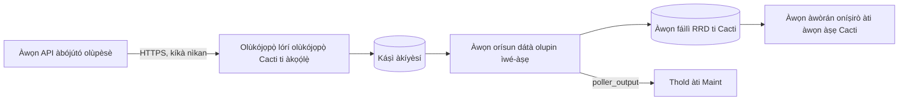

<!-- Source: README.md; SHA256: 7c621642e5f1a46bac66e4bc744f70aebb014c610d22de034088845fdc170405 -->

<!-- translations:start -->
[English](../../../README.md) | [简体中文](../zh-CN/README.md) | [हिन्दी](../hi-IN/README.md) | [Español (España)](../es-ES/README.md) | [Español (Latinoamérica)](../es-419/README.md) | [العربية (السعودية)](../ar-SA/README.md) | [Afrikaans](../af-ZA/README.md) | [አማርኛ](../am-ET/README.md) | [العربية (مصر)](../ar-EG/README.md) | [العربية (المغرب)](../ar-MA/README.md) | [বাংলা](../bn-BD/README.md) | [Bosanski](../bs-BA/README.md) | [Deutsch](../de-DE/README.md) | [فارسی](../fa-IR/README.md) | [Filipino](../fil-PH/README.md) | [Français](../fr-FR/README.md) | [Français (Maroc)](../fr-MA/README.md) | [Français (Sénégal)](../fr-SN/README.md) | [Hausa](../ha-NG/README.md) | [עברית](../he-IL/README.md) | [Hrvatski](../hr-HR/README.md) | [Bahasa Indonesia](../id-ID/README.md) | [Igbo](../ig-NG/README.md) | [Italiano](../it-IT/README.md) | [日本語](../ja-JP/README.md) | [한국어](../ko-KR/README.md) | [Malagasy](../mg-MG/README.md) | [मराठी](../mr-IN/README.md) | [Bahasa Melayu](../ms-MY/README.md) | [Nederlands](../nl-NL/README.md) | [Polski](../pl-PL/README.md) | [Português (Brasil)](../pt-BR/README.md) | [Русский](../ru-RU/README.md) | [Kinyarwanda](../rw-RW/README.md) | [Soomaali](../so-SO/README.md) | [Српски](../sr-RS/README.md) | [Svenska](../sv-SE/README.md) | [Kiswahili](../sw-KE/README.md) | [தமிழ்](../ta-IN/README.md) | [తెలుగు](../te-IN/README.md) | [ไทย](../th-TH/README.md) | [Türkçe](../tr-TR/README.md) | [Українська](../uk-UA/README.md) | [اردو](../ur-PK/README.md) | [Tiếng Việt](../vi-VN/README.md) | [isiXhosa](../xh-ZA/README.md) | [Yorùbá](README.md) | [繁體中文](../zh-TW/README.md) | [isiZulu](../zu-ZA/README.md)
<!-- translations:end -->

# plugin_cloud

Àfikún Cacti 1.2 kan tí ó ń mú àwọn ohun-èlò àti ìwọ̀n láti ọ̀dọ̀ àwọn olùpèsè àwọsánmà gbogbo-gbòò wọ inú Cacti gẹ́gẹ́ bí àwọn ẹ̀rọ, orísun dátà, àti àwòrán oníṣirò lásán. Àwọn iṣẹ́ àwọsánmà yóò wá jókòó lẹ́gbẹ̀ẹ́ nẹ́tíwọ́ọ̀kì tí ó ń gbé wọn, lábẹ́ àwọn àṣẹ Cacti, bẹ́ẹ̀ sì ni Thold àti Maint lè fi ìkìlọ̀ ránṣẹ́ lórí wọn kí wọ́n sì dá wọn dúró. Àfikún kan ṣoṣo ni ó bo gbogbo olùpèsè, pẹ̀lú awakọ̀ kọ̀ọ̀kan fún olùpèsè kọ̀ọ̀kan: DigitalOcean, AWS, Google Cloud, àti Azure ní àkọ́kọ́.

> **Ipò: àṣeyọrí pàtàkì 3 (DigitalOcean àti àwọn ohun Cacti), lábẹ́ àtúnyẹ̀wò.** Àṣeyọrí pàtàkì yìí ṣe àfikún awakọ̀ DigitalOcean, àwọn àdàkọ Cacti, ẹ̀rọ ààyè-iṣẹ́ kan fún àkọọ́lẹ̀ kọ̀ọ̀kan pẹ̀lú ìbéèrè dátà kan fún irú ohun-èlò kọ̀ọ̀kan, ìtẹ̀wọlé olupin ìwé-àṣẹ, àti ìṣirò ìbéèrè lórí New Graphs àti ojú-ewé ìlera. Àwọn àyẹ̀wò àkọ́kọ́ lórí àkọọ́lẹ̀ DigitalOcean tí ó ń ṣiṣẹ́ wà ní àkọsílẹ̀ nínú [àwọn òtítọ́ olùpèsè](../../research/provider-facts.md). Má ṣe lò ó nínú àyíká iṣẹ́ gidi.

## Àwọn ipa ìwọlé

| Àgbègbè àṣẹ | Ìwọlé |
| --- | --- |
| Cloud View | Àwọn ojú-ewé àbójútó tí ó wà tẹ́lẹ̀. |
| Cloud Operator | Àbójútó pẹ̀lú ojú-ewé Operations àti àwọn ìdánimọ̀ àyẹ̀wò kánjúkánjú ti ara-ẹni. |
| Cloud Admin | Ìwọlé Operator pẹ̀lú ètò ìṣàkóso àti àwọn ìṣe àbójútó tí ó wà tẹ́lẹ̀. |

Lẹ́yìn dída àwọn fáìlì ìgbéga kọ̀pì, ṣí ojú-ewé Plugins gẹ́gẹ́ bí alámòójútó láti forúkọsílẹ̀
àgbègbè àṣẹ tuntun náà. Fi àgbègbè àṣẹ Operator fún ni ní pàtó lábẹ́ **Configuration > Users** tàbí àwọn ẹgbẹ́ olùlò.
Àwọn ìgbéga máa ń pa àwọn ID àti àṣẹ ìfúnni View àti Admin tí ó wà tẹ́lẹ̀ mọ́. Ìwọlé Admin
máa ń jogún ìwọlé Operator, ìwọlé Operator sì máa ń jogún ìwọlé View lórí ìbéèrè kọ̀ọ̀kan;
èyí kò ṣe àfikún àwọn àṣẹ ìfúnni tí a tọ́jú sí àwọn olùlò tàbí àwọn ẹgbẹ́. Àwọn ètò àfikún náà tún nílò
ìwọlé Cloud Admin ní àfikún sí àṣẹ Settings ti Cacti.

Àwọn àṣẹ ẹ̀rọ Cacti ṣì máa ń díwọ̀n àwọn ìlà àti àwọn ìṣe tí ó wà fún olùlò kọ̀ọ̀kan; àwọn ohun tí a kò tíì so pọ̀ nílò alámòójútó. Àwọn Operator lè rí i dájú pé ẹ̀rí ìwọlé tí a tọ́jú fún àkọọ́lẹ̀ tí wọ́n lè wọ ẹ̀rọ Cacti rẹ̀ tọ̀nà.
Àwọn ẹ̀rí ìwọlé, ètò ìṣàkóso, ìsopọ̀, píparẹ́ àti àwọn àyípadà àbójútó mìíràn
ṣì wà nínú àwọn ojú-ewé àbójútó. Àwọn ìdánimọ̀ máa ń pẹ́ nínú àkókò ìlò olùlò lọ́wọ́lọ́wọ́ nìkan,
fún wákàtí kan ní púpọ̀ jù lọ àti nígbà tí àkíyèsí kan náà ṣì wà ní tuntun nìkan.
Àwọn àkíyèsí tuntun tàbí tí ó yípadà máa ń sọ wọ́n di asán. Wọn kì í ṣe àmì ìwọ̀n tí ó kùnà
ní aláàlàáfíà tàbí dá àwọn ìkìlọ̀ dúró láéláé.

## Ìdí rẹ̀

Olùpèsè àwọsánmà kọ̀ọ̀kan ní kọ́nsóòlù àbójútó tirẹ̀. Tí a bá lò wọ́n lẹ́gbẹ̀ẹ́ Cacti, wọ́n máa ń fi àlàfo mẹ́ta sílẹ̀:

- **Ìṣàkóso ìwọlé ọ̀tọ̀.** Fífihàn àwọn ìwọ̀n àwọsánmà fún olùlò Cacti túmọ̀ sí fífún wọn ní ìwọlé àwọsánmà.
- **Kò sí àyíká nẹ́tíwọ́ọ̀kì.** Àwọn ìjápọ̀ ibi-iṣẹ́ ni a ń yàwòrán oníṣirò wọn nínú Cacti; àwọn iṣẹ́ tí ó wà lẹ́yìn wọn ni a ń yàwòrán oníṣirò wọn nínú kọ́nsóòlù olùpèsè kọ̀ọ̀kan.
- **Ìkìlọ̀ ọ̀tọ̀.** Thold àti Maint ń ṣiṣẹ́ lórí àwọn orísun dátà àti ẹ̀rọ Cacti, nítorí náà a máa ń ṣètò àti dádúró àwọn ìkìlọ̀ olùpèsè lọ́tọ̀ọ̀tọ̀, lẹ́ẹ̀kan fún olùpèsè kọ̀ọ̀kan.

Àfikún náà máa ń ka API àbójútó olùpèsè kọ̀ọ̀kan lórí olùkójọpọ̀ Cacti, ó máa ń tọ́jú àwọn kókó dátà tuntun sínú káṣì, ó sì máa ń pèsè wọn fún olupin ìwé-àṣẹ Cacti. Olùkójọpọ̀ Cacti ni ó ń kọ àwọn fáìlì RRD, nítorí náà yíya àwòrán oníṣirò, àwọn àṣẹ, Thold, Maint, àti boost ń ṣiṣẹ́ gẹ́gẹ́ bí wọ́n ṣe ń ṣiṣẹ́ fún dátà Cacti èyíkéyìí.

## Àwọn ìpinnu àwòrán

- **Kíkà nìkan.** Awakọ̀ kọ̀ọ̀kan lè kọ àwọn iṣẹ́ olùpèsè tí ó wà lórí àtòjọ ìyọ̀ǹda rẹ̀ nìkan; àfikún náà kì í yí ohun-èlò àwọsánmà kankan padà láéláé. ([ADR 0002](../../decisions/0002-read-only-with-operation-allowlist.md))
- **PHP nìkan, kò sí SDK.** Ìfọwọ́sowọ́pọ̀ àti pàṣípààrọ̀ àmì ni a ṣe ní PHP pẹ̀lú àwọn ìfẹ̀sí tí Cacti ti nílò tẹ́lẹ̀. Kò sí ìgbẹ́kẹ̀lé àkókò ìṣiṣẹ́ Composer. ([ADR 0003](../../decisions/0003-php-only-without-sdks.md))
- **Iye owó ṣáájú ìkójọpọ̀.** Àfikún náà máa ń ka àwọn ìwọ̀n tí ó ní orísun dátà Cacti nìkan, ó máa ń fi iye ìbéèrè tí a retí àti iye owó àtòjọ hàn ṣáájú kí a tó dá àwọn àwòrán oníṣirò, ó sì máa ń fi ààlà oṣooṣù múlẹ̀. ([ADR 0005](../../decisions/0005-collect-only-what-is-graphed.md))
- **Kò sí ẹ̀rí ìwọlé tí kò ní ààbò nínú ibi-ìpamọ́ dátà.** Àwọn ẹ̀rí ìwọlé ń wá láti inú àpótí ààbò tí a fi fáìlì ìṣírò tí ó wà lóde ibi-ìpamọ́ dátà ṣí, láti inú fáìlì ẹ̀rí ìwọlé, tàbí láti inú ìdánimọ̀ àpẹẹrẹ olùpèsè. ([ADR 0007](../../decisions/0007-credentials-outside-the-database-in-the-clear.md))

## Ààyè iṣẹ́ àti ipò

| Ìpele | Ààyè iṣẹ́ | Àwọn àṣeyọrí pàtàkì | Ipò |
|---|---|---|---|
| 0, ìwádìí | Ìfìdí òtítọ́ olùpèsè múlẹ̀, àtòjọ ìwọ̀n, àwòṣe iye owó àti òṣùwọ̀n, àwọn àmì ìdánwò ìfọwọ́sowọ́pọ̀, àyẹ̀wò ìgbesẹ̀ ìrìnnà | [M1](https://github.com/somethingwithproof/plugin_cloud/milestone/1) | Ó ti parí, àyàfi àwọn àyẹ̀wò tí ó nílò àkọọ́lẹ̀ olùpèsè tí ó ń ṣiṣẹ́ |
| 1, kókó iṣẹ́ àti DigitalOcean | Àwọn àkọọ́lẹ̀, àpótí ààbò ẹ̀rí ìwọlé, ìrìnnà, olùkójọpọ̀, káṣì àkíyèsí, àwọn ohun Cacti, ojú-ewé ìlera, DigitalOcean Droplets àti àwọn olùpín ìwọ̀n ẹrù | [M2](https://github.com/somethingwithproof/plugin_cloud/milestone/2), [M3](https://github.com/somethingwithproof/plugin_cloud/milestone/3), [M4](https://github.com/somethingwithproof/plugin_cloud/milestone/4) | M2 ti parí ([#81](https://github.com/somethingwithproof/plugin_cloud/pull/81)); awakọ̀ M3, àwọn àdàkọ, àti àwọn ẹ̀rọ ààyè-iṣẹ́ ti darapọ̀; ìṣirò ìbéèrè, àwọn àṣẹ, àti àwọn àyẹ̀wò iṣẹ́ wà lábẹ́ àtúnyẹ̀wò; M4 kò tíì bẹ̀rẹ̀ |
| 2, AWS | Signature Version 4, `AssumeRole`, àwọn ipa àpẹẹrẹ, CloudWatch `GetMetricData`, àkójọpọ̀ agbègbè | [M5](https://github.com/somethingwithproof/plugin_cloud/milestone/5) | Kò tíì bẹ̀rẹ̀ |
| 3, Google Cloud | Service account JWT, olupin metadata, Cloud Monitoring `timeSeries.list` | [M6](https://github.com/somethingwithproof/plugin_cloud/milestone/6) | Kò tíì bẹ̀rẹ̀ |
| 4, Azure | Àwọn ẹ̀rí ìwọlé olùbára Entra, ìdánimọ̀ tí a ń ṣàkóso, Resource Graph, `metrics:getBatch` | [M7](https://github.com/somethingwithproof/plugin_cloud/milestone/7) | Kò tíì bẹ̀rẹ̀ |
| 5, àwọn olùkójọpọ̀ òkèèrè | Àwọn àkọọ́lẹ̀ lórí àwọn olùkójọpọ̀ dátà òkèèrè ti Cacti | [M8](https://github.com/somethingwithproof/plugin_cloud/milestone/8) | Kò tíì bẹ̀rẹ̀ |

Lóde ààyè iṣẹ́: yíyí àwọn ohun-èlò àwọsánmà padà, dídá tàbí fífìdáhàn àwọn ìkìlọ̀ olùpèsè, àwọn ìròyìn ìsanwó, àwọn àkọsílẹ̀ àti ìtọpa, àti ẹ̀rọ ìkìlọ̀ tí àfikún náà ni tirẹ̀. Àwọn olùpèsè mìíràn (Hetzner Cloud, Akamai Cloud, Oracle Cloud, àti àwọn mìíràn) jẹ́ àwọn ọ̀ràn ìwádìí.

## Ohun tí àṣeyọrí pàtàkì 2 mú wá

- **Ìfisípò tí a dáàbò bo.** Lórí PHP tí ó kéré sí 8.2, tàbí láìsí ext-openssl, ìfisípò àti mímú ṣiṣẹ́ ni a máa kọ̀ pẹ̀lú ìránṣẹ́ kan, ìyókù Cacti yóò sì máa bá iṣẹ́ rẹ̀ lọ.
- **Ìgbésí-ayé iṣẹ́.** Fi sori ẹ̀rọ, gbé ga, kí o sì yọ ọ́ kúrò nípasẹ̀ ojú-ewé Plugins ti Cacti. Àwọn ìgbéga wà ní ètò àtòjọ wọn sì ń rí iṣẹ́ ṣe tí ìdádúró bá ṣẹlẹ̀. Yíyọ kúrò máa ń pa àwọn tábìlì àfikún mọ́ àyàfi tí o bá pa *Keep Plugin Tables on Uninstall* rẹ́.
- **Àwọn àgbègbè àṣẹ ọ̀tọ̀.** *Cloud Admin* ń ṣí **Cloud Accounts**; *Cloud Operator* ń ṣí **Cloud Operations**; *Cloud View* ń ṣí **Cloud Health**. Admin máa ń jogún Operator, Operator sì máa ń jogún View. Gbogbo ojú-ewé mẹ́tẹ̀ẹ̀ta wà lábẹ́ Management.
- **Àwọn àkọọ́lẹ̀ àti ẹ̀rí ìwọlé.** Ṣe àfikún, ṣàtúnṣe, ṣàwárí òtítọ́, kí o sì pa àwọn àkọọ́lẹ̀ rẹ́. Ẹ̀rí ìwọlé jẹ́ èyí tí a fi kọ́ọ̀dù ṣírò sínú ibi-ìpamọ́ dátà pẹ̀lú fáìlì kọ́kọ́rọ́ tí a pa mọ́ lóde rẹ̀ (AES-256-GCM), tàbí tí a kà láti inú fáìlì lórí olùkójọpọ̀. Àwọn ẹ̀rí ìwọlé jẹ́ kíkọ nìkan nínú UI, a sì máa ń yọ wọ́n kúrò nínú àwọn àkọsílẹ̀.
- **Olùkójọpọ̀.** Ó máa ń bẹ̀rẹ̀ láti inú ìṣiṣẹ́ olùkójọpọ̀ kọ̀ọ̀kan, àpẹẹrẹ kan fún olùkójọpọ̀ kọ̀ọ̀kan, láàárín ìṣúná àkókò kan. Ó máa ń gba àṣẹ ìyáwó fún àkọọ́lẹ̀ kọ̀ọ̀kan, ó máa ń ṣe ìwádìí lórí ààrín àkókò tirẹ̀, ó sì máa ń ka àwọn ìwọ̀n fún àwọn orísun dátà àfikún náà tí ó ń ṣiṣẹ́ nìkan.
- **Ìlera.** Ipò ìkójọpọ̀, ìwádìí, ohun-èlò, àti ìtutù fún àkọọ́lẹ̀ kọ̀ọ̀kan, pẹ̀lú àwọn ìkìlọ̀ fún kọ́kọ́rọ́ àpótí ààbò tí kò ṣe é lò, àwọn fáìlì ẹ̀rí ìwọlé tí kò ní ààbò, àti àwọn ààrín àkókò tí olùkójọpọ̀ kò lè tẹ̀lé.

## Ìfisípò àti ètò ìṣàkóso

Àwọn ìgbésẹ̀ wọ̀nyí ń fi kọ́ọ̀dù àṣeyọrí pàtàkì 2 sori ẹ̀rọ fún ìgbéléwọ̀n. Wọ́n nílò Cacti 1.2.31 tàbí èyí tí ó ga jù lọ lórí PHP 8.2 tàbí èyí tí ó ga jù lọ.

1. Da ibi-ìpamọ́ kọ́ọ̀dù náà kọ̀pì sí `plugins/cloud` lábẹ́ àkójọpọ̀ fáìlì Cacti rẹ. Àkójọpọ̀ fáìlì náà gbọ́dọ̀ jẹ́ `cloud`.
2. Dá kọ́kọ́rọ́ àpótí ààbò sílẹ̀ lóde gbòǹgbò wẹ́ẹ̀bù. Fi í sínú àkójọpọ̀ fáìlì tí root àti olùlò Cacti nìkan lè kọ sí, kí o sì jẹ́ kí fáìlì náà ṣe é kà fún olùlò tí ó ń ṣiṣẹ́ olupin wẹ́ẹ̀bù àti olùkójọpọ̀ nìkan. Àfikún náà kì í dá tàbí kọ fáìlì yìí láéláé:

   ```sh
   sudo install -d -m 0750 -o root -g cacti /etc/cacti
   head -c 32 /dev/urandom | sudo tee /etc/cacti/cloud-vault.key > /dev/null
   sudo chown cacti:cacti /etc/cacti/cloud-vault.key
   sudo chmod 0600 /etc/cacti/cloud-vault.key
   ```

   Rọ́pò `cacti` pẹ̀lú olùlò tí ó ń ṣiṣẹ́ olupin wẹ́ẹ̀bù àti olùkójọpọ̀ rẹ. Fáìlì náà ní 32 raw bytes tàbí 64 àwọn lẹ́tà hexadecimal. Ṣe àfẹ̀yìntì rẹ̀ pẹ̀lú ibi-ìpamọ́ dátà; láìsí rẹ̀, a gbọ́dọ̀ tún àwọn ẹ̀rí ìwọlé tí a tọ́jú tẹ̀ sínú lẹ́ẹ̀kan sí i.
3. Nínú Cacti, ṣí **Configuration > Plugins**, lẹ́yìn náà fi *Cloud* sori ẹ̀rọ kí o sì mú un ṣiṣẹ́.
4. Lábẹ́ **Configuration > Settings > Cloud**, ṣètò *Vault Key File* tí o bá lo ọ̀nà mìíràn. *Collector Time Budget* (ìyàn àìyípadà 240 ìṣẹ́jú-àáyá) gbọ́dọ̀ kéré sí ààrín àkókò olùkójọpọ̀.
5. Fún àwọn olùlò àti àwọn ẹgbẹ́ ní *Cloud Admin*, *Cloud Operator* tàbí *Cloud View* lábẹ́ **Configuration > Users**. Ìfisípò máa ń fún alámòójútó ní Cloud Admin àti Cloud View; Cloud Admin ní ìwọlé Operator nínú, nítorí náà alámòójútó kò nílò àṣẹ ìfúnni Operator ọ̀tọ̀.
6. Ṣe àfikún àwọn àkọọ́lẹ̀ lábẹ́ **Management > Cloud Accounts**, lẹ́yìn náà ṣàyẹ̀wò **Management > Cloud Health** fún àwọn ìkìlọ̀.

## Àwọn àfojúsùn ìbámu

| Ẹ̀yà | Àfojúsùn |
|---|---|
| Cacti | 1.2.31 tàbí èyí tí ó ga jù lọ, kò sí àtúnṣe kókó |
| PHP | 8.2 tàbí èyí tí ó ga jù lọ; `setup.php` ṣì lè kà lórí 8.0 kí àyíká ìṣiṣẹ́ tí kò ní àtìlẹ́yìn lè gba ìkọ̀sílẹ̀ dípò UI Cacti tí ó bà jẹ́ |
| Àwọn ìfẹ̀sí PHP | Kò sí ju àwọn tí Cacti 1.2.31 nílò lọ |
| Thold, Maint | Kò sí àyípadà tí ó pọn dandan |

## Àwòrán ètò

- [docs/performance.md](../../performance.md) ní àwọn ìwọ̀n olùkójọpọ̀ àti ojú-ewé ìlera, pẹ̀lú ẹ̀rọ àti àwọn ètò tí a lò.
- [docs/PLAN.md](../../PLAN.md) ni ètò kíkún: àwòrán ètò, àwọn òtítọ́ olùpèsè àti Cacti tí ó gbẹ́kẹ̀lé (pẹ̀lú àwọn orísun), àdéhùn awakọ̀, ìṣirò iye owó, àwọn ààlà ààbò, ìdánwò, àti àwọn ewu.
- [docs/decisions/](../../decisions) ní àwọn àkọsílẹ̀ ìpinnu àwòrán ètò fún àwọn yíyàn tí a ti ṣe tẹ́lẹ̀.
- [docs/REQUIREMENTS.md](../../REQUIREMENTS.md) so ID ìbéèrè kọ̀ọ̀kan pọ̀ mọ́ ọ̀ràn rẹ̀.



## Bí a ṣe ń tọpa iṣẹ́

- **Àwọn àṣeyọrí pàtàkì** tẹ̀lé àwọn àṣeyọrí pàtàkì ètò náà. Kọ̀ọ̀kan ní ọ̀ràn àkọ́kọ́ tí ó kà àwọn ọ̀ràn abẹ́ rẹ̀ àti ẹ̀rí ìparí.
- **Àwọn ọ̀ràn** ni a pín sí oríṣiríṣi nípa àmì: `type: requirement`, `type: research`, `type: decision`, `type: epic`. Àwọn ọ̀ràn ìbéèrè máa ń sọ àwọn ìbéèrè tí ó ní nọ́ńbà tí ó sì ṣe é dánwò (`REQ-AREA-NNN`) àti àwọn ìlànà ìtẹ́wọ́gbà.
- **Àwọn àmì** tún ń gbé `area:`, `provider:`, `phase:`, `priority:`, àti `status:`. Wo [CONTRIBUTING.md](../../../CONTRIBUTING.md#labels).
- [Pátákó iṣẹ́-àkànṣe](https://github.com/users/somethingwithproof/projects/7) fi gbogbo àwọn ọ̀ràn hàn jákèjádò àwọn àṣeyọrí pàtàkì.

## Ìdàgbàsókè

CI máa ń ṣàyẹ̀wò àṣìṣe kọ́ọ̀dù àwọn ojú ìbẹ̀rẹ̀ lórí PHP 8.0, ó máa ń ṣe àwọn ìdánwò ẹ̀yà àti ìsopọ̀ àti PHPStan level 9, ó sì máa ń fi àfikún náà sori ẹ̀rọ lórí PHP 8.2 sí 8.5 pẹ̀lú Cacti 1.2.31 àti ẹ̀ka 1.2.x. Ó tún máa ń ṣàyẹ̀wò pé a kọ PHP 8.1 láì ba Cacti jẹ́. Àwọn ìdánwò náà ń lo Pest láti inú ohun èlò ìdánwò àfikún ti kókó Cacti. Yíyàn yẹn jẹ́ ti ìgbà díẹ̀ títí tí a ó fi pinnu lórí [#12](https://github.com/somethingwithproof/plugin_cloud/issues/12). [.github/workflows/plugin-ci-workflow.yml](../../../.github/workflows/plugin-ci-workflow.yml) ṣe àtòjọ gbogbo ìgbésẹ̀. Ṣiṣẹ́ `sh tests/lint-workflows.sh` àti `sh locales/build_gettext.sh --check` lórí kọ̀ǹpútà rẹ ṣáájú kí o tó fi ránṣẹ́.

## Ìkópa

Ka [CONTRIBUTING.md](../../../CONTRIBUTING.md). Àwọn ìfisílẹ̀ kọ́ọ̀dù nílò ìfọwọ́sowọ́pọ̀ DCO. Ìjíròrò àwòrán ètò ń ṣẹlẹ̀ lórí àwọn ọ̀ràn; àwọn ìpinnu tí ó ṣí sílẹ̀ gbé àmì `type: decision`.

## Ààbò

Fi àwọn àìlera ààbò tó ni létí ní ìkọ̀kọ̀; wo [SECURITY.md](../../../SECURITY.md).

## Ìwé-àṣẹ

GNU General Public License v2.0, ìwé-àṣẹ kan náà bíi ti Cacti àti àwọn àfikún rẹ̀. Wo [LICENSE](../../../LICENSE).
