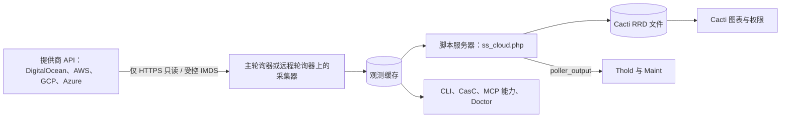

<!-- Source: README.md; SHA256: ac2074a40238686915802803c5efe773f33677f934281e0605e6e87a71a9d27d -->

<!-- translations:start -->
[English](../../../README.md) | [简体中文](README.md) | [हिन्दी](../hi-IN/README.md) | [Español (España)](../es-ES/README.md) | [Español (Latinoamérica)](../es-419/README.md) | [العربية (السعودية)](../ar-SA/README.md) | [Afrikaans](../af-ZA/README.md) | [አማርኛ](../am-ET/README.md) | [العربية (مصر)](../ar-EG/README.md) | [العربية (المغرب)](../ar-MA/README.md) | [বাংলা](../bn-BD/README.md) | [Bosanski](../bs-BA/README.md) | [Deutsch](../de-DE/README.md) | [فارسی](../fa-IR/README.md) | [Filipino](../fil-PH/README.md) | [Français](../fr-FR/README.md) | [Français (Maroc)](../fr-MA/README.md) | [Français (Sénégal)](../fr-SN/README.md) | [Hausa](../ha-NG/README.md) | [עברית](../he-IL/README.md) | [Hrvatski](../hr-HR/README.md) | [Bahasa Indonesia](../id-ID/README.md) | [Igbo](../ig-NG/README.md) | [Italiano](../it-IT/README.md) | [日本語](../ja-JP/README.md) | [한국어](../ko-KR/README.md) | [Malagasy](../mg-MG/README.md) | [मराठी](../mr-IN/README.md) | [Bahasa Melayu](../ms-MY/README.md) | [Nederlands](../nl-NL/README.md) | [Polski](../pl-PL/README.md) | [Português (Brasil)](../pt-BR/README.md) | [Русский](../ru-RU/README.md) | [Kinyarwanda](../rw-RW/README.md) | [Soomaali](../so-SO/README.md) | [Српски](../sr-RS/README.md) | [Svenska](../sv-SE/README.md) | [Kiswahili](../sw-KE/README.md) | [தமிழ்](../ta-IN/README.md) | [తెలుగు](../te-IN/README.md) | [ไทย](../th-TH/README.md) | [Türkçe](../tr-TR/README.md) | [Українська](../uk-UA/README.md) | [اردو](../ur-PK/README.md) | [Tiếng Việt](../vi-VN/README.md) | [isiXhosa](../xh-ZA/README.md) | [Yorùbá](../yo-NG/README.md) | [繁體中文](../zh-TW/README.md) | [isiZulu](../zu-ZA/README.md)
<!-- translations:end -->

# plugin_cloud

这是一个 Cacti 1.2 插件，将公有云提供商的资源和指标作为普通设备、数据源和图表引入 Cacti。云工作负载由此与承载它们的网络并列显示，受 Cacti 权限控制，并可由 Thold 和 Maint 触发或抑制告警。单个插件通过纯 PHP 的只读提供商驱动覆盖 DigitalOcean、Amazon Web Services、Google Cloud 和 Microsoft Azure。

> **状态：开发中，尚未发布版本（`0.1.0-dev`）。** 本分支已实现 DigitalOcean、AWS、Google Cloud 和 Azure 的纯 PHP 驱动、远程数据采集器复制与只读代理健康检查、CasC 提供商与运维 CLI、MCP 能力以及 Doctor 检查。目前随附的 Cacti 模板涵盖 DigitalOcean Droplets 和负载均衡器（`templates/cloud_digitalocean.xml`）；AWS、Google Cloud 和 Azure 的 Cacti 模板包以及除 DigitalOcean 之外的实时账户验证（[提供商事实](../../research/provider-facts.md)）尚未完成。请勿用于生产环境。

## 支持的提供商

每个提供商驱动均注册于 `Drivers::production()`，由 `Provider::released()` 提供，使用纯 PHP、ext-openssl（`ext-openssl`）和流套接字运行，无任何 SDK 或 Composer 运行时依赖。

| 提供商 | 作用域字段 | 凭据来源 | 身份验证 | 已发现资源 | 指标采集 |
|---|---|---|---|---|---|
| DigitalOcean (`digitalocean`) | 无（基于令牌作用域） | `vault`, `file` | Bearer 令牌 | `droplet`, `load_balancer` | `/v2/monitoring/metrics`，支持速率限制份额感知；随附 Cacti 模板与数据查询 |
| Amazon Web Services (`aws`) | `account_id`（12 位数字），`regions` | `vault`, `file`, `instance` | 纯 PHP AWS SigV4 (`AWS4-HMAC-SHA256`)、STS `GetCallerIdentity` 验证、可选 STS `AssumeRole`、用于 `instance` 账户的 EC2 IMDSv2 (`169.254.169.254`) | `ec2_instance`, `rds_instance`, `aws_elb` (ALB/NLB) | 批量 CloudWatch `GetMetricData`（每次调用最多 500 个查询） |
| Google Cloud (`gcp`) | `project` | `vault`, `file`, `instance` | 通过 `ext-openssl` 签名的纯 PHP RS256 服务账号 JWT 并在 `oauth2.googleapis.com/token` 交换令牌，或用于 `instance` 账户的 GCE 元数据服务器 (`metadata.google.internal`) | 通过 `instances.aggregatedList` 获取 `gce_instance` | Cloud Monitoring `timeSeries.list` |
| Microsoft Azure (`azure`) | `tenant`, `subscription`, `regions` | `vault`, `file`, `instance` | 纯 PHP Entra ID OAuth2 客户端凭据流（仅支持 `client_secret`；不含证书断言），或用于 ARM 和 Monitor 令牌的 Azure IMDS (`169.254.169.254`) 托管身份 | 通过 ARM Resource Graph 获取 `azure_vm`（使用 `$skipToken` 分页并去重） | Azure Monitor `metrics:getBatch`（每次调用最多 50 个资源，处理 HTTP 429 和 529 限流） |

## 已实现能力

### 核心平台、保险库与采集器

- **受保护的安装与生命周期。** 入口文件（`setup.php`、`cli/cloud.php`、`poller_cloud.php`、`ss_cloud.php` 和页面脚本）可在 PHP 8.0 上解析，并在低于 PHP 8.2 或缺少 `ext-openssl` 时拒绝运行而不破坏 Cacti。升级按序且幂等（`Schema::VERSION = 3`，9 张表），支持中断恢复。卸载时默认保留插件表，除非取消勾选 *Keep Plugin Tables on Uninstall*。
- **账户与凭据。** 在 **Management > Cloud Accounts** 下添加、编辑、验证和删除账户。凭据可来自 AES-256-GCM 加密保险库（`plugin_cloud_secret`，默认密钥路径 `/etc/cacti/cloud-vault.key`）、限定在已配置 *Credential File Directory*（`cloud_credential_dir`，默认为空以拒绝文件）内的文件，或提供商实例身份。凭据在界面中只写不可读，并在日志中脱敏。
- **严格的出站与只读控制。** 每个驱动均在 `GuardedTransport` 和 `OutboundPolicy` 保护下运行：仅允许向各提供商精确主机名发起 HTTPS 443 端口请求，仅对 `instance` 账户开放链路本地 HTTP 80 端口元数据端点（`169.254.169.254`、`metadata.google.internal`）。仅允许白名单内的只读操作。
- **采集器与成本控制。** `poller_cloud.php` 通过 Cacti 进程注册表从 `poller_bottom` 启动（每个轮询器一个进程），在 `cloud_collector_budget` 时间预算内运行，获取每账户租约，按 `discover_interval` 执行资源发现，仅针对活跃的 Cacti 数据源（`plugin_cloud_series`）采集指标，遵循 `request_share` 和 `monthly_ceiling`，并将最新数据点缓存于 `plugin_cloud_observation` 供 `ss_cloud.php` 读取。
- **Cacti 对象与请求估算。** 为每个账户维护一个作用域设备（`plugin_cloud_device`），在设备保存时保留作用域设备的重索引方法，导入 DigitalOcean 模板和脚本服务器数据查询（`templates/cloud_digitalocean.xml`、`cloud_do_droplet.xml`、`cloud_do_load_balancer.xml`），并在 **New Graphs**（`graphs_new_top_links`）和 **Cloud Health** 页面显示请求数和目录价成本估算。

### 远程数据采集器

- `INFO` 声明了 `remote_collect:1`。账户可分配给任意已启用的 Cacti 轮询器（`poller_id >= 1`），`poller_cloud.php --poller=N` 仅采集归属该轮询器的账户。
- **`replicate_out` 钩子。** 通过 `replicate_out_table()` 将按轮询器划分的行从 `plugin_cloud_account`、`plugin_cloud_device`、`plugin_cloud_series` 复制到远程轮询器，并仅针对目标轮询器拥有的保险库凭据账户复制 `plugin_cloud_secret` 中的加密密文行。原始保险库密钥文件绝不存入数据库或进行复制，始终保留在各轮询器本地。
- **`remote_agent` 钩子。** 提供只读 JSON 健康摘要（`action=cloud_health`），仅接受整数 `poller_id` 和 `account_id` 参数，不返回任何凭据、文件路径或密钥。

### 生态钩子（CasC、MCP 能力与 Doctor）

- **CasC 提供商（`casc_register_providers`）。** 注册 `cloud` 提供商（schema 版本 `1`），支持确定性的纯 PHP YAML 和 XML 导出、清单验证、差异规划与确认应用。保险库凭据导出为 `vault:account:<name>` 引用；拒绝原始密钥字段（`secret`、`secrets`、`token`、`access_token`、`refresh_token`、`password`、`private_key`、`access_key_id`、`secret_access_key`、`session_token`、`client_secret`、`credential`、`credentials`、`vault_key`）。应用配置需要精确的 SHA-256 `--confirm=<PLAN_HASH>`。
- **MCP / Abilities API（`abilities_register`）。** 注册三个严格只读的能力，受 Cloud View 权限域（`cloud_health.php`）和针对非管理员调用者的 Cacti 设备作用域限制，不输出任何凭据、保险库密钥或凭据文件路径：
  - `cloud-list-accounts`（可选参数 `provider`、`poller_id`）
  - `cloud-list-resources`（可选参数 `account_id`、`type`、`lifecycle`）
  - `cloud-get-health`（可选参数 `account_id`）
- **Doctor 检查（`doctor_register_checks`）。** 注册五项不暴露任何密钥值或密钥材料的诊断检查：
  - `cloud_schema`：数据库 schema 版本是否为最新
  - `cloud_vault_key`：保险库密钥文件的可读性、权限和大小
  - `cloud_drivers`：所有已发布提供商的生产驱动注册状态
  - `cloud_accounts_health`：失败、受限流或数据过期的已启用账户
  - `cloud_poller_intervals`：已启用账户的采集间隔与 Cacti 轮询器间隔的对齐情况

## CLI

在 Cacti 根目录下使用 PHP 8.2 或更高版本运行：

```sh
# Operator and CasC CLI (options use --key=value form)
php plugins/cloud/cli/cloud.php export [--format=yaml|xml]
php plugins/cloud/cli/cloud.php validate --file=<path> [--format=yaml|xml]
php plugins/cloud/cli/cloud.php plan --file=<path> [--format=yaml|xml]
php plugins/cloud/cli/cloud.php apply --file=<path> --confirm=<PLAN_HASH> [--format=yaml|xml]
php plugins/cloud/cli/cloud.php health [--format=text|json] [--poller=<id>]

# Collector entry point (normally started by poller_bottom)
php plugins/cloud/poller_cloud.php [--poller=N] [--force] [--debug]
```

## 访问角色

| 权限域 | 访问权限 |
| --- | --- |
| Cloud View | 现有的监控页面。 |
| Cloud Operator | 监控页面，加上运维页面和个人分诊确认。 |
| Cloud Admin | 操作员权限，加上现有的配置和管理操作。 |

复制升级文件后，以管理员身份打开 Plugins 页面以注册权限域。在 **Configuration > Users** 或用户组下显式分配 Operator 权限域。升级会保留现有的 View 和 Admin 权限域 ID 及授权。Admin 访问在每次请求时自动继承 Operator 访问，Operator 访问自动继承 View 访问；这不会向用户或用户组添加持久化的授权记录。除了 Cacti 的 Settings 权限外，插件设置还需要 Cloud Admin 访问权限。

Cacti 设备权限限制每位用户可查看的行和可执行的操作；未映射的对象需要管理员权限。操作员可以为自己有权访问其 Cacti 设备的账户验证已存储的凭据。凭据、配置、映射、删除和其他管理更改仍保留在管理页面中。分诊确认仅在当前用户会话内有效，最长持续一小时，且仅在同一观测数据保持新鲜时有效。新的或发生变化的观测数据会使其失效。它们绝不会将失败的测量标记为健康，也不会抑制告警。

## 原因

每个云提供商都有各自的监控控制台。与 Cacti 并行运行时，会留下三个缺口：

- **访问控制分离。** 向 Cacti 用户展示云指标意味着需要为他们提供云平台登录账号。
- **缺少网络上下文。** 本地链路在 Cacti 中绘制图表，而它们承载的工作负载则在各自的提供商控制台中绘制图表。
- **告警分离。** Thold 和 Maint 作用于 Cacti 数据源和设备，因此云提供商告警需要按提供商分别配置和抑制。

本插件在 Cacti 轮询器上读取各提供商的监控 API，缓存最新数据点，并将其提供给 Cacti 脚本服务器。由 Cacti 轮询器写入 RRD 文件，因此绘图、权限、Thold、Maint 和 boost 的工作方式与任何其他 Cacti 数据完全一致。

## 设计承诺

- **只读。** 每个驱动只能构建其允许列表中的提供商操作；插件绝不更改云资源。（[ADR 0002](../../decisions/0002-read-only-with-operation-allowlist.md)）
- **纯 PHP，无 SDK。** 签名和令牌交换使用 Cacti 已要求的 PHP 扩展实现，无 Composer 运行时依赖。（[ADR 0003](../../decisions/0003-php-only-without-sdks.md)）
- **采集前核算成本。** 插件仅读取存在 Cacti 数据源的指标，在创建图表前显示预期请求数和目录价成本，并强制执行月度上限。（[ADR 0005](../../decisions/0005-collect-only-what-is-graphed.md)）
- **数据库中不存明文凭据。** 凭据来自使用数据库外部文件加密的保险库、凭据文件或提供商实例身份。（[ADR 0007](../../decisions/0007-credentials-outside-the-database-in-the-clear.md)）

## 范围与状态

| 阶段 | 范围 | 里程碑 | 状态 |
|---|---|---|---|
| 0，研究 | 提供商事实确认、指标目录、成本与速率模型、签名测试向量、传输原型 | [M1](https://github.com/somethingwithproof/plugin_cloud/milestone/1) | 已完成，需要实时提供商账户的检查除外 |
| 1，核心与 DigitalOcean | 账户、凭据保险库、传输、采集器、观测缓存、Cacti 对象、模板、请求估算、健康页面、DigitalOcean Droplets 和负载均衡器 | [M2](https://github.com/somethingwithproof/plugin_cloud/milestone/2), [M3](https://github.com/somethingwithproof/plugin_cloud/milestone/3), [M4](https://github.com/somethingwithproof/plugin_cloud/milestone/4) | 已实现；M4 试点验证待完成 |
| 2，AWS | 纯 PHP SigV4、STS `AssumeRole`、IMDSv2 实例角色、EC2/RDS/ELB 清单、CloudWatch `GetMetricData` | [M5](https://github.com/somethingwithproof/plugin_cloud/milestone/5) | 驱动已实现；Cacti 模板与实时账户验证待完成 |
| 3，Google Cloud | 纯 PHP RS256 服务账号 JWT、GCE 元数据服务器、Compute Engine 清单、Cloud Monitoring `timeSeries.list` | [M6](https://github.com/somethingwithproof/plugin_cloud/milestone/6) | 驱动已实现；Cacti 模板与实时账户验证待完成 |
| 4，Azure | Entra ID 客户端凭据、IMDS 托管身份、ARM Resource Graph 虚拟机清单、Azure Monitor `metrics:getBatch` | [M7](https://github.com/somethingwithproof/plugin_cloud/milestone/7) | 驱动已实现；Cacti 模板与实时账户验证待完成 |
| 5，远程采集器与生态 | 远程数据采集器（`replicate_out`、`remote_agent`）、CasC 提供商与 CLI、MCP 能力、Doctor 检查 | [M8](https://github.com/somethingwithproof/plugin_cloud/milestone/8) | 已实现 |

超出范围：更改云资源、创建或镜像提供商告警、账单报告、日志与链路追踪，以及插件自建的告警引擎。更多提供商（Hetzner Cloud、Akamai Cloud、Oracle Cloud 等）作为研究议题跟踪。

## 安装与配置

以下步骤用于安装开发代码以供评估。要求 Cacti 1.2.31 或更高版本及 PHP 8.2 或更高版本。

1. 将仓库复制到 Cacti 目录下的 `plugins/cloud`。目录名必须为 `cloud`。
2. 在每个使用保险库凭据的轮询器上，于 Web 根目录之外创建保险库密钥。将其放置在仅 root 和 Cacti 用户可写的目录中，并使该文件仅对运行 Web 服务器和轮询器的用户可读。插件绝不会创建或写入此文件：

   ```sh
   sudo install -d -m 0750 -o root -g cacti /etc/cacti
   head -c 32 /dev/urandom | sudo tee /etc/cacti/cloud-vault.key > /dev/null
   sudo chown cacti:cacti /etc/cacti/cloud-vault.key
   sudo chmod 0600 /etc/cacti/cloud-vault.key
   ```

   将 `cacti` 替换为实际运行 Web 服务器和轮询器的用户。该文件包含 32 个原始字节或 64 个十六进制字符。请将其与数据库一同备份；若缺少此密钥，已存储的凭据必须重新输入。
3. 在 Cacti 中打开 **Configuration > Plugins**，然后安装并启用 *Cloud*。
4. 在 **Configuration > Settings > Cloud** 下，如果使用了其他路径请设置 *Vault Key File*，如果计划使用基于文件的凭据请配置 *Credential File Directory*，并保持 *Collector Time Budget*（默认 240 秒）低于轮询器间隔。
5. 在 **Configuration > Users** 下向用户和用户组授予 *Cloud Admin*、*Cloud Operator* 或 *Cloud View*。安装时会自动向管理员授予 Cloud Admin 和 Cloud View；Cloud Admin 已包含 Operator 访问权限，因此管理员无需单独授予 Operator 权限。
6. 在 **Management > Cloud Accounts** 下添加账户，然后检查 **Management > Cloud Health** 是否有警告。

## 兼容性目标

| 组件 | 目标 |
|---|---|
| Cacti | 1.2.31 或更高版本，无需修改核心代码 |
| PHP | 8.2 或更高版本；入口文件在 PHP 8.0 上保持可解析，以便不支持的运行时能收到明确拒绝而不是损坏 Cacti 界面 |
| PHP 扩展 | `ext-openssl`（Cacti 1.2.31 必需）；不需要 `ext-curl` 且无 Composer 运行时依赖 |
| Thold, Maint | 无需任何修改 |

## 设计

- [docs/performance.md](../../performance.md) 包含采集器和健康页面的性能测量数据，以及所用的硬件和配置。
- [docs/PLAN.md](../../PLAN.md) 是完整规划：架构、所依赖的提供商与 Cacti 事实（附来源）、驱动契约、成本计算、安全边界、测试与风险。
- [docs/decisions/](../../decisions/) 保存已做选择的架构决策记录。
- [docs/REQUIREMENTS.md](../../REQUIREMENTS.md) 将每个需求 ID 映射到对应的议题。



## 工作跟踪方式

- **里程碑** 遵循规划中的里程碑。每个里程碑都有一个史诗议题，列出其子议题和退出证据。
- **议题** 按标签分类：`type: requirement`、`type: research`、`type: decision`、`type: epic`。需求议题会说明带编号的可测试需求（`REQ-AREA-NNN`）和验收标准。
- **标签** 还包含 `area:`、`provider:`、`phase:`、`priority:` 和 `status:`。参见 [CONTRIBUTING.md](../../../CONTRIBUTING.md#labels)。
- [项目看板](https://github.com/users/somethingwithproof/projects/7) 展示了各里程碑下的所有议题。

## 开发

CI（[.github/workflows/plugin-ci-workflow.yml](../../../.github/workflows/plugin-ci-workflow.yml)）会检查发布归档和语义化版本（`bash tests/bin/archive-check.sh`），在 PHP 8.0 上对入口文件进行语法检查，在 `CLOUD_OFFLINE=1` 下针对 Cacti `release/1.2.31` 和 `1.2.x` 在 PHP 8.2 至 8.5 上运行 Pest 单元测试（`phpunit.xml`）、生命周期集成测试（`phpunit-integration.xml`）和 PHPStan 9 级静态分析，检查在 PHP 8.1 上的拒绝行为，验证 gettext 目录，测量 1,000 个序列的采集和健康页面性能，并运行工作流语法检查与 REUSE 合规检查。

推送前的本地检查：

```sh
bash tests/bin/archive-check.sh
sh tests/lint-workflows.sh
sh locales/build_gettext.sh --check
CACTI_PATH=/path/to/cacti phpstan analyse -c phpstan.neon --no-progress
```

使用 `--configuration=phpunit.xml` 运行 Pest 进行单元测试和源码规则测试，或搭配 `CACTI_PATH` 和 `CLOUD_TEST_DATABASE=disposable` 使用 `--configuration=phpunit-integration.xml` 针对一次性 Cacti 数据库运行生命周期集成测试。

## 贡献

请阅读 [CONTRIBUTING.md](../../../CONTRIBUTING.md)。提交需要附带 DCO 签署（DCO sign-off）。设计讨论在议题中进行；待决决策带有 `type: decision` 标签。

## 安全

请私下报告安全漏洞；参见 [SECURITY.md](../../../SECURITY.md)。

## 许可证

GNU 通用公共许可证 v2.0（GNU General Public License v2.0），与 Cacti 及其插件相同。参见 [LICENSE](../../../LICENSE)。
