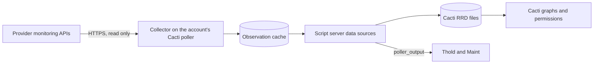

<!-- Source: README.md; SHA256: 7c621642e5f1a46bac66e4bc744f70aebb014c610d22de034088845fdc170405 -->

<!-- translations:start -->
[English](../../../README.md) | [简体中文](README.md) | [हिन्दी](../hi-IN/README.md) | [Español (España)](../es-ES/README.md) | [Español (Latinoamérica)](../es-419/README.md) | [العربية (السعودية)](../ar-SA/README.md) | [Afrikaans](../af-ZA/README.md) | [አማርኛ](../am-ET/README.md) | [العربية (مصر)](../ar-EG/README.md) | [العربية (المغرب)](../ar-MA/README.md) | [বাংলা](../bn-BD/README.md) | [Bosanski](../bs-BA/README.md) | [Deutsch](../de-DE/README.md) | [فارسی](../fa-IR/README.md) | [Filipino](../fil-PH/README.md) | [Français](../fr-FR/README.md) | [Français (Maroc)](../fr-MA/README.md) | [Français (Sénégal)](../fr-SN/README.md) | [Hausa](../ha-NG/README.md) | [עברית](../he-IL/README.md) | [Hrvatski](../hr-HR/README.md) | [Bahasa Indonesia](../id-ID/README.md) | [Igbo](../ig-NG/README.md) | [Italiano](../it-IT/README.md) | [日本語](../ja-JP/README.md) | [한국어](../ko-KR/README.md) | [Malagasy](../mg-MG/README.md) | [मराठी](../mr-IN/README.md) | [Bahasa Melayu](../ms-MY/README.md) | [Nederlands](../nl-NL/README.md) | [Polski](../pl-PL/README.md) | [Português (Brasil)](../pt-BR/README.md) | [Русский](../ru-RU/README.md) | [Kinyarwanda](../rw-RW/README.md) | [Soomaali](../so-SO/README.md) | [Српски](../sr-RS/README.md) | [Svenska](../sv-SE/README.md) | [Kiswahili](../sw-KE/README.md) | [தமிழ்](../ta-IN/README.md) | [తెలుగు](../te-IN/README.md) | [ไทย](../th-TH/README.md) | [Türkçe](../tr-TR/README.md) | [Українська](../uk-UA/README.md) | [اردو](../ur-PK/README.md) | [Tiếng Việt](../vi-VN/README.md) | [isiXhosa](../xh-ZA/README.md) | [Yorùbá](../yo-NG/README.md) | [繁體中文](../zh-TW/README.md) | [isiZulu](../zu-ZA/README.md)
<!-- translations:end -->

<a id="plugin_cloud"></a>
# plugin_cloud

这是一个 Cacti 1.2 插件，将公有云提供商的资源和指标作为普通设备、数据源和图表引入 Cacti。云工作负载由此与承载它们的网络并列显示，受 Cacti 权限控制，并可由 Thold 和 Maint 触发或抑制告警。一个插件覆盖所有提供商，每个提供商使用独立驱动，首先支持 DigitalOcean、AWS、Google Cloud 和 Azure。

> **状态：里程碑 3（DigitalOcean 和 Cacti 对象），正在审核。** 此里程碑增加 DigitalOcean 驱动、Cacti 模板、每账户一个范围设备及每资源类型一个数据查询、脚本服务器输入，以及“新建图表”和健康页面上的请求估算。使用真实 DigitalOcean 账户的初步检查记录在[提供商事实](../../research/provider-facts.md)中。请勿用于生产环境。

<a id="access-roles"></a>
## 访问角色

| 权限域 | 访问权限 |
| --- | --- |
| Cloud View | 现有监控页面。 |
| Cloud Operator | 监控页面、运维页面和个人排查确认记录。 |
| Cloud Admin | 操作员访问权限以及现有配置和管理操作。 |

复制升级文件后，请以管理员身份打开插件页面以注册新权限域。在 **Configuration > Users** 或用户组中明确分配 Operator 权限域。升级会保留现有 View 和 Admin 权限域的 ID 和授权。每次请求中，Admin 访问继承 Operator 访问，Operator 访问继承 View 访问；这不会向用户或组添加已存储的授权。插件设置除需要 Cacti 的 Settings 权限外，还需要 Cloud Admin 访问权限。

Cacti 设备权限仍限制各用户可用的行和操作；未映射对象需要管理员处理。操作员可验证其有权访问的 Cacti 设备所对应账户的已存储凭据。凭据、配置、映射、删除及其他管理变更仍位于管理页面。确认记录仅在当前用户会话内有效，最长一小时，且仅在同一观测结果仍新鲜时有效。新的或发生变化的观测会使其失效。确认记录绝不会将失败测量标记为健康，也不会抑制告警。

<a id="why"></a>
## 原因

每个云提供商都有自己的监控控制台。与 Cacti 并行使用时，会留下三项缺口：

- **独立的访问控制。** 要向 Cacti 用户展示云指标，就必须给予其云登录权限。
- **缺少网络上下文。** 本地链路在 Cacti 中绘图，而链路背后的工作负载在各提供商的控制台中绘图。
- **独立的告警。** Thold 和 Maint 使用 Cacti 数据源和设备，因此必须为每个提供商单独配置和抑制其告警。

插件在 Cacti 轮询器上读取各提供商的监控 API，缓存最新数据点，并将其提供给 Cacti 脚本服务器。Cacti 轮询器负责写入 RRD 文件，因此图表、权限、Thold、Maint 和 boost 的工作方式与其他 Cacti 数据相同。

<a id="design-commitments"></a>
## 设计承诺

- **只读。** 每个驱动只能构建其允许列表中的提供商操作；插件绝不会更改云资源。([ADR 0002](../../decisions/0002-read-only-with-operation-allowlist.md))
- **仅 PHP，无 SDK。** 使用 Cacti 已要求的 PHP 扩展实现签名和令牌交换。没有 Composer 运行时依赖。([ADR 0003](../../decisions/0003-php-only-without-sdks.md))
- **采集前展示费用。** 插件仅读取具有 Cacti 数据源的指标，在创建图表前显示预计请求数和按标价计算的费用，并执行每月上限。([ADR 0005](../../decisions/0005-collect-only-what-is-graphed.md))
- **数据库中不存储明文凭据。** 凭据来自加密凭据库（其密钥保存在数据库之外的文件中）、凭据文件或提供商的实例身份。([ADR 0007](../../decisions/0007-credentials-outside-the-database-in-the-clear.md))

<a id="scope-and-status"></a>
## 范围与状态

| 阶段 | 范围 | 里程碑 | 状态 |
|---|---|---|---|
| 0，研究 | 提供商事实确认、指标目录、费用和速率模型、签名测试向量、传输验证原型 | [M1](https://github.com/somethingwithproof/plugin_cloud/milestone/1) | 已完成，但需要真实提供商账户的检查除外 |
| 1，核心与 DigitalOcean | 账户、凭据库、传输、采集器、观测缓存、Cacti 对象、健康页面、DigitalOcean Droplet 和负载均衡器 | [M2](https://github.com/somethingwithproof/plugin_cloud/milestone/2), [M3](https://github.com/somethingwithproof/plugin_cloud/milestone/3), [M4](https://github.com/somethingwithproof/plugin_cloud/milestone/4) | M2 已完成（[#81](https://github.com/somethingwithproof/plugin_cloud/pull/81)）；M3 驱动、模板及范围设备已合并；请求估算、权限及性能检查正在审核；M4 尚未开始 |
| 2，AWS | Signature Version 4、`AssumeRole`、实例角色、CloudWatch `GetMetricData`、区域清单 | [M5](https://github.com/somethingwithproof/plugin_cloud/milestone/5) | 尚未开始 |
| 3，Google Cloud | 服务账户 JWT、元数据服务器、Cloud Monitoring `timeSeries.list` | [M6](https://github.com/somethingwithproof/plugin_cloud/milestone/6) | 尚未开始 |
| 4，Azure | Entra 客户端凭据、托管身份、Resource Graph、`metrics:getBatch` | [M7](https://github.com/somethingwithproof/plugin_cloud/milestone/7) | 尚未开始 |
| 5，远程采集器 | Cacti 远程数据采集器上的账户 | [M8](https://github.com/somethingwithproof/plugin_cloud/milestone/8) | 尚未开始 |

不在范围内：更改云资源、创建或镜像提供商告警、账单报表、日志和跟踪，以及插件自有的告警引擎。其他提供商（Hetzner Cloud、Akamai Cloud、Oracle Cloud 等）属于研究议题。

<a id="what-milestone-2-ships"></a>
## 里程碑 2 交付内容

- **带保护检查的安装。** PHP 低于 8.2 或缺少 ext-openssl 时，会拒绝安装和启用并给出提示，Cacti 的其他部分继续工作。
- **生命周期。** 通过 Cacti 插件页面安装、升级和卸载。升级按顺序执行，并可从中断中恢复。除非取消 *Keep Plugin Tables on Uninstall*，否则卸载会保留插件表。
- **独立权限域。** *Cloud Admin* 打开 **Cloud Accounts**；*Cloud Operator* 打开 **Cloud Operations**；*Cloud View* 打开 **Cloud Health**。Admin 继承 Operator，Operator 继承 View。三个页面均位于 Management 下。
- **账户和凭据。** 添加、编辑、验证和删除账户。凭据使用保存在数据库外的密钥文件在数据库内加密（AES-256-GCM），或从轮询器上的文件读取。界面中凭据只能写入，日志中会对其进行遮蔽。
- **采集器。** 每次轮询器运行时启动，每个轮询器一个实例，并受时间预算约束。它为每个账户取得租约，以独立间隔执行发现，并仅读取插件自有的活动数据源对应的指标。
- **健康状态。** 显示每账户的采集、发现、资源和新鲜度状态，并对不可用的凭据库密钥、不安全的凭据文件，以及轮询器无法满足的间隔发出警告。

<a id="install-and-configure"></a>
## 安装与配置

以下步骤安装里程碑 2 的代码以供评估。要求 Cacti 1.2.31 或更高版本，运行于 PHP 8.2 或更高版本。

1. 将仓库复制到 Cacti 目录下的 `plugins/cloud`。目录必须命名为 `cloud`。
2. 在 Web 根目录之外创建凭据库密钥。将其放在仅 root 和 Cacti 用户可写的目录中，并使文件仅供运行 Web 服务器和轮询器的用户读取。插件绝不会创建或写入此文件：

   ```sh
   sudo install -d -m 0750 -o root -g cacti /etc/cacti
   head -c 32 /dev/urandom | sudo tee /etc/cacti/cloud-vault.key > /dev/null
   sudo chown cacti:cacti /etc/cacti/cloud-vault.key
   sudo chmod 0600 /etc/cacti/cloud-vault.key
   ```

   将 `cacti` 替换为运行 Web 服务器和轮询器的用户。文件包含 32 个原始字节或 64 个十六进制字符。请将其与数据库一同备份；没有它，必须重新输入已存储的凭据。
3. 在 Cacti 中打开 **Configuration > Plugins**，然后安装并启用 *Cloud*。
4. 在 **Configuration > Settings > Cloud** 中，如果使用了其他路径，请设置 *Vault Key File*。*Collector Time Budget*（默认 240 秒）必须小于轮询器间隔。
5. 在 **Configuration > Users** 中向用户和组授予 *Cloud Admin*、*Cloud Operator* 或 *Cloud View*。安装会向管理员授予 Cloud Admin 和 Cloud View；Cloud Admin 包含 Operator 访问权限，因此管理员无需单独授予 Operator。
6. 在 **Management > Cloud Accounts** 下添加账户，然后在 **Management > Cloud Health** 中检查警告。

<a id="compatibility-targets"></a>
## 兼容性目标

| 组件 | 目标 |
|---|---|
| Cacti | 1.2.31 或更高版本，不需要核心补丁 |
| PHP | 8.2 或更高版本；`setup.php` 在 8.0 上保持可解析，使不受支持的运行时收到拒绝提示，而不会破坏 Cacti 界面 |
| PHP 扩展 | 不需要超出 Cacti 1.2.31 要求的扩展 |
| Thold、Maint | 无需更改 |

<a id="design"></a>
## 设计

- [docs/performance.md](docs/performance.md) 提供采集器和健康页面的测量结果，以及所用硬件和设置。
- [docs/PLAN.md](../../PLAN.md) 是完整计划：架构、依赖的提供商和 Cacti 事实（含来源）、驱动契约、费用计算、安全边界、测试及风险。
- [docs/decisions/](../../decisions) 保存已作出选择的架构决策记录。
- [docs/REQUIREMENTS.md](../../REQUIREMENTS.md) 将各需求 ID 映射到对应议题。



<a id="how-work-is-tracked"></a>
## 工作跟踪方式

- **里程碑**遵循计划中的里程碑。每个里程碑都有一个史诗议题，列出子议题和完成证据。
- **议题**通过标签分类：`type: requirement`、`type: research`、`type: decision`、`type: epic`。需求议题给出编号且可测试的需求（`REQ-AREA-NNN`）和验收标准。
- **标签**还包括 `area:`、`provider:`、`phase:`、`priority:` 和 `status:`。参见 [CONTRIBUTING.md](../../../CONTRIBUTING.md#labels)。
- [项目看板](https://github.com/users/somethingwithproof/projects/7) 显示各里程碑的全部议题。

<a id="development"></a>
## 开发

CI 在 PHP 8.0 上检查入口文件语法，执行单元测试、集成测试和 PHPStan 级别 9 检查，并在 PHP 8.2 至 8.5 上针对 Cacti 1.2.31 和 1.2.x 分支安装插件。它还验证 PHP 8.1 会被拒绝且不会破坏 Cacti。测试使用 Cacti 核心插件测试环境中的 Pest。此选择是临时性的，等待 [#12](https://github.com/somethingwithproof/plugin_cloud/issues/12) 作出决定。[.github/workflows/plugin-ci-workflow.yml](../../../.github/workflows/plugin-ci-workflow.yml) 列出了所有步骤。推送前请在本地运行 `sh tests/lint-workflows.sh` 和 `sh locales/build_gettext.sh --check`。

<a id="contributing"></a>
## 贡献

请阅读 [CONTRIBUTING.md](../../../CONTRIBUTING.md)。提交需要 DCO 签署。设计讨论通过议题进行；未决决策带有 `type: decision` 标签。

<a id="security"></a>
## 安全

请私下报告漏洞；参见 [SECURITY.md](../../../SECURITY.md)。

<a id="license"></a>
## 许可证

GNU 通用公共许可证 v2.0，与 Cacti 及其插件使用的许可证相同。参见 [LICENSE](../../../LICENSE)。
