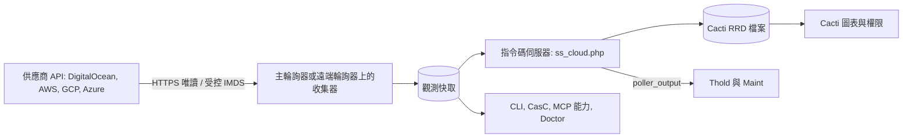

<!-- Source: README.md; SHA256: ac2074a40238686915802803c5efe773f33677f934281e0605e6e87a71a9d27d -->

<!-- translations:start -->
[English](../../../README.md) | [简体中文](../zh-CN/README.md) | [हिन्दी](../hi-IN/README.md) | [Español (España)](../es-ES/README.md) | [Español (Latinoamérica)](../es-419/README.md) | [العربية (السعودية)](../ar-SA/README.md) | [Afrikaans](../af-ZA/README.md) | [አማርኛ](../am-ET/README.md) | [العربية (مصر)](../ar-EG/README.md) | [العربية (المغرب)](../ar-MA/README.md) | [বাংলা](../bn-BD/README.md) | [Bosanski](../bs-BA/README.md) | [Deutsch](../de-DE/README.md) | [فارسی](../fa-IR/README.md) | [Filipino](../fil-PH/README.md) | [Français](../fr-FR/README.md) | [Français (Maroc)](../fr-MA/README.md) | [Français (Sénégal)](../fr-SN/README.md) | [Hausa](../ha-NG/README.md) | [עברית](../he-IL/README.md) | [Hrvatski](../hr-HR/README.md) | [Bahasa Indonesia](../id-ID/README.md) | [Igbo](../ig-NG/README.md) | [Italiano](../it-IT/README.md) | [日本語](../ja-JP/README.md) | [한국어](../ko-KR/README.md) | [Malagasy](../mg-MG/README.md) | [मराठी](../mr-IN/README.md) | [Bahasa Melayu](../ms-MY/README.md) | [Nederlands](../nl-NL/README.md) | [Polski](../pl-PL/README.md) | [Português (Brasil)](../pt-BR/README.md) | [Русский](../ru-RU/README.md) | [Kinyarwanda](../rw-RW/README.md) | [Soomaali](../so-SO/README.md) | [Српски](../sr-RS/README.md) | [Svenska](../sv-SE/README.md) | [Kiswahili](../sw-KE/README.md) | [தமிழ்](../ta-IN/README.md) | [తెలుగు](../te-IN/README.md) | [ไทย](../th-TH/README.md) | [Türkçe](../tr-TR/README.md) | [Українська](../uk-UA/README.md) | [اردو](../ur-PK/README.md) | [Tiếng Việt](../vi-VN/README.md) | [isiXhosa](../xh-ZA/README.md) | [Yorùbá](../yo-NG/README.md) | [繁體中文](README.md) | [isiZulu](../zu-ZA/README.md)
<!-- translations:end -->

# plugin_cloud

這是一個 Cacti 1.2 外掛程式，可將公有雲供應商的資源與指標匯入 Cacti，作為一般的裝置、資料來源與圖表。雲端工作負載與承載它們的網路並列於 Cacti 的權限控管之下，並且由 Thold 與 Maint 進行告警與抑制。單一外掛程式透過純 PHP、唯讀的供應商驅動程式涵蓋 DigitalOcean、Amazon Web Services、Google Cloud 與 Microsoft Azure。

> **狀態：開發中，尚未發布正式版本（`0.1.0-dev`）。**此分支實作了 DigitalOcean、AWS、Google Cloud 與 Azure 的純 PHP 驅動程式、遠端資料收集器複寫與唯讀代理健康狀態、CasC 供應商與操作員 CLI、MCP 能力以及 Doctor 檢查。目前隨附的 Cacti 範本涵蓋 DigitalOcean Droplets 與負載平衡器（`templates/cloud_digitalocean.xml`）；AWS、Google Cloud 與 Azure 的 Cacti 範本套件，以及 DigitalOcean 以外的實際帳戶驗證（[供應商事實資料](../../research/provider-facts.md)）尚未完成。請勿在正式環境中執行。

## 支援的供應商

每個供應商驅動程式皆於 `Drivers::production()` 中註冊、由 `Provider::released()` 提供，並使用 `ext-openssl` 與串流 Socket 以純 PHP 執行，完全不依賴任何 SDK 或 Composer 執行時期相依套件。

| 供應商 | 範圍欄位 | 憑證來源 | 驗證方式 | 探索到的資源 | 指標收集 |
|---|---|---|---|---|---|
| DigitalOcean (`digitalocean`) | 無（權杖範圍） | `vault`, `file` | Bearer token | `droplet`, `load_balancer` | `/v2/monitoring/metrics`（具備速率限制配額感知）；隨附 Cacti 範本與資料查詢 |
| Amazon Web Services (`aws`) | `account_id`（12 位數字）、`regions` | `vault`, `file`, `instance` | 純 PHP AWS SigV4（`AWS4-HMAC-SHA256`）、STS `GetCallerIdentity` 驗證、選用的 STS `AssumeRole`、`instance` 帳戶使用 EC2 IMDSv2（`169.254.169.254`） | `ec2_instance`, `rds_instance`, `aws_elb` (ALB/NLB) | 批次 CloudWatch `GetMetricData`（每次呼叫最多 500 個查詢） |
| Google Cloud (`gcp`) | `project` | `vault`, `file`, `instance` | 透過 `ext-openssl` 產生純 PHP RS256 服務帳戶 JWT 並於 `oauth2.googleapis.com/token` 交換，或針對 `instance` 帳戶使用 GCE 中繼資料伺服器（`metadata.google.internal`） | 透過 `instances.aggregatedList` 取得 `gce_instance` | Cloud Monitoring `timeSeries.list` |
| Microsoft Azure (`azure`) | `tenant`, `subscription`, `regions` | `vault`, `file`, `instance` | 純 PHP Entra ID OAuth2 用戶端憑證流程（僅限 `client_secret`；不包含憑證斷言），或針對 ARM 與 Monitor 權杖使用 Azure IMDS（`169.254.169.254`）受控識別 | 透過 ARM Resource Graph 取得 `azure_vm`（使用 `$skipToken` 分頁並去除重複項目） | Azure Monitor `metrics:getBatch`（每次呼叫最多 50 個資源，支援 HTTP 429 與 529 節流處理） |

## 已實作的功能

### 核心平台、金鑰保管庫與收集器

- **受保護的安裝與生命週期。** 進入點（`setup.php`、`cli/cloud.php`、`poller_cloud.php`、`ss_cloud.php` 與頁面指令碼）可在 PHP 8.0 上進行語法解析，並在 PHP 低於 8.2 或缺少 `ext-openssl` 時拒絕執行而不破壞 Cacti。升級流程依序進行、具冪等性（`Schema::VERSION = 3`，9 個資料表），且能承受中斷。除非取消勾選 *Keep Plugin Tables on Uninstall*，否則解除安裝會保留外掛程式資料表。
- **帳戶與憑證。** 在 **Management > Cloud Accounts** 下新增、編輯、驗證與刪除帳戶。憑證可來自 AES-256-GCM 加密的保管庫（`plugin_cloud_secret`，預設以 `/etc/cacti/cloud-vault.key` 作為金鑰）、來自受限於已設定 *Credential File Directory*（`cloud_credential_dir`，預設為空以拒絕讀取檔案）內的檔案，或來自供應商執行個體識別。憑證在 UI 中為唯寫，並會從記錄檔中遮罩隱藏。
- **嚴格的連外與唯讀控制。** 每個驅動程式皆於 `GuardedTransport` 與 `OutboundPolicy` 背後運作：僅允許透過 HTTPS 連接埠 443 連線至各供應商的精確主機名稱，且僅針對 `instance` 帳戶啟用連結本地 HTTP 連接埠 80 的中繼資料端點（`169.254.169.254`、`metadata.google.internal`）。僅允許核准清單上的唯讀作業。
- **收集器與成本控制。** `poller_cloud.php` 從 `poller_bottom` 執行（透過 Cacti 的處理程序登錄機制，每個輪詢器一個處理程序），在 `cloud_collector_budget` 預算內運作，取得每個帳戶的租約，依 `discover_interval` 執行探索，僅讀取使用中之 Cacti 資料來源（`plugin_cloud_series`）的指標，遵循 `request_share` 與 `monthly_ceiling`，並將最新資料點快取於 `plugin_cloud_observation` 供 `ss_cloud.php` 使用。
- **Cacti 物件與請求數預估。** 為每個帳戶維護一個範圍裝置（`plugin_cloud_device`），在儲存裝置時保留範圍裝置的重新索引方法，匯入 DigitalOcean 範本與指令碼伺服器資料查詢（`templates/cloud_digitalocean.xml`、`cloud_do_droplet.xml`、`cloud_do_load_balancer.xml`），並在 **New Graphs**（`graphs_new_top_links`）與 **Cloud Health** 上顯示請求數與牌價預估。

### 遠端資料收集器

- `INFO` 宣告 `remote_collect:1`。帳戶可指派給任何已啟用的 Cacti 輪詢器（`poller_id >= 1`），而 `poller_cloud.php --poller=N` 僅收集屬於該輪詢器的帳戶。
- **`replicate_out` 掛鉤。** 透過 `replicate_out_table()` 從 `plugin_cloud_account`、`plugin_cloud_device`、`plugin_cloud_series` 複寫屬於該輪詢器範圍的資料列，並從 `plugin_cloud_secret` 複寫已加密的密文資料列（僅限屬於目標輪詢器的保管庫帳戶）。原始保管庫金鑰檔案絕不會儲存於資料庫或被複寫，而是保留在每個輪詢器的本機端。
- **`remote_agent` 掛鉤。** 提供唯讀的 JSON 健康狀態摘要（`action=cloud_health`），僅接受整數 `poller_id` 與 `account_id` 參數，且不回傳任何憑證、檔案路徑或機密資訊。

### 生態系統掛鉤（CasC、MCP 能力與 Doctor）

- **CasC 供應商（`casc_register_providers`）。** 註冊 `cloud` 供應商（結構描述版本 `1`），具備確定性的純 PHP YAML 與 XML 匯出、資訊清單驗證、差異規劃與確認套用功能。保管庫憑證會匯出為 `vault:account:<name>` 參照；原始機密欄位（`secret`、`secrets`、`token`、`access_token`、`refresh_token`、`password`、`private_key`、`access_key_id`、`secret_access_key`、`session_token`、`client_secret`、`credential`、`credentials`、`vault_key`）將被拒絕。套用時必須提供精確的 SHA-256 `--confirm=<PLAN_HASH>`。
- **MCP / Abilities API（`abilities_register`）。** 為非管理員呼叫端註冊三項嚴格唯讀的能力，受限於 Cloud View 權限領域（`cloud_health.php`）與 Cacti 裝置範圍，且不會輸出任何憑證、保管庫金鑰或憑證檔案路徑：
  - `cloud-list-accounts`（選用 `provider`、`poller_id`）
  - `cloud-list-resources`（選用 `account_id`、`type`、`lifecycle`）
  - `cloud-get-health`（選用 `account_id`）
- **Doctor 檢查（`doctor_register_checks`）。** 註冊五項診斷檢查，不會揭露任何機密值或金鑰內容：
  - `cloud_schema`：結構描述版本是否為最新
  - `cloud_vault_key`：保管庫金鑰檔案的可讀性、權限與大小
  - `cloud_drivers`：所有已發布供應商的正式驅動程式註冊狀態
  - `cloud_accounts_health`：失敗、被節流或資料過期的已啟用帳戶
  - `cloud_poller_intervals`：已啟用帳戶的收集間隔與 Cacti 輪詢器間隔是否對齊

## CLI

使用 PHP 8.2 或更新版本從 Cacti 根目錄執行：

```sh
# Operator and CasC CLI (options use --key=value form)
php plugins/cloud/cli/cloud.php export [--format=yaml|xml]
php plugins/cloud/cli/cloud.php validate --file=<path> [--format=yaml|xml]
php plugins/cloud/cli/cloud.php plan --file=<path> [--format=yaml|xml]
php plugins/cloud/cli/cloud.php apply --file=<path> --confirm=<PLAN_HASH> [--format=yaml|xml]
php plugins/cloud/cli/cloud.php health [--format=text|json] [--poller=<id>]

# Collector entry point (normally started by poller_bottom)
php plugins/cloud/poller_cloud.php [--poller=N] [--force] [--debug]
```

## 存取角色

| 權限領域 | 存取權限 |
| --- | --- |
| Cloud View | 現有的監控頁面。 |
| Cloud Operator | 監控功能加上操作頁面與個人分流確認（acknowledgments）。 |
| Cloud Admin | Operator 存取權限加上現有的設定與管理動作。 |

複製升級檔案後，請以管理員身分開啟 Plugins 頁面以註冊權限領域。於 **Configuration > Users** 或使用者群組中明確指派 Operator 權限領域。升級會保留現有的 View 與 Admin 權限領域 ID 與授權。Admin 權限於每次請求時繼承 Operator 權限，而 Operator 權限繼承 View 權限；這不會在使用者或群組中新增儲存的授權項目。外掛程式設定除了需要 Cacti 的 Settings 權限外，還需要 Cloud Admin 權限。

Cacti 裝置權限會限制每位使用者可存取的資料列與動作；未對應的物件則需要管理員權限。Operator 可為其有權存取對應 Cacti 裝置的帳戶驗證已儲存的憑證。憑證、設定、對應、刪除與其他管理變更仍保留於管理頁面中。確認僅在目前使用者的工作階段中有效，最長一小時，且僅於同一筆觀測維持最新狀態時有效。新的或已變更的觀測會使其失效。確認絕不會將失敗的量測標記為健康，也不會抑制告警。

## 為什麼需要這個外掛程式

每個雲端供應商都有自己的監控主控台。與 Cacti 並行運作時，會留下三個缺口：

- **分離的存取控制。** 要讓 Cacti 使用者看到雲端指標，就意味著必須給他們一個雲端登入帳號。
- **缺乏網路脈絡。** 地端鏈路在 Cacti 中繪製圖表；而其背後的工作負載卻在各供應商的主控台中繪製圖表。
- **分離的告警。** Thold 與 Maint 作用於 Cacti 資料來源與裝置，因此供應商告警必須為每個供應商分別設定與抑制。

此外掛程式會在 Cacti 輪詢器上讀取各供應商的監控 API，將最新資料點快取，並提供給 Cacti 的指令碼伺服器。由 Cacti 的輪詢器寫入 RRD 檔案，因此繪圖、權限、Thold、Maint 與 boost 的運作方式皆與任何其他 Cacti 資料相同。

## 設計承諾

- **唯讀。** 每個驅動程式只能建構其核准清單上的供應商作業；外掛程式絕不會變更雲端資源。（[ADR 0002](../../decisions/0002-read-only-with-operation-allowlist.md)）
- **純 PHP，無 SDK。** 簽章與權杖交換皆以 PHP 搭配 Cacti 已需要的擴充套件實作。無 Composer 執行時期相依套件。（[ADR 0003](../../decisions/0003-php-only-without-sdks.md)）
- **先計費後收集。** 外掛程式僅讀取具有 Cacti 資料來源的指標，在建立圖表前顯示預期的請求數與牌價成本，並強制執行每月上限。（[ADR 0005](../../decisions/0005-collect-only-what-is-graphed.md)）
- **資料庫不存明文憑證。** 憑證來自以資料庫外部檔案為金鑰的加密保管庫、來自憑證檔案，或來自供應商的執行個體識別。（[ADR 0007](../../decisions/0007-credentials-outside-the-database-in-the-clear.md)）

## 範圍與狀態

| 階段 | 範圍 | 里程碑 | 狀態 |
|---|---|---|---|
| 0，研究 | 供應商事實確認、指標目錄、成本與速率模型、簽章測試向量、傳輸概念驗證 | [M1](https://github.com/somethingwithproof/plugin_cloud/milestone/1) | 已完成，需要實際供應商帳戶的檢查除外 |
| 1，核心與 DigitalOcean | 帳戶、憑證保管庫、傳輸、收集器、觀測快取、Cacti 物件、範本、請求數預估、健康頁面、DigitalOcean Droplets 與負載平衡器 | [M2](https://github.com/somethingwithproof/plugin_cloud/milestone/2), [M3](https://github.com/somethingwithproof/plugin_cloud/milestone/3), [M4](https://github.com/somethingwithproof/plugin_cloud/milestone/4) | 已實作；M4 先導驗證待進行 |
| 2，AWS | 純 PHP SigV4、STS `AssumeRole`、IMDSv2 執行個體角色、EC2/RDS/ELB 清單、CloudWatch `GetMetricData` | [M5](https://github.com/somethingwithproof/plugin_cloud/milestone/5) | 驅動程式已實作；Cacti 範本與實際帳戶驗證待進行 |
| 3，Google Cloud | 純 PHP RS256 服務帳戶 JWT、GCE 中繼資料伺服器、Compute Engine 清單、Cloud Monitoring `timeSeries.list` | [M6](https://github.com/somethingwithproof/plugin_cloud/milestone/6) | 驅動程式已實作；Cacti 範本與實際帳戶驗證待進行 |
| 4，Azure | Entra ID 用戶端憑證、IMDS 受控識別、ARM Resource Graph VM 清單、Azure Monitor `metrics:getBatch` | [M7](https://github.com/somethingwithproof/plugin_cloud/milestone/7) | 驅動程式已實作；Cacti 範本與實際帳戶驗證待進行 |
| 5，遠端收集器與生態系統 | 遠端資料收集器（`replicate_out`、`remote_agent`）、CasC 供應商與 CLI、MCP 能力、Doctor 檢查 | [M8](https://github.com/somethingwithproof/plugin_cloud/milestone/8) | 已實作 |

範圍外項目：變更雲端資源、建立或鏡像供應商告警、帳務報表、記錄檔與追蹤資訊，以及外掛程式自有的告警引擎。其他供應商（Hetzner Cloud、Akamai Cloud、Oracle Cloud 等）為研究議題。

## 安裝與設定

這些步驟會安裝開發中程式碼以供評估。它們需要執行於 PHP 8.2 或更新版本的 Cacti 1.2.31 或更新版本。

1. 將此儲存庫複製到您 Cacti 目錄下的 `plugins/cloud`。目錄名稱必須為 `cloud`。
2. 在每個使用保管庫憑證的輪詢器上，於網站根目錄之外建立保管庫金鑰。將其置於僅 root 與 Cacti 使用者可寫入的目錄中，並設定該檔案僅供執行網頁伺服器與輪詢器的使用者讀取。外掛程式絕不會建立或寫入此檔案：

   ```sh
   sudo install -d -m 0750 -o root -g cacti /etc/cacti
   head -c 32 /dev/urandom | sudo tee /etc/cacti/cloud-vault.key > /dev/null
   sudo chown cacti:cacti /etc/cacti/cloud-vault.key
   sudo chmod 0600 /etc/cacti/cloud-vault.key
   ```

   請將 `cacti` 替換為執行您網頁伺服器與輪詢器的使用者。該檔案包含 32 個原始位元組或 64 個十六進位字元。請將其與資料庫一併備份；若遺失此檔案，必須重新輸入已儲存的憑證。
3. 在 Cacti 中開啟 **Configuration > Plugins**，然後安裝並啟用 *Cloud*。
4. 在 **Configuration > Settings > Cloud** 下，若您使用其他路徑請設定 *Vault Key File*，若計畫使用檔案型憑證請設定 *Credential File Directory*，並將 *Collector Time Budget*（預設 240 秒）保持低於輪詢器間隔。
5. 在 **Configuration > Users** 下為使用者與群組授予 *Cloud Admin*、*Cloud Operator* 或 *Cloud View*。安裝時會將 Cloud Admin 與 Cloud View 授予管理員；Cloud Admin 已包含 Operator 存取權限，因此管理員不需要額外的 Operator 授權。
6. 在 **Management > Cloud Accounts** 下新增帳戶，接著檢查 **Management > Cloud Health** 是否有警告訊息。

## 相容性目標

| 元件 | 目標 |
|---|---|
| Cacti | 1.2.31 或更新版本，無須修補核心程式 |
| PHP | 8.2 或更新版本；進入點維持可在 8.0 上解析，使不支援的執行時期收到拒絕訊息而非損壞的 Cacti UI |
| PHP 擴充套件 | `ext-openssl`（Cacti 1.2.31 所需）；不需 `ext-curl` 且無 Composer 執行時期相依套件 |
| Thold, Maint | 不需任何變更 |

## 設計

- [docs/performance.md](../../performance.md) 包含收集器與健康頁面的效能測量數據，以及所使用的硬體與設定。
- [docs/PLAN.md](../../PLAN.md) 為完整計畫：架構、所依賴的供應商與 Cacti 事實（附來源）、驅動程式合約、成本計算、安全邊界、測試與風險。
- [docs/decisions/](../../decisions/) 收錄了已做出選擇的架構決策記錄。
- [docs/REQUIREMENTS.md](../../REQUIREMENTS.md) 將每個需求 ID 對應至其議題。



## 工作追蹤方式

- **里程碑**遵循計畫中的里程碑。每個里程碑都有一個史詩議題（epic issue），列出其子議題與完成證據。
- **議題**以標籤分類：`type: requirement`、`type: research`、`type: decision`、`type: epic`。需求議題會敘明編號且可測試的需求（`REQ-AREA-NNN`）與驗收條件。
- **標籤**亦包含 `area:`、`provider:`、`phase:`、`priority:` 與 `status:`。請參閱 [CONTRIBUTING.md](../../../CONTRIBUTING.md#labels)。
- [專案看板](https://github.com/users/somethingwithproof/projects/7) 顯示跨所有里程碑的全部議題。

## 開發

CI（[.github/workflows/plugin-ci-workflow.yml](../../../.github/workflows/plugin-ci-workflow.yml)）會檢查發布封存檔與語意化版本（`bash tests/bin/archive-check.sh`）、於 PHP 8.0 上對進入點執行語法檢查、在 PHP 8.2 至 8.5 上針對 Cacti `release/1.2.31` 與 `1.2.x` 搭配 `CLOUD_OFFLINE=1` 執行 Pest 單元測試（`phpunit.xml`）與生命週期整合測試（`phpunit-integration.xml`）及 PHPStan 第 9 級檢查、驗證在 PHP 8.1 上的拒絕行為、驗證 gettext 目錄、測量 1,000 個序列收集與健康頁面的效能，並執行工作流程 lint 檢查與 REUSE 合規性檢查。

推送前的本機檢查：

```sh
bash tests/bin/archive-check.sh
sh tests/lint-workflows.sh
sh locales/build_gettext.sh --check
CACTI_PATH=/path/to/cacti phpstan analyse -c phpstan.neon --no-progress
```

使用 `--configuration=phpunit.xml` 執行 Pest 以進行單元與原始碼規則測試，或使用 `--configuration=phpunit-integration.xml` 搭配 `CACTI_PATH` 與 `CLOUD_TEST_DATABASE=disposable` 針對免洗 Cacti 資料庫執行生命週期整合測試。

## 貢獻

請閱讀 [CONTRIBUTING.md](../../../CONTRIBUTING.md)。提交（commit）需要 DCO 簽署。設計討論於議題中進行；尚未定案的決策會標記 `type: decision` 標籤。

## 安全性

請私下通報安全漏洞；請參閱 [SECURITY.md](../../../SECURITY.md)。

## 授權條款

GNU General Public License v2.0，與 Cacti 及其外掛程式相同之授權條款。請參閱 [LICENSE](../../../LICENSE)。
