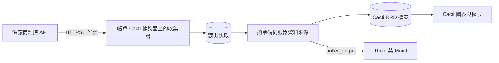

<!-- Source: README.md; SHA256: 7c621642e5f1a46bac66e4bc744f70aebb014c610d22de034088845fdc170405 -->

<!-- translations:start -->
[English](../../../README.md) | [简体中文](../zh-CN/README.md) | [हिन्दी](../hi-IN/README.md) | [Español (España)](../es-ES/README.md) | [Español (Latinoamérica)](../es-419/README.md) | [العربية (السعودية)](../ar-SA/README.md) | [Afrikaans](../af-ZA/README.md) | [አማርኛ](../am-ET/README.md) | [العربية (مصر)](../ar-EG/README.md) | [العربية (المغرب)](../ar-MA/README.md) | [বাংলা](../bn-BD/README.md) | [Deutsch](../de-DE/README.md) | [فارسی](../fa-IR/README.md) | [Filipino](../fil-PH/README.md) | [Français](../fr-FR/README.md) | [Français (Maroc)](../fr-MA/README.md) | [Français (Sénégal)](../fr-SN/README.md) | [Hausa](../ha-NG/README.md) | [עברית](../he-IL/README.md) | [Bahasa Indonesia](../id-ID/README.md) | [Igbo](../ig-NG/README.md) | [Italiano](../it-IT/README.md) | [日本語](../ja-JP/README.md) | [한국어](../ko-KR/README.md) | [Malagasy](../mg-MG/README.md) | [मराठी](../mr-IN/README.md) | [Bahasa Melayu](../ms-MY/README.md) | [Nederlands](../nl-NL/README.md) | [Polski](../pl-PL/README.md) | [Português (Brasil)](../pt-BR/README.md) | [Русский](../ru-RU/README.md) | [Kinyarwanda](../rw-RW/README.md) | [Soomaali](../so-SO/README.md) | [Svenska](../sv-SE/README.md) | [Kiswahili](../sw-KE/README.md) | [தமிழ்](../ta-IN/README.md) | [తెలుగు](../te-IN/README.md) | [ไทย](../th-TH/README.md) | [Türkçe](../tr-TR/README.md) | [Українська](../uk-UA/README.md) | [اردو](../ur-PK/README.md) | [Tiếng Việt](../vi-VN/README.md) | [isiXhosa](../xh-ZA/README.md) | [Yorùbá](../yo-NG/README.md) | [繁體中文](README.md) | [isiZulu](../zu-ZA/README.md)
<!-- translations:end -->

# plugin_cloud

這是一個 Cacti 1.2 外掛程式，可將公有雲供應商的資源與指標匯入 Cacti，作為一般的裝置、資料來源與圖表。雲端工作負載便能與承載它們的網路並列於 Cacti 的權限控管之下，並且可透過 Thold 與 Maint 進行告警與抑制。單一外掛程式即可涵蓋所有供應商，並為每個供應商提供專屬驅動程式：優先支援 DigitalOcean、AWS、Google Cloud 與 Azure。

> **狀態：里程碑 3（DigitalOcean 與 Cacti 物件），審查中。**此里程碑新增了 DigitalOcean 驅動程式、Cacti 範本、每個帳戶一個範圍裝置（scope device）與每種資源類型一個資料查詢、指令碼伺服器輸入，以及「New Graphs」與健康狀態頁面上的請求數預估。針對實際 DigitalOcean 帳戶的初步檢查結果已記錄於[供應商事實資料](../../research/provider-facts.md)。請勿在正式環境中執行。

## 存取角色

| 權限領域 | 存取權限 |
| --- | --- |
| Cloud View | 現有的監控頁面。 |
| Cloud Operator | 監控頁面，加上「維運（Operations）」頁面及個人分診確認（triage acknowledgment）。 |
| Cloud Admin | Operator 存取權限，加上現有的設定與管理動作。 |

複製升級檔案後，請以管理員身分開啟「外掛程式（Plugins）」頁面以註冊新的權限領域。請在 **設定 > 使用者（Configuration > Users）** 或使用者群組中明確指派 Operator 權限領域。升級會保留現有的 View 與 Admin 權限領域 ID 及授權。在每次請求時，Admin 存取權限會繼承 Operator 存取權限，而 Operator 存取權限會繼承 View 存取權限；這不會在使用者或群組中新增儲存的授權項目。此外，外掛程式設定除了需要 Cacti 的「設定（Settings）」權限外，還需要 Cloud Admin 存取權限。

Cacti 裝置權限仍會限制每位使用者可見的資料列與可用動作；未對應的物件則需要管理員處理。Operator 可以針對其擁有存取權限之 Cacti 裝置所屬的帳戶，驗證已儲存的憑證。憑證、設定、對應、刪除及其他管理變更仍保留於管理頁面中。確認狀態僅在目前使用者的工作階段期間有效，最長一小時，且僅在該筆觀測資料保持最新狀態時有效；新的或已變更的觀測資料會使確認狀態失效。確認狀態絕不會將失敗的量測標記為健康，也不會抑制告警。

## 設計動機

每個雲端供應商都有自己的監控主控台。若與 Cacti 並行運作，會產生三個落差：

- **分離的存取控制。** 讓 Cacti 使用者檢視雲端指標，意味著必須提供他們雲端登入帳號。
- **缺乏網路脈絡。** 地端鏈路在 Cacti 中繪製圖表；其背後的工作負載卻在各供應商的主控台中繪製圖表。
- **分離的告警機制。** Thold 與 Maint 僅作用於 Cacti 資料來源與裝置，因此供應商告警必須按供應商分別設定與抑制。

此外掛程式會在 Cacti 輪詢器上讀取各供應商的監控 API，快取最新的資料點，並提供給 Cacti 的指令碼伺服器。由 Cacti 的輪詢器寫入 RRD 檔案，因此繪圖、權限、Thold、Maint 與 boost 的運作方式皆與任何其他 Cacti 資料相同。

## 設計承諾

- **唯讀。** 每個驅動程式只能建立其允許清單（allowlist）上的供應商操作；外掛程式絕不會變更雲端資源。（[ADR 0002](../../decisions/0002-read-only-with-operation-allowlist.md)）
- **純 PHP，不使用 SDK。** 簽章與權杖交換皆以 PHP 實作，僅使用 Cacti 本身已要求的擴充功能，無 Composer 執行時期相依套件。（[ADR 0003](../../decisions/0003-php-only-without-sdks.md)）
- **先估算成本，再進行收集。** 外掛程式僅讀取具有 Cacti 資料來源的指標，在建立圖表前顯示預期的請求次數與牌價成本，並強制執行每月上限。（[ADR 0005](../../decisions/0005-collect-only-what-is-graphed.md)）
- **資料庫中不存放明文憑證。** 憑證來自以資料庫外部檔案作為金鑰的加密保管庫、來自憑證檔案，或來自供應商的執行個體身分（instance identity）。（[ADR 0007](../../decisions/0007-credentials-outside-the-database-in-the-clear.md)）

## 範圍與狀態

| 階段 | 範圍 | 里程碑 | 狀態 |
|---|---|---|---|
| 0，研究 | 供應商事實確認、指標目錄、成本與費率模型、簽章測試向量、傳輸驗證（transport spike） | [M1](https://github.com/somethingwithproof/plugin_cloud/milestone/1) | 已完成，唯需實際供應商帳戶的檢查項目除外 |
| 1，核心與 DigitalOcean | 帳戶、憑證保管庫、傳輸層、收集器、觀測快取、Cacti 物件、健康狀態頁面、DigitalOcean Droplets 與負載平衡器 | [M2](https://github.com/somethingwithproof/plugin_cloud/milestone/2)、[M3](https://github.com/somethingwithproof/plugin_cloud/milestone/3)、[M4](https://github.com/somethingwithproof/plugin_cloud/milestone/4) | M2 已完成（[#81](https://github.com/somethingwithproof/plugin_cloud/pull/81)）；M3 驅動程式、範本與範圍裝置已合併；請求數預估、權限與效能檢查審查中；M4 尚未開始 |
| 2，AWS | Signature Version 4、`AssumeRole`、執行個體角色、CloudWatch `GetMetricData`、區域清冊 | [M5](https://github.com/somethingwithproof/plugin_cloud/milestone/5) | 尚未開始 |
| 3，Google Cloud | 服務帳戶 JWT、中繼資料伺服器、Cloud Monitoring `timeSeries.list` | [M6](https://github.com/somethingwithproof/plugin_cloud/milestone/6) | 尚未開始 |
| 4，Azure | Entra 用戶端憑證、受控識別、Resource Graph、`metrics:getBatch` | [M7](https://github.com/somethingwithproof/plugin_cloud/milestone/7) | 尚未開始 |
| 5，遠端收集器 | Cacti 遠端資料收集器上的帳戶 | [M8](https://github.com/somethingwithproof/plugin_cloud/milestone/8) | 尚未開始 |

不在範圍內的項目：變更雲端資源、建立或鏡像供應商警報、帳單報表、日誌與追蹤（traces），以及外掛程式自有的告警引擎。其他供應商（Hetzner Cloud、Akamai Cloud、Oracle Cloud 等）列為研究議題。

## 里程碑 2 交付內容

- **受保護的安裝機制。** 在低於 PHP 8.2 的環境或缺少 ext-openssl 時，會拒絕安裝與啟用並顯示訊息，同時維持 Cacti 其餘部分正常運作。
- **生命週期。** 透過 Cacti 的「外掛程式」頁面進行安裝、升級與解除安裝。升級按順序執行，且在中斷後可恢復。除非取消勾選 *Keep Plugin Tables on Uninstall*，否則解除安裝會保留外掛程式的資料表。
- **獨立權限領域。** *Cloud Admin* 可開啟 **Cloud Accounts**；*Cloud Operator* 可開啟 **Cloud Operations**；*Cloud View* 可開啟 **Cloud Health**。Admin 繼承 Operator，Operator 繼承 View。這三個頁面皆位於「管理（Management）」底下。
- **帳戶與憑證。** 新增、編輯、驗證與刪除帳戶。憑證會以存放於資料庫外部的金鑰檔案進行加密後儲存於資料庫（AES-256-GCM），或從輪詢器上的檔案讀取。憑證在 UI 中為僅寫入（write-only），且會從日誌中遮蔽移除。
- **收集器。** 每次輪詢器執行時啟動，每個輪詢器一個執行個體，並在時間預算內運作。它會依帳戶取得租約（lease），按各自的間隔執行探索（discovery），並僅為外掛程式自身的啟用中資料來源讀取指標。
- **健康狀態。** 依帳戶呈現收集、探索、資源與新鮮度狀態，並針對無法使用的保管庫金鑰、不安全的憑證檔案，以及輪詢器無法配合的間隔發出警告。

## 安裝與設定

以下步驟用於安裝里程碑 2 的程式碼以供評估。環境需求為 Cacti 1.2.31 或更新版本，搭配 PHP 8.2 或更新版本。

1. 將儲存庫複製到 Cacti 目錄下的 `plugins/cloud`。目錄名稱必須為 `cloud`。
2. 在網頁根目錄之外建立保管庫金鑰。將其放置於僅 root 與 Cacti 使用者可寫入的目錄中，並將檔案設為僅執行網頁伺服器與輪詢器的使用者可讀取。外掛程式絕不會建立或寫入此檔案：

   ```sh
   sudo install -d -m 0750 -o root -g cacti /etc/cacti
   head -c 32 /dev/urandom | sudo tee /etc/cacti/cloud-vault.key > /dev/null
   sudo chown cacti:cacti /etc/cacti/cloud-vault.key
   sudo chmod 0600 /etc/cacti/cloud-vault.key
   ```

   請將 `cacti` 替換為執行網頁伺服器與輪詢器的使用者。該檔案包含 32 個原始位元組（raw bytes）或 64 個十六進位字元。請將此檔案與資料庫一併備份；若遺失此檔案，則必須重新輸入已儲存的憑證。
3. 在 Cacti 中開啟 **設定 > 外掛程式（Configuration > Plugins）**，然後安裝並啟用 *Cloud*。
4. 在 **設定 > 設定值 > Cloud（Configuration > Settings > Cloud）** 下，若您使用了其他路徑，請設定 *Vault Key File*。*Collector Time Budget*（預設 240 秒）必須保持低於輪詢器間隔。
5. 在 **設定 > 使用者（Configuration > Users）** 下，將 *Cloud Admin*、*Cloud Operator* 或 *Cloud View* 授予使用者與群組。安裝時會自動將 Cloud Admin 與 Cloud View 授予管理員；Cloud Admin 已包含 Operator 存取權限，因此管理員無需額外授予 Operator 權限。
6. 在 **管理 > Cloud Accounts（Management > Cloud Accounts）** 下新增帳戶，然後檢查 **管理 > Cloud Health（Management > Cloud Health）** 是否有警告訊息。

## 相容性目標

| 元件 | 目標 |
|---|---|
| Cacti | 1.2.31 或更新版本，無需修補核心程式碼 |
| PHP | 8.2 或更新版本；`setup.php` 在 8.0 上仍保持可剖析，以便不支援的執行時期能獲得明確拒絕訊息，而非導致 Cacti UI 損毀 |
| PHP 擴充功能 | 除了 Cacti 1.2.31 所需的擴充功能外，無額外需求 |
| Thold、Maint | 無需任何變更 |

## 設計

- [docs/performance.md](../../performance.md) 包含收集器與健康狀態頁面的量測數據，以及所使用的硬體與設定。
- [docs/PLAN.md](../../PLAN.md) 為完整規劃：包含架構、其所依賴的供應商與 Cacti 事實（含來源）、驅動程式合約、成本計算、安全性邊界、測試與風險。
- [docs/decisions/](../../decisions) 存放已制定決策的架構決策記錄（ADR）。
- [docs/REQUIREMENTS.md](../../REQUIREMENTS.md) 將每個需求 ID 對應至其議題。



## 工作追蹤方式

- **里程碑** 對應規劃中的各項里程碑。每個里程碑都有一個史詩議題（epic issue），列出其子議題與結束佐證。
- **議題** 依標籤分類：`type: requirement`、`type: research`、`type: decision`、`type: epic`。需求議題會載明具編號且可測試的需求（`REQ-AREA-NNN`）與驗收標準。
- **標籤** 亦包含 `area:`、`provider:`、`phase:`、`priority:` 與 `status:`。請參閱 [CONTRIBUTING.md](../../../CONTRIBUTING.md#labels)。
- [專案看板](https://github.com/users/somethingwithproof/projects/7) 顯示跨里程碑的所有議題。

## 開發

CI 會在 PHP 8.0 上對進入點執行語法檢查（lint），執行單元測試、整合測試及 PHPStan level 9 靜態分析，並在 PHP 8.2 至 8.5 上針對 Cacti 1.2.31 與 1.2.x 分支安裝外掛程式。它亦會檢查 PHP 8.1 是否能被正確拒絕而不致破壞 Cacti。測試採用來自 Cacti 核心外掛程式測試框架（plugin harness）的 Pest；在 [#12](https://github.com/somethingwithproof/plugin_cloud/issues/12) 做出決定前，此選擇仍屬暫定。[.github/workflows/plugin-ci-workflow.yml](../../../.github/workflows/plugin-ci-workflow.yml) 列出了所有步驟。推送前請先在本機執行 `sh tests/lint-workflows.sh` 與 `sh locales/build_gettext.sh --check`。

## 貢獻

請閱讀 [CONTRIBUTING.md](../../../CONTRIBUTING.md)。提交（commit）需要附上 DCO 簽署（sign-off）。設計討論會在議題上進行；待決定的項目會標記 `type: decision` 標籤。

## 安全性

請私下通報漏洞；參閱 [SECURITY.md](../../../SECURITY.md)。

## 授權條款

GNU General Public License v2.0，與 Cacti 及其外掛程式採用相同的授權條款。參閱 [LICENSE](../../../LICENSE)。
