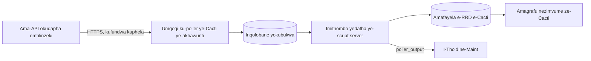

<!-- Source: README.md; SHA256: 7c621642e5f1a46bac66e4bc744f70aebb014c610d22de034088845fdc170405 -->

<!-- translations:start -->
[English](../../../README.md) | [简体中文](../zh-CN/README.md) | [हिन्दी](../hi-IN/README.md) | [Español (España)](../es-ES/README.md) | [Español (Latinoamérica)](../es-419/README.md) | [العربية (السعودية)](../ar-SA/README.md) | [Afrikaans](../af-ZA/README.md) | [አማርኛ](../am-ET/README.md) | [العربية (مصر)](../ar-EG/README.md) | [العربية (المغرب)](../ar-MA/README.md) | [বাংলা](../bn-BD/README.md) | [Bosanski](../bs-BA/README.md) | [Deutsch](../de-DE/README.md) | [فارسی](../fa-IR/README.md) | [Filipino](../fil-PH/README.md) | [Français](../fr-FR/README.md) | [Français (Maroc)](../fr-MA/README.md) | [Français (Sénégal)](../fr-SN/README.md) | [Hausa](../ha-NG/README.md) | [עברית](../he-IL/README.md) | [Hrvatski](../hr-HR/README.md) | [Bahasa Indonesia](../id-ID/README.md) | [Igbo](../ig-NG/README.md) | [Italiano](../it-IT/README.md) | [日本語](../ja-JP/README.md) | [한국어](../ko-KR/README.md) | [Malagasy](../mg-MG/README.md) | [मराठी](../mr-IN/README.md) | [Bahasa Melayu](../ms-MY/README.md) | [Nederlands](../nl-NL/README.md) | [Polski](../pl-PL/README.md) | [Português (Brasil)](../pt-BR/README.md) | [Русский](../ru-RU/README.md) | [Kinyarwanda](../rw-RW/README.md) | [Soomaali](../so-SO/README.md) | [Српски](../sr-RS/README.md) | [Svenska](../sv-SE/README.md) | [Kiswahili](../sw-KE/README.md) | [தமிழ்](../ta-IN/README.md) | [తెలుగు](../te-IN/README.md) | [ไทย](../th-TH/README.md) | [Türkçe](../tr-TR/README.md) | [Українська](../uk-UA/README.md) | [اردو](../ur-PK/README.md) | [Tiếng Việt](../vi-VN/README.md) | [isiXhosa](../xh-ZA/README.md) | [Yorùbá](../yo-NG/README.md) | [繁體中文](../zh-TW/README.md) | [isiZulu](README.md)
<!-- translations:end -->

# plugin_cloud

I-plugin ye-Cacti 1.2 eletha izinsiza namamethrikhi avela kubahlinzeki befu lomphakathi ku-Cacti njengamadivayisi ajwayelekile, imithombo yedatha, namagrafu. Imithwalo yomsebenzi wefu ibe isihlala eduze kwenethiwekhi eyithwalayo, ngaphansi kwezimvume ze-Cacti, futhi i-Thold ne-Maint zingaxwayisa ngayo futhi ziyicindezele. I-plugin eyodwa ihlanganisa bonke abahlinzeki, ineshayeli ngomhlinzeki ngamunye: kuqala i-DigitalOcean, i-AWS, i-Google Cloud, ne-Azure.

> **Isimo: ingqopha-mlando 3 (i-DigitalOcean nezinto ze-Cacti), iyabuyekezwa.** Le ngqopha-mlando ingeza ishayeli ye-DigitalOcean, izifanekiso ze-Cacti, idivayisi yobubanzi nge-akhawunti ngayinye enombuzo wedatha ngohlobo lwensiza, okokufaka kwe-script server, kanye nesilinganiso sesicelo ku-New Graphs nasekhasini lezempilo. Ukuhlolwa kokuqala nge-akhawunti ye-DigitalOcean ephilayo kubhalwe ku-[amaqiniso omhlinzeki](../../research/provider-facts.md). Ungayisebenzisi ekukhiqizeni.

## Izindima zokufinyelela

| Isigaba | Ukufinyelela |
| --- | --- |
| Cloud View | Amakhasi okuqapha akhona. |
| Cloud Operator | Ukuqapha kanye nekhasi le-Operations kanye nokuvuma kokuhlola komuntu siqu. |
| Cloud Admin | Ukufinyelela kwe-Operator kanye nokucushwa okukhona nezenzo zokuphatha. |

Ngemva kokukopisha amafayela okuthuthukisa, vula ikhasi le-Plugins njengomlawuli ukuze ubhalise
isigaba esisha. Nika isigaba se-Operator ngokusobala ngaphansi kokuthi **Configuration > Users** noma amaqembu abasebenzisi.
Ukuthuthukisa kugcina ama-ID nezinikezelo zezigaba ze-View ne-Admin ezikhona. Ukufinyelela kwe-Admin
kudla ifa lokufinyelela kwe-Operator, futhi ukufinyelela kwe-Operator kudla ifa lokufinyelela kwe-View esicelweni ngasinye;
lokhu akungezi izinikezelo ezigciniwe kubasebenzisi noma kumaqembu. Izilungiselelo ze-plugin zidinga futhi
ukufinyelela kwe-Cloud Admin ngaphezu kwemvume ye-Settings ye-Cacti.

Izimvume zedivayisi ye-Cacti zisalinganisela imigqa nezenzo ezitholakala kumsebenzisi ngamunye; izinto ezingamephiwe zidinga umlawuli. Ama-Operator angaqinisekisa ubufakazi obugcinekile be-akhawunti edivayisi yayo ye-Cacti angakwazi ukuyifinyelela.
Ubufakazi, ukucushwa, ukumepha, ukususa nezinye iziguquko zokuphatha
kuhlala emakhasini okuphatha. Ukuvuma kuhlala kuphela kusikhathi somsebenzisi wamanje,
isikhathi esingeqi ihora elilodwa futhi kuphela ngenkathi ukubukwa okufanayo kusakusha.
Ukubukwa okusha noma okushintshiwe kuyakuqeda amandla. Akukaze kumake isilinganiso esehlulekile
njengesiphilile noma kucindezele izexwayiso.

## Kungani

Umhlinzeki wefu ngamunye unekhonsoli yakhe yokuqapha. Uma kusetshenziswa eceleni kwe-Cacti, kushiya izikhala ezintathu:

- **Ukulawulwa kokufinyelela okuhlukene.** Ukubonisa umsebenzisi we-Cacti amamethrikhi efu kusho ukumnika ukungena kwefu.
- **Akukho mongo wenethiwekhi.** Izixhumanisi zasendaweni zigrafwa ku-Cacti; imithwalo yomsebenzi engemuva kwazo igrafwa kukhonsoli yomhlinzeki ngamunye.
- **Ukuxwayisa okuhlukene.** I-Thold ne-Maint zisebenza emithonjeni yedatha nakumadivayisi e-Cacti, ngakho ama-alamu omhlinzeki acushwa futhi acindezelwe ngokuhlukana, kanye ngomhlinzeki ngamunye.

I-plugin ifunda i-API yokuqapha yomhlinzeki ngamunye ku-poller ye-Cacti, igcine amaphuzu edatha akamuva ku-cache, futhi iwathumele ku-script server ye-Cacti. I-poller ye-Cacti ibhala amafayela e-RRD, ngakho ukugrafa, izimvume, i-Thold, i-Maint, ne-boost kusebenza njengoba kwenza kunoma iyiphi idatha ye-Cacti.

## Izibopho zomklamo

- **Kufundwa kuphela.** Ishayeli ngayinye ingakha kuphela imisebenzi yomhlinzeki esohlwini lwayo oluvunyelwe; i-plugin ayikaze ishintshe insiza yefu. ([ADR 0002](../../decisions/0002-read-only-with-operation-allowlist.md))
- **I-PHP kuphela, awekho ama-SDK.** Ukusayina nokushintshisana ngamathokheni kusetshenziswa ku-PHP ngezandiso i-Cacti esivele izidinga. Akukho okuncikwe kwe-Composer ngesikhathi sokusebenza. ([ADR 0003](../../decisions/0003-php-only-without-sdks.md))
- **Izindleko ngaphambi kokuqoqwa.** I-plugin ifunda kuphela amamethrikhi anomthombo wedatha we-Cacti, ibonisa isibalo sezicelo esilindelekile nezindleko zohlu lwentengo ngaphambi kokuba kwakhiwe amagrafu, futhi iphoqelela umkhawulo wenyanga. ([ADR 0005](../../decisions/0005-collect-only-what-is-graphed.md))
- **Abukho ubufakazi obungabhaliwe ngokucacile kusizindalwazi.** Ubufakazi buvela endaweni ephephile ebethelwe evulwa ngefayela elingaphandle kwesizindalwazi, efayeleni lobufakazi, noma kubunikazi besibonelo somhlinzeki. ([ADR 0007](../../decisions/0007-credentials-outside-the-database-in-the-clear.md))

## Ububanzi nesimo

| Isigaba | Ububanzi | Izingqopha-mlando | Isimo |
|---|---|---|---|
| 0, ucwaningo | Ukuqinisekiswa kwamaqiniso omhlinzeki, izinhlu zamamethrikhi, imodeli yezindleko nezinga, ama-vector wokuhlola okusayina, isivivinyo sokuthutha | [M1](https://github.com/somethingwithproof/plugin_cloud/milestone/1) | Kwenziwe, ngaphandle kokuhlolwa okudinga i-akhawunti yomhlinzeki ephilayo |
| 1, umongo ne-DigitalOcean | Ama-akhawunti, indawo ephephile yobufakazi, ukuthutha, umqoqi, inqolobane yokubukwa, izinto ze-Cacti, ikhasi lezempilo, ama-Droplet nama-load balancer e-DigitalOcean | [M2](https://github.com/somethingwithproof/plugin_cloud/milestone/2), [M3](https://github.com/somethingwithproof/plugin_cloud/milestone/3), [M4](https://github.com/somethingwithproof/plugin_cloud/milestone/4) | I-M2 yenziwe ([#81](https://github.com/somethingwithproof/plugin_cloud/pull/81)); ishayeli ye-M3, izifanekiso, namadivayisi obubanzi kuhlanganisiwe; izilinganiso zezicelo, izimvume, nokuhlolwa kokusebenza kuyabuyekezwa; i-M4 ayikaqali |
| 2, AWS | Signature Version 4, `AssumeRole`, izindima zesibonelo, CloudWatch `GetMetricData`, uhlu lwesifunda | [M5](https://github.com/somethingwithproof/plugin_cloud/milestone/5) | Akukaqali |
| 3, Google Cloud | JWT ye-akhawunti yesevisi, iseva ye-metadata, Cloud Monitoring `timeSeries.list` | [M6](https://github.com/somethingwithproof/plugin_cloud/milestone/6) | Akukaqali |
| 4, Azure | Ubufakazi beklayenti be-Entra, ubuwena obuphethwe, Resource Graph, `metrics:getBatch` | [M7](https://github.com/somethingwithproof/plugin_cloud/milestone/7) | Akukaqali |
| 5, abaqoqi abakude | Ama-akhawunti kubaqoqi bedatha abakude be-Cacti | [M8](https://github.com/somethingwithproof/plugin_cloud/milestone/8) | Akukaqali |

Okungaphandle kobubanzi: ukushintsha izinsiza zefu, ukwakha noma ukubukisa ama-alamu omhlinzeki, imibiko yokukhokha, amalogi nemikhondo, kanye nenjini yokuxwayisa ephethwe yi-plugin. Abanye abahlinzeki (i-Hetzner Cloud, i-Akamai Cloud, i-Oracle Cloud, nabanye) bayizindaba zocwaningo.

## Okulethwa yingqopha-mlando 2

- **Ukufakwa okuvikelekile.** Ku-PHP engaphansi kuka-8.2, noma ngaphandle kwe-ext-openssl, ukufaka nokuvula kuyaliwa ngomlayezo, futhi yonke enye ingxenye ye-Cacti iyaqhubeka nokusebenza.
- **Umjikelezo wokuphila.** Faka, thuthukisa, futhi khipha ngekhasi le-Plugins le-Cacti. Ukuthuthukisa kuhlelekile futhi kusinda ekuphazamisekeni. Ukukhipha kugcina amathebula e-plugin ngaphandle uma usula *Keep Plugin Tables on Uninstall*.
- **Izigaba ezihlukene.** *Cloud Admin* ivula **Cloud Accounts**; *Cloud Operator* ivula **Cloud Operations**; *Cloud View* ivula **Cloud Health**. I-Admin idla ifa le-Operator, futhi i-Operator idla ifa le-View. Wonke amakhasi amathathu angaphansi kwe-Management.
- **Ama-akhawunti nobufakazi.** Engeza, hlela, qinisekisa, futhi susa ama-akhawunti. Ubufakazi buyabethelwa kusizindalwazi ngefayela lokhiye elingaphandle kwaso (AES-256-GCM), noma bufundwe efayeleni eliku-poller. Ubufakazi bubhalwa kuphela ku-UI futhi bususwa kumalogi.
- **Umqoqi.** Uqala ekusebenzeni ngakunye kwe-poller, isibonelo esisodwa nge-poller ngayinye, ngaphakathi kwesabelo sesikhathi. Uthatha isiqashiso nge-akhawunti ngayinye, asebenzise ukutholakala ngesikhawu sako, futhi afunde amamethrikhi kuphela emithombo yedatha esebenzayo ye-plugin ngokwayo.
- **Impilo.** Isimo sokuqoqwa nge-akhawunti ngayinye, ukutholakala, insiza, nobusha, kanye nezexwayiso zokhiye wendawo ephephile ongasebenziseki, amafayela obufakazi angaphephile, nezikhawu i-poller engakwazi ukuzihlonipha.

## Ukufaka nokucusha

Lezi zinyathelo zifaka ikhodi yengqopha-mlando 2 ukuze ihlolwe. Zidinga i-Cacti 1.2.31 noma yakamuva ku-PHP 8.2 noma yakamuva.

1. Kopisha inqolobane ku-`plugins/cloud` ngaphansi kohla lwakho lwe-Cacti. Uhla kufanele lubizwe ngokuthi `cloud`.
2. Yakha ukhiye wendawo ephephile ngaphandle kwe-web root. Uwubeke kuhla olungabhalwa kuphela ngu-root nomsebenzisi we-Cacti, futhi wenze ifayela lifundwe kuphela ngumsebenzisi oqhuba iseva yewebhu ne-poller. I-plugin ayikaze yakhe noma ibhale leli fayela:

   ```sh
   sudo install -d -m 0750 -o root -g cacti /etc/cacti
   head -c 32 /dev/urandom | sudo tee /etc/cacti/cloud-vault.key > /dev/null
   sudo chown cacti:cacti /etc/cacti/cloud-vault.key
   sudo chmod 0600 /etc/cacti/cloud-vault.key
   ```

   Faka umsebenzisi oqhuba iseva yakho yewebhu ne-poller esikhundleni sika-`cacti`. Ifayela liqukethe ama-byte angama-32 angahluziwe noma izinhlamvu ezingama-64 ze-hexadecimal. Yenzele ikhophi yokusekela kanye nesizindalwazi; ngaphandle kwayo, ubufakazi obugciniwe kufanele bufakwe futhi.
3. Ku-Cacti, vula **Configuration > Plugins**, bese ufaka futhi uvule *Cloud*.
4. Ngaphansi kokuthi **Configuration > Settings > Cloud**, setha *Vault Key File* uma usebenzise enye indlela. *Collector Time Budget* (okuzenzakalelayo imizuzwana engama-240) kufanele ihlale ngaphansi kwesikhawu se-poller.
5. Nika *Cloud Admin*, *Cloud Operator* noma *Cloud View* kubasebenzisi namaqembu ngaphansi kokuthi **Configuration > Users**. Ukufaka kunika i-Cloud Admin ne-Cloud View kumlawuli; i-Cloud Admin ihlanganisa ukufinyelela kwe-Operator, ngakho umlawuli akadingi ukunikezwa kwe-Operator okuhlukile.
6. Engeza ama-akhawunti ngaphansi kokuthi **Management > Cloud Accounts**, bese uhlola **Management > Cloud Health** ukuthola izexwayiso.

## Izinjongo zokuhambisana

| Ingxenye | Injongo |
|---|---|
| Cacti | 1.2.31 noma yakamuva, awekho ama-patch omongo |
| PHP | 8.2 noma yakamuva; `setup.php` ihlala ifundeka ku-8.0 ukuze isikhathi sokusebenza esingasekelwe sithole ukwaliwa esikhundleni se-UI ye-Cacti ephukile |
| Izandiso ze-PHP | Azikho ngaphezu kwalezo i-Cacti 1.2.31 ezidingayo |
| Thold, Maint | Azikho iziguquko ezidingekayo |

## Umklamo

- [docs/performance.md](../../performance.md) inezilinganiso zomqoqi nekhasi lezempilo, kanye ne-hardware nezilungiselelo ezisetshenzisiwe.
- [docs/PLAN.md](../../PLAN.md) yipulani egcwele: ukwakheka, amaqiniso omhlinzeki ne-Cacti encike kuwo (nemithombo), inkontileka yeshayeli, izibalo zezindleko, imingcele yokuphepha, ukuhlolwa, nezingozi.
- [docs/decisions/](../../decisions) iqukethe amarekhodi ezinqumo zokwakheka ezivele zenziwe.
- [docs/REQUIREMENTS.md](../../REQUIREMENTS.md) imepha yonke i-ID yemfuneko endabeni yayo.



## Indlela umsebenzi olandelelwa ngayo

- **Izingqopha-mlando** zilandela izingqopha-mlando zepulani. Ngayinye inenkinga enkulu ebala izinkinga zayo ezingaphansi nobufakazi bokuphuma.
- **Izinkinga** zihlukaniswa ngelebula: `type: requirement`, `type: research`, `type: decision`, `type: epic`. Izinkinga zemfuneko zisho izimfuneko ezinezinombolo, ezihlolwayo (`REQ-AREA-NNN`) nemibandela yokwamukela.
- **Amalebula** nawo athwala `area:`, `provider:`, `phase:`, `priority:`, kanye no-`status:`. Bheka [CONTRIBUTING.md](../../../CONTRIBUTING.md#labels).
- [Ibhodi lephrojekthi](https://github.com/users/somethingwithproof/projects/7) ibonisa zonke izinkinga kuzo zonke izingqopha-mlando.

## Ukuthuthukisa

I-CI ihlola izindawo zokungena ku-PHP 8.0, isebenzise ukuhlolwa kweyunithi nokuhlanganiswa kanye nezinga le-PHPStan 9, futhi ifake i-plugin ku-PHP 8.2 kuya ku-8.5 ngokumelene ne-Cacti 1.2.31 negatsha le-1.2.x. Ihlola futhi ukuthi i-PHP 8.1 iyaliwa ngaphandle kokuphula i-Cacti. Ukuhlolwa kusebenzisa i-Pest evela ku-harness ye-plugin yomongo we-Cacti. Lokho kukhetha kuyisikhashana kuze kube yilapho [#12](https://github.com/somethingwithproof/plugin_cloud/issues/12) inqunywa. [.github/workflows/plugin-ci-workflow.yml](../../../.github/workflows/plugin-ci-workflow.yml) ibala zonke izinyathelo. Sebenzisa `sh tests/lint-workflows.sh` kanye ne-`sh locales/build_gettext.sh --check` endaweni ngaphambi kokuphusha.

## Ukufaka isandla

Funda [CONTRIBUTING.md](../../../CONTRIBUTING.md). Ama-commit adinga i-DCO sign-off. Ingxoxo yomklamo yenzeka ezinkingeni; izinqumo ezivuliwe zithwala ilebula ye-`type: decision`.

## Ukuphepha

Bika ubungozi ngasese; bheka [SECURITY.md](../../../SECURITY.md).

## Ilayisensi

I-GNU General Public License v2.0, ilayisensi efanayo neye-Cacti nama-plugin ayo. Bheka [LICENSE](../../../LICENSE).
