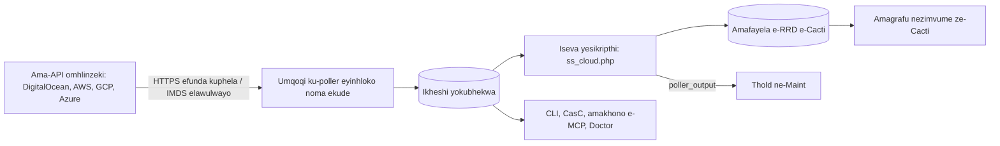

<!-- Source: README.md; SHA256: ac2074a40238686915802803c5efe773f33677f934281e0605e6e87a71a9d27d -->

<!-- translations:start -->
[English](../../../README.md) | [简体中文](../zh-CN/README.md) | [हिन्दी](../hi-IN/README.md) | [Español (España)](../es-ES/README.md) | [Español (Latinoamérica)](../es-419/README.md) | [العربية (السعودية)](../ar-SA/README.md) | [Afrikaans](../af-ZA/README.md) | [አማርኛ](../am-ET/README.md) | [العربية (مصر)](../ar-EG/README.md) | [العربية (المغرب)](../ar-MA/README.md) | [বাংলা](../bn-BD/README.md) | [Bosanski](../bs-BA/README.md) | [Deutsch](../de-DE/README.md) | [فارسی](../fa-IR/README.md) | [Filipino](../fil-PH/README.md) | [Français](../fr-FR/README.md) | [Français (Maroc)](../fr-MA/README.md) | [Français (Sénégal)](../fr-SN/README.md) | [Hausa](../ha-NG/README.md) | [עברית](../he-IL/README.md) | [Hrvatski](../hr-HR/README.md) | [Bahasa Indonesia](../id-ID/README.md) | [Igbo](../ig-NG/README.md) | [Italiano](../it-IT/README.md) | [日本語](../ja-JP/README.md) | [한국어](../ko-KR/README.md) | [Malagasy](../mg-MG/README.md) | [मराठी](../mr-IN/README.md) | [Bahasa Melayu](../ms-MY/README.md) | [Nederlands](../nl-NL/README.md) | [Polski](../pl-PL/README.md) | [Português (Brasil)](../pt-BR/README.md) | [Русский](../ru-RU/README.md) | [Kinyarwanda](../rw-RW/README.md) | [Soomaali](../so-SO/README.md) | [Српски](../sr-RS/README.md) | [Svenska](../sv-SE/README.md) | [Kiswahili](../sw-KE/README.md) | [தமிழ்](../ta-IN/README.md) | [తెలుగు](../te-IN/README.md) | [ไทย](../th-TH/README.md) | [Türkçe](../tr-TR/README.md) | [Українська](../uk-UA/README.md) | [اردو](../ur-PK/README.md) | [Tiếng Việt](../vi-VN/README.md) | [isiXhosa](../xh-ZA/README.md) | [Yorùbá](../yo-NG/README.md) | [繁體中文](../zh-TW/README.md) | [isiZulu](README.md)
<!-- translations:end -->

# plugin_cloud

I-plugin ye-Cacti 1.2 eletha izinsiza namamethrikhi avela kubahlinzeki befu lomphakathi ku-Cacti njengamadivayisi ajwayelekile, imithombo yedatha, namagrafu. Imithwalo yomsebenzi wefu ihlala eduze kwenethiwekhi eyithwalayo, ngaphansi kwezimvume ze-Cacti, futhi i-Thold ne-Maint zixwayisa ngayo futhi ziyicindezele. I-plugin eyodwa ihlanganisa i-DigitalOcean, i-Amazon Web Services, i-Google Cloud, ne-Microsoft Azure ngabashayeli babahlinzeki be-PHP emsulwa abafunda kuphela.

> **Isimo: isathuthukiswa, akukho ukukhishwa okwamanje (`0.1.0-dev`).** Leli gatsha lisebenzisa abashayeli be-PHP emsulwa be-DigitalOcean, i-AWS, i-Google Cloud, ne-Azure, ukuphindaphinda komqoqi wedatha okude kanye nempilo yomeleli efunda kuphela, umhlinzeki we-CasC ne-CLI yomqhubi, amakhono e-MCP, nokuhlola kwe-Doctor. Izifanekiso ze-Cacti ezikhishiwe okwamanje zihlanganisa ama-DigitalOcean Droplet nama-load balancer (`templates/cloud_digitalocean.xml`); amaphakheji ezifanekiso ze-Cacti e-AWS, i-Google Cloud, ne-Azure kanye nokufaneleka kwe-akhawunti ephilayo ngale kwe-DigitalOcean ([amaqiniso omhlinzeki](../../research/provider-facts.md)) akukapheli. Ungayisebenzisi ekukhiqizeni.

## Abahlinzeki abasekelwayo

Umshayeli ngamunye womhlinzeki ubhaliswe ku-`Drivers::production()`, uhlinzekwa yi-`Provider::released()`, futhi usebenza nge-PHP emsulwa esebenzisa i-`ext-openssl` namasokhethi okusakaza ngaphandle kwe-SDK noma izinto ezincike esikhathini sokusebenza ze-Composer.

| Umhlinzeki | Izinkambu zobubanzi | Imithombo yezifakazelo | Ukuqinisekisa | Izinsiza ezitholiwe | Ukuqoqwa kwamamethrikhi |
|---|---|---|---|---|---|
| DigitalOcean (`digitalocean`) | Akukho (okwenziwe ububanzi bethokheni) | `vault`, `file` | Bearer token | `droplet`, `load_balancer` | `/v2/monitoring/metrics` enolwazi lwesabelo somkhawulo wezinga; iza nezifanekiso ze-Cacti nemibuzo yedatha |
| Amazon Web Services (`aws`) | `account_id` (amadijithi ayi-12), `regions` | `vault`, `file`, `instance` | I-AWS SigV4 ye-PHP emsulwa (`AWS4-HMAC-SHA256`), ukuqinisekiswa kwe-STS `GetCallerIdentity`, i-STS `AssumeRole` ekhethekayo, i-EC2 IMDSv2 (`169.254.169.254`) yama-akhawunti e-`instance` | `ec2_instance`, `rds_instance`, `aws_elb` (ALB/NLB) | I-CloudWatch `GetMetricData` ehlanganisiwe (kuze kube yimibuzo eyi-500 ngocingo ngalunye) |
| Google Cloud (`gcp`) | `project` | `vault`, `file`, `instance` | I-JWT ye-akhawunti yesevisi ye-RS256 ye-PHP emsulwa nge-`ext-openssl` eshintshaniswa ku-`oauth2.googleapis.com/token`, noma iseva ye-metadata ye-GCE (`metadata.google.internal`) yama-akhawunti e-`instance` | `gce_instance` nge-`instances.aggregatedList` | Cloud Monitoring `timeSeries.list` |
| Microsoft Azure (`azure`) | `tenant`, `subscription`, `regions` | `vault`, `file`, `instance` | Ukugeleza kwezifakazelo zeklayenti ze-Entra ID OAuth2 ye-PHP emsulwa (`client_secret` kuphela; iziqinisekiso zezitifiketi azifakiwe), noma ubunikazi obuphathwayo be-Azure IMDS (`169.254.169.254`) bamathokheni e-ARM ne-Monitor | `azure_vm` nge-ARM Resource Graph (enamakhasi nge-`$skipToken` futhi isuswe izimpinda) | Azure Monitor `metrics:getBatch` (kuze kube yizinsiza eziyi-50 ngocingo ngalunye, iphatha ukubanjwa kwe-HTTP 429 ne-529) |

## Amakhono asetshenzisiwe

### Inkundla eyinhloko, indlu yezimfihlo, nomqoqi

- **Ukufaka nomjikelezo wempilo ovikelekile.** Izindawo zokungena (`setup.php`, `cli/cloud.php`, `poller_cloud.php`, `ss_cloud.php`, nemibhalo yamakhasi) ziyahlaziywa ku-PHP 8.0 futhi zenqabe i-PHP engaphansi kwe-8.2 noma ukuntuleka kwe-`ext-openssl` ngaphandle kokuphazamisa i-Cacti. Ukuthuthukiswa kuhlelekile, akuguquki uma kuphindwa (`Schema::VERSION = 3`, amathebula ayi-9), futhi kuyamelana nokuphazamiseka. Ukukhipha kugcina amathebula e-plugin ngaphandle uma i-*Keep Plugin Tables on Uninstall* isuliwe.
- **Ama-akhawunti nezifakazelo.** Engeza, hlela, qinisekisa, futhi ususe ama-akhawunti ngaphansi kwe-**Management > Cloud Accounts**. Izifakazelo zivela endlini ebethelwe ye-AES-256-GCM (`plugin_cloud_secret`, ekhiywe nge-`/etc/cacti/cloud-vault.key` ngokuzenzakalelayo), efayeleni elikhawulelwe ngaphakathi kwe-*Credential File Directory* elungiselelwe (`cloud_credential_dir`, engenalutho ngokuzenzakalelayo ukuze yenqabe amafayela), noma kubunikazi besibonelo somhlinzeki. Izifakazelo zezokubhala kuphela ku-UI futhi ziyasuswa kumalogi.
- **Ukulawula okuqinile kokuphumayo nokufunda kuphela.** Umshayeli ngamunye usebenza ngemuva kwe-`GuardedTransport` ne-`OutboundPolicy`: imbobo ye-HTTPS 443 eya emagameni omabungazi aqondile omhlinzeki ngamunye, kanye nezindawo zokugcina ze-metadata ye-HTTP yesixhumanisi sendawo imbobo 80 (`169.254.169.254`, `metadata.google.internal`) ezivulelwe ama-akhawunti e-`instance` kuphela. Imisebenzi yokufunda kuphela esohlwini oluvunyelwe kuphela evunyelwe.
- **Umqoqi nokulawula izindleko.** I-`poller_cloud.php` isebenza isuka ku-`poller_bottom` (inqubo eyodwa nge-poller ngayinye ngerejista yenqubo ye-Cacti) ngaphakathi kwe-`cloud_collector_budget`, ithola ukuqashwa kwe-akhawunti ngayinye, iqhuba ukutholakala ku-`discover_interval`, ifunda amamethrikhi emithombo yedatha ye-Cacti esebenzayo kuphela (`plugin_cloud_series`), ihlonipha i-`request_share` ne-`monthly_ceiling`, futhi igcina amaphuzu edatha akamuva ku-`plugin_cloud_observation` ye-`ss_cloud.php`.
- **Izinto ze-Cacti nezilinganiso zezicelo.** Igcina idivayisi yobubanzi nge-akhawunti ngayinye (`plugin_cloud_device`), ivikela izindlela zokwenza inkomba kabusha zedivayisi yobubanzi ekulondolozeni amadivayisi, ingenisa izifanekiso ze-DigitalOcean nemibuzo yedatha yeseva yesikripthi (`templates/cloud_digitalocean.xml`, `cloud_do_droplet.xml`, `cloud_do_load_balancer.xml`), futhi ibonisa izilinganiso zezicelo nezamanani ohlu ku-**New Graphs** (`graphs_new_top_links`) naku-**Cloud Health**.

### Abaqoqi bedatha abakude

- I-`INFO` imemezela `remote_collect:1`. Ama-akhawunti anganikezwa kunoma iyiphi i-Cacti poller enikwe amandla (`poller_id >= 1`), futhi i-`poller_cloud.php --poller=N` iqoqa ama-akhawunti angawe-poller leyo kuphela.
- **I-hook ye-`replicate_out`.** Iphindaphinda imigqa yobubanzi be-poller evela ku-`plugin_cloud_account`, `plugin_cloud_device`, `plugin_cloud_series`, kanye nemigqa ye-ciphertext ebethelwe evela ku-`plugin_cloud_secret` (kuphela kuma-akhawunti asekelwa yindlu yezimfihlo angawe-poller eqondiwe) nge-`replicate_out_table()`. Amafayela okhiye abaluhlaza endlu yezimfihlo awalokothi agcinwe kusizindalwazi noma aphindaphindwe futhi ahlala endaweni ku-poller ngayinye.
- **I-hook ye-`remote_agent`.** Iveza isifinyezo sempilo se-JSON esifunda kuphela (`action=cloud_health`) esamukela kuphela amapharamitha enani eliphelele le-`poller_id` ne-`account_id` futhi sibuyisela iqanda lezifakazelo, izindlela zamafayela, noma izimfihlo.

### Ama-hook ohlelo lwemvelo (CasC, amakhono e-MCP, ne-Doctor)

- **Umhlinzeki we-CasC (`casc_register_providers`).** Ubhalisa umhlinzeki we-`cloud` (inguqulo yesikima `1`) ngokuthumela ngaphandle kwe-YAML ne-XML ye-PHP emsulwa eqinisekile, ukuqinisekiswa kwe-manifest, ukuhlela umehluko, nokusebenzisa okuqinisekisiwe. Izifakazelo zendlu yezimfihlo zithunyelwa ngaphandle njengezinkomba ze-`vault:account:<name>`; izinkambu zezimfihlo eziluhlaza (`secret`, `secrets`, `token`, `access_token`, `refresh_token`, `password`, `private_key`, `access_key_id`, `secret_access_key`, `session_token`, `client_secret`, `credential`, `credentials`, `vault_key`) ziyenqatshwa. Ukusebenzisa kudinga i-SHA-256 eqondile ye-`--confirm=<PLAN_HASH>`.
- **I-MCP / Abilities API (`abilities_register`).** Ibhalisa amakhono amathathu afunda kuphela ngokuqinile avalelwe esigabeni se-Cloud View (`cloud_health.php`) nasobubanzini bedivayisi ye-Cacti kubashayeli abangewona abalawuli, engakhiphi zifakazelo, okhiye bendlu yezimfihlo, noma izindlela zamafayela ezifakazelo:
  - `cloud-list-accounts` (i-`provider`, `poller_id` ekhethekayo)
  - `cloud-list-resources` (i-`account_id`, `type`, `lifecycle` ekhethekayo)
  - `cloud-get-health` (i-`account_id` ekhethekayo)
- **Ukuhlola kwe-Doctor (`doctor_register_checks`).** Kubhalisa ukuhlola okuhlanu kokuxilonga okungavezi amanani ezimfihlo noma izinto zokhiye:
  - `cloud_schema`: ukuhambisana kwenguqulo yesikima nesikhathi samanje
  - `cloud_vault_key`: ukufundeka kwefayela lokhiye wendlu yezimfihlo, izimvume, nobukhulu
  - `cloud_drivers`: ukubhaliswa komshayeli wokukhiqiza kubo bonke abahlinzeki abakhishiwe
  - `cloud_accounts_health`: ama-akhawunti anikwe amandla ahlulekile, abanjiwe, noma amadala
  - `cloud_poller_intervals`: ukulungelelaniswa kwezikhathi zokuqoqa zama-akhawunti anikwe amandla nesikhathi se-poller ye-Cacti

## I-CLI

Sebenzisa usuka kuhla lwemibhalo oluyimpande lwe-Cacti nge-PHP 8.2 noma kamva:

```sh
# Operator and CasC CLI (options use --key=value form)
php plugins/cloud/cli/cloud.php export [--format=yaml|xml]
php plugins/cloud/cli/cloud.php validate --file=<path> [--format=yaml|xml]
php plugins/cloud/cli/cloud.php plan --file=<path> [--format=yaml|xml]
php plugins/cloud/cli/cloud.php apply --file=<path> --confirm=<PLAN_HASH> [--format=yaml|xml]
php plugins/cloud/cli/cloud.php health [--format=text|json] [--poller=<id>]

# Collector entry point (normally started by poller_bottom)
php plugins/cloud/poller_cloud.php [--poller=N] [--force] [--debug]
```

## Izindima zokufinyelela

| Isigaba | Ukufinyelela |
| --- | --- |
| Cloud View | Amakhasi okugada akhona. |
| Cloud Operator | Ukugada kanye nekhasi leMisebenzi nokuvuma kokuhlunga komuntu siqu. |
| Cloud Admin | Ukufinyelela kwe-Operator kanye nokulungiselelwa okukhona nezenzo zokuphatha. |

Ngemva kokukopisha amafayela okuthuthukisa, vula ikhasi le-Plugins njengomlawuli ukuze ubhalise izigaba. Nika isigaba se-Operator ngokucacile ngaphansi kwe-**Configuration > Users** noma amaqembu abasebenzisi. Ukuthuthukiswa kugcina ama-ID nezinikezelo zezigaba ze-View ne-Admin ezikhona. Ukufinyelela kwe-Admin kuzuza ifa lokufinyelela kwe-Operator, futhi ukufinyelela kwe-Operator kuzuza ifa lokufinyelela kwe-View esicelweni ngasinye; lokhu akungezi izinikezelo ezigciniwe kubasebenzisi noma kumaqembu. Izilungiselelo ze-plugin nazo zidinga ukufinyelela kwe-Cloud Admin ngaphezu kwemvume ye-Settings ye-Cacti.

Izimvume zedivayisi ye-Cacti zikhawulela imigqa nezenzo ezitholakalayo kumsebenzisi ngamunye; izinto ezingamephiwe zidinga umlawuli. Abasebenzisi bangaqinisekisa isifakazelo esigciniwe se-akhawunti abangafinyelela idivayisi yayo ye-Cacti. Izifakazelo, ukulungiselelwa, ukumepha, ukususa, nolunye ushintsho lokuphatha kuhlala emakhasini okuphatha. Ukuvuma kuhlala kuseshini yomsebenzisi yamanje kuphela, isikhathi esingaphezu kwehora elilodwa kuphela futhi kuphela uma ukubhekwa okufanayo kusalokhu kukusha. Ukubhekwa okusha noma okushintshile kuyakwenza kungasebenzi. Akulokothi kuphawule ukulinganisa okuhlulekile njengokunempilo noma kucindezele izexwayiso.

## Kungani

Umhlinzeki ngamunye wefu unekhonsoli yakhe yokugada. Uma zisebenza eceleni kwe-Cacti, zishiya izikhala ezintathu:

- **Ukulawula ukufinyelela okuhlukile.** Ukubonisa umsebenzisi we-Cacti amamethrikhi efu kusho ukumnika ukungena efwini.
- **Akukho mongo yenethiwekhi.** Izixhumanisi zasendaweni zenziwa igrafu ku-Cacti; imithwalo yomsebenzi engemuva kwazo yenziwa igrafu kukhonsoli yomhlinzeki ngamunye.
- **Ukuxwayisa okuhlukile.** I-Thold ne-Maint zisebenza emithonjeni yedatha nasemadivayisini e-Cacti, ngakho-ke ama-alamu omhlinzeki alungiselelwa futhi acindezelwe ngokwehlukana, kanye ngomhlinzeki ngamunye.

I-plugin ifunda i-API yokugada yomhlinzeki ngamunye ku-poller ye-Cacti, igcine amaphuzu edatha akamuva kwikheshi, futhi iwahambise kuseva yesikripthi ye-Cacti. I-poller ye-Cacti ibhala amafayela e-RRD, ngakho ukudweba amagrafu, izimvume, i-Thold, i-Maint, ne-boost kusebenza njengakunanoma iyiphi enye idatha ye-Cacti.

## Izibopho zokuklama

- **Funda kuphela.** Umshayeli ngamunye angakha kuphela imisebenzi yomhlinzeki esohlwini lwakhe oluvunyelwe; i-plugin ayilokothi ishintshe insiza yefu. ([ADR 0002](../../decisions/0002-read-only-with-operation-allowlist.md))
- **I-PHP kuphela, azikho i-SDK.** Ukusayina nokushintshaniswa kwamathokheni kusetshenziswa ku-PHP ngezandiso i-Cacti esezidinga kakade. Azikho izinto ezincike esikhathini sokusebenza ze-Composer. ([ADR 0003](../../decisions/0003-php-only-without-sdks.md))
- **Izindleko ngaphambi kokuqoqa.** I-plugin ifunda kuphela amamethrikhi anomthombo wedatha we-Cacti, ibonise isibalo esilindelwe sezicelo nezindleko zamanani ohlu ngaphambi kokudala amagrafu, futhi iphoqelele umkhawulo wenyanga. ([ADR 0005](../../decisions/0005-collect-only-what-is-graphed.md))
- **Azikho izifakazelo zombhalo osobala kusizindalwazi.** Izifakazelo zivela endlini ebethelwe ekhiywe ngefayela elingaphandle kwesizindalwazi, efayeleni lezifakazelo, noma kubunikazi besibonelo somhlinzeki. ([ADR 0007](../../decisions/0007-credentials-outside-the-database-in-the-clear.md))

## Ububanzi nesimo

| Isigaba | Ububanzi | Izingqopha-mlando | Isimo |
|---|---|---|---|
| 0, ucwaningo | Ukuqinisekiswa kwamaqiniso omhlinzeki, izinhlu zamamethrikhi, imodeli yezindleko nezinga, ama-vector okuhlola ukusayina, uvavanyo lokuhambisa | [M1](https://github.com/somethingwithproof/plugin_cloud/milestone/1) | Kuqediwe, ngaphandle kokuhlola okudinga ama-akhawunti abahlinzeki aphilayo |
| 1, umgogodla ne-DigitalOcean | Ama-akhawunti, indlu yezifakazelo, ukuthutha, umqoqi, ikheshi yokubhekwa, izinto ze-Cacti, izifanekiso, izilinganiso zezicelo, ikhasi lempilo, ama-DigitalOcean Droplets nama-load balancer | [M2](https://github.com/somethingwithproof/plugin_cloud/milestone/2), [M3](https://github.com/somethingwithproof/plugin_cloud/milestone/3), [M4](https://github.com/somethingwithproof/plugin_cloud/milestone/4) | Kusetshenzisiwe; ukufaneleka kokuhlolwa kwe-M4 kulindile |
| 2, AWS | I-SigV4 ye-PHP emsulwa, i-STS `AssumeRole`, izindima zesibonelo ze-IMDSv2, uhlu lwe-EC2/RDS/ELB, i-CloudWatch `GetMetricData` | [M5](https://github.com/somethingwithproof/plugin_cloud/milestone/5) | Umshayeli usetshenzisiwe; izifanekiso ze-Cacti nokufaneleka kwe-akhawunti ephilayo kulindile |
| 3, Google Cloud | I-JWT ye-akhawunti yesevisi ye-RS256 ye-PHP emsulwa, iseva ye-metadata ye-GCE, uhlu lwe-Compute Engine, i-Cloud Monitoring `timeSeries.list` | [M6](https://github.com/somethingwithproof/plugin_cloud/milestone/6) | Umshayeli usetshenzisiwe; izifanekiso ze-Cacti nokufaneleka kwe-akhawunti ephilayo kulindile |
| 4, Azure | Izifakazelo zeklayenti ze-Entra ID, ubunikazi obuphathwayo be-IMDS, uhlu lwe-VM lwe-ARM Resource Graph, i-Azure Monitor `metrics:getBatch` | [M7](https://github.com/somethingwithproof/plugin_cloud/milestone/7) | Umshayeli usetshenzisiwe; izifanekiso ze-Cacti nokufaneleka kwe-akhawunti ephilayo kulindile |
| 5, abaqoqi abakude nohlelo lwemvelo | Abaqoqi bedatha abakude (`replicate_out`, `remote_agent`), umhlinzeki we-CasC ne-CLI, amakhono e-MCP, ukuhlola kwe-Doctor | [M8](https://github.com/somethingwithproof/plugin_cloud/milestone/8) | Kusetshenzisiwe |

Okungaphandle kobubanzi: ukushintsha izinsiza zefu, ukudala noma ukufanisa ama-alamu omhlinzeki, imibiko yokukhokhisa, amalogi nemikhondo, kanye nenjini yokuxwayisa ephethwe yi-plugin. Abanye abahlinzeki (i-Hetzner Cloud, i-Akamai Cloud, i-Oracle Cloud, nabanye) bayizinkinga zocwaningo.

## Faka futhi ulungiselele

Lezi zinyathelo zifaka ikhodi yokuthuthukisa ukuze ihlolwe. Zidinga i-Cacti 1.2.31 noma kamva ku-PHP 8.2 noma kamva.

1. Kopisha indawo yokugcina ku-`plugins/cloud` ngaphansi kohla lwakho lwemibhalo lwe-Cacti. Uhla lwemibhalo kufanele lubizwe ngokuthi `cloud`.
2. Dala ukhiye wendlu yezimfihlo ngaphandle kwempande yewebhu ku-poller ngayinye esebenzisa izifakazelo ezisekelwa yindlu yezimfihlo. Wubeke kuhla lwemibhalo lapho kuphela i-root nomsebenzisi we-Cacti abangabhala khona, futhi wenze ifayela lifundeke kuphela ngumsebenzisi osebenzisa iseva yewebhu ne-poller. I-plugin ayilokothi idale noma ibhale leli fayela:

   ```sh
   sudo install -d -m 0750 -o root -g cacti /etc/cacti
   head -c 32 /dev/urandom | sudo tee /etc/cacti/cloud-vault.key > /dev/null
   sudo chown cacti:cacti /etc/cacti/cloud-vault.key
   sudo chmod 0600 /etc/cacti/cloud-vault.key
   ```

   Faka esikhundleni se-`cacti` umsebenzisi osebenzisa iseva yakho yewebhu ne-poller. Leli fayela liqukethe ama-byte aluhlaza ayi-32 noma izinhlamvu ze-hexadecimal ezingama-64. Yigcine ikhophi kanye nesizindalwazi; ngaphandle kwayo, izifakazelo ezigciniwe kufanele zifakwe kabusha.
3. Ku-Cacti, vula **Configuration > Plugins**, bese ufaka futhi uvule i-*Cloud*.
4. Ngaphansi kwe-**Configuration > Settings > Cloud**, setha *Vault Key File* uma usebenzise enye indlela, lungiselela *Credential File Directory* uma uhlela ukusebenzisa izifakazelo ezisekelwe efayeleni, futhi ugcine *Collector Time Budget* (okuzenzakalelayo imizuzwana engama-240) ingaphansi kwesikhathi se-poller.
5. Nika *Cloud Admin*, *Cloud Operator*, noma *Cloud View* kubasebenzisi nasemaqenjini ngaphansi kwe-**Configuration > Users**. Ukufaka kunikeza umlawuli i-Cloud Admin ne-Cloud View; i-Cloud Admin ihlanganisa ukufinyelela kwe-Operator, ngakho umlawuli akadingi isinikezelo esihlukile se-Operator.
6. Engeza ama-akhawunti ngaphansi kwe-**Management > Cloud Accounts**, bese uhlola **Management > Cloud Health** ngezexwayiso.

## Izinjongo zokuhambisana

| Ingxenye | Injongo |
|---|---|
| Cacti | 1.2.31 noma kamva, azikho iziqeshana eziyinhloko |
| PHP | 8.2 noma kamva; izindawo zokungena zihlala zihlaziya ku-8.0 ukuze isikhathi sokusebenza esingasekelwe sithole ukwenqatshwa esikhundleni se-UI ye-Cacti ephukile |
| Izandiso ze-PHP | `ext-openssl` (edingwa yi-Cacti 1.2.31); akukho `ext-curl` futhi azikho izinto ezincike esikhathini sokusebenza ze-Composer |
| Thold, Maint | Alukho ushintsho oludingekayo |

## Ukuklama

- I-[docs/performance.md](../../performance.md) inezilinganiso zomqoqi nekhasi lempilo, kanye nehadiwe nezilungiselelo ezisetshenzisiwe.
- I-[docs/PLAN.md](../../PLAN.md) iyisu eliphelele: ukwakhiwa, amaqiniso omhlinzeki ne-Cacti encike kuwo (nemithombo), inkontileka yomshayeli, izibalo zezindleko, imingcele yokuphepha, ukuhlolwa, nobungozi.
- I-[docs/decisions/](../../decisions/) igcina amarekhodi ezinqumo zokwakhiwa zokukhetha osekuvele kwenziwe.
- I-[docs/REQUIREMENTS.md](../../REQUIREMENTS.md) imepha i-ID yemfuneko ngayinye enkingeni yayo.



## Indlela umsebenzi olandelelwa ngayo

- **Izingqopha-mlando** zilandela izingqopha-mlando zesu. Ngayinye inenkinga enkulu (epic) efaka uhlu lwezinkinga zayo ezingaphansi nobufakazi bokuphuma.
- **Izinkinga** zihlukaniswa ngelebuli: `type: requirement`, `type: research`, `type: decision`, `type: epic`. Izinkinga zezimfuneko zisho izimfuneko ezinenombolo ezihlolekayo (`REQ-AREA-NNN`) nemibandela yokwamukela.
- **Amalebula** aphinde aphathe `area:`, `provider:`, `phase:`, `priority:`, ne-`status:`. Bheka i-[CONTRIBUTING.md](../../../CONTRIBUTING.md#labels).
- I-[bhodi lephrojekthi](https://github.com/users/somethingwithproof/projects/7) ibonisa zonke izinkinga kuzo zonke izingqopha-mlando.

## Ukuthuthukisa

I-CI ([.github/workflows/plugin-ci-workflow.yml](../../../.github/workflows/plugin-ci-workflow.yml)) ihlola ingobo yomlando yokukhishwa nenguqulo enencazelo (`bash tests/bin/archive-check.sh`), ihlola izindawo zokungena ku-PHP 8.0, isebenzisa ukuhlolwa kweyunithi ye-Pest (`phpunit.xml`) nokuhlanganiswa komjikelezo wempilo (`phpunit-integration.xml`) kanye ne-PHPStan ezingeni le-9 ku-PHP 8.2 kuya ku-8.5 ngokumelene ne-Cacti `release/1.2.31` ne-`1.2.x` nge-`CLOUD_OFFLINE=1`, ihlola ukwenqatshwa ku-PHP 8.1, iqinisekisa amakhathalogi e-gettext, ilinganisa ukusebenza kokuqoqwa kwezinhlelo eziyi-1,000 nekhasi lempilo, futhi isebenzisa ukuhlolwa kokugeleza komsebenzi nokuthobela i-REUSE.

Ukuhlola kwendawo ngaphambi kokuphusha:

```sh
bash tests/bin/archive-check.sh
sh tests/lint-workflows.sh
sh locales/build_gettext.sh --check
CACTI_PATH=/path/to/cacti phpstan analyse -c phpstan.neon --no-progress
```

Sebenzisa i-Pest nge-`--configuration=phpunit.xml` ukuhlola kweyunithi nemithetho yomthombo, noma `--configuration=phpunit-integration.xml` nge-`CACTI_PATH` ne-`CLOUD_TEST_DATABASE=disposable` ngokumelene nesizindalwazi se-Cacti esilahlwayo ukuhlola ukuhlanganiswa komjikelezo wempilo.

## Ukunikela

Funda i-[CONTRIBUTING.md](../../../CONTRIBUTING.md). Ama-commit adinga ukusayinwa kwe-DCO. Ingxoxo yokuklama yenzeka ezinkingeni; izinqumo ezivulekile zithwala ilebuli ye-`type: decision`.

## Ukuphepha

Bika ubuthakathaka ngasese; bheka i-[SECURITY.md](../../../SECURITY.md).

## Ilayisensi

GNU General Public License v2.0, ilayisensi efanayo neye-Cacti nama-plugin ayo. Bheka i-[LICENSE](../../../LICENSE).
